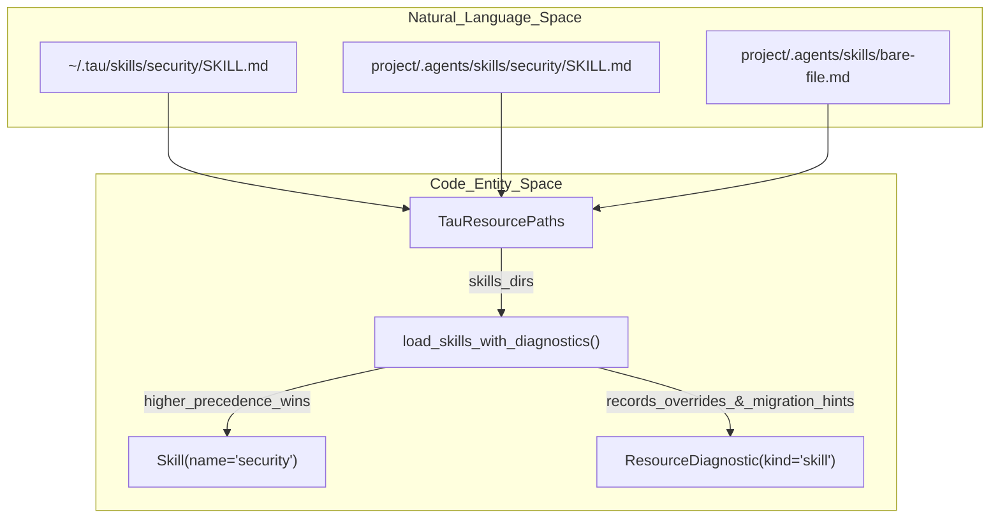
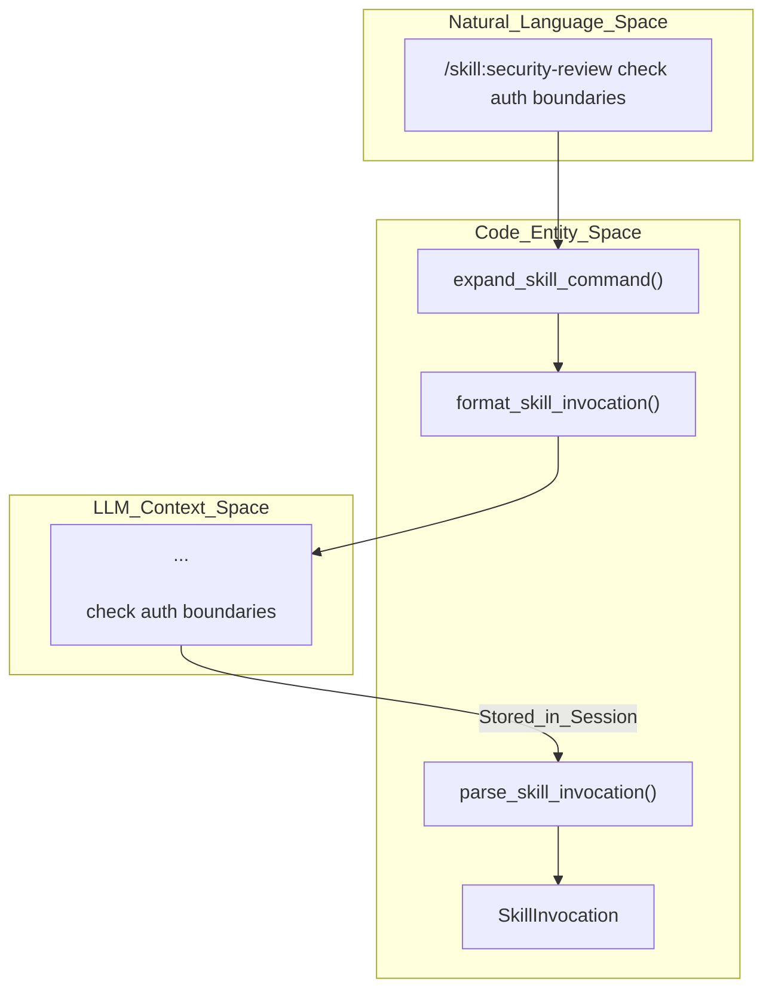

<!-- source: DeepWiki mcp.deepwiki.com · repo huggingface/tau · page 6.1 Skills · fetched 2026-10-26 -->

# Skills

<details>
<summary>Relevant source files</summary>

The following files were used as context for generating this wiki page:

- [dev-notes/architecture/phase-9-skills-prompts.md](dev-notes/architecture/phase-9-skills-prompts.md)
- [src/tau_coding/data/docs/skills.md](src/tau_coding/data/docs/skills.md)
- [src/tau_coding/prompt_templates.py](src/tau_coding/prompt_templates.py)
- [src/tau_coding/skills.py](src/tau_coding/skills.py)
- [tests/test_prompt_templates.py](tests/test_prompt_templates.py)
- [tests/test_skills.py](tests/test_skills.py)
- [website/content/guides/skills-and-prompts.md](website/content/guides/skills-and-prompts.md)

</details>


This page explains Tau's skill resource system, detailing how task-specific knowledge instructions are represented via the `Skill` dataclass, discovered and loaded from disk, expanded via `/skill:<name>` commands, and indexed for automatic LLM discovery in the system prompt [website/content/guides/skills-and-prompts.md:6-8]().

---

## 1. The Skill Dataclass and YAML Frontmatter

The core internal representation of a loaded skill is the `Skill` dataclass defined in `src/tau_coding/skills.py` [src/tau_coding/skills.py:19-28](). It encapsulates the skill's identifier name, its absolute file path, its raw markdown content, an optional description, and a boolean flag determining whether the skill can be invoked autonomously by the model [src/tau_coding/skills.py:19-28]().

```python
@dataclass(frozen=True, slots=True)
class Skill:
    """A markdown skill resource."""

    name: str
    path: Path
    content: str
    description: str | None = None
    disable_model_invocation: bool = False
```

### YAML Frontmatter and Metadata
Skills support optional YAML frontmatter for metadata configuration [src/tau_coding/resources.py:255-284](). The parser extracts keys such as `description` and `disable-model-invocation` [website/content/guides/skills-and-prompts.md:42-43](). If no explicit description is supplied in the frontmatter, Tau invokes `derive_description` to automatically derive one from the first markdown heading or paragraph [src/tau_coding/resources.py:286-295]().

**Example Skill File (`~/.tau/skills/security-review/SKILL.md`):**
```markdown
---
description: Review a diff for security issues.
disable-model-invocation: false
---
# Security Review
Steps to review the current diff for security problems...
```

**Hiding a Skill from the Model:** Setting `disable-model-invocation: true` in the frontmatter excludes the skill from the system prompt's skill index [src/tau_coding/skills.py:151](). While the model cannot discover or invoke it autonomously, users can still trigger it explicitly using `/skill:<name>` or via the `/skills` command picker [website/content/guides/skills-and-prompts.md:102-107]().

Sources: [src/tau_coding/skills.py:19-28](), [src/tau_coding/skills.py:151](), [src/tau_coding/resources.py:255-295](), [website/content/guides/skills-and-prompts.md:42-47](), [website/content/guides/skills-and-prompts.md:102-107]()

---

## 2. Discovery and Loading

Skills are discovered across user and project directories using a precedence-based search strategy implemented in `load_skills()` and `load_skills_with_diagnostics()` [src/tau_coding/skills.py:45-91]().

### Directory Precedence
The `TauResourcePaths.skills_dirs` property defines the search order, where later resource directories override earlier ones on name collisions [src/tau_coding/resources.py:84-102]():
1. User Tau: `~/.tau/skills/`
2. User Agents: `~/.agents/skills/`
3. Project Tau: `<cwd>/.tau/skills/`
4. Project Agents: `<cwd>/.agents/skills/`

Only the `skills/` subdirectory beneath a Tau or agents root is scanned; root-level files are ignored [src/tau_coding/resources.py:87-90](). Furthermore, Tau strictly follows the Agent Skills specification by requiring each skill to reside in a dedicated subdirectory containing a `SKILL.md` file [src/tau_coding/skills.py:179-183]().

### Diagnostics and Bare `.md` Migration
The `load_skills_with_diagnostics()` function processes each directory and yields both the canonicalized list of `Skill` objects and a collection of `ResourceDiagnostic` records [src/tau_coding/skills.py:62-91](). 
* **Overrides:** When a project-local skill replaces a user-level skill with the same name, a diagnostic is recorded [src/tau_coding/skills.py:78-88]().
* **Bare File Hints:** Bare `.md` files at the root of a skills directory (e.g., `~/.tau/skills/review.md`) are skipped and trigger an informational diagnostic detailing how to migrate them into `review/SKILL.md` subdirectories [src/tau_coding/skills.py:198-212](), [tests/test_skills.py:122-147]().

### Diagram: Skill Discovery and Precedence Flow



Sources: [src/tau_coding/skills.py:45-91](), [src/tau_coding/skills.py:179-212](), [src/tau_coding/resources.py:84-102](), [tests/test_skills.py:122-147]()

---

## 3. Skill Invocation and Expansion

Skills can be invoked explicitly via user prompts or expanded automatically by the session orchestrator [website/content/guides/skills-and-prompts.md:79-88]().

### Explicit Expansion (`/skill:<name>`)
When prompt text starts with `/skill:`, `expand_skill_command()` parses the request, looks up the target skill by name, and delegates formatting to `format_skill_invocation()` [src/tau_coding/skills.py:94-114]().

```python
def format_skill_invocation(
    skill: Skill,
    additional_instructions: str | None = None,
) -> str:
    """Format a full skill invocation prompt."""
    skill_block = (
        f'<skill name="{skill.name}" location="{skill.path}">\n'
        f"References are relative to {skill.path.parent}.\n\n"
        f"{skill.content.strip()}\n"
        "</skill>"
    )
    if additional_instructions and additional_instructions.strip():
        return f"{skill_block}\n\n{additional_instructions.strip()}"
    return skill_block
```

### Parsing Invocations
The `parse_skill_invocation()` function and `SkillInvocation` dataclass allow Tau and its frontends to recognize expanded skill XML blocks in session histories [src/tau_coding/skills.py:35-43](), [src/tau_coding/skills.py:132-147]().

### Diagram: Skill Invocation Pipeline



Sources: [src/tau_coding/skills.py:35-43](), [src/tau_coding/skills.py:94-114](), [src/tau_coding/skills.py:116-130](), [src/tau_coding/skills.py:132-147]()

---

## 4. System Prompt Skill Index

To enable autonomous discovery, Tau constructs a concise index of all non-disabled skills using `build_skill_index()` [src/tau_coding/skills.py:149-159](). This summary is injected into the system prompt so the model can inspect available capabilities and decide when to reference them [website/content/guides/skills-and-prompts.md:79-80]().

```python
def build_skill_index(skills: Sequence[Skill]) -> str:
    """Build a concise index of available skills for future system prompt assembly."""
    visible_skills = [skill for skill in skills if not skill.disable_model_invocation]
    if not visible_skills:
        return "Available skills: none"
    lines = ["Available skills:"]
    for skill in sorted(visible_skills, key=lambda item: item.name):
        description = skill.description or "No description"
        lines.append(f"- {skill.name}: {description}")
    return "\n".join(lines)
```

Sources: [src/tau_coding/skills.py:149-159](), [website/content/guides/skills-and-prompts.md:79-80]()

---

