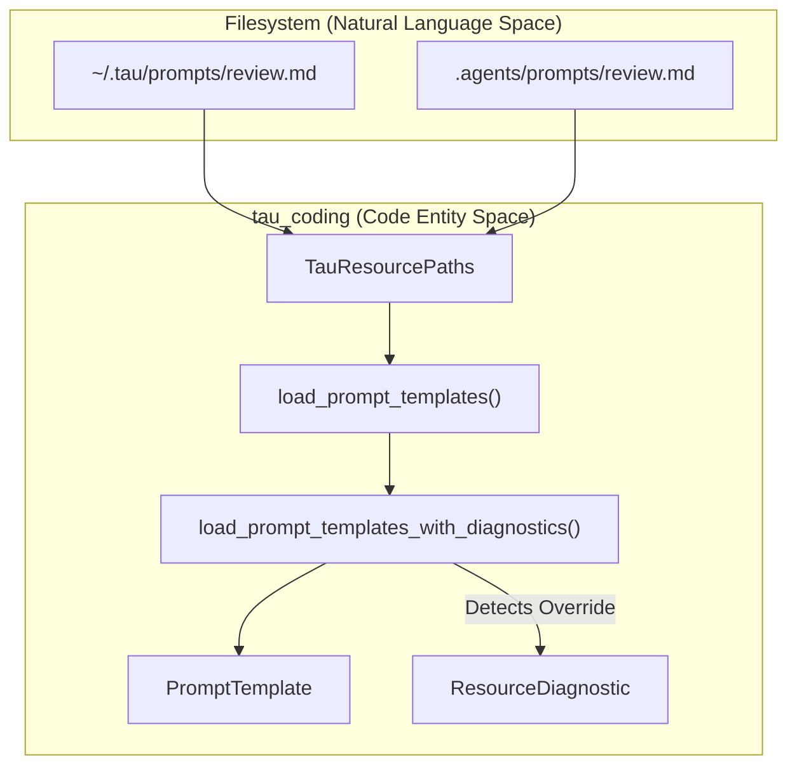
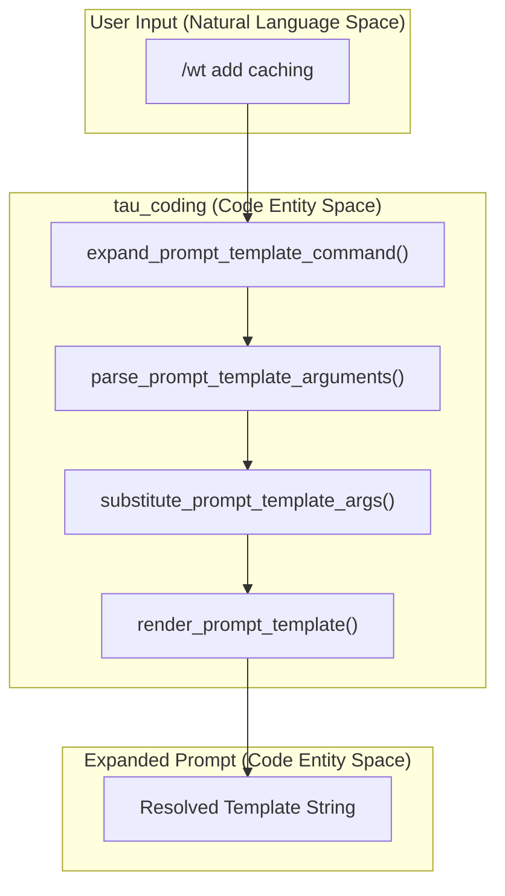

<!-- source: DeepWiki mcp.deepwiki.com · repo huggingface/tau · page 6.2 Prompt Templates · fetched 2026-10-26 -->

# Prompt Templates

Relevant source files

The following files were used as context for generating this wiki page:

- [dev-notes/architecture/phase-9-skills-prompts.md](dev-notes/architecture/phase-9-skills-prompts.md)
- [src/tau_coding/commands.py](src/tau_coding/commands.py)
- [src/tau_coding/data/docs/skills.md](src/tau_coding/data/docs/skills.md)
- [src/tau_coding/prompt_templates.py](src/tau_coding/prompt_templates.py)
- [src/tau_coding/skills.py](src/tau_coding/skills.py)
- [tests/test_commands.py](tests/test_commands.py)
- [tests/test_prompt_templates.py](tests/test_prompt_templates.py)
- [tests/test_skills.py](tests/test_skills.py)
- [website/content/guides/skills-and-prompts.md](website/content/guides/skills-and-prompts.md)

This page covers the implementation and data flow of prompt templates in Tau, detailing `PromptTemplate`, directory discovery, Pi-compatible argument substitution, `{{ variable }}` interpolation, slash-command expansion, and the TUI edit modal.

Sources: `[src/tau_coding/prompt_templates.py:1-186]`, `[website/content/guides/skills-and-prompts.md:121-167]`

## The PromptTemplate Dataclass and Candidate Rules

Prompt templates are represented by the `PromptTemplate` dataclass, defined in `src/tau_coding/prompt_templates.py`. Each template captures a parsed Markdown file's name (derived from its filename stem), absolute path, raw content, and description.

| Field | Type | Description |
| :--- | :--- | :--- |
| `name` | `str` | The filename stem (e.g., `review` for `review.md`). |
| `path` | `Path` | Absolute filesystem path to the source file. |
| `content` | `str` | Raw Markdown body (excluding frontmatter). |
| `description` | `str \| None` | Summary derived from YAML frontmatter or the first paragraph. |

The function `is_prompt_template_candidate()` validates that files have a `.md` extension and do not use reserved names (`prompts`, `skills`, `tools`, `reload`) defined in `_RESERVED_TEMPLATE_NAMES`.

Sources: `[src/tau_coding/prompt_templates.py:23-39]`, `[src/tau_coding/prompt_templates.py:127-128]`

## Resource Discovery and Precedence

Prompt templates are discovered across multiple directories defined in `TauResourcePaths`. The precedence order ensures project-level resources override user-level resources.

### Precedence Order (Low to High)
1.  **Global Tau Home:** `~/.tau/prompts/`
2.  **Global Agents Home:** `~/.agents/prompts/`
3.  **Project Tau Dir:** `<cwd>/.tau/prompts/`
4.  **Project Agents Dir:** `<cwd>/.agents/prompts/`

The `load_prompt_templates()` function iterates through these directories, maintaining a `templates_by_name` map where higher-precedence directories overwrite lower-precedence entries. The variant `load_prompt_templates_with_diagnostics()` detects name clashes and returns `ResourceDiagnostic` entries for non-fatal reporting.

Sources: `[website/content/guides/skills-and-prompts.md:22-29]`, `[src/tau_coding/prompt_templates.py:41-75]`, `[tests/test_prompt_templates.py:69-91]`

## Argument Parsing and Substitution

Tau supports two distinct interpolation mechanisms: Pi-compatible argument placeholders and `{{ variable }}` template variables.

### Pi-Compatible Argument Variables
Templates can declare argument expansions using Pi's syntax rules, handled by `substitute_prompt_template_args()` and parsed via `parse_prompt_template_arguments()`:
- **Positional:** `$1`, `$2`, ... for individual arguments.
- **Aggregate:** `$@` or `$ARGUMENTS` for all arguments joined with spaces.
- **Defaults:** `${1:-default}` or `${@:-default}`.
- **Slices:** `${@:N}` or `${@:N:L}` for argument slicing.

### Template Variables
`render_prompt_template()` evaluates `{{ variable }}` patterns against a provided dictionary mapping. By default, missing variables raise a `ResourceError`, but callers can specify a fallback `missing` string for forgiving rendering.

Sources: `[src/tau_coding/prompt_templates.py:18-21]`, `[src/tau_coding/prompt_templates.py:78-159]`, `[tests/test_prompt_templates.py:112-168]`

## Slash-Command Invocation and Expansion

When a user submits a prompt starting with `/<name> [arguments]`, `expand_prompt_template_command()` attempts translation:
1.  **Filtering:** Ignores non-slash strings, double slashes (`//`), or skill invocations (`/skill:`).
2.  **Parsing & Matching:** Splits the command name and argument payload, then locates the corresponding `PromptTemplate` by filename stem.
3.  **Substitution & Fallback:** Replaces argument placeholders (`$1`, `$@`, etc.). If a template contains no argument placeholders, the raw argument string is automatically appended after a blank line.

Sources: `[src/tau_coding/prompt_templates.py:161-186]`, `[tests/test_prompt_templates.py:131-185]`

## The Edit-Prompts Modal

In the TUI `/prompts` picker, users can highlight a template and press **Ctrl+E** to open its complete Markdown source inside a Textual `TextArea`. Pressing **Ctrl+S** saves the content back to the template's file path and triggers resource reloading. **Escape** cancels without saving.

Sources: `[dev-notes/design/edit-prompts-modal.md:1-25]`

## Technical Data Flow

### Diagram: Template Discovery and Loading
Bridges Markdown files on disk (Natural Language Space) to dataclasses and loaders in Tau (Code Entity Space).

Sources: `[src/tau_coding/prompt_templates.py:41-75]`, `[src/tau_coding/resources.py:102-115]`

### Diagram: Slash-Command Expansion and Rendering
Bridges user command execution (Natural Language Space) to internal expansion functions (Code Entity Space).

Sources: `[src/tau_coding/prompt_templates.py:78-186]`

## Comparison with Skills

While both are Markdown resources, Prompt Templates and Skills serve distinct operational roles:

| Feature | Prompt Templates | Skills |
| :--- | :--- | :--- |
| **Invocation** | `/<name> [args]` | `/skill:<name> [args]` |
| **Substitution** | Pi-compatible `$1`, `$@`, `{{ var }}` | Static or instruction reference |
| **Expansion** | Replaces command text before send | Injects invocation request into turn |
| **System Prompt** | Not indexed automatically | Listed in system prompt index |
| **Reserved Names** | `prompts`, `skills`, `tools`, `reload` | None |

Sources: `[website/content/guides/skills-and-prompts.md:121-167]`, `[src/tau_coding/prompt_templates.py:23]`

---

