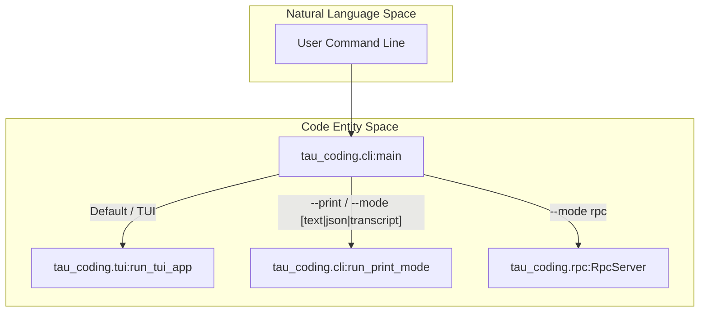
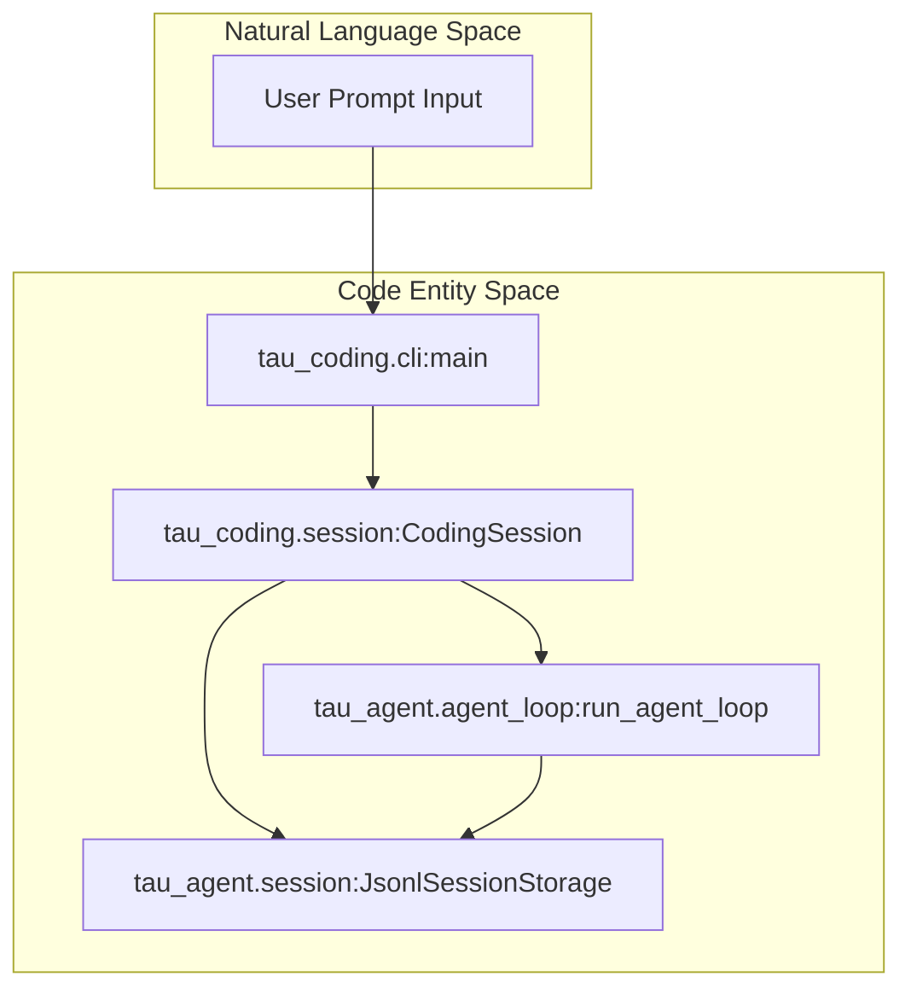

<!-- source: DeepWiki mcp.deepwiki.com · repo huggingface/tau · page 7 Frontends: CLI, Print Mode, and RPC · fetched 2026-10-26 -->

# Frontends: CLI, Print Mode, and RPC

Relevant source files

The following files were used as context for generating this wiki page:

- [src/tau_coding/cli.py](src/tau_coding/cli.py)
- [src/tau_coding/data/docs/cli.md](src/tau_coding/data/docs/cli.md)
- [tests/test_cli.py](tests/test_cli.py)
- [website/content/reference/cli.md](website/content/reference/cli.md)

The purpose of this page is to provide a high-level overview of the Tau command-line interface (CLI), built using the `typer` library [src/tau_coding/cli.py:14-15](), and its three primary operational modes: the interactive Terminal User Interface (TUI), non-interactive Print Mode, and the JSONL RPC Subprocess Protocol. It also covers session lifecycle handling during non-interactive execution and links to detailed child pages for each component.

---

## 1. Overview of the Tau CLI and Operational Modes

The `tau` command is the primary entry point for the coding agent. It parses global flags and subcommands, sets up provider configurations, and routes execution to one of three frontends:

1. **Interactive TUI Mode**: Default mode when running `tau` without headless flags [website/content/reference/cli.md:6-13](), launching the Textual-based `run_tui_app()` [src/tau_coding/cli.py:70-70]().
2. **Print Mode**: Triggered via `-p`/`--print` or `--mode` [website/content/reference/cli.md:16](), executing a single prompt non-interactively via `run_print_mode()` [tests/test_cli.py:15-15]() and rendering outputs to standard streams.
3. **JSONL RPC Mode**: Triggered via `--mode rpc` [website/content/reference/cli.md:51](), starting an `RpcServer` [src/tau_coding/cli.py:53-53]() over `stdin`/`stdout` for editor integration or subprocess hosts.

### Operational Modes Comparison

| Mode | Trigger | Main Code Entity | Output / Interaction |
| :--- | :--- | :--- | :--- |
| **TUI** | `tau` [website/content/reference/cli.md:13]() | `tau_coding.tui:run_tui_app` [src/tau_coding/cli.py:70-70]() | Rich Textual widgets, interactive modals, sidebar |
| **Print** | `tau --print` [website/content/reference/cli.md:16]() | `tau_coding.cli:run_print_mode` [tests/test_cli.py:15-15]() | Text, JSON, or Transcript via `EventRenderer` [src/tau_coding/rendering.py:51-51]() |
| **RPC** | `tau --mode rpc` [website/content/reference/cli.md:51]() | `tau_coding.rpc:RpcServer` [src/tau_coding/cli.py:53-53]() | Pi-compatible JSONL event stream over `stdin`/`stdout` |

Title: CLI Startup and Mode Dispatch

Sources: [src/tau_coding/cli.py:53-70](), [website/content/reference/cli.md:6-16]()

---

## 2. Session Lifecycle in Non-Interactive Use

Even in non-interactive execution (Print Mode and RPC Mode), Tau maintains a complete session lifecycle. It instantiates a `CodingSession` which prepares project context, loads resources, and persists conversation turns to disk [src/tau_agent/session.py:15-17]().

Title: Non-Interactive Session Execution Flow

Sources: [src/tau_coding/cli.py:44-50](), [src/tau_agent/session.py:15-17](), [src/tau_coding/session_preparation.py:67-67]()

---

## 3. Child Pages

For granular technical specifications, refer to the following child pages:

* **[CLI Commands and Options](#7.1)** — Documents the main typer callback, global flags (`--model`, `--provider`, `--cwd`, `--prompt`, `--thinking`, `--approve`, `--system-prompt`), utility commands (`setup`, `providers`, `install`, `sessions`, `export`, `update`), and startup provider resolution. For details, see [CLI Commands and Options](#7.1).
* **[Print Mode and Event Rendering](#7.2)** — Covers `run_print_mode()`, output modes (`text`, `json`, `transcript`), the `EventRenderer` protocol (`TranscriptRenderer`, `PlainRenderer`, `JsonRenderer`), `create_event_renderer()`, and terminal command handling in headless execution. For details, see [Print Mode and Event Rendering](#7.2).
* **[JSONL RPC Mode](#7.3)** — Documents `rpc.py`, detailing the Pi-compatible JSONL RPC protocol over `stdin`/`stdout`, request/response/event schemas, session metadata, runtime interchangeability, and how editor hosts drive Tau as a subprocess. For details, see [JSONL RPC Mode](#7.3).

Sources: [src/tau_coding/cli.py:1-122](), [src/tau_coding/rpc.py:1-50](), [src/tau_coding/rendering.py:40-60]()

---

