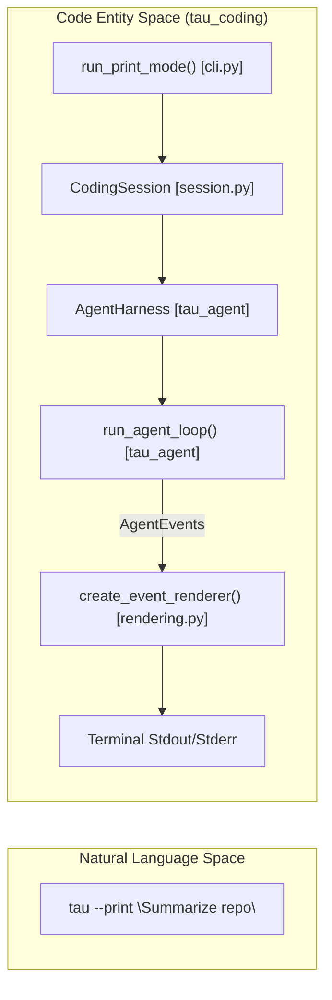

<!-- source: DeepWiki mcp.deepwiki.com · repo huggingface/tau · page 7.1 CLI Commands and Options · fetched 2026-10-26 -->

# CLI Commands and Options

<details>
<summary>Relevant source files</summary>

The following files were used as context for generating this wiki page:

- [AGENTS.md](AGENTS.md)
- [dev-notes/architecture/cli-bad-model-error.md](dev-notes/architecture/cli-bad-model-error.md)
- [landing.html](landing.html)
- [src/tau_coding/cli.py](src/tau_coding/cli.py)
- [src/tau_coding/data/docs/cli.md](src/tau_coding/data/docs/cli.md)
- [tests/test_cli.py](tests/test_cli.py)
- [website/content/reference/cli.md](website/content/reference/cli.md)

</details>


The Tau CLI is the primary entry point for interacting with the coding agent. Built using the `typer` library (`src/tau_coding/cli.py`), it manages the transition between the terminal environment and the agent's execution modes (TUI, Print Mode, or JSONL RPC). It handles provider selection, session management, administrative tasks like provider configuration, extension installation, and automated update checks.

Sources: [src/tau_coding/cli.py:1-123](), [website/content/reference/cli.md:1-26]()

---

## CLI Entry Point and Main Callback

The `main` function, decorated as the `app.callback` in `src/tau_coding/cli.py`, serves as the central orchestrator [src/tau_coding/cli.py:191-195](). It handles global flags, configures stream encodings, runs background checks, and determines whether to launch a subcommand or enter an operational mode.

### Command Flow and Mode Selection

1.  **Stream Configuration**: On startup, Tau forces `stdout` and `stderr` to UTF-8 via `_force_utf8_streams()` to prevent `UnicodeEncodeError` on Windows consoles (e.g., cp1252 codepages) when models output non-ASCII characters [src/tau_coding/cli.py:87-101]().
2.  **Version Check**: If `--version` (`-v`) is passed, it prints the package version via `_current_version()` and exits [tests/test_cli.py:111-116]().
3.  **Subcommand Execution**: If a subcommand like `setup`, `providers`, `install`, `sessions`, `export`, or `update` is invoked, the main callback hands off execution to that specific handler [src/tau_coding/cli.py:106-122]().
4.  **Update & Release Notes Notices**: Before starting an interactive session or print mode, the CLI performs a best-effort PyPI check via `startup_update_notice` [src/tau_coding/update_check.py:108-145]() and inspects release notes via `startup_release_notes_notice` [src/tau_coding/update_check.py:148-190](), unless disabled by `TAU_NO_UPDATE_CHECK=1` or structured JSON output modes [dev-notes/architecture/startup-update-check.md:3-24]().
5.  **Operational Mode Routing**: Based on flags (`--print`, `--mode`), Tau selects between the interactive TUI (`run_tui_app`), headless print mode (`run_print_mode`), or JSONL RPC server (`RpcServer`) [src/tau_coding/cli.py:273-315]().

Sources: [src/tau_coding/cli.py:75-122](), [src/tau_coding/update_check.py:108-190](), [dev-notes/architecture/startup-update-check.md:1-24]()

---

## Global Options and Flags

Global flags must be placed *before* any positional prompt arguments so Typer parses them correctly [website/content/reference/cli.md:17-17]().

| Flag | Argument Type | Purpose |
| :--- | :--- | :--- |
| `-m`, `--model` | `str \| None` | Overrides the default model for the session [website/content/reference/cli.md:47-47](). |
| `--provider` | `str \| None` | Specifies the configured provider name to use [website/content/reference/cli.md:48-48](). |
| `-t`, `--thinking` | `ThinkingLevel` | Sets the initial thinking level (`off`, `minimal`, `low`, `medium`, `high`, `xhigh`, `max`) for this run [website/content/reference/cli.md:49-49](). |
| `--cwd` | `Path \| None` | Sets the working directory for built-in tools [website/content/reference/cli.md:50-50](). |
| `--mode` | `Literal` | Selects headless output (`text`, `json`, `transcript`, `rpc`) [website/content/reference/cli.md:51-51](). |
| `--session` | `str \| None` | Resumes a session ID in the TUI or print mode [website/content/reference/cli.md:52-52](). |
| `--new-session` | `bool` | Forces creation of a fresh session instead of resuming default [website/content/reference/cli.md:53-53](). |
| `--system-prompt` | `str \| Path` | Replaces Tau's default system prompt base with literal text or a UTF-8 file [website/content/reference/cli.md:55-55](). |
| `--append-system-prompt` | `str \| Path` | Appends literal text or a UTF-8 file (repeatable) [website/content/reference/cli.md:56-56](). |
| `-e`, `--extension` | `Path` | Loads an explicit extension file or directory (repeatable) [website/content/reference/cli.md:58-58](). |
| `-a`, `--approve` / `-na`, `--no-approve` | `bool` | Runs project trust decisions for protected inputs for this invocation only [website/content/reference/cli.md:61-62](). |

Sources: [src/tau_coding/cli.py:136-236](), [website/content/reference/cli.md:42-64]()

---

## Startup Provider Resolution

Before initializing a session, the CLI resolves which model and provider to use via `resolve_provider_selection()` [src/tau_coding/provider_config.py:46]().

### Resolution Logic
1.  **Explicit Selection**: If both provider name and model ID are specified via CLI flags, they are validated against `ProviderSettings` [src/tau_coding/provider_config.py:46]().
2.  **Provider Only**: If only a provider is named, Tau selects that provider's configured `default_model` [src/tau_coding/provider_config.py:46]().
3.  **Model Only**: If only a model is named, Tau searches the effective catalog (built-in plus user overrides) for a matching provider [src/tau_coding/provider_config.py:46]().
4.  **Defaults**: If neither is specified, it falls back to `DEFAULT_PROVIDER_NAME` ("openai") and `DEFAULT_MODEL` [src/tau_coding/provider_config.py:36-37]().

### System Initialization Diagram
This diagram maps natural language space CLI arguments to the instantiation of the `ModelProvider` protocol in code entity space.

**CLI to Provider Resolution**
```mermaid
graph TD
    subgraph "Natural Language Space (CLI)"
        CLI["tau --model \"gpt-4o\" --provider \"anthropic\""]
    end

    subgraph "Code Entity Space (tau_coding)"
        Main["main() [cli.py]"] --> RPS["resolve_provider_selection() [provider_config.py]"]
        RPS --> LPS["load_provider_settings() [provider_config.py]"]
        LPS -- "reads" --> PJSON["providers.json"]
        
        RPS --> CMP["create_model_provider() [provider_runtime.py]"]
        CMP --> FCS["FileCredentialStore() [credentials.py]"]
        FCS -- "reads" --> CJSON["credentials.json"]
        
        CMP -- "instantiates" --> MP["ModelProvider [tau_ai]"]
    end
```

Sources: [src/tau_coding/cli.py:191-236](), [src/tau_coding/provider_config.py:36-50](), [src/tau_coding/provider_runtime.py:51-65]()

---

## Administrative Commands

### `setup`
Registers or updates an OpenAI-compatible provider (e.g., Ollama, LocalAI) via `setup_command()` [src/tau_coding/cli.py:160-190](). It constructs an `OpenAICompatibleProviderConfig`, updates settings with `upsert_openai_compatible_provider()`, and persists changes to `providers.json` [src/tau_coding/cli.py:170-186]().

### `providers`
Lists all configured model providers and their authentication status by invoking `providers_command()`, which reads `ProviderSettings` and formats them via `render_provider_settings()` and `FileCredentialStore()` [src/tau_coding/cli.py:126-129]().

### `install`
Installs a trusted local or Git extension into Tau's user extension directory (`~/.tau/extensions/`) via `install_command()` [src/tau_coding/cli.py:131-158]() and `install_extension()` [src/tau_coding/extension_installer.py](). It supports local files/directories, Pi-style `git:github.com/owner/repo[@ref]` sources, and HTTP/SSH Git URLs [website/content/reference/cli.md:65-68]().

### `sessions`
Lists indexed sessions with their ID, title, model, and working directory [website/content/reference/cli.md:36-36]().

### `export`
Exports a session artifact as HTML (default) or JSONL via `export_session_artifact()` and `normalize_export_format()` [src/tau_coding/cli.py:61-66]().

### `update`
Upgrades Tau using the package manager that owns its environment via `update_tau()` [src/tau_coding/updater.py:44-58]() and `detect_install_method()` [src/tau_coding/updater.py:121-133]().
-   **uv-tool**: Runs `uv tool install tau-ai@<latest>` [dev-notes/architecture/startup-update-check.md:29-30](). On Windows (`win32`), it performs a safe asynchronous handoff via `_handoff_windows_update()` [src/tau_coding/updater.py:100-107](), spawning a detached PowerShell script (`update.ps1`) that waits for the parent Tau process PID to exit before running `uv`, preventing file-locking conflicts [dev-notes/architecture/startup-update-check.md:30-42]().
-   **pipx / uv-pip / pip**: Executes `pipx upgrade`, `uv pip install`, or standard `pip install` against the active python prefix [src/tau_coding/updater.py:135-158]().

Sources: [src/tau_coding/cli.py:126-190](), [src/tau_coding/updater.py:44-158](), [dev-notes/architecture/startup-update-check.md:25-46]()

---

## Non-Interactive Print Mode

When invoked with `-p`/`--print` or `--mode`, Tau runs in headless non-interactive mode via `run_print_mode()` [src/tau_coding/cli.py:273-286]().

### Execution Flow and Rendering
1.  **Session Setup**: Prepares a `CodingSession` configured with discovered project contexts and options [src/tau_coding/session_preparation.py]().
2.  **Event Rendering**: As `run_agent_loop()` executes, generated `AgentEvent` items are processed by an `EventRenderer` matching the requested `--mode` (`text`, `json`, `transcript`, or `rpc`) [src/tau_coding/rendering.py:42-51]().
3.  **Headless Execution**: Print mode outputs tool calls and responses directly to `stdout`/`stderr` without opening the Textual TUI [src/tau_coding/data/docs/cli.md:3-6]().

**Print Mode Architecture**


Sources: [src/tau_coding/cli.py:273-286](), [src/tau_coding/rendering.py:42-51](), [src/tau_coding/session.py:55-61]()

---

