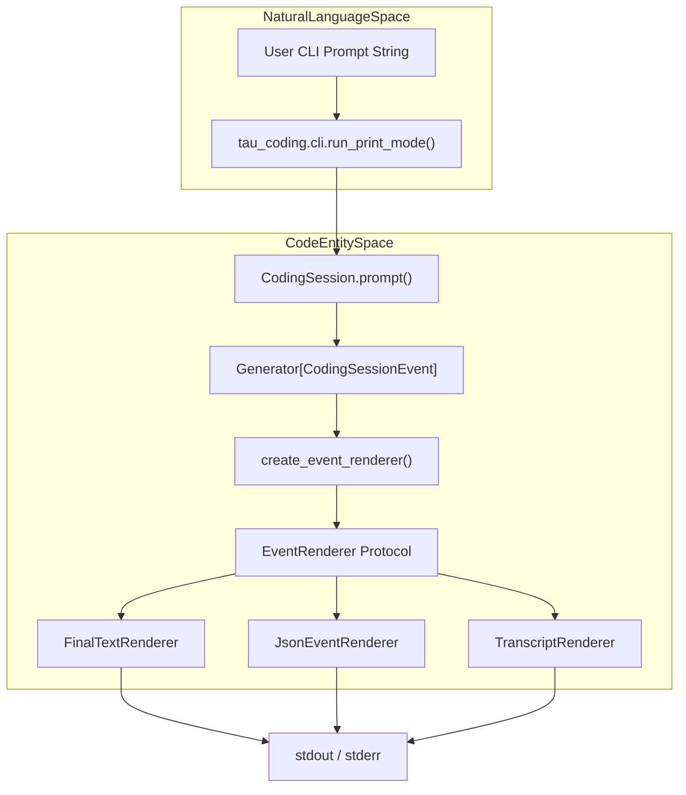
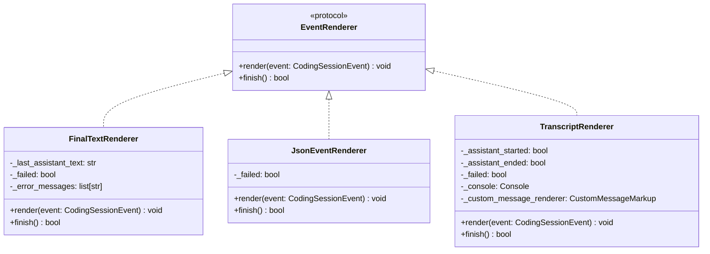

<!-- source: DeepWiki mcp.deepwiki.com · repo huggingface/tau · page 7.2 Print Mode and Event Rendering · fetched 2026-10-26 -->

# Print Mode and Event Rendering

Relevant source files

The following files were used as context for generating this wiki page:

- [dev-notes/print-mode-session-ids.md](dev-notes/print-mode-session-ids.md)
- [dev-notes/print-mode-session-resume.md](dev-notes/print-mode-session-resume.md)
- [src/tau_agent/session/storage.py](src/tau_agent/session/storage.py)
- [src/tau_agent/session/tree.py](src/tau_agent/session/tree.py)
- [src/tau_coding/rendering/__init__.py](src/tau_coding/rendering/__init__.py)
- [src/tau_coding/rendering/base.py](src/tau_coding/rendering/base.py)
- [src/tau_coding/rendering/json.py](src/tau_coding/rendering/json.py)
- [src/tau_coding/rendering/plain.py](src/tau_coding/rendering/plain.py)
- [src/tau_coding/rendering/transcript.py](src/tau_coding/rendering/transcript.py)
- [src/tau_coding/session_manager.py](src/tau_coding/session_manager.py)
- [tests/test_rendering.py](tests/test_rendering.py)
- [tests/test_session_manager.py](tests/test_session_manager.py)
- [website/content/guides/print-mode.md](website/content/guides/print-mode.md)

## Purpose and Scope

This page covers Tau's non-interactive **Print Mode** and its event rendering architecture. Print mode allows running single turns or automated pipelines without launching the interactive TUI. It handles stream isolation, session resumption (`--session`), machine-safe session IDs (`--session-id`), output format selection (`text`, `json`, `transcript`, `rpc`), terminal command invocation (`!` and `!!`), and delegates formatting to implementations of the `EventRenderer` protocol.

Sources: [src/tau_coding/rendering/base.py:1-27](), [website/content/guides/print-mode.md:1-121](), [dev-notes/print-mode-session-resume.md:1-32]()

---

## Output Modes and the EventRenderer Protocol

Tau's non-interactive execution decouples the agent core event stream (`CodingSessionEvent`) from the terminal output channel via the `EventRenderer` protocol defined in `src/tau_coding/rendering/base.py` [src/tau_coding/rendering/base.py:20-27]().

### Diagram: Print Mode Data Flow

Sources: [src/tau_coding/rendering/base.py:11-27](), [src/tau_coding/rendering/__init__.py:12-23]()

The `PrintOutputMode` string enum enumerates the supported output targets [src/tau_coding/rendering/base.py:11-18]():
*   `text`: Human-readable clean final response (default).
*   `json`: Machine-parseable JSONL stream of all underlying events.
*   `transcript`: Rich structured log with tool execution telemetry directed to `stderr` and streaming text deltas on `stdout`.
*   `rpc`: Pipe-compatible line-delimited RPC protocol over standard I/O.

Sources: [src/tau_coding/rendering/base.py:11-18](), [src/tau_coding/rendering/__init__.py:12-23]()

---

## Renderer Implementations and Factory

The `create_event_renderer()` factory function inspects the `PrintOutputMode` and returns the appropriate protocol implementation [src/tau_coding/rendering/__init__.py:12-23]().

### Diagram: EventRenderer Class Hierarchy

Sources: [src/tau_coding/rendering/__init__.py:12-23](), [src/tau_coding/rendering/plain.py:10-38](), [src/tau_coding/rendering/json.py:10-26](), [src/tau_coding/rendering/transcript.py:22-94]()

### FinalTextRenderer (`text`)
Implemented in `src/tau_coding/rendering/plain.py`, `FinalTextRenderer` suppresses all intermediate reasoning tokens and progress blocks [src/tau_coding/rendering/plain.py:10-38](). It listens for `MessageEndEvent` matching an `AssistantMessage`, tracks error stop reasons, and echoes the final text payload to `stdout` upon `finish()` [src/tau_coding/rendering/plain.py:16-38]().

### JsonEventRenderer (`json`)
Implemented in `src/tau_coding/rendering/json.py`, `JsonEventRenderer` dumps every raw `CodingSessionEvent` as a JSON string using Pydantic's `model_dump_json(by_alias=True, exclude_none=True)` directly to `stdout` [src/tau_coding/rendering/json.py:10-26]().

### TranscriptRenderer (`transcript`)
Implemented in `src/tau_coding/rendering/transcript.py`, `TranscriptRenderer` provides real-time streaming feedback [src/tau_coding/rendering/transcript.py:22-94](). It echoes `TextDeltaEvent` increments immediately to `stdout` via `typer.echo()`, while directing tool executions, retry telemetry, and custom message markup through a Rich `Console` instance configured for `stderr` [src/tau_coding/rendering/transcript.py:35-89]().

Sources: [src/tau_coding/rendering/plain.py:10-38](), [src/tau_coding/rendering/json.py:10-26](), [src/tau_coding/rendering/transcript.py:22-94](), [src/tau_coding/rendering/__init__.py:12-23]()

---

## Session Lifecycle and Non-Interactive Execution (`run_print_mode`)

Non-interactive runs are coordinated by `run_print_mode()` inside `src/tau_coding/cli.py`. It establishes the execution context through the following steps:

1.  **Session Resolution or Creation**:
    *   If `--session <id>` is provided, `SessionManager` resolves the existing record, allowing follow-up turns to resume conversation history [dev-notes/print-mode-session-resume.md:1-19]().
    *   If `--session-id <id>` and `--new-session` are provided, `SessionManager` atomically validates and reserves the file-safe identifier (rejecting reserved stems like `default` or `index`, validating 128-byte limits and portable name constraints) [dev-notes/print-mode-session-ids.md:1-55](), [src/tau_coding/session_manager.py:29-120](). The `validate_session_id` function [src/tau_coding/session_manager.py:39-53]() enforces rules such as alphanumeric characters, '-', '_', and '.', starting and ending with an alphanumeric character, a maximum length of 128 bytes, and rejection of reserved IDs like "default", "index", and Windows reserved file stems [src/tau_coding/session_manager.py:49-53](). The `create_session_exclusive` method [src/tau_coding/session_manager.py:183-191]() ensures atomic creation, preventing overwrites or collisions, and rolls back reservations if indexing fails [tests/test_session_manager.py:134-157]().
2.  **Terminal Command Handling**:
    *   Before invoking the agent loop, inputs beginning with `!` or `!!` are intercepted.
    *   `!` commands execute immediately via `CodingSession.run_terminal_command()` and terminate [src/tau_coding/cli.py:358-364]().
    *   `!!` commands execute the shell command, inject the output into session history as context, and proceed to send the instruction to the LLM.
3.  **Prompt Dispatch**: `session.prompt()` is called, and the resulting event stream is consumed by the factory-selected `EventRenderer` [src/tau_coding/rendering/__init__.py:12-23]().
4.  **Exit Code**: `renderer.finish()` determines the process exit code, returning non-zero if an assistant error occurred [src/tau_coding/rendering/plain.py:31-38](), [src/tau_coding/rendering/json.py:25-26](), [src/tau_coding/rendering/transcript.py:92-93]().

Sources: [src/tau_coding/cli.py:339-370](), [src/tau_coding/session_manager.py:29-120](), [dev-notes/print-mode-session-ids.md:1-55](), [dev-notes/print-mode-session-resume.md:1-32](), [tests/test_session_manager.py:134-157]()

---

