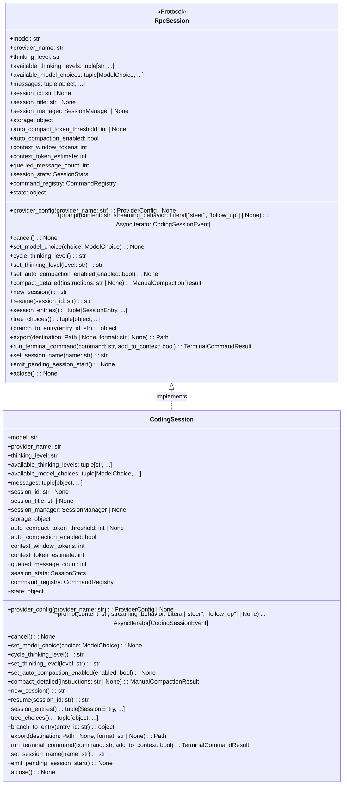

<!-- source: DeepWiki mcp.deepwiki.com · repo huggingface/tau · page 7.3 JSONL RPC Mode · fetched 2026-10-26 -->

# JSONL RPC Mode

<details>
<summary>Relevant source files</summary>

The following files were used as context for generating this wiki page:

- [dev-notes/architecture/phase-28-rpc.md](dev-notes/architecture/phase-28-rpc.md)
- [dev-notes/design/rpc-runtime-interchangeability-plan.md](dev-notes/design/rpc-runtime-interchangeability-plan.md)
- [src/tau_coding/rpc.py](src/tau_coding/rpc.py)
- [tests/test_rpc.py](tests/test_rpc.py)
- [website/content/reference/rpc.md](website/content/reference/rpc.md)

</details>


## Purpose and Scope

This page documents `src/tau_coding/rpc.py`, which implements a Pi-compatible JSONL RPC (Remote Procedure Call) frontend for Tau coding sessions `[src/tau_coding/rpc.py:1]`. This mode enables editors, IDE extensions, or Electron subprocess hosts (such as a Node.js harness) to drive Tau programmatically over standard input and standard output using strict line-delimited JSON objects `[website/content/reference/rpc.md:1-38]`, `[dev-notes/design/rpc-runtime-interchangeability-plan.md:1-19]`.

## 1. Protocol Architecture and Framing

The RPC server listens on `stdin` for newline-delimited JSON commands and emits responses and session events as JSON lines to `stdout` `[website/content/reference/rpc.md:1-15]`. Diagnostics and logging are routed to `stderr`.

### RPC Server Data Flow
```mermaid
graph TD
    A[Client (Editor / Electron Host)] -->|JSON Command (stdin)| B(RpcServer)
    B -->|JSON Response / Event (stdout)| A
    B -- json.loads() / validate --> C{_dispatch(command, tasks)}
    B -- anyio.Lock() (thread-safe write) --> D[Output Stream]
```
Sources: `[src/tau_coding/rpc.py:163-184]()`, `[src/tau_coding/rpc.py:156]()`

### Framing Rules
*   **Line Delimiters**: Records must be separated by Line Feed (`\n`). A trailing Carriage Return (`\r`) is automatically stripped for CRLF compatibility `[src/tau_coding/rpc.py:167-170]`, `[website/content/reference/rpc.md:33-36]`.
*   **Record Size Limit**: Individual lines are bounded at a maximum of 16 MiB (`_MAX_RECORD_BYTES`). Oversized records trigger a parse error response rather than crashing the parser `[src/tau_coding/rpc.py:37,173-175]`.
*   **Unicode Handling**: Unicode line separators (such as U+2028 and U+2029) are treated as ordinary string contents inside JSON payloads `[website/content/reference/rpc.md:35-37]`.

Sources: `[src/tau_coding/rpc.py:37-187]()`, `[website/content/reference/rpc.md:1-38]()`

## 2. RpcSession Protocol and CodingSession Bridge

To decouple the RPC transport layer from concrete application internals, `RpcServer` interacts with sessions through the `RpcSession` protocol `[src/tau_coding/rpc.py:40-141]`. This protocol defines the public surface of `CodingSession` required to support state inspection, model configuration, prompting, and session management.

### RpcSession Protocol

Sources: `[src/tau_coding/rpc.py:40-141]()`, `[tau_coding/session.py]()`

Key attributes exposed via `RpcSession`:
*   **Model & Provider State**: `model`, `provider_name`, `thinking_level`, `available_thinking_levels`, and `available_model_choices` `[src/tau_coding/rpc.py:43-56]`.
*   **Execution Control**: `prompt()`, `cancel()`, `run_terminal_command()`, and async compaction methods (`compact_detailed()`) `[src/tau_coding/rpc.py:99-136]`.
*   **Session Metadata & Persistence**: `session_id`, `session_title`, `storage`, `session_manager`, and export capabilities `[src/tau_coding/rpc.py:64-130]`.

Sources: `[src/tau_coding/rpc.py:40-141]()`, `[dev-notes/architecture/phase-28-rpc.md:5-12]()`

## 3. Request, Response, and Event Schemas

Clients interact with Tau by sending JSON objects containing an optional `id` and a required `type` field `[src/tau_coding/rpc.py:189-194]`, `[website/content/reference/rpc.md:12-16]`.

### Response Envelope
Every request receives a correlated response object echoing the request `id` (if supplied):

```json
{
  "id": "one",
  "type": "response",
  "command": "prompt",
  "success": true
}
```

If a command fails or arguments are invalid, `success` is set to `false`, and error details are returned without terminating the server process `[src/tau_coding/rpc.py:189-206]`, `[website/content/reference/rpc.md:26-28]`.

### Event Streaming
Asynchronous events (such as `agent_start`, `text_delta`, `tool_call`, and `agent_settled`) are emitted directly to `stdout` during command execution `[tests/test_rpc.py:41-66]`, `[website/content/reference/rpc.md:12-16]`. Clients should rely on `agent_settled` (rather than `agent_end`) to determine when an agent run has completely finished all retries, compaction, or follow-up tasks `[website/content/reference/rpc.md:29-32]`.

Sources: `[src/tau_coding/rpc.py:189-206]()`, `[tests/test_rpc.py:41-66]`, `[website/content/reference/rpc.md:1-32]()`

## 4. Subprocess Lifecycle and Concurrency Control

`RpcServer` runs inside an asynchronous event loop powered by AnyIO `[src/tau_coding/rpc.py:143-188]`.

### RpcServer Concurrency
```mermaid
graph TD
    A[RpcServer.run()] --> B{anyio.create_task_group()}
    B --> C[Stdin Reader Loop]
    C -->|readline()| D{Process Line}
    D -->|json.loads()| E{_dispatch(command, tasks)}
    E --> F[Command Execution Task (e.g., prompt)]
    F --> G[Streaming Events to stdout]
    C -->|EOF| H[Cancel Active Prompt Tasks]
    H --> I[session.aclose()]
    I --> J[Exit]

    subgraph RpcServer
        C -- anyio.to_thread.run_sync --> D
        G -- _write_lock --> K[stdout]
    end
```
Sources: `[src/tau_coding/rpc.py:143-188]()`

### Concurrency Mechanics
*   **Serialized Writers**: Output writing is protected by an `anyio.Lock()` (`self._write_lock`), ensuring that interleaved responses and streaming events never corrupt each other's byte streams on `stdout` `[src/tau_coding/rpc.py:156]`, `[dev-notes/architecture/phase-28-rpc.md:8-11]`.
*   **Task Group Isolation**: Prompt execution, steering, and follow-up requests spawn tasks within an AnyIO task group. This ensures that input reading, cancellation requests (`abort`), and queued interactions remain fully responsive while the model streams tokens or executes tools `[src/tau_coding/rpc.py:159-188]`, `[dev-notes/architecture/phase-28-rpc.md:8-11]`.
*   **Shutdown on EOF**: When `stdin` reaches EOF (`line == ""`), the server cancels active prompt tasks, awaits completion, and invokes `_session.aclose()` before exiting `[src/tau_coding/rpc.py:165-187]`.

Sources: `[src/tau_coding/rpc.py:143-188]`, `[dev-notes/architecture/phase-28-rpc.md:5-12]()`

## 5. Runtime Interchangeability and Pi Compatibility

Tau's RPC frontend is designed to be runtime-interchangeable with Pi's coding agent protocol at the process boundary `[dev-notes/design/rpc-runtime-interchangeability-plan.md:1-34]`.

### Pi Compatibility Matrix
| Capability Area | Status in Tau RPC | Notes |
|:----------------|:------------------|:------|
| Prompting & Streaming (`prompt`, `steer`, `follow_up`, `abort`) | Supported | Fully operational over AnyIO task groups `[dev-notes/architecture/phase-28-rpc.md:13-17]` |
| State & Messages Inspection (`get_state`, `messages`) | Supported | Mapped to `CodingSession` and session storage `[dev-notes/architecture/phase-28-rpc.md:17-18]` |
| Models & Thinking Control | Supported | Pi-shaped model schemas, list/cycle/set thinking levels `[dev-notes/architecture/phase-28-rpc.md:19-20]` |
| Manual Compaction | Supported | Detailed compaction and summary injection `[dev-notes/architecture/phase-28-rpc.md:20-21]` |
| Session Lifecycle & Forking | Supported | New, resume, fork, tree projection, and HTML export `[dev-notes/architecture/phase-28-rpc.md:21-25]` |
| Command Discovery | Supported | With synthetic Tau source metadata `[dev-notes/architecture/phase-28-rpc.md:22]` |
| Direct Bash | Supported | `[dev-notes/architecture/phase-28-rpc.md:23]` |
| `abort_bash` | Deferred | Requires a cancellable public session API `[dev-notes/architecture/phase-28-rpc.md:24]` |
| Auto-compaction toggle | Supported | `[dev-notes/architecture/phase-28-rpc.md:26]` |
| Extension UI RPC | Deferred | Tau currently uses frontend bridge callbacks `[dev-notes/architecture/phase-28-rpc.md:27]` |
| Queue/retry controls, clone, image prompts | Deferred | `[dev-notes/architecture/phase-28-rpc.md:28]` |

### Electron Integration Pattern
Electron hosts manage Tau as a child process via `child_process.spawn()`, communicating via JSONL `[website/content/reference/rpc.md:39-58]`, `[dev-notes/design/rpc-runtime-interchangeability-plan.md:104-114]`. The renderer interacts with the subprocess using a uniform command/event contract, insulating UI components from whether Tau or Pi is executing underneath `[dev-notes/design/rpc-runtime-interchangeability-plan.md:1-19]`.

Sources: `[dev-notes/architecture/phase-28-rpc.md:13-32]`, `[dev-notes/design/rpc-runtime-interchangeability-plan.md:1-113]()`, `[website/content/reference/rpc.md:39-58]()`

---

