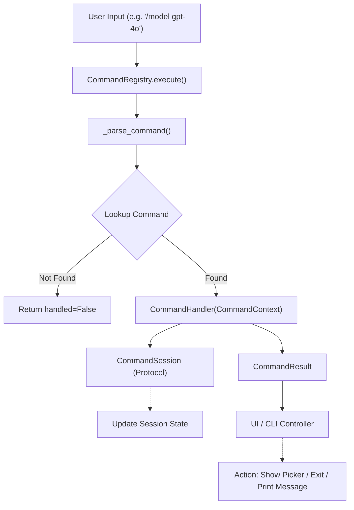
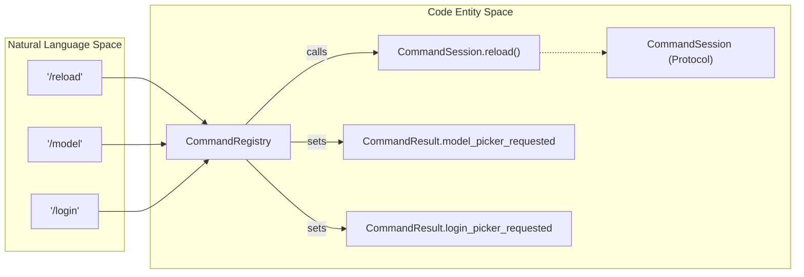

<!-- source: DeepWiki mcp.deepwiki.com · repo huggingface/tau · page 8 Slash Command Registry · fetched 2026-10-26 -->

# Slash Command Registry

Relevant source files

The following files were used as context for generating this wiki page:

- [src/tau_coding/commands.py](src/tau_coding/commands.py)
- [tests/test_commands.py](tests/test_commands.py)

The Slash Command Registry is the central dispatch mechanism for user interactions that bypass the standard LLM prompt flow. It handles session management, provider configuration, and UI state changes through a unified `CommandRegistry` [src/tau_coding/commands.py:170-174]().

## Core Components

The command system is built around a protocol-based interaction between the TUI/CLI and the underlying `CodingSession`.

### CommandRegistry
The `CommandRegistry` is responsible for registering, parsing, and executing slash commands. It maintains a mapping of command names and aliases to their respective `CommandHandler` functions [src/tau_coding/commands.py:170-174](). It supports command normalization and duplicate detection during registration [src/tau_coding/commands.py:177-188]().

### CommandSession Protocol
To maintain a clean separation between the command registry and the application state, the registry interacts with a `CommandSession` protocol [src/tau_coding/commands.py:35-36](). This protocol exposes only the necessary attributes and methods required for commands to query or modify session state, such as `cwd`, `model`, `tools`, `skills`, `context_token_estimate`, and `reload_provider_settings()` [src/tau_coding/commands.py:39-103]().

### CommandResult
Every command execution returns a `CommandResult` dataclass [src/tau_coding/commands.py:106-107](). This object acts as a set of instructions for the frontend (TUI or CLI) to perform actions that the command handler cannot do directly, such as requesting a modal picker (`model_picker_requested`), exiting the application (`exit_requested`), or initiating session actions [src/tau_coding/commands.py:109-142]().

### Command Flow Overview

The following diagram illustrates how a user input string is transformed into a system action.

**Command Execution Flow**

Sources: [src/tau_coding/commands.py:199-211](), [src/tau_coding/commands.py:106-142]()

## Default Command Suite

Tau comes with a comprehensive set of built-in commands initialized via `create_default_command_registry()` [tests/test_commands.py:125-150]().

| Command | Purpose | Result Action |
| :--- | :--- | :--- |
| `/quit` | Exit the application | `exit_requested = True` [src/tau_coding/commands.py:110]() |
| `/new` | Start a fresh session | `new_session_requested = True` [src/tau_coding/commands.py:113]() |
| `/compact` | Manual context summarization | `compact_summary = "..."` [src/tau_coding/commands.py:114]() |
| `/model` | Switch LLM or open picker | `model_picker_requested = True` [src/tau_coding/commands.py:130]() |
| `/login` | Authenticate with a provider | `login_picker_requested = True` [src/tau_coding/commands.py:122]() |
| `/session` | Show session metadata/stats | Returns formatted string message [src/tau_coding/commands.py:139]() |
| `/tree` | View session history tree | `tree_picker_requested = True` [src/tau_coding/commands.py:121]() |
| `/reload` | Refresh skills and templates | Triggers `session.reload()` [src/tau_coding/commands.py:112]() |

Sources: [src/tau_coding/commands.py:1-213](), [tests/test_commands.py:124-150]()

## Natural Language to Code Mapping

The command registry acts as a bridge between user-facing slash commands and the internal code entities of the `tau_coding` package.

**Command Logic Mapping**

Sources: [src/tau_coding/commands.py:35-103](), [src/tau_coding/commands.py:106-142](), [src/tau_coding/commands.py:170-211]()

## Advanced Command Features

### UI-Picker Delegation
Many commands do not execute a change immediately but instead return a picker-requested flag in the `CommandResult` [src/tau_coding/commands.py:111-136](). This allows the TUI to present a graphical selection list while the core command registry remains independent of the UI implementation. For details, see [Command Definitions and Execution Flow](#8.1).

### Autocomplete Integration
The `CommandRegistry` serves as a primary data source for the TUI's autocomplete engine via `build_completion_state()`. The engine inspects registered commands and aliases to provide real-time suggestions as the user types a leading `/`. It also handles specialized expansions like `@` for files and `!` for shell paths. For details, see [TUI Autocomplete Engine](#8.2).

### Skill Expansion
Note that `/skill:<name>` is handled as a special case. It is not processed as a standard registry command but is instead bypassed by `CommandRegistry.execute()` [src/tau_coding/commands.py:205-206]() so it can be handled by prompt expansion logic. However, the autocomplete engine explicitly supports `/skill:` name suggestions.

Sources: [src/tau_coding/commands.py:1-213](), [tests/test_commands.py:1-150]()

## Related Pages
- [Command Definitions and Execution Flow](#8.1) — Detailed breakdown of every built-in command handler and the delegation pattern.
- [TUI Autocomplete Engine](#8.2) — How the system provides suggestions for commands, file paths, and arguments.
- [CodingSession: Session Lifecycle](#3) — The primary implementation of the `CommandSession` protocol.

Sources: [src/tau_coding/commands.py:1-213](), [tests/test_commands.py:1-150]()

---

