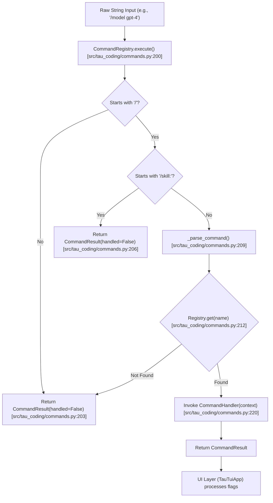
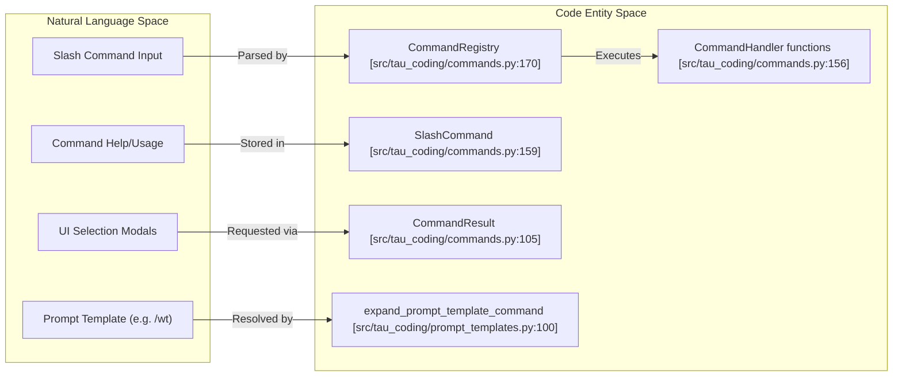

<!-- source: DeepWiki mcp.deepwiki.com · repo huggingface/tau · page 8.1 Command Definitions and Execution Flow · fetched 2026-10-26 -->

# Command Definitions and Execution Flow

Relevant source files

The following files were used as context for generating this wiki page:

- [src/tau_coding/commands.py](src/tau_coding/commands.py)
- [src/tau_coding/data/docs/tui.md](src/tau_coding/data/docs/tui.md)
- [tests/test_commands.py](tests/test_commands.py)
- [website/content/guides/tui.md](website/content/guides/tui.md)
- [website/content/reference/configuration.md](website/content/reference/configuration.md)
- [website/content/reference/slash-commands.md](website/content/reference/slash-commands.md)

This section details Tau's slash command architecture, covering `CommandRegistry.execute()`, `SlashCommand`, `CommandContext`, `create_default_command_registry()`, all built-in commands, and the UI-picker delegation pattern.

## Core Data Structures

The slash command subsystem is structured around a clean separation of concerns between state representation, execution results, runtime context, and command definitions within `tau_coding`.

*   **`CommandSession` (Protocol)**: Defines the interface that a session object must implement to be compatible with command handlers. It provides access to the current working directory (`cwd`), model settings, available tools, resource diagnostics, and methods to trigger reloads or model changes [src/tau_coding/commands.py:35-99]().
*   **`CommandResult`**: A structured dataclass returned by handlers. It contains flags that the UI layer (like `TauTuiApp`) uses to trigger state changes, such as `exit_requested`, `new_session_requested`, or various picker requests [src/tau_coding/commands.py:105-142]().
*   **`CommandContext`**: Bundles the session instance, the registry itself, and the parsed command name and arguments for use within a handler [src/tau_coding/commands.py:145-154]().
*   **`SlashCommand`**: Defines a command's metadata, including its name, aliases, description, and the `CommandHandler` function [src/tau_coding/commands.py:159-168]().

Sources: [src/tau_coding/commands.py:35-168]()

## Execution Flow: From Input to Action

The execution flow bridges the gap between raw string input and the execution of application logic via `CommandRegistry.execute()` [src/tau_coding/commands.py:200-220]().

### Command Dispatch Flow

Sources: [src/tau_coding/commands.py:200-220]()

### Natural Language to Code Entity Mapping

Sources: [src/tau_coding/commands.py:105-170](), [src/tau_coding/prompt_templates.py:100-130]()

## Built-in Commands

The default registry is populated via `create_default_command_registry()`, registering the complete built-in command suite [tests/test_commands.py:126-152](). Below are the primary built-in commands:

| Command | Purpose | Key Result Flags / Behavior |
| :--- | :--- | :--- |
| `/compact` | Summarizes and compacts the active context window | `compact_summary` |
| `/export` | Exports the current session (HTML/JSONL) | `export_requested=True`, format, destination |
| `/hotkeys` | Displays keyboard shortcuts | Opens help modal / message |
| `/local` | Manages registered local backends (e.g. llama.cpp) | `local_requested=True` |
| `/login` | Authenticates with a built-in provider via OAuth or API key | `login_picker_requested=True`, `login_provider` |
| `/logout` | Removes saved credentials for a provider | `logout_picker_requested=True`, `logout_provider` |
| `/model` | Refreshes catalogs and opens the model picker | `model_picker_requested=True` |
| `/name` | Renames the current session and terminal tab | `session_name` |
| `/new` | Starts a fresh session | `new_session_requested=True` |
| `/prompts` | Searches loaded prompt templates | `prompts_picker_requested=True` |
| `/quit` | Exits the active session | `exit_requested=True` |
| `/reload` | Reloads local skills, prompts, extensions, and context | `reload_requested=True`, `message` |
| `/resume` | Resumes a previous session or opens the picker | `resume_picker_requested=True`, `resume_session_id` |
| `/scoped-models` | Chooses favorite models for quick-cycling | `scoped_models_picker_requested=True` |
| `/session` | Displays session info, token usage, and stats | `message` (formatted statistics) |
| `/sidebar` | Toggles the sidebar for the session | `sidebar_toggle_requested=True` |
| `/skill` | Opens searchable picker of loaded skills | `skills_picker_requested=True` |
| `/skills` | Alias/picker for skills | `skills_picker_requested=True` |
| `/system` | Shows active system prompt without altering context | Returns active system prompt text |
| `/theme` | Displays or sets the TUI theme | `theme_picker_requested=True`, `theme` |
| `/tools` | Browses active tools and descriptions | `tools_picker_requested=True` |
| `/tree` | Branches from an earlier point in session history | `tree_picker_requested=True` |

Sources: [src/tau_coding/commands.py:216-514](), [tests/test_commands.py:126-152]()

## The UI-Picker Delegation Pattern

Tau uses a delegation pattern for commands that require complex interactive UI flows (such as picking a model, theme, or local backend). Instead of handlers directly executing UI logic, they return declarative flags inside `CommandResult` [src/tau_coding/commands.py:105-142]().

1.  **Handler Execution**: A command handler (e.g., `_model_command`) evaluates input arguments. If no argument is passed, it returns a `CommandResult` with `model_picker_requested=True` [src/tau_coding/commands.py:279-289]().
2.  **TUI Interception**: The TUI application layer (`TauTuiApp`) checks the returned `CommandResult`. Upon seeing `model_picker_requested=True`, it pushes the corresponding modal screen (e.g., `ModelPickerScreen`) onto its screen stack.
3.  **Selection & Application**: When the user makes a selection in the modal, a callback triggers the corresponding method on the session object (e.g., `session.set_model()`).

Sources: [src/tau_coding/commands.py:105-142](), [src/tau_coding/commands.py:279-289]()

## Special Handling: Skills and Templates

Not all slash-prefixed strings are consumed by the `CommandRegistry`.

### Skill Expansion (`/skill:<name>`)
Inputs starting with `/skill:` bypass registry execution (`handled=False`) [src/tau_coding/commands.py:205-206](). They are handled as prompt-expansion paths, where the TUI or session expands the named skill file into the active prompt buffer before submission [website/content/reference/slash-commands.md:51-56]().

### Prompt Templates
Unrecognized slash commands return `handled=False` from `CommandRegistry.execute()` [src/tau_coding/commands.py:200-220](). The application layer then falls back to matching the command against loaded prompt templates using `expand_prompt_template_command()` [src/tau_coding/prompt_templates.py:100-130](). Templates support `{{ arguments }}` substitution and file editing via **Ctrl+E** [website/content/reference/slash-commands.md:62-66]().

Sources: [src/tau_coding/commands.py:200-220](), [src/tau_coding/prompt_templates.py:100-130](), [website/content/reference/slash-commands.md:51-66]()

---

