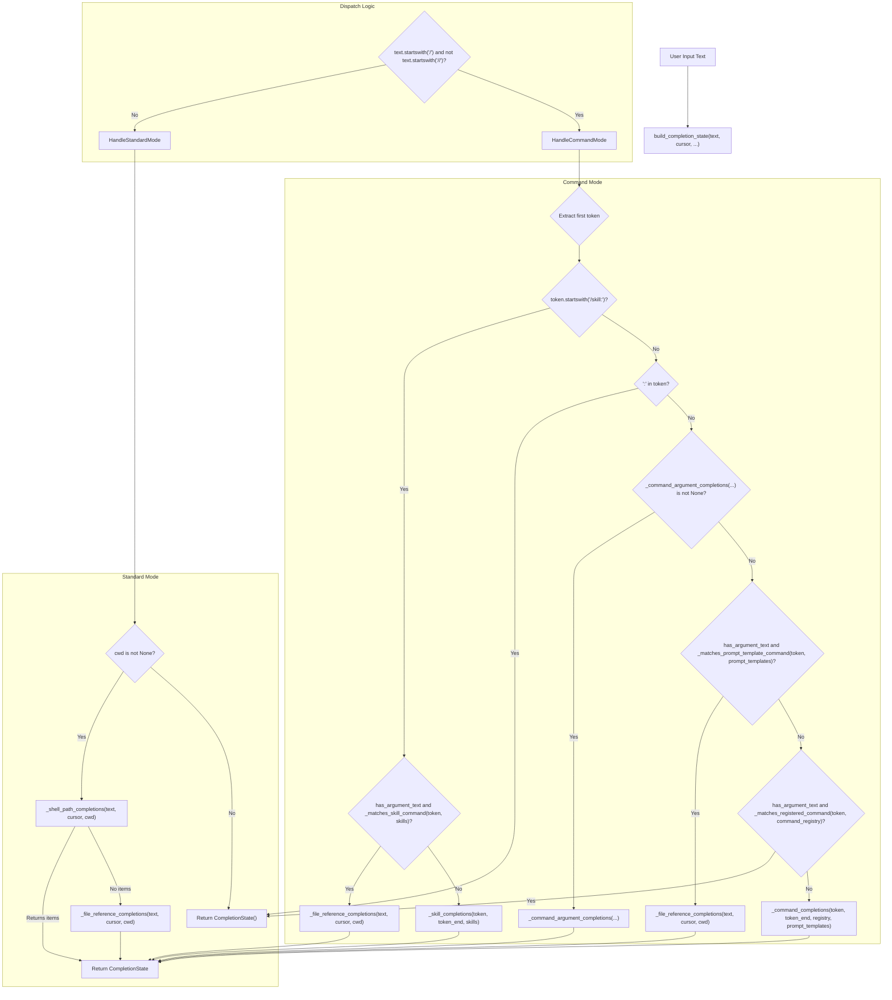
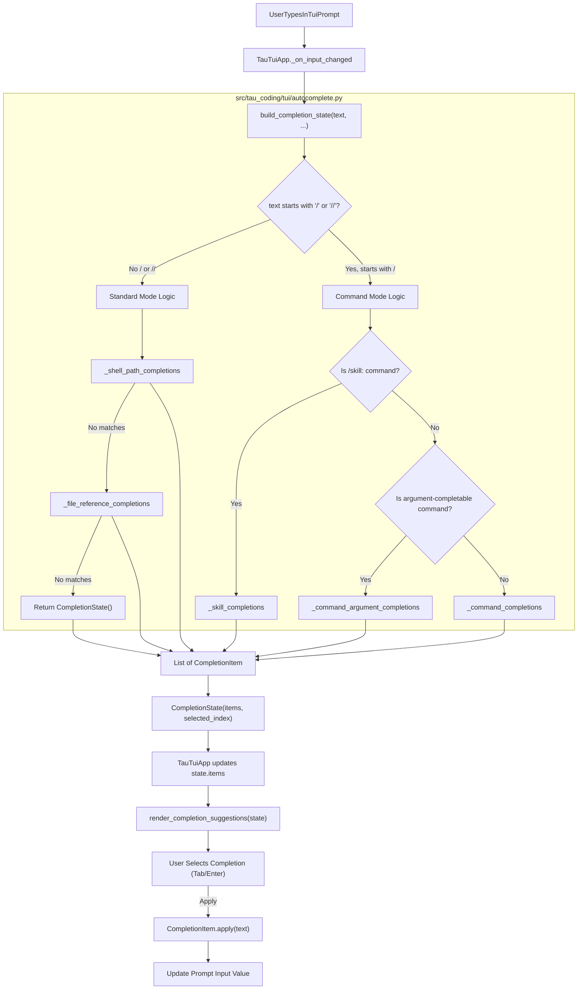

<!-- source: DeepWiki mcp.deepwiki.com · repo huggingface/tau · page 8.2 TUI Autocomplete Engine · fetched 2026-10-26 -->

# TUI Autocomplete Engine

<details>
<summary>Relevant source files</summary>

The following files were used as context for generating this wiki page:

- [src/tau_coding/tui/autocomplete.py](src/tau_coding/tui/autocomplete.py)
- [tests/test_tui_autocomplete.py](tests/test_tui_autocomplete.py)

</details>


This page details the implementation of the autocomplete engine within Tau's Terminal User Interface (TUI). It covers how completion suggestions are generated, the data structures used to represent them, the logic for dispatching to different completion modes (command, file reference, shell path, and argument-specific), and how these suggestions are ranked and categorized. The core logic resides in `src/tau_coding/tui/autocomplete.py` [src/tau_coding/tui/autocomplete.py:1-28]().

## Core Components

The autocomplete engine relies on two primary data structures: `CompletionItem` and `CompletionState`. The `build_completion_state()` function is the central entry point for generating completion suggestions based on the current prompt input.

### `CompletionItem`

The `CompletionItem` dataclass represents a single selectable completion suggestion [src/tau_coding/tui/autocomplete.py:52-63]().

```python
@dataclass(frozen=True, slots=True)
class CompletionItem:
    display: str
    replacement: str
    start: int
    end: int
    kind: CompletionKind
    description: str | None = None
    category: str | None = None

    def apply(self, text: str) -> str:
        return f"{text[: self.start]}{self.replacement}{text[self.end :]}"
```

*   `display`: The string shown to the user in the completion list [src/tau_coding/tui/autocomplete.py:55]().
*   `replacement`: The string that will replace the current input segment if this item is selected [src/tau_coding/tui/autocomplete.py:56]().
*   `start`: The starting index in the original input text where the replacement should begin [src/tau_coding/tui/autocomplete.py:57]().
*   `end`: The ending index in the original input text where the replacement should end [src/tau_coding/tui/autocomplete.py:58]().
*   `kind`: The source of the completion, defined by `CompletionKind` enum (e.g., `COMMAND`, `FILE_REFERENCE`, `SKILL`) [src/tau_coding/tui/autocomplete.py:59]().
*   `description`: An optional longer description for the item, displayed alongside it [src/tau_coding/tui/autocomplete.py:60]().
*   `category`: An optional category string used for grouping and rendering (e.g., "Commands", "Custom prompts") [src/tau_coding/tui/autocomplete.py:61]().

The `apply()` method [src/tau_coding/tui/autocomplete.py:63-66]() facilitates inserting the `replacement` string into the original `text` at the specified `start` and `end` indices. The `cursor_after_apply()` method [src/tau_coding/tui/autocomplete.py:68-71]() calculates the new cursor position after applying the completion.

Sources:
* [src/tau_coding/tui/autocomplete.py:52-71]()

### `CompletionState`

The `CompletionState` dataclass holds the current set of completion items and the index of the currently selected item [src/tau_coding/tui/autocomplete.py:74-102]().

```python
@dataclass(frozen=True, slots=True)
class CompletionState:
    items: tuple[CompletionItem, ...] = ()
    selected_index: int = 0

    @property
    def selected(self) -> CompletionItem | None:
        # ...
    def select_next(self) -> CompletionState:
        # ...
    def select_previous(self) -> CompletionState:
        # ...
```

*   `items`: A tuple of `CompletionItem` objects representing all available suggestions [src/tau_coding/tui/autocomplete.py:77]().
*   `selected_index`: The index of the currently highlighted item in the `items` tuple [src/tau_coding/tui/autocomplete.py:78]().

It provides methods `selected()`, `select_next()`, and `select_previous()` for navigating through the suggestions by returning new immutable state instances [src/tau_coding/tui/autocomplete.py:80-102]().

Sources:
* [src/tau_coding/tui/autocomplete.py:74-102]()

## `build_completion_state()` Logic

The `build_completion_state()` function [src/tau_coding/tui/autocomplete.py:106-175]() is responsible for orchestrating the autocomplete process. It takes the current input `text` and various context objects (e.g., `command_registry`, `skills`, `prompt_templates`, `cwd`) to generate a `CompletionState`.

### Dispatch Logic

The function dispatches to different completion strategies based on the input `text`:

1.  **Standard Mode (Non-command)**: If the text does not start with `/` or starts with `//` (which is treated as a literal comment), it checks for file reference completions (`@`) or shell path completions (`!`) [src/tau_coding/tui/autocomplete.py:123-129]().
    *   If `cwd` is provided, it first attempts `_shell_path_completions()` [src/tau_coding/tui/autocomplete.py:125-127]().
    *   If no shell path completions, it attempts `_file_reference_completions()` [src/tau_coding/tui/autocomplete.py:128]().
    *   If no `cwd` or no matches, an empty `CompletionState` is returned [src/tau_coding/tui/autocomplete.py:129]().

2.  **Command Mode**: If the text starts with `/` (and not `//`), it's treated as a command.
    *   **Skill Command (`/skill:`)**: If the token starts with `/skill:`, it calls `_skill_completions()` [src/tau_coding/tui/autocomplete.py:134-142](). If a skill name is already fully typed and followed by a space, file reference completions are still available for the skill's arguments [src/tau_coding/tui/autocomplete.py:135-141]().
    *   **Argument Completions**: If the command token does not contain a colon (`:`) (excluding `/skill:`), it attempts `_command_argument_completions()` for specific commands like `/model`, `/login`, `/resume`, `/theme` [src/tau_coding/tui/autocomplete.py:147-158]().
    *   **Prompt Template Arguments**: If argument completions are not found and the command matches a prompt template, file reference completions are offered for its arguments [src/tau_coding/tui/autocomplete.py:160-163]().
    *   **Registered Command Arguments**: If argument completions are not found and the command matches a registered command, no further completions are offered for its arguments [src/tau_coding/tui/autocomplete.py:165-166]().
    *   **General Command Completions**: If no argument-specific completions are found, or if the command is fully typed and arguments follow, it falls back to `_command_completions()` [src/tau_coding/tui/autocomplete.py:168-174](). This includes registered slash commands and custom prompt templates.

#### Autocomplete Engine Dispatch Flow



Sources:
* [src/tau_coding/tui/autocomplete.py:106-175]()

### File Reference Completions (`@`)

The `_file_reference_completions()` function provides suggestions for file paths prefixed with `@` [src/tau_coding/tui/autocomplete.py:178-207]().

*   It identifies the active file reference token using `_active_file_reference_token()` [src/tau_coding/tui/autocomplete.py:179]().
*   It handles external references (e.g., `../`) via `_external_file_reference_completions()` [src/tau_coding/tui/autocomplete.py:184-191]().
*   It iterates through files and directories in the `cwd` using `_iter_file_reference_paths()` [src/tau_coding/tui/autocomplete.py:194](), filtering out ignored paths defined in `IGNORED_FILE_COMPLETION_DIRS` (e.tau_coding.g., `.git`, `.venv`, `node_modules`) [src/tau_coding/tui/autocomplete.py:14-28]().
*   Suggestions are limited by `MAX_FILE_COMPLETIONS` (default 50) [src/tau_coding/tui/autocomplete.py:30]().
*   The `display` format includes a trailing slash for directories [src/tau_coding/tui/autocomplete.py:198]().

Sources:
* [src/tau_coding/tui/autocomplete.py:14-30]()
* [src/tau_coding/tui/autocomplete.py:178-207]()

### Shell Path Completions (`!`)

The `_shell_path_completions()` function handles completions for shell commands and their arguments, specifically for paths when the input starts with `!` [src/tau_coding/tui/autocomplete.py:239-264]().

*   It detects if the input is a shell command using `_shell_command_prefix_span()` [src/tau_coding/tui/autocomplete.py:240]().
*   It then identifies the active path token within the shell command using `_active_shell_path_token()` [src/tau_coding/tui/autocomplete.py:244]().
*   The `_parse_shell_path_token()` function extracts the path components [src/tau_coding/tui/autocomplete.py:249]().
*   `_iter_shell_path_completions()` generates potential path completions, considering both files and directories [src/tau_coding/tui/autocomplete.py:252]().
*   Completions are formatted with a trailing space for files or a trailing slash for directories to facilitate further argument input [src/tau_coding/tui/autocomplete.py:258-263]().

Sources:
* [src/tau_coding/tui/autocomplete.py:239-264]()

### Argument Completions

Specific commands like `/model`, `/login`, `/resume`, and `/theme` have dedicated argument completion logic within `_command_argument_completions()` [src/tau_coding/tui/autocomplete.py:267-324]().

*   **`/model`**: Suggests available `model_names` and `provider_names` [src/tau_coding/tui/autocomplete.py:274-281](), as well as `thinking_levels` [src/tau_coding/tui/autocomplete.py:282-289]().
*   **`/login`**: Suggests `provider_names` from the catalog [src/tau_coding/tui/autocomplete.py:291-296]().
*   **`/resume`**: Suggests `session_ids` or descriptive `session_options` [src/tau_coding/tui/autocomplete.py:298-303]().
*   **`/theme`**: Suggests available TUI `theme_names` [src/tau_coding/tui/autocomplete.py:305-310]().

These completions use the `CompletionOption` dataclass [src/tau_coding/tui/autocomplete.py:33-40]() to pass picker metadata before conversion to `CompletionItem`.

Sources:
* [src/tau_coding/tui/autocomplete.py:33-40]()
* [src/tau_coding/tui/autocomplete.py:267-324]()

### Command and Skill Completions

*   **Command Completions**: `_command_completions()` [src/tau_coding/tui/autocomplete.py:327-373]() generates suggestions for registered slash commands from the `CommandRegistry` [src/tau_coding/commands.py:10](). It also includes custom `prompt_templates` as commands [src/tau_coding/prompt_templates.py:11]().
    *   It considers both canonical command names and their aliases/search terms [src/tau_coding/tui/autocomplete.py:334-335]().
    *   The `/skill:` command is handled specially to ensure it's always suggested with a trailing colon [src/tau_coding/tui/autocomplete.py:340-345]().
*   **Skill Completions**: `_skill_completions()` [src/tau_coding/tui/autocomplete.py:376-394]() provides suggestions for skill names after `/skill:`.
    *   It filters `skills` based on the input prefix [src/tau_coding/skills.py:13]().
    *   The replacement text includes the full `/skill:<name>` format.

Sources:
* [src/tau_coding/tui/autocomplete.py:327-373]()
* [src/tau_coding/tui/autocomplete.py:376-394]()

## Ranking and Categorization

Completions are ranked and categorized to improve user experience.

*   **Prioritization**: Direct matches for commands are prioritized over matches found via search terms [tests/test_tui_autocomplete.py:113-125](). For example, `/res` will suggest `/resume` before `/new` (which might match via a "clear" or "reset" search term) [tests/test_tui_autocomplete.py:121-124]().
*   **Categorization**: `CompletionItem`s use the `category` field [src/tau_coding/tui/autocomplete.py:61]() to group suggestions in the UI, such as "Commands" and "Custom prompts" [tests/test_tui_autocomplete.py:42-44]().
*   **Display**: The `render_completion_suggestions()` function handles the visual rendering, including aligning wrapped descriptions to the suggestion display name [tests/test_tui_autocomplete.py:54-76]().

Sources:
* [src/tau_coding/tui/autocomplete.py:61]()
* [tests/test_tui_autocomplete.py:42-76]()
* [tests/test_tui_autocomplete.py:113-125]()

## Autocomplete Data Flow

The following diagram bridges the user input space to the code entities responsible for processing and rendering completions.



Sources:
* [src/tau_coding/tui/autocomplete.py:89-175]()
* [src/tau_coding/tui/autocomplete.py:178-207]()
* [src/tau_coding/tui/autocomplete.py:239-264]()
* [src/tau_coding/tui/autocomplete.py:267-324]()
* [src/tau_coding/tui/autocomplete.py:327-373]()
* [src/tau_coding/tui/autocomplete.py:376-394]()
* [tests/test_tui_autocomplete.py:8-10]()

---

