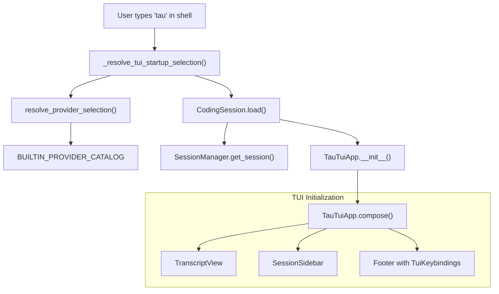
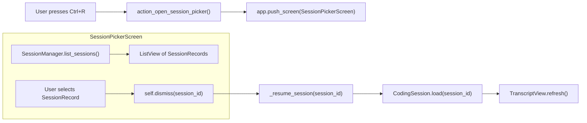

<!-- source: DeepWiki mcp.deepwiki.com · repo huggingface/tau · page 9.1 TauTuiApp: Application Logic and Event Flow · fetched 2026-10-26 -->

# TauTuiApp: Application Logic and Event Flow

Relevant source files

The following files were used as context for generating this wiki page:

- [dev-notes/architecture/resume-picker-search.md](dev-notes/architecture/resume-picker-search.md)
- [dev-notes/architecture/tui-terminal-tab-title.md](dev-notes/architecture/tui-terminal-tab-title.md)
- [dev-notes/architecture/tui-turn-notifications.md](dev-notes/architecture/tui-turn-notifications.md)
- [dev-notes/herdr-textual-mouse-compatibility.md](dev-notes/herdr-textual-mouse-compatibility.md)
- [dev-notes/tui-file-drop.md](dev-notes/tui-file-drop.md)
- [src/tau_coding/tui/app.py](src/tau_coding/tui/app.py)
- [src/tau_coding/tui/file_drop.py](src/tau_coding/tui/file_drop.py)
- [src/tau_coding/tui/terminal_notification.py](src/tau_coding/tui/terminal_notification.py)
- [src/tau_coding/tui/terminal_title.py](src/tau_coding/tui/terminal_title.py)
- [src/tau_coding/tui/widgets.py](src/tau_coding/tui/widgets.py)
- [tests/test_terminal_notification.py](tests/test_terminal_notification.py)
- [tests/test_terminal_title.py](tests/test_terminal_title.py)
- [tests/test_tui_app.py](tests/test_tui_app.py)
- [tests/test_tui_file_drop.py](tests/test_tui_file_drop.py)

## Purpose and Scope

This page provides a technical deep dive into `TauTuiApp`, the Textual-based terminal user interface application class for Tau `[src/tau_coding/tui/app.py:277-280]()`. It covers initialization and startup flows, prompt worker lifecycle, event processing, command routing, modal picker screens, file drag-and-drop handling, terminal tab titles, turn completion notifications, and the extension UI bridge.

---

## Overview of TauTuiApp

`TauTuiApp` inherits from `textual.app.App` and acts as the central event and UI coordinator for interactive coding sessions `[src/tau_coding/tui/app.py:277-280]()`. 

### Key Responsibilities
*   **Event Translation**: Converts `AgentEvent` and `ProviderEvent` streams into `TuiState` mutations via `TuiEventAdapter` `[src/tau_coding/tui/app.py:321]()`.
*   **Worker Management**: Executes asynchronous agent loops inside background Textual `Worker` instances to keep the terminal responsive `[src/tau_coding/tui/app.py:839-842]()`.
*   **Command Processing**: Dispatches slash commands (`/model`, `/compact`, etc.) and terminal commands (`!`) to the underlying `CodingSession` and command registries `[src/tau_coding/tui/app.py:946-951]()`.
*   **Modal Orchestration**: Manages auxiliary picker and configuration screens (sessions, models, themes, logins, prompts).
*   **Environment Integration**: Manages terminal window titles (`TerminalTitleController`) `[src/tau_coding/tui/terminal_title.py:75-124]()` and desktop attention notifications (`TerminalNotificationController`) `[src/tau_coding/tui/terminal_notification.py:72-115]()`.

Sources: `[src/tau_coding/tui/app.py:277-330]`, `[src/tau_coding/tui/app.py:839-842]`, `[src/tau_coding/tui/app.py:946-951]`, `[src/tau_coding/tui/terminal_title.py:75-125]`, `[src/tau_coding/tui/terminal_notification.py:72-115]()`

---

## Startup and Initialization

The TUI is launched via `run_tui_app()` `[src/tau_coding/tui/app.py:1666-1672]()`. Before instantiation, it resolves the initial provider selection, credential state, and target session using `_resolve_tui_startup_selection()` `[src/tau_coding/tui/app.py:1606-1664]()`.

### Startup Flow Diagram

"Natural Language Space" to "Code Entity Space": Startup Resolution

Sources: `[src/tau_coding/tui/app.py:1606-1664]`, `[src/tau_coding/provider_config.py:133-158]`, `[src/tau_coding/session.py:168-185]`, `[src/tau_coding/tui/app.py:332-376]()`

---

## The Prompt Worker and Event Flow

When a user submits a prompt, `TauTuiApp` spawns a background worker thread via `_run_prompt()` `[src/tau_coding/tui/app.py:823-837]()`. This worker consumes the asynchronous event stream returned by `CodingSession.prompt()`.

### Event Processing Loop
1.  **Submission**: `action_submit_prompt` `[src/tau_coding/tui/app.py:785-802]()` extracts the input text and invokes `session.prompt()`.
2.  **Worker Execution**: `_run_prompt()` iterates over incoming `AgentEvent` items.
3.  **State Update**: Events pass through `_apply_streaming_transcript_event()` `[src/tau_coding/tui/app.py:923-936]`, modifying the `TuiState`.
4.  **UI Refresh**: The `TuiEventAdapter` updates widget structures inside the `TranscriptView`.

### Steering vs. Follow-up
Tau supports queuing messages while the agent loop is active:
*   **Steering**: Injected immediately after the current turn completes. Triggered by pressing `Enter` while a run is underway `[src/tau_coding/tui/app.py:813-821]()`.
*   **Follow-up**: Queued for execution only after the agent settles completely. Triggered by pressing `Alt-Enter` `[src/tau_coding/tui/app.py:804-811]()`.

Sources: `[src/tau_coding/tui/app.py:823-936]`, `[src/tau_coding/tui/app.py:785-821]`, `[src/tau_coding/tui/adapter.py:28-40]()`

---

## Terminal Command Execution

The TUI allows users to execute shell commands directly from the prompt input by prefixing them with `!` (e.g., `!git status`).

### Implementation: `_run_terminal_command()`
When a prompt starts with `!`, `_handle_command` delegates to `_run_terminal_command()` `[src/tau_coding/tui/app.py:1016-1049]()`:
*   Parses the command using `parse_terminal_command()` `[src/tau_coding/session.py:86]()`.
*   Executes the subprocess within the session's current working directory (`session.cwd`).
*   Wraps the execution outcome in a `TerminalCommandResult` `[src/tau_coding/session.py:141-147]()` and appends it to `TuiState` as a chat item with the `terminal_command` role `[src/tau_coding/tui/state.py:102]()`.

Sources: `[src/tau_coding/tui/app.py:1016-1049]`, `[src/tau_coding/session.py:141-147]`, `[src/tau_coding/tui/state.py:102]()`

---

## Modal Screens and Pickers

Tau employs Textual `ModalScreen` instances for multi-step interactions, list selection, and auxiliary dialogs without disrupting the primary transcript.

| Screen Class | Purpose | Trigger Mechanism |
| :--- | :--- | :--- |
| `SessionPickerScreen` | Lists historical sessions from `SessionManager`. | `Ctrl+R` or `/resume` `[src/tau_coding/tui/app.py:1212-1240]()` |
| `TreePickerScreen` | Visualizes the branching session tree. | `/tree` `[src/tau_coding/tui/app.py:1270-1300]()` |
| `ModelPickerScreen` | Selection of providers and underlying models. | `/model` `[src/tau_coding/tui/app.py:1400-1430]()` |
| `ThemePickerScreen` | Switching active TUI color themes. | `/theme` `[src/tau_coding/tui/app.py:1558-1580]()` |
| `CommandOutputScreen` | Displays multi-line output for `/help` or `/status`. | Slash commands `[src/tau_coding/tui/app.py:1100-1130]()` |
| `OAuthLoginScreen` | Manages OAuth authentication flows. | `/login` `[src/tau_coding/tui/app.py:1320-1360]()` |
| `PromptTemplatePickerScreen` | Selects and edits prompt templates. | `/prompt` `[src/tau_coding/tui/app.py:126-127]()` |
| `SkillPickerScreen` | Selects and inspects skills. | `/skill` `[src/tau_coding/tui/app.py:130-131]()` |
| `LocalBackendPickerScreen` | Manages local model backends. | `/local` `[src/tau_coding/tui/local_backends.py:170-175]()` |

### Modal Logic Flow

"Natural Language Space" to "Code Entity Space": Modal Interaction

Sources: `[src/tau_coding/tui/app.py:1212-1240]`, `[src/tau_coding/tui/app.py:1400-1430]`, `[src/tau_coding/tui/app.py:1558-1580]`, `[src/tau_coding/tui/app.py:1077-1099]`, `[src/tau_coding/tui/app.py:126-127]`, `[src/tau_coding/tui/app.py:130-131]`, `[src/tau_coding/tui/local_backends.py:170-175]()`

---

## Command Handling Logic

The dispatcher method `_handle_command()` `[src/tau_coding/tui/app.py:938-1014]()` processes all non-plain-text prompt submissions:

1.  **Slash Commands**: If the string begins with `/`, it is dispatched to `session.handle_command()` `[src/tau_coding/tui/app.py:946]()`.
    *   If `resume_session_id` is returned, the app calls `_resume_session()` `[src/tau_coding/tui/app.py:954]()`.
    *   If `new_session_requested` is true, it invokes `_new_session()` `[src/tau_coding/tui/app.py:958]()`.
    *   If `tree_picker_requested` is true, it pushes `TreePickerScreen` `[src/tau_coding/tui/app.py:962]()`.
2.  **Terminal Commands**: If the string begins with `!`, execution delegates to `_run_terminal_command()` `[src/tau_coding/tui/app.py:1008]()`.
3.  **Natural Language Prompts**: All other inputs pass directly into `_run_prompt()` `[src/tau_coding/tui/app.py:1012]()`.

Sources: `[src/tau_coding/tui/app.py:938-1014]`, `[src/tau_coding/session.py:1330-1370]`, `[src/tau_coding/commands.py:27-50]()`

---

## Large Paste Handling

When a user pastes a large amount of text into the prompt, `PromptInput` `[src/tau_coding/tui/app.py:125]()` handles it specially to prevent UI freezes. If the pasted text exceeds `PASTE_DISPLAY_THRESHOLD` `[src/tau_coding/tui/app.py:205]()` (default 1000 characters), it is replaced with a placeholder `[src/tau_coding/tui/app.py:600-604]()`. The full content is still sent to the agent, but the UI remains responsive.

Sources: `[src/tau_coding/tui/app.py:125]`, `[src/tau_coding/tui/app.py:205]`, `[src/tau_coding/tui/app.py:600-604]()`

---

## File Drop Handling

Tau supports dragging and dropping files from an OS file manager directly onto the terminal window, inserting their paths into the prompt input `[src/tau_coding/tui/file_drop.py:1-20]()`.

*   **Detection**: Terminals transmit drag-and-drop actions by typing path strings into stdin. Under bracketed-paste mode, this arrives as a single `textual.events.Paste` message `[dev-notes/tui-file-drop.md:8-12]()`.
*   **Normalization**: `normalize_dropped_paths()` `[src/tau_coding/tui/file_drop.py:31-61]()` verifies whether the pasted payload consists exclusively of valid absolute paths on disk, resolving shell escapes, quoted strings, and `file://` URIs.
*   **Unfocused Drops**: Certain sources (such as the macOS Dock downloads stack) drop files while the terminal window is unfocused. `TauTuiApp.on_paste()` `[src/tau_coding/tui/app.py:549-556]()` intercepts pastes bubbling up when `self.focused is None` and safely roots them to the prompt input `[dev-notes/tui-file-drop.md:41-67]()`.

Sources: `[src/tau_coding/tui/file_drop.py:31-61]`, `[src/tau_coding/tui/app.py:549-556]`, `[dev-notes/tui-file-drop.md:1-93]()`

---

## Terminal Title and Turn Notifications

Tau manages auxiliary terminal integration features to improve background awareness.

### Terminal Tab Titles
The `TerminalTitleController` `[src/tau_coding/tui/terminal_title.py:75-124]()` emits OSC 0 sequences to keep the terminal window or tab title synchronized with the active session name and running state `[dev-notes/architecture/tui-terminal-tab-title.md:7-15]()`. When an agent task executes, an animated Braille spinner prefix is displayed alongside the session title. The controller is designed to be robust, disabling itself if a write operation fails `[src/tau_coding/tui/terminal_title.py:98-103]()`.

### Turn Completion Notifications
The `TerminalNotificationController` `[src/tau_coding/tui/terminal_notification.py:72-115]()` triggers desktop attention alerts or terminal bells when an agent turn fully settles (`AgentSettledEvent`) while the terminal window is unfocused `[dev-notes/architecture/tui-turn-notifications.md:7-33]()`. It supports OSC 9 (Ghostty, iTerm2, MinTTY) and OSC 99 (Kitty) protocols, alongside fallback bell modes (`"bell"` / `"off"`).

Sources: `[src/tau_coding/tui/terminal_title.py:75-125]`, `[src/tau_coding/tui/terminal_notification.py:72-116]`, `[dev-notes/architecture/tui-terminal-tab-title.md:1-70]`, `[dev-notes/architecture/tui-turn-notifications.md:1-54]`, `[src/tau_coding/tui/terminal_title.py:98-103]()`

---

## Bounded Transcript Performance

To maintain high responsiveness during extended coding sessions, `TranscriptView` implements windowed DOM mounting `[dev-notes/architecture/tui-long-transcript-performance.md:4-6]()`:
*   **Windowing**: Only a contiguous subset of items from `TuiState.items` is mounted in the active layout at any given time `[dev-notes/architecture/tui-long-transcript-performance.md:29-32]()`.
*   **Targeted Updates**: Incremental changes (such as streaming chunks or tool completions) mutate specific widget rows rather than re-rendering the entire history list `[dev-notes/architecture/tui-long-transcript-performance.md:40-52]()`.

Sources: `[dev-notes/architecture/tui-long-transcript-performance.md:1-79]`, `[src/tau_coding/tui/widgets.py:138]()`

---

## Extension Bridge: _TuiExtensionUiBridge

The `_TuiExtensionUiBridge` `[src/tau_coding/tui/app.py:228-274]()` exposes an abstraction layer that permits Python extensions to interact with the TUI without direct Textual coupling:
*   **Notifications**: Bridges extension messages into `app.notify()` calls.
*   **Dialogs**: Implements asynchronous `confirm()`, `prompt()`, and `select()` routines that push modal screens `[src/tau_coding/tui/app.py:252-274]()`.
*   **Custom Slots**: Enables extensions to register custom widgets into designated sidebar and panel slots via `SlotWidgetFactory` `[src/tau_coding/tui/app.py:89]()`.

Sources: `[src/tau_coding/tui/app.py:228-274]`, `[src/tau_coding/tui/app.py:89]()`

---

