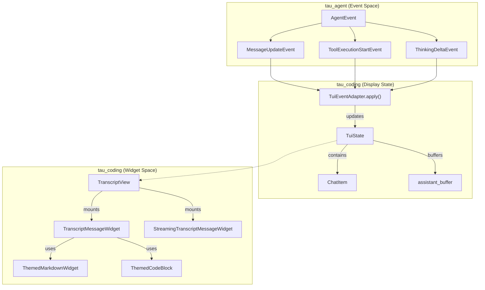
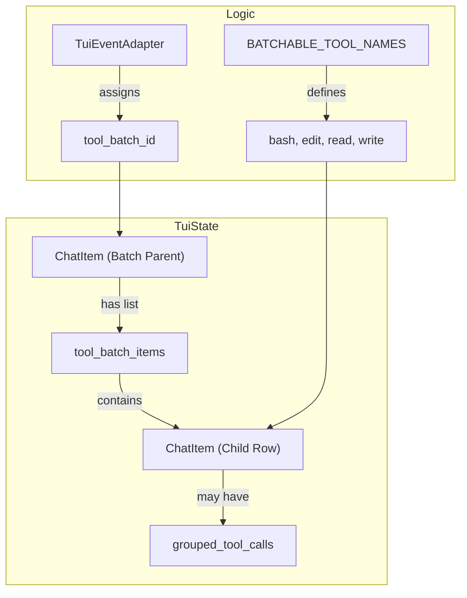
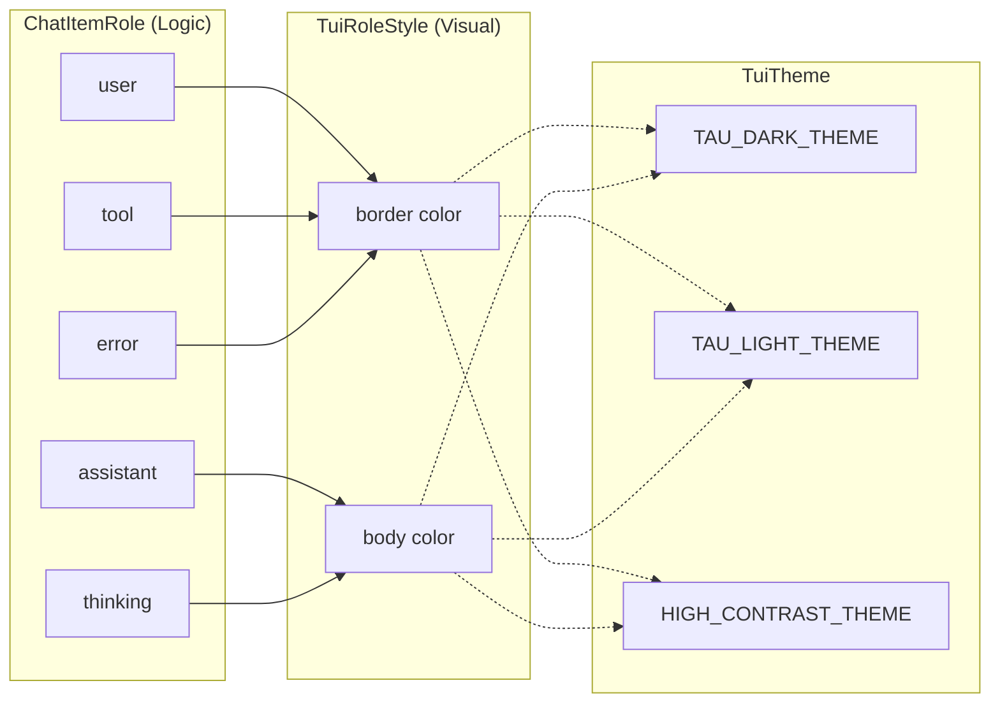

<!-- source: DeepWiki mcp.deepwiki.com · repo huggingface/tau · page 9.2 TUI Widgets and Transcript Rendering · fetched 2026-10-26 -->

# TUI Widgets and Transcript Rendering

Relevant source files

The following files were used as context for generating this wiki page:

- [dev-notes/extension-sidebar-sections.md](dev-notes/extension-sidebar-sections.md)
- [dev-notes/openai-reasoning-summary-boundaries.md](dev-notes/openai-reasoning-summary-boundaries.md)
- [dev-notes/tui-compact-bash-invocations.md](dev-notes/tui-compact-bash-invocations.md)
- [dev-notes/tui-grouped-read-calls.md](dev-notes/tui-grouped-read-calls.md)
- [dev-notes/tui-sidebar-file-editor.md](dev-notes/tui-sidebar-file-editor.md)
- [dev-notes/tui-sidebar-session-insights.md](dev-notes/tui-sidebar-session-insights.md)
- [dev-notes/tui-tool-batches.md](dev-notes/tui-tool-batches.md)
- [examples/extensions/sidebar_status.py](examples/extensions/sidebar_status.py)
- [src/tau_coding/data/examples/extensions/sidebar_status.py](src/tau_coding/data/examples/extensions/sidebar_status.py)
- [src/tau_coding/extensions/__init__.py](src/tau_coding/extensions/__init__.py)
- [src/tau_coding/tui/app.py](src/tau_coding/tui/app.py)
- [src/tau_coding/tui/widgets.py](src/tau_coding/tui/widgets.py)
- [tests/test_tui_app.py](tests/test_tui_app.py)
- [tests/test_tui_components.py](tests/test_tui_components.py)

The Tau Terminal User Interface (TUI) is built on the **Textual** framework, utilizing a custom widget hierarchy to render the agent's reasoning, tool executions, and conversation history. The rendering system translates raw agent events into a structured, themed transcript while maintaining high performance during streaming and supporting complex tool-call grouping.

## Rendering Architecture

The rendering pipeline follows a three-stage transformation process to ensure the TUI remains responsive and decoupled from the agent's internal logic.

1.  **Event Emission**: `CodingSession` or `run_agent_loop` emits `AgentEvent` objects [src/tau_coding/tui/adapter.py:3-12]().
2.  **State Adaptation**: The `TuiEventAdapter` [src/tau_coding/tui/adapter.py:27-28]() processes these events and updates a mutable `TuiState` [src/tau_coding/tui/state.py:81-84]().
3.  **Widget Mounting**: The `TranscriptView` [src/tau_coding/tui/widgets.py:613-614]() reacts to state changes by mounting or updating specialized widgets like `TranscriptMessageWidget` [src/tau_coding/tui/widgets.py:534]() or `StreamingTranscriptMessageWidget` [src/tau_coding/tui/widgets.py:579]().

### Event to State Flow

The following diagram bridges natural language concepts to concrete code entities in the event-to-widget pipeline.

**Data Flow: Agent Events to TUI Widgets**

Sources: [src/tau_coding/tui/adapter.py:35-150](), [src/tau_coding/tui/state.py:81-115](), [src/tau_coding/tui/widgets.py:613-630]()

Sources: [src/tau_coding/tui/adapter.py:3-28](), [src/tau_coding/tui/widgets.py:534-630]()

## Transcript Widgets

### TranscriptView and Follow Mode
`TranscriptView` is a `VerticalScroll` container that manages the lifecycle of chat items [src/tau_coding/tui/widgets.py:613-614](). It implements a **Follow Mode** scroll anchor: if the user is scrolled to the bottom, the view automatically scrolls to reveal new content; if the user scrolls up to inspect history, auto-scrolling is suspended [src/tau_coding/tui/widgets.py:652-662]().

### TranscriptMessageWidget
This widget represents a single, finalized message in the transcript [src/tau_coding/tui/widgets.py:534-535]().
*   **Gutter**: A visual vertical bar colored according to the message role style [src/tau_coding/tui/widgets.py:567-568]().
*   **Body**: Renders content using `ThemedMarkdownWidget` for assistant/user messages or specialized blocks for tool results [src/tau_coding/tui/widgets.py:534-541]().
*   **Selection**: Implements `selection_text` to allow users to copy clean text (without TUI artifacts) to the clipboard [src/tau_coding/tui/widgets.py:554-557]().

### StreamingTranscriptMessageWidget
A specialized version of the message widget used for real-time streaming [src/tau_coding/tui/widgets.py:579-580](). It uses a `MarkdownStream` [src/tau_coding/tui/widgets.py:33]() to incrementally render Markdown as tokens arrive from the LLM, preventing the "flicker" associated with full-widget re-renders [src/tau_coding/tui/widgets.py:589-593]().

Sources: [src/tau_coding/tui/widgets.py:534-662](), [src/tau_coding/tui/state.py:56-78]()

## Tool Call Grouping and Batches

Tau implements sophisticated grouping for tool calls to reduce transcript noise.

*   **Grouped File Calls**: Adjacent `read`, `edit`, or `write` calls are combined into a single presentation group [dev-notes/tui-grouped-read-calls.md:9-11](). For example, multiple file reads appear as "Read 4 files" with a bulleted list of paths [dev-notes/tui-grouped-read-calls.md:13-18]().
*   **Tool Batches**: Contiguous tool-call runs from a single assistant message share one transcript message block [dev-notes/tui-tool-batches.md:10-11](). Each line maintains its own status color (orange for running, green for success, red for error) [dev-notes/tui-tool-batches.md:22-23]().
*   **Compact Bash Invocations**: Bash commands now require a `description` field in the tool call. The TUI displays this description compactly, normalizing whitespace, and only reveals the full command and result upon expansion (`Ctrl+O`) [dev-notes/tui-compact-bash-invocations.md:9-12](). If no description is provided, a generic "Running shell command" label is used [dev-notes/tui-compact-bash-invocations.md:16-17]().
*   **Expansion**: Pressing `Ctrl+O` expands these groups to show individual invocations and results [dev-notes/tui-tool-batches.md:27-31]().

### Entity Relationship: Batched Chat Items

The following diagram illustrates how chat items and batch identifiers map to state properties in the TUI architecture.

**Entity Relationship: Batched Chat Items**

Sources: [src/tau_coding/tui/state.py:36-73](), [src/tau_coding/tui/adapter.py:102-115](), [dev-notes/tui-tool-batches.md:43-52]()

Sources: [src/tau_coding/tui/state.py:36-73](), [src/tau_coding/tui/adapter.py:102-115]()

## Content Rendering Components

### ThemedMarkdown and Code Blocks
Tau uses a customized Markdown pipeline to ensure consistent styling with the TUI theme.
*   **ThemedMarkdownWidget**: Overrides standard Textual Markdown blocks to apply `TauMarkdownBlock` [src/tau_coding/tui/widgets.py:407-410]().
*   **TauMarkdownBlock**: Customizes how tokens are converted to content, specifically applying the `tau_link_style` for inline links [src/tau_coding/tui/widgets.py:370-404]().
*   **ThemedCodeBlock**: A static widget that uses `Pygments` for syntax highlighting within the TUI [src/tau_coding/tui/widgets.py:729-730](). It attempts to resolve lexers by name and falls back to plain text if the language is unknown [src/tau_coding/tui/widgets.py:742-747]().

### Tool Result Rendering
Tool outputs (e.g., shell command results or file reads) are formatted via `render_chat_item` [src/tau_coding/tui/widgets.py:884]().
*   **Truncation**: Large outputs are truncated to prevent TUI lag, governed by `TOOL_RESULT_PREVIEW_LINES` (8 lines) and `TOOL_RESULT_PREVIEW_CHARS` (2,000 characters) [src/tau_coding/tui/state.py:29-31]().
*   **Extension Support**: If an extension provides a `tool_result_renderer`, it is used to generate custom markup for the result [src/tau_coding/tui/state.py:95]().

### Patch and Diff Logic
When the agent uses the `edit` tool, the TUI renders a patch-style diff. The rendering logic detects if the result content looks like a unified diff and applies `ThemedCodeBlock` with a `diff` lexer [src/tau_coding/tui/widgets.py:918-922]().

Sources: [src/tau_coding/tui/widgets.py:370-410](), [src/tau_coding/tui/widgets.py:729-747](), [src/tau_coding/tui/widgets.py:884-922](), [src/tau_coding/tui/state.py:29-31]()

## Sidebar and Metadata

### SessionSidebar
The `SessionSidebar` [src/tau_coding/tui/widgets.py:114-115]() provides a persistent view of the agent's current environment. It implements the `SessionSummarySource` protocol [src/tau_coding/tui/widgets.py:65-66](). The `update_from_session` method [src/tau_coding/tui/widgets.py:146-179]() redraws the sidebar content based on a "fingerprint" of session data to avoid redundant updates [src/tau_coding/tui/widgets.py:153-156]().

The sidebar now shows detailed session insights, including:
*   **Session Name**: The generated or user-assigned session name.
*   **Activity**: User turns and assistant tool calls on the active branch.
*   **Usage**: Cumulative provider-reported input/output tokens, prompt-cache hit rates, and estimated cost.
*   **Compaction Status**: Automatic-compaction status and threshold.
*   **Resources**: Context files, tools, skills, prompt templates, and loaded extensions.

The `SidebarFileItem` [src/tau_coding/tui/widgets.py:124-125]() now allows interactive editing of prompt templates, project context files, and skill files directly within the TUI. Clicking a file item replaces the transcript with a text editor, allowing `Ctrl+S` to save and `Escape` to restore the transcript [dev-notes/tui-sidebar-file-editor.md:5-8]().

Extensions can also add host-framed sections to the sidebar using `context.ui.sidebar.set_section()` [src/tau_coding/extensions/__init__.py:23](), allowing for custom status displays or interactive elements [dev-notes/extension-sidebar-sections.md:11-13]().

| Feature | Description | Code Entity |
| :--- | :--- | :--- |
| **Token Usage** | Displays current estimate vs. threshold | `context_token_estimate` [src/tau_coding/tui/widgets.py:90]() |
| **Model Info** | Current provider and model name | `model`, `provider_name` [src/tau_coding/tui/widgets.py:72-75]() |
| **Resources** | Counts of loaded skills and tools | `skills`, `tools` [src/tau_coding/tui/widgets.py:78-81]() |
| **Context** | List of files currently in the prompt | `context_files` [src/tau_coding/tui/widgets.py:87]() |
| **Session Stats** | Cumulative token usage, cost, and cache hit rates | `session_stats` [src/tau_coding/tui/widgets.py:121]() |
| **Extensions** | List of loaded extension names | `extension_names` [src/tau_coding/tui/widgets.py:119]() |

### CompactSessionInfo
For narrow terminal windows, `CompactSessionInfo` [src/tau_coding/tui/widgets.py:182-183]() collapses the sidebar metadata into a single-line summary [src/tau_coding/tui/widgets.py:198]().

Sources: [src/tau_coding/tui/widgets.py:65-198](), [dev-notes/tui-sidebar-session-insights.md:7-20](), [dev-notes/tui-sidebar-file-editor.md:5-8](), [dev-notes/extension-sidebar-sections.md:11-13]()

## Theming and Visual Styles

The TUI utilizes a `TuiTheme` object to map functional roles to visual styles.

**Visual Mapping: Roles to Styles**

Sources: [src/tau_coding/tui/state.py:28](), [src/tau_coding/tui/config.py:42](), [src/tau_coding/tui/widgets.py:567-568]()

### Key Classes for Styles
*   **TuiRoleStyle**: Defines the `border` and `body` colors for a specific role [src/tau_coding/tui/config.py:42]().
*   **TuiTheme**: A dataclass holding all resolved visual styles for the TUI, including `role_styles` [src/tau_coding/tui/config.py:42]().
*   **Built-in Themes**: Tau ships with `TAU_DARK_THEME`, `TAU_LIGHT_THEME`, and `HIGH_CONTRAST_THEME` [src/tau_coding/tui/config.py:42]().

Sources: [src/tau_coding/tui/config.py:42](), [src/tau_coding/tui/widgets.py:567-568]()

---

