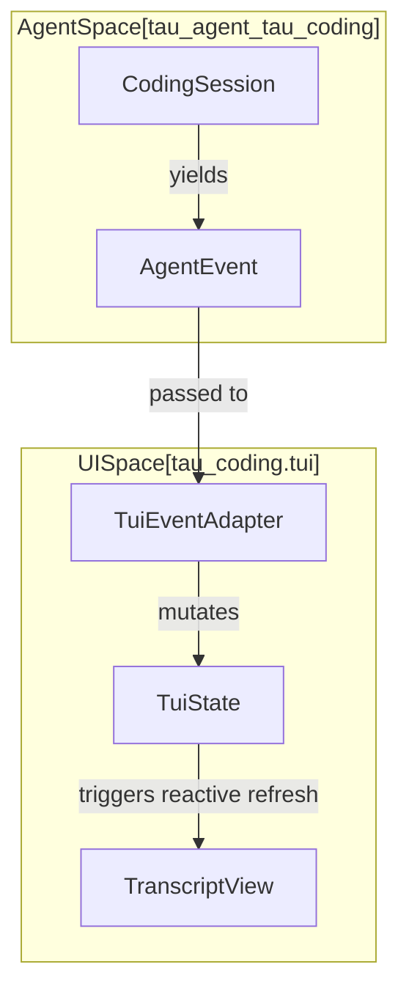
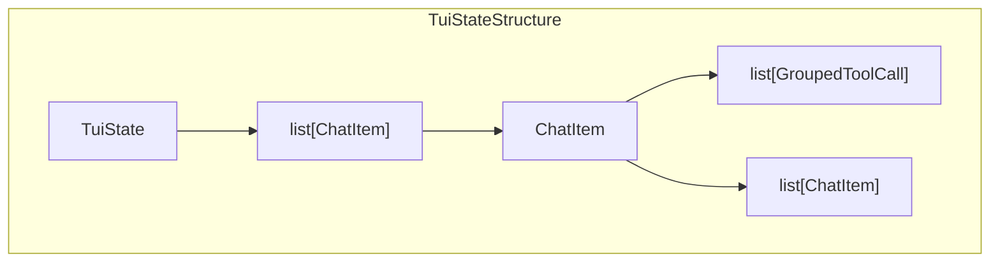
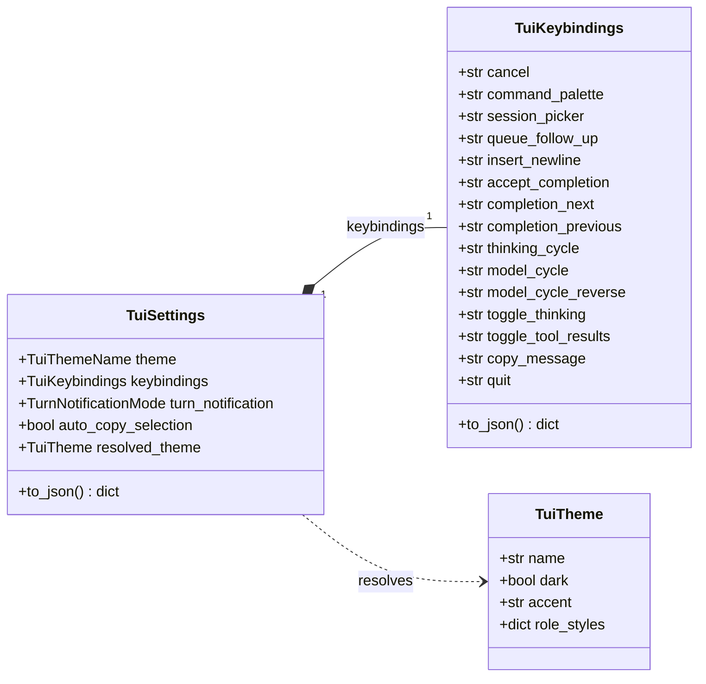

<!-- source: DeepWiki mcp.deepwiki.com · repo huggingface/tau · page 9.3 TUI State, Adapter, and Configuration · fetched 2026-10-26 -->

# TUI State, Adapter, and Configuration

Relevant source files

The following files were used as context for generating this wiki page:

- [dev-notes/architecture/phase-17-tui-autocomplete.md](dev-notes/architecture/phase-17-tui-autocomplete.md)
- [dev-notes/chat-stream-channels.md](dev-notes/chat-stream-channels.md)
- [src/tau_ai/stream.py](src/tau_ai/stream.py)
- [src/tau_coding/tui/adapter.py](src/tau_coding/tui/adapter.py)
- [src/tau_coding/tui/config.py](src/tau_coding/tui/config.py)
- [src/tau_coding/tui/state.py](src/tau_coding/tui/state.py)
- [src/tau_coding/tui/themes/tau-light.json](src/tau_coding/tui/themes/tau-light.json)
- [tests/test_chat_channels.py](tests/test_chat_channels.py)
- [tests/test_tui_adapter.py](tests/test_tui_adapter.py)
- [tests/test_tui_chat_channels.py](tests/test_tui_chat_channels.py)
- [tests/test_tui_config.py](tests/test_tui_config.py)
- [tests/test_tui_themes.py](tests/test_tui_themes.py)
- [website/content/reference/keybindings.md](website/content/reference/keybindings.md)

The Tau TUI is built on the [Textual](https://textual.textualize.io/) framework and maintains a strict separation between portable agent logic and interactive display state. This page details how agent events are transformed into UI elements, how transcript state is managed, and how the TUI is configured and themed.

---

## 1. Event Flow and Architecture

The TUI operates on a unidirectional data flow. The `CodingSession` (which wraps `AgentHarness` and `run_agent_loop`) emits `CodingSessionEvent` and `AgentEvent` objects. These events are intercepted by the `TuiEventAdapter`, which mutates a `TuiState` object [src/tau_coding/tui/adapter.py:27-29](). Textual widgets then react to changes in `TuiState` to update the display.

### Natural Language Space to Code Entity Space

The following mapping associates high-level TUI concepts with their concrete codebase implementations:

| User Concept | Code Entity | File Path |
| :--- | :--- | :--- |
| **The Transcript** | `TuiState.items` | [src/tau_coding/tui/state.py:84]() |
| **Streaming Text** | `TuiState.assistant_buffer` | [src/tau_coding/tui/state.py:85]() |
| **Tool Progress** | `record_tool_update()` | [src/tau_coding/tui/state.py:214-217]() |
| **Theme Styles** | `TuiRoleStyle` | [src/tau_coding/tui/config.py:16]() |
| **Key Maps** | `TuiKeybindings` | [src/tau_coding/tui/config.py:50]() |

Title: TUI Event Flow Architecture

Sources: [src/tau_coding/tui/adapter.py:27-35](), [src/tau_coding/tui/state.py:81-95]()

---

## 2. TUI State, ChatItem, and Tool Batching

The `TuiState` class serves as the single source of truth for the visible transcript [src/tau_coding/tui/state.py:81-83](). Rather than storing full session history, it maintains a flattened list of `ChatItem` objects ready for rendering.

### ChatItem and Roles
A `ChatItem` represents a single rendered block in the conversation [src/tau_coding/tui/state.py:56-78](). Each item defines a `role` (`ChatItemRole`, aliased from `TranscriptRole` [src/tau_coding/tui/state.py:28]()) that dictates its styling:

| Role | Description |
| :--- | :--- |
| `user` | User-authored messages. |
| `assistant` | LLM-generated responses. |
| `tool` | Tool invocations (`read`, `edit`, `write`, `bash`) and their results. |
| `thinking` | Model reasoning tokens. |
| `skill` | Skill invocation records. |
| `error` | Recoverable or fatal errors. |
| `status` | System status updates. |
| `branch_summary` | Summary of a session branch. |
| `compaction_summary` | Summary of a context compaction event. |
| `custom` | Custom messages from extensions. |

Sources: [src/tau_coding/tui/state.py:28-28](), [src/tau_coding/tui/state.py:56-78]()

### Tool Batching and Grouping
To reduce noise during exploration-heavy turns, adjacent built-in tool calls (`read`, `edit`, `write`, `bash`) from the same assistant response are batched and grouped:
- **Grouped Tool Calls (`GroupedToolCall`)**: Multiple adjacent reads, writes, or edits collapse into a single aggregate row (e.g., `Read 4 files`) [src/tau_coding/tui/state.py:42-53]().
- **Tool Batches**: Adjacent mixed tool calls share a single parent `ChatItem` containing structured child rows while maintaining O(1) tool-ID lookups.

Title: TUI State Data Structures

Sources: [src/tau_coding/tui/state.py:42-78](), [src/tau_coding/tui/state.py:81-114]()

---

## 3. TuiEventAdapter and Stream Channels

The `TuiEventAdapter` translates low-level agent and provider events into high-level TUI state updates via its `apply()` method [src/tau_coding/tui/adapter.py:27-35]().

### Chat Stream Channels
As models stream responses, the adapter handles distinct content channels. The `canonicalize_provider_stream` function in `tau_ai` is responsible for translating raw provider events into a canonical stream of `AssistantMessageEvent`s, which can include independent channels for text and thinking content, especially for Chat Completions models [src/tau_ai/stream.py:88-102](). This ensures that interleaved `content` and `reasoning_content` fragments are correctly handled without prematurely ending blocks [dev-notes/chat-stream-channels.md:3-15]().

1.  **Text Channel**: Handled via `TextDeltaEvent`, accumulating text into `state.assistant_buffer` [src/tau_coding/tui/adapter.py:64-67]().
2.  **Thinking Channel**: Handled via `ThinkingDeltaEvent`, routing reasoning tokens into the thinking display state [src/tau_coding/tui/adapter.py:68-69]().
3.  **Tool Execution Channel**: Manages `ToolExecutionStartEvent`, `ToolExecutionUpdateEvent`, and `ToolExecutionEndEvent` to show live progress and results [src/tau_coding/tui/adapter.py:118-139]().
4.  **Lifecycle & Compaction Channel**: Intercepts `AgentStartEvent`, `AgentEndEvent`, `CompactionStartEvent`, and `AutoRetryStartEvent` to update running status and handle automatic overflow retries [src/tau_coding/tui/adapter.py:36-55](), [src/tau_coding/tui/adapter.py:140-149]().

Sources: [src/tau_coding/tui/adapter.py:35-150](), [tests/test_tui_adapter.py:44-110](), [src/tau_ai/stream.py:88-102](), [dev-notes/chat-stream-channels.md:3-15](), [tests/test_chat_channels.py:13-58](), [tests/test_tui_chat_channels.py:11-26]()

---

## 4. Configuration and Persistence (`tui.json`)

Tau durably persists TUI settings under Tau home at `tui.json` [src/tau_coding/tui/config.py:119-122]().

### TuiSettings and Keybindings
The `TuiSettings` dataclass encapsulates user configurations, including active themes, sidebar positioning, turn notification modes, and customizable `TuiKeybindings` [src/tau_coding/tui/config.py:50-108]().

| Setting Field | Default Value / Options | Description |
| :--- | :--- | :--- |
| `theme` | `"tau-dark"` | Active TUI theme name. |
| `sidebar_position` | `"right"` (`"left"`, `"right"`, `"off"`) | Sidebar layout preference. |
| `turn_notification` | `"desktop"` (`"off"`, `"bell"`, `"desktop"`) | Turn completion alert mechanism [src/tau_coding/tui/config.py:22](). |
| `keybindings` | `TuiKeybindings()` | Customizable keyboard shortcut map [src/tau_coding/tui/config.py:50-68](). |
| `auto_copy_selection` | `False` | Automatically copy selected text to clipboard [src/tau_coding/tui/config.py:96](). |

Title: TUI Settings and Keybindings

Sources: [src/tau_coding/tui/config.py:50-117](), [tests/test_tui_config.py:25-74](), [website/content/reference/keybindings.md:10-48]()

---

## 5. Theming System and Loading Helpers

Tau features a structured JSON-based theming engine that pairs Textual chrome styling with semantic transcript role styles (`TuiRoleStyle`).

### Built-in and Custom Themes
-   **Built-in Themes**: `tau-dark`, `tau-light`, and `high-contrast` are bundled natively [src/tau_coding/tui/config.py:11-19](). An example of a built-in theme is `src/tau_coding/tui/themes/tau-light.json` [src/tau_coding/tui/themes/tau-light.json:1-48]().
-   **Custom Themes**: Users can place custom `.json` theme files in `~/.tau/themes/`. The loader validates schema compliance, checks color compatibility for both Rich and Textual parsers, and handles non-fatal diagnostics via `load_custom_tui_themes()` [tests/test_tui_themes.py:16-21](), [tests/test_tui_themes.py:161-175]().

### Key Functions
-   `load_tui_settings(paths: TauPaths | None) -> TuiSettings`: Loads durable settings from `tui.json`, falling back to default values if the file is missing or invalid [src/tau_coding/tui/config.py:124-132]().
-   `save_tui_settings(settings: TuiSettings, paths: TauPaths | None) -> Path`: Persists settings to disk as formatted JSON [src/tau_coding/tui/config.py:135-140]().
-   `tui_settings_from_json(data: dict) -> TuiSettings`: Parses raw dictionaries into structured settings, strictly validating recognized fields while gracefully ignoring unknown keys for forward compatibility [src/tau_coding/tui/config.py:143-170]().

Sources: [src/tau_coding/tui/config.py:124-170](), [tests/test_tui_config.py:25-83](), [tests/test_tui_themes.py:16-22](), [src/tau_coding/tui/themes/tau-light.json:1-48]()

---

