# Page: Overview

# Overview

<details>
<summary>Relevant source files</summary>

The following files were used as context for generating this wiki page:

- [AGENTS.md](AGENTS.md)
- [CONTRIBUTING.md](CONTRIBUTING.md)
- [README.md](README.md)
- [dev-notes/architecture/cli-bad-model-error.md](dev-notes/architecture/cli-bad-model-error.md)
- [dev-notes/release-process.md](dev-notes/release-process.md)
- [docs/assets/tau-header.svg](docs/assets/tau-header.svg)
- [landing.html](landing.html)
- [pyproject.toml](pyproject.toml)
- [src/tau_coding/data/release-notes/releases.json](src/tau_coding/data/release-notes/releases.json)
- [uv.lock](uv.lock)

</details>


Tau is a minimalist, terminal-based coding agent and a reference implementation for building agentic systems [README.md:27-36](), [CONTRIBUTING.md:3-3](). Distributed on PyPI as `tau-ai` [pyproject.toml:5-8](), it allows users to interact with their codebase using natural language to explain code, run tests, analyze stack traces, and perform complex edits [README.md:27-32](). 

The project is designed with a strict separation of concerns, ensuring that the reusable "brain" of the agent is portable and completely independent of any specific user interface, model provider, or file layout [README.md:35-58](), [CONTRIBUTING.md:15-27]().

For detailed instructions on setting up your environment, see [Getting Started](#1.1). For an in-depth breakdown of fundamental mechanisms, see [Core Concepts](#1.2).

---

## Three-Layer Architecture

Tau's design philosophy emphasizes small, readable layers over monolithic abstractions [README.md:187-191](), [CONTRIBUTING.md:25-25](). The codebase is partitioned into three distinct packages that communicate via a typed event stream [README.md:39-47](), [CONTRIBUTING.md:7-13](), [pyproject.toml:41-42]():

1. **`tau_ai`**: The provider abstraction layer. It translates various LLM provider APIs (OpenAI, Anthropic, Google, local endpoints) into a unified, provider-neutral stream [README.md:42](), [CONTRIBUTING.md:10-10]().
2. **`tau_agent`**: The core "brain" and portable harness. It manages the `AgentHarness`, `run_agent_loop()`, tool execution tracking, and session primitives [README.md:43-44](), [CONTRIBUTING.md:11-11]().
3. **`tau_coding`**: The application layer. It wraps the core harness with `CodingSession`, CLI commands, the Textual-based TUI, built-in coding tools (`read`, `write`, `edit`, `bash`), and project instruction discovery [README.md:45-46](), [CONTRIBUTING.md:12-12]().

### System Component Mapping

The following diagram bridges high-level architectural concepts to the specific code entities that implement them across the three packages.

**Architecture to Code Mapping**
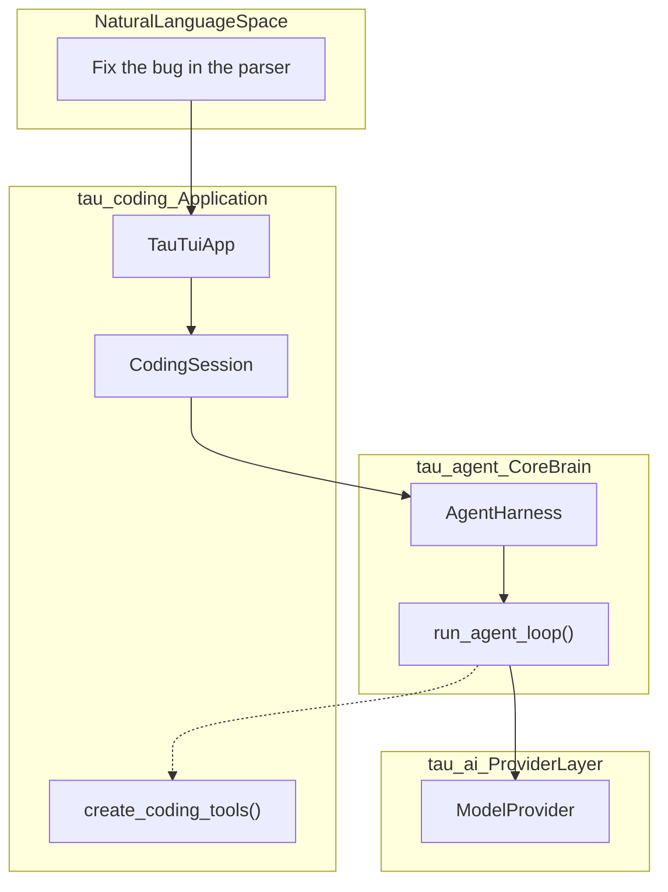
Sources: [README.md:39-48](), [CONTRIBUTING.md:7-21](), [pyproject.toml:41-42]()

---

## Key Design Philosophy

* **Events are the Contract**: The core loop emits typed event objects (`AgentEvent`). Frontends like the TUI (`TauTuiApp`) or one-shot print mode consume these events to render output [README.md:192-194](), [CONTRIBUTING.md:26-26]().
* **Durable Sessions**: History is stored as append-only JSONL files under `~/.tau/sessions/`, supporting seamless session resumption, branching, and HTML/JSONL exports [README.md:178-180](), [CONTRIBUTING.md:29-29]().
* **Tools are Typed Functions**: Tools are defined as standard Python functions accompanied by a `ToolDefinition` schema and an asynchronous executor [README.md:195-197](), [CONTRIBUTING.md:28-28]().
* **Context Management**: Tau supports manual and automatic context compaction to handle long-running conversations within strict model token limits [README.md:183-184](), [README.md:198-199]().
* **Portable Core**: The reusable `AgentHarness` has zero dependencies on Textual, Rich, the CLI interface, or specific local config directories [README.md:191-195](), [CONTRIBUTING.md:27-27]().

Sources: [README.md:187-202](), [CONTRIBUTING.md:23-31]()

---

## Installation

Tau is published on PyPI as `tau-ai` and exposes a global `tau` command [README.md:59-62](), [pyproject.toml:5-32](). It requires Python 3.12 or newer [pyproject.toml:12]().

### Recommended Installers
For macOS and Linux:
```bash
curl -LsSf https://twotimespi.dev/install.sh | sh
```
For Windows PowerShell:
```powershell
irm https://twotimespi.dev/install.ps1 | iex
```

### Package Managers and Local Development
```bash
uv tool install tau-ai
tau --version
```
For local contribution or source inspection:
```bash
git clone https://github.com/huggingface/tau.git
cd tau
uv sync --dev
uv run tau --version
```
Sources: [README.md:65-117](), [pyproject.toml:12-39]()

---

## Quickstart

To launch an interactive terminal session inside your target project repository:
1. Navigate to your project directory: `cd my-project` [README.md:135-138]()
2. Run Tau: `tau` [README.md:137]()
3. Connect an AI provider using the `/login` command (e.g., `/login openai` or `/login openai-codex`) [README.md:160-162]()

For scripts, CI pipelines, or non-interactive use, Tau provides a **Print Mode**:
```bash
tau -p "Summarize the changes in the last commit"
```
Sources: [README.md:146-151]()

---

## Component Interaction

The following sequence diagram illustrates how a user prompt flows through the application orchestrator and core harness to execute tools and return a response, bridging natural language requests to specific code methods.

**Flow: User Prompt to Code Change**
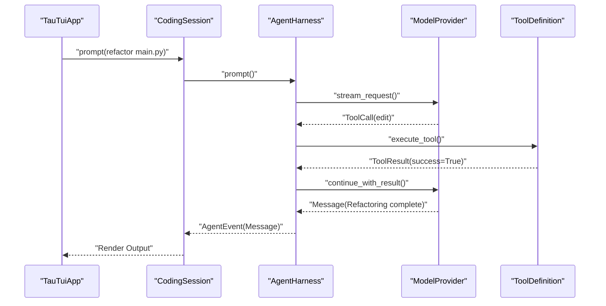
Sources: [README.md:205-223](), [CONTRIBUTING.md:81-85]()

---

## Further Reading

* **[Getting Started](#1.1)**: Installation via PyPI/install scripts, local development setup, running the TUI and print mode, and connecting providers via `/login`.
* **[Core Concepts](#1.2)**: Comprehensive explanation of the agent loop, providers/models, tool definitions, session storage, `AGENTS.md`, and context window compaction.

---

# Page: Getting Started

# Getting Started

<details>
<summary>Relevant source files</summary>

The following files were used as context for generating this wiki page:

- [.gitignore](.gitignore)
- [CONTRIBUTING.md](CONTRIBUTING.md)
- [README.md](README.md)
- [dev-notes/install-scripts.md](dev-notes/install-scripts.md)
- [dev-notes/prompt-caching.md](dev-notes/prompt-caching.md)
- [dev-notes/release-process.md](dev-notes/release-process.md)
- [docs/assets/tau-header.svg](docs/assets/tau-header.svg)
- [website/content/quickstart.md](website/content/quickstart.md)
- [website/static/install.ps1](website/static/install.ps1)
- [website/static/install.sh](website/static/install.sh)
- [website/static/landing.js](website/static/landing.js)

</details>


This page covers the initial setup, installation, and first-run procedures for Tau. It describes how to install the package via PyPI and bootstrap scripts, set up a local development environment, run the operational modes (TUI and print mode), connect to model providers using `/login`, and links to the official quickstart guide.

---

## Installation via PyPI and Install Scripts

Tau is distributed on PyPI as `tau-ai` and exposes a global `tau` console command [README.md:61](). It requires Python 3.12 or newer [README.md:62](). The recommended installation utilizes [`uv`](https://docs.astral.sh/uv/) to manage isolated tool environments [README.md:62-63]().

### Standard Installation and Bootstrap Scripts
For users without an existing `uv` environment, automated bootstrap installers are available for POSIX and Windows systems [README.md:65-75](), [website/content/quickstart.md:16-26](). These scripts locate or install `uv`, create an isolated tool environment for `tau-ai`, verify execution, and check `PATH` availability without requiring administrator or `sudo` privileges [README.md:77](), [website/static/install.sh:1-72](), [website/static/install.ps1:1-68]().

- **macOS / Linux:**
  ```bash
  curl -LsSf https://twotimespi.dev/install.sh | sh
  ```
- **Windows (PowerShell):**
  ```powershell
  irm https://twotimespi.dev/install.ps1 | iex
  ```

Alternatively, if a Python package manager is already present, Tau can be installed directly [README.md:82-90]():
```bash
uv tool install tau-ai
# or
pipx install tau-ai
# or
python -m pip install tau-ai
```

To update an existing installation, Tau provides an update command that inspects its environment receipt and fetches the latest stable release [README.md:104-107](), [website/content/quickstart.md:46-58]():
```bash
tau update
```

**Installation and Upgrade Data Flow**
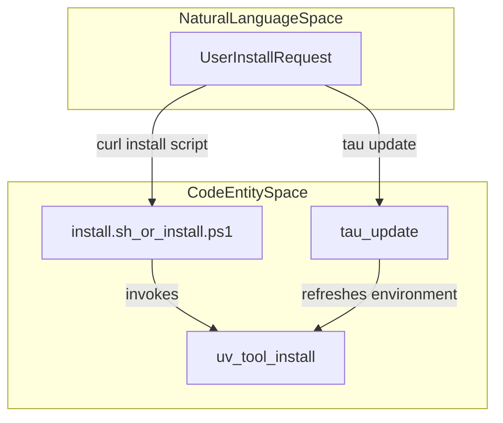
Sources: [README.md:59-109](), [website/content/quickstart.md:10-59](), [website/static/install.sh:1-72](), [website/static/install.ps1:1-68](), [dev-notes/install-scripts.md:1-20]()

---

## Local Development Setup

For developers modifying Tau source code or running test suites, dependencies and environment synchronization are handled via `uv` [CONTRIBUTING.md:32-34]().

1. **Clone the repository:**
   ```bash
   git clone https://github.com/huggingface/tau.git
   cd tau
   ```
2. **Sync development dependencies:**
   ```bash
   uv sync --dev
   ```
   This creates a `.venv` virtual environment and installs testing and linting tools such as `pytest`, `ruff`, and `mypy` [README.md:115]().
3. **Run the test suite:**
   ```bash
   uv run pytest
   ```
4. **Install as an editable tool:**
   ```bash
   uv tool install --editable --force .
   ```
   *Note: Re-run the editable install command after pulling source updates to ensure package metadata, dependency state, and executable entry points are synchronized [README.md:126-129]().*

Sources: [README.md:110-129](), [CONTRIBUTING.md:32-56]()

---

## Operational Modes

Tau supports interactive terminal usage as well as headless script execution [README.md:176]().

### 1. Interactive Terminal User Interface (TUI)
Executing `tau` without positional prompt flags launches the Textual-based interactive TUI inside the target project directory [README.md:137](), [website/content/quickstart.md:94-101]().
* **Launch:** `tau`

### 2. Print Mode
Print mode (`-p`) bypasses the TUI widget hierarchy, evaluating a single-shot prompt against the model and streaming output directly to standard output [README.md:146-150](), [website/content/quickstart.md:139-148]().
* **Launch:** `tau -p "summarize the architecture"` [README.md:149]()
* **Targeting Workspaces:** `tau --cwd /path/to/project -p "find the CLI entry point"` [README.md:150]()

**Operational Mode Dispatch**
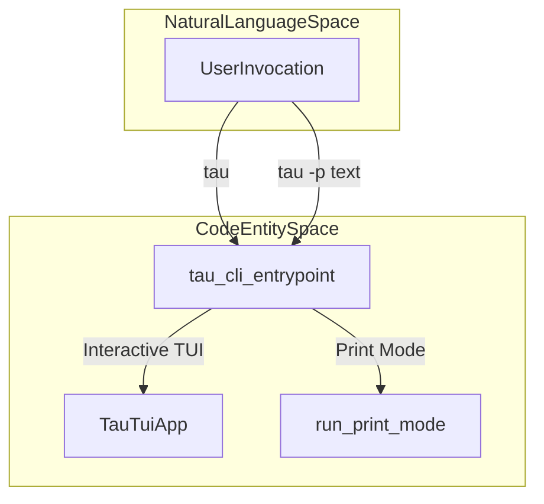
Sources: [README.md:131-151](), [website/content/quickstart.md:94-148]()

---

## Connecting a Provider with `/login`

Tau requires an authenticated Large Language Model provider to function [README.md:153](). It ships with built-in configurations for OpenAI, Anthropic, OpenAI Codex subscription auth, OpenRouter, Hugging Face, and custom OpenAI-compatible endpoints [README.md:166-168]().

### The `/login` Slash Command
Within the interactive TUI, model credentials and active provider bindings are managed via the `/login` command [README.md:153-162]():
- Typing `/login` opens an interactive selection menu [website/content/quickstart.md:83]().
- Typing `/login openai` or `/login openai-codex` initiates direct credential configuration and secure storage [README.md:161-162](), [website/content/quickstart.md:84-85]().

### Provider Catalogs and Overlays
Built-in provider and model definitions are declared declaratively in `src/tau_coding/data/catalog.toml` [README.md:170](). Users can define custom endpoints or local models without modifying source code by placing a `~/.tau/catalog.toml` overlay file with matching schema [README.md:170-172](), [CONTRIBUTING.md:97-100]().

Sources: [README.md:153-173](), [CONTRIBUTING.md:89-100](), [website/content/quickstart.md:71-90]()

---

## Pointer to the Quickstart Guide

For a complete interactive walkthrough, beginner troubleshooting, and keybinding references, consult the official [Quickstart Guide](https://twotimespi.dev/quickstart/) [README.md:12](), [website/content/quickstart.md:1-155]().

Sources: [README.md:10-14](), [website/content/quickstart.md:1-155]()

---

# Page: Core Concepts

# Core Concepts

<details>
<summary>Relevant source files</summary>

The following files were used as context for generating this wiki page:

- [dev-notes/architecture/auto-session-naming.md](dev-notes/architecture/auto-session-naming.md)
- [src/tau_agent/__init__.py](src/tau_agent/__init__.py)
- [src/tau_agent/loop.py](src/tau_agent/loop.py)
- [src/tau_agent/messages.py](src/tau_agent/messages.py)
- [tests/test_agent_loop.py](tests/test_agent_loop.py)
- [tests/test_agent_types.py](tests/test_agent_types.py)
- [website/content/guides/context.md](website/content/guides/context.md)
- [website/content/internals/agent-loop.md](website/content/internals/agent-loop.md)
- [website/content/internals/design-principles.md](website/content/internals/design-principles.md)
- [website/layouts/_default/why-tau.html](website/layouts/_default/why-tau.html)
- [website/layouts/partials/footer.html](website/layouts/partials/footer.html)

</details>


This page explains the fundamental concepts of the Tau codebase. Tau is structured as a three-layer system designed to separate concerns between AI model communication, agentic execution loops, and coding-specific application features.

## Purpose and Scope

The purpose of this page is to provide a comprehensive technical reference for Tau's core abstractions. It bridges conceptual ideas—such as the agent loop, session trees, context windows, compaction, thinking modes, project trust, and operational interfaces—directly to their implementation locations in the codebase.

Sources: [website/content/internals/design-principles.md:9-13](), [AGENTS.md:15-32]()

---

## The Three-Layer Architecture

Tau's design philosophy emphasizes small, readable layers where each package has a distinct responsibility, keeping the core agent harness decoupled from user interfaces and framework dependencies [AGENTS.md:15-32]().

| Package | Role | Key Responsibility |
| :--- | :--- | :--- |
| `tau_ai` | **Provider Layer** | Translates model-specific APIs into a neutral event stream [AGENTS.md:26-26](). |
| `tau_agent` | **Agent Brain** | Manages the loop, tool execution, and session primitives [AGENTS.md:27-27](). |
| `tau_coding` | **Application Layer** | Adds coding tools, CLI/TUI, and resource discovery [AGENTS.md:28-28](). |

Sources: [pyproject.toml:41-42](), [AGENTS.md:15-32](), [src/tau_coding/tui/adapter.py:1-16]()

---

## 1. The Agent Loop

The **Agent Loop** is the heart of the system. Implemented as the asynchronous generator function `run_agent_loop` [src/tau_agent/loop.py:52-68](), it is a stateful cycle where the agent processes prompts, streams responses, manages steering/follow-up queues, and executes tools.

### Execution Flow
1. **Turn Start**: The loop begins with a user prompt, prelude messages, steering messages, or follow-up inputs [src/tau_agent/loop.py:74-82](), [src/tau_agent/loop.py:96-110]().
2. **Model Streaming**: The LLM streams content (text, thinking blocks, or tool calls) via provider integration layers [src/tau_agent/loop.py:126-140]().
3. **Tool Execution**: If the model requests tool calls (`ToolCall`), the loop pauses model interaction to invoke tools via `_execute_tool_call` and yields execution events [src/tau_agent/loop.py:153-171]().
4. **Feedback**: Tool results (`ToolResultMessage`) are appended to the conversation history, and the loop continues until the assistant produces no more tool calls [src/tau_agent/loop.py:165-180]().

### Diagram: Agent Loop Architecture (Natural Language to Code Space)
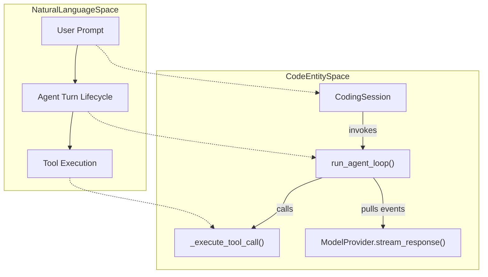
Sources: [src/tau_agent/loop.py:52-68](), [src/tau_agent/loop.py:126-171](), [tests/test_agent_loop.py:56-82]()

---

## 2. Providers and Models

A **Provider** is a concrete implementation of the model provider interface (`ModelProvider`), handling API differences across vendors. Tau maintains a built-in provider and model catalog (`BUILTIN_PROVIDER_CATALOG`) containing metadata, cost tiers, and context windows [src/tau_coding/provider_catalog.py:71-93]().

* **Hot-swapping**: Users can switch models mid-session via slash commands or configuration changes.
* **Thinking Modes**: For reasoning-capable models, Tau manages a `ThinkingLevel` enum (`off`, `minimal`, `low`, `medium`, `high`, `xhigh`, `max`) [website/content/guides/context.md:93-100](). Reasoning blocks are preserved in assistant message structures [src/tau_agent/messages.py:102-107]().

Sources: [src/tau_coding/provider_catalog.py:71-103](), [src/tau_coding/thinking.py:9-15](), [website/content/guides/context.md:92-118]()

---

## 3. Tools and Skills

Tau distinguishes between **Tools** (executable Python functions) and **Skills** (Markdown-based prompt instructions).

### Built-in Coding Tools
* `read`: Reads file contents, supporting image MIME types for vision models [src/tau_agent/messages.py:109-113]().
* `write`: Overwrites or creates files.
* `edit`: Applies patch/diff modifications to files.
* `bash`: Executes non-interactive shell commands with timeout and signal handling.

### Skills
Skills are reusable instructions stored as `.md` files with YAML frontmatter. Invoking `/skill:<name>` expands the skill definition into the active conversation context.

Sources: [src/tau_coding/tui/state.py:25-25](), [src/tau_agent/messages.py:109-124](), [website/content/reference/slash-commands.md:31-32]()

---

## 4. Sessions and the Session Tree

A **Session** is a persistent record of conversation history maintained as an append-only JSONL file tree rather than a flat list, allowing branch exploration and rollbacks.

* **Persistence**: Stored as newline-delimited JSON objects representing various entry types (`MessageEntry`, `CompactionEntry`, `BranchSummaryEntry`, `ModelChangeEntry`, `SessionInfoEntry`) [src/tau_agent/__init__.py:45-59]().
* **TUI Mapping**: The TUI adapter converts underlying session entries into `ChatItem` structures for rendering in the transcript view [src/tau_coding/tui/adapter.py:1-24]().

### Diagram: Session Data Flow (Natural Language to Code Space)
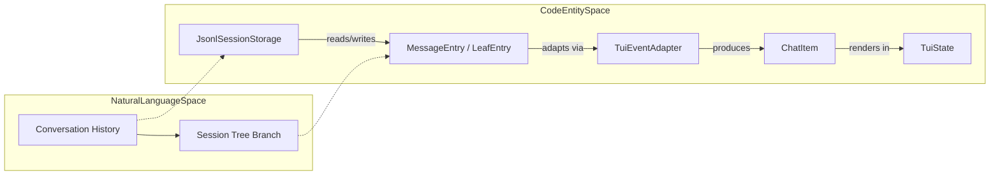
Sources: [src/tau_agent/__init__.py:45-59](), [src/tau_coding/tui/state.py:39-63](), [src/tau_coding/tui/adapter.py:1-24]()

---

## 5. Context Windows and Compaction

LLMs operate within a finite **Context Window**. When sessions grow long, Tau manages token capacity via automatic and manual compaction [website/content/guides/context.md:6-8]().

* **Context Accounting**: Tau tracks active context using authoritative provider-reported usage where available (`Usage`), falling back to a deterministic token estimator (`characters / 4` plus metadata overhead) [website/content/guides/context.md:25-31](), [src/tau_agent/messages.py:46-57]().
* **Compaction**: When approaching token thresholds, automatic or manual compaction (`/compact`) summarizes older conversation history into a compaction entry, retaining a recent message suffix [website/content/guides/context.md:45-86]().

Sources: [src/tau_agent/messages.py:46-57](), [website/content/guides/context.md:6-91]()

---

## 6. Project Context (`AGENTS.md`) and System Prompts

Tau discovers project-specific instructions to ground the agent in the local development environment.

* **Discovery**: The harness scans for `AGENTS.md` and system prompt files (`SYSTEM.md`, `APPEND_SYSTEM.md`) in the working directory and project `.tau/` directories.
* **Precedence**: User-level and project-level configuration files compose in a deterministic order before injection into the system prompt.

Sources: [website/content/reference/configuration.md:57-88](), [AGENTS.md:1-3]()

---

## 7. Project Trust and Security

Tau implements a security model to govern ambient project resources and local execution permissions [website/content/reference/configuration.md:36-41]().

* **Trust Decisions**: The `defaultProjectTrust` setting (`ask`, `always`, `never`) controls whether project-local `.tau/` extensions, skills, and instructions are trusted upon startup.
* **Trust File**: Decisions are durably recorded in configuration trust storage (`~/.tau/trust.json`) [website/content/reference/configuration.md:21-21]().

Sources: [website/content/reference/configuration.md:36-41]()

---

## 8. The Three Interfaces: TUI, Print Mode, and RPC

Tau provides three operational interfaces built on top of the shared agent harness:

1. **Terminal User Interface (TUI)**: An interactive Textual application driven by `TuiEventAdapter` for real-time streaming, transcript windowing, and session management [src/tau_coding/tui/adapter.py:1-24]().
2. **Print Mode**: A non-interactive CLI mode (`-p` / `--print`) that renders output via pluggable `EventRenderer` implementations for scripting or piped execution.
3. **JSONL RPC Mode**: A machine-readable, Pi-compatible JSONL RPC protocol over `stdin`/`stdout` allowing external editors and subprocess hosts to drive Tau programmatically.

Sources: [src/tau_coding/tui/adapter.py:1-24](), [AGENTS.md:33-44]()

---

# Page: Architecture: Three-Layer Design

# Architecture: Three-Layer Design

<details>
<summary>Relevant source files</summary>

The following files were used as context for generating this wiki page:

- [dev-notes/architecture/index.md](dev-notes/architecture/index.md)
- [src/tau_agent/harness.py](src/tau_agent/harness.py)
- [tests/test_agent_harness.py](tests/test_agent_harness.py)
- [website/content/internals/custom-frontend.md](website/content/internals/custom-frontend.md)

</details>


Tau is built on a modular, three-layer architecture designed to separate low-level LLM communication from high-level coding application logic. This separation ensures that the core agent brain remains portable, testable, and independent of specific providers or user interfaces.

For detailed exploration of each individual layer, refer to the child pages:
- [tau_ai: Provider Abstraction Layer](#2.1)
- [tau_agent: Portable Agent Brain](#2.2)
- [tau_coding: Coding Agent Application](#2.3)

---

## High-Level Dependency Flow

The system follows a strict unidirectional dependency rule: the application layer depends on the agent layer, which in turn depends on the AI provider layer [dev-notes/architecture/index.md:13-19]().

Title: "Package Dependency Hierarchy"
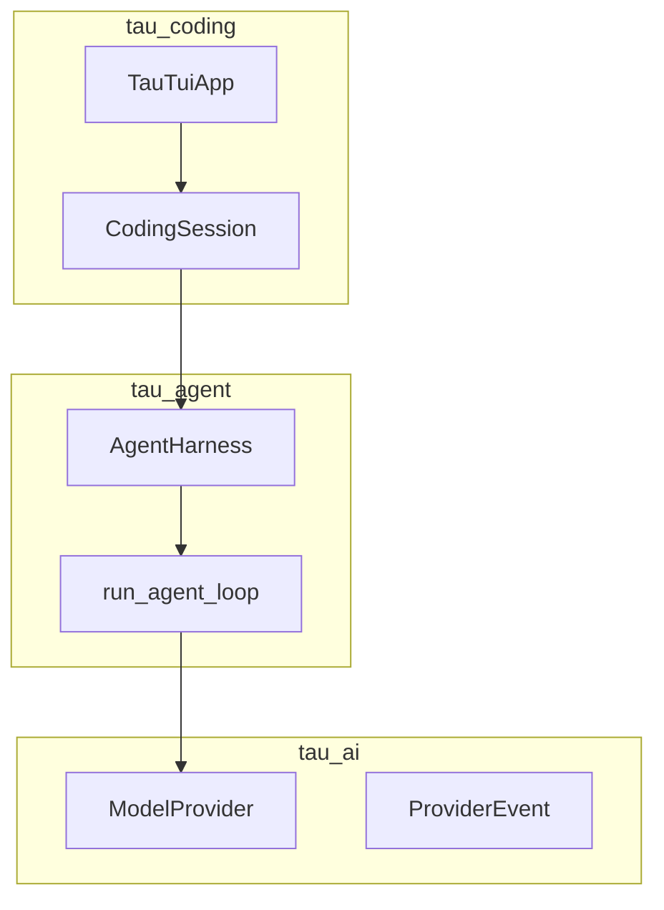
**Sources:** [dev-notes/architecture/index.md:13-19](), [src/tau_agent/harness.py:62-64]()

---

## The Three Packages

### 1. `tau_ai`: Provider Abstraction Layer
The `tau_ai` package handles the complexities of provider-specific APIs (OpenAI, Anthropic, Google, Mistral, etc.). It translates raw model streams into a normalized stream of provider events, manages retries, handles credentials, and supports provider-specific thinking modes.

For details, see [tau_ai: Provider Abstraction Layer](#2.1).
**Sources:** [dev-notes/architecture/index.md:16-16]()

### 2. `tau_agent`: Portable Agent Brain
This is the core reasoning engine of Tau. It defines fundamental types for the transcript, tools, events, and the execution loop. It remains strictly UI-neutral and provider-neutral [dev-notes/architecture/index.md:17-17](), [dev-notes/architecture/index.md:21-22]().

- **`AgentHarness`**: The primary stateful wrapper that maintains session transcripts, queues steering/follow-up messages, handles cancellation, and manages turn execution [src/tau_agent/harness.py:62-64]().
- **`run_agent_loop`**: A pure asynchronous generator function that orchestrates the turn lifecycle and tool execution [src/tau_agent/harness.py:174-189]().
- **Session Primitives**: Low-level session entry types and append-only JSONL storage mechanics.

For details, see [tau_agent: Portable Agent Brain](#2.2).
**Sources:** [dev-notes/architecture/index.md:17-17](), [dev-notes/architecture/index.md:21-22](), [src/tau_agent/harness.py:62-64](), [src/tau_agent/harness.py:174-189]()

### 3. `tau_coding`: Coding Agent Application
The `tau_coding` package turns the generic agent into a specialized coding assistant. It wraps `AgentHarness` to provide durable session management, filesystem/shell tools, resource loading, and frontends [website/content/internals/custom-frontend.md:16-28]().

- **`CodingSession`**: The central orchestrator uniting persistence, tools, compaction, and configuration [website/content/internals/custom-frontend.md:16-20]().
- **Frontends**: Textual TUI app, Typer-based CLI, and stdin/stdout RPC server [dev-notes/architecture/index.md:18-18]().
- **Resources**: Discovery of project contexts, skills, and system prompt formatting.

For details, see [tau_coding: Coding Agent Application](#2.3).
**Sources:** [dev-notes/architecture/index.md:18-18](), [website/content/internals/custom-frontend.md:16-28]()

---

## Event-Driven Communication and Data Flow

Communication between layers relies on normalized event streams. Lower layers emit provider-neutral events that bubble up through the harness into application session handlers and frontends [website/content/internals/custom-frontend.md:37-45]().

Title: "Natural Language to Code Entity Execution Flow"
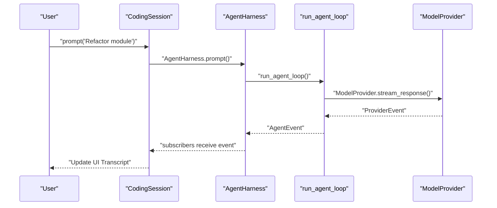
**Sources:** [src/tau_agent/harness.py:147-191](), [website/content/internals/custom-frontend.md:37-45]()

### Core Data Structures

| Concept | Code Entity | Role |
| :--- | :--- | :--- |
| **Agent Message** | `AgentMessage` | Base class for user, assistant, and tool messages [src/tau_agent/harness.py:14-20]() |
| **Agent Harness** | `AgentHarness` | Stateful session transcript and queue manager [src/tau_agent/harness.py:62-64]() |
| **Agent Event** | `AgentEvent` | Union type emitted during turn execution [src/tau_agent/harness.py:12-12]() |
| **Coding Session** | `CodingSession` | Application orchestrator linking storage, tools, and UI [website/content/internals/custom-frontend.md:16-20]() |

**Sources:** [src/tau_agent/harness.py:12-20](), [src/tau_agent/harness.py:62-64](), [website/content/internals/custom-frontend.md:16-20]()

---

## Key Boundaries

### The AgentHarness Boundary
The `AgentHarness` is the clean-room boundary inside `tau_agent`. It contains no knowledge of the filesystem, shell tools, terminal rendering libraries, or project configuration paths [dev-notes/architecture/index.md:21-22](). It focuses purely on managing message sequences, driving tool execution via callbacks, and invoking the underlying `ModelProvider`.

### The CodingSession Boundary
The `CodingSession` in `tau_coding` introduces the "real-world" environment [website/content/internals/custom-frontend.md:25-28](). It binds the portable harness to concrete file and shell tools (`read`, `write`, `edit`, `bash`), manages append-only JSONL persistence (`JsonlSessionStorage`), handles context compaction, and exposes commands to interactive frontends [website/content/internals/custom-frontend.md:25-28]().

**Sources:** [dev-notes/architecture/index.md:21-22](), [website/content/internals/custom-frontend.md:25-28]()

---

# Page: tau_ai: Provider Abstraction Layer

# tau_ai: Provider Abstraction Layer

<details>
<summary>Relevant source files</summary>

The following files were used as context for generating this wiki page:

- [dev-notes/README.md](dev-notes/README.md)
- [dev-notes/catalog-model-safety.md](dev-notes/catalog-model-safety.md)
- [dev-notes/chat-stream-channels.md](dev-notes/chat-stream-channels.md)
- [dev-notes/google-stream-completion.md](dev-notes/google-stream-completion.md)
- [dev-notes/hugging-face-response-provider-metadata.md](dev-notes/hugging-face-response-provider-metadata.md)
- [dev-notes/portable-tool-call-ids.md](dev-notes/portable-tool-call-ids.md)
- [src/tau_agent/tools.py](src/tau_agent/tools.py)
- [src/tau_ai/__init__.py](src/tau_ai/__init__.py)
- [src/tau_ai/_provider_events.py](src/tau_ai/_provider_events.py)
- [src/tau_ai/anthropic.py](src/tau_ai/anthropic.py)
- [src/tau_ai/env.py](src/tau_ai/env.py)
- [src/tau_ai/events.py](src/tau_ai/events.py)
- [src/tau_ai/fake.py](src/tau_ai/fake.py)
- [src/tau_ai/google.py](src/tau_ai/google.py)
- [src/tau_ai/mistral.py](src/tau_ai/mistral.py)
- [src/tau_ai/openai_codex.py](src/tau_ai/openai_codex.py)
- [src/tau_ai/openai_compatible.py](src/tau_ai/openai_compatible.py)
- [src/tau_ai/provider.py](src/tau_ai/provider.py)
- [src/tau_ai/stream.py](src/tau_ai/stream.py)
- [src/tau_ai/tool_call_ids.py](src/tau_ai/tool_call_ids.py)
- [tests/test_chat_channels.py](tests/test_chat_channels.py)
- [tests/test_cross_provider_history.py](tests/test_cross_provider_history.py)
- [tests/test_tau_ai.py](tests/test_tau_ai.py)
- [tests/test_tui_chat_channels.py](tests/test_tui_chat_channels.py)

</details>


The `tau_ai` package serves as the foundational communication layer for Tau. It provides a provider-neutral abstraction for interacting with various Large Language Model (LLM) APIs, ensuring that provider-specific details (request formats, authentication, SSE chunking) do not leak into the higher-level agent logic.

## Purpose and Scope

`tau_ai` translates raw API payloads into a unified stream of `AssistantMessageEvent` objects (re-exported from `tau_agent`). This design allows the `tau_agent` loop to remain backend-agnostic, consuming the same event types whether the model is hosted by OpenAI, Anthropic, or a local server.

Key responsibilities include:
*   **Protocol Definition**: Defining the `ModelProvider` and `CancellationToken` interfaces [src/tau_ai/provider.py:1-5]().
*   **Event Normalization**: Mapping disparate streaming formats (OpenAI SSE, Anthropic Messages, Google Generative AI) into standard events like `TextDeltaEvent` and `ToolCallDeltaEvent` [src/tau_ai/events.py:1-37]().
*   **Stream Canonicalization**: Normalizing transitional provider events through `canonicalize_provider_stream`, supporting independent channels for Chat Completions [src/tau_ai/stream.py:88-122](), [dev-notes/chat-stream-channels.md:1-20]().
*   **Resiliency**: Implementing exponential backoff and retry logic for transient HTTP failures [src/tau_ai/retry.py:1-43]().
*   **Reasoning Support**: Handling "thinking" or "reasoning" blocks emitted by modern models [src/tau_ai/events.py:13-26]().
*   **Safety and Diagnostics**: Extracting safe, secret-free error messages from provider responses [src/tau_ai/http_errors.py:1-26]().
*   **Tool ID Portability**: Ensuring tool call identifiers are compatible when switching providers mid-session [src/tau_ai/tool_call_ids.py:1-24]().

Sources: [src/tau_ai/provider.py:1-5](), [src/tau_ai/events.py:1-37](), [src/tau_ai/stream.py:88-122](), [dev-notes/chat-stream-channels.md:1-20](), [src/tau_ai/retry.py:1-43](), [src/tau_ai/http_errors.py:1-26](), [src/tau_ai/tool_call_ids.py:1-24]()

## Architecture: Data Flow

The following diagram illustrates how `tau_ai` bridges the gap between raw HTTP streams and the `AgentHarness` by mapping external LLM endpoints to concrete Python provider classes.

### Provider Event Mapping Architecture
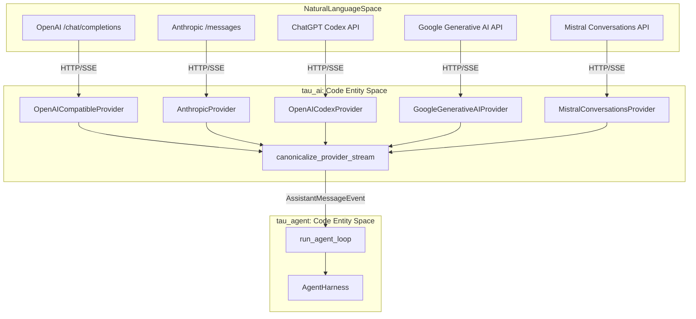
Sources: [src/tau_ai/provider.py:1-5](), [src/tau_ai/openai_compatible.py:72-76](), [src/tau_ai/anthropic.py:73-74](), [src/tau_ai/openai_codex.py:94-96](), [src/tau_ai/google.py:47-49](), [src/tau_ai/mistral.py:47-49]()

## Key Interfaces

### ModelProvider Protocol
The `ModelProvider` is a Python `Protocol` that defines the standard interface for all adapters [src/tau_ai/provider.py:1-5]().

| Method | Role |
| :--- | :--- |
| `stream_response` | Takes a model name, system prompt, messages, and tools; returns an `AsyncIterator[AssistantMessageEvent]` [src/tau_ai/provider.py:1-5](). |

### AssistantMessageEvent Types
Adapters emit a sequence of events canonicalized by `canonicalize_provider_stream` [src/tau_ai/stream.py:88-122]():

*   `AssistantStartEvent`: Signals the beginning of a model turn [src/tau_ai/events.py:17-20]().
*   `TextDeltaEvent`: Contains a fragment of generated text [src/tau_ai/events.py:21]().
*   `ThinkingDeltaEvent`: Contains a fragment of internal reasoning (e.g., for `o1` or `Claude`) [src/tau_ai/events.py:24]().
*   `ToolCallStartEvent` / `ToolCallDeltaEvent`: Emitted as tool calls are streamed from the provider [src/tau_ai/events.py:27-29]().
*   `AssistantDoneEvent`: Finalizes the turn with the complete `AssistantMessage` [src/tau_ai/events.py:17]().
*   `AssistantErrorEvent`: Terminal failure notification containing diagnostic data [src/tau_ai/events.py:18]().

Sources: [src/tau_ai/provider.py:1-5](), [src/tau_ai/stream.py:88-122](), [src/tau_ai/events.py:1-37]()

## Concrete Provider Implementations

### OpenAICompatibleProvider
Supports any API following the OpenAI `/chat/completions` standard. It also includes logic to transparently route specific models to the newer `/v1/responses` API [src/tau_ai/openai_compatible.py:1-9]().
*   **Routing Logic**: Models like `gpt-5.5` or `gpt-5.4` are routed to the Responses API via `_use_responses_api` [src/tau_ai/openai_compatible.py:64-69]().
*   **Prompt Caching**: Utilizes `openai_prompt_cache_key` to manage session affinity and caching [src/tau_ai/openai_compatible.py:160-181]().

### AnthropicProvider
Targets the Anthropic Messages API [src/tau_ai/anthropic.py:1-1]().
*   **Versioning**: Hardcoded to version `2023-06-01` [src/tau_ai/anthropic.py:55]().
*   **Thinking Support**: Handles `thinking_budget_tokens`, `thinking_effort`, and `thinking_mode` in the request payload [src/tau_ai/anthropic.py:140-145]().
*   **Cache Breakpoints**: Manages up to 4 cache breakpoints (system, tools, and recent messages) to optimize performance [src/tau_ai/anthropic.py:59-67]().

### OpenAICodexProvider
A specialized provider for the ChatGPT Codex backend, typically used with subscription-based accounts [src/tau_ai/openai_codex.py:1-1]().
*   **Authentication**: Uses `OpenAICodexCredentials` consisting of an `access_token` and `account_id` [src/tau_ai/openai_codex.py:60-64]().
*   **Model Discovery**: Implements `discover_model_limits` and `discover_models` to fetch usage limits from the authenticated Codex model catalog [src/tau_ai/openai_codex.py:121-132]().

### Google and Mistral Providers
*   **GoogleGenerativeAIProvider**: Adapter for Google's `streamGenerateContent` API, using SSE format [src/tau_ai/google.py:47-49](). Requires a valid Google `finishReason` before reporting successful completion [src/tau_ai/google.py:165-173](), [dev-notes/google-stream-completion.md:5-8]().
*   **MistralConversationsProvider**: Adapter for Mistral's streaming chat API [src/tau_ai/mistral.py:47-49]().

Sources: [src/tau_ai/openai_compatible.py:1-181](), [src/tau_ai/anthropic.py:1-145](), [src/tau_ai/openai_codex.py:60-132](), [src/tau_ai/google.py:47-173](), [src/tau_ai/mistral.py:47-49](), [dev-notes/google-stream-completion.md:1-25]()

## Stream Canonicalization and Independent Channels

Provider parsers emit raw internal events (`ProviderEvent`) that are translated by `canonicalize_provider_stream` into `AssistantMessageEvent` streams [src/tau_ai/stream.py:88-122]().

*   **Independent Channels**: For Chat Completions (e.g., models that interleave `content` and `reasoning_content` in the same chunk), `independent_channels=True` ensures that switches between text and thinking channels do not prematurely close blocks [src/tau_ai/openai_compatible.py:118-122](), [dev-notes/chat-stream-channels.md:1-20]().
*   **Channel Lifecycle**: Each channel maintains its own content index and emits independent start and end events while preserving first-seen channel order [src/tau_ai/stream.py:125-171](), [dev-notes/chat-stream-channels.md:1-20]().

Sources: [src/tau_ai/stream.py:88-171](), [src/tau_ai/openai_compatible.py:118-122](), [dev-notes/chat-stream-channels.md:1-20]()

## Portable Tool-Call IDs

When switching providers (e.g., from OpenAI to Anthropic), tool call IDs must be translated to a format acceptable by the new provider.
*   **`portable_tool_call_id`**: Converts provider-specific IDs (like Codex's piped IDs) into a deterministic 40-character hex string if they don't meet the standard `[A-Za-z0-9_-]` format [src/tau_ai/tool_call_ids.py:1-24]().
*   **Deterministic Hashing**: Uses SHA-256 to ensure that the same native ID always maps to the same portable ID across different provider adapters [src/tau_ai/tool_call_ids.py:1-24]().

Sources: [src/tau_ai/tool_call_ids.py:1-24]()

## HTTP/Proxy Handling and Retry Logic

### HTTP Client Management
Providers manage underlying network connections using `httpx.AsyncClient` instances, with automatic client lifecycle cleanup via `aclose()` [src/tau_ai/openai_compatible.py:88-92](), [src/tau_ai/anthropic.py:86-90]().

### Retry Mechanism
Providers use a centralized retry utility in `tau_ai.retry`.
*   **Backoff**: Implements exponential backoff via `retry_delay_seconds`, capped by `max_retry_delay_seconds` [src/tau_ai/retry.py:1-43]().
*   **Wait**: Uses `wait_for_retry`, which performs non-blocking sleeps while polling the `CancellationToken`.
*   **Retry Event**: Emits `ProviderRetryEvent` to notify the system of progress [src/tau_ai/retry.py:1-43]().

### Cancellation
The `CancellationToken` protocol allows the agent layer to interrupt a provider stream mid-flight [src/tau_ai/provider.py:1-5]().
*   **Checkpoints**: Providers check `signal.is_cancelled()` inside their SSE loops and within backoff periods [src/tau_ai/mistral.py:164-165]().

Sources: [src/tau_ai/openai_compatible.py:88-92](), [src/tau_ai/anthropic.py:86-90](), [src/tau_ai/retry.py:1-43](), [src/tau_ai/provider.py:1-5](), [src/tau_ai/mistral.py:164-165]()

## The Fake Provider

The `FakeProvider` is used throughout the test suite to simulate model behavior without network overhead [src/tau_ai/fake.py:1-41](), [tests/test_tau_ai.py:73-95]().

### FakeProvider Scripting Flow
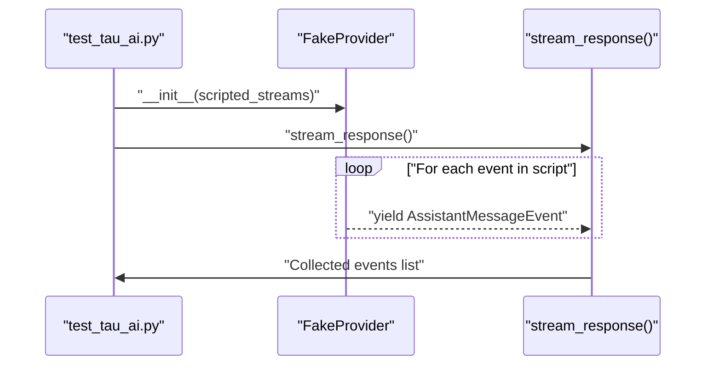
Sources: [src/tau_ai/fake.py:1-41](), [tests/test_tau_ai.py:70-95]()

The `FakeProvider` maintains a `calls` list that records every request made by the agent, allowing tests to assert that the correct system prompt, messages, and tools were sent [src/tau_ai/fake.py:1-41]().

Sources: [src/tau_ai/fake.py:1-41](), [tests/test_tau_ai.py:70-95]()

---

# Page: tau_agent: Portable Agent Brain

# tau_agent: Portable Agent Brain

<details>
<summary>Relevant source files</summary>

The following files were used as context for generating this wiki page:

- [dev-notes/tool-history-recovery.md](dev-notes/tool-history-recovery.md)
- [src/tau_agent/__init__.py](src/tau_agent/__init__.py)
- [src/tau_agent/harness.py](src/tau_agent/harness.py)
- [src/tau_agent/loop.py](src/tau_agent/loop.py)
- [src/tau_agent/messages.py](src/tau_agent/messages.py)
- [src/tau_agent/tool_history.py](src/tau_agent/tool_history.py)
- [tests/test_agent_harness.py](tests/test_agent_harness.py)
- [tests/test_agent_loop.py](tests/test_agent_loop.py)
- [tests/test_agent_types.py](tests/test_agent_types.py)
- [tests/test_tool_history.py](tests/test_tool_history.py)
- [website/content/internals/agent-loop.md](website/content/internals/agent-loop.md)

</details>


The `tau_agent` package serves as the core orchestration layer of Tau. It defines the "brain" of the agent—a stateful, reusable harness that manages conversational history (transcripts), tool execution, tool history recovery, and session persistence while remaining decoupled from specific UI implementations or coding-specific logic.

For details on the agent loop, turn lifecycles, and event types, see [Agent Loop and Events](#2.2.1). For session models and JSONL persistence, see [Session Tree and JSONL Persistence](#2.2.2).

## High-Level Architecture

The package bridges the gap between raw LLM providers (`tau_ai`) and application-specific environments (`tau_coding`). It provides a provider-neutral representation of messages, tools, and events.

### Entity Mapping: Logic to Code

**Agent Brain Entity Mapping**
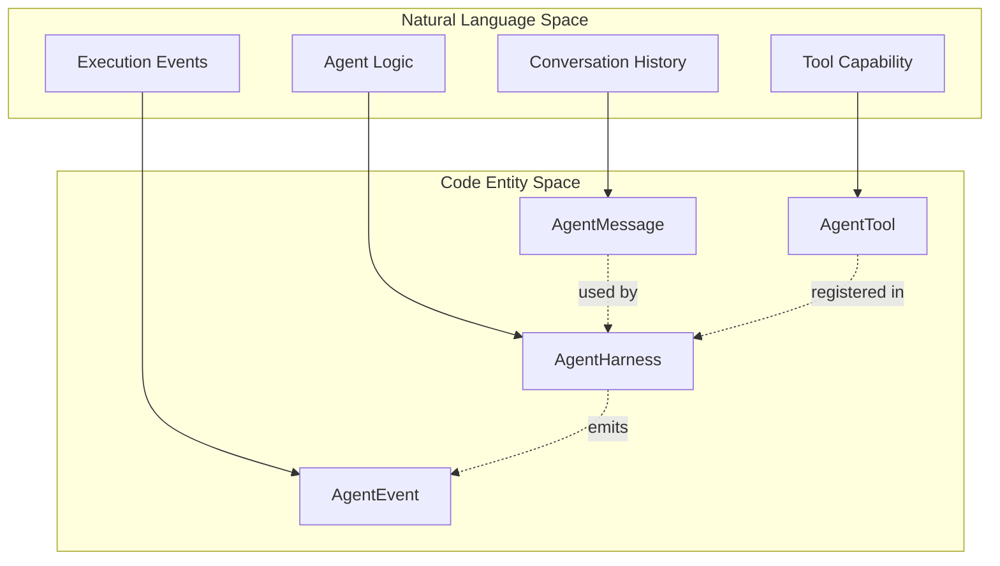
Sources: [src/tau_agent/messages.py:130-215](), [src/tau_agent/tools.py:1-67](), [src/tau_agent/harness.py:62-82](), [src/tau_agent/events.py:1-20]()

---

## Core Components

### AgentHarness and Config
The `AgentHarness` is the primary stateful entry point [src/tau_agent/harness.py:62-63](). It maintains the message transcript and manages two distinct queues for message injection:
*   **Steering Queue:** For messages injected immediately during the current turn, used for user interruptions or automated corrections [src/tau_agent/harness.py:76](), [src/tau_agent/harness.py:121-126]().
*   **Follow-up Queue:** For messages processed once the current run naturally concludes [src/tau_agent/harness.py:77](), [src/tau_agent/harness.py:128-133]().

Configuration is handled via `AgentHarnessConfig`, which defines the provider, model, system prompt, and available tools [src/tau_agent/harness.py:39-49]().

### The Pure Agent Loop and Tool History Recovery
At the heart of the harness is `run_agent_loop`, a stateless function that iterates through LLM turns [src/tau_agent/loop.py:52-68](). It handles streaming provider deltas, transcript management, tool execution, queue draining, and invoking tool history repair (`repair_tool_history`) to guarantee provider compatibility [src/tau_agent/loop.py:42](), [src/tau_agent/loop.py:174-190]().

For a deep dive into turn lifecycles, tool execution, queuing modes, cancellation, and event types, see [Agent Loop and Events](#2.2.1).

Sources: [src/tau_agent/harness.py:39-200](), [src/tau_agent/loop.py:52-190](), [src/tau_agent/messages.py:130-215](), [src/tau_agent/events.py:1-20]()

---

## Session Primitives and Storage

Tau treats sessions as append-only trees of entries rather than flat message lists, enabling features like branching, compaction, and metadata tracking.

### Session Persistence Mapping

**Session Storage Entity Mapping**
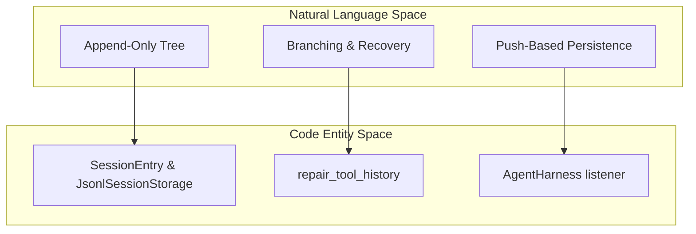
Sources: [src/tau_agent/session/storage.py:1-60](), [src/tau_agent/tool_history.py:40-60]()

### Persistence and Tree Traversal
Entries are persisted via `JsonlSessionStorage`, which writes each entry as a JSON line [src/tau_agent/session/storage.py:1-60](). Tau uses **push-based persistence**, subscribing listeners to the harness so every notification writes immediately to disk before events reach frontends [src/tau_agent/harness.py:108-115]().

For details on entry models (`MessageEntry`, `CompactionEntry`, `LeafEntry`, etc.), tree traversal, and JSONL storage, see [Session Tree and JSONL Persistence](#2.2.2).

Sources: [src/tau_agent/session/storage.py:1-60](), [src/tau_agent/tool_history.py:40-165](), [src/tau_agent/harness.py:108-115]()

---

# Page: Agent Loop and Events

# Agent Loop and Events

<details>
<summary>Relevant source files</summary>

The following files were used as context for generating this wiki page:

- [src/tau_agent/__init__.py](src/tau_agent/__init__.py)
- [src/tau_agent/events.py](src/tau_agent/events.py)
- [src/tau_agent/loop.py](src/tau_agent/loop.py)
- [src/tau_agent/messages.py](src/tau_agent/messages.py)
- [tests/test_agent_loop.py](tests/test_agent_loop.py)
- [tests/test_agent_types.py](tests/test_agent_types.py)
- [website/content/internals/agent-loop.md](website/content/internals/agent-loop.md)

</details>


This page provides a detailed examination of the agent loop within the `tau_agent` package, focusing on the `run_agent_loop` function defined in `src/tau_agent/loop.py`. It covers the lifecycle of an agent turn, how tool execution is managed, the role of steering and follow-up message queues, cancellation mechanisms, session settling, and the comprehensive `AgentEvent` union type. The `run_agent_loop` function is designed as a pure, provider-neutral engine that processes messages, tools, and provider streams into a sequence of observable events [src/tau_agent/loop.py:1-68]().

Sources:
- [src/tau_agent/loop.py:1-68]()
- [website/content/internals/agent-loop.md:1-76]()

---

## The `run_agent_loop` Function

The `run_agent_loop` function [src/tau_agent/loop.py:52-68]() serves as the core decision-making and interaction engine of Tau. It accepts conversation state (system prompt, messages), available tools, and a model provider, streaming `AgentEvent`s as the agent reasons and executes actions. The messages list passed to `run_agent_loop` is mutated by the loop to accumulate assistant responses and tool results [src/tau_agent/loop.py:146-169]().

### Agent Turn Lifecycle

The agent loop operates in a series of execution turns [src/tau_agent/loop.py:94](). Each turn begins with a `TurnStartEvent` [src/tau_agent/loop.py:102]() and terminates with a `TurnEndEvent` [src/tau_agent/loop.py:172](). Within a turn, the agent interacts with the `ModelProvider` to stream assistant output.

The lifecycle sequence unfolds as follows:
1. **Agent Start**: An `AgentStartEvent` is yielded at the beginning of the execution stream [src/tau_agent/loop.py:74]().
2. **Turn Start**: A `TurnStartEvent` is yielded for each turn [src/tau_agent/loop.py:75](), [src/tau_agent/loop.py:102]().
3. **Provider Interaction**: The loop invokes `_assistant_events` to request and stream provider output [src/tau_agent/loop.py:126-134]().
    * Provider stream chunks are translated into agent-level events:
        * `AssistantStartEvent` -> `MessageStartEvent` [src/tau_agent/events.py:34-37]()
        * `TextDeltaEvent` / `ThinkingDeltaEvent` -> `MessageUpdateEvent` [src/tau_agent/events.py:39-45]()
        * `AssistantDoneEvent` -> `MessageEndEvent` [src/tau_agent/events.py:47-50]()
4. **Assistant Message Collection**: The final `AssistantMessage` is recovered from the `MessageEndEvent` stream [src/tau_agent/loop.py:136-139]() and appended to the message history [src/tau_agent/loop.py:146]().
5. **Tool Execution (if any)**: If the `AssistantMessage` contains tool calls [src/tau_agent/loop.py:154-155](), the loop executes them via `_execute_tool_call` [src/tau_agent/loop.py:157-164]().
6. **Turn End**: A `TurnEndEvent` is yielded containing the assistant message and any accumulated tool results [src/tau_agent/loop.py:172]().
7. **Agent End**: An `AgentEndEvent` is yielded when the loop exhausts its queues and terminates [src/tau_agent/loop.py:182]().

Sources:
- [src/tau_agent/loop.py:52-184]()
- [src/tau_agent/events.py:1-87]()

---

## Tool Execution

When the `ModelProvider` returns an `AssistantMessage` containing `ToolCall` blocks, the loop enters its tool execution phase [src/tau_agent/loop.py:153-171]().

1. **Tool Lookup**: The agent resolves tools using `tool_by_name`, built from the `tools` sequence passed into `run_agent_loop` [src/tau_agent/loop.py:93]().
2. **Execution Start**: A `ToolExecutionStartEvent` is emitted for each tool call [src/tau_agent/events.py:52-57]().
3. **Tool Invocation**: The `execute_fn` of the target `AgentTool` is invoked with its arguments, a cancellation signal, and update callbacks.
4. **Execution Update**: Intermediate progress is broadcast via `ToolExecutionUpdateEvent`s [src/tau_agent/events.py:59-66]().
5. **Execution End**: Upon completion, an `AgentToolResult` is returned, a `ToolExecutionEndEvent` is yielded [src/tau_agent/events.py:67-73](), and a corresponding `ToolResultMessage` is appended to the message history [src/tau_agent/loop.py:168-169]().
6. **Continuation**: Once all tool calls are processed, the loop advances to the next turn, feeding the new tool results back to the model [src/tau_agent/loop.py:98-100]().

### Tool Execution Flow Diagram

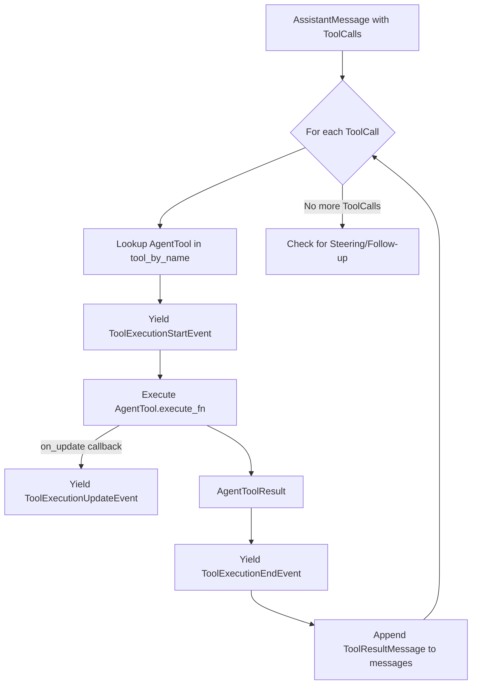

Sources:
- [src/tau_agent/loop.py:93]()
- [src/tau_agent/loop.py:153-171]()
- [src/tau_agent/events.py:52-73]()
- [tests/test_agent_loop.py:190-214]()

---

## Steering and Follow-up Queues

The `run_agent_loop` function supports dynamic message injection via `get_steering_messages` and `get_follow_up_messages` callbacks [src/tau_agent/loop.py:64-65]().

* **Steering Messages**: Inspected at the start of every turn [src/tau_agent/loop.py:96](), [src/tau_agent/loop.py:174](). If present, steering messages are immediately appended to the conversation history and processed, allowing users or frontends to steer the agent mid-stream [src/tau_agent/loop.py:105-110]().
* **Follow-up Messages**: Evaluated only after the tool execution cycle finishes and no steering messages remain pending [src/tau_agent/loop.py:176-179](). If follow-up messages are retrieved, the loop continues execution.
* **Agent Settled**: When the agent finishes processing turns, tool calls, and queues without further input or tool execution, the agent reaches an settled state (`agent_settled`), concluding the run with `AgentEndEvent` [src/tau_agent/loop.py:180-182]().

Sources:
- [src/tau_agent/loop.py:64-67]()
- [src/tau_agent/loop.py:96-180]()

---

## Cancellation Tokens and History Repair

* **Cancellation (`signal`)**: The loop accepts an optional `CancellationToken` (`signal`) to abort ongoing model requests or tool executions [src/tau_agent/loop.py:62]().
* **History Repair**: Prior to dispatching message history to a provider, `run_agent_loop` invokes history repair utilities [src/tau_agent/loop.py:42](), [src/tau_agent/loop.py:130]() to ensure correct message alternation and unfulfilled tool-call recovery.

Sources:
- [src/tau_agent/loop.py:30]()
- [src/tau_agent/loop.py:42-62]()
- [src/tau_agent/loop.py:130]()

---

## The `AgentEvent` Union Type

All events emitted during `run_agent_loop` belong to the `AgentEvent` discriminated union [src/tau_agent/events.py:75-87]().

### Event Types Reference Table

| Event Class | Type String | Purpose |
| :--- | :--- | :--- |
| `AgentStartEvent` | `agent_start` | Indicates the beginning of an agent run [src/tau_agent/events.py:15-16](). |
| `AgentEndEvent` | `agent_end` | Indicates the conclusion of an agent run [src/tau_agent/events.py:19-20](). |
| `TurnStartEvent` | `turn_start` | Marks the start of a new model interaction turn [src/tau_agent/events.py:24-25](). |
| `TurnEndEvent` | `turn_end` | Marks the end of a turn following tool execution [src/tau_agent/events.py:28-29](). |
| `MessageStartEvent` | `message_start` | Signals the creation of a new transcript message [src/tau_agent/events.py:34-35](). |
| `MessageUpdateEvent` | `message_update` | Carries streaming text, thinking, or tool deltas [src/tau_agent/events.py:39-40](). |
| `MessageEndEvent` | `message_end` | Signals the finalization of a transcript message [src/tau_agent/events.py:47-48](). |
| `ToolExecutionStartEvent` | `tool_execution_start` | Indicates a tool call has started executing [src/tau_agent/events.py:52-53](). |
| `ToolExecutionUpdateEvent` | `tool_execution_update` | Reports progress updates from a running tool [src/tau_agent/events.py:59-60](). |
| `ToolExecutionEndEvent` | `tool_execution_end` | Reports completion and result of a tool call [src/tau_agent/events.py:67-68](). |

Sources:
- [src/tau_agent/events.py:1-87]()

---

## Bridging Natural Language and Code Entities

### Mapping Intent to Execution Diagram

```mermaid
graph TD
    subgraph "NaturalLanguageSpace"
        NL_UserPrompt[""User Prompt (e.g., Edit README.md)""]
        NL_AgentThought[""Agent Thought (internal reasoning)""]
        NL_ToolAction[""Tool Action (e.g., write README.md)""]
    end

    subgraph "CodeEntitySpace"
        CE_run_agent_loop[""run_agent_loop(...) in tau_agent/loop.py""]
        CE_ModelProvider[""ModelProvider.stream_response(...) in tau_agent/provider.py""]
        CE_AgentTool[""AgentTool.execute_fn(...) in tau_agent/tools.py""]

        subgraph "AgentEventStream"
            AES_MessageUpdateEvent[""MessageUpdateEvent in tau_agent/events.py""]
            AES_ToolExecutionStartEvent[""ToolExecutionStartEvent in tau_agent/events.py""]
        end
    end

    NL_UserPrompt --> CE_run_agent_loop
    CE_run_agent_loop --> CE_ModelProvider
    CE_ModelProvider -- "ThinkingDeltaEvent" --> AES_MessageUpdateEvent
    NL_AgentThought --> AES_MessageUpdateEvent
    CE_run_agent_loop --> CE_AgentTool
    CE_AgentTool --> AES_ToolExecutionStartEvent
    NL_ToolAction --> AES_ToolExecutionStartEvent
```

Sources:
- [src/tau_agent/loop.py:52-68]()
- [src/tau_agent/events.py:39-45]()

### Agent Harness and Loop Interaction Diagram

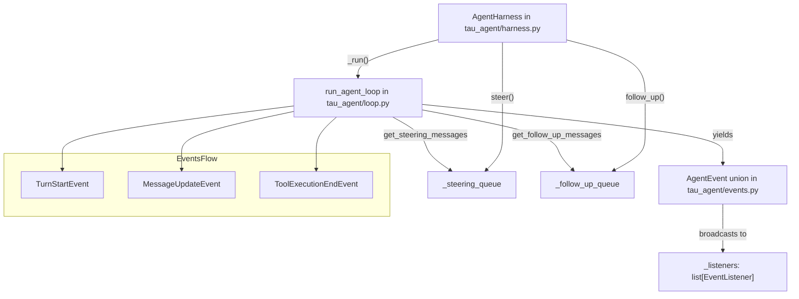

Sources:
- [src/tau_agent/loop.py:52-68]()
- [src/tau_agent/events.py:75-87]()

---

# Page: Session Tree and JSONL Persistence

# Session Tree and JSONL Persistence

<details>
<summary>Relevant source files</summary>

The following files were used as context for generating this wiki page:

- [dev-notes/architecture/phase-20-2-thinking-controls.md](dev-notes/architecture/phase-20-2-thinking-controls.md)
- [dev-notes/architecture/phase-22-compaction-foundation.md](dev-notes/architecture/phase-22-compaction-foundation.md)
- [dev-notes/architecture/phase-24-session-tree-branching.md](dev-notes/architecture/phase-24-session-tree-branching.md)
- [dev-notes/architecture/phase-7-session-tree.md](dev-notes/architecture/phase-7-session-tree.md)
- [dev-notes/architecture/phase-8-coding-session.md](dev-notes/architecture/phase-8-coding-session.md)
- [dev-notes/custom-message-session-entries.md](dev-notes/custom-message-session-entries.md)
- [dev-notes/design/04-sessions.md](dev-notes/design/04-sessions.md)
- [dev-notes/design/602-session-preparation-lifecycle.md](dev-notes/design/602-session-preparation-lifecycle.md)
- [dev-notes/drop-leaf-session-entries.md](dev-notes/drop-leaf-session-entries.md)
- [dev-notes/first-kept-compaction.md](dev-notes/first-kept-compaction.md)
- [dev-notes/per-entry-session-labels.md](dev-notes/per-entry-session-labels.md)
- [dev-notes/push-based-persistence.md](dev-notes/push-based-persistence.md)
- [dev-notes/summary-request-usage.md](dev-notes/summary-request-usage.md)
- [src/tau_agent/session/__init__.py](src/tau_agent/session/__init__.py)
- [src/tau_agent/session/entries.py](src/tau_agent/session/entries.py)
- [src/tau_agent/session/jsonl.py](src/tau_agent/session/jsonl.py)
- [src/tau_agent/session/memory.py](src/tau_agent/session/memory.py)
- [src/tau_coding/branch_summary.py](src/tau_coding/branch_summary.py)
- [tests/test_session.py](tests/test_session.py)

</details>


This page details the append-only session entry model, JSONL persistence, in-memory state reconstruction, push-based persistence architecture, and tree traversal mechanisms used in Tau (`tau_agent.session`).

---

## Purpose and Scope

Tau preserves conversations and agent state across runs using an immutable append-only event log. Instead of mutating historical state in place, Tau appends new entries to a JSONL file and reconstructs active conversational state by replaying them [dev-notes/design/04-sessions.md:5-9](). Low-level session primitives, entries, serialization, and replay live in `tau_agent`, while coding-agent session orchestration (`CodingSession`) lives in `tau_coding` [dev-notes/design/04-sessions.md:85-89]().

Sources: [dev-notes/design/04-sessions.md:5-9](), [dev-notes/design/04-sessions.md:85-89]()

---

## Append-Only Session Entry Model

Tau's session persistence is built on `BaseSessionEntry`, which provides a unique `id` (generated via `new_entry_id()`), an optional `parent_id` for tree structuring, and a `timestamp` [src/tau_agent/session/entries.py:15-32]().

### Session Entry Types

| Entry Class | Type Discriminator | Purpose |
|:---|:---|:---|
| `MessageEntry` | `message` | Stores a standard transcript message (User, Assistant, or ToolResult) [src/tau_agent/session/entries.py:35-40](). |
| `CustomMessageEntry` | `custom_message` | Extension-injected message that participates in model context [src/tau_agent/session/entries.py:42-50](). |
| `ModelChangeEntry` | `model_change` | Records a change in the model and optional provider [src/tau_agent/session/entries.py:52-63](). |
| `ThinkingLevelChangeEntry` | `thinking_level_change` | Records changes to reasoning effort or thinking budget [src/tau_agent/session/entries.py:65-70](). |
| `CompactionEntry` | `compaction` | A context summary replacing older entries during replay [src/tau_agent/session/entries.py:72-86](). |
| `BranchSummaryEntry` | `branch_summary` | A summary of an abandoned or alternate branch [src/tau_agent/session/entries.py:88-98](). |
| `LabelEntry` | `label` | A bookmark change attached to a session entry [src/tau_agent/session/entries.py:100-106](). |
| `LeafEntry` | `leaf` | A legacy active-tip pointer retained strictly for deserialization compatibility [src/tau_agent/session/entries.py:108-113](). |
| `SessionInfoEntry` | `session_info` | Basic metadata such as creation time, working directory (`cwd`), and title [src/tau_agent/session/entries.py:115-122](). |
| `CustomEntry` | `custom` | Extension or application-owned session data identified by a namespace [src/tau_agent/session/entries.py:124-130](). |

### Code Entity Mapping: Session Entry Definitions

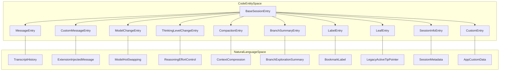
Sources: [src/tau_agent/session/entries.py:25-144]()

---

## JsonlSessionStorage and Serialization

Entries are serialized into canonical JSON Lines (JSONL) format via `entry_to_json_line()` and deserialized via `entry_from_json_line()` or `entries_from_json_lines()` [src/tau_agent/session/jsonl.py:19-60]().

- **Migration**: `_migrate_session_entry()` handles backward compatibility for legacy Tau-v1 message structures, such as string-based assistant content with old `tool_calls` fields, null usage costs, and legacy targetless labels [src/tau_agent/session/jsonl.py:63-116]().
- **Validation**: Pydantic's `TypeAdapter[SessionEntry]` validates payloads against the discriminated union schema [src/tau_agent/session/jsonl.py:12-32]().

### Code Entity Mapping: Serialization & Storage Architecture

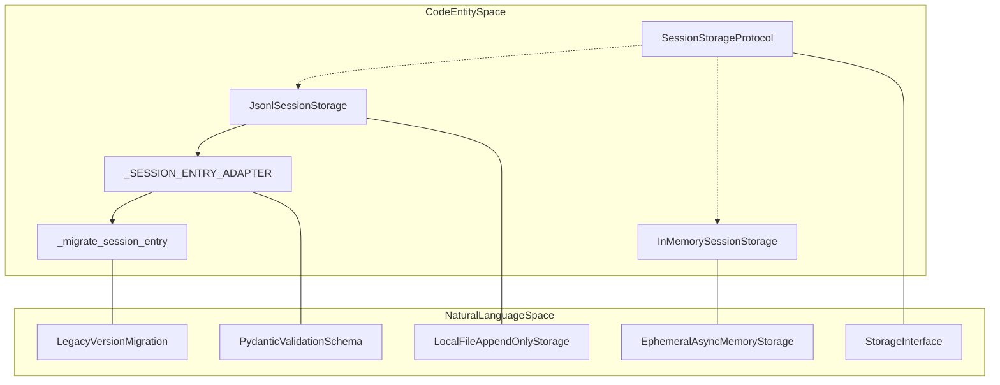
Sources: [src/tau_agent/session/jsonl.py:12-101]()

---

## Tree Traversal, Replay, and SessionState

Because sessions are append-only and support branching via `parent_id` pointers, the active conversational state is dynamically reconstructed into a `SessionState` snapshot [src/tau_agent/session/memory.py:22-37]().

- **Path Reconstruction**: `path_to_entry()` traverses upwards from a target `leaf_id` to the root using parent identifiers, performs cycle detection, and orders entries chronologically [src/tau_agent/session/tree.py:22-40]().
- **Active Tip Selection**: The active tip defaults to the last non-`leaf` entry in file order. Historical `leaf` records remain readable for backward compatibility but never select the tip [src/tau_agent/session/memory.py:45-54]().
- **Replay Logic**: `SessionState.from_entries()` iterates through the resolved branch path, accumulating messages, active model/provider, thinking levels, labels, compactions, and branch summaries [src/tau_agent/session/memory.py:39-125]().

### Data Flow: From JSONL Storage to In-Memory SessionState

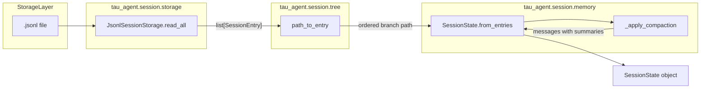
Sources: [src/tau_agent/session/memory.py:39-125](), [src/tau_agent/session/tree.py:22-40]()

---

## Branch Summaries and Compaction Replay

- **Compaction Replay**: When `SessionState.from_entries()` encounters a `CompactionEntry`, `_apply_compaction` evaluates `first_kept_entry_id` or legacy `replaces_entry_ids` to strip summarized historical entries while retaining newer context and injecting a provider-neutral summary message [src/tau_agent/session/memory.py:100-176]() [dev-notes/architecture/phase-22-compaction-foundation.md:21-33]().
- **Branch Summaries**: `BranchSummaryEntry` records represent explored alternate paths. When active in a branch path, `SessionState` converts them into a user-context summary message [dev-notes/architecture/phase-24-session-tree-branching.md:35-37](). `CodingSession` and `summarize_branch_messages_with_model` use model-assisted summarization to generate structured branch goals, progress, decisions, and next steps [src/tau_coding/branch_summary.py:68-111]() [dev-notes/architecture/phase-24-session-tree-branching.md:39-47]().

Sources: [src/tau_agent/session/memory.py:100-176](), [src/tau_coding/branch_summary.py:68-111](), [dev-notes/architecture/phase-22-compaction-foundation.md:21-33](), [dev-notes/architecture/phase-24-session-tree-branching.md:35-47]()

---

## Push-Based Persistence Architecture

Tau utilizes a push-based persistence model where `CodingSession` subscribes a persistence listener to the `AgentHarness` [dev-notes/design/04-sessions.md:41-43]().

- **Durable Boundary**: `MessageEndEvent` serves as the durable-message boundary [dev-notes/design/04-sessions.md:41-43](). Every `message_end` notification appends that message to storage before the event reaches the frontend [dev-notes/design/04-sessions.md:41-43]().
- **Cancellation & Interrupted Calls**: Because persistence runs via harness event subscribers rather than consumption loops, UI teardowns (such as pressing `Esc` in the TUI to cancel a worker) cannot lose writes, including synthetic "Tool call interrupted by user" error results generated during cancelled cleanup [dev-notes/push-based-persistence.md:16-24]().
- **Unstarted Runs**: A message whose `message_end` never fired (e.g., an abandoned first prompt) is deliberately not persisted, preventing aborted prompts from indexing new session files [dev-notes/design/04-sessions.md:50-51]().

Sources: [dev-notes/push-based-persistence.md:1-39](), [dev-notes/design/04-sessions.md:41-55]()

---

# Page: tau_coding: Coding Agent Application

# tau_coding: Coding Agent Application

<details>
<summary>Relevant source files</summary>

The following files were used as context for generating this wiki page:

- [src/tau_coding/cli.py](src/tau_coding/cli.py)
- [src/tau_coding/data/docs/cli.md](src/tau_coding/data/docs/cli.md)
- [src/tau_coding/session.py](src/tau_coding/session.py)
- [tests/test_cli.py](tests/test_cli.py)
- [tests/test_coding_session.py](tests/test_coding_session.py)
- [website/content/reference/cli.md](website/content/reference/cli.md)

</details>


The `tau_coding` package serves as the application and orchestration layer of the Tau architecture [src/tau_coding/session.py:1](). While `tau_ai` provides model connectivity [src/tau_ai/__init__.py:1]() and `tau_agent` provides the portable agent "brain" (loop and state management) [src/tau_agent/__init__.py:1](), `tau_coding` defines the specific environment for a coding assistant. It integrates filesystem tools, session persistence, resource discovery (skills/prompts), command parsing, project trust, extension runtimes, and provides CLI, TUI, and JSONL RPC frontends [src/tau_coding/cli.py:1](), [src/tau_coding/tui.py:1](), [src/tau_coding/rpc.py:1]().

---

## 1. CodingSession Orchestration and Lifecycle

`CodingSession` is the central orchestrator that wraps an `AgentHarness` and manages the lifecycle of a coding task [src/tau_coding/session.py:1](). It handles the translation between high-level application intent (e.g., executing prompts, switching models, compacting history, branching) and low-level agent events.

### Implementation and Data Flow
When a session is initialized via `CodingSession.load()`, or configured via `CodingSessionConfig`, it performs the following sequence:
1. **State Reconstruction**: Reads entries from a `SessionStorage` instance (typically `JsonlSessionStorage`) and replays them into a `SessionState` object [src/tau_coding/session.py:38]().
2. **Harness Creation**: Initializes an `AgentHarness` using the restored message transcript and the configured `ModelProvider` [src/tau_agent/harness.py:15]().
3. **Tool Attachment**: Injects standard coding tools (`read`, `write`, `edit`, `bash`) into the session via `create_coding_tools` and `create_bash_tool` [src/tau_coding/tools/__init__.py:170]().
4. **Resource Loading**: Discovers project context files like `AGENTS.md`, skills, and prompt templates using resource discovery modules [src/tau_coding/context.py:55](), [src/tau_coding/skills.py:153]().

**Figure 1: CodingSession Orchestration Flow**
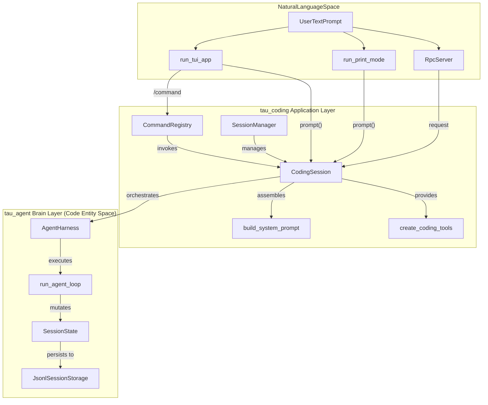
**Sources:** [src/tau_coding/session.py:1](), [src/tau_coding/session_manager.py:147](), [src/tau_coding/commands/__init__.py:1](), [src/tau_coding/system_prompt.py:160]()

---

## 2. Built-in Tools and Resource Management

`tau_coding` implements concrete filesystem and execution tools along with resource discovery engines for skills, prompt templates, and system prompts.

### Tool Integration
Tools are instantiated via `create_coding_tools()` and `create_bash_tool()` [src/tau_coding/tools/__init__.py:170]():
- **`read`, `write`, `edit`**: Direct filesystem manipulation with safety checks, diff-based editing, and file locking mechanisms.
- **`bash`**: Shell command execution within the working directory (`cwd`) featuring timeout management and signal handling.

### System Prompt Assembly
The system prompt is dynamically assembled via `build_system_prompt()` [src/tau_coding/system_prompt.py:160](). It merges:
- Base system prompts or CLI overrides (`--system-prompt`, `--append-system-prompt`) [website/content/reference/cli.md:55-56]()
- Discovered project context files (`AGENTS.md`, `SYSTEM.md`) [src/tau_coding/system_prompt.py:154]()
- Available skills and tool descriptions
- Date and working directory metadata

**Sources:** [src/tau_coding/tools/__init__.py:170](), [src/tau_coding/system_prompt.py:154-162](), [website/content/reference/cli.md:55-56]()

---

## 3. Session Management, Persistence, and Compaction

Sessions are recorded as append-only sequences of `SessionEntry` objects in JSONL files via `JsonlSessionStorage` [src/tau_coding/session.py:32]().

### Key Session Features
- **Branching**: Moving the active leaf to an earlier point in the session tree using branch utilities [src/tau_coding/session.py:43]().
- **Compaction**: Summarizing token-heavy message histories into a `CompactionEntry` when exceeding `auto_compact_token_threshold` [src/tau_coding/context_window.py:61]() using `summarize_messages_for_compaction()` [src/tau_coding/context_window.py:65]().
- **Statistics & Usage**: Tracking token consumption, cost accumulation, tokens per second (TPS), time to first token (TTFT), and wait times via `calculate_session_stats()` [src/tau_coding/session_stats.py:152]().

**Table 1: Session Management Entities**

| Feature | Code Entity | File Path |
| :--- | :--- | :--- |
| **Session Orchestration** | `CodingSession` | [src/tau_coding/session.py:1]() |
| **Storage Backend** | `JsonlSessionStorage` | [src/tau_coding/session.py:32]() |
| **Session Discovery & CRUD** | `SessionManager` | [src/tau_coding/session_manager.py:148]() |
| **Context Compaction** | `summarize_messages_for_compaction` | [src/tau_coding/context_window.py:65]() |
| **Session Statistics** | `calculate_session_stats` | [src/tau_coding/session_stats.py:152]() |

**Sources:** [src/tau_coding/session.py:1](), [src/tau_coding/session_manager.py:148](), [src/tau_coding/context_window.py:61-65](), [src/tau_coding/session_stats.py:152]()

---

## 4. Frontends: CLI, TUI, Print Mode, and RPC

`tau_coding` supports multiple operational interfaces built around the `CodingSession` abstraction [src/tau_coding/cli.py:1]().

### Operational Modes
1. **Interactive TUI**: Launched via `run_tui_app()` [src/tau_coding/cli.py:71](); provides a rich terminal user interface using Textual, streaming responses, markdown rendering, and modal pickers.
2. **Print Mode**: Executed via `run_print_mode()` [src/tau_coding/cli.py:51](); a non-interactive output mode for single prompts or CI pipelines that formats events via `create_event_renderer()` [src/tau_coding/cli.py:52]().
3. **JSONL RPC Mode**: Implemented by `RpcServer` [src/tau_coding/cli.py:54](); provides a Pi-compatible JSONL subprocess protocol over `stdin`/`stdout` for IDE integration.

**Figure 2: Frontend to Application Dispatch Flow**
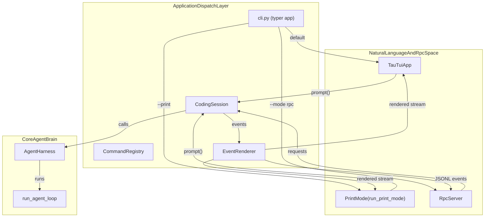
**Sources:** [src/tau_coding/cli.py:51-78](), [src/tau_coding/session.py:1](), [src/tau_coding/rendering.py:52]()

---

## 5. Provider Configuration, Credentials, Extensions, and Project Trust

Managing LLM endpoints, authentication, execution security, and custom extensions is handled through a set of configuration stores and coordinators within `tau_coding`.

- **Provider Settings & Catalog**: Managed through `ProviderSettings`, `load_provider_settings()`, and catalog loaders that query `models.dev` overlays and local overrides [src/tau_coding/provider_config.py:112]().
- **Credentials & OAuth**: Stored securely via `FileCredentialStore` supporting API keys and OAuth flows [src/tau_coding/credentials.py:67]().
- **Project Trust**: Gated by `ProjectTrustCoordinator` and `ProjectTrustStore`, evaluating whether ambient project files (like extensions or custom system prompts) are safe to load [src/tau_coding/project_trust.py:93]().
- **Extension Runtime**: Managed via `ExtensionRuntime` which handles dynamic tool registration, command injection, and hook payloads [src/tau_coding/extensions/runtime.py:1]().

**Sources:** [src/tau_coding/provider_config.py:112](), [src/tau_coding/credentials.py:67](), [src/tau_coding/project_trust.py:93](), [src/tau_coding/extensions/runtime.py:1]()

---

# Page: CodingSession: Session Lifecycle

# CodingSession: Session Lifecycle

<details>
<summary>Relevant source files</summary>

The following files were used as context for generating this wiki page:

- [src/tau_coding/session.py](src/tau_coding/session.py)
- [tests/test_coding_session.py](tests/test_coding_session.py)

</details>


The `CodingSession` class is the central orchestrator of the `tau_coding` package [src/tau_coding/session.py:1](). It wraps the core `AgentHarness` execution engine [src/tau_agent/harness.py:15-15]() and provides the necessary infrastructure for a persistent coding environment, including tool management, context window optimization, usage accounting, and session history management [src/tau_coding/session.py:226-258]().

## Overview

While `AgentHarness` manages the raw agent loop, `CodingSession` handles application-level concerns:
- **Persistence**: Loading and saving session state via `SessionStorage` (typically `JsonlSessionStorage`) [src/tau_coding/session.py:233-233]().
- **Environment**: Managing the current working directory (`cwd`), coding tools (`read`, `write`, `edit`, `bash`), and project context [src/tau_coding/session.py:234-241]().
- **Commands**: Providing a `CommandRegistry` for slash commands like `/compact`, `/model`, or `/skill` [src/tau_coding/session.py:246-246]().
- **Optimization**: Monitoring token usage and executing compaction plans to stay within model context limits [src/tau_coding/session.py:251-253]().

### Session State Mapping
The following diagram illustrates how `CodingSession` bridges high-level user interactions to the underlying session entries and model providers.

**Diagram: Session Lifecycle Flow**
```mermaid
graph TD
    subgraph "Natural Language Space"
        UserPrompt["UserPrompt"] -- "Input text" --> CodingSession[CodingSession]
        SlashCmd["SlashCmd"] -- "/compact, /model" --> CodingSession[CodingSession]
    end

    subgraph "CodingSession Orchestrator [src/tau_coding/session.py]"
        CodingSessionConfig["CodingSessionConfig"] -- "Configures" --> CodingSession
        SessionState["SessionState"] -- "Manages" --> CodingSession
    end

    subgraph "Code Entity Space"
        AgentHarness["AgentHarness"] -- "wraps" --> CodingSession
        JsonlSessionStorage["JsonlSessionStorage"] -- "persists to" --> CodingSession
        ModelProvider["ModelProvider"] -- "configures" --> CodingSession
        AgentTool["AgentTool"] -- "invokes" --> AgentHarness
    end

    tau_agent["tau_agent"] -- "AgentHarness" --> AgentHarness
    tau_agent_session_jsonl["tau_agent_session_jsonl"] -- "JsonlSessionStorage" --> JsonlSessionStorage
    tau_ai["tau_ai"] -- "ModelProvider" --> ModelProvider
    tau_coding_tools["tau_coding_tools"] -- "read/write/edit/bash" --> AgentTool
```
Sources: [src/tau_coding/session.py:226-258](), [src/tau_agent/session/state.py:11-25](), [src/tau_coding/tools.py:164-164]()

---

## Session Initialization and State
Sessions are initialized via `CodingSession.load()`, which reconstructs the `SessionState` from a JSONL storage file [src/tau_coding/session.py:311-316](). If storage is empty, a new session tree is created. The `CodingSessionConfig` defines the initial provider, model, and system prompt parameters [src/tau_coding/session.py:226-258]().

Key initialization steps include resource discovery, state reconstruction from `SessionEntry` streams, and system prompt assembly [src/tau_coding/session.py:311-392]().

For details, see [Session Initialization and State](#3.1).

Sources: [src/tau_coding/session.py:311-392](), [src/tau_agent/session/storage.py:17-29]()

---

## Context Compaction and Token Accounting
To prevent the LLM from exceeding its context window, `CodingSession` tracks token usage via estimation utilities [src/tau_coding/context_window.py:54-54](). When thresholds are reached, the session executes compaction plans to summarize historical messages while retaining recent context [src/tau_coding/session.py:209-215]().

Compaction replaces sequences of message entries with `CompactionEntry` objects in the append-only session history [src/tau_agent/session/entries.py:26-26]().

For details, see [Context Compaction and Token Accounting](#3.2).

Sources: [src/tau_coding/session.py:770-785](), [src/tau_coding/context_window.py:47-57]()

---

## Session Branching and Export
Tau supports non-linear session histories through branching. Users can jump to a previous point in the session tree using `branch_to_entry()`, generating a `BranchSummaryEntry` and updating the active leaf [src/tau_agent/session/entries.py:25-25]().

**Diagram: Session Tree Branching**
```mermaid
graph LR
    subgraph "Session Tree [src/tau_agent/session/tree.py]"
        E1["MessageEntry (Root)"] -- "precedes" --> E2["MessageEntry"]
        E2 -- "precedes" --> E3["MessageEntry (Old Leaf)"]
        E3 -- "branch_to_entry()" --> B1["BranchSummaryEntry"]
        E2 -- "branch_to_entry()" --> B1
        B1 -- "precedes" --> E4["MessageEntry (New Leaf)"]
    end
```
Sources: [src/tau_agent/session/tree.py:39-39](), [src/tau_coding/session.py:905-925]()

Exporting sessions is handled by `export_session_artifact`, enabling users to save their work as readable HTML transcripts or portable JSONL files [src/tau_coding/session_export.py:119-123]().

For details, see [Session Branching and Export](#3.3).

Sources: [src/tau_coding/session.py:905-945](), [src/tau_coding/session_export.py:119-123]()

---

## Usage, Stats, and Response Timing
`CodingSession` tracks operational metrics across its lifecycle using `session_usage.py` and `session_stats.py` [src/tau_coding/session_stats.py:1-150](). These modules accumulate token counts, compute estimated API costs, measure average tokens per second (TPS), time-to-first-token (TTFT), and track provider-wait durations.

These statistics surface dynamically in the TUI sidebar and populate the usage tab of HTML exports [website/content/guides/sessions.md:117-122]().

For details, see [Usage, Stats, and Response Timing](#3.4).

Sources: [src/tau_coding/session_stats.py:1-150](), [website/content/guides/sessions.md:117-122]()

---

# Page: Session Initialization and State

# Session Initialization and State

<details>
<summary>Relevant source files</summary>

The following files were used as context for generating this wiki page:

- [dev-notes/architecture/phase-20-2-thinking-controls.md](dev-notes/architecture/phase-20-2-thinking-controls.md)
- [dev-notes/architecture/phase-24-session-tree-branching.md](dev-notes/architecture/phase-24-session-tree-branching.md)
- [dev-notes/architecture/phase-8-coding-session.md](dev-notes/architecture/phase-8-coding-session.md)
- [dev-notes/design/04-sessions.md](dev-notes/design/04-sessions.md)
- [dev-notes/design/602-session-preparation-lifecycle.md](dev-notes/design/602-session-preparation-lifecycle.md)
- [dev-notes/drop-leaf-session-entries.md](dev-notes/drop-leaf-session-entries.md)
- [dev-notes/push-based-persistence.md](dev-notes/push-based-persistence.md)
- [src/tau_coding/session.py](src/tau_coding/session.py)
- [tests/test_coding_session.py](tests/test_coding_session.py)

</details>


The purpose of this page is to detail the initialization sequence of `CodingSession`, configuration via `CodingSessionConfig`, state reconstruction from JSONL storage, pending initial entries, system prompt assembly at startup, and the active-leaf/file-order tip concept.

## Purpose and Scope

`CodingSession` is the central orchestrator for the tau coding-agent environment [src/tau_coding/session.py:1](). It coordinates configuration, resource loading, prompt assembly, and persistent session storage. This page documents how a session transitions from a stored JSONL file on disk into an active, runnable agent session in memory.

Sources: [src/tau_coding/session.py]()

## CodingSession Initialization and Configuration

A `CodingSession` is instantiated via its asynchronous factory method `CodingSession.load()` [dev-notes/architecture/phase-8-coding-session.py:48](). The instantiation process is parameterized by the `CodingSessionConfig` dataclass [src/tau_coding/session.py]().

### Configuration Parameters

`CodingSessionConfig` encapsulates all runtime requirements needed to bind a session to its environment:
*   `provider`: The underlying `ModelProvider` instance [tests/test_coding_session.py:123]().
*   `model`: The string identifier for the active model [tests/test_coding_session.py:124]().
*   `system`: The base system prompt string [tests/test_coding_session.py:125]().
*   `storage`: A `SessionStorage` implementation (typically `JsonlSessionStorage`) [tests/test_coding_session.py:126]().
*   `cwd`: The canonical project working directory (`Path`) [tests/test_coding_session.py:127]().

### The Loading Sequence

When `CodingSession.load()` is invoked, it performs the following steps:
1.  **Resource Discovery**: Discovers project context files, skills, and prompt templates relative to `cwd` [src/tau_coding/session.py]().
2.  **Storage Ingestion**: Reads all entry records from the underlying `SessionStorage` implementation [dev-notes/architecture/phase-8-coding-session.py:68]().
3.  **State Reconstruction**: Replays entries into a `SessionState` instance, resolving the active branch and conversation tip [dev-notes/architecture/phase-8-coding-session.py:68]().
4.  **Harness Binding**: Instantiates an `AgentHarness` wrapping the restored messages, prompt, tools, and the active model configuration [dev-notes/architecture/phase-8-coding-session.py:73]().
5.  **Persistence Registration**: Subscribes a push-based persistence listener to the harness to capture `message_end` events [dev-notes/push-based-persistence.md:41]().

**Figure 1: Session Loading and State Reconstruction Flow**
```mermaid
sequenceDiagram
    participant CLI as "CLI/TUI"
    participant CS as "CodingSession.load()"
    participant Store as "JsonlSessionStorage"
    participant State as "SessionState"
    participant Harness as "AgentHarness"

    CLI->>CS: "load(config)"
    CS->>Store: "read_all()"
    Store-->>CS: "list[SessionEntry]"
    
    CS->>State: "from_entries(entries)"
    Note over State: Replays entries linearly<br/>or via path_to_entry
    State-->>CS: "SessionState"
    
    CS->>CS: "build_system_prompt()"
    
    create participant Harness
    CS->>Harness: "AgentHarness(AgentHarnessConfig)"
    
    CS-->>CLI: "CodingSession"
```
Sources: [src/tau_coding/session.py](), [dev-notes/architecture/phase-8-coding-session.py]()

## Session State and File-Order Tip Selection

Tau uses an append-only, tree-based model for session history [dev-notes/design/04-sessions.md:9](). Instead of mutating existing records, operations append new entries to the storage file [dev-notes/design/04-sessions.md:9]().

### Session Entries

Entries in the session file inherit from `SessionEntry` and include [src/tau_coding/session.py:27]():
*   `MessageEntry`: Encapsulates user, assistant, or tool result messages [src/tau_coding/session.py:34]().
*   `CompactionEntry`: Stores historical summaries to compress the context window [src/tau_coding/session.py:29]().
*   `ModelChangeEntry` / `ThinkingLevelChangeEntry`: Records mutations to the model name or reasoning effort [src/tau_coding/session.py:35]().
*   `SessionInfoEntry`: Holds basic metadata such as session title and working directory [src/tau_coding/session.py:36]().
*   `BranchSummaryEntry`: Preserves summaries generated during tree branching [src/tau_coding/session.py:28]().
*   `LeafEntry`: Retained strictly for legacy read compatibility; new writes no longer emit explicit leaf records [dev-notes/drop-leaf-session-entries.md:4]().

### The Active Tip Concept

Tau follows Pi's file-order rule for session tips: **the active tip is the last non-`leaf` entry in JSONL order** [dev-notes/drop-leaf-session-entries.md:3](). Historical `leaf` entries deserialize correctly but are ignored when selecting the active tip [dev-notes/drop-leaf-session-entries.md:13]().

**Figure 2: Natural Language Space to Code Entity Space: Session State and Tip Resolution**
```mermaid
graph TD
    subgraph "NaturalLanguageSpace[\"Natural Language & Storage Space\"]"
        NL1["StoredJSONLLines[\"JSONL File Rows\"]"]
        NL2["ActiveConversationTip[\"Active Terminal Message\"]"]
    end

    subgraph "CodeEntitySpace[\"tau_coding & tau_agent Code Space\"]"
        E1["JsonlSessionStorage[\"JsonlSessionStorage.read_all()\"]"]
        E2["SessionState[\"SessionState.from_entries()\"]"]
        E3["ActiveLeaf[\"active_leaf_id / Last non-leaf entry\"]"]
        E4["AgentHarness[\"AgentHarness\"]"]
    end

    NL1 -->|ingested by| E1
    E1 -->|parses into| E2
    E2 -->|determines| E3
    E3 -->|initializes| E4
    E4 -->|drives| NL2
```
Sources: [dev-notes/drop-leaf-session-entries.md](), [src/tau_coding/session.py]()

## Pending Initial Entries and Push-Based Persistence

New, empty sessions defer file creation until the first durable entry is written [dev-notes/design/04-sessions.md:54](). 

### Pending Initial Entries

When a session starts without prior history, initial metadata entries (`SessionInfoEntry`, `ModelChangeEntry`, `ThinkingLevelChangeEntry`) are held in memory as pending initial entries [dev-notes/architecture/phase-8-coding-session.py:76](). When the first user prompt or durable action occurs, these pending entries are flushed to storage atomically before the message entry is written [dev-notes/design/04-sessions.md:54]().

### Push-Based Persistence

Persistence in `CodingSession` is push-based rather than pull-based [dev-notes/push-based-persistence.md:5](). The coding session subscribes a persistence listener to the underlying `AgentHarness`, and every `message_end` notification immediately appends that completed message to the session storage before the event propagates to frontends or UIs [dev-notes/push-based-persistence.md:5](). This guarantees that interrupted tool calls, synthetic error results from user cancellation, and completed turns are preserved even if the TUI or event consumer aborts midway [dev-notes/push-based-persistence.md:17]().

Sources: [dev-notes/push-based-persistence.md](), [dev-notes/design/04-sessions.md]()

## System Prompt Assembly at Startup

The system prompt is not statically persisted inside the session JSONL file [dev-notes/design/04-sessions.md:59](). Instead, when a session is loaded or resumed, Tau rebuilds the system prompt dynamically from current configuration and environment resources [dev-notes/design/04-sessions.md:61]().

### Assembly Pipeline

`build_system_prompt()` constructs the runtime prompt by combining [src/tau_coding/session.py:154]():
1.  **Base Instructions**: Core agent directives and persona configurations [src/tau_coding/session.py:160]().
2.  **Tool Descriptors**: Formatted definitions for available tools (`read`, `write`, `edit`, `bash`) [src/tau_coding/session.py:170]().
3.  **Loaded Skills**: Documentation for custom skills discovered via `load_skills_with_diagnostics()` [src/tau_coding/session.py:153]().
4.  **Project Context**: Injected contents from `AGENTS.md` and related context files located in `cwd` [src/tau_coding/session.py:55]().

This dynamic resolution ensures that resumed sessions automatically pick up updated instructions, refactored project guidelines, and new skills without violating the historical integrity of the conversation branch [dev-notes/design/04-sessions.md:61]().

Sources: [src/tau_coding/session.py](), [dev-notes/design/04-sessions.md]()

## Session Management Architecture

The high-level management of session files across the filesystem is coordinated by `SessionManager` [src/tau_coding/session_manager.py:147]().

### Key Component Roles

| Class | Code Module | Role |
| :--- | :--- | :--- |
| `CodingSession` | `src/tau_coding/session.py` | High-level application wrapper connecting storage, harness, tools, and prompts [src/tau_coding/session.py:1]() |
| `SessionState` | `tau_agent.session` | Reconstructs linear session state and active branch paths from raw entries [src/tau_agent.session]() |
| `JsonlSessionStorage` | `tau_agent.session` | Handles low-level reading and line-by-line appending of session entries [src/tau_agent.session]() |
| `SessionManager` | `src/tau_coding/session_manager.py` | Discovers, indexes, names, and manages session JSONL artifacts on disk [src/tau_coding/session_manager.py:147]() |

**Figure 3: Natural Language Space to Code Entity Space: Architecture of Session Storage & Management**
Manager components interacting with storage classes.
```mermaid
graph TD
    subgraph "NaturalLanguageSpace[\"User Session & Filesystem Space\"]"
        U1["UserSessionArtifacts[\"~/.tau/sessions/*.jsonl\"]"]
    end

    subgraph "CodeEntitySpace[\"tau_coding Module Space\"]"
        SM["SessionManager[\"SessionManager\"]"]
        CS["CodingSession[\"CodingSession.load()\"]"]
        JSS["JsonlSessionStorage[\"JsonlSessionStorage\"]"]
        TP["TauPaths[\"TauPaths\"]"]
    end

    TP -->|locates root| SM
    SM -->|discovers files| JSS
    JSS -->|reads/writes| U1
    CS -->|wraps storage & state| JSS
```
Sources: [src/tau_coding/session.py](), [src/tau_coding/session_manager.py](), [src/tau_coding/paths.py]()

---

# Page: Context Compaction and Token Accounting

# Context Compaction and Token Accounting

<details>
<summary>Relevant source files</summary>

The following files were used as context for generating this wiki page:

- [src/tau_coding/context_window.py](src/tau_coding/context_window.py)
- [src/tau_coding/session.py](src/tau_coding/session.py)
- [tests/test_coding_session.py](tests/test_coding_session.py)
- [tests/test_context_window.py](tests/test_context_window.py)
- [website/content/guides/context.md](website/content/guides/context.md)

</details>


## Purpose and Scope
This page details the implementation of context token estimation, token accounting, compaction planning, and summarization infrastructure within Tau's application layer (`tau_coding`). It covers how `CodingSession` and `context_window.py` track context consumption, evaluate automatic compaction thresholds, handle manual and reactive overflow compaction, and format summarization prompts for LLMs.

Sources: [src/tau_coding/context_window.py:1-180](), [website/content/guides/context.md:1-91]()

---

## Token Accounting and Estimation

Tau uses a hybrid approach to track context usage: it anchors the active context size to authoritative provider-reported usage when available, falling back to a deterministic, character-based estimation for trailing messages or initial turns [website/content/guides/context.md:25-31]().

### Estimation Functions
The deterministic token estimation engine is implemented in `src/tau_coding/context_window.py` using fixed estimation heuristics:
- `estimate_text_tokens(text: str)`: Calculates rough token count using `CHARS_PER_TOKEN = 4` [src/tau_coding/context_window.py:17-17](), ensuring a minimum of `1` token for non-empty strings [src/tau_coding/context_window.py:128-132]().
- `estimate_message_tokens(message: AgentMessage)`: Computes overhead tokens (`MESSAGE_OVERHEAD_TOKENS = 4`) plus text length, including reasoning/thinking content blocks and tool call payloads [src/tau_coding/context_window.py:18-18](), [src/tau_coding/context_window.py:135-150]().
- `estimate_tool_tokens(tool: AgentTool)`: Adds `TOOL_OVERHEAD_TOKENS = 16` plus name, description, and JSON schema size [src/tau_coding/context_window.py:19-19](), [src/tau_coding/context_window.py:153-160]().
- `estimate_context_tokens()` / `estimate_context_usage()`: Aggregates system prompt, messages, and tool definitions into a unified `ContextUsageEstimate` dataclass [src/tau_coding/context_window.py:110-127](), [src/tau_coding/context_window.py:163-171]().

### ContextUsageEstimate
The `ContextUsageEstimate` dataclass captures the detailed breakdown of active context consumption for a request:

| Field | Type | Description |
| :--- | :--- | :--- |
| `total_tokens` | `int` | Sum of all active context components [src/tau_coding/context_window.py:113-113]() |
| `system_tokens` | `int` | Estimated tokens for the system prompt [src/tau_coding/context_window.py:114-114]() |
| `message_tokens` | `int` | Estimated tokens across conversation messages [src/tau_coding/context_window.py:115-115]() |
| `tool_tokens` | `int` | Estimated tokens for registered tool schemas [src/tau_coding/context_window.py:116-116]() |
| `provider_tokens` | `int` | Authoritative token count reported by the model provider (if valid) [src/tau_coding/context_window.py:119-119]() |
| `trailing_tokens` | `int` | Estimated tokens for messages appended after the last provider report [src/tau_coding/context_window.py:120-120]() |
| `uses_provider_usage` | `bool` | Property indicating if authoritative provider usage anchors the estimate [src/tau_coding/context_window.py:123-125]() |

Sources: [src/tau_coding/context_window.py:110-171](), [tests/test_context_window.py:19-125]()

---

## Compaction Mechanisms and Planning

To prevent sessions from exhausting model context windows, Tau provides automatic, manual, and reactive compaction mechanisms.

### Automatic Compaction Threshold
Tau evaluates whether to compact context at three distinct lifecycle points: before sending a new prompt, after a successful assistant turn, and immediately following a provider context-overflow error [website/content/guides/context.md:45-54](). 

The automatic threshold is calculated via `auto_compaction_threshold_for_context_window()`:
```python
def auto_compaction_threshold_for_context_window(context_window_tokens: int) -> int | None:
    if context_window_tokens <= 0:
        return None
    return max(1, context_window_tokens - DEFAULT_COMPACTION_RESERVE_TOKENS)
```
Where `DEFAULT_COMPACTION_RESERVE_TOKENS = 16_384` [src/tau_coding/context_window.py:22-22](), [src/tau_coding/context_window.py:173-178](). Users can override this value via the CLI flag `--auto-compact-threshold` [website/content/guides/context.md:63-67]().

### Compaction Plans and Execution
A compaction operation constructs a compaction plan that identifies older messages for summarization while retaining a recent suffix buffer (`DEFAULT_COMPACTION_KEEP_RECENT_TOKENS = 20_000`) [src/tau_coding/context_window.py:23-23](). 

- **Manual Compaction**: Triggered via `/compact [focus text]` on demand [website/content/guides/context.md:74-85](). It summarizes the entire active context into a single checkpoint summary.
- **Reactive Overflow Compaction**: If an LLM response fails due to a context overflow, Tau intercepts the error, forces a compaction run, and retries the request once [website/content/guides/context.md:51-53]().

Sources: [src/tau_coding/context_window.py:21-25](), [website/content/guides/context.md:45-91]()

---

## Summarization Prompts and Infrastructure

When compacting conversation history, Tau prompts the model using structured prompt constants defined in `src/tau_coding/context_window.py`:

- `SUMMARIZATION_SYSTEM_PROMPT`: Restricts the LLM from continuing the conversation or answering questions, enforcing strict structured summary output [src/tau_coding/context_window.py:26-32]().
- `SUMMARIZATION_PROMPT`: Directs the model to organize state into specific markdown headings: `## Goal`, `## Constraints & Preferences`, `## Progress` (Done/In Progress/Blocked), `## Key Decisions`, `## Next Steps`, and `## Critical Context` [src/tau_coding/context_window.py:34-60]().
- `UPDATE_SUMMARIZATION_PROMPT`: Used when a previous summary exists (prefixed by `COMPACTION_SUMMARY_PREFIX`). It instructs the LLM to incrementally update existing summaries while preserving key paths and decisions [src/tau_coding/context_window.py:24-24](), [src/tau_coding/context_window.py:62-93]().
- `TURN_PREFIX_SUMMARIZATION_PROMPT`: Summarizes the prefix of an oversized individual turn while keeping the recent suffix intact [src/tau_coding/context_window.py:95-106]().

Sources: [src/tau_coding/context_window.py:24-106](), [tests/test_context_window.py:126-181]()

---

## Implementation Diagrams

### Context Accounting Data Flow
The following diagram illustrates how natural language input and model responses flow through token estimation and provider usage verification in `tau_coding`.

```mermaid
graph TD
    subgraph "Natural Language Space"
        UserPrompt["User Input"]
        SysPrompt["System Prompt"]
        History["Conversation History"]
    end

    subgraph "Code Entity Space: tau_agent.messages"
        AM["AssistantMessage"]
        USG["Usage Block (input, output, cache)"]
    end

    subgraph "Code Entity Space: tau_coding.context_window"
        ECU["estimate_context_usage()"]
        CUE["ContextUsageEstimate"]
    end

    subgraph "Code Entity Space: tau_coding.session"
        CS["CodingSession"]
        AC["auto_compact_token_threshold"]
    end

    History --> AM
    AM --> USG
    USG --> ECU
    UserPrompt --> ECU
    SysPrompt --> ECU
    ECU --> CUE
    CUE --> CS
    CS -->|"Compare Total"| AC
    CS -->|"Trigger Compaction"| CompactFlow["Compaction Plan Execution"]
```
Sources: [src/tau_coding/context_window.py:110-171](), [website/content/guides/context.md:25-54]()

### Compaction Replay Logic
This diagram shows how stored session entries and summarization outputs are replayed to reconstruct active context.

```mermaid
graph TD
    subgraph "Natural Language Space"
        SummaryMsg["Previous Conversation Summary"]
        RecentMsgs["Uncompacted Recent Messages"]
    end

    subgraph "Code Entity Space: tau_agent.session"
        JSS["JsonlSessionStorage"]
        CE["CompactionEntry"]
        ME["MessageEntry"]
        SS["SessionState"]
    end

    subgraph "Code Entity Space: tau_coding.session"
        CS["CodingSession"]
    end

    JSS -->|"read_all()"| ME
    JSS -->|"read_all()"| CE
    CE -->|"replace_entry_ids"| SS
    ME -->|"Filtered Active Entries"| SS
    SS -->|"active_entries"| CS
    CS -->|"Injects Summary"| SummaryMsg
    CS -->|"Appends Tail"| RecentMsgs
```
Sources: [src/tau_coding/context_window.py:21-60](), [website/content/guides/context.md:45-57]()

---

# Page: Session Branching and Export

# Session Branching and Export

<details>
<summary>Relevant source files</summary>

The following files were used as context for generating this wiki page:

- [dev-notes/architecture/phase-20-4-session-export.md](dev-notes/architecture/phase-20-4-session-export.md)
- [dev-notes/export-usage-event-markers.md](dev-notes/export-usage-event-markers.md)
- [dev-notes/print-mode-session-ids.md](dev-notes/print-mode-session-ids.md)
- [dev-notes/print-mode-session-resume.md](dev-notes/print-mode-session-resume.md)
- [dev-notes/session-export-usage-tab.md](dev-notes/session-export-usage-tab.md)
- [src/tau_agent/session/storage.py](src/tau_agent/session/storage.py)
- [src/tau_agent/session/tree.py](src/tau_agent/session/tree.py)
- [src/tau_coding/session_export.py](src/tau_coding/session_export.py)
- [src/tau_coding/session_manager.py](src/tau_coding/session_manager.py)
- [src/tau_coding/session_usage.py](src/tau_coding/session_usage.py)
- [tests/test_session_export.py](tests/test_session_export.py)
- [tests/test_session_manager.py](tests/test_session_manager.py)
- [tests/test_session_usage.py](tests/test_session_usage.py)
- [website/content/guides/print-mode.md](website/content/guides/print-mode.md)
- [website/content/guides/sessions.md](website/content/guides/sessions.md)

</details>


This page covers session persistence, branching mechanics, model-assisted branch summarization, session metadata management via `SessionManager` [src/tau_coding/session_manager.py:122-123](), and exporting transcripts to HTML and JSONL formats [src/tau_coding/session_export.py:74-128]().

## Session Management, CRUD, and Auto Session Naming

The `SessionManager` class handles the lifecycle, indexing, and auto-naming of user-home coding sessions [src/tau_coding/session_manager.py:122-123](). It maintains a hierarchical index per project and globally [src/tau_coding/session_manager.py:129-136]().

### Key Data Structures and Validation
- **`CodingSessionRecord`**: Durable metadata representing a coding session, including its unique `id`, filesystem `path`, working directory (`cwd`), `model`, optional `title`, and timestamps [src/tau_coding/session_manager.py:73-86]().
- **`SessionRecordModel`**: A Pydantic model (`extra="ignore"`) used for serializing records to JSONL indexes [src/tau_coding/session_manager.py:55-70]().
- **Session Naming and ID Rules**: `normalize_session_name()` cleans and validates human-readable session names (rejecting empty or multi-line strings) [src/tau_coding/session_manager.py:29-36](). `validate_session_id()` ensures session IDs are safe for cross-platform filenames, checking length (`_MAX_SESSION_ID_BYTES`), reserved words (`_RESERVED_SESSION_IDS` like `default`, `index`), Windows reserved stems, and regex compliance [src/tau_coding/session_manager.py:39-53]().

### CRUD Implementation Details
- **Create**: `create_session()` builds a session record, assigns an ID or uses a provided one, creates the transcript file, and records it in the project index [src/tau_coding/session_manager.py:159-181]().
- **Exclusive Creation**: `create_session_exclusive()` safely reserves transcript IDs atomically to prevent race conditions during parallel worker initialization (e.g., in print mode) [src/tau_coding/session_manager.py:183-199]().
- **Listing and Reading**: `list_sessions()` aggregates records from project indexes or global indexes, sorting them by `updated_at` descending [src/tau_coding/session_manager.py:137-146](). `get_session()` retrieves a specific record by ID [src/tau_coding/session_manager.py:147-152]().

Sources: [src/tau_coding/session_manager.py:1-251](), [tests/test_session_manager.py:1-163]()

## Session Branching and BranchSummaryEntry Generation

Tau sessions are structured as append-only trees of `SessionEntry` objects [src/tau_agent/session/storage.py:17-37](). Users can explore alternative hypotheses or forks without losing past context.

### Branch Navigation
- **`tree_choices()`**: Traverses the session tree to return a list of branchable nodes (such as user prompts and tool responses) for UI selection [src/tau_coding/session.py:1220-1252]().
- **`branch_to_entry()`**: Relocates the active session leaf to a specified `entry_id` by appending a new `LeafEntry` to the JSONL log, updating the active conversation path [src/tau_coding/session.py:1254-1311]().

### Branch Summary Generation
When abandoning a branch to return to an earlier node, Tau can synthesize a `BranchSummaryEntry` using `summarize_branch_messages_with_model()` in `branch_summary.py` [src/tau_coding/branch_summary.py:66-73]().

1. **Serialization**: Branch messages are formatted into a text representation, truncating long tool results to fit within length limits (`MAX_SUMMARY_SOURCE_MESSAGE_CHARS`, `MAX_SUMMARY_SOURCE_TOTAL_CHARS`) [src/tau_coding/branch_summary.py:61-63](), [src/tau_coding/branch_summary.py:122-138]().
2. **Model Request**: An LLM request is executed with `BRANCH_SUMMARY_SYSTEM_PROMPT` and `BRANCH_SUMMARY_PROMPT` to produce a structured markdown breakdown (Goal, Constraints, Progress, Key Decisions, Next Steps) [src/tau_coding/branch_summary.py:18-59](), [src/tau_coding/branch_summary.py:79-97]().
3. **Context Enrichment**: File read/write operations performed during the abandoned exploration are appended as `<read-files>` and `<modified-files>` blocks [src/tau_coding/branch_summary.py:187-196]().

### Code-to-System Mapping: Branching & Session Management

```mermaid
classDiagram
    class SessionManager {
        +create_session()
        +create_session_exclusive()
        +list_sessions()
        +get_session()
    }
    class CodingSession {
        +branch_to_entry()
        +tree_choices()
    }
    class BranchSummaryEntry {
        +str id
        +str summary
        +list replaces_entry_ids
    }
    class JsonlSessionStorage {
        +append()
        +read_all()
    }

    SessionManager --> CodingSession : "initializes"
    CodingSession --> JsonlSessionStorage : "persists state"
    JsonlSessionStorage --> BranchSummaryEntry : "stores entries"
```
Sources: [src/tau_coding/session_manager.py:122-199](), [src/tau_coding/session.py:1220-1311](), [src/tau_coding/branch_summary.py:66-103](), [src/tau_agent/session/entries.py:91-95]()

## Session Export: HTML and JSONL

Sessions can be exported to standalone artifacts via `session_export.py` [src/tau_coding/session_export.py:1-127]().

### Export Formats and Functions
- **`export_session_jsonl()`**: Dumps all session entries line-by-line into a standard JSONL file [src/tau_coding/session_export.py:74-78]().
- **`export_session_html()`**: Generates a self-contained HTML document containing a sidebar tree, detailed entry stream, theme toggles, and an embedded base64 copy for JSONL round-tripping [src/tau_coding/session_export.py:87-106](), [src/tau_coding/session_export.py:177-201]().
- **`export_session_artifact()`**: Dispatches to either HTML or JSONL export based on the requested format or file extension [src/tau_coding/session_export.py:109-128]().

### HTML Export Architecture and Usage Tab
The generated HTML file includes two interactive tabs:
1. **Transcript Tab**: Features an interactive tree sidebar reflecting parent-child branches and an entry stream with collapsible accordions for messages, tools, and events [src/tau_coding/session_export.py:187-198](), [dev-notes/architecture/phase-20-4-session-export.md:27-33]().
2. **Usage Tab**: Renders charts for token consumption, cache hit rates, estimated costs (via provider catalog rates), tool call counts, and notable session events (compactions, model changes, thinking changes) [src/tau_coding/session_usage.py:117-207](), [dev-notes/session-export-usage-tab.md:5-10]().

Sources: [src/tau_coding/session_export.py:1-204](), [src/tau_coding/session_usage.py:1-224](), [dev-notes/architecture/phase-20-4-session-export.md:1-82]()

## The Export CLI Command and TUI Integration

The CLI exposes session exporting through the `tau export` command [dev-notes/architecture/phase-20-4-session-export.md:9-17](). Users can export sessions by ID or direct file path:

```bash
tau export <session-id>
tau export <session-id> session.html
tau export <session-id> --format jsonl
```

Inside the interactive TUI, the same functionality is accessible via the slash command `/export [--format html|jsonl] [destination]` [dev-notes/architecture/phase-20-4-session-export.md:21-25]().

### Code Entity Mapping: Export Flow

```mermaid
sequenceDiagram
    participant CLI as "Typer CLI / TUI Command"
    participant SM as "SessionManager"
    participant SE as "session_export.py"
    participant Disk as "FileSystem"

    CLI->>SM: "get_session(session_id)"
    SM-->>CLI: "CodingSessionRecord"
    CLI->>SE: "export_session_artifact(entries, destination, format)"
    SE->>Disk: "write HTML or JSONL file"
    CLI-->>CLI: "Report export success"
```
Sources: [src/tau_coding/session_manager.py:122-153](), [src/tau_coding/session_export.py:107-128](), [dev-notes/architecture/phase-20-4-session-export.md:9-25]()

---

# Page: Usage, Stats, and Response Timing

# Usage, Stats, and Response Timing

<details>
<summary>Relevant source files</summary>

The following files were used as context for generating this wiki page:

- [dev-notes/export-usage-event-markers.md](dev-notes/export-usage-event-markers.md)
- [dev-notes/response-timing-and-speed.md](dev-notes/response-timing-and-speed.md)
- [dev-notes/session-export-usage-tab.md](dev-notes/session-export-usage-tab.md)
- [src/tau_coding/session_export.py](src/tau_coding/session_export.py)
- [src/tau_coding/session_stats.py](src/tau_coding/session_stats.py)
- [src/tau_coding/session_usage.py](src/tau_coding/session_usage.py)
- [tests/test_session_export.py](tests/test_session_export.py)
- [tests/test_session_stats.py](tests/test_session_stats.py)
- [tests/test_session_usage.py](tests/test_session_usage.py)
- [website/content/guides/sessions.md](website/content/guides/sessions.md)

</details>


This page documents the implementation of usage tracking, performance analytics, and response timing in Tau, centered around `src/tau_coding/session_stats.py` and `src/tau_coding/session_usage.py` [src/tau_coding/session_stats.py:1-183](), [src/tau_coding/session_usage.py:1-218](). It covers token and cost accumulation, token-weighted output speeds (TPS), time to first token (TTFT), provider-wait accounting via monotonic clocks, persistence of usage event markers, and how these metrics surface in the TUI sidebar and standalone HTML export dashboards.

---

## 1. Core Architecture and Data Flow

Tau separates durable session entry storage from analytics and UI rendering. The active session branch (a linked sequence of `SessionEntry` records) provides the immutable event source. `src/tau_coding/session_stats.py` [src/tau_coding/session_stats.py:1-183]() aggregates lifetime usage totals, cache hit rates, costs, and speed metrics. `src/tau_coding/session_usage.py` [src/tau_coding/session_usage.py:1-218]() structures request-level breakdowns, event markers, and HTML dashboard markup for exports.

```mermaid
graph TD
    subgraph "Natural Language Space"
        ActiveBranch[""Active Session Branch""]
        SessionExport[""HTML Export Usage Tab""]
        TUISidebar[""TUI Sidebar Session Summary""]
    end

    subgraph "Code Entity Space"
        Entries[""Sequence[SessionEntry]""]
        Stats[""calculate_session_stats()""]
        Usage[""collect_session_usage()""]
        Dashboard[""render_usage_dashboard()""]
        ModelStats[""SessionStats dataclass""]
        ReqUsage[""RequestUsage dataclass""]
    end

    ActiveBranch --> Entries
    Entries --> Stats
    Entries --> Usage
    Stats --> ModelStats
    Usage --> ReqUsage
    ReqUsage --> Dashboard
    ModelStats --> TUISidebar
    Dashboard --> SessionExport

    classDef default fill:#fff,stroke:#333,stroke-width:2px;
    class ActiveBranch,SessionExport,TUISidebar,Entries,Stats,Usage,Dashboard,ModelStats,ReqUsage default;
```

*Diagram 1: Bridging active session branches to analytics models and UI surfaces.*

Sources:
- `src/tau_coding/session_stats.py` [src/tau_coding/session_stats.py:1-183]()
- `src/tau_coding/session_usage.py` [src/tau_coding/session_usage.py:1-218]()

---

## 2. Token and Cost Accumulation

Cumulative activity and billed usage for an active branch are encapsulated by the `SessionStats` dataclass defined in `src/tau_coding/session_stats.py` [src/tau_coding/session_stats.py:16-33](). 

### SessionStats Fields

| Field Name | Type | Description |
| :--- | :--- | :--- |
| `turn_count` | `int` | Number of user or extension-authored custom message turns. |
| `tool_call_count` | `int` | Total tool calls requested across assistant messages. |
| `input_tokens` | `int` | Total prompt tokens (fresh + cache read + cache write). |
| `output_tokens` | `int` | Total model output tokens generated. |
| `cached_input_tokens` | `int` | Cumulative prompt tokens served from cache (`cache_read`). |
| `cache_write_tokens` | `int` | Cumulative prompt tokens written to cache. |
| `latest_prompt_tokens` | `int` | Prompt tokens consumed on the most recent request. |
| `latest_cached_input_tokens` | `int` | Cached tokens consumed on the most recent request. |
| `estimated_cost` | `float \| None` | Total estimated cost in USD (or `None` if pricing is incomplete). |

### Aggregation and Pricing

The function `calculate_session_stats(entries, *, pricing)` iterates over all entries in the active path, filtering for `MessageEntry` instances [src/tau_coding/session_stats.py:71-157](). User messages increment `turn_count`, while assistant messages accumulate usage records, tool calls, and timings [src/tau_coding/session_stats.py:93-112]().

Cost estimation relies on a `PricingResolver` callback that supplies per-million-token rates for specific providers and models [src/tau_coding/session_stats.py:12-12, 127](). When catalog rates are absent, Tau falls back to provider-reported costs if present (`usage.cost.total`), or marks `estimated_cost` as `None` to prevent misleading partial summaries [src/tau_coding/session_stats.py:128-132]().

```python
# Conceptual cost calculation logic from src/tau_coding/session_stats.py
def _response_cost(
    *,
    input_tokens: int,
    output_tokens: int,
    cache_read_tokens: int,
    cache_write_tokens: int,
    cache_write_1h_tokens: int,
    rates: Mapping[str, float],
) -> float:
    write_1h = min(cache_write_1h_tokens, cache_write_tokens)
    return (
        input_tokens * rates.get("input", 0.0)
        + output_tokens * rates.get("output", 0.0)
        + cache_read_tokens * rates.get("cacheRead", 0.0)
        + (cache_write_tokens - write_1h) * rates.get("cacheWrite", 0.0)
        + write_1h * rates.get("cacheWrite1h", rates.get("cacheWrite", 0.0))
    ) / _TOKENS_PER_MILLION
```
*(Cites `src/tau_coding/session_stats.py:160-184`)*

Sources:
- `src/tau_coding/session_stats.py` [src/tau_coding/session_stats.py:1-183]()

---

## 3. Response Timing, TTFT, and Effective Output Speed

Tau measures provider response performance at three granular boundaries in the agent loop using monotonic clocks, avoiding wall-clock skew [dev-notes/response-timing-and-speed.md:5-27]().

```mermaid
graph TD
    subgraph "Natural Language Space"
        RequestStart[""1. Provider Stream Request Starts""]
        FirstOutput[""2. First Text/Thinking/Tool Call Arrives""]
        StreamComplete[""3. Response Completes or Fails""]
    end

    subgraph "Code Entity Space"
        Loop[""tau_agent.loop (Monotonic Clock)""]
        Timing[""ResponseTiming dataclass""]
        Msg[""AssistantMessage.timing""]
        Stats[""calculate_session_stats()""]
    end

    RequestStart --> Loop
    FirstOutput --> Loop
    StreamComplete --> Loop
    Loop --> Timing
    Timing --> Msg
    Msg --> Stats

    classDef default fill:#fff,stroke:#333,stroke-width:2px;
    class RequestStart,FirstOutput,StreamComplete,Loop,Timing,Msg,Stats default;
```

*Diagram 2: Flow of timing telemetry from provider stream boundaries to aggregated statistics.*

### Timing Metrics

- **Time to First Token (TTFT)**: The arithmetic mean duration from request start to the first output event (`time_to_first_output_ms`). Calculated via `SessionStats.average_time_to_first_output_ms` [src/tau_coding/session_stats.py:64-68]().
- **Effective Output Speed (TPS)**: Token-weighted output speed across timed responses, excluding time spent by upstream consumers rendering or persisting events [src/tau_coding/session_stats.py:57-61](), [dev-notes/response-timing-and-speed.md:10-14]().

$$\text{Session TPS} = \frac{\sum \text{timed output tokens}}{\sum \text{timed response durations (ms)}} \times 1000$$

Sources:
- `src/tau_coding/session_stats.py` [src/tau_coding/session_stats.py:57-69]()
- `dev-notes/response-timing-and-speed.md` [dev-notes/response-timing-and-speed.md:1-65]()

---

## 4. Usage Events and HTML Export Dashboard

The module `src/tau_coding/session_usage.py` compiles request-level usage records (`RequestUsage`) and session event markers (`UsageEvent`) for HTML session exports [src/tau_coding/session_usage.py:35-72]().

### Usage Events

Notable session events are positioned against the next model request in the exported usage tab:
- **Compaction**: Triggered by `CompactionEntry` [src/tau_coding/session_usage.py:212-218]().
- **Model Change**: Triggered by `ModelChangeEntry`.
- **Thinking-Level Change**: Triggered by `ThinkingLevelChangeEntry`.
- **Branch Summary**: Triggered by `BranchSummaryEntry`.

`collect_session_usage(entries)` parses the entry sequence, tracking tool frequencies, request counts, and pending events [src/tau_coding/session_usage.py:148-218](). `render_usage_dashboard(usage)` generates self-contained interactive SVG charts with hover tooltips, series toggles, and PNG download options [src/tau_coding/session_usage.py:30](), [dev-notes/session-export-usage-tab.md:10]().

Sources:
- `src/tau_coding/session_usage.py` [src/tau_coding/session_usage.py:1-218]()
- `dev-notes/export-usage-event-markers.md` [dev-notes/export-usage-event-markers.md:1-17]()
- `dev-notes/session-export-usage-tab.md` [dev-notes/session-export-usage-tab.md:1-37]()

---

## 5. Surfacing in Interfaces: TUI Sidebar and Export Usage Tab

Usage and stats calculated by `session_stats.py` and `session_usage.py` surface in two primary interfaces:

1. **The TUI Sidebar**: `tau_coding.session_stats` feeds real-time metrics to the interactive TUI sidebar. The sidebar displays:
   - User turns and tool calls on the active branch.
   - Cumulative input and output tokens.
   - Latest-request and cumulative session cache hit rates.
   - Estimated cost (or `$N/A` if incomplete).
2. **The Export Usage Tab**: Standalone HTML session exports (`src/tau_coding/session_export.py`) include a dedicated **Usage** tab [src/tau_coding/session_export.py:196-197](), [dev-notes/session-export-usage-tab.md:4-10](). It displays interactive prompt-input charts, cache hit rate trends, cost breakdowns, and event markers styled using Tau's built-in TUI themes (`tau-dark` / `tau-light`) [dev-notes/session-export-usage-tab.md:18-24]().

Sources:
- `src/tau_coding/session_export.py` [src/tau_coding/session_export.py:195-198]()
- `dev-notes/session-export-usage-tab.md` [dev-notes/session-export-usage-tab.md:1-37]()

---

# Page: Provider Configuration and Credentials

# Provider Configuration and Credentials

<details>
<summary>Relevant source files</summary>

The following files were used as context for generating this wiki page:

- [src/tau_coding/__init__.py](src/tau_coding/__init__.py)
- [src/tau_coding/catalog_loader.py](src/tau_coding/catalog_loader.py)
- [src/tau_coding/data/catalog.toml](src/tau_coding/data/catalog.toml)
- [src/tau_coding/provider_catalog.py](src/tau_coding/provider_catalog.py)
- [src/tau_coding/provider_config.py](src/tau_coding/provider_config.py)
- [tests/test_provider_catalog.py](tests/test_provider_catalog.py)
- [tests/test_provider_config.py](tests/test_provider_config.py)
- [website/content/guides/providers-and-models.md](website/content/guides/providers-and-models.md)

</details>


Tau manages LLM providers through a multi-layered configuration system that separates static metadata (the catalog) from user preferences (provider settings) and secure secrets (credentials). This architecture allows Tau to support a wide range of services—including OpenAI, Anthropic, GitHub Copilot, OpenRouter, Hugging Face, and local models—while providing a unified interface for model switching and advanced features like "Thinking" modes.

Sources: [src/tau_coding/provider_config.py:1-10](), [website/content/guides/providers-and-models.md:1-15]()

## Provider Settings and Catalog

Tau uses a data-driven approach to define provider capabilities. Metadata for built-in providers is stored in a TOML catalog, which can be extended by users without modifying Python source code.

- **Provider Catalog**: The `BUILTIN_PROVIDER_CATALOG` [src/tau_coding/provider_catalog.py:103-103]() is populated from a static TOML definition [src/tau_coding/data/catalog.toml:1-20](). Users can overlay this by creating `~/.tau/catalog.toml` [src/tau_coding/catalog_loader.py:39-39](), allowing them to add custom OpenAI-compatible endpoints or override built-in model lists.
- **Effective Catalog**: The `effective_catalog()` function [src/tau_coding/catalog_loader.py:148-160]() performs the merge between the built-in catalog and user overrides, providing a single source of truth for available providers.
- **Durable Configuration**: `ProviderSettings` [src/tau_coding/provider_config.py:461]() manages active provider selections, default models, and preferences. Preferences like custom `headers`, `timeout_seconds`, and `max_retries` are persisted in `~/.tau/providers.json` [src/tau_coding/provider_config.py:53-55]().
- **Configuration Classes**: Settings are specialized into `OpenAICompatibleProviderConfig` [src/tau_coding/provider_config.py:114-114](), `AnthropicProviderConfig` [src/tau_coding/provider_config.py:187-187](), and `OpenAICodexProviderConfig` [src/tau_coding/provider_config.py:255]().

For details, see [Provider Settings and Catalog](#4.1).

Sources: [src/tau_coding/provider_config.py:114-300](), [src/tau_coding/provider_catalog.py:70-95](), [src/tau_coding/catalog_loader.py:38-160](), [src/tau_coding/data/catalog.toml:1-20]()

## Runtime Provider Construction and Thinking Levels

The transition from static configuration to an active API client happens through the `create_model_provider()` factory. This returns a `ClosableModelProvider`, which wraps the underlying `ModelProvider` protocol.

### Thinking Levels and Reasoning
Tau abstracts complex reasoning parameters into a standard `ThinkingLevel` enum [src/tau_coding/thinking.py:26-26](). This allows the agent to scale its computational effort across different providers:
- **Anthropic**: Maps levels to `thinking_budget_tokens` using `anthropic_thinking_budget_for_level()` [src/tau_coding/thinking.py:47-47]().
- **OpenAI**: Maps levels to `reasoning_effort` (e.g., "low", "medium", "high") via `reasoning_effort_for_level()` [src/tau_coding/thinking.py:50-50]().
- **Configuration**: Providers in the catalog specify their supported levels and the specific `thinking_parameter` used (e.g., `anthropic.thinking` or `reasoning_effort`) [src/tau_coding/data/catalog.toml:17-19]().

For details, see [Runtime Provider Construction and Thinking Levels](#4.2).

Sources: [src/tau_coding/provider_config.py:42-50](), [src/tau_coding/thinking.py:26-50](), [src/tau_coding/data/catalog.toml:17-19]()

## Credentials and OAuth

Tau handles authentication through the `FileCredentialStore` [src/tau_coding/credentials.py:77-77](), which manages `~/.tau/credentials.json` with restricted filesystem permissions.

- **API Keys**: Stored as `ApiKeyCredential` [src/tau_coding/credentials.py:43-43](). Resolution follows a hierarchy: stored credential first, then the environment variable defined in the provider's `api_key_env` (e.g., `ANTHROPIC_API_KEY` [src/tau_coding/provider_config.py:202]()).
- **OAuth System**: Tau features an expanded `OAuthRegistry` [src/tau_coding/oauth_registry.py:30-30](). It supports PKCE flows for Anthropic and OpenAI Codex, and device-code flows for GitHub Copilot.
- **Automatic Refresh**: The `OAuthCredential` [src/tau_coding/credentials.py:53-53]() stores refresh tokens, allowing Tau to maintain sessions without re-authentication.
- **Commands**: Users interact with this system via `/login` (to trigger OAuth or save keys) and `/logout` to purge stored credentials.

For details, see [Credentials and OAuth](#4.3).

Sources: [src/tau_coding/credentials.py:43-80](), [src/tau_coding/provider_config.py:200-210](), [src/tau_coding/oauth_registry.py:30-45]()

## Entity Mapping: Configuration to Code

### Provider Configuration and Catalog Lifecycle
```mermaid
graph TD
    BuiltinMeta["Built-in Metadata"] --> BC[builtin_catalog]
    UserOverlays["User Overlays catalog.toml"] --> EC[effective_catalog]
    BC --> EC
    RuntimePrefs["Runtime Prefs providers.json"] --> LPS[load_provider_settings]
    EC --> LPS
    LPS --> PS[ProviderSettings]
    PS --> PCE[ProviderCatalogEntry]
```
Sources: [src/tau_coding/catalog_loader.py:128-150](), [src/tau_coding/provider_config.py:461-480](), [src/tau_coding/provider_catalog.py:71-93]()

### Runtime Resolution and Credentials
```mermaid
graph LR
    ModelSwitch["Model Switch Event"] --> CMP[create_model_provider]
    SecureStorage["Secure Storage credentials.json"] --> FCS[FileCredentialStore]
    FCS --> CR[CredentialReader]
    CR --> CMP
    OR[OAuthRegistry] --> CMP
    CMP --> OAP[OpenAICompatibleProvider]
    CMP --> AP[AnthropicProvider]
    CMP --> OCP[OpenAICodexProvider]
```
Sources: [src/tau_coding/credentials.py:77](), [src/tau_coding/provider_config.py:61-64](), [src/tau_coding/oauth_registry.py:30]()

---

# Page: Provider Settings and Catalog

# Provider Settings and Catalog

<details>
<summary>Relevant source files</summary>

The following files were used as context for generating this wiki page:

- [dev-notes/architecture/config-driven-provider-catalog.md](dev-notes/architecture/config-driven-provider-catalog.md)
- [src/tau_coding/__init__.py](src/tau_coding/__init__.py)
- [src/tau_coding/provider_config.py](src/tau_coding/provider_config.py)
- [tests/test_provider_config.py](tests/test_provider_config.py)

</details>


Tau manages Large Language Model (LLM) connectivity through a durable configuration system located in the `tau_coding` package. This system abstracts the differences between providers (OpenAI, Anthropic, etc.) while allowing users to customize endpoints, models, and thinking capabilities through a hierarchical catalog and settings model.

For detailed information on the underlying catalog schemas, model metadata, cost tiers, and user overlays, see [Catalog Loader and models.dev Overlays](#4.1.1).

## Overview and Purpose

The provider configuration system bridges high-level user preferences with low-level runtime configurations needed by `tau_ai`. It coordinates durable persistence to disk, credential handling, and the lifecycle required to initialize active models.

### Key Data Entities

| Entity | Role | Source |
| :--- | :--- | :--- |
| `ProviderSettings` | Root container for user-defined provider configurations and preferences. | `[src/tau_coding/provider_config.py:258-283]()` |
| `ScopedModelConfig` | Tracks user session favorites for specific provider and model pairs. | `[src/tau_coding/provider_config.py:249-256]()` |
| `OpenAICompatibleProviderConfig` | Durable settings for OpenAI-compatible providers. | `[src/tau_coding/provider_config.py:113-135]()` |
| `AnthropicProviderConfig` | Specialized configuration for Anthropic models. | `[src/tau_coding/provider_config.py:187-209]()` |
| `OpenAICodexProviderConfig` | OAuth-based subscription settings for Codex/ChatGPT models. | `[src/tau_coding/provider_config.py:218-246]()` |

Sources: `[src/tau_coding/provider_config.py:113-283]`, `[src/tau_coding/__init__.py:66-98]()`

---

## Provider Configuration Class Hierarchy

The configuration data model links persistent user preferences to strongly-typed dataclasses representing each provider family and its associated model metadata.

Provider Configuration Class Hierarchy
```mermaid
graph TD
    PS["ProviderSettings"] --> OIC["OpenAICompatibleProviderConfig"]
    PS --> APC["AnthropicProviderConfig"]
    PS --> OAC["OpenAICodexProviderConfig"]
    PS --> SMC["ScopedModelConfig"]
    OIC --> PMM["ProviderModelMetadata"]
    APC --> PMM
    OAC --> PMM
```
Sources: `[src/tau_coding/provider_config.py:68-283]`, `[tests/test_provider_config.py:10-35]()`

---

## Load-Merge-Resolve Lifecycle

Tau follows a multi-stage resolution pipeline to construct runtime provider instances from persistent disk storage and built-in defaults.

Provider Configuration Resolution Lifecycle
```mermaid
graph TD
    subgraph "Catalog Space"
        A["BUILTIN_PROVIDER_CATALOG"] --> D["effective_catalog()"]
        B["~/.tau/catalog.toml"] --> D
    end

    subgraph "Settings Space"
        D --> E["load_provider_settings()"]
        C["~/.tau/providers.json"] --> E
        E --> F["ProviderSettings"]
    end

    subgraph "Resolution Space"
        F --> G["resolve_provider_selection()"]
        H["CLI Args"] --> G
        G --> I["ProviderSelection"]
    end

    subgraph "Runtime Space"
        I --> J["create_model_provider()"]
        J --> K["ModelProvider"]
    end
```
Sources: `[src/tau_coding/catalog_loader.py:128-150]`, `[src/tau_coding/provider_config.py:539-558]`, `[src/tau_coding/provider_runtime.py:51-152]()`

---

## Persistence: Load, Save, and Legacy Migration

Durable provider settings are serialized into JSON format under the user's home directory. The function `load_provider_settings()` reads `providers.json`, falling back to built-in defaults if the file is absent (`[src/tau_coding/provider_config.py:539-558]()`). Conversely, `save_provider_settings()` writes configuration atomically using temporary files and automatic `.bak` backups (`[src/tau_coding/provider_config.py:605-625]()`).

Legacy schema versions or stale model references (such as removed Codex aliases) are pruned or migrated automatically during loading to ensure runtime compatibility (`[tests/test_provider_config.py:39-64]()`).

Sources: `[src/tau_coding/provider_config.py:539-625]`, `[tests/test_provider_config.py:39-64]()`

---

## Child Page Details

For deep dives into the underlying catalog schema and overlay loading mechanisms, refer to the child page:
- [Catalog Loader and models.dev Overlays](#4.1.1)

Sources: `[src/tau_coding/catalog_loader.py:1-183]()`

---

# Page: Catalog Loader and models.dev Overlays

# Catalog Loader and models.dev Overlays

<details>
<summary>Relevant source files</summary>

The following files were used as context for generating this wiki page:

- [TODO.md](TODO.md)
- [dev-notes/architecture/provider-catalog-live-validation.md](dev-notes/architecture/provider-catalog-live-validation.md)
- [dev-notes/codex-live-model-catalog.md](dev-notes/codex-live-model-catalog.md)
- [dev-notes/kimi-k3-model-catalog.md](dev-notes/kimi-k3-model-catalog.md)
- [src/tau_coding/catalog_loader.py](src/tau_coding/catalog_loader.py)
- [src/tau_coding/codex_model_store.py](src/tau_coding/codex_model_store.py)
- [src/tau_coding/data/catalog.toml](src/tau_coding/data/catalog.toml)
- [src/tau_coding/data/docs/models.md](src/tau_coding/data/docs/models.md)
- [src/tau_coding/paths.py](src/tau_coding/paths.py)
- [src/tau_coding/provider_catalog.py](src/tau_coding/provider_catalog.py)
- [tests/test_codex_model_store.py](tests/test_codex_model_store.py)
- [tests/test_provider_catalog.py](tests/test_provider_catalog.py)
- [website/content/guides/providers-and-models.md](website/content/guides/providers-and-models.md)

</details>


## Purpose and Scope

This page provides a deep technical dive into Tau's configuration-driven provider catalog system, implemented primarily across `src/tau_coding/provider_catalog.py` [src/tau_coding/provider_catalog.py:1-111]() and `src/tau_coding/catalog_loader.py` [src/tau_coding/catalog_loader.py:1-183](). It covers core data structures (`ProviderCatalogEntry`, `ModelCatalogMetadata`, `ModelCostTier`), the `catalog.toml` schema, user-level overlays, model tombstones, live validation workflows, and the account-scoped Codex model store (`src/tau_coding/codex_model_store.py` [src/tau_coding/codex_model_store.py:1-88]()).

Sources: `src/tau_coding/provider_catalog.py` [src/tau_coding/provider_catalog.py:1-111](), `src/tau_coding/catalog_loader.py` [src/tau_coding/catalog_loader.py:1-183](), `src/tau_coding/codex_model_store.py` [src/tau_coding/codex_model_store.py:1-88]()

---

## Core Catalog Data Structures

Tau models provider definitions and per-model metadata using frozen dataclasses defined in `src/tau_coding/provider_catalog.py` [src/tau_coding/provider_catalog.py:31-95](). These structures are instantiated during catalog loading and consumed by frontends, model pickers, and runtime provider factories.

```mermaid
graph TD
    ProviderCatalogEntry["ProviderCatalogEntry"] --> ModelCatalogMetadata["ModelCatalogMetadata"]

    subgraph "Data Structure Fields"
        ProviderCatalogEntry_Fields["name: str, kind: ProviderKind, base_url: str, models: tuple, context_windows: dict, model_metadata: dict"]
        ModelCatalogMetadata_Fields["name: str, reasoning: bool, input: tuple, cost: dict, cost_tiers: tuple, context_window: int, compat: dict"]
    end

    ProviderCatalogEntry -.-> ProviderCatalogEntry_Fields
    ModelCatalogMetadata -.-> ModelCatalogMetadata_Fields

    style ProviderCatalogEntry fill:none,stroke:#000,stroke-width:2px
    style ModelCatalogMetadata fill:none,stroke:#000,stroke-width:2px
    style ProviderCatalogEntry_Fields fill:none,stroke:#000,stroke-width:1px
    style ModelCatalogMetadata_Fields fill:none,stroke:#000,stroke-width:1px
```
*Diagram 1: Core Catalog Data Structure Hierarchy (`ProviderCatalogEntry` and `ModelCatalogMetadata`)*

Sources: `src/tau_coding/provider_catalog.py` [src/tau_coding/provider_catalog.py:31-95]()

### `ModelCostTier` and Pricing Accounting
`ModelCostTier` allows defining usage rates that apply up to an optional input-token threshold [src/tau_coding/provider_catalog.py:31-38](). The helper function `model_cost_for_input_tokens()` [src/tau_coding/provider_catalog.py:57-67]() iterates through configured tiers and returns the appropriate cost dictionary or falls back to the flat base `cost` attribute.

| Class / Function | File Path | Role |
| :--- | :--- | :--- |
| `ModelCostTier` | `src/tau_coding/provider_catalog.py:31-38` | Represents token cost rates up to a max input token limit. |
| `ModelCatalogMetadata` | `src/tau_coding/provider_catalog.py:40-55` | Holds capabilities, limits, pricing, and compatibility flags for a single model. |
| `model_cost_for_input_tokens()` | `src/tau_coding/provider_catalog.py:57-67` | Resolves tiered pricing based on current input token volume. |
| `ProviderCatalogEntry` | `src/tau_coding/provider_catalog.py:70-94` | Durable descriptor for an AI provider, its endpoints, and available models. |

Sources: `src/tau_coding/provider_catalog.py` [src/tau_coding/provider_catalog.py:31-94]()

---

## Catalog Schema and Pydantic Validation (`catalog.toml`)

Tau validates built-in and user overlay catalog files against strict Pydantic models defined in `src/tau_coding/catalog_loader.py` [src/tau_coding/catalog_loader.py:58-121](). Any malformed fields, unknown keys, or missing required parameters raise a `CatalogError` [src/tau_coding/catalog_loader.py:54-55]().

```toml
schema_version = 1

[[providers]]
name = "nebius"
display_name = "Nebius AI Studio"
kind = "openai-compatible"
base_url = "https://api.studio.nebius.ai/v1"
api_key_env = "NEBIUS_API_KEY"
credential_name = "nebius"
models = ["deepseek-ai/DeepSeek-V4-Pro"]
default_model = "deepseek-ai/DeepSeek-V4-Pro"
docs_url = "https://studio.nebius.ai/docs"

[providers.context_windows]
"deepseek-ai/DeepSeek-V4-Pro" = 163840
```
*Snippet 1: Example `catalog.toml` Provider Block Structure*

Sources: `src/tau_coding/catalog_loader.py` [src/tau_coding/catalog_loader.py:58-121](), `tests/test_provider_catalog.py` [tests/test_provider_catalog.py:25-43]()

---

## Load-Merge-Resolve Lifecycle and User Overlays

The catalog loading subsystem merges packaged baseline definitions with user-provided overlays located at `~/.tau/catalog.toml` [src/tau_coding/catalog_loader.py:143-160]().

```mermaid
graph TD
    subgraph "Natural Language Space"
        PackagedCatalogResource["Packaged Catalog Resource"]
        UserOverlayFile["User Overlay File"]
        CachedModelsDevData["Cached Models Dev Data"]
    end

    subgraph "Code Entity Space"
        builtin_catalog_resource_text["builtin_catalog_resource_text()"] --> builtin_catalog["builtin_catalog()"]
        user_catalog_path["user_catalog_path()"] --> effective_catalog["effective_catalog()"]
        builtin_catalog --> _merge_raw_catalogs["_merge_raw_catalogs()"]
        effective_catalog --> _merge_raw_catalogs
        _merge_raw_catalogs --> _entries_from_raw["_entries_from_raw()"]
    end

    PackagedCatalogResource --> builtin_catalog_resource_text
    UserOverlayFile --> user_catalog_path
    CachedModelsDevData --> builtin_catalog

    style builtin_catalog_resource_text fill:none,stroke:#000,stroke-width:2px
    style effective_catalog fill:none,stroke:#000,stroke-width:2px
    style _merge_raw_catalogs fill:none,stroke:#000,stroke-width:2px
    style _entries_from_raw fill:none,stroke:#000,stroke-width:2px
```
*Diagram 2: Catalog Loading and Overlay Resolution Lifecycle*

Sources: `src/tau_coding/catalog_loader.py` [src/tau_coding/catalog_loader.py:122-160]()

### Overlay Merge Rules
When `~/.tau/catalog.toml` defines a provider matching an existing built-in provider name:
1. **Scalar fields** replace built-in values [src/tau_coding/catalog_loader.py:90-113]().
2. **Models** are merged with user models taking precedence [src/tau_coding/catalog_loader.py:99]().
3. **Context windows** are merged per model key [src/tau_coding/catalog_loader.py:103]().
4. **Thinking configuration groups** (`thinking_levels`, `thinking_models`, `thinking_default`, `thinking_parameter`) replace atomically when `thinking_levels` is present [src/tau_coding/catalog_loader.py:41-43]().

Sources: `src/tau_coding/catalog_loader.py` [src/tau_coding/catalog_loader.py:41-43](), [src/tau_coding/catalog_loader.py:90-113]()

---

## The Codex Model Store

For authenticated OpenAI Codex subscriptions (`openai-codex`), model inventories and runtime limits are dynamic and account-specific [website/content/guides/providers-and-models.md:103-124](). Tau decouples this from static catalog definitions using an account-scoped model store implemented in `src/tau_coding/codex_model_store.py` [src/tau_coding/codex_model_store.py:1-88]().

```mermaid
graph TD
    subgraph "Natural Language Space"
        AuthenticatedCodexSession["Authenticated Codex Session"]
        PersistedAccountStore["Persisted Account Store"]
    end

    subgraph "Code Entity Space"
        cached_codex_model_catalog["cached_codex_model_catalog()"] --> AccountIDMatches{"Account ID Matches?"}
        AccountIDMatches -- Yes --> ReturnRuntimeModelCatalog["Return RuntimeModelCatalog"]
        AccountIDMatches -- No --> ReturnNone["Return None"]
        save_codex_model_catalog["save_codex_model_catalog()"] --> _catalog_to_json["_catalog_to_json()"]
        _catalog_to_json --> codex_model_store_path["codex_model_store_path()"]
    end

    AuthenticatedCodexSession --> cached_codex_model_catalog
    PersistedAccountStore --> cached_codex_model_catalog
    save_codex_model_catalog --> PersistedAccountStore

    style cached_codex_model_catalog fill:none,stroke:#000,stroke-width:2px
    style save_codex_model_catalog fill:none,stroke:#000,stroke-width:2px
    style ReturnRuntimeModelCatalog fill:none,stroke:#000,stroke-width:2px
    style ReturnNone fill:none,stroke:#000,stroke-width:2px
```
*Diagram 3: Codex Model Store Resolution and Caching Flow*

Sources: `src/tau_coding/codex_model_store.py` [src/tau_coding/codex_model_store.py:25-88](), `website/content/guides/providers-and-models.md` [website/content/guides/providers-and-models.md:103-135]()

### Storage Specifications
* **Path:** `~/.tau/codex-models-store.json` [src/tau_coding/paths.py:67-69]().
* **Versioning:** Validates `schema_version == 1` and strict `account_id` matching before loading cached models [src/tau_coding/codex_model_store.py:42-45]().
* **Atomic Writes:** Uses `NamedTemporaryFile` combined with `.replace()` to prevent partial JSON write corruption [src/tau_coding/codex_model_store.py:70-82]().
* **Exclusions:** Stores *only* parsed model metadata and account identifiers; OAuth tokens and raw secrets are never written to the store [website/content/guides/providers-and-models.md:129-131]().

Sources: `src/tau_coding/paths.py` [src/tau_coding/paths.py:67-69](), `src/tau_coding/codex_model_store.py` [src/tau_coding/codex_model_store.py:25-88](), `website/content/guides/providers-and-models.md` [website/content/guides/providers-and-models.md:129-135]()

---

## Live Validation and Models.dev Generation

Tau synchronizes mainstream provider models using generated metadata from `models.dev` combined with build-time manifests [website/content/guides/providers-and-models.md:113-120]().

### Model Generation Workflow
To refresh the built-in generated inventory:
```bash
uv run python scripts/generate_models.py
```
*Snippet 2: Regenerating Model Inventories*

Sources: `website/content/guides/providers-and-models.md` [website/content/guides/providers-and-models.md:118-120]()

### Live Validation Runbook Summary
Live validation verifies that every model and thinking level configured in Tau successfully initiates a streaming connection (`response_start`) with the remote provider [dev-notes/architecture/provider-catalog-live-validation.md:23-38]().
* **Validation Script:** Executed via `uv run python ~/.tau/provider-validation/validate_provider_catalog.py run` [dev-notes/architecture/provider-catalog-live-validation.md:97-103]().
* **Results Ledger:** Appended as JSONL records to `~/.tau/provider-validation/pi-api-provider-catalog/results.jsonl` [dev-notes/architecture/provider-catalog-live-validation.md:73-77]().
* **Error Classification:** Distinguishes between payload schema failures (fixed in runtime adapters), deprecated model IDs (removed via catalog tombstones), and account-specific billing/credential errors [dev-notes/architecture/provider-catalog-live-validation.md:156-192]().

Sources: `dev-notes/architecture/provider-catalog-live-validation.md` [dev-notes/architecture/provider-catalog-live-validation.md:1-192]()

---

# Page: Runtime Provider Construction and Thinking Levels

# Runtime Provider Construction and Thinking Levels

<details>
<summary>Relevant source files</summary>

The following files were used as context for generating this wiki page:

- [dev-notes/architecture/zai-thinking-serialization.md](dev-notes/architecture/zai-thinking-serialization.md)
- [dev-notes/hugging-face-sticky-routing.md](dev-notes/hugging-face-sticky-routing.md)
- [src/tau_coding/provider_runtime.py](src/tau_coding/provider_runtime.py)
- [src/tau_coding/thinking.py](src/tau_coding/thinking.py)
- [tests/test_provider_runtime.py](tests/test_provider_runtime.py)
- [tests/test_thinking.py](tests/test_thinking.py)

</details>


This page covers the core runtime construction mechanics for LLM providers in Tau, the `ThinkingLevel` abstraction and its mapping to provider-specific reasoning controls (such as OpenAI reasoning effort and Anthropic thinking budgets), provider hot-swapping via `ClosableModelProvider`, and advanced routing patterns like Hugging Face sticky routing.

Sources: `[src/tau_coding/provider_runtime.py:1-158](), [src/tau_coding/thinking.py:1-79](), [dev-notes/hugging-face-sticky-routing.md:1-79]()`

---

## Runtime Provider Construction

The primary entry point for turning a static configuration into an active LLM client is `create_model_provider()` [tests/test_provider_runtime.py:17-27](). This function resolves credentials, validates model compatibility, applies thinking settings, and returns a `ClosableModelProvider`. For dynamic or extension-defined providers, Tau provides `create_dynamic_model_provider()` to instantiate runtime candidates safely from process-local definitions [src/tau_coding/provider_runtime.py:74-86]().

### ClosableModelProvider Protocol
The `ClosableModelProvider` protocol extends the base `ModelProvider` from `tau_agent.provider` by adding an asynchronous `aclose()` method `[src/tau_coding/provider_runtime.py:66-72]()`. This allows the `CodingSession` to cleanly shut down network clients or file handles when a provider is hot-swapped or the session terminates.

### Provider Dispatch Logic
`create_model_provider` performs dispatch across concrete backend configurations to instantiate the appropriate runtime client:
* **Anthropic:** `AnthropicProviderConfig` constructs `AnthropicProvider` [src/tau_ai/anthropic.py]() with proper OAuth or API key headers and cache retention tiers [tests/test_provider_runtime.py:112-144]().
* **OpenAI Codex:** `OpenAICodexProviderConfig` constructs `OpenAICodexProvider` [src/tau_ai/openai_codex.py]() with version resolution [src/tau_coding/codex_version.py]() and model-specific image capabilities [tests/test_provider_runtime.py:20-51]().
* **OpenAI Compatible:** `OpenAICompatibleProviderConfig` constructs `OpenAICompatibleProvider` [src/tau_ai/openai_compatible.py]() supporting custom headers, prompt caching keys, session affinity settings, and model aliasing for gateways [tests/test_provider_runtime.py:53-67]().

Sources: `[src/tau_coding/provider_runtime.py:66-158](), [tests/test_provider_runtime.py:20-144]()`

---

## Thinking Levels and Reasoning

Tau provides a unified abstraction for reasoning or thinking modes (`ThinkingLevel`), which map to provider-specific request parameters depending on the target model family.

### The ThinkingLevel Enum
The `ThinkingLevel` type defines seven standard intensities [src/tau_coding/thinking.py:8-20]():
* `off`: No reasoning tokens.
* `minimal`: Very brief reasoning.
* `low`: Light reasoning.
* `medium`: Moderate reasoning (Default) [src/tau_coding/thinking.py:21]().
* `high`: Deep reasoning.
* `xhigh`: Very deep reasoning.
* `max`: Maximum reasoning.

### Provider-Specific Mappings
Tau maps these abstract levels into provider parameters [src/tau_coding/thinking.py:9]():
1. **`reasoning_effort` (OpenAI & Compatible):** Maps `ThinkingLevel` directly to OpenAI-compatible `reasoning_effort` fields (`none`, `minimal`, `low`, `medium`, `high`, `xhigh`, `max`) via `reasoning_effort_for_level()` [src/tau_coding/thinking.py:57-62]().
2. **`anthropic.thinking` (Anthropic):** Maps levels to explicit `budget_tokens` integers via `anthropic_thinking_budget_for_level()` [src/tau_coding/thinking.py:65-77]():
   * `minimal`: `1024`
   * `low`: `2048`
   * `medium`: `4096`
   * `high`: `8192`
   * `xhigh`: `16384`
   * `max`: `32768`
3. **Z.AI Thinking Serialization:** For Z.AI compatible endpoints, Tau preserves logical thinking state when `supportsReasoningEffort` is false by serializing a `thinking` object (`{"thinking": {"type": "enabled"}}` or `{"type": "disabled"}`), and emits `reasoning_effort` only when model catalog metadata explicitly supports it [dev-notes/architecture/zai-thinking-serialization.md:1-37]().

Sources: `[src/tau_coding/thinking.py:1-79](), [dev-notes/architecture/zai-thinking-serialization.md:1-37](), [tests/test_thinking.py:1-43]()`

---

## Hugging Face Sticky Routing and Failover

Tau pins a logical model from its built-in `huggingface` provider to one explicit Hugging Face Inference Provider `[dev-notes/hugging-face-sticky-routing.md:1-12]().`

### Session-Scoped Routing Mechanics
1. **Automatic Routing:** Without a configured preference, the first request uses automatic routing through the Hugging Face Router [dev-notes/hugging-face-sticky-routing.md:7-11]().
2. **Header Pinning:** After a successful request, Tau reads the `x-inference-provider` response header and rebuilds the runtime with that explicit provider suffix (e.g., `zai-org/GLM-5.2:deepinfra`) [dev-notes/hugging-face-sticky-routing.md:7-11]().
3. **Model Aliasing:** The OpenAI-compatible runtime uses an internal logical-to-wire model alias mapping [dev-notes/hugging-face-sticky-routing.md:13-19]() so that the harness and persisted assistant messages continue using the clean logical model ID while wire payloads incorporate the backing inference provider suffix.

Sources: `[dev-notes/hugging-face-sticky-routing.md:1-79](), [tests/test_provider_runtime.py:69-96]()`

---

## Data Flow: Config to Runtime Construction

The following sequence diagram illustrates how a `ProviderConfig`, model selection, and `ThinkingLevel` are transformed into a functional `ClosableModelProvider`.

```mermaid
sequenceDiagram
    participant CS as "CodingSession"
    participant PR as "provider_runtime.py"
    participant TH as "thinking.py"
    participant AI as "AnthropicProvider"

    CS->>PR: "create_model_provider(config, model, thinking_level)"
    
    rect rgb(240, 240, 240)
    Note over PR, TH: "Resolve Thinking Parameters"
    PR->>TH: "reasoning_effort_for_level(thinking_level)"
    TH-->>PR: "high"
    PR->>TH: "anthropic_thinking_budget_for_level(thinking_level)"
    TH-->>PR: 8192
    end

    PR->>AI: "AnthropicProvider(AnthropicConfig(thinking_budget_tokens=8192))"
    AI-->>PR: "ClosableModelProvider instance"
    
    PR-->>CS: "ClosableModelProvider"
```

Sources: `[src/tau_coding/provider_runtime.py:1-158](), [src/tau_coding/thinking.py:57-77]()`

---

## Entity Relationship: Thinking and Providers

This class diagram maps the structural relationships between provider configuration classes, thinking enums, and runtime provider implementations in code.

```mermaid
classDiagram
    class ProviderConfig {
        <<interface>>
        +tuple thinking_levels
        +ThinkingLevel thinking_default
    }
    
    class ThinkingLevel {
        <<enumeration>>
        off
        minimal
        low
        medium
        high
        xhigh
        max
    }

    class ClosableModelProvider {
        <<interface>>
        +aclose()
    }

    class AnthropicProvider {
        +AnthropicConfig config
    }

    class OpenAICodexProvider {
        +OpenAICodexConfig config
    }

    class OpenAICompatibleProvider {
        +OpenAICompatibleConfig config
    }

    ProviderConfig --> ThinkingLevel : "restricts"
    ClosableModelProvider <|-- AnthropicProvider
    ClosableModelProvider <|-- OpenAICodexProvider
    ClosableModelProvider <|-- OpenAICompatibleProvider
    
    note for ProviderConfig "Defined in src/tau_coding/provider_config.py"
    note for ThinkingLevel "Defined in src/tau_coding/thinking.py"
    note for ClosableModelProvider "Defined in src/tau_coding/provider_runtime.py"
```

Sources: `[src/tau_coding/provider_config.py:1-100](), [src/tau_coding/thinking.py:1-35](), [src/tau_coding/provider_runtime.py:66-72]()`

---

# Page: Credentials and OAuth

# Credentials and OAuth

<details>
<summary>Relevant source files</summary>

The following files were used as context for generating this wiki page:

- [src/tau_ai/http.py](src/tau_ai/http.py)
- [src/tau_coding/credentials.py](src/tau_coding/credentials.py)
- [src/tau_coding/oauth.py](src/tau_coding/oauth.py)
- [src/tau_coding/oauth_anthropic.py](src/tau_coding/oauth_anthropic.py)
- [tests/test_credentials.py](tests/test_credentials.py)
- [tests/test_http.py](tests/test_http.py)
- [tests/test_oauth.py](tests/test_oauth.py)
- [tests/test_oauth_providers.py](tests/test_oauth_providers.py)
- [tests/test_oauth_tui.py](tests/test_oauth_tui.py)

</details>


Tau manages sensitive provider credentials using a local file-based store and supports complex OAuth 2.0 flows for subscription-backed providers. This system ensures that API keys and refreshable tokens are persisted securely while providing automated mechanisms for login, token maintenance, and runtime limit discovery.

## Credential Storage

Tau uses a JSON-backed storage mechanism located in the user's home directory to persist credentials securely.

### FileCredentialStore and Credential Types
The `FileCredentialStore` class handles the serialization and deserialization of credentials to `~/.tau/credentials.json` [src/tau_coding/credentials.py:76-81](). It enforces strict file permissions (`0o600`) via `NamedTemporaryFile` and `chmod` to ensure only the current user can read stored secrets [src/tau_coding/credentials.py:152-164]().

The store supports two primary credential types:
1. **ApiKeyCredential**: A wrapper for static API keys [src/tau_coding/credentials.py:50-57]().
2. **OAuthCredential**: A structure for refreshable tokens containing `access`, `refresh`, `expires` timestamps, optional `account_id`, and provider-specific `metadata` [src/tau_coding/credentials.py:20-32]().

**Credential Storage Flow**
```mermaid
graph TD
    subgraph "Natural Language Space"
        User["User provides key/login"]
    end

    subgraph "Code Entity Space"
        Registry["CommandRegistry"]
        Store["FileCredentialStore"]
        Disk["credentials.json (0o600)"]
        
        Registry -- "/login calls" --> Store
        Store -- "set()" --> Store
        Store -- "set_oauth()" --> Store
        Store -- "_save()" --> Disk
    end
    
    User --> Registry
```
Sources: [src/tau_coding/credentials.py:64-149](), [src/tau_coding/oauth.py:85-93]()

## OAuth Registry and Provider Flows

Tau features a registry-based OAuth system where providers implement the `OAuthProvider` protocol to define login and refresh behaviors [tests/test_oauth_providers.py:29-36](). The registry manages these implementations, allowing the TUI and CLI to look up provider-specific logic by ID [tests/test_oauth_providers.py:22-28]().

### OAuth Flow Kinds
The system supports multiple flow types:
- **browser**: Standard Authorization Code flow with PKCE (used by OpenAI Codex and Anthropic).
- **device_code**: Headless flow where the user enters a code on an external device (used by GitHub Copilot).

### Provider-Specific Implementations
- **OpenAI Codex**: Uses `OPENAI_CODEX_CLIENT_ID` and a local server on port `1455` [src/tau_coding/oauth.py:32-39]().
- **Anthropic**: Uses `ANTHROPIC_CLIENT_ID` and port `53692` [src/tau_coding/oauth_anthropic.py:31-40]().
- **PKCE Generation**: `create_pkce_pair` generates a high-entropy `verifier` and SHA-256 `challenge` [src/tau_coding/oauth.py:131-136](). A local server (`_LocalOAuthServer`) captures the redirect [src/tau_coding/oauth.py:104-129]().
- **GitHub Copilot**: Utilizes the device-code flow, handled via `poll_oauth_device_code` and `login_github_copilot` [src/tau_coding/oauth_github_copilot.py:18-20]().

**OAuth Entity Mapping**
```mermaid
graph LR
    subgraph "Natural Language Space"
        Browser["Web Browser"]
        AuthServer["LLM Auth Server (OpenAI/Anthropic/GitHub)"]
    end

    subgraph "Code Entity Space"
        Flow["AuthorizationFlow"]
        Server["_LocalOAuthServer"]
        DevicePoll["poll_oauth_device_code"]
        Creds["OAuthCredential"]

        Flow -- "generates URL" --> Browser
        Browser -- "Redirects to localhost" --> Server
        DevicePoll -- "polls for token" --> AuthServer
        Server -- "extracts code" --> Creds
    end

    AuthServer -- "Authorizes" --> Browser
```
Sources: [src/tau_coding/oauth.py:48-162](), [src/tau_coding/oauth_anthropic.py:46-116](), [src/tau_coding/oauth_github_copilot.py:18-20]()

## Token Refresh Logic

OAuth credentials include an `expires` timestamp in milliseconds. Tau automatically refreshes tokens to prevent session interruption.

### Expiration Skews
Expiration is verified using `oauth_credential_is_expired`. Safety skews are applied (e.g., `TOKEN_REFRESH_SKEW_MS` = 60s for OpenAI, `ANTHROPIC_TOKEN_SKEW_MS` = 5m for Anthropic) to ensure tokens refresh before failing [src/tau_coding/oauth.py:40, 193-195](), [src/tau_coding/oauth_anthropic.py:41]().

### Refresh Actions
Each provider defines custom refresh paths:
- `OpenAICodexOAuthProvider.refresh` calls `refresh_openai_codex_token` [src/tau_coding/oauth.py:95-98]().
- Anthropic OAuth routines invoke `refresh_anthropic_token` [src/tau_coding/oauth_anthropic.py:118-133]().
- GitHub Copilot executes token exchange routines [src/tau_coding/oauth_github_copilot.py:20]().

Sources: [src/tau_coding/oauth.py:95-98](), [src/tau_coding/oauth_anthropic.py:118-133]()

## Slash Commands: /login and /logout

Users manage credentials interactively via the command system.

| Command | Functionality | Implementation Detail |
| :--- | :--- | :--- |
| `/login` | Initiates OAuth flow or prompts for API key. | Dispatches to `OAuthProvider.login` or `FileCredentialStore.set_api_key`. |
| `/logout` | Removes credentials for a provider. | Calls `FileCredentialStore.delete(name)` to remove the entry from disk [src/tau_coding/credentials.py:120-124](). |

### TUI Integration
The `/login` command triggers the `OAuthLoginScreen` within the TUI:
1. **Browser Flow**: Displays the full authorization URL (automatically copied to clipboard) and provides an input field for manual code/URL entry if the local callback fails [tests/test_oauth_tui.py:47-74]().
2. **Device Flow**: Renders the `user_code` and `verification_uri` for out-of-band authorization [tests/test_oauth_tui.py:77-102]().

Sources: [src/tau_coding/credentials.py:120-124](), [tests/test_oauth_tui.py:16-102]()

---

# Page: Built-in Coding Tools

# Built-in Coding Tools

<details>
<summary>Relevant source files</summary>

The following files were used as context for generating this wiki page:

- [dev-notes/architecture/multimodal-read-results.md](dev-notes/architecture/multimodal-read-results.md)
- [dev-notes/architecture/read-image-processing.md](dev-notes/architecture/read-image-processing.md)
- [src/tau_ai/content.py](src/tau_ai/content.py)
- [src/tau_coding/image_processing.py](src/tau_coding/image_processing.py)
- [src/tau_coding/tools.py](src/tau_coding/tools.py)
- [tests/test_coding_tools.py](tests/test_coding_tools.py)
- [tests/test_multimodal_provider_payloads.py](tests/test_multimodal_provider_payloads.py)
- [website/content/reference/tools.md](website/content/reference/tools.md)

</details>


Tau provides a set of four built-in tools—`read`, `write`, `edit`, and `bash`—that enable the agent to interact with a local filesystem and shell environment [website/content/reference/tools.md:6-8](). These tools are defined in the `tau_coding` package (`src/tau_coding/tools.py`), keeping the core `tau_agent` loop platform-agnostic while providing the necessary primitives for software engineering tasks [src/tau_coding/tools.py:1-8]().

The tools are designed to be provider-neutral, returning structured `AgentToolResult` objects that the agent loop can process and persist in the session transcript [src/tau_agent/tools.py:25-30]().

### Architecture and Integration

The tools are separated into two layers: the abstract definition and the concrete implementation. The `tau_agent` package defines the `AgentTool` protocol, while `tau_coding` implements the specific logic for local development using `ToolDefinition` to bridge the gap [src/tau_coding/tools.py:96-103]().

#### Tool Lifecycle Diagram
This diagram shows how a natural language request from a user is transformed into a concrete filesystem or shell action via the tool infrastructure, mapping natural language concepts to concrete code entities.

```mermaid
graph TD
    subgraph "Natural Language Space"
        User["User Prompt"]
        LLM["Assistant Message"]
    end

    subgraph "Code Entity Space (tau_agent)"
        Loop["run_agent_loop()"]
        TCall["ToolCall"]
        ATool["AgentTool"]
    end

    subgraph "Code Entity Space (tau_coding)"
        Executor["ToolDefinition.executor"]
        Read["create_read_tool()"]
        Write["create_write_tool()"]
        Edit["create_edit_tool()"]
        Bash["create_bash_tool()"]
    end

    User --> Loop
    Loop --> LLM
    LLM -- "requests" --> TCall
    TCall -- "triggers" --> ATool
    ATool -- "calls" --> Executor
    Executor --> Read
    Executor --> Write
    Executor --> Edit
    Executor --> Bash
```
Sources: [src/tau_agent/tools.py:25-30](), [src/tau_coding/tools.py:96-134](), [src/tau_coding/tools.py:164-185]()

### The Core Toolset

Tau exposes these tools through the `create_coding_tools()` factory function, which initializes them relative to a specific working directory (`cwd`) [src/tau_coding/tools.py:164-178]().

| Tool | Purpose | Key Features |
| :--- | :--- | :--- |
| `read` | File inspection | Supports line-based slicing (`offset`, `limit`) and multimodal image detection (JPEG, static PNG, GIF, WebP, and BMP) with auto-normalization [src/tau_coding/tools.py:188-200](), [website/content/reference/tools.md:33-43](). |
| `write` | File creation | Creates parent directories and overwrites existing files with complete UTF-8 content [website/content/reference/tools.md:73-75](). |
| `edit` | Precise modification | Uses exact string replacement with mandatory unique matches and full rollback on failure [website/content/reference/tools.md:95-98](). |
| `bash` | Shell execution | Runs commands in the `cwd` with support for timeouts, signal handling, output tailing, and present-participle display descriptions [website/content/reference/tools.md:114-117](). |

#### Data Flow: Tool Call to Result
The following diagram maps the transition from an assistant's intent to the structured data returned by the environment, including validation, file locks, and image processing.

```mermaid
graph LR
    subgraph "Assistant Intent"
        TC["ToolCall"]
    end

    subgraph "tau_coding Execution"
        VAL["ToolInputError Validation"]
        LOCK["Per-Path Write Lock _file_locks"]
        IMG["process_image()"]
        PROC["Process Execution"]
    end

    subgraph "Structured Result"
        ATR["AgentToolResult"]
        TR["TruncationResult"]
        IC["ImageContent"]
    end

    TC --> VAL
    VAL --> LOCK
    LOCK --> IMG
    LOCK --> PROC
    IMG --> IC
    PROC --> ATR
    ATR --> TR
    IC --> ATR
```
Sources: [src/tau_agent/tools.py:25-27](), [src/tau_coding/tools.py:47-48](), [src/tau_coding/tools.py:137](), [src/tau_coding/tools.py:69-90](), [src/tau_coding/image_processing.py:32-39]()

### Tool Configuration, Safety, and Multimodal Support

*   **File Locking**: To prevent race conditions, the tools share per-path write/edit locks (`_file_locks`) within the process, ensuring concurrent mutations do not interleave [src/tau_coding/tools.py:137](), [src/tau_coding/tools.py:175-177]().
*   **Output Management**: Results are automatically truncated if they exceed `DEFAULT_MAX_OUTPUT_LINES` (2,000) or `DEFAULT_MAX_OUTPUT_BYTES` (50 KB) to prevent context window overflow [src/tau_coding/tools.py:41-42]().
*   **Multimodal Processing**: The `read` tool detects images by content (magic bytes) rather than extension [tests/test_coding_tools.py:128-136](). It normalizes images to fit provider limits, such as converting BMP to PNG or resizing large dimensions via `process_image()` [src/tau_coding/image_processing.py:85-121](), [website/content/reference/tools.md:36-43]().
*   **Input Validation**: Tools raise `ToolInputError` for malformed arguments, which are reported back to the agent as text results [src/tau_coding/tools.py:47-48]().
*   **Shell Customization & Display**: The `bash` tool requires a present-participle `description` argument to power clean, compact TUI rendering while supporting execution prefixes via `shell_command_prefix` [src/tau_coding/tools.py:167](), [website/content/reference/tools.md:111-117]().

Sources: [src/tau_coding/tools.py:41-177](), [src/tau_coding/image_processing.py:85-121](), [tests/test_coding_tools.py:128-136]()

### Further Reading

For detailed technical specifications, implementation details, and the prompt assembly logic, see the following child pages:

*   **[Tool Definitions: read, write, edit, bash](#5.1)**: Deep dive into the `ToolDefinition` class, the `TruncationResult` metadata, the edit diff algorithm, bash timeout/signal handling, image MIME support and the image processing pipeline, and `ToolInputError`.
*   **[System Prompt Assembly](#5.2)**: Covers `build_system_prompt()`, `BuildSystemPromptOptions`, project context files, tool/skill formatting, `AGENTS.md` discovery, `SYSTEM.md`/`APPEND_SYSTEM.md` precedence, bundled self-docs, and `TauResourcePaths`.

Sources: [src/tau_coding/tools.py:96-134](), [src/tau_coding/image_processing.py:1-50](), [src/tau_agent/messages.py:24-25]()

---

# Page: Tool Definitions: read, write, edit, bash

# Tool Definitions: read, write, edit, bash

<details>
<summary>Relevant source files</summary>

The following files were used as context for generating this wiki page:

- [dev-notes/architecture/multimodal-read-results.md](dev-notes/architecture/multimodal-read-results.md)
- [dev-notes/architecture/read-image-processing.md](dev-notes/architecture/read-image-processing.md)
- [src/tau_ai/content.py](src/tau_ai/content.py)
- [src/tau_coding/image_processing.py](src/tau_coding/image_processing.py)
- [src/tau_coding/tools.py](src/tau_coding/tools.py)
- [tests/test_coding_tools.py](tests/test_coding_tools.py)
- [tests/test_multimodal_provider_payloads.py](tests/test_multimodal_provider_payloads.py)
- [website/content/reference/tools.md](website/content/reference/tools.md)

</details>


## Purpose and Scope

This page provides a deep technical dive into Tau's built-in coding tools (`read`, `write`, `edit`, and `bash`), implemented in the `tau_coding` package [src/tau_coding/tools.py:1-8](). It details tool definition factories (`create_coding_tools()`), schema wrappers (`ToolDefinition`), exception handling via `ToolInputError`, process-wide file locking, output truncation mechanics, the edit diff validation algorithm, bash process execution with timeout and signal handling, and the multimodal image processing pipeline.

---

## 1. Tool Infrastructure and Lifecycle

The coding tools bridge provider-neutral agent interfaces (`tau_agent`) with local environment interactions (`tau_coding`) [src/tau_coding/tools.py:3-7](). 

### Key Classes and Data Flow

*   **`AgentTool`**: The core execution primitive consumed by the provider-neutral agent loop (`run_agent_loop`), containing parameter schemas and execute functions [src/tau_coding/tools.py:126-134]().
*   **`ToolDefinition`**: A rich wrapper class defined in `tau_coding` holding metadata such as `prompt_snippet`, `prompt_guidelines`, JSON input schemas, and async executors [src/tau_coding/tools.py:96-113](). Its `to_agent_tool()` method adapts it into an `AgentTool` [src/tau_coding/tools.py:114-135]().
*   **`ToolInputError`**: A subclass of `ValueError` raised when a tool receives invalid structured arguments (e.g., missing parameters or bad types) [src/tau_coding/tools.py:47-48]().
*   **File Locking**: To prevent race conditions during concurrent tool calls or steering turns, Tau maintains a process-wide mapping of paths to `asyncio.Lock` instances (`_file_locks`) [src/tau_coding/tools.py:137]().

### Natural Language to Code Entity Mapping: Tool Registration

```mermaid
graph TD
    subgraph "Natural_Language_Space"
        LLM_CALL["Tool_Call_Read_Path_Src_Main"]
    end

    subgraph "Code_Entity_Space"
        TOOL_REG["create_coding_tools()"]
        READ_DEF["create_read_tool_definition()"]
        EXEC_FN["ToolDefinition.executor"]
        LOCKS["_file_locks: dict[Path, asyncio.Lock]"]
    end

    LLM_CALL -->|"Dispatched by AgentHarness"| TOOL_REG
    TOOL_REG --> READ_DEF
    READ_DEF --> EXEC_FN
    EXEC_FN -->|"Acquires"| LOCKS
```
Sources: [src/tau_coding/tools.py:96-137](), [src/tau_coding/tools.py:164-185]()

---

## 2. The `read` Tool and Image Pipeline

The `read` tool handles file inspection, text slicing, truncation, and multimodal attachment processing.

### Text Implementation and Slicing
*   **Slicing**: Supports 1-indexed `offset` and positive integer `limit` arguments [src/tau_coding/tools.py:196-200]().
*   **Truncation**: Enforces `DEFAULT_MAX_OUTPUT_BYTES` (50 KB) and `DEFAULT_MAX_OUTPUT_LINES` (2,000 lines), appending continuation hints when content is cut [src/tau_coding/tools.py:41-42]().

### Image Processing Pipeline
Images are detected from magic bytes and normalized via `tau_coding/image_processing.py`:
1.  **Detection**: `detect_supported_image_mime_type()` identifies JPEGs, static PNGs, GIFs, WebPs, and BMPs while rejecting unsupported formats like animated PNGs or JPEG XL [src/tau_coding/image_processing.py:65-82]().
2.  **Validation**: Source files are checked against `DEFAULT_MAX_SOURCE_IMAGE_BYTES` (50 MB) and `DEFAULT_MAX_SOURCE_PIXELS` (40 million) [src/tau_coding/image_processing.py:12-15]().
3.  **Normalization**: BMPs are converted to PNG. Images exceeding 2,000 pixels or 5 MB are downscaled using LANCZOS resampling while preserving aspect ratios [src/tau_coding/image_processing.py:118-178]().
4.  **Model Capabilities**: Checked against `ImageSupportState`. If the active model lacks vision support, a text-only placeholder is returned to prevent malformed API requests [src/tau_coding/tools.py:52-55](), [src/tau_ai/content.py:9-16]().

Sources: [src/tau_coding/tools.py:188-208](), [src/tau_coding/image_processing.py:1-178](), [src/tau_ai/content.py:29-45]()

---

## 3. The `write` Tool

The `write` tool creates or completely overwrites UTF-8 text files [website/content/reference/tools.md:60-62]().
*   **Path Resolution**: Resolves target paths relative to the session working directory (`cwd`) [src/tau_coding/tools.py:179]().
*   **Directory Creation**: Automatically creates missing parent directories before writing.
*   **Concurrency Control**: Acquires the path-based `asyncio.Lock` from `_file_locks` to ensure atomic file overwrites [src/tau_coding/tools.py:137]().

Sources: [src/tau_coding/tools.py:164-185](), [website/content/reference/tools.md:60-76]()

---

## 4. The `edit` Tool (Diff Algorithm)

The `edit` tool performs precise multi-location file updates using `oldText`/`newText` replacement blocks [website/content/reference/tools.md:77-88]().

### Replacement Logic
1.  **Match Validation**: Every `oldText` block must exist **exactly once** in the target file and cannot overlap with other edits [website/content/reference/tools.md:95-96]().
2.  **Atomic Rollback**: All replacements are validated in memory before writing to disk. If any single edit fails, the entire file remains untouched [website/content/reference/tools.md:96-97]().
3.  **Normalization**: Line endings are normalized during matching, and the file's original dominant line ending is restored upon writing [website/content/reference/tools.md:98]().
4.  **Diff Generation**: Successful edits return a unified diff patch and the line number of the first modification [website/content/reference/tools.md:98-99]().

Sources: [src/tau_coding/tools.py:12-13](), [website/content/reference/tools.md:77-100]()

---

## 5. The `bash` Tool and Process Management

The `bash` tool executes shell commands within the project working directory [website/content/reference/tools.md:101-104]().

### Execution Control
*   **Timeout & Signals**: Commands accept an optional `timeout` argument. When exceeded on POSIX systems, `os.killpg` terminates the entire spawned process group [website/content/reference/tools.md:112, 116-117]().
*   **Output Management**: Combines `stdout` and `stderr`. Large outputs are truncated to 2,000 lines / 50 KB in the tool result, while the full stream is written to a temporary `.log` file referenced in the response details [website/content/reference/tools.md:114-116]().
*   **TUI Compactness**: Requires a present-participle `description` argument to render a concise single-line preview in the TUI, expandable via `Ctrl+O` [tests/test_coding_tools.py:62-70]().

### Natural Language to Code Entity Mapping: Shell Execution

```mermaid
graph TD
    subgraph "Natural_Language_Space"
        BASH_REQ["Tool_Call_Bash_Command_Pytest"]
    end

    subgraph "Code_Entity_Space"
        BASH_FACTORY["create_bash_tool()"]
        BASH_EXEC["bash.executor"]
        subgraph "Process_Management"
            SUBPROC["asyncio.create_subprocess_shell"]
            TIMEOUT["asyncio.wait_for(timeout)"]
            LOG_FILE["Temporary_Log_File"]
        end
    end

    BASH_REQ --> BASH_FACTORY
    BASH_FACTORY --> BASH_EXEC
    BASH_EXEC --> SUBPROC
    BASH_EXEC --> TIMEOUT
    SUBPROC --> LOG_FILE
```
Sources: [src/tau_coding/tools.py:184](), [website/content/reference/tools.md:101-118](), [tests/test_coding_tools.py:62-70]()

---

## 6. Truncation and Metadata

When outputs exceed context thresholds, tools package metadata using `TruncationResult` [src/tau_coding/tools.py:69-77]():

| Field | Description |
| :--- | :--- |
| `content` | The returned output slice string [src/tau_coding/tools.py:79]() |
| `truncated` | Boolean flag indicating if truncation occurred [src/tau_coding/tools.py:80]() |
| `truncated_by` | Reason or limit responsible for truncation [src/tau_coding/tools.py:81]() |
| `total_lines` | Original line count before truncation [src/tau_coding/tools.py:82]() |
| `total_bytes` | Original size in bytes [src/tau_coding/tools.py:83]() |
| `output_lines` | Returned line count [src/tau_coding/tools.py:84]() |
| `output_bytes` | Returned size in bytes [src/tau_coding/tools.py:85]() |
| `last_line_partial` | Whether the final line was cut mid-string [src/tau_coding/tools.py:86]() |

Sources: [src/tau_coding/tools.py:69-93]()

---

# Page: System Prompt Assembly

# System Prompt Assembly

<details>
<summary>Relevant source files</summary>

The following files were used as context for generating this wiki page:

- [dev-notes/system-prompt-files.md](dev-notes/system-prompt-files.md)
- [dev-notes/system-prompt-sidebar.md](dev-notes/system-prompt-sidebar.md)
- [src/tau_coding/resources.py](src/tau_coding/resources.py)
- [src/tau_coding/system_prompt.py](src/tau_coding/system_prompt.py)
- [tests/test_resources.py](tests/test_resources.py)
- [tests/test_system_prompt.py](tests/test_system_prompt.py)

</details>


The system prompt assembly layer in Tau is responsible for constructing the deterministic instructions that define the agent's identity, capabilities, and project-specific constraints. It bridges the gap between static resource files (skills, `AGENTS.md`, `SYSTEM.md`, bundled self-docs) and dynamic session state (available tools, current working directory, current date).

## Overview

Tau uses a "Pi-style" system prompt structure, characterized by clear section headers and XML-like tags for structured data such as project context and skill indexes [src/tau_coding/system_prompt.py:73-160](). The assembly process is managed by `tau_coding`, ensuring that the core `tau_agent` remains agnostic of the filesystem and resource discovery logic.

### Key Components
- **`build_system_prompt()`**: The primary entry point for generating the system string [src/tau_coding/system_prompt.py:73-76]().
- **`build_system_prompt_inspection()`**: Inspects and attributes every contiguous section of the prompt for debugging or the `/system` command [src/tau_coding/system_prompt.py:78-159]().
- **`BuildSystemPromptOptions`**: A dataclass containing all inputs for the prompt, including tools, skills, context files, and custom overrides [src/tau_coding/system_prompt.py:56-71]().
- **`ProjectContextFile`**: Represents a discovered instruction file (like `AGENTS.md`) to be injected into the prompt [src/tau_coding/system_prompt.py:21-27]().
- **`TauResourcePaths`**: Manages the discovery of Tau-native and `.agents` resources across user and project directories [src/tau_coding/resources.py:50-64]().

Sources: [src/tau_coding/system_prompt.py:21-76](), [src/tau_coding/resources.py:50-64]()

## Prompt Assembly Flow

The following diagrams illustrate how various data sources are aggregated into the final system prompt and how code entities map to the natural language prompt.

### System Prompt Construction Pipeline
```mermaid
graph TD
    subgraph "Natural Language Space (Input)"
        A["AGENTS.md Content"]
        C["SKILL.md Descriptions"]
        G1["Custom Prompt Text"]
        G2["Append Prompt Text"]
        S["Bundled Self-Docs"]
    end

    subgraph "Code Entity Space (Assembly)"
        B["ProjectContextFile"]
        D["Skill Objects"]
        E["AgentTool Definitions"]
        H["BuildSystemPromptOptions"]
        
        E -->|"format_available_tools()"| F["Tool Snippets"]
        E -->|"collect_prompt_guidelines()"| G["Guidelines"]
        S -->|"format_tau_documentation()"| I_DOC["Routing Hints"]
    end

    A --> B
    C --> D
    B --> H
    D --> H
    F --> H
    G --> H
    G1 --> H
    G2 --> H
    I_DOC --> H
    
    H -->|"build_system_prompt()"| I["Final System String"]
    I --> J["AgentHarness / run_agent_loop()"]
```
Sources: [src/tau_coding/system_prompt.py:56-160](), [src/tau_coding/resources.py:50-181]()

### Tool-to-Prompt Mapping
```mermaid
graph LR
    subgraph "AgentTool Object"
        T_NAME["name: 'read'"]
        T_SNIP["prompt_snippet: 'Read file contents'"]
        T_GUIDE["prompt_guidelines: ['Use read to examine...']"]
    end

    subgraph "System Prompt Section"
        P_TOOLS["Available tools:\n- read: Read file contents"]
        P_GUIDE["Guidelines:\n- Use read to examine..."]
    end

    T_NAME --> P_TOOLS
    T_SNIP --> P_TOOLS
    T_GUIDE --> P_GUIDE
```
Sources: [src/tau_coding/system_prompt.py:103-106](), [tests/test_system_prompt.py:30-47]()

## Discovery and Precedence

### TauResourcePaths and System Prompt Files
The `TauResourcePaths` class manages filesystem locations for resources [src/tau_coding/resources.py:50-64](). It resolves paths in an increasing order of precedence (User -> Project), allowing project-local configurations to override or supplement global user settings [src/tau_coding/resources.py:86-133]().

| Resource Type | Precedence Order | Discovery Logic |
| :--- | :--- | :--- |
| **Skills** | User `~/.tau/skills` -> User `~/.agents/skills` -> Project `.tau/skills` -> Project `.agents/skills` | `TauResourcePaths.skills_dirs` [src/tau_coding/resources.py:86-104]() |
| **Replacement System Prompts** | Project `.tau/SYSTEM.md` -> User `~/.tau/SYSTEM.md` (Explicit `--system-prompt` overrides both) | `discover_system_prompt_resources()` [src/tau_coding/resources.py:152-181]() |
| **Append System Prompts** | User `~/.tau/APPEND_SYSTEM.md` -> Project `.tau/APPEND_SYSTEM.md` -> Explicit `--append-system-prompt` | `discover_system_prompt_resources()` [src/tau_coding/resources.py:152-181]() |
| **Project Context** | `.agents/AGENTS.md` / `AGENTS.md` | `discover_project_context()` |

Sources: [src/tau_coding/resources.py:50-181](), [dev-notes/system-prompt-files.md:1-21]()

Tau automatically discovers optional replacement (`SYSTEM.md`) and append (`APPEND_SYSTEM.md`) files under user and project `.tau` directories [dev-notes/system-prompt-files.md:7-14](). Replacement files use strict precedence where project overrides user [dev-notes/system-prompt-files.md:16-17](). Append files are cumulative layers applied in order: user, project, then explicit CLI values [dev-notes/system-prompt-files.md:17-20]().

Sources: [src/tau_coding/resources.py:152-181](), [dev-notes/system-prompt-files.md:1-25]()

## Formatting Logic

### Tool and Guideline Integration
The default prompt includes an "Available tools" section and a "Guidelines" section derived from `AgentTool` objects [src/tau_coding/system_prompt.py:93-110]().
- **Tool Snippets**: `format_available_tools()` iterates through registered tools, filtering and formatting those that supply a valid prompt snippet [src/tau_coding/system_prompt.py:103]().
- **Guideline De-duplication**: `collect_prompt_guidelines()` aggregates guidelines from tools and built-in rules, deduplicating them to avoid repetitive instructions [tests/test_system_prompt.py:66-73]().

Sources: [src/tau_coding/system_prompt.py:93-110](), [tests/test_system_prompt.py:66-73]()

### Bundled Self-Docs
Tau injects routing hints pointing to installed reference material (`README.md`, `docs/`, examples) so the model knows when and how to reference internal self-documentation [src/tau_coding/system_prompt.py:189-210]().

Sources: [src/tau_coding/system_prompt.py:189-210](), [tests/test_system_prompt.py:48-50]()

### XML-Style Structured Data
Tau uses specific XML tags to help the LLM parse complex instructions.

#### Skills Index
Skills are formatted into an `<available_skills>` block [tests/test_system_prompt.py:175-190](). This is only included if the `read` tool is available, as the model must use `read` to access full skill content at the provided `<location>` [src/tau_coding/system_prompt.py:138-139]().

```xml
<available_skills>
  <skill>
    <name>review-code</name>
    <description>Review &lt;code&gt;</description>
    <location>/path/to/SKILL.md</location>
  </skill>
</available_skills>
```
Sources: [src/tau_coding/system_prompt.py:138-139](), [tests/test_system_prompt.py:175-190]()

#### Project Context
Context files (like `AGENTS.md`) are wrapped in `<project_context>` tags with individual `<project_instructions>` entries mapping to their file paths [tests/test_system_prompt.py:75-93]().

```xml
<project_context>
Project-specific instructions and guidelines:

<project_instructions path="/repo/AGENTS.md">
Follow these project rules.
</project_instructions>
</project_context>
```
Sources: [tests/test_system_prompt.py:75-93]()

## Customization, Inspection, and TUI Sidebar Integration

If a `custom_prompt` is provided in `BuildSystemPromptOptions`, it replaces the default Tau identity, tools, and guidelines sections [src/tau_coding/system_prompt.py:84-92](). However, Tau still appends the following to maintain essential operational context [src/tau_coding/system_prompt.py:112-155]():
1. Append system prompt sections and cumulative `APPEND_SYSTEM.md` files [src/tau_coding/system_prompt.py:112-134]().
2. Extension-provided extra sections [src/tau_coding/system_prompt.py:135]().
3. Project context blocks (`<project_context>`) [src/tau_coding/system_prompt.py:137]().
4. Skills index (if `read` tool exists) [src/tau_coding/system_prompt.py:138-139]().
5. Current date (ISO format) [src/tau_coding/system_prompt.py:140-147]().
6. Current working directory [src/tau_coding/system_prompt.py:148-155]().

### Inspection and Provenance
`build_system_prompt_inspection()` pairs the final text with an ordered tuple of `SystemPromptSource` objects [src/tau_coding/system_prompt.py:48-54](). This provenance map supports local inspection commands (e.g., `/system`) by displaying exact file paths and source kinds for every segment [src/tau_coding/system_prompt.py:162-180]().

### TUI Sidebar Integration
`CodingSession` exposes selected replacement and append source paths through `.system_prompt_files` [dev-notes/system-prompt-sidebar.md:19-20](). The TUI sidebar consumes this metadata to display an active **system prompt** section when user or project `.tau` prompt files contribute to the session [dev-notes/system-prompt-sidebar.md:5-7]().

Sources: [src/tau_coding/system_prompt.py:78-180](), [dev-notes/system-prompt-sidebar.md:1-36]()

---

# Page: Skills, Prompt Templates, and Resources

# Skills, Prompt Templates, and Resources

<details>
<summary>Relevant source files</summary>

The following files were used as context for generating this wiki page:

- [dev-notes/architecture/phase-9-skills-prompts.md](dev-notes/architecture/phase-9-skills-prompts.md)
- [src/tau_coding/data/docs/skills.md](src/tau_coding/data/docs/skills.md)
- [src/tau_coding/prompt_templates.py](src/tau_coding/prompt_templates.py)
- [src/tau_coding/resources.py](src/tau_coding/resources.py)
- [src/tau_coding/skills.py](src/tau_coding/skills.py)
- [src/tau_coding/system_prompt.py](src/tau_coding/system_prompt.py)
- [tests/test_prompt_templates.py](tests/test_prompt_templates.py)
- [tests/test_resources.py](tests/test_resources.py)
- [tests/test_skills.py](tests/test_skills.py)
- [tests/test_system_prompt.py](tests/test_system_prompt.py)
- [website/content/guides/skills-and-prompts.md](website/content/guides/skills-and-prompts.md)

</details>


## Purpose and Scope

Tau features a flexible, precedence-ordered resource system that allows users and projects to define reusable behaviors, system prompt overrides, and prompt templates. These resources are authored in Markdown and can include YAML frontmatter for metadata [website/content/guides/skills-and-prompts.md:6-9](). 

This page provides a high-level overview of how Tau discovers, loads, and injects these resources. For deep technical details, refer to the child pages:
- [Skills](#6.1) — Covers the `Skill` dataclass, loading logic, diagnostics, frontmatter, and model invocation boundaries.
- [Prompt Templates](#6.2) — Covers `PromptTemplate`, variable substitution (`$1`, `$@`, `{{ variable }}`), slash-command expansion, and the edit modal.

Sources: [website/content/guides/skills-and-prompts.md:6-9]()

---

## Resource Discovery and Paths

Tau manages filesystem locations through the `TauResourcePaths` class [src/tau_coding/resources.py:49-61](). Resources are discovered across user-level and project-local directories, with project-local configurations taking higher precedence [src/tau_coding/resources.py:84-131]().

| Resource Type | Default Directories (Low to High Precedence) |
| :--- | :--- |
| **Skills** | `~/.tau/skills/` → `~/.agents/skills/` → `<cwd>/.tau/skills/` → `<cwd>/.agents/skills/` [src/tau_coding/resources.py:84-102]() |
| **Prompts** | `~/.tau/prompts/` → `~/.agents/prompts/` → `<cwd>/.tau/prompts/` → `<cwd>/.agents/prompts/` [src/tau_coding/resources.py:118-131]() |
| **System Prompts** | `~/.tau/SYSTEM.md` → `<cwd>/.tau/SYSTEM.md` [src/tau_coding/resources.py:190-192]() |

When name collisions occur across precedence tiers, Tau surfaces non-fatal `ResourceDiagnostic` entries rather than failing outright [website/content/guides/skills-and-prompts.md:31-36](). Users can reload resources dynamically in the TUI using `/reload`.

Sources: [src/tau_coding/resources.py:49-131](), [src/tau_coding/resources.py:190-192](), [website/content/guides/skills-and-prompts.md:31-36]()

---

## Markdown Resource Format

Both skills and prompt templates rely on Markdown files parsed via `parse_markdown_resource()` [src/tau_coding/resources.py:10-15](). YAML frontmatter provides metadata like `description`, while the file body supplies the core instruction text.

Diagram: Markdown Resource Parsing Pipeline
```mermaid
graph TD
    subgraph "Natural Language Space"
        MD["SKILL.md or Prompt .md file"]
        FM["YAML Frontmatter (--- description: ... ---)"]
        BODY["Markdown Instructions Body"]
    end

    subgraph "Code Entity Space"
        PRS["parse_markdown_resource()"]
        SKL["Skill Dataclass"]
        PT["PromptTemplate Dataclass"]
        DER["derive_description()"]
    end

    MD --> PRS
    PRS --> FM
    PRS --> BODY
    FM -->|description| SKL
    BODY -->|content| SKL
    FM -->|description| PT
    BODY -->|content| PT
    BODY -.->|fallback if no frontmatter| DER
    DER -.->|derived description| SKL

    style PRS stroke-dasharray: 5 5
```

Sources: [src/tau_coding/resources.py:10-15](), [tests/test_resources.py:136-156]()

---

## Skills

A skill is a directory containing a `SKILL.md` file following the Agent Skills specification [website/content/guides/skills-and-prompts.md:40-41](). Skills provide reference know-how that the agent can inspect or that users can invoke via `/skill:<name>` [website/content/guides/skills-and-prompts.md:83-88](). 

Loaded skills are indexed into the system prompt so the model is aware of available specialized capabilities [website/content/guides/skills-and-prompts.md:79-81](). For comprehensive documentation on skill loading diagnostics, frontmatter flags like `disable-model-invocation`, and invocation mechanics, see [Skills](#6.1).

Sources: [website/content/guides/skills-and-prompts.md:40-116]()

---

## Prompt Templates

Prompt templates are stored as flat `.md` files under prompt directories and act as saved prompt macros [website/content/guides/skills-and-prompts.md:121-124](). They support both modern Pi-style positional variables (`$1`, `$@`, `$ARGUMENTS`) and legacy `{{ variable }}` syntax [website/content/guides/skills-and-prompts.md:129-148]().

Templates are invoked via slash commands matching their filename stem [src/tau_coding/prompt_templates.py:161-186](). Certain filenames like `prompts.md` and `skills.md` are reserved for built-in TUI pickers and trigger diagnostics if shadowed [website/content/guides/skills-and-prompts.md:127-128](). For complete details on template execution and editing, see [Prompt Templates](#6.2).

Sources: [src/tau_coding/prompt_templates.py:20-23](), [src/tau_coding/prompt_templates.py:161-186](), [website/content/guides/skills-and-prompts.md:121-155]()

---

## System Prompt Resources

Tau supports special system-level Markdown configuration files discovered via `discover_system_prompt_resources()` [src/tau_coding/resources.py:150-156](). 
- `SYSTEM.md` acts as a base prompt replacement file [dev-notes/system-prompt-files.md:7-11]().
- `APPEND_SYSTEM.md` acts as a cumulative extension layer appended to the base prompt [dev-notes/system-prompt-files.md:11-17]().

Unlike portable skills, system prompt files are strictly Tau-specific and are not discovered within `.agents` directories [dev-notes/system-prompt-files.md:26-32]().

Diagram: System Prompt Resource Discovery Flow
```mermaid
graph TD
    subgraph "Natural Language Space"
        SYS["SYSTEM.md file"]
        APP["APPEND_SYSTEM.md file"]
    end

    subgraph "Code Entity Space"
        DSP["discover_system_prompt_resources()"]
        SPR["SystemPromptResources Dataclass"]
        TRP["TauResourcePaths"]
        BSP["CodingSession system prompt assembly"]
    end

    TRP --> DSP
    SYS --> DSP
    APP --> DSP
    DSP --> SPR
    SPR --> BSP

    style DSP stroke-dasharray: 5 5
```

Sources: [src/tau_coding/resources.py:150-178](), [dev-notes/system-prompt-files.md:7-32]()

---

# Page: Skills

# Skills

<details>
<summary>Relevant source files</summary>

The following files were used as context for generating this wiki page:

- [dev-notes/architecture/phase-9-skills-prompts.md](dev-notes/architecture/phase-9-skills-prompts.md)
- [src/tau_coding/data/docs/skills.md](src/tau_coding/data/docs/skills.md)
- [src/tau_coding/prompt_templates.py](src/tau_coding/prompt_templates.py)
- [src/tau_coding/skills.py](src/tau_coding/skills.py)
- [tests/test_prompt_templates.py](tests/test_prompt_templates.py)
- [tests/test_skills.py](tests/test_skills.py)
- [website/content/guides/skills-and-prompts.md](website/content/guides/skills-and-prompts.md)

</details>


This page explains Tau's skill resource system, detailing how task-specific knowledge instructions are represented via the `Skill` dataclass, discovered and loaded from disk, expanded via `/skill:<name>` commands, and indexed for automatic LLM discovery in the system prompt [website/content/guides/skills-and-prompts.md:6-8]().

---

## 1. The Skill Dataclass and YAML Frontmatter

The core internal representation of a loaded skill is the `Skill` dataclass defined in `src/tau_coding/skills.py` [src/tau_coding/skills.py:19-28](). It encapsulates the skill's identifier name, its absolute file path, its raw markdown content, an optional description, and a boolean flag determining whether the skill can be invoked autonomously by the model [src/tau_coding/skills.py:19-28]().

```python
@dataclass(frozen=True, slots=True)
class Skill:
    """A markdown skill resource."""

    name: str
    path: Path
    content: str
    description: str | None = None
    disable_model_invocation: bool = False
```

### YAML Frontmatter and Metadata
Skills support optional YAML frontmatter for metadata configuration [src/tau_coding/resources.py:255-284](). The parser extracts keys such as `description` and `disable-model-invocation` [website/content/guides/skills-and-prompts.md:42-43](). If no explicit description is supplied in the frontmatter, Tau invokes `derive_description` to automatically derive one from the first markdown heading or paragraph [src/tau_coding/resources.py:286-295]().

**Example Skill File (`~/.tau/skills/security-review/SKILL.md`):**
```markdown
---
description: Review a diff for security issues.
disable-model-invocation: false
---
# Security Review
Steps to review the current diff for security problems...
```

**Hiding a Skill from the Model:** Setting `disable-model-invocation: true` in the frontmatter excludes the skill from the system prompt's skill index [src/tau_coding/skills.py:151](). While the model cannot discover or invoke it autonomously, users can still trigger it explicitly using `/skill:<name>` or via the `/skills` command picker [website/content/guides/skills-and-prompts.md:102-107]().

Sources: [src/tau_coding/skills.py:19-28](), [src/tau_coding/skills.py:151](), [src/tau_coding/resources.py:255-295](), [website/content/guides/skills-and-prompts.md:42-47](), [website/content/guides/skills-and-prompts.md:102-107]()

---

## 2. Discovery and Loading

Skills are discovered across user and project directories using a precedence-based search strategy implemented in `load_skills()` and `load_skills_with_diagnostics()` [src/tau_coding/skills.py:45-91]().

### Directory Precedence
The `TauResourcePaths.skills_dirs` property defines the search order, where later resource directories override earlier ones on name collisions [src/tau_coding/resources.py:84-102]():
1. User Tau: `~/.tau/skills/`
2. User Agents: `~/.agents/skills/`
3. Project Tau: `<cwd>/.tau/skills/`
4. Project Agents: `<cwd>/.agents/skills/`

Only the `skills/` subdirectory beneath a Tau or agents root is scanned; root-level files are ignored [src/tau_coding/resources.py:87-90](). Furthermore, Tau strictly follows the Agent Skills specification by requiring each skill to reside in a dedicated subdirectory containing a `SKILL.md` file [src/tau_coding/skills.py:179-183]().

### Diagnostics and Bare `.md` Migration
The `load_skills_with_diagnostics()` function processes each directory and yields both the canonicalized list of `Skill` objects and a collection of `ResourceDiagnostic` records [src/tau_coding/skills.py:62-91](). 
* **Overrides:** When a project-local skill replaces a user-level skill with the same name, a diagnostic is recorded [src/tau_coding/skills.py:78-88]().
* **Bare File Hints:** Bare `.md` files at the root of a skills directory (e.g., `~/.tau/skills/review.md`) are skipped and trigger an informational diagnostic detailing how to migrate them into `review/SKILL.md` subdirectories [src/tau_coding/skills.py:198-212](), [tests/test_skills.py:122-147]().

### Diagram: Skill Discovery and Precedence Flow

```mermaid
graph TD
    subgraph "Natural_Language_Space"
        A1["~/.tau/skills/security/SKILL.md"]
        A2["project/.agents/skills/security/SKILL.md"]
        A3["project/.agents/skills/bare-file.md"]
    end

    subgraph "Code_Entity_Space"
        B["TauResourcePaths"]
        C["load_skills_with_diagnostics()"]
        D["Skill(name='security')"]
        E["ResourceDiagnostic(kind='skill')"]
    end

    A1 --> B
    A2 --> B
    A3 --> B
    B -- "skills_dirs" --> C
    C -- "higher_precedence_wins" --> D
    C -- "records_overrides_&_migration_hints" --> E
```

Sources: [src/tau_coding/skills.py:45-91](), [src/tau_coding/skills.py:179-212](), [src/tau_coding/resources.py:84-102](), [tests/test_skills.py:122-147]()

---

## 3. Skill Invocation and Expansion

Skills can be invoked explicitly via user prompts or expanded automatically by the session orchestrator [website/content/guides/skills-and-prompts.md:79-88]().

### Explicit Expansion (`/skill:<name>`)
When prompt text starts with `/skill:`, `expand_skill_command()` parses the request, looks up the target skill by name, and delegates formatting to `format_skill_invocation()` [src/tau_coding/skills.py:94-114]().

```python
def format_skill_invocation(
    skill: Skill,
    additional_instructions: str | None = None,
) -> str:
    """Format a full skill invocation prompt."""
    skill_block = (
        f'<skill name="{skill.name}" location="{skill.path}">\n'
        f"References are relative to {skill.path.parent}.\n\n"
        f"{skill.content.strip()}\n"
        "</skill>"
    )
    if additional_instructions and additional_instructions.strip():
        return f"{skill_block}\n\n{additional_instructions.strip()}"
    return skill_block
```

### Parsing Invocations
The `parse_skill_invocation()` function and `SkillInvocation` dataclass allow Tau and its frontends to recognize expanded skill XML blocks in session histories [src/tau_coding/skills.py:35-43](), [src/tau_coding/skills.py:132-147]().

### Diagram: Skill Invocation Pipeline

```mermaid
graph TD
    subgraph "Natural_Language_Space"
        UI["/skill:security-review check auth boundaries"]
    end

    subgraph "Code_Entity_Space"
        F1["expand_skill_command()"]
        F2["format_skill_invocation()"]
        F3["parse_skill_invocation()"]
        D1["SkillInvocation"]
    end

    subgraph "LLM_Context_Space"
        P["<skill name='security-review' location='...'>...</skill>\n\ncheck auth boundaries"]
    end

    UI --> F1
    F1 --> F2
    F2 --> P
    P -- "Stored_in_Session" --> F3
    F3 --> D1
```

Sources: [src/tau_coding/skills.py:35-43](), [src/tau_coding/skills.py:94-114](), [src/tau_coding/skills.py:116-130](), [src/tau_coding/skills.py:132-147]()

---

## 4. System Prompt Skill Index

To enable autonomous discovery, Tau constructs a concise index of all non-disabled skills using `build_skill_index()` [src/tau_coding/skills.py:149-159](). This summary is injected into the system prompt so the model can inspect available capabilities and decide when to reference them [website/content/guides/skills-and-prompts.md:79-80]().

```python
def build_skill_index(skills: Sequence[Skill]) -> str:
    """Build a concise index of available skills for future system prompt assembly."""
    visible_skills = [skill for skill in skills if not skill.disable_model_invocation]
    if not visible_skills:
        return "Available skills: none"
    lines = ["Available skills:"]
    for skill in sorted(visible_skills, key=lambda item: item.name):
        description = skill.description or "No description"
        lines.append(f"- {skill.name}: {description}")
    return "\n".join(lines)
```

Sources: [src/tau_coding/skills.py:149-159](), [website/content/guides/skills-and-prompts.md:79-80]()

---

# Page: Prompt Templates

# Prompt Templates

<details>
<summary>Relevant source files</summary>

The following files were used as context for generating this wiki page:

- [dev-notes/architecture/phase-9-skills-prompts.md](dev-notes/architecture/phase-9-skills-prompts.md)
- [src/tau_coding/commands.py](src/tau_coding/commands.py)
- [src/tau_coding/data/docs/skills.md](src/tau_coding/data/docs/skills.md)
- [src/tau_coding/prompt_templates.py](src/tau_coding/prompt_templates.py)
- [src/tau_coding/skills.py](src/tau_coding/skills.py)
- [tests/test_commands.py](tests/test_commands.py)
- [tests/test_prompt_templates.py](tests/test_prompt_templates.py)
- [tests/test_skills.py](tests/test_skills.py)
- [website/content/guides/skills-and-prompts.md](website/content/guides/skills-and-prompts.md)

</details>


This page covers the implementation and data flow of prompt templates in Tau, detailing `PromptTemplate`, directory discovery, Pi-compatible argument substitution, `{{ variable }}` interpolation, slash-command expansion, and the TUI edit modal.

Sources: `[src/tau_coding/prompt_templates.py:1-186]`, `[website/content/guides/skills-and-prompts.md:121-167]`

## The PromptTemplate Dataclass and Candidate Rules

Prompt templates are represented by the `PromptTemplate` dataclass, defined in `src/tau_coding/prompt_templates.py`. Each template captures a parsed Markdown file's name (derived from its filename stem), absolute path, raw content, and description.

| Field | Type | Description |
| :--- | :--- | :--- |
| `name` | `str` | The filename stem (e.g., `review` for `review.md`). |
| `path` | `Path` | Absolute filesystem path to the source file. |
| `content` | `str` | Raw Markdown body (excluding frontmatter). |
| `description` | `str \| None` | Summary derived from YAML frontmatter or the first paragraph. |

The function `is_prompt_template_candidate()` validates that files have a `.md` extension and do not use reserved names (`prompts`, `skills`, `tools`, `reload`) defined in `_RESERVED_TEMPLATE_NAMES`.

Sources: `[src/tau_coding/prompt_templates.py:23-39]`, `[src/tau_coding/prompt_templates.py:127-128]`

## Resource Discovery and Precedence

Prompt templates are discovered across multiple directories defined in `TauResourcePaths`. The precedence order ensures project-level resources override user-level resources.

### Precedence Order (Low to High)
1.  **Global Tau Home:** `~/.tau/prompts/`
2.  **Global Agents Home:** `~/.agents/prompts/`
3.  **Project Tau Dir:** `<cwd>/.tau/prompts/`
4.  **Project Agents Dir:** `<cwd>/.agents/prompts/`

The `load_prompt_templates()` function iterates through these directories, maintaining a `templates_by_name` map where higher-precedence directories overwrite lower-precedence entries. The variant `load_prompt_templates_with_diagnostics()` detects name clashes and returns `ResourceDiagnostic` entries for non-fatal reporting.

Sources: `[website/content/guides/skills-and-prompts.md:22-29]`, `[src/tau_coding/prompt_templates.py:41-75]`, `[tests/test_prompt_templates.py:69-91]`

## Argument Parsing and Substitution

Tau supports two distinct interpolation mechanisms: Pi-compatible argument placeholders and `{{ variable }}` template variables.

### Pi-Compatible Argument Variables
Templates can declare argument expansions using Pi's syntax rules, handled by `substitute_prompt_template_args()` and parsed via `parse_prompt_template_arguments()`:
- **Positional:** `$1`, `$2`, ... for individual arguments.
- **Aggregate:** `$@` or `$ARGUMENTS` for all arguments joined with spaces.
- **Defaults:** `${1:-default}` or `${@:-default}`.
- **Slices:** `${@:N}` or `${@:N:L}` for argument slicing.

### Template Variables
`render_prompt_template()` evaluates `{{ variable }}` patterns against a provided dictionary mapping. By default, missing variables raise a `ResourceError`, but callers can specify a fallback `missing` string for forgiving rendering.

Sources: `[src/tau_coding/prompt_templates.py:18-21]`, `[src/tau_coding/prompt_templates.py:78-159]`, `[tests/test_prompt_templates.py:112-168]`

## Slash-Command Invocation and Expansion

When a user submits a prompt starting with `/<name> [arguments]`, `expand_prompt_template_command()` attempts translation:
1.  **Filtering:** Ignores non-slash strings, double slashes (`//`), or skill invocations (`/skill:`).
2.  **Parsing & Matching:** Splits the command name and argument payload, then locates the corresponding `PromptTemplate` by filename stem.
3.  **Substitution & Fallback:** Replaces argument placeholders (`$1`, `$@`, etc.). If a template contains no argument placeholders, the raw argument string is automatically appended after a blank line.

Sources: `[src/tau_coding/prompt_templates.py:161-186]`, `[tests/test_prompt_templates.py:131-185]`

## The Edit-Prompts Modal

In the TUI `/prompts` picker, users can highlight a template and press **Ctrl+E** to open its complete Markdown source inside a Textual `TextArea`. Pressing **Ctrl+S** saves the content back to the template's file path and triggers resource reloading. **Escape** cancels without saving.

Sources: `[dev-notes/design/edit-prompts-modal.md:1-25]`

## Technical Data Flow

### Diagram: Template Discovery and Loading
Bridges Markdown files on disk (Natural Language Space) to dataclasses and loaders in Tau (Code Entity Space).

```mermaid
graph TD
    subgraph "Filesystem (Natural Language Space)"
        F1["~/.tau/prompts/review.md"]
        F2[".agents/prompts/review.md"]
    end

    subgraph "tau_coding (Code Entity Space)"
        TRP["TauResourcePaths"]
        LPT["load_prompt_templates()"]
        LPTD["load_prompt_templates_with_diagnostics()"]
        PT["PromptTemplate"]
        RD["ResourceDiagnostic"]
    end

    F1 --> TRP
    F2 --> TRP
    TRP --> LPT
    LPT --> LPTD
    LPTD --> PT
    LPTD -- "Detects Override" --> RD
```
Sources: `[src/tau_coding/prompt_templates.py:41-75]`, `[src/tau_coding/resources.py:102-115]`

### Diagram: Slash-Command Expansion and Rendering
Bridges user command execution (Natural Language Space) to internal expansion functions (Code Entity Space).

```mermaid
graph TD
    subgraph "User Input (Natural Language Space)"
        UI["/wt add caching"]
    end

    subgraph "tau_coding (Code Entity Space)"
        EPTC["expand_prompt_template_command()"]
        PTA["parse_prompt_template_arguments()"]
        SPA["substitute_prompt_template_args()"]
        RPT["render_prompt_template()"]
    end

    subgraph "Expanded Prompt (Code Entity Space)"
        FP["Resolved Template String"]
    end

    UI --> EPTC
    EPTC --> PTA
    PTA --> SPA
    SPA --> RPT
    RPT --> FP
```
Sources: `[src/tau_coding/prompt_templates.py:78-186]`

## Comparison with Skills

While both are Markdown resources, Prompt Templates and Skills serve distinct operational roles:

| Feature | Prompt Templates | Skills |
| :--- | :--- | :--- |
| **Invocation** | `/<name> [args]` | `/skill:<name> [args]` |
| **Substitution** | Pi-compatible `$1`, `$@`, `{{ var }}` | Static or instruction reference |
| **Expansion** | Replaces command text before send | Injects invocation request into turn |
| **System Prompt** | Not indexed automatically | Listed in system prompt index |
| **Reserved Names** | `prompts`, `skills`, `tools`, `reload` | None |

Sources: `[website/content/guides/skills-and-prompts.md:121-167]`, `[src/tau_coding/prompt_templates.py:23]`

---

# Page: Frontends: CLI, Print Mode, and RPC

# Frontends: CLI, Print Mode, and RPC

<details>
<summary>Relevant source files</summary>

The following files were used as context for generating this wiki page:

- [src/tau_coding/cli.py](src/tau_coding/cli.py)
- [src/tau_coding/data/docs/cli.md](src/tau_coding/data/docs/cli.md)
- [tests/test_cli.py](tests/test_cli.py)
- [website/content/reference/cli.md](website/content/reference/cli.md)

</details>


The purpose of this page is to provide a high-level overview of the Tau command-line interface (CLI), built using the `typer` library [src/tau_coding/cli.py:14-15](), and its three primary operational modes: the interactive Terminal User Interface (TUI), non-interactive Print Mode, and the JSONL RPC Subprocess Protocol. It also covers session lifecycle handling during non-interactive execution and links to detailed child pages for each component.

---

## 1. Overview of the Tau CLI and Operational Modes

The `tau` command is the primary entry point for the coding agent. It parses global flags and subcommands, sets up provider configurations, and routes execution to one of three frontends:

1. **Interactive TUI Mode**: Default mode when running `tau` without headless flags [website/content/reference/cli.md:6-13](), launching the Textual-based `run_tui_app()` [src/tau_coding/cli.py:70-70]().
2. **Print Mode**: Triggered via `-p`/`--print` or `--mode` [website/content/reference/cli.md:16](), executing a single prompt non-interactively via `run_print_mode()` [tests/test_cli.py:15-15]() and rendering outputs to standard streams.
3. **JSONL RPC Mode**: Triggered via `--mode rpc` [website/content/reference/cli.md:51](), starting an `RpcServer` [src/tau_coding/cli.py:53-53]() over `stdin`/`stdout` for editor integration or subprocess hosts.

### Operational Modes Comparison

| Mode | Trigger | Main Code Entity | Output / Interaction |
| :--- | :--- | :--- | :--- |
| **TUI** | `tau` [website/content/reference/cli.md:13]() | `tau_coding.tui:run_tui_app` [src/tau_coding/cli.py:70-70]() | Rich Textual widgets, interactive modals, sidebar |
| **Print** | `tau --print` [website/content/reference/cli.md:16]() | `tau_coding.cli:run_print_mode` [tests/test_cli.py:15-15]() | Text, JSON, or Transcript via `EventRenderer` [src/tau_coding/rendering.py:51-51]() |
| **RPC** | `tau --mode rpc` [website/content/reference/cli.md:51]() | `tau_coding.rpc:RpcServer` [src/tau_coding/cli.py:53-53]() | Pi-compatible JSONL event stream over `stdin`/`stdout` |

Title: CLI Startup and Mode Dispatch
```mermaid
graph TD
    subgraph "Natural Language Space"
        User["User Command Line"]
    end

    subgraph "Code Entity Space"
        CLI["tau_coding.cli:main"]
        TUI["tau_coding.tui:run_tui_app"]
        Print["tau_coding.cli:run_print_mode"]
        RPC["tau_coding.rpc:RpcServer"]
    end

    User --> CLI
    CLI -- "Default / TUI" --> TUI
    CLI -- "--print / --mode [text|json|transcript]" --> Print
    CLI -- "--mode rpc" --> RPC
```
Sources: [src/tau_coding/cli.py:53-70](), [website/content/reference/cli.md:6-16]()

---

## 2. Session Lifecycle in Non-Interactive Use

Even in non-interactive execution (Print Mode and RPC Mode), Tau maintains a complete session lifecycle. It instantiates a `CodingSession` which prepares project context, loads resources, and persists conversation turns to disk [src/tau_agent/session.py:15-17]().

Title: Non-Interactive Session Execution Flow
```mermaid
graph TD
    subgraph "Natural Language Space"
        Prompt["User Prompt Input"]
    end

    subgraph "Code Entity Space"
        CLI["tau_coding.cli:main"]
        Session["tau_coding.session:CodingSession"]
        Loop["tau_agent.agent_loop:run_agent_loop"]
        Storage["tau_agent.session:JsonlSessionStorage"]
    end

    Prompt --> CLI
    CLI --> Session
    Session --> Storage
    Session --> Loop
    Loop --> Storage
```
Sources: [src/tau_coding/cli.py:44-50](), [src/tau_agent/session.py:15-17](), [src/tau_coding/session_preparation.py:67-67]()

---

## 3. Child Pages

For granular technical specifications, refer to the following child pages:

* **[CLI Commands and Options](#7.1)** — Documents the main typer callback, global flags (`--model`, `--provider`, `--cwd`, `--prompt`, `--thinking`, `--approve`, `--system-prompt`), utility commands (`setup`, `providers`, `install`, `sessions`, `export`, `update`), and startup provider resolution. For details, see [CLI Commands and Options](#7.1).
* **[Print Mode and Event Rendering](#7.2)** — Covers `run_print_mode()`, output modes (`text`, `json`, `transcript`), the `EventRenderer` protocol (`TranscriptRenderer`, `PlainRenderer`, `JsonRenderer`), `create_event_renderer()`, and terminal command handling in headless execution. For details, see [Print Mode and Event Rendering](#7.2).
* **[JSONL RPC Mode](#7.3)** — Documents `rpc.py`, detailing the Pi-compatible JSONL RPC protocol over `stdin`/`stdout`, request/response/event schemas, session metadata, runtime interchangeability, and how editor hosts drive Tau as a subprocess. For details, see [JSONL RPC Mode](#7.3).

Sources: [src/tau_coding/cli.py:1-122](), [src/tau_coding/rpc.py:1-50](), [src/tau_coding/rendering.py:40-60]()

---

# Page: CLI Commands and Options

# CLI Commands and Options

<details>
<summary>Relevant source files</summary>

The following files were used as context for generating this wiki page:

- [AGENTS.md](AGENTS.md)
- [dev-notes/architecture/cli-bad-model-error.md](dev-notes/architecture/cli-bad-model-error.md)
- [landing.html](landing.html)
- [src/tau_coding/cli.py](src/tau_coding/cli.py)
- [src/tau_coding/data/docs/cli.md](src/tau_coding/data/docs/cli.md)
- [tests/test_cli.py](tests/test_cli.py)
- [website/content/reference/cli.md](website/content/reference/cli.md)

</details>


The Tau CLI is the primary entry point for interacting with the coding agent. Built using the `typer` library (`src/tau_coding/cli.py`), it manages the transition between the terminal environment and the agent's execution modes (TUI, Print Mode, or JSONL RPC). It handles provider selection, session management, administrative tasks like provider configuration, extension installation, and automated update checks.

Sources: [src/tau_coding/cli.py:1-123](), [website/content/reference/cli.md:1-26]()

---

## CLI Entry Point and Main Callback

The `main` function, decorated as the `app.callback` in `src/tau_coding/cli.py`, serves as the central orchestrator [src/tau_coding/cli.py:191-195](). It handles global flags, configures stream encodings, runs background checks, and determines whether to launch a subcommand or enter an operational mode.

### Command Flow and Mode Selection

1.  **Stream Configuration**: On startup, Tau forces `stdout` and `stderr` to UTF-8 via `_force_utf8_streams()` to prevent `UnicodeEncodeError` on Windows consoles (e.g., cp1252 codepages) when models output non-ASCII characters [src/tau_coding/cli.py:87-101]().
2.  **Version Check**: If `--version` (`-v`) is passed, it prints the package version via `_current_version()` and exits [tests/test_cli.py:111-116]().
3.  **Subcommand Execution**: If a subcommand like `setup`, `providers`, `install`, `sessions`, `export`, or `update` is invoked, the main callback hands off execution to that specific handler [src/tau_coding/cli.py:106-122]().
4.  **Update & Release Notes Notices**: Before starting an interactive session or print mode, the CLI performs a best-effort PyPI check via `startup_update_notice` [src/tau_coding/update_check.py:108-145]() and inspects release notes via `startup_release_notes_notice` [src/tau_coding/update_check.py:148-190](), unless disabled by `TAU_NO_UPDATE_CHECK=1` or structured JSON output modes [dev-notes/architecture/startup-update-check.md:3-24]().
5.  **Operational Mode Routing**: Based on flags (`--print`, `--mode`), Tau selects between the interactive TUI (`run_tui_app`), headless print mode (`run_print_mode`), or JSONL RPC server (`RpcServer`) [src/tau_coding/cli.py:273-315]().

Sources: [src/tau_coding/cli.py:75-122](), [src/tau_coding/update_check.py:108-190](), [dev-notes/architecture/startup-update-check.md:1-24]()

---

## Global Options and Flags

Global flags must be placed *before* any positional prompt arguments so Typer parses them correctly [website/content/reference/cli.md:17-17]().

| Flag | Argument Type | Purpose |
| :--- | :--- | :--- |
| `-m`, `--model` | `str \| None` | Overrides the default model for the session [website/content/reference/cli.md:47-47](). |
| `--provider` | `str \| None` | Specifies the configured provider name to use [website/content/reference/cli.md:48-48](). |
| `-t`, `--thinking` | `ThinkingLevel` | Sets the initial thinking level (`off`, `minimal`, `low`, `medium`, `high`, `xhigh`, `max`) for this run [website/content/reference/cli.md:49-49](). |
| `--cwd` | `Path \| None` | Sets the working directory for built-in tools [website/content/reference/cli.md:50-50](). |
| `--mode` | `Literal` | Selects headless output (`text`, `json`, `transcript`, `rpc`) [website/content/reference/cli.md:51-51](). |
| `--session` | `str \| None` | Resumes a session ID in the TUI or print mode [website/content/reference/cli.md:52-52](). |
| `--new-session` | `bool` | Forces creation of a fresh session instead of resuming default [website/content/reference/cli.md:53-53](). |
| `--system-prompt` | `str \| Path` | Replaces Tau's default system prompt base with literal text or a UTF-8 file [website/content/reference/cli.md:55-55](). |
| `--append-system-prompt` | `str \| Path` | Appends literal text or a UTF-8 file (repeatable) [website/content/reference/cli.md:56-56](). |
| `-e`, `--extension` | `Path` | Loads an explicit extension file or directory (repeatable) [website/content/reference/cli.md:58-58](). |
| `-a`, `--approve` / `-na`, `--no-approve` | `bool` | Runs project trust decisions for protected inputs for this invocation only [website/content/reference/cli.md:61-62](). |

Sources: [src/tau_coding/cli.py:136-236](), [website/content/reference/cli.md:42-64]()

---

## Startup Provider Resolution

Before initializing a session, the CLI resolves which model and provider to use via `resolve_provider_selection()` [src/tau_coding/provider_config.py:46]().

### Resolution Logic
1.  **Explicit Selection**: If both provider name and model ID are specified via CLI flags, they are validated against `ProviderSettings` [src/tau_coding/provider_config.py:46]().
2.  **Provider Only**: If only a provider is named, Tau selects that provider's configured `default_model` [src/tau_coding/provider_config.py:46]().
3.  **Model Only**: If only a model is named, Tau searches the effective catalog (built-in plus user overrides) for a matching provider [src/tau_coding/provider_config.py:46]().
4.  **Defaults**: If neither is specified, it falls back to `DEFAULT_PROVIDER_NAME` ("openai") and `DEFAULT_MODEL` [src/tau_coding/provider_config.py:36-37]().

### System Initialization Diagram
This diagram maps natural language space CLI arguments to the instantiation of the `ModelProvider` protocol in code entity space.

**CLI to Provider Resolution**
```mermaid
graph TD
    subgraph "Natural Language Space (CLI)"
        CLI["tau --model \"gpt-4o\" --provider \"anthropic\""]
    end

    subgraph "Code Entity Space (tau_coding)"
        Main["main() [cli.py]"] --> RPS["resolve_provider_selection() [provider_config.py]"]
        RPS --> LPS["load_provider_settings() [provider_config.py]"]
        LPS -- "reads" --> PJSON["providers.json"]
        
        RPS --> CMP["create_model_provider() [provider_runtime.py]"]
        CMP --> FCS["FileCredentialStore() [credentials.py]"]
        FCS -- "reads" --> CJSON["credentials.json"]
        
        CMP -- "instantiates" --> MP["ModelProvider [tau_ai]"]
    end
```

Sources: [src/tau_coding/cli.py:191-236](), [src/tau_coding/provider_config.py:36-50](), [src/tau_coding/provider_runtime.py:51-65]()

---

## Administrative Commands

### `setup`
Registers or updates an OpenAI-compatible provider (e.g., Ollama, LocalAI) via `setup_command()` [src/tau_coding/cli.py:160-190](). It constructs an `OpenAICompatibleProviderConfig`, updates settings with `upsert_openai_compatible_provider()`, and persists changes to `providers.json` [src/tau_coding/cli.py:170-186]().

### `providers`
Lists all configured model providers and their authentication status by invoking `providers_command()`, which reads `ProviderSettings` and formats them via `render_provider_settings()` and `FileCredentialStore()` [src/tau_coding/cli.py:126-129]().

### `install`
Installs a trusted local or Git extension into Tau's user extension directory (`~/.tau/extensions/`) via `install_command()` [src/tau_coding/cli.py:131-158]() and `install_extension()` [src/tau_coding/extension_installer.py](). It supports local files/directories, Pi-style `git:github.com/owner/repo[@ref]` sources, and HTTP/SSH Git URLs [website/content/reference/cli.md:65-68]().

### `sessions`
Lists indexed sessions with their ID, title, model, and working directory [website/content/reference/cli.md:36-36]().

### `export`
Exports a session artifact as HTML (default) or JSONL via `export_session_artifact()` and `normalize_export_format()` [src/tau_coding/cli.py:61-66]().

### `update`
Upgrades Tau using the package manager that owns its environment via `update_tau()` [src/tau_coding/updater.py:44-58]() and `detect_install_method()` [src/tau_coding/updater.py:121-133]().
-   **uv-tool**: Runs `uv tool install tau-ai@<latest>` [dev-notes/architecture/startup-update-check.md:29-30](). On Windows (`win32`), it performs a safe asynchronous handoff via `_handoff_windows_update()` [src/tau_coding/updater.py:100-107](), spawning a detached PowerShell script (`update.ps1`) that waits for the parent Tau process PID to exit before running `uv`, preventing file-locking conflicts [dev-notes/architecture/startup-update-check.md:30-42]().
-   **pipx / uv-pip / pip**: Executes `pipx upgrade`, `uv pip install`, or standard `pip install` against the active python prefix [src/tau_coding/updater.py:135-158]().

Sources: [src/tau_coding/cli.py:126-190](), [src/tau_coding/updater.py:44-158](), [dev-notes/architecture/startup-update-check.md:25-46]()

---

## Non-Interactive Print Mode

When invoked with `-p`/`--print` or `--mode`, Tau runs in headless non-interactive mode via `run_print_mode()` [src/tau_coding/cli.py:273-286]().

### Execution Flow and Rendering
1.  **Session Setup**: Prepares a `CodingSession` configured with discovered project contexts and options [src/tau_coding/session_preparation.py]().
2.  **Event Rendering**: As `run_agent_loop()` executes, generated `AgentEvent` items are processed by an `EventRenderer` matching the requested `--mode` (`text`, `json`, `transcript`, or `rpc`) [src/tau_coding/rendering.py:42-51]().
3.  **Headless Execution**: Print mode outputs tool calls and responses directly to `stdout`/`stderr` without opening the Textual TUI [src/tau_coding/data/docs/cli.md:3-6]().

**Print Mode Architecture**
```mermaid
graph LR
    subgraph "Natural Language Space"
        Input["tau --print \"Summarize repo\""]
    end

    subgraph "Code Entity Space (tau_coding)"
        RPM["run_print_mode() [cli.py]"] --> CS["CodingSession [session.py]"]
        CS --> AH["AgentHarness [tau_agent]"]
        AH --> RAL["run_agent_loop() [tau_agent]"]
        RAL -- "AgentEvents" --> ER["create_event_renderer() [rendering.py]"]
        ER --> Stdout["Terminal Stdout/Stderr"]
    end
```

Sources: [src/tau_coding/cli.py:273-286](), [src/tau_coding/rendering.py:42-51](), [src/tau_coding/session.py:55-61]()

---

# Page: Print Mode and Event Rendering

# Print Mode and Event Rendering

<details>
<summary>Relevant source files</summary>

The following files were used as context for generating this wiki page:

- [dev-notes/print-mode-session-ids.md](dev-notes/print-mode-session-ids.md)
- [dev-notes/print-mode-session-resume.md](dev-notes/print-mode-session-resume.md)
- [src/tau_agent/session/storage.py](src/tau_agent/session/storage.py)
- [src/tau_agent/session/tree.py](src/tau_agent/session/tree.py)
- [src/tau_coding/rendering/__init__.py](src/tau_coding/rendering/__init__.py)
- [src/tau_coding/rendering/base.py](src/tau_coding/rendering/base.py)
- [src/tau_coding/rendering/json.py](src/tau_coding/rendering/json.py)
- [src/tau_coding/rendering/plain.py](src/tau_coding/rendering/plain.py)
- [src/tau_coding/rendering/transcript.py](src/tau_coding/rendering/transcript.py)
- [src/tau_coding/session_manager.py](src/tau_coding/session_manager.py)
- [tests/test_rendering.py](tests/test_rendering.py)
- [tests/test_session_manager.py](tests/test_session_manager.py)
- [website/content/guides/print-mode.md](website/content/guides/print-mode.md)

</details>


## Purpose and Scope

This page covers Tau's non-interactive **Print Mode** and its event rendering architecture. Print mode allows running single turns or automated pipelines without launching the interactive TUI. It handles stream isolation, session resumption (`--session`), machine-safe session IDs (`--session-id`), output format selection (`text`, `json`, `transcript`, `rpc`), terminal command invocation (`!` and `!!`), and delegates formatting to implementations of the `EventRenderer` protocol.

Sources: [src/tau_coding/rendering/base.py:1-27](), [website/content/guides/print-mode.md:1-121](), [dev-notes/print-mode-session-resume.md:1-32]()

---

## Output Modes and the EventRenderer Protocol

Tau's non-interactive execution decouples the agent core event stream (`CodingSessionEvent`) from the terminal output channel via the `EventRenderer` protocol defined in `src/tau_coding/rendering/base.py` [src/tau_coding/rendering/base.py:20-27]().

### Diagram: Print Mode Data Flow
```mermaid
graph TD
    subgraph "NaturalLanguageSpace"
        Prompt["User CLI Prompt String"] --> PrintMode["tau_coding.cli.run_print_mode()"]
    end

    subgraph "CodeEntitySpace"
        PrintMode --> CodingSession["CodingSession.prompt()"]
        CodingSession --> EventStream["Generator[CodingSessionEvent]"]
        EventStream --> Factory["create_event_renderer()"]
        Factory --> Renderer["EventRenderer Protocol"]
        Renderer --> Plain["FinalTextRenderer"]
        Renderer --> Json["JsonEventRenderer"]
        Renderer --> Transcript["TranscriptRenderer"]
    end

    Plain --> STDOUT["stdout / stderr"]
    Json --> STDOUT
    Transcript --> STDOUT
```
Sources: [src/tau_coding/rendering/base.py:11-27](), [src/tau_coding/rendering/__init__.py:12-23]()

The `PrintOutputMode` string enum enumerates the supported output targets [src/tau_coding/rendering/base.py:11-18]():
*   `text`: Human-readable clean final response (default).
*   `json`: Machine-parseable JSONL stream of all underlying events.
*   `transcript`: Rich structured log with tool execution telemetry directed to `stderr` and streaming text deltas on `stdout`.
*   `rpc`: Pipe-compatible line-delimited RPC protocol over standard I/O.

Sources: [src/tau_coding/rendering/base.py:11-18](), [src/tau_coding/rendering/__init__.py:12-23]()

---

## Renderer Implementations and Factory

The `create_event_renderer()` factory function inspects the `PrintOutputMode` and returns the appropriate protocol implementation [src/tau_coding/rendering/__init__.py:12-23]().

### Diagram: EventRenderer Class Hierarchy
```mermaid
classDiagram
    class EventRenderer {
        <<protocol>>
        +render(event: CodingSessionEvent) void
        +finish() bool
    }
    class FinalTextRenderer {
        -_last_assistant_text: str
        -_failed: bool
        -_error_messages: list[str]
        +render(event: CodingSessionEvent) void
        +finish() bool
    }
    class JsonEventRenderer {
        -_failed: bool
        +render(event: CodingSessionEvent) void
        +finish() bool
    }
    class TranscriptRenderer {
        -_assistant_started: bool
        -_assistant_ended: bool
        -_failed: bool
        -_console: Console
        -_custom_message_renderer: CustomMessageMarkup
        +render(event: CodingSessionEvent) void
        +finish() bool
    }

    EventRenderer <|.. FinalTextRenderer
    EventRenderer <|.. JsonEventRenderer
    EventRenderer <|.. TranscriptRenderer
```
Sources: [src/tau_coding/rendering/__init__.py:12-23](), [src/tau_coding/rendering/plain.py:10-38](), [src/tau_coding/rendering/json.py:10-26](), [src/tau_coding/rendering/transcript.py:22-94]()

### FinalTextRenderer (`text`)
Implemented in `src/tau_coding/rendering/plain.py`, `FinalTextRenderer` suppresses all intermediate reasoning tokens and progress blocks [src/tau_coding/rendering/plain.py:10-38](). It listens for `MessageEndEvent` matching an `AssistantMessage`, tracks error stop reasons, and echoes the final text payload to `stdout` upon `finish()` [src/tau_coding/rendering/plain.py:16-38]().

### JsonEventRenderer (`json`)
Implemented in `src/tau_coding/rendering/json.py`, `JsonEventRenderer` dumps every raw `CodingSessionEvent` as a JSON string using Pydantic's `model_dump_json(by_alias=True, exclude_none=True)` directly to `stdout` [src/tau_coding/rendering/json.py:10-26]().

### TranscriptRenderer (`transcript`)
Implemented in `src/tau_coding/rendering/transcript.py`, `TranscriptRenderer` provides real-time streaming feedback [src/tau_coding/rendering/transcript.py:22-94](). It echoes `TextDeltaEvent` increments immediately to `stdout` via `typer.echo()`, while directing tool executions, retry telemetry, and custom message markup through a Rich `Console` instance configured for `stderr` [src/tau_coding/rendering/transcript.py:35-89]().

Sources: [src/tau_coding/rendering/plain.py:10-38](), [src/tau_coding/rendering/json.py:10-26](), [src/tau_coding/rendering/transcript.py:22-94](), [src/tau_coding/rendering/__init__.py:12-23]()

---

## Session Lifecycle and Non-Interactive Execution (`run_print_mode`)

Non-interactive runs are coordinated by `run_print_mode()` inside `src/tau_coding/cli.py`. It establishes the execution context through the following steps:

1.  **Session Resolution or Creation**:
    *   If `--session <id>` is provided, `SessionManager` resolves the existing record, allowing follow-up turns to resume conversation history [dev-notes/print-mode-session-resume.md:1-19]().
    *   If `--session-id <id>` and `--new-session` are provided, `SessionManager` atomically validates and reserves the file-safe identifier (rejecting reserved stems like `default` or `index`, validating 128-byte limits and portable name constraints) [dev-notes/print-mode-session-ids.md:1-55](), [src/tau_coding/session_manager.py:29-120](). The `validate_session_id` function [src/tau_coding/session_manager.py:39-53]() enforces rules such as alphanumeric characters, '-', '_', and '.', starting and ending with an alphanumeric character, a maximum length of 128 bytes, and rejection of reserved IDs like "default", "index", and Windows reserved file stems [src/tau_coding/session_manager.py:49-53](). The `create_session_exclusive` method [src/tau_coding/session_manager.py:183-191]() ensures atomic creation, preventing overwrites or collisions, and rolls back reservations if indexing fails [tests/test_session_manager.py:134-157]().
2.  **Terminal Command Handling**:
    *   Before invoking the agent loop, inputs beginning with `!` or `!!` are intercepted.
    *   `!` commands execute immediately via `CodingSession.run_terminal_command()` and terminate [src/tau_coding/cli.py:358-364]().
    *   `!!` commands execute the shell command, inject the output into session history as context, and proceed to send the instruction to the LLM.
3.  **Prompt Dispatch**: `session.prompt()` is called, and the resulting event stream is consumed by the factory-selected `EventRenderer` [src/tau_coding/rendering/__init__.py:12-23]().
4.  **Exit Code**: `renderer.finish()` determines the process exit code, returning non-zero if an assistant error occurred [src/tau_coding/rendering/plain.py:31-38](), [src/tau_coding/rendering/json.py:25-26](), [src/tau_coding/rendering/transcript.py:92-93]().

Sources: [src/tau_coding/cli.py:339-370](), [src/tau_coding/session_manager.py:29-120](), [dev-notes/print-mode-session-ids.md:1-55](), [dev-notes/print-mode-session-resume.md:1-32](), [tests/test_session_manager.py:134-157]()

---

# Page: JSONL RPC Mode

# JSONL RPC Mode

<details>
<summary>Relevant source files</summary>

The following files were used as context for generating this wiki page:

- [dev-notes/architecture/phase-28-rpc.md](dev-notes/architecture/phase-28-rpc.md)
- [dev-notes/design/rpc-runtime-interchangeability-plan.md](dev-notes/design/rpc-runtime-interchangeability-plan.md)
- [src/tau_coding/rpc.py](src/tau_coding/rpc.py)
- [tests/test_rpc.py](tests/test_rpc.py)
- [website/content/reference/rpc.md](website/content/reference/rpc.md)

</details>


## Purpose and Scope

This page documents `src/tau_coding/rpc.py`, which implements a Pi-compatible JSONL RPC (Remote Procedure Call) frontend for Tau coding sessions `[src/tau_coding/rpc.py:1]`. This mode enables editors, IDE extensions, or Electron subprocess hosts (such as a Node.js harness) to drive Tau programmatically over standard input and standard output using strict line-delimited JSON objects `[website/content/reference/rpc.md:1-38]`, `[dev-notes/design/rpc-runtime-interchangeability-plan.md:1-19]`.

## 1. Protocol Architecture and Framing

The RPC server listens on `stdin` for newline-delimited JSON commands and emits responses and session events as JSON lines to `stdout` `[website/content/reference/rpc.md:1-15]`. Diagnostics and logging are routed to `stderr`.

### RPC Server Data Flow
```mermaid
graph TD
    A[Client (Editor / Electron Host)] -->|JSON Command (stdin)| B(RpcServer)
    B -->|JSON Response / Event (stdout)| A
    B -- json.loads() / validate --> C{_dispatch(command, tasks)}
    B -- anyio.Lock() (thread-safe write) --> D[Output Stream]
```
Sources: `[src/tau_coding/rpc.py:163-184]()`, `[src/tau_coding/rpc.py:156]()`

### Framing Rules
*   **Line Delimiters**: Records must be separated by Line Feed (`\n`). A trailing Carriage Return (`\r`) is automatically stripped for CRLF compatibility `[src/tau_coding/rpc.py:167-170]`, `[website/content/reference/rpc.md:33-36]`.
*   **Record Size Limit**: Individual lines are bounded at a maximum of 16 MiB (`_MAX_RECORD_BYTES`). Oversized records trigger a parse error response rather than crashing the parser `[src/tau_coding/rpc.py:37,173-175]`.
*   **Unicode Handling**: Unicode line separators (such as U+2028 and U+2029) are treated as ordinary string contents inside JSON payloads `[website/content/reference/rpc.md:35-37]`.

Sources: `[src/tau_coding/rpc.py:37-187]()`, `[website/content/reference/rpc.md:1-38]()`

## 2. RpcSession Protocol and CodingSession Bridge

To decouple the RPC transport layer from concrete application internals, `RpcServer` interacts with sessions through the `RpcSession` protocol `[src/tau_coding/rpc.py:40-141]`. This protocol defines the public surface of `CodingSession` required to support state inspection, model configuration, prompting, and session management.

### RpcSession Protocol
```mermaid
classDiagram
    class RpcSession {
        <<Protocol>>
        +model: str
        +provider_name: str
        +thinking_level: str
        +available_thinking_levels: tuple[str, ...]
        +available_model_choices: tuple[ModelChoice, ...]
        +provider_config(provider_name: str): ProviderConfig | None
        +messages: tuple[object, ...]
        +session_id: str | None
        +session_title: str | None
        +session_manager: SessionManager | None
        +storage: object
        +auto_compact_token_threshold: int | None
        +auto_compaction_enabled: bool
        +context_window_tokens: int
        +context_token_estimate: int
        +queued_message_count: int
        +session_stats: SessionStats
        +command_registry: CommandRegistry
        +state: object
        +prompt(content: str, streaming_behavior: Literal["steer", "follow_up"] | None): AsyncIterator[CodingSessionEvent]
        +cancel(): None
        +set_model_choice(choice: ModelChoice): None
        +cycle_thinking_level(): str
        +set_thinking_level(level: str): str
        +set_auto_compaction_enabled(enabled: bool): None
        +compact_detailed(instructions: str | None): ManualCompactionResult
        +new_session(): str
        +resume(session_id: str): str
        +session_entries(): tuple[SessionEntry, ...]
        +tree_choices(): tuple[object, ...]
        +branch_to_entry(entry_id: str): object
        +export(destination: Path | None, format: str | None): Path
        +run_terminal_command(command: str, add_to_context: bool): TerminalCommandResult
        +set_session_name(name: str): str
        +emit_pending_session_start(): None
        +aclose(): None
    }

    class CodingSession {
        +model: str
        +provider_name: str
        +thinking_level: str
        +available_thinking_levels: tuple[str, ...]
        +available_model_choices: tuple[ModelChoice, ...]
        +provider_config(provider_name: str): ProviderConfig | None
        +messages: tuple[object, ...]
        +session_id: str | None
        +session_title: str | None
        +session_manager: SessionManager | None
        +storage: object
        +auto_compact_token_threshold: int | None
        +auto_compaction_enabled: bool
        +context_window_tokens: int
        +context_token_estimate: int
        +queued_message_count: int
        +session_stats: SessionStats
        +command_registry: CommandRegistry
        +state: object
        +prompt(content: str, streaming_behavior: Literal["steer", "follow_up"] | None): AsyncIterator[CodingSessionEvent]
        +cancel(): None
        +set_model_choice(choice: ModelChoice): None
        +cycle_thinking_level(): str
        +set_thinking_level(level: str): str
        +set_auto_compaction_enabled(enabled: bool): None
        +compact_detailed(instructions: str | None): ManualCompactionResult
        +new_session(): str
        +resume(session_id: str): str
        +session_entries(): tuple[SessionEntry, ...]
        +tree_choices(): tuple[object, ...]
        +branch_to_entry(entry_id: str): object
        +export(destination: Path | None, format: str | None): Path
        +run_terminal_command(command: str, add_to_context: bool): TerminalCommandResult
        +set_session_name(name: str): str
        +emit_pending_session_start(): None
        +aclose(): None
    }

    RpcSession <|.. CodingSession : implements
```
Sources: `[src/tau_coding/rpc.py:40-141]()`, `[tau_coding/session.py]()`

Key attributes exposed via `RpcSession`:
*   **Model & Provider State**: `model`, `provider_name`, `thinking_level`, `available_thinking_levels`, and `available_model_choices` `[src/tau_coding/rpc.py:43-56]`.
*   **Execution Control**: `prompt()`, `cancel()`, `run_terminal_command()`, and async compaction methods (`compact_detailed()`) `[src/tau_coding/rpc.py:99-136]`.
*   **Session Metadata & Persistence**: `session_id`, `session_title`, `storage`, `session_manager`, and export capabilities `[src/tau_coding/rpc.py:64-130]`.

Sources: `[src/tau_coding/rpc.py:40-141]()`, `[dev-notes/architecture/phase-28-rpc.md:5-12]()`

## 3. Request, Response, and Event Schemas

Clients interact with Tau by sending JSON objects containing an optional `id` and a required `type` field `[src/tau_coding/rpc.py:189-194]`, `[website/content/reference/rpc.md:12-16]`.

### Response Envelope
Every request receives a correlated response object echoing the request `id` (if supplied):

```json
{
  "id": "one",
  "type": "response",
  "command": "prompt",
  "success": true
}
```

If a command fails or arguments are invalid, `success` is set to `false`, and error details are returned without terminating the server process `[src/tau_coding/rpc.py:189-206]`, `[website/content/reference/rpc.md:26-28]`.

### Event Streaming
Asynchronous events (such as `agent_start`, `text_delta`, `tool_call`, and `agent_settled`) are emitted directly to `stdout` during command execution `[tests/test_rpc.py:41-66]`, `[website/content/reference/rpc.md:12-16]`. Clients should rely on `agent_settled` (rather than `agent_end`) to determine when an agent run has completely finished all retries, compaction, or follow-up tasks `[website/content/reference/rpc.md:29-32]`.

Sources: `[src/tau_coding/rpc.py:189-206]()`, `[tests/test_rpc.py:41-66]`, `[website/content/reference/rpc.md:1-32]()`

## 4. Subprocess Lifecycle and Concurrency Control

`RpcServer` runs inside an asynchronous event loop powered by AnyIO `[src/tau_coding/rpc.py:143-188]`.

### RpcServer Concurrency
```mermaid
graph TD
    A[RpcServer.run()] --> B{anyio.create_task_group()}
    B --> C[Stdin Reader Loop]
    C -->|readline()| D{Process Line}
    D -->|json.loads()| E{_dispatch(command, tasks)}
    E --> F[Command Execution Task (e.g., prompt)]
    F --> G[Streaming Events to stdout]
    C -->|EOF| H[Cancel Active Prompt Tasks]
    H --> I[session.aclose()]
    I --> J[Exit]

    subgraph RpcServer
        C -- anyio.to_thread.run_sync --> D
        G -- _write_lock --> K[stdout]
    end
```
Sources: `[src/tau_coding/rpc.py:143-188]()`

### Concurrency Mechanics
*   **Serialized Writers**: Output writing is protected by an `anyio.Lock()` (`self._write_lock`), ensuring that interleaved responses and streaming events never corrupt each other's byte streams on `stdout` `[src/tau_coding/rpc.py:156]`, `[dev-notes/architecture/phase-28-rpc.md:8-11]`.
*   **Task Group Isolation**: Prompt execution, steering, and follow-up requests spawn tasks within an AnyIO task group. This ensures that input reading, cancellation requests (`abort`), and queued interactions remain fully responsive while the model streams tokens or executes tools `[src/tau_coding/rpc.py:159-188]`, `[dev-notes/architecture/phase-28-rpc.md:8-11]`.
*   **Shutdown on EOF**: When `stdin` reaches EOF (`line == ""`), the server cancels active prompt tasks, awaits completion, and invokes `_session.aclose()` before exiting `[src/tau_coding/rpc.py:165-187]`.

Sources: `[src/tau_coding/rpc.py:143-188]`, `[dev-notes/architecture/phase-28-rpc.md:5-12]()`

## 5. Runtime Interchangeability and Pi Compatibility

Tau's RPC frontend is designed to be runtime-interchangeable with Pi's coding agent protocol at the process boundary `[dev-notes/design/rpc-runtime-interchangeability-plan.md:1-34]`.

### Pi Compatibility Matrix
| Capability Area | Status in Tau RPC | Notes |
|:----------------|:------------------|:------|
| Prompting & Streaming (`prompt`, `steer`, `follow_up`, `abort`) | Supported | Fully operational over AnyIO task groups `[dev-notes/architecture/phase-28-rpc.md:13-17]` |
| State & Messages Inspection (`get_state`, `messages`) | Supported | Mapped to `CodingSession` and session storage `[dev-notes/architecture/phase-28-rpc.md:17-18]` |
| Models & Thinking Control | Supported | Pi-shaped model schemas, list/cycle/set thinking levels `[dev-notes/architecture/phase-28-rpc.md:19-20]` |
| Manual Compaction | Supported | Detailed compaction and summary injection `[dev-notes/architecture/phase-28-rpc.md:20-21]` |
| Session Lifecycle & Forking | Supported | New, resume, fork, tree projection, and HTML export `[dev-notes/architecture/phase-28-rpc.md:21-25]` |
| Command Discovery | Supported | With synthetic Tau source metadata `[dev-notes/architecture/phase-28-rpc.md:22]` |
| Direct Bash | Supported | `[dev-notes/architecture/phase-28-rpc.md:23]` |
| `abort_bash` | Deferred | Requires a cancellable public session API `[dev-notes/architecture/phase-28-rpc.md:24]` |
| Auto-compaction toggle | Supported | `[dev-notes/architecture/phase-28-rpc.md:26]` |
| Extension UI RPC | Deferred | Tau currently uses frontend bridge callbacks `[dev-notes/architecture/phase-28-rpc.md:27]` |
| Queue/retry controls, clone, image prompts | Deferred | `[dev-notes/architecture/phase-28-rpc.md:28]` |

### Electron Integration Pattern
Electron hosts manage Tau as a child process via `child_process.spawn()`, communicating via JSONL `[website/content/reference/rpc.md:39-58]`, `[dev-notes/design/rpc-runtime-interchangeability-plan.md:104-114]`. The renderer interacts with the subprocess using a uniform command/event contract, insulating UI components from whether Tau or Pi is executing underneath `[dev-notes/design/rpc-runtime-interchangeability-plan.md:1-19]`.

Sources: `[dev-notes/architecture/phase-28-rpc.md:13-32]`, `[dev-notes/design/rpc-runtime-interchangeability-plan.md:1-113]()`, `[website/content/reference/rpc.md:39-58]()`

---

# Page: Slash Command Registry

# Slash Command Registry

<details>
<summary>Relevant source files</summary>

The following files were used as context for generating this wiki page:

- [src/tau_coding/commands.py](src/tau_coding/commands.py)
- [tests/test_commands.py](tests/test_commands.py)

</details>


The Slash Command Registry is the central dispatch mechanism for user interactions that bypass the standard LLM prompt flow. It handles session management, provider configuration, and UI state changes through a unified `CommandRegistry` [src/tau_coding/commands.py:170-174]().

## Core Components

The command system is built around a protocol-based interaction between the TUI/CLI and the underlying `CodingSession`.

### CommandRegistry
The `CommandRegistry` is responsible for registering, parsing, and executing slash commands. It maintains a mapping of command names and aliases to their respective `CommandHandler` functions [src/tau_coding/commands.py:170-174](). It supports command normalization and duplicate detection during registration [src/tau_coding/commands.py:177-188]().

### CommandSession Protocol
To maintain a clean separation between the command registry and the application state, the registry interacts with a `CommandSession` protocol [src/tau_coding/commands.py:35-36](). This protocol exposes only the necessary attributes and methods required for commands to query or modify session state, such as `cwd`, `model`, `tools`, `skills`, `context_token_estimate`, and `reload_provider_settings()` [src/tau_coding/commands.py:39-103]().

### CommandResult
Every command execution returns a `CommandResult` dataclass [src/tau_coding/commands.py:106-107](). This object acts as a set of instructions for the frontend (TUI or CLI) to perform actions that the command handler cannot do directly, such as requesting a modal picker (`model_picker_requested`), exiting the application (`exit_requested`), or initiating session actions [src/tau_coding/commands.py:109-142]().

### Command Flow Overview

The following diagram illustrates how a user input string is transformed into a system action.

**Command Execution Flow**
```mermaid
graph TD
    User["User Input (e.g. '/model gpt-4o')"] --> Registry["CommandRegistry.execute()"]
    Registry --> Parse["_parse_command()"]
    Parse --> Lookup{"Lookup Command"}
    Lookup -- "Not Found" --> Unknown["Return handled=False"]
    Lookup -- "Found" --> Handler["CommandHandler(CommandContext)"]
    Handler --> Session["CommandSession (Protocol)"]
    Session -.-> State["Update Session State"]
    Handler --> Result["CommandResult"]
    Result --> UI["UI / CLI Controller"]
    UI -.-> Action["Action: Show Picker / Exit / Print Message"]
```
Sources: [src/tau_coding/commands.py:199-211](), [src/tau_coding/commands.py:106-142]()

## Default Command Suite

Tau comes with a comprehensive set of built-in commands initialized via `create_default_command_registry()` [tests/test_commands.py:125-150]().

| Command | Purpose | Result Action |
| :--- | :--- | :--- |
| `/quit` | Exit the application | `exit_requested = True` [src/tau_coding/commands.py:110]() |
| `/new` | Start a fresh session | `new_session_requested = True` [src/tau_coding/commands.py:113]() |
| `/compact` | Manual context summarization | `compact_summary = "..."` [src/tau_coding/commands.py:114]() |
| `/model` | Switch LLM or open picker | `model_picker_requested = True` [src/tau_coding/commands.py:130]() |
| `/login` | Authenticate with a provider | `login_picker_requested = True` [src/tau_coding/commands.py:122]() |
| `/session` | Show session metadata/stats | Returns formatted string message [src/tau_coding/commands.py:139]() |
| `/tree` | View session history tree | `tree_picker_requested = True` [src/tau_coding/commands.py:121]() |
| `/reload` | Refresh skills and templates | Triggers `session.reload()` [src/tau_coding/commands.py:112]() |

Sources: [src/tau_coding/commands.py:1-213](), [tests/test_commands.py:124-150]()

## Natural Language to Code Mapping

The command registry acts as a bridge between user-facing slash commands and the internal code entities of the `tau_coding` package.

**Command Logic Mapping**
```mermaid
graph LR
    subgraph "Natural Language Space"
        InputReload["'/reload'"]
        InputModel["'/model'"]
        InputLogin["'/login'"]
    end

    subgraph "Code Entity Space"
        CR["CommandRegistry"]
        CS["CommandSession (Protocol)"]
        ReloadMethod["CommandSession.reload()"]
        ModelPickerFlag["CommandResult.model_picker_requested"]
        LoginPickerFlag["CommandResult.login_picker_requested"]
    end

    InputReload --> CR
    CR -- "calls" --> ReloadMethod
    InputModel --> CR
    CR -- "sets" --> ModelPickerFlag
    InputLogin --> CR
    CR -- "sets" --> LoginPickerFlag
    ReloadMethod -.-> CS
```
Sources: [src/tau_coding/commands.py:35-103](), [src/tau_coding/commands.py:106-142](), [src/tau_coding/commands.py:170-211]()

## Advanced Command Features

### UI-Picker Delegation
Many commands do not execute a change immediately but instead return a picker-requested flag in the `CommandResult` [src/tau_coding/commands.py:111-136](). This allows the TUI to present a graphical selection list while the core command registry remains independent of the UI implementation. For details, see [Command Definitions and Execution Flow](#8.1).

### Autocomplete Integration
The `CommandRegistry` serves as a primary data source for the TUI's autocomplete engine via `build_completion_state()`. The engine inspects registered commands and aliases to provide real-time suggestions as the user types a leading `/`. It also handles specialized expansions like `@` for files and `!` for shell paths. For details, see [TUI Autocomplete Engine](#8.2).

### Skill Expansion
Note that `/skill:<name>` is handled as a special case. It is not processed as a standard registry command but is instead bypassed by `CommandRegistry.execute()` [src/tau_coding/commands.py:205-206]() so it can be handled by prompt expansion logic. However, the autocomplete engine explicitly supports `/skill:` name suggestions.

Sources: [src/tau_coding/commands.py:1-213](), [tests/test_commands.py:1-150]()

## Related Pages
- [Command Definitions and Execution Flow](#8.1) — Detailed breakdown of every built-in command handler and the delegation pattern.
- [TUI Autocomplete Engine](#8.2) — How the system provides suggestions for commands, file paths, and arguments.
- [CodingSession: Session Lifecycle](#3) — The primary implementation of the `CommandSession` protocol.

Sources: [src/tau_coding/commands.py:1-213](), [tests/test_commands.py:1-150]()

---

# Page: Command Definitions and Execution Flow

# Command Definitions and Execution Flow

<details>
<summary>Relevant source files</summary>

The following files were used as context for generating this wiki page:

- [src/tau_coding/commands.py](src/tau_coding/commands.py)
- [src/tau_coding/data/docs/tui.md](src/tau_coding/data/docs/tui.md)
- [tests/test_commands.py](tests/test_commands.py)
- [website/content/guides/tui.md](website/content/guides/tui.md)
- [website/content/reference/configuration.md](website/content/reference/configuration.md)
- [website/content/reference/slash-commands.md](website/content/reference/slash-commands.md)

</details>


This section details Tau's slash command architecture, covering `CommandRegistry.execute()`, `SlashCommand`, `CommandContext`, `create_default_command_registry()`, all built-in commands, and the UI-picker delegation pattern.

## Core Data Structures

The slash command subsystem is structured around a clean separation of concerns between state representation, execution results, runtime context, and command definitions within `tau_coding`.

*   **`CommandSession` (Protocol)**: Defines the interface that a session object must implement to be compatible with command handlers. It provides access to the current working directory (`cwd`), model settings, available tools, resource diagnostics, and methods to trigger reloads or model changes [src/tau_coding/commands.py:35-99]().
*   **`CommandResult`**: A structured dataclass returned by handlers. It contains flags that the UI layer (like `TauTuiApp`) uses to trigger state changes, such as `exit_requested`, `new_session_requested`, or various picker requests [src/tau_coding/commands.py:105-142]().
*   **`CommandContext`**: Bundles the session instance, the registry itself, and the parsed command name and arguments for use within a handler [src/tau_coding/commands.py:145-154]().
*   **`SlashCommand`**: Defines a command's metadata, including its name, aliases, description, and the `CommandHandler` function [src/tau_coding/commands.py:159-168]().

Sources: [src/tau_coding/commands.py:35-168]()

## Execution Flow: From Input to Action

The execution flow bridges the gap between raw string input and the execution of application logic via `CommandRegistry.execute()` [src/tau_coding/commands.py:200-220]().

### Command Dispatch Flow

```mermaid
graph TD
    Input["Raw String Input (e.g., '/model gpt-4')"] --> RegistryExecute["CommandRegistry.execute() [src/tau_coding/commands.py:200]"]
    RegistryExecute --> CheckSlash{"Starts with '/'?"}

    CheckSlash -- No --> HandledFalse["Return CommandResult(handled=False) [src/tau_coding/commands.py:203]"]
    CheckSlash -- Yes --> CheckSkill{"Starts with '/skill:'?"}

    CheckSkill -- Yes --> HandledFalseSkill["Return CommandResult(handled=False) [src/tau_coding/commands.py:206]"]
    CheckSkill -- No --> Parse["_parse_command() [src/tau_coding/commands.py:209]"]

    Parse --> CommandLookup{"Registry.get(name) [src/tau_coding/commands.py:212]"}

    CommandLookup -- Not Found --> HandledFalse
    CommandLookup -- Found --> HandlerCall["Invoke CommandHandler(context) [src/tau_coding/commands.py:220]"]

    HandlerCall --> Result["Return CommandResult"]
    Result --> UI["UI Layer (TauTuiApp) processes flags"]
```
Sources: [src/tau_coding/commands.py:200-220]()

### Natural Language to Code Entity Mapping

```mermaid
graph LR
    subgraph "Natural Language Space"
        UserCmd["Slash Command Input"]
        HelpText["Command Help/Usage"]
        Picker["UI Selection Modals"]
        TemplateCmd["Prompt Template (e.g. /wt)"]
    end

    subgraph "Code Entity Space"
        UserCmd -->|Parsed by| Registry["CommandRegistry [src/tau_coding/commands.py:170]"]
        HelpText -->|Stored in| SlashCmd["SlashCommand [src/tau_coding/commands.py:159]"]
        Picker -->|Requested via| CmdRes["CommandResult [src/tau_coding/commands.py:105]"]
        Registry -->|Executes| Handlers["CommandHandler functions [src/tau_coding/commands.py:156]"]
        TemplateCmd -->|Resolved by| ExpandTemplate["expand_prompt_template_command [src/tau_coding/prompt_templates.py:100]"]
    end
```
Sources: [src/tau_coding/commands.py:105-170](), [src/tau_coding/prompt_templates.py:100-130]()

## Built-in Commands

The default registry is populated via `create_default_command_registry()`, registering the complete built-in command suite [tests/test_commands.py:126-152](). Below are the primary built-in commands:

| Command | Purpose | Key Result Flags / Behavior |
| :--- | :--- | :--- |
| `/compact` | Summarizes and compacts the active context window | `compact_summary` |
| `/export` | Exports the current session (HTML/JSONL) | `export_requested=True`, format, destination |
| `/hotkeys` | Displays keyboard shortcuts | Opens help modal / message |
| `/local` | Manages registered local backends (e.g. llama.cpp) | `local_requested=True` |
| `/login` | Authenticates with a built-in provider via OAuth or API key | `login_picker_requested=True`, `login_provider` |
| `/logout` | Removes saved credentials for a provider | `logout_picker_requested=True`, `logout_provider` |
| `/model` | Refreshes catalogs and opens the model picker | `model_picker_requested=True` |
| `/name` | Renames the current session and terminal tab | `session_name` |
| `/new` | Starts a fresh session | `new_session_requested=True` |
| `/prompts` | Searches loaded prompt templates | `prompts_picker_requested=True` |
| `/quit` | Exits the active session | `exit_requested=True` |
| `/reload` | Reloads local skills, prompts, extensions, and context | `reload_requested=True`, `message` |
| `/resume` | Resumes a previous session or opens the picker | `resume_picker_requested=True`, `resume_session_id` |
| `/scoped-models` | Chooses favorite models for quick-cycling | `scoped_models_picker_requested=True` |
| `/session` | Displays session info, token usage, and stats | `message` (formatted statistics) |
| `/sidebar` | Toggles the sidebar for the session | `sidebar_toggle_requested=True` |
| `/skill` | Opens searchable picker of loaded skills | `skills_picker_requested=True` |
| `/skills` | Alias/picker for skills | `skills_picker_requested=True` |
| `/system` | Shows active system prompt without altering context | Returns active system prompt text |
| `/theme` | Displays or sets the TUI theme | `theme_picker_requested=True`, `theme` |
| `/tools` | Browses active tools and descriptions | `tools_picker_requested=True` |
| `/tree` | Branches from an earlier point in session history | `tree_picker_requested=True` |

Sources: [src/tau_coding/commands.py:216-514](), [tests/test_commands.py:126-152]()

## The UI-Picker Delegation Pattern

Tau uses a delegation pattern for commands that require complex interactive UI flows (such as picking a model, theme, or local backend). Instead of handlers directly executing UI logic, they return declarative flags inside `CommandResult` [src/tau_coding/commands.py:105-142]().

1.  **Handler Execution**: A command handler (e.g., `_model_command`) evaluates input arguments. If no argument is passed, it returns a `CommandResult` with `model_picker_requested=True` [src/tau_coding/commands.py:279-289]().
2.  **TUI Interception**: The TUI application layer (`TauTuiApp`) checks the returned `CommandResult`. Upon seeing `model_picker_requested=True`, it pushes the corresponding modal screen (e.g., `ModelPickerScreen`) onto its screen stack.
3.  **Selection & Application**: When the user makes a selection in the modal, a callback triggers the corresponding method on the session object (e.g., `session.set_model()`).

Sources: [src/tau_coding/commands.py:105-142](), [src/tau_coding/commands.py:279-289]()

## Special Handling: Skills and Templates

Not all slash-prefixed strings are consumed by the `CommandRegistry`.

### Skill Expansion (`/skill:<name>`)
Inputs starting with `/skill:` bypass registry execution (`handled=False`) [src/tau_coding/commands.py:205-206](). They are handled as prompt-expansion paths, where the TUI or session expands the named skill file into the active prompt buffer before submission [website/content/reference/slash-commands.md:51-56]().

### Prompt Templates
Unrecognized slash commands return `handled=False` from `CommandRegistry.execute()` [src/tau_coding/commands.py:200-220](). The application layer then falls back to matching the command against loaded prompt templates using `expand_prompt_template_command()` [src/tau_coding/prompt_templates.py:100-130](). Templates support `{{ arguments }}` substitution and file editing via **Ctrl+E** [website/content/reference/slash-commands.md:62-66]().

Sources: [src/tau_coding/commands.py:200-220](), [src/tau_coding/prompt_templates.py:100-130](), [website/content/reference/slash-commands.md:51-66]()

---

# Page: TUI Autocomplete Engine

# TUI Autocomplete Engine

<details>
<summary>Relevant source files</summary>

The following files were used as context for generating this wiki page:

- [src/tau_coding/tui/autocomplete.py](src/tau_coding/tui/autocomplete.py)
- [tests/test_tui_autocomplete.py](tests/test_tui_autocomplete.py)

</details>


This page details the implementation of the autocomplete engine within Tau's Terminal User Interface (TUI). It covers how completion suggestions are generated, the data structures used to represent them, the logic for dispatching to different completion modes (command, file reference, shell path, and argument-specific), and how these suggestions are ranked and categorized. The core logic resides in `src/tau_coding/tui/autocomplete.py` [src/tau_coding/tui/autocomplete.py:1-28]().

## Core Components

The autocomplete engine relies on two primary data structures: `CompletionItem` and `CompletionState`. The `build_completion_state()` function is the central entry point for generating completion suggestions based on the current prompt input.

### `CompletionItem`

The `CompletionItem` dataclass represents a single selectable completion suggestion [src/tau_coding/tui/autocomplete.py:52-63]().

```python
@dataclass(frozen=True, slots=True)
class CompletionItem:
    display: str
    replacement: str
    start: int
    end: int
    kind: CompletionKind
    description: str | None = None
    category: str | None = None

    def apply(self, text: str) -> str:
        return f"{text[: self.start]}{self.replacement}{text[self.end :]}"
```

*   `display`: The string shown to the user in the completion list [src/tau_coding/tui/autocomplete.py:55]().
*   `replacement`: The string that will replace the current input segment if this item is selected [src/tau_coding/tui/autocomplete.py:56]().
*   `start`: The starting index in the original input text where the replacement should begin [src/tau_coding/tui/autocomplete.py:57]().
*   `end`: The ending index in the original input text where the replacement should end [src/tau_coding/tui/autocomplete.py:58]().
*   `kind`: The source of the completion, defined by `CompletionKind` enum (e.g., `COMMAND`, `FILE_REFERENCE`, `SKILL`) [src/tau_coding/tui/autocomplete.py:59]().
*   `description`: An optional longer description for the item, displayed alongside it [src/tau_coding/tui/autocomplete.py:60]().
*   `category`: An optional category string used for grouping and rendering (e.g., "Commands", "Custom prompts") [src/tau_coding/tui/autocomplete.py:61]().

The `apply()` method [src/tau_coding/tui/autocomplete.py:63-66]() facilitates inserting the `replacement` string into the original `text` at the specified `start` and `end` indices. The `cursor_after_apply()` method [src/tau_coding/tui/autocomplete.py:68-71]() calculates the new cursor position after applying the completion.

Sources:
* [src/tau_coding/tui/autocomplete.py:52-71]()

### `CompletionState`

The `CompletionState` dataclass holds the current set of completion items and the index of the currently selected item [src/tau_coding/tui/autocomplete.py:74-102]().

```python
@dataclass(frozen=True, slots=True)
class CompletionState:
    items: tuple[CompletionItem, ...] = ()
    selected_index: int = 0

    @property
    def selected(self) -> CompletionItem | None:
        # ...
    def select_next(self) -> CompletionState:
        # ...
    def select_previous(self) -> CompletionState:
        # ...
```

*   `items`: A tuple of `CompletionItem` objects representing all available suggestions [src/tau_coding/tui/autocomplete.py:77]().
*   `selected_index`: The index of the currently highlighted item in the `items` tuple [src/tau_coding/tui/autocomplete.py:78]().

It provides methods `selected()`, `select_next()`, and `select_previous()` for navigating through the suggestions by returning new immutable state instances [src/tau_coding/tui/autocomplete.py:80-102]().

Sources:
* [src/tau_coding/tui/autocomplete.py:74-102]()

## `build_completion_state()` Logic

The `build_completion_state()` function [src/tau_coding/tui/autocomplete.py:106-175]() is responsible for orchestrating the autocomplete process. It takes the current input `text` and various context objects (e.g., `command_registry`, `skills`, `prompt_templates`, `cwd`) to generate a `CompletionState`.

### Dispatch Logic

The function dispatches to different completion strategies based on the input `text`:

1.  **Standard Mode (Non-command)**: If the text does not start with `/` or starts with `//` (which is treated as a literal comment), it checks for file reference completions (`@`) or shell path completions (`!`) [src/tau_coding/tui/autocomplete.py:123-129]().
    *   If `cwd` is provided, it first attempts `_shell_path_completions()` [src/tau_coding/tui/autocomplete.py:125-127]().
    *   If no shell path completions, it attempts `_file_reference_completions()` [src/tau_coding/tui/autocomplete.py:128]().
    *   If no `cwd` or no matches, an empty `CompletionState` is returned [src/tau_coding/tui/autocomplete.py:129]().

2.  **Command Mode**: If the text starts with `/` (and not `//`), it's treated as a command.
    *   **Skill Command (`/skill:`)**: If the token starts with `/skill:`, it calls `_skill_completions()` [src/tau_coding/tui/autocomplete.py:134-142](). If a skill name is already fully typed and followed by a space, file reference completions are still available for the skill's arguments [src/tau_coding/tui/autocomplete.py:135-141]().
    *   **Argument Completions**: If the command token does not contain a colon (`:`) (excluding `/skill:`), it attempts `_command_argument_completions()` for specific commands like `/model`, `/login`, `/resume`, `/theme` [src/tau_coding/tui/autocomplete.py:147-158]().
    *   **Prompt Template Arguments**: If argument completions are not found and the command matches a prompt template, file reference completions are offered for its arguments [src/tau_coding/tui/autocomplete.py:160-163]().
    *   **Registered Command Arguments**: If argument completions are not found and the command matches a registered command, no further completions are offered for its arguments [src/tau_coding/tui/autocomplete.py:165-166]().
    *   **General Command Completions**: If no argument-specific completions are found, or if the command is fully typed and arguments follow, it falls back to `_command_completions()` [src/tau_coding/tui/autocomplete.py:168-174](). This includes registered slash commands and custom prompt templates.

#### Autocomplete Engine Dispatch Flow

```mermaid
graph TD
    UserEvent["User Input Text"] --> BuildState["build_completion_state(text, cursor, ...)"]

    subgraph Dispatch Logic
        CheckSlash{"text.startswith('/') and not text.startswith('//')?"}
        CheckSlash -- "No" --> HandleStandardMode
        CheckSlash -- "Yes" --> HandleCommandMode
    end

    subgraph Standard Mode
        HandleStandardMode --> CheckCwd{"cwd is not None?"}
        CheckCwd -- "Yes" --> ShellPathComp["_shell_path_completions(text, cursor, cwd)"]
        ShellPathComp -- "Returns items" --> ReturnState["Return CompletionState"]
        ShellPathComp -- "No items" --> FileRefComp["_file_reference_completions(text, cursor, cwd)"]
        FileRefComp --> ReturnState
        CheckCwd -- "No" --> ReturnEmpty["Return CompletionState()"]
    end

    subgraph Command Mode
        HandleCommandMode --> GetToken{"Extract first token"}
        GetToken --> IsSkillCmd{"token.startswith('/skill:')?"}
        IsSkillCmd -- "Yes" --> CheckSkillArgs{"has_argument_text and _matches_skill_command(token, skills)?"}
        CheckSkillArgs -- "Yes" --> SkillFileRefComp["_file_reference_completions(text, cursor, cwd)"]
        SkillFileRefComp --> ReturnState
        CheckSkillArgs -- "No" --> SkillNameComp["_skill_completions(token, token_end, skills)"]
        SkillNameComp --> ReturnState

        IsSkillCmd -- "No" --> HasColon{"':' in token?"}
        HasColon -- "Yes" --> ReturnEmpty

        HasColon -- "No" --> ArgCompCheck{"_command_argument_completions(...) is not None?"}
        ArgCompCheck -- "Yes" --> ArgComp["_command_argument_completions(...)"]
        ArgComp --> ReturnState

        ArgCompCheck -- "No" --> PromptTemplateArgs{"has_argument_text and _matches_prompt_template_command(token, prompt_templates)?"}
        PromptTemplateArgs -- "Yes" --> PromptFileRefComp["_file_reference_completions(text, cursor, cwd)"]
        PromptFileRefComp --> ReturnState

        PromptTemplateArgs -- "No" --> RegisteredCmdArgs{"has_argument_text and _matches_registered_command(token, command_registry)?"}
        RegisteredCmdArgs -- "Yes" --> ReturnEmpty

        RegisteredCmdArgs -- "No" --> CmdComp["_command_completions(token, token_end, registry, prompt_templates)"]
        CmdComp --> ReturnState
    end
```

Sources:
* [src/tau_coding/tui/autocomplete.py:106-175]()

### File Reference Completions (`@`)

The `_file_reference_completions()` function provides suggestions for file paths prefixed with `@` [src/tau_coding/tui/autocomplete.py:178-207]().

*   It identifies the active file reference token using `_active_file_reference_token()` [src/tau_coding/tui/autocomplete.py:179]().
*   It handles external references (e.g., `../`) via `_external_file_reference_completions()` [src/tau_coding/tui/autocomplete.py:184-191]().
*   It iterates through files and directories in the `cwd` using `_iter_file_reference_paths()` [src/tau_coding/tui/autocomplete.py:194](), filtering out ignored paths defined in `IGNORED_FILE_COMPLETION_DIRS` (e.tau_coding.g., `.git`, `.venv`, `node_modules`) [src/tau_coding/tui/autocomplete.py:14-28]().
*   Suggestions are limited by `MAX_FILE_COMPLETIONS` (default 50) [src/tau_coding/tui/autocomplete.py:30]().
*   The `display` format includes a trailing slash for directories [src/tau_coding/tui/autocomplete.py:198]().

Sources:
* [src/tau_coding/tui/autocomplete.py:14-30]()
* [src/tau_coding/tui/autocomplete.py:178-207]()

### Shell Path Completions (`!`)

The `_shell_path_completions()` function handles completions for shell commands and their arguments, specifically for paths when the input starts with `!` [src/tau_coding/tui/autocomplete.py:239-264]().

*   It detects if the input is a shell command using `_shell_command_prefix_span()` [src/tau_coding/tui/autocomplete.py:240]().
*   It then identifies the active path token within the shell command using `_active_shell_path_token()` [src/tau_coding/tui/autocomplete.py:244]().
*   The `_parse_shell_path_token()` function extracts the path components [src/tau_coding/tui/autocomplete.py:249]().
*   `_iter_shell_path_completions()` generates potential path completions, considering both files and directories [src/tau_coding/tui/autocomplete.py:252]().
*   Completions are formatted with a trailing space for files or a trailing slash for directories to facilitate further argument input [src/tau_coding/tui/autocomplete.py:258-263]().

Sources:
* [src/tau_coding/tui/autocomplete.py:239-264]()

### Argument Completions

Specific commands like `/model`, `/login`, `/resume`, and `/theme` have dedicated argument completion logic within `_command_argument_completions()` [src/tau_coding/tui/autocomplete.py:267-324]().

*   **`/model`**: Suggests available `model_names` and `provider_names` [src/tau_coding/tui/autocomplete.py:274-281](), as well as `thinking_levels` [src/tau_coding/tui/autocomplete.py:282-289]().
*   **`/login`**: Suggests `provider_names` from the catalog [src/tau_coding/tui/autocomplete.py:291-296]().
*   **`/resume`**: Suggests `session_ids` or descriptive `session_options` [src/tau_coding/tui/autocomplete.py:298-303]().
*   **`/theme`**: Suggests available TUI `theme_names` [src/tau_coding/tui/autocomplete.py:305-310]().

These completions use the `CompletionOption` dataclass [src/tau_coding/tui/autocomplete.py:33-40]() to pass picker metadata before conversion to `CompletionItem`.

Sources:
* [src/tau_coding/tui/autocomplete.py:33-40]()
* [src/tau_coding/tui/autocomplete.py:267-324]()

### Command and Skill Completions

*   **Command Completions**: `_command_completions()` [src/tau_coding/tui/autocomplete.py:327-373]() generates suggestions for registered slash commands from the `CommandRegistry` [src/tau_coding/commands.py:10](). It also includes custom `prompt_templates` as commands [src/tau_coding/prompt_templates.py:11]().
    *   It considers both canonical command names and their aliases/search terms [src/tau_coding/tui/autocomplete.py:334-335]().
    *   The `/skill:` command is handled specially to ensure it's always suggested with a trailing colon [src/tau_coding/tui/autocomplete.py:340-345]().
*   **Skill Completions**: `_skill_completions()` [src/tau_coding/tui/autocomplete.py:376-394]() provides suggestions for skill names after `/skill:`.
    *   It filters `skills` based on the input prefix [src/tau_coding/skills.py:13]().
    *   The replacement text includes the full `/skill:<name>` format.

Sources:
* [src/tau_coding/tui/autocomplete.py:327-373]()
* [src/tau_coding/tui/autocomplete.py:376-394]()

## Ranking and Categorization

Completions are ranked and categorized to improve user experience.

*   **Prioritization**: Direct matches for commands are prioritized over matches found via search terms [tests/test_tui_autocomplete.py:113-125](). For example, `/res` will suggest `/resume` before `/new` (which might match via a "clear" or "reset" search term) [tests/test_tui_autocomplete.py:121-124]().
*   **Categorization**: `CompletionItem`s use the `category` field [src/tau_coding/tui/autocomplete.py:61]() to group suggestions in the UI, such as "Commands" and "Custom prompts" [tests/test_tui_autocomplete.py:42-44]().
*   **Display**: The `render_completion_suggestions()` function handles the visual rendering, including aligning wrapped descriptions to the suggestion display name [tests/test_tui_autocomplete.py:54-76]().

Sources:
* [src/tau_coding/tui/autocomplete.py:61]()
* [tests/test_tui_autocomplete.py:42-76]()
* [tests/test_tui_autocomplete.py:113-125]()

## Autocomplete Data Flow

The following diagram bridges the user input space to the code entities responsible for processing and rendering completions.

```mermaid
graph TD
    UserEvent["UserTypesInTuiPrompt"] --> AppInput["TauTuiApp._on_input_changed"]
    AppInput --> BuildState["build_completion_state(text, ...)"]

    subgraph CompletionEngine["src/tau_coding/tui/autocomplete.py"]
        BuildState --> CheckSlashInput{"text starts with '/' or '//'?"}
        CheckSlashInput -- "No / or //" --> HandleStandardMode["Standard Mode Logic"]
        CheckSlashInput -- "Yes, starts with /" --> HandleCommandMode["Command Mode Logic"]

        HandleStandardMode --> ShellPathComp["_shell_path_completions"]
        ShellPathComp -- "No matches" --> FileRefComp["_file_reference_completions"]
        FileRefComp -- "No matches" --> EmptyState["Return CompletionState()"]

        HandleCommandMode --> IsSkillCmd{"Is /skill: command?"}
        IsSkillCmd -- "Yes" --> SkillComp["_skill_completions"]
        IsSkillCmd -- "No" --> IsArgCmd{"Is argument-completable command?"}
        IsArgCmd -- "Yes" --> ArgComp["_command_argument_completions"]
        IsArgCmd -- "No" --> CmdComp["_command_completions"]
    end

    SkillComp --> ItemList["List of CompletionItem"]
    ArgComp --> ItemList
    CmdComp --> ItemList
    FileRefComp --> ItemList
    ShellPathComp --> ItemList
    EmptyState --> ItemList

    ItemList --> StateObj["CompletionState(items, selected_index)"]
    StateObj --> AppUpdate["TauTuiApp updates state.items"]
    AppUpdate --> Render["render_completion_suggestions(state)"]
    Render --> SelectChoice["User Selects Completion (Tab/Enter)"]
    SelectChoice -- "Apply" --> ApplyMethod["CompletionItem.apply(text)"]
    ApplyMethod --> FinalInput["Update Prompt Input Value"]
```

Sources:
* [src/tau_coding/tui/autocomplete.py:89-175]()
* [src/tau_coding/tui/autocomplete.py:178-207]()
* [src/tau_coding/tui/autocomplete.py:239-264]()
* [src/tau_coding/tui/autocomplete.py:267-324]()
* [src/tau_coding/tui/autocomplete.py:327-373]()
* [src/tau_coding/tui/autocomplete.py:376-394]()
* [tests/test_tui_autocomplete.py:8-10]()

---

# Page: Terminal User Interface (TUI)

# Terminal User Interface (TUI)

<details>
<summary>Relevant source files</summary>

The following files were used as context for generating this wiki page:

- [src/tau_coding/tui/__init__.py](src/tau_coding/tui/__init__.py)
- [src/tau_coding/tui/app.py](src/tau_coding/tui/app.py)
- [src/tau_coding/tui/widgets.py](src/tau_coding/tui/widgets.py)
- [tests/test_tui_app.py](tests/test_tui_app.py)

</details>


The Tau Terminal User Interface (TUI) is a high-level frontend built with the [Textual](https://textual.textualize.io/) framework. It provides an interactive, event-driven environment for interacting with the coding agent, featuring real-time streaming, session management, and rich rendering of code and tool outputs.

The TUI is decoupled from the core agent logic (`tau_agent`) and the application orchestrator (`CodingSession`). It consumes events and updates a local display state, ensuring that the core "brain" of the system remains portable and independent of terminal-specific concerns.

### Architecture Overview

The TUI follows a unidirectional data flow pattern where the `CodingSession` emits events that are translated into UI state changes via the `TuiEventAdapter`.

#### Diagram: TUI Architecture and Data Flow
```mermaid
graph TD
    subgraph "Code Entity Space"
        CS["CodingSession"]
        TEA["TuiEventAdapter"]
        TS["TuiState"]
        TTA["TauTuiApp"]
        PI["PromptInput"]
        TV["TranscriptView"]
    end

    subgraph "Natural Language Space"
        UserPrompt["User Input / Slash Commands"]
        AgentStream["Streaming Assistant Response"]
        ToolStatus["Tool Execution Feedback"]
    end

    UserPrompt --> PI
    PI -- "_handle_command() or _run_prompt()" --> TTA
    TTA -- "interacts with" --> CS
    CS -- "emits CodingSessionEvent" --> TEA
    TEA -- "updates" --> TS
    TS -- "reactive update" --> TV
    TV --> AgentStream
    TV --> ToolStatus
```

Sources: [src/tau_coding/tui/app.py:75-165](), [src/tau_coding/tui/adapter.py:27-150](), [src/tau_coding/tui/state.py:81-220]()

---

### Component Hierarchy

The TUI is organized into a main application class, a state management layer, and a set of specialized widgets and modal screens.

| Component | Role | Code Location |
| :--- | :--- | :--- |
| `TauTuiApp` | The main `textual.app.App`. Manages the event loop, background workers, and global keybindings. | [src/tau_coding/tui/app.py:26]() |
| `TuiState` | A non-widget class holding the transcript items, assistant buffer, and session activity. | [src/tau_coding/tui/state.py:81]() |
| `TuiEventAdapter` | A bridge that translates `CodingSessionEvent` types into `TuiState` updates. | [src/tau_coding/tui/adapter.py:5]() |
| `TranscriptView` | The primary scrollable area that renders `ChatItem` objects into visual widgets. | [src/tau_coding/tui/widgets.py:191]() |
| `PromptInput` | A customized `TextArea` supporting multiline input and autocomplete. | [src/tau_coding/tui/app.py:125]() |
| `SessionSidebar` | Displays metadata: current model, working directory, tools, and context files. | [src/tau_coding/tui/widgets.py:157]() |

Sources: [src/tau_coding/tui/app.py:26](), [src/tau_coding/tui/state.py:81](), [src/tau_coding/tui/adapter.py:5](), [src/tau_coding/tui/widgets.py:191](), [src/tau_coding/tui/app.py:125](), [src/tau_coding/tui/widgets.py:157]()

---

### TauTuiApp: Application Logic and Event Flow

The `TauTuiApp` class manages the lifecycle of a TUI session. It uses Textual's worker subsystem to run `CodingSession.prompt()` in the background via the `_run_prompt()` worker [src/tau_coding/tui/app.py:1262-1322](). This prevents the UI from freezing during long-running LLM generation tasks. It handles prompt steering (interrupting the agent to provide guidance) and follow-up queues (`alt+enter`) [src/tau_coding/tui/app.py:1347-1388](), as well as modal picker screens for models, sessions, and authentication [src/tau_coding/tui/app.py:115-147]().

For details, see [TauTuiApp: Application Logic and Event Flow](#9.1).

Sources: [src/tau_coding/tui/app.py:115-147](), [src/tau_coding/tui/app.py:1262-1322](), [src/tau_coding/tui/app.py:1347-1388]()

---

### TUI Widgets and Transcript Rendering

The transcript is rendered using a hierarchy of widgets that transform raw agent messages into formatted Rich content. `TranscriptMessageWidget` handles static messages, while `StreamingTranscriptMessageWidget` manages live text deltas during generation [src/tau_coding/tui/widgets.py:169](). The TUI includes specialized rendering for tool results, code blocks, diffs, and Follow Mode [src/tau_coding/tui/widgets.py:191]().

For details, see [TUI Widgets and Transcript Rendering](#9.2).

Sources: [src/tau_coding/tui/widgets.py:169](), [src/tau_coding/tui/widgets.py:191]()

---

### TUI State, Adapter, and Configuration

The TUI maintains its own display state in `TuiState`, which stores a list of `ChatItem` objects [src/tau_coding/tui/state.py:81-84](). The `TuiEventAdapter` translates session events into state mutations [src/tau_coding/tui/adapter.py:35-150](). User preferences such as keybindings, color themes, and general TuiSettings are persisted in `tui.json` [src/tau_coding/tui/config.py:15-83]().

For details, see [TUI State, Adapter, and Configuration](#9.3).

Sources: [src/tau_coding/tui/adapter.py:35-150](), [src/tau_coding/tui/state.py:81-84](), [src/tau_coding/tui/config.py:15-83]()

---

### Interaction Flow: User Prompt to Display

#### Diagram: Prompt Submission and Event Flow
```mermaid
sequenceDiagram
    title "Prompt Submission and Event Flow"
    participant U as "User"
    participant P as "PromptInput"
    participant A as "TauTuiApp"
    participant W as "Worker (_run_prompt)"
    participant S as "CodingSession"
    participant V as "TranscriptView"

    U->>P: Type prompt + Enter
    P->>A: action_submit_prompt()
    A->>V: Add ChatItem (User)
    A->>W: Spawn Worker via run_worker()
    W->>S: prompt(text)
    S-->>W: yield CodingSessionEvent
    W->>A: _apply_streaming_transcript_event()
    A->>V: Update Widget / Transcript
    S-->>W: yield AgentSettledEvent
    W->>A: Worker Finished
    A->>P: Clear Input / Reset Border
```

Sources: [src/tau_coding/tui/app.py:1262-1322](), [src/tau_coding/tui/app.py:1347-1388](), [src/tau_coding/tui/adapter.py:49-55]()

---

# Page: TauTuiApp: Application Logic and Event Flow

# TauTuiApp: Application Logic and Event Flow

<details>
<summary>Relevant source files</summary>

The following files were used as context for generating this wiki page:

- [dev-notes/architecture/resume-picker-search.md](dev-notes/architecture/resume-picker-search.md)
- [dev-notes/architecture/tui-terminal-tab-title.md](dev-notes/architecture/tui-terminal-tab-title.md)
- [dev-notes/architecture/tui-turn-notifications.md](dev-notes/architecture/tui-turn-notifications.md)
- [dev-notes/herdr-textual-mouse-compatibility.md](dev-notes/herdr-textual-mouse-compatibility.md)
- [dev-notes/tui-file-drop.md](dev-notes/tui-file-drop.md)
- [src/tau_coding/tui/app.py](src/tau_coding/tui/app.py)
- [src/tau_coding/tui/file_drop.py](src/tau_coding/tui/file_drop.py)
- [src/tau_coding/tui/terminal_notification.py](src/tau_coding/tui/terminal_notification.py)
- [src/tau_coding/tui/terminal_title.py](src/tau_coding/tui/terminal_title.py)
- [src/tau_coding/tui/widgets.py](src/tau_coding/tui/widgets.py)
- [tests/test_terminal_notification.py](tests/test_terminal_notification.py)
- [tests/test_terminal_title.py](tests/test_terminal_title.py)
- [tests/test_tui_app.py](tests/test_tui_app.py)
- [tests/test_tui_file_drop.py](tests/test_tui_file_drop.py)

</details>


## Purpose and Scope

This page provides a technical deep dive into `TauTuiApp`, the Textual-based terminal user interface application class for Tau `[src/tau_coding/tui/app.py:277-280]()`. It covers initialization and startup flows, prompt worker lifecycle, event processing, command routing, modal picker screens, file drag-and-drop handling, terminal tab titles, turn completion notifications, and the extension UI bridge.

---

## Overview of TauTuiApp

`TauTuiApp` inherits from `textual.app.App` and acts as the central event and UI coordinator for interactive coding sessions `[src/tau_coding/tui/app.py:277-280]()`. 

### Key Responsibilities
*   **Event Translation**: Converts `AgentEvent` and `ProviderEvent` streams into `TuiState` mutations via `TuiEventAdapter` `[src/tau_coding/tui/app.py:321]()`.
*   **Worker Management**: Executes asynchronous agent loops inside background Textual `Worker` instances to keep the terminal responsive `[src/tau_coding/tui/app.py:839-842]()`.
*   **Command Processing**: Dispatches slash commands (`/model`, `/compact`, etc.) and terminal commands (`!`) to the underlying `CodingSession` and command registries `[src/tau_coding/tui/app.py:946-951]()`.
*   **Modal Orchestration**: Manages auxiliary picker and configuration screens (sessions, models, themes, logins, prompts).
*   **Environment Integration**: Manages terminal window titles (`TerminalTitleController`) `[src/tau_coding/tui/terminal_title.py:75-124]()` and desktop attention notifications (`TerminalNotificationController`) `[src/tau_coding/tui/terminal_notification.py:72-115]()`.

Sources: `[src/tau_coding/tui/app.py:277-330]`, `[src/tau_coding/tui/app.py:839-842]`, `[src/tau_coding/tui/app.py:946-951]`, `[src/tau_coding/tui/terminal_title.py:75-125]`, `[src/tau_coding/tui/terminal_notification.py:72-115]()`

---

## Startup and Initialization

The TUI is launched via `run_tui_app()` `[src/tau_coding/tui/app.py:1666-1672]()`. Before instantiation, it resolves the initial provider selection, credential state, and target session using `_resolve_tui_startup_selection()` `[src/tau_coding/tui/app.py:1606-1664]()`.

### Startup Flow Diagram

"Natural Language Space" to "Code Entity Space": Startup Resolution

```mermaid
graph TD
    UserRun["User types 'tau' in shell"] --> ResolveStartup["_resolve_tui_startup_selection()"]
    ResolveStartup --> CheckProv["resolve_provider_selection()"]
    CheckProv --> CatalogLookup["BUILTIN_PROVIDER_CATALOG"]
    
    ResolveStartup --> LoadSess["CodingSession.load()"]
    LoadSess --> SessMgr["SessionManager.get_session()"]
    
    LoadSess --> AppInit["TauTuiApp.__init__()"]
    AppInit --> ComposeUI["TauTuiApp.compose()"]
    
    subgraph "TUI Initialization"
        ComposeUI --> Transcript["TranscriptView"]
        ComposeUI --> Sidebar["SessionSidebar"]
        ComposeUI --> Footer["Footer with TuiKeybindings"]
    end
```

Sources: `[src/tau_coding/tui/app.py:1606-1664]`, `[src/tau_coding/provider_config.py:133-158]`, `[src/tau_coding/session.py:168-185]`, `[src/tau_coding/tui/app.py:332-376]()`

---

## The Prompt Worker and Event Flow

When a user submits a prompt, `TauTuiApp` spawns a background worker thread via `_run_prompt()` `[src/tau_coding/tui/app.py:823-837]()`. This worker consumes the asynchronous event stream returned by `CodingSession.prompt()`.

### Event Processing Loop
1.  **Submission**: `action_submit_prompt` `[src/tau_coding/tui/app.py:785-802]()` extracts the input text and invokes `session.prompt()`.
2.  **Worker Execution**: `_run_prompt()` iterates over incoming `AgentEvent` items.
3.  **State Update**: Events pass through `_apply_streaming_transcript_event()` `[src/tau_coding/tui/app.py:923-936]`, modifying the `TuiState`.
4.  **UI Refresh**: The `TuiEventAdapter` updates widget structures inside the `TranscriptView`.

### Steering vs. Follow-up
Tau supports queuing messages while the agent loop is active:
*   **Steering**: Injected immediately after the current turn completes. Triggered by pressing `Enter` while a run is underway `[src/tau_coding/tui/app.py:813-821]()`.
*   **Follow-up**: Queued for execution only after the agent settles completely. Triggered by pressing `Alt-Enter` `[src/tau_coding/tui/app.py:804-811]()`.

Sources: `[src/tau_coding/tui/app.py:823-936]`, `[src/tau_coding/tui/app.py:785-821]`, `[src/tau_coding/tui/adapter.py:28-40]()`

---

## Terminal Command Execution

The TUI allows users to execute shell commands directly from the prompt input by prefixing them with `!` (e.g., `!git status`).

### Implementation: `_run_terminal_command()`
When a prompt starts with `!`, `_handle_command` delegates to `_run_terminal_command()` `[src/tau_coding/tui/app.py:1016-1049]()`:
*   Parses the command using `parse_terminal_command()` `[src/tau_coding/session.py:86]()`.
*   Executes the subprocess within the session's current working directory (`session.cwd`).
*   Wraps the execution outcome in a `TerminalCommandResult` `[src/tau_coding/session.py:141-147]()` and appends it to `TuiState` as a chat item with the `terminal_command` role `[src/tau_coding/tui/state.py:102]()`.

Sources: `[src/tau_coding/tui/app.py:1016-1049]`, `[src/tau_coding/session.py:141-147]`, `[src/tau_coding/tui/state.py:102]()`

---

## Modal Screens and Pickers

Tau employs Textual `ModalScreen` instances for multi-step interactions, list selection, and auxiliary dialogs without disrupting the primary transcript.

| Screen Class | Purpose | Trigger Mechanism |
| :--- | :--- | :--- |
| `SessionPickerScreen` | Lists historical sessions from `SessionManager`. | `Ctrl+R` or `/resume` `[src/tau_coding/tui/app.py:1212-1240]()` |
| `TreePickerScreen` | Visualizes the branching session tree. | `/tree` `[src/tau_coding/tui/app.py:1270-1300]()` |
| `ModelPickerScreen` | Selection of providers and underlying models. | `/model` `[src/tau_coding/tui/app.py:1400-1430]()` |
| `ThemePickerScreen` | Switching active TUI color themes. | `/theme` `[src/tau_coding/tui/app.py:1558-1580]()` |
| `CommandOutputScreen` | Displays multi-line output for `/help` or `/status`. | Slash commands `[src/tau_coding/tui/app.py:1100-1130]()` |
| `OAuthLoginScreen` | Manages OAuth authentication flows. | `/login` `[src/tau_coding/tui/app.py:1320-1360]()` |
| `PromptTemplatePickerScreen` | Selects and edits prompt templates. | `/prompt` `[src/tau_coding/tui/app.py:126-127]()` |
| `SkillPickerScreen` | Selects and inspects skills. | `/skill` `[src/tau_coding/tui/app.py:130-131]()` |
| `LocalBackendPickerScreen` | Manages local model backends. | `/local` `[src/tau_coding/tui/local_backends.py:170-175]()` |

### Modal Logic Flow

"Natural Language Space" to "Code Entity Space": Modal Interaction

```mermaid
graph LR
    UserAction["User presses Ctrl+R"] --> Trigger["action_open_session_picker()"]
    Trigger --> PushScreen["app.push_screen(SessionPickerScreen)"]
    
    subgraph "SessionPickerScreen"
        LoadSess["SessionManager.list_sessions()"] --> RenderList["ListView of SessionRecords"]
        UserSelect["User selects SessionRecord"] --> Dismiss["self.dismiss(session_id)"]
    end
    
    Dismiss --> ResumeCallback["_resume_session(session_id)"]
    ResumeCallback --> SessionLoad["CodingSession.load(session_id)"]
    SessionLoad --> RefreshUI["TranscriptView.refresh()"]
```

Sources: `[src/tau_coding/tui/app.py:1212-1240]`, `[src/tau_coding/tui/app.py:1400-1430]`, `[src/tau_coding/tui/app.py:1558-1580]`, `[src/tau_coding/tui/app.py:1077-1099]`, `[src/tau_coding/tui/app.py:126-127]`, `[src/tau_coding/tui/app.py:130-131]`, `[src/tau_coding/tui/local_backends.py:170-175]()`

---

## Command Handling Logic

The dispatcher method `_handle_command()` `[src/tau_coding/tui/app.py:938-1014]()` processes all non-plain-text prompt submissions:

1.  **Slash Commands**: If the string begins with `/`, it is dispatched to `session.handle_command()` `[src/tau_coding/tui/app.py:946]()`.
    *   If `resume_session_id` is returned, the app calls `_resume_session()` `[src/tau_coding/tui/app.py:954]()`.
    *   If `new_session_requested` is true, it invokes `_new_session()` `[src/tau_coding/tui/app.py:958]()`.
    *   If `tree_picker_requested` is true, it pushes `TreePickerScreen` `[src/tau_coding/tui/app.py:962]()`.
2.  **Terminal Commands**: If the string begins with `!`, execution delegates to `_run_terminal_command()` `[src/tau_coding/tui/app.py:1008]()`.
3.  **Natural Language Prompts**: All other inputs pass directly into `_run_prompt()` `[src/tau_coding/tui/app.py:1012]()`.

Sources: `[src/tau_coding/tui/app.py:938-1014]`, `[src/tau_coding/session.py:1330-1370]`, `[src/tau_coding/commands.py:27-50]()`

---

## Large Paste Handling

When a user pastes a large amount of text into the prompt, `PromptInput` `[src/tau_coding/tui/app.py:125]()` handles it specially to prevent UI freezes. If the pasted text exceeds `PASTE_DISPLAY_THRESHOLD` `[src/tau_coding/tui/app.py:205]()` (default 1000 characters), it is replaced with a placeholder `[src/tau_coding/tui/app.py:600-604]()`. The full content is still sent to the agent, but the UI remains responsive.

Sources: `[src/tau_coding/tui/app.py:125]`, `[src/tau_coding/tui/app.py:205]`, `[src/tau_coding/tui/app.py:600-604]()`

---

## File Drop Handling

Tau supports dragging and dropping files from an OS file manager directly onto the terminal window, inserting their paths into the prompt input `[src/tau_coding/tui/file_drop.py:1-20]()`.

*   **Detection**: Terminals transmit drag-and-drop actions by typing path strings into stdin. Under bracketed-paste mode, this arrives as a single `textual.events.Paste` message `[dev-notes/tui-file-drop.md:8-12]()`.
*   **Normalization**: `normalize_dropped_paths()` `[src/tau_coding/tui/file_drop.py:31-61]()` verifies whether the pasted payload consists exclusively of valid absolute paths on disk, resolving shell escapes, quoted strings, and `file://` URIs.
*   **Unfocused Drops**: Certain sources (such as the macOS Dock downloads stack) drop files while the terminal window is unfocused. `TauTuiApp.on_paste()` `[src/tau_coding/tui/app.py:549-556]()` intercepts pastes bubbling up when `self.focused is None` and safely roots them to the prompt input `[dev-notes/tui-file-drop.md:41-67]()`.

Sources: `[src/tau_coding/tui/file_drop.py:31-61]`, `[src/tau_coding/tui/app.py:549-556]`, `[dev-notes/tui-file-drop.md:1-93]()`

---

## Terminal Title and Turn Notifications

Tau manages auxiliary terminal integration features to improve background awareness.

### Terminal Tab Titles
The `TerminalTitleController` `[src/tau_coding/tui/terminal_title.py:75-124]()` emits OSC 0 sequences to keep the terminal window or tab title synchronized with the active session name and running state `[dev-notes/architecture/tui-terminal-tab-title.md:7-15]()`. When an agent task executes, an animated Braille spinner prefix is displayed alongside the session title. The controller is designed to be robust, disabling itself if a write operation fails `[src/tau_coding/tui/terminal_title.py:98-103]()`.

### Turn Completion Notifications
The `TerminalNotificationController` `[src/tau_coding/tui/terminal_notification.py:72-115]()` triggers desktop attention alerts or terminal bells when an agent turn fully settles (`AgentSettledEvent`) while the terminal window is unfocused `[dev-notes/architecture/tui-turn-notifications.md:7-33]()`. It supports OSC 9 (Ghostty, iTerm2, MinTTY) and OSC 99 (Kitty) protocols, alongside fallback bell modes (`"bell"` / `"off"`).

Sources: `[src/tau_coding/tui/terminal_title.py:75-125]`, `[src/tau_coding/tui/terminal_notification.py:72-116]`, `[dev-notes/architecture/tui-terminal-tab-title.md:1-70]`, `[dev-notes/architecture/tui-turn-notifications.md:1-54]`, `[src/tau_coding/tui/terminal_title.py:98-103]()`

---

## Bounded Transcript Performance

To maintain high responsiveness during extended coding sessions, `TranscriptView` implements windowed DOM mounting `[dev-notes/architecture/tui-long-transcript-performance.md:4-6]()`:
*   **Windowing**: Only a contiguous subset of items from `TuiState.items` is mounted in the active layout at any given time `[dev-notes/architecture/tui-long-transcript-performance.md:29-32]()`.
*   **Targeted Updates**: Incremental changes (such as streaming chunks or tool completions) mutate specific widget rows rather than re-rendering the entire history list `[dev-notes/architecture/tui-long-transcript-performance.md:40-52]()`.

Sources: `[dev-notes/architecture/tui-long-transcript-performance.md:1-79]`, `[src/tau_coding/tui/widgets.py:138]()`

---

## Extension Bridge: _TuiExtensionUiBridge

The `_TuiExtensionUiBridge` `[src/tau_coding/tui/app.py:228-274]()` exposes an abstraction layer that permits Python extensions to interact with the TUI without direct Textual coupling:
*   **Notifications**: Bridges extension messages into `app.notify()` calls.
*   **Dialogs**: Implements asynchronous `confirm()`, `prompt()`, and `select()` routines that push modal screens `[src/tau_coding/tui/app.py:252-274]()`.
*   **Custom Slots**: Enables extensions to register custom widgets into designated sidebar and panel slots via `SlotWidgetFactory` `[src/tau_coding/tui/app.py:89]()`.

Sources: `[src/tau_coding/tui/app.py:228-274]`, `[src/tau_coding/tui/app.py:89]()`

---

# Page: TUI Widgets and Transcript Rendering

# TUI Widgets and Transcript Rendering

<details>
<summary>Relevant source files</summary>

The following files were used as context for generating this wiki page:

- [dev-notes/extension-sidebar-sections.md](dev-notes/extension-sidebar-sections.md)
- [dev-notes/openai-reasoning-summary-boundaries.md](dev-notes/openai-reasoning-summary-boundaries.md)
- [dev-notes/tui-compact-bash-invocations.md](dev-notes/tui-compact-bash-invocations.md)
- [dev-notes/tui-grouped-read-calls.md](dev-notes/tui-grouped-read-calls.md)
- [dev-notes/tui-sidebar-file-editor.md](dev-notes/tui-sidebar-file-editor.md)
- [dev-notes/tui-sidebar-session-insights.md](dev-notes/tui-sidebar-session-insights.md)
- [dev-notes/tui-tool-batches.md](dev-notes/tui-tool-batches.md)
- [examples/extensions/sidebar_status.py](examples/extensions/sidebar_status.py)
- [src/tau_coding/data/examples/extensions/sidebar_status.py](src/tau_coding/data/examples/extensions/sidebar_status.py)
- [src/tau_coding/extensions/__init__.py](src/tau_coding/extensions/__init__.py)
- [src/tau_coding/tui/app.py](src/tau_coding/tui/app.py)
- [src/tau_coding/tui/widgets.py](src/tau_coding/tui/widgets.py)
- [tests/test_tui_app.py](tests/test_tui_app.py)
- [tests/test_tui_components.py](tests/test_tui_components.py)

</details>


The Tau Terminal User Interface (TUI) is built on the **Textual** framework, utilizing a custom widget hierarchy to render the agent's reasoning, tool executions, and conversation history. The rendering system translates raw agent events into a structured, themed transcript while maintaining high performance during streaming and supporting complex tool-call grouping.

## Rendering Architecture

The rendering pipeline follows a three-stage transformation process to ensure the TUI remains responsive and decoupled from the agent's internal logic.

1.  **Event Emission**: `CodingSession` or `run_agent_loop` emits `AgentEvent` objects [src/tau_coding/tui/adapter.py:3-12]().
2.  **State Adaptation**: The `TuiEventAdapter` [src/tau_coding/tui/adapter.py:27-28]() processes these events and updates a mutable `TuiState` [src/tau_coding/tui/state.py:81-84]().
3.  **Widget Mounting**: The `TranscriptView` [src/tau_coding/tui/widgets.py:613-614]() reacts to state changes by mounting or updating specialized widgets like `TranscriptMessageWidget` [src/tau_coding/tui/widgets.py:534]() or `StreamingTranscriptMessageWidget` [src/tau_coding/tui/widgets.py:579]().

### Event to State Flow

The following diagram bridges natural language concepts to concrete code entities in the event-to-widget pipeline.

**Data Flow: Agent Events to TUI Widgets**
```mermaid
graph TD
    subgraph "tau_agent (Event Space)"
        A["AgentEvent"] --> B["MessageUpdateEvent"]
        A --> C["ToolExecutionStartEvent"]
        A --> D["ThinkingDeltaEvent"]
    end

    subgraph "tau_coding (Display State)"
        E["TuiEventAdapter.apply()"] -- "updates" --> F["TuiState"]
        F -- "contains" --> G["ChatItem"]
        F -- "buffers" --> H["assistant_buffer"]
    end

    subgraph "tau_coding (Widget Space)"
        I["TranscriptView"] -- "mounts" --> J["TranscriptMessageWidget"]
        I -- "mounts" --> K["StreamingTranscriptMessageWidget"]
        J -- "uses" --> L["ThemedMarkdownWidget"]
        J -- "uses" --> M["ThemedCodeBlock"]
    end

    B --> E
    C --> E
    D --> E
    F -.-> I
```
Sources: [src/tau_coding/tui/adapter.py:35-150](), [src/tau_coding/tui/state.py:81-115](), [src/tau_coding/tui/widgets.py:613-630]()

Sources: [src/tau_coding/tui/adapter.py:3-28](), [src/tau_coding/tui/widgets.py:534-630]()

## Transcript Widgets

### TranscriptView and Follow Mode
`TranscriptView` is a `VerticalScroll` container that manages the lifecycle of chat items [src/tau_coding/tui/widgets.py:613-614](). It implements a **Follow Mode** scroll anchor: if the user is scrolled to the bottom, the view automatically scrolls to reveal new content; if the user scrolls up to inspect history, auto-scrolling is suspended [src/tau_coding/tui/widgets.py:652-662]().

### TranscriptMessageWidget
This widget represents a single, finalized message in the transcript [src/tau_coding/tui/widgets.py:534-535]().
*   **Gutter**: A visual vertical bar colored according to the message role style [src/tau_coding/tui/widgets.py:567-568]().
*   **Body**: Renders content using `ThemedMarkdownWidget` for assistant/user messages or specialized blocks for tool results [src/tau_coding/tui/widgets.py:534-541]().
*   **Selection**: Implements `selection_text` to allow users to copy clean text (without TUI artifacts) to the clipboard [src/tau_coding/tui/widgets.py:554-557]().

### StreamingTranscriptMessageWidget
A specialized version of the message widget used for real-time streaming [src/tau_coding/tui/widgets.py:579-580](). It uses a `MarkdownStream` [src/tau_coding/tui/widgets.py:33]() to incrementally render Markdown as tokens arrive from the LLM, preventing the "flicker" associated with full-widget re-renders [src/tau_coding/tui/widgets.py:589-593]().

Sources: [src/tau_coding/tui/widgets.py:534-662](), [src/tau_coding/tui/state.py:56-78]()

## Tool Call Grouping and Batches

Tau implements sophisticated grouping for tool calls to reduce transcript noise.

*   **Grouped File Calls**: Adjacent `read`, `edit`, or `write` calls are combined into a single presentation group [dev-notes/tui-grouped-read-calls.md:9-11](). For example, multiple file reads appear as "Read 4 files" with a bulleted list of paths [dev-notes/tui-grouped-read-calls.md:13-18]().
*   **Tool Batches**: Contiguous tool-call runs from a single assistant message share one transcript message block [dev-notes/tui-tool-batches.md:10-11](). Each line maintains its own status color (orange for running, green for success, red for error) [dev-notes/tui-tool-batches.md:22-23]().
*   **Compact Bash Invocations**: Bash commands now require a `description` field in the tool call. The TUI displays this description compactly, normalizing whitespace, and only reveals the full command and result upon expansion (`Ctrl+O`) [dev-notes/tui-compact-bash-invocations.md:9-12](). If no description is provided, a generic "Running shell command" label is used [dev-notes/tui-compact-bash-invocations.md:16-17]().
*   **Expansion**: Pressing `Ctrl+O` expands these groups to show individual invocations and results [dev-notes/tui-tool-batches.md:27-31]().

### Entity Relationship: Batched Chat Items

The following diagram illustrates how chat items and batch identifiers map to state properties in the TUI architecture.

**Entity Relationship: Batched Chat Items**
```mermaid
graph TD
    subgraph "TuiState"
        A["ChatItem (Batch Parent)"] -- "has list" --> B["tool_batch_items"]
        B -- "contains" --> C["ChatItem (Child Row)"]
        C -- "may have" --> D["grouped_tool_calls"]
    end

    subgraph "Logic"
        E["TuiEventAdapter"] -- "assigns" --> F["tool_batch_id"]
        G["BATCHABLE_TOOL_NAMES"] -- "defines" --> H["bash, edit, read, write"]
    end

    F --> A
    H --> C
```
Sources: [src/tau_coding/tui/state.py:36-73](), [src/tau_coding/tui/adapter.py:102-115](), [dev-notes/tui-tool-batches.md:43-52]()

Sources: [src/tau_coding/tui/state.py:36-73](), [src/tau_coding/tui/adapter.py:102-115]()

## Content Rendering Components

### ThemedMarkdown and Code Blocks
Tau uses a customized Markdown pipeline to ensure consistent styling with the TUI theme.
*   **ThemedMarkdownWidget**: Overrides standard Textual Markdown blocks to apply `TauMarkdownBlock` [src/tau_coding/tui/widgets.py:407-410]().
*   **TauMarkdownBlock**: Customizes how tokens are converted to content, specifically applying the `tau_link_style` for inline links [src/tau_coding/tui/widgets.py:370-404]().
*   **ThemedCodeBlock**: A static widget that uses `Pygments` for syntax highlighting within the TUI [src/tau_coding/tui/widgets.py:729-730](). It attempts to resolve lexers by name and falls back to plain text if the language is unknown [src/tau_coding/tui/widgets.py:742-747]().

### Tool Result Rendering
Tool outputs (e.g., shell command results or file reads) are formatted via `render_chat_item` [src/tau_coding/tui/widgets.py:884]().
*   **Truncation**: Large outputs are truncated to prevent TUI lag, governed by `TOOL_RESULT_PREVIEW_LINES` (8 lines) and `TOOL_RESULT_PREVIEW_CHARS` (2,000 characters) [src/tau_coding/tui/state.py:29-31]().
*   **Extension Support**: If an extension provides a `tool_result_renderer`, it is used to generate custom markup for the result [src/tau_coding/tui/state.py:95]().

### Patch and Diff Logic
When the agent uses the `edit` tool, the TUI renders a patch-style diff. The rendering logic detects if the result content looks like a unified diff and applies `ThemedCodeBlock` with a `diff` lexer [src/tau_coding/tui/widgets.py:918-922]().

Sources: [src/tau_coding/tui/widgets.py:370-410](), [src/tau_coding/tui/widgets.py:729-747](), [src/tau_coding/tui/widgets.py:884-922](), [src/tau_coding/tui/state.py:29-31]()

## Sidebar and Metadata

### SessionSidebar
The `SessionSidebar` [src/tau_coding/tui/widgets.py:114-115]() provides a persistent view of the agent's current environment. It implements the `SessionSummarySource` protocol [src/tau_coding/tui/widgets.py:65-66](). The `update_from_session` method [src/tau_coding/tui/widgets.py:146-179]() redraws the sidebar content based on a "fingerprint" of session data to avoid redundant updates [src/tau_coding/tui/widgets.py:153-156]().

The sidebar now shows detailed session insights, including:
*   **Session Name**: The generated or user-assigned session name.
*   **Activity**: User turns and assistant tool calls on the active branch.
*   **Usage**: Cumulative provider-reported input/output tokens, prompt-cache hit rates, and estimated cost.
*   **Compaction Status**: Automatic-compaction status and threshold.
*   **Resources**: Context files, tools, skills, prompt templates, and loaded extensions.

The `SidebarFileItem` [src/tau_coding/tui/widgets.py:124-125]() now allows interactive editing of prompt templates, project context files, and skill files directly within the TUI. Clicking a file item replaces the transcript with a text editor, allowing `Ctrl+S` to save and `Escape` to restore the transcript [dev-notes/tui-sidebar-file-editor.md:5-8]().

Extensions can also add host-framed sections to the sidebar using `context.ui.sidebar.set_section()` [src/tau_coding/extensions/__init__.py:23](), allowing for custom status displays or interactive elements [dev-notes/extension-sidebar-sections.md:11-13]().

| Feature | Description | Code Entity |
| :--- | :--- | :--- |
| **Token Usage** | Displays current estimate vs. threshold | `context_token_estimate` [src/tau_coding/tui/widgets.py:90]() |
| **Model Info** | Current provider and model name | `model`, `provider_name` [src/tau_coding/tui/widgets.py:72-75]() |
| **Resources** | Counts of loaded skills and tools | `skills`, `tools` [src/tau_coding/tui/widgets.py:78-81]() |
| **Context** | List of files currently in the prompt | `context_files` [src/tau_coding/tui/widgets.py:87]() |
| **Session Stats** | Cumulative token usage, cost, and cache hit rates | `session_stats` [src/tau_coding/tui/widgets.py:121]() |
| **Extensions** | List of loaded extension names | `extension_names` [src/tau_coding/tui/widgets.py:119]() |

### CompactSessionInfo
For narrow terminal windows, `CompactSessionInfo` [src/tau_coding/tui/widgets.py:182-183]() collapses the sidebar metadata into a single-line summary [src/tau_coding/tui/widgets.py:198]().

Sources: [src/tau_coding/tui/widgets.py:65-198](), [dev-notes/tui-sidebar-session-insights.md:7-20](), [dev-notes/tui-sidebar-file-editor.md:5-8](), [dev-notes/extension-sidebar-sections.md:11-13]()

## Theming and Visual Styles

The TUI utilizes a `TuiTheme` object to map functional roles to visual styles.

**Visual Mapping: Roles to Styles**
```mermaid
graph LR
    subgraph "ChatItemRole (Logic)"
        R1["user"]
        R2["assistant"]
        R3["tool"]
        R4["thinking"]
        R5["error"]
    end

    subgraph "TuiRoleStyle (Visual)"
        S1["border color"]
        S2["body color"]
    end

    R1 --> S1
    R2 --> S2
    R3 --> S1
    R4 --> S2
    R5 --> S1
    
    subgraph "TuiTheme"
        T1["TAU_DARK_THEME"]
        T2["TAU_LIGHT_THEME"]
        T3["HIGH_CONTRAST_THEME"]
    end
    
    S1 -.-> T1
    S2 -.-> T1
    S1 -.-> T2
    S2 -.-> T2
    S1 -.-> T3
    S2 -.-> T3
```
Sources: [src/tau_coding/tui/state.py:28](), [src/tau_coding/tui/config.py:42](), [src/tau_coding/tui/widgets.py:567-568]()

### Key Classes for Styles
*   **TuiRoleStyle**: Defines the `border` and `body` colors for a specific role [src/tau_coding/tui/config.py:42]().
*   **TuiTheme**: A dataclass holding all resolved visual styles for the TUI, including `role_styles` [src/tau_coding/tui/config.py:42]().
*   **Built-in Themes**: Tau ships with `TAU_DARK_THEME`, `TAU_LIGHT_THEME`, and `HIGH_CONTRAST_THEME` [src/tau_coding/tui/config.py:42]().

Sources: [src/tau_coding/tui/config.py:42](), [src/tau_coding/tui/widgets.py:567-568]()

---

# Page: TUI State, Adapter, and Configuration

# TUI State, Adapter, and Configuration

<details>
<summary>Relevant source files</summary>

The following files were used as context for generating this wiki page:

- [dev-notes/architecture/phase-17-tui-autocomplete.md](dev-notes/architecture/phase-17-tui-autocomplete.md)
- [dev-notes/chat-stream-channels.md](dev-notes/chat-stream-channels.md)
- [src/tau_ai/stream.py](src/tau_ai/stream.py)
- [src/tau_coding/tui/adapter.py](src/tau_coding/tui/adapter.py)
- [src/tau_coding/tui/config.py](src/tau_coding/tui/config.py)
- [src/tau_coding/tui/state.py](src/tau_coding/tui/state.py)
- [src/tau_coding/tui/themes/tau-light.json](src/tau_coding/tui/themes/tau-light.json)
- [tests/test_chat_channels.py](tests/test_chat_channels.py)
- [tests/test_tui_adapter.py](tests/test_tui_adapter.py)
- [tests/test_tui_chat_channels.py](tests/test_tui_chat_channels.py)
- [tests/test_tui_config.py](tests/test_tui_config.py)
- [tests/test_tui_themes.py](tests/test_tui_themes.py)
- [website/content/reference/keybindings.md](website/content/reference/keybindings.md)

</details>


The Tau TUI is built on the [Textual](https://textual.textualize.io/) framework and maintains a strict separation between portable agent logic and interactive display state. This page details how agent events are transformed into UI elements, how transcript state is managed, and how the TUI is configured and themed.

---

## 1. Event Flow and Architecture

The TUI operates on a unidirectional data flow. The `CodingSession` (which wraps `AgentHarness` and `run_agent_loop`) emits `CodingSessionEvent` and `AgentEvent` objects. These events are intercepted by the `TuiEventAdapter`, which mutates a `TuiState` object [src/tau_coding/tui/adapter.py:27-29](). Textual widgets then react to changes in `TuiState` to update the display.

### Natural Language Space to Code Entity Space

The following mapping associates high-level TUI concepts with their concrete codebase implementations:

| User Concept | Code Entity | File Path |
| :--- | :--- | :--- |
| **The Transcript** | `TuiState.items` | [src/tau_coding/tui/state.py:84]() |
| **Streaming Text** | `TuiState.assistant_buffer` | [src/tau_coding/tui/state.py:85]() |
| **Tool Progress** | `record_tool_update()` | [src/tau_coding/tui/state.py:214-217]() |
| **Theme Styles** | `TuiRoleStyle` | [src/tau_coding/tui/config.py:16]() |
| **Key Maps** | `TuiKeybindings` | [src/tau_coding/tui/config.py:50]() |

Title: TUI Event Flow Architecture
```mermaid
graph TD
    subgraph "AgentSpace[tau_agent_tau_coding]"
        CS["CodingSession"]
        AE["AgentEvent"]
    end

    subgraph "UISpace[tau_coding.tui]"
        TEA["TuiEventAdapter"]
        TS["TuiState"]
        TW["TranscriptView"]
    end

    CS -- "yields" --> AE
    AE -- "passed to" --> TEA
    TEA -- "mutates" --> TS
    TS -- "triggers reactive refresh" --> TW
```
Sources: [src/tau_coding/tui/adapter.py:27-35](), [src/tau_coding/tui/state.py:81-95]()

---

## 2. TUI State, ChatItem, and Tool Batching

The `TuiState` class serves as the single source of truth for the visible transcript [src/tau_coding/tui/state.py:81-83](). Rather than storing full session history, it maintains a flattened list of `ChatItem` objects ready for rendering.

### ChatItem and Roles
A `ChatItem` represents a single rendered block in the conversation [src/tau_coding/tui/state.py:56-78](). Each item defines a `role` (`ChatItemRole`, aliased from `TranscriptRole` [src/tau_coding/tui/state.py:28]()) that dictates its styling:

| Role | Description |
| :--- | :--- |
| `user` | User-authored messages. |
| `assistant` | LLM-generated responses. |
| `tool` | Tool invocations (`read`, `edit`, `write`, `bash`) and their results. |
| `thinking` | Model reasoning tokens. |
| `skill` | Skill invocation records. |
| `error` | Recoverable or fatal errors. |
| `status` | System status updates. |
| `branch_summary` | Summary of a session branch. |
| `compaction_summary` | Summary of a context compaction event. |
| `custom` | Custom messages from extensions. |

Sources: [src/tau_coding/tui/state.py:28-28](), [src/tau_coding/tui/state.py:56-78]()

### Tool Batching and Grouping
To reduce noise during exploration-heavy turns, adjacent built-in tool calls (`read`, `edit`, `write`, `bash`) from the same assistant response are batched and grouped:
- **Grouped Tool Calls (`GroupedToolCall`)**: Multiple adjacent reads, writes, or edits collapse into a single aggregate row (e.g., `Read 4 files`) [src/tau_coding/tui/state.py:42-53]().
- **Tool Batches**: Adjacent mixed tool calls share a single parent `ChatItem` containing structured child rows while maintaining O(1) tool-ID lookups.

Title: TUI State Data Structures
```mermaid
graph TD
    subgraph "TuiStateStructure"
        TS["TuiState"] --> CI["list[ChatItem]"]
        CI --> IT["ChatItem"]
        IT --> GTC["list[GroupedToolCall]"]
        IT --> BTI["list[ChatItem]"]
    end
```
Sources: [src/tau_coding/tui/state.py:42-78](), [src/tau_coding/tui/state.py:81-114]()

---

## 3. TuiEventAdapter and Stream Channels

The `TuiEventAdapter` translates low-level agent and provider events into high-level TUI state updates via its `apply()` method [src/tau_coding/tui/adapter.py:27-35]().

### Chat Stream Channels
As models stream responses, the adapter handles distinct content channels. The `canonicalize_provider_stream` function in `tau_ai` is responsible for translating raw provider events into a canonical stream of `AssistantMessageEvent`s, which can include independent channels for text and thinking content, especially for Chat Completions models [src/tau_ai/stream.py:88-102](). This ensures that interleaved `content` and `reasoning_content` fragments are correctly handled without prematurely ending blocks [dev-notes/chat-stream-channels.md:3-15]().

1.  **Text Channel**: Handled via `TextDeltaEvent`, accumulating text into `state.assistant_buffer` [src/tau_coding/tui/adapter.py:64-67]().
2.  **Thinking Channel**: Handled via `ThinkingDeltaEvent`, routing reasoning tokens into the thinking display state [src/tau_coding/tui/adapter.py:68-69]().
3.  **Tool Execution Channel**: Manages `ToolExecutionStartEvent`, `ToolExecutionUpdateEvent`, and `ToolExecutionEndEvent` to show live progress and results [src/tau_coding/tui/adapter.py:118-139]().
4.  **Lifecycle & Compaction Channel**: Intercepts `AgentStartEvent`, `AgentEndEvent`, `CompactionStartEvent`, and `AutoRetryStartEvent` to update running status and handle automatic overflow retries [src/tau_coding/tui/adapter.py:36-55](), [src/tau_coding/tui/adapter.py:140-149]().

Sources: [src/tau_coding/tui/adapter.py:35-150](), [tests/test_tui_adapter.py:44-110](), [src/tau_ai/stream.py:88-102](), [dev-notes/chat-stream-channels.md:3-15](), [tests/test_chat_channels.py:13-58](), [tests/test_tui_chat_channels.py:11-26]()

---

## 4. Configuration and Persistence (`tui.json`)

Tau durably persists TUI settings under Tau home at `tui.json` [src/tau_coding/tui/config.py:119-122]().

### TuiSettings and Keybindings
The `TuiSettings` dataclass encapsulates user configurations, including active themes, sidebar positioning, turn notification modes, and customizable `TuiKeybindings` [src/tau_coding/tui/config.py:50-108]().

| Setting Field | Default Value / Options | Description |
| :--- | :--- | :--- |
| `theme` | `"tau-dark"` | Active TUI theme name. |
| `sidebar_position` | `"right"` (`"left"`, `"right"`, `"off"`) | Sidebar layout preference. |
| `turn_notification` | `"desktop"` (`"off"`, `"bell"`, `"desktop"`) | Turn completion alert mechanism [src/tau_coding/tui/config.py:22](). |
| `keybindings` | `TuiKeybindings()` | Customizable keyboard shortcut map [src/tau_coding/tui/config.py:50-68](). |
| `auto_copy_selection` | `False` | Automatically copy selected text to clipboard [src/tau_coding/tui/config.py:96](). |

Title: TUI Settings and Keybindings
```mermaid
classDiagram
    direction LR
    class TuiSettings {
        +TuiThemeName theme
        +TuiKeybindings keybindings
        +TurnNotificationMode turn_notification
        +bool auto_copy_selection
        +TuiTheme resolved_theme
        +to_json() dict
    }
    class TuiKeybindings {
        +str cancel
        +str command_palette
        +str session_picker
        +str queue_follow_up
        +str insert_newline
        +str accept_completion
        +str completion_next
        +str completion_previous
        +str thinking_cycle
        +str model_cycle
        +str model_cycle_reverse
        +str toggle_thinking
        +str toggle_tool_results
        +str copy_message
        +str quit
        +to_json() dict
    }
    class TuiTheme {
        +str name
        +bool dark
        +str accent
        +dict role_styles
    }
    TuiSettings "1" *-- "1" TuiKeybindings : keybindings
    TuiSettings ..> TuiTheme : resolves
```
Sources: [src/tau_coding/tui/config.py:50-117](), [tests/test_tui_config.py:25-74](), [website/content/reference/keybindings.md:10-48]()

---

## 5. Theming System and Loading Helpers

Tau features a structured JSON-based theming engine that pairs Textual chrome styling with semantic transcript role styles (`TuiRoleStyle`).

### Built-in and Custom Themes
-   **Built-in Themes**: `tau-dark`, `tau-light`, and `high-contrast` are bundled natively [src/tau_coding/tui/config.py:11-19](). An example of a built-in theme is `src/tau_coding/tui/themes/tau-light.json` [src/tau_coding/tui/themes/tau-light.json:1-48]().
-   **Custom Themes**: Users can place custom `.json` theme files in `~/.tau/themes/`. The loader validates schema compliance, checks color compatibility for both Rich and Textual parsers, and handles non-fatal diagnostics via `load_custom_tui_themes()` [tests/test_tui_themes.py:16-21](), [tests/test_tui_themes.py:161-175]().

### Key Functions
-   `load_tui_settings(paths: TauPaths | None) -> TuiSettings`: Loads durable settings from `tui.json`, falling back to default values if the file is missing or invalid [src/tau_coding/tui/config.py:124-132]().
-   `save_tui_settings(settings: TuiSettings, paths: TauPaths | None) -> Path`: Persists settings to disk as formatted JSON [src/tau_coding/tui/config.py:135-140]().
-   `tui_settings_from_json(data: dict) -> TuiSettings`: Parses raw dictionaries into structured settings, strictly validating recognized fields while gracefully ignoring unknown keys for forward compatibility [src/tau_coding/tui/config.py:143-170]().

Sources: [src/tau_coding/tui/config.py:124-170](), [tests/test_tui_config.py:25-83](), [tests/test_tui_themes.py:16-22](), [src/tau_coding/tui/themes/tau-light.json:1-48]()

---

# Page: Filesystem Layout and Configuration Files

# Filesystem Layout and Configuration Files

<details>
<summary>Relevant source files</summary>

The following files were used as context for generating this wiki page:

- [dev-notes/codex-live-model-catalog.md](dev-notes/codex-live-model-catalog.md)
- [src/tau_coding/codex_model_store.py](src/tau_coding/codex_model_store.py)
- [src/tau_coding/data/docs/models.md](src/tau_coding/data/docs/models.md)
- [src/tau_coding/data/docs/tui.md](src/tau_coding/data/docs/tui.md)
- [src/tau_coding/paths.py](src/tau_coding/paths.py)
- [tests/test_codex_model_store.py](tests/test_codex_model_store.py)
- [tests/test_paths.py](tests/test_paths.py)
- [website/content/guides/tui.md](website/content/guides/tui.md)
- [website/content/reference/configuration.md](website/content/reference/configuration.md)
- [website/content/reference/slash-commands.md](website/content/reference/slash-commands.md)

</details>


Tau maintains a structured on-disk presence to manage durable user settings, session transcripts, model catalog caches, credentials, and project-specific resources. It follows a "Global Home + Project Local" philosophy, where global configurations in the user's home directory can be augmented or overridden by files within a specific project's directory.

This page provides a high-level overview of Tau's on-disk layout. For detailed specifications, see the child pages:
- [TauPaths and Resource Discovery](#10.1)
- [Shell Configuration and Diagnostics](#10.2)
- [Project Trust and Security](#10.3)

---

## Directory Structure Overview

Tau primarily operates out of two root locations: the global `~/.tau/` directory and project-local `.tau/` or `.agents/` folders [src/tau_coding/paths.py:30-36](). The `TAU_HOME` environment variable can override the default `~/.tau` location [src/tau_coding/paths.py:14-27]().

### Global Configuration (`~/.tau/`)
The global home directory, resolved by the `TauPaths` dataclass [src/tau_coding/paths.py:30-36](), stores application-wide data and caches:
*   **`catalog.toml`**: Optional user-level provider and model catalog overlay [website/content/reference/configuration.md:48-48]().
*   **`providers.json`**: Provider and model preferences [website/content/reference/configuration.md:49-49]().
*   **`models-store.json`**: Refreshed models.dev catalog cache [website/content/reference/configuration.md:50-50]().
*   **`codex-models-store.json`**: Account-scoped OpenAI Codex model snapshot [website/content/reference/configuration.md:51-51]().
*   **`credentials.json`**: Saved API keys and OAuth tokens stored with restrictive permissions [website/content/reference/configuration.md:52-52]().
*   **`state/extensions/`**: Built-in integration state, including `llama.cpp` [website/content/reference/configuration.md:53-53]().
*   **`settings.json`**: General settings (trust default, shell prefix) [website/content/reference/configuration.md:54-54]().
*   **`trust.json`**: Versioned project-input trust decisions [website/content/reference/configuration.md:55-55]().
*   **`tui.json`**: TUI theme, keybindings, and layout [website/content/reference/configuration.md:56-56]().
*   **`sessions/`**: Saved sessions, per project [website/content/reference/configuration.md:57-57]().
*   **`skills/`**: User-level skills [website/content/reference/configuration.md:58-58]().
*   **`prompts/`**: User-level prompt templates [website/content/reference/configuration.md:59-59]().
*   **`themes/`**: User-level TUI themes [website/content/reference/configuration.md:60-60]().
*   **`SYSTEM.md`**: Optional replacement system-prompt base [website/content/reference/configuration.md:61-61]().
*   **`APPEND_SYSTEM.md`**: Optional appended system-prompt instructions [website/content/reference/configuration.md:62-62]().
*   **`AGENTS.md`**: Global project instructions [website/content/reference/configuration.md:63-63]().
*   **`logs/`**: Diagnostics [website/content/reference/configuration.md:64-64]().

### Project-Local Resources
Tau automatically discovers project resources within the active working directory (CWD) when the project is trusted [website/content/reference/configuration.md:117-117]():
*   **`.tau/`**: Project-specific skills, prompts, themes, and system prompt files (`SYSTEM.md`, `APPEND_SYSTEM.md`) [src/tau_coding/paths.py:111-129]().
*   **`.agents/`**: Interoperable directory for agent-level skills and prompts [src/tau_coding/paths.py:103-109]().

### Filesystem Entity Mapping
The following diagram maps high-level filesystem components to their respective code entities.

**Filesystem to Code Entity Mapping**
```mermaid
graph TD
    subgraph "NaturalLanguageSpace"
        HomeDir["UserHome(~/.tau)"]
        ProjDir["ProjectRoot(CWD)"]
        SessFile["SessionTranscript(sessions/<project-slug>/default.jsonl)"]
        DiagLog["DiagnosticLog(logs/agent-calls.jsonl)"]
        ShellCfgFile["ShellSettings(settings.json)"]
        TrustStore["TrustStore(trust.json)"]
        CredentialsFile["Credentials(credentials.json)"]
        CodexCache["CodexModelCache(codex-models-store.json)"]
        LlamaCppState["LlamaCppState(state/extensions/llama.cpp.json)"]
    end

    subgraph "CodeEntitySpace"
        TP["TauPaths"]
        TRP["TauResourcePaths"]
        ACDL["AgentCallDiagnosticLogger"]
        SS["ShellSettings"]
        PTS["ProjectTrustStore"]
        FCS["FileCredentialStore"]
        JSS["JsonlSessionStorage"]
        CCMC["cached_codex_model_catalog"]
        LLCP["llama_cpp_state_path"]
    end

    HomeDir --> TP
    ProjDir --> TRP
    SessFile --> JSS
    DiagLog --> ACDL
    ShellCfgFile --> SS
    TrustStore --> PTS
    CredentialsFile --> FCS
    CodexCache --> CCMC
    LlamaCppState --> LLCP

    TP -. "defines" .-> TRP
    TP -. "provides path to" .-> ACDL
    TP -. "provides path to" .-> SS
    TP -. "provides path to" .-> PTS
    TP -. "provides path to" .-> FCS
    TP -. "provides path to" .-> JSS
    TP -. "provides path to" .-> CCMC
    TP -. "provides path to" .-> LLCP
```
Sources: [src/tau_coding/paths.py:30-144](), [website/content/reference/configuration.md:47-64](), [src/tau_coding/codex_model_store.py:30-34]()

---

## TauPaths and Resource Discovery

The `TauPaths` class provides a centralized mechanism for resolving file paths across home and project directories [src/tau_coding/paths.py:30-36](). Resource discovery combines global user directories (`~/.tau/`, `~/.agents/`) and project-local directories (`.tau/`, `.agents/`) following strict precedence rules. The `TAU_HOME` environment variable allows users to specify an alternative home directory for isolating configurations and sessions [website/content/reference/configuration.md:12-29]().

For details on path definitions, resource discovery, and precedence order, see [TauPaths and Resource Discovery](#10.1).

Sources: [src/tau_coding/paths.py:30-144](), [website/content/reference/configuration.md:12-29]()

---

## Shell Configuration and Diagnostics

Durable configuration options such as shell command prefixes and headless trust defaults are managed in `settings.json` [website/content/reference/configuration.md:54-54]() via `ShellSettings`. Additionally, Tau logs agent interaction failures and non-fatal resource loading diagnostics into structured diagnostic files, such as `agent-calls.jsonl` [src/tau_coding/paths.py:48-54]().

For details on shell settings, forward-compatible configuration parsing, and diagnostic logging, see [Shell Configuration and Diagnostics](#10.2).

Sources: [website/content/reference/configuration.md:54-54](), [src/tau_coding/paths.py:48-54]()

---

## Project Trust and Security

Tau enforces a project trust model to gate ambient local resources (such as project skills, prompts, and system prompt files) inside untrusted working directories [website/content/reference/configuration.md:117-122](). Trust decisions are persisted atomically in `trust.json` [website/content/reference/configuration.md:55-55]() and managed via TUI prompts or CLI flags (`--approve` / `--no-approve`). The default project trust policy is `ask` [website/content/reference/configuration.md:70-70]().

For details on the trust lifecycle and security boundaries, see [Project Trust and Security](#10.3).

Sources: [website/content/reference/configuration.md:55-55](), [website/content/reference/configuration.md:70-70](), [website/content/reference/configuration.md:117-122]()

---

## Summary of Configuration Components

| Component | File Path | Primary Class / Module |
| :--- | :--- | :--- |
| **Path Resolution** | `src/tau_coding/paths.py` | `TauPaths` [src/tau_coding/paths.py:30-36]() |
| **Diagnostic Log** | `~/.tau/logs/agent-calls.jsonl` | `agent_calls_log_path` [src/tau_coding/paths.py:51-54]() |
| **Session Storage** | `~/.tau/sessions/<project-slug>/default.jsonl` | `default_session_path` [src/tau_coding/paths.py:147-150]() |
| **Shell Config** | `~/.tau/settings.json` | `settings.json` [website/content/reference/configuration.md:54-54]() |
| **Trust Store** | `~/.tau/trust.json` | `trust.json` [website/content/reference/configuration.md:55-55]() |
| **Credentials** | `~/.tau/credentials.json` | `credentials.json` [website/content/reference/configuration.md:52-52]() |
| **Codex Model Cache** | `~/.tau/codex-models-store.json` | `cached_codex_model_catalog` [src/tau_coding/codex_model_store.py:30-34]() |
| **Llama.cpp State** | `~/.tau/state/extensions/llama.cpp.json` | `llama_cpp_state_path` [src/tau_coding/paths.py:77-80]() |

Sources: [src/tau_coding/paths.py:30-150](), [website/content/reference/configuration.md:52-57](), [src/tau_coding/codex_model_store.py:30-34]()

---

# Page: TauPaths and Resource Discovery

# TauPaths and Resource Discovery

<details>
<summary>Relevant source files</summary>

The following files were used as context for generating this wiki page:

- [dev-notes/codex-live-model-catalog.md](dev-notes/codex-live-model-catalog.md)
- [dev-notes/tau-home-profiles.md](dev-notes/tau-home-profiles.md)
- [src/tau_coding/codex_model_store.py](src/tau_coding/codex_model_store.py)
- [src/tau_coding/data/docs/README.md](src/tau_coding/data/docs/README.md)
- [src/tau_coding/data/docs/models.md](src/tau_coding/data/docs/models.md)
- [src/tau_coding/extension_installer.py](src/tau_coding/extension_installer.py)
- [src/tau_coding/paths.py](src/tau_coding/paths.py)
- [src/tau_coding/resources.py](src/tau_coding/resources.py)
- [src/tau_coding/system_prompt.py](src/tau_coding/system_prompt.py)
- [src/tau_coding/tui/themes/__init__.py](src/tau_coding/tui/themes/__init__.py)
- [tests/conftest.py](tests/conftest.py)
- [tests/test_codex_model_store.py](tests/test_codex_model_store.py)
- [tests/test_paths.py](tests/test_paths.py)
- [tests/test_resources.py](tests/test_resources.py)
- [tests/test_system_prompt.py](tests/test_system_prompt.py)

</details>


This page details Tau's filesystem organization, focusing on the `TauPaths` dataclass for canonical application data storage, `TauResourcePaths` for resource resolution, project-local `.tau` and `.agents` directories, and the discovery precedence order for skills, prompt templates, and system prompt files.

Sources: [src/tau_coding/paths.py:1-131](), [src/tau_coding/resources.py:49-137]()

## TauPaths: Canonical Filesystem Layout

The `TauPaths` dataclass serves as the central authority for all filesystem locations used by the `tau_coding` application [src/tau_coding/paths.py:11-17](). It manages persistent application state under the user's home directory alongside project-local resources [src/tau_coding/paths.py:15-17]().

### User-Level Directories and Stores
Tau initializes hidden directories in the user's home (`~/.tau/` and `~/.agents/`) to store configuration, transcripts, and caches [src/tau_coding/paths.py:19-20]().

| Property | Path Location | Purpose |
|:---|:---|:---|
| `home` | `Path.home() / ".tau"` | Primary user application data root [src/tau_coding/paths.py:38-38]() |
| `agents_home` | `Path.home() / ".agents"` | User-level shared agent resources root [src/tau_coding/paths.py:39-39]() |
| `sessions_dir` | `home / "sessions"` | Storage root for JSONL session transcripts [src/tau_coding/paths.py:43-45]() |
| `logs_dir` | `home / "logs"` | Storage for diagnostic logs [src/tau_coding/paths.py:48-50]() |
| `agent_calls_log_path` | `logs_dir / "agent-calls.jsonl"` | Detailed JSONL failure log for agent calls [src/tau_coding/paths.py:53-55]() |
| `models_store_path` | `home / "models-store.json"` | Persisted remote model-catalog cache [src/tau_coding/paths.py:58-60]() |
| `codex_version_store_path` | `home / "codex-version-store.json"` | Latest released Codex-version cache [src/tau_coding/paths.py:63-65]() |
| `codex_models_store_path` | `home / "codex-models-store.json"` | Account-scoped Codex model-catalog cache [src/tau_coding/paths.py:68-70]() |
| `extension_state_dir` | `home / "state" / "extensions"` | User-level state directory owned by extensions [src/tau_coding/paths.py:73-75]() |
| `llama_cpp_state_path` | `extension_state_dir / "llama.cpp.json"` | Safe built-in llama.cpp integration state [src/tau_coding/paths.py:78-80]() |
| `user_skills_dir` | `home / "skills"` | User-level markdown skills directory [src/tau_coding/paths.py:83-85]() |
| `user_prompts_dir` | `home / "prompts"` | User-level markdown prompt templates directory [src/tau_coding/paths.py:88-90]() |
| `user_themes_dir` | `home / "themes"` | User-level TUI themes directory [src/tau_coding/paths.py:93-95]() |
| `user_extensions_dir` | `home / "extensions"` | User-level extension installation directory [src/tau_coding/paths.py:98-100]() |
| `user_agents_skills_dir` | `agents_home / "skills"` | User-level `.agents/skills` directory [src/tau_coding/paths.py:103-105]() |
| `user_agents_prompts_dir` | `agents_home / "prompts"` | User-level `.agents/prompts` directory [src/tau_coding/paths.py:108-110]()

Sources: [src/tau_coding/paths.py:30-110]()

### Project-Local Methods and Session Isolation
Project-local paths are resolved relative to an active working directory (`cwd`) [src/tau_coding/paths.py:111-138](). Sessions are isolated per project by combining a slugified directory name with a 6-character SHA256 hash of the absolute resolved `cwd` path [src/tau_coding/paths.py:140-144]().

```mermaid
graph TD
    subgraph "Natural Language Space"
        A["ActiveProjectDirectory"]
        B["UserHomeDirectory"]
    end

    subgraph "Code Entity Space (tau_coding.paths)"
        C["TauPaths.project_session_dir(cwd)"]
        D["_slugify_path(resolved_cwd)"]
        E["sha256(str(resolved_cwd)).hexdigest()[:6]"]
        F["TauPaths.default_session_path(cwd)"]
    end

    A -->|"Input cwd"| C
    A -->|"Path resolution"| D
    A -->|"Digest generation"| E
    B -->|"Base sessions_dir"| C
    C -->|"Combines slug and hash"| F
    D -->|"Slug string"| C
    E -->|"Hex digest"| C
    F -->|"~/.tau/sessions/slug-digest/default.jsonl"| G["DefaultSessionFile"]
```
Sources: [src/tau_coding/paths.py:140-144](), [src/tau_coding/paths.py:153-179]()

## TauResourcePaths and Discovery Precedence

The `TauResourcePaths` dataclass manages the discovery of skills, prompt templates, TUI themes, and system prompt override files across multiple user and project locations [src/tau_coding/resources.py:50-138]().

### Precedence Order
When loading resources, Tau aggregates paths in **increasing precedence order** (later entries override earlier ones or act as cumulative append layers) [src/tau_coding/resources.py:86-133]().

1.  **User Tau**: `~/.tau/skills/`, `~/.tau/prompts/`, `~/.tau/themes/` [src/tau_coding/resources.py:67-69](), [src/tau_coding/resources.py:70-72](), [src/tau_coding/resources.py:113-113]()
2.  **User Agents**: `~/.agents/skills/`, `~/.agents/prompts/` [src/tau_coding/resources.py:95-96](), [src/tau_coding/resources.py:124-125]()
3.  **Project Tau**: `<cwd>/.tau/skills/`, `<cwd>/.tau/prompts/`, `<cwd>/.tau/themes/` [src/tau_coding/paths.py:120-121](), [src/tau_coding/paths.py:123-124](), [src/tau_coding/paths.py:126-127]()
4.  **Project Agents**: `<cwd>/.agents/skills/`, `<cwd>/.agents/prompts/` [src/tau_coding/paths.py:130-131](), [src/tau_coding/paths.py:133-134]()

Sources: [src/tau_coding/resources.py:86-133]()

### System Prompt Discovery
System prompt discovery (`discover_system_prompt_resources`) handles two distinct file types:
*   `SYSTEM.md`: Replacement base prompt file. Precedence selects project `.tau/SYSTEM.md` over user `~/.tau/SYSTEM.md`, unless explicitly overridden via CLI `--system-prompt` [src/tau_coding/resources.py:162-169](). Note that `.agents` directories are excluded from system prompt discovery [tests/test_resources.py:96-97]().
*   `APPEND_SYSTEM.md`: Cumulative append prompt files. These are loaded additively in order: user `~/.tau/APPEND_SYSTEM.md`, project `.tau/APPEND_SYSTEM.md`, followed by explicit CLI `--append-system-prompt` values [tests/test_resources.py:105-110]().

Sources: [src/tau_coding/resources.py:153-181](), [tests/test_resources.py:85-116]()

```mermaid
graph TD
    subgraph "Natural Language Space"
        A["UserGlobalResources"]
        B["ProjectLocalResources"]
    end

    subgraph "Code Entity Space (tau_coding.resources)"
        R1["TauResourcePaths.root"]
        R2["TauResourcePaths.cwd"]
        D1["TauResourcePaths.skills_dirs"]
        D2["TauResourcePaths.prompts_dirs"]
        D3["_dedupe_paths()"]
        SP["discover_system_prompt_resources()"]
    end

    A -->|"~/.tau & ~/.agents"| R1
    B -->|"cwd / .tau & cwd / .agents"| R2
    R1 --> D1
    R2 --> D1
    R1 --> D2
    R2 --> D2
    D1 --> D3
    D2 --> D3
    R1 --> SP
    R2 --> SP
    SP -->|"SYSTEM.md & APPEND_SYSTEM.md"| S["SystemPromptResources"]
```
Sources: [src/tau_coding/resources.py:50-138](), [src/tau_coding/resources.py:153-181]()

## Resource Diagnostics and Tolerant Loading

Tau implements tolerant resource discovery via `ResourceDiagnostic` records rather than failing immediately on non-fatal issues (such as shadowed files, missing optional directories, or migration hints) [src/tau_coding/resources.py:29-47]().

### ResourceDiagnostic Structure
The `ResourceDiagnostic` dataclass captures metadata about discovery events:
*   `kind`: Categorization string (e.g. `"replacement"`, `"append"`, `"skill"`) [src/tau_coding/resources.py:32-32]().
*   `message`: Human-readable explanation [src/tau_coding/resources.py:33-33]().
*   `path`: Associated filesystem `Path` if applicable [src/tau_coding/resources.py:34-34]().
*   `name`: Resource or entity name [src/tau_coding/resources.py:35-35]().
*   `severity`: Diagnostic level, defaulting to `"warning"` or `"info"` [src/tau_coding/resources.py:36-36]().

Selected system prompt files and resource files must be valid UTF-8 strings; unreadable or binary files raise a `ResourceError` during startup or reload to prevent silent misconfiguration [tests/test_resources.py:153-170]().

Sources: [src/tau_coding/resources.py:12-47](), [tests/test_resources.py:153-170]()

---

# Page: Shell Configuration and Diagnostics

# Shell Configuration and Diagnostics

<details>
<summary>Relevant source files</summary>

The following files were used as context for generating this wiki page:

- [dev-notes/anthropic-stream-error-recovery.md](dev-notes/anthropic-stream-error-recovery.md)
- [dev-notes/architecture/provider-retries.md](dev-notes/architecture/provider-retries.md)
- [dev-notes/architecture/user-config-forward-compatibility.md](dev-notes/architecture/user-config-forward-compatibility.md)
- [dev-notes/codex-stream-error-recovery.md](dev-notes/codex-stream-error-recovery.md)
- [src/tau_coding/diagnostics.py](src/tau_coding/diagnostics.py)
- [src/tau_coding/shell_config.py](src/tau_coding/shell_config.py)
- [tests/test_shell_config.py](tests/test_shell_config.py)

</details>


This page covers the configuration of the shell environment for tool execution, forward-compatible user configuration parsing, structured agent-call diagnostic logging, provider retry diagnostics, and non-fatal resource diagnostics for shadowed skills and prompt templates.

## Shell Configuration

Tau allows users to configure the shell environment used by the `bash` tool [src/tau_coding/shell_config.py:1-1](). This is managed via `shell_config.py`, which handles loading and parsing durable shell settings from the user's home directory [src/tau_coding/shell_config.py:1-12]().

### ShellSettings and Loading

The `ShellSettings` class stores configuration used during terminal command execution [src/tau_coding/shell_config.py:18-21](). Its primary field is `shell_command_prefix`, which injects initialization commands (such as aliases or environment exports) before any agent-requested command runs [src/tau_coding/shell_config.py:21-21](). It also manages `default_project_trust` settings to control whether Tau asks for permission before executing commands in specific project directories [src/tau_coding/shell_config.py:23-23]().

Settings are stored in `~/.tau/settings.json` [src/tau_coding/shell_config.py:35-37](). The `load_shell_settings()` function reads this file and returns a `ShellSettings` object, falling back to built-in defaults if the file is missing [src/tau_coding/shell_config.py:40-44]().

| Function / Class | Description |
| :--- | :--- |
| `load_shell_settings(paths)` | Loads settings from `settings.json` or returns default `ShellSettings` [src/tau_coding/shell_config.py:40-51](). |
| `shell_settings_from_json(data)` | Validates and parses a dictionary into `ShellSettings`. Supports both camelCase (`shellCommandPrefix`) and snake_case (`shell_command_prefix`) keys [src/tau_coding/shell_config.py:54-74](). |
| `ShellSettings.to_json()` | Serializes current settings back to a JSON-compatible dictionary using camelCase [src/tau_coding/shell_config.py:25-32](). |

**Sources:** [src/tau_coding/shell_config.py:1-74](), [tests/test_shell_config.py:1-49]()

## Forward-Compatible User Configuration

Tau enforces a strict forward-compatibility principle for user-level configuration files [dev-notes/architecture/user-config-forward-compatibility.md:1-10](). To prevent newer Tau releases from breaking older installations when writing new fields, parsers for durable user configuration ignore unknown or unrecognized fields [dev-notes/architecture/user-config-forward-compatibility.md:11-15]().

### Covered Files and Behaviors
*   **`~/.tau/settings.json`**: Handled by `shell_settings_from_json()`, which ignores unknown top-level keys while strictly validating recognized fields like `defaultProjectTrust` and `shellCommandPrefix` [src/tau_coding/shell_config.py:54-74](), [dev-notes/architecture/user-config-forward-compatibility.md:5-10]().
*   **`~/.tau/tui.json`**: Ignores unknown top-level settings and nested keybinding actions [dev-notes/architecture/user-config-forward-compatibility.md:5-10]().
*   **`~/.tau/providers.json`**: Ignores unknown top-level settings and nested provider-preference fields [dev-notes/architecture/user-config-forward-compatibility.md:5-10]().

Catalog configuration (`~/.tau/catalog.toml`) and custom theme JSON remain strictly validated because they govern provider security routing, endpoints, and rendering integrity [dev-notes/architecture/user-config-forward-compatibility.md:37-45]().

**Sources:** [src/tau_coding/shell_config.py:54-74](), [dev-notes/architecture/user-config-forward-compatibility.md:1-61]()

## Agent Call Diagnostic Logging

When an LLM call fails or an agent loop encounters an error, Tau records structured diagnostics to a central log file (`~/.tau/logs/agent-calls.jsonl`) [src/tau_coding/diagnostics.py:28-37](). This allows post-mortem analysis without exposing sensitive credentials or large request bodies [src/tau_coding/diagnostics.py:110-117]().

### AgentCallDiagnosticLogger and Context

The `AgentCallDiagnosticLogger` manages writing structured JSONL entries [src/tau_coding/diagnostics.py:28-33](). It is instantiated via `AgentCallDiagnosticLogger.from_paths()` [src/tau_coding/diagnostics.py:34-37]().

Context for a run is captured in `AgentCallDiagnosticContext`, which contains non-secret metadata: `provider_name`, `model`, `cwd`, `session_id`, and a unique `run_id` generated by `new_agent_call_run_id()` [src/tau_coding/diagnostics.py:18-27](), [src/tau_coding/diagnostics.py:102-104]().

### Logging Methods

*   `log_exception()`: Captures unexpected Python exceptions with traceback details [src/tau_coding/diagnostics.py:39-54]().
*   `log_assistant_error()`: Captures terminal `AssistantMessage` errors along with scrubbed provider error details [src/tau_coding/diagnostics.py:56-74]().
*   `log_huggingface_route_failover()`: Records automatic Hugging Face route failovers [src/tau_coding/diagnostics.py:76-94]().

### Payload Scrubbing

To keep log entries small and secure, `_provider_error_details()` and `_safe_stream_event_details()` strip large raw event payloads, preserving only scalar classification keys (`type`, `code`, `message`, `param`, `sequence_number`, `status_code`, `attempts`) [src/tau_coding/diagnostics.py:110-166]().

**Diagnostic Logging Architecture**
```mermaid
graph TD
    subgraph "Natural_Language_Space"
        A["FailureContext"]
        B["ErrorLogFile"]
        C["ExceptionCapture"]
        D["ProviderScrubbing"]
        E["HuggingFaceRouteFailover"]
    end

    subgraph "Code_Entity_Space"
        AC["AgentCallDiagnosticContext"]
        AL["AgentCallDiagnosticLogger"]
        LE["log_exception()"]
        LAE["log_assistant_error()"]
        LHRF["log_huggingface_route_failover()"]
        PS["_safe_error_object()"]
        PED["_provider_error_details()"]
        SSED["_safe_stream_event_details()"]
    end

    A --> AC
    B --> AL
    C --> LE
    C --> LAE
    E --> LHRF

    AC -- "context" --> LE
    AC -- "context" --> LAE
    AC -- "context" --> LHRF

    LE -- "appends_to" --> AL
    LAE -- "appends_to" --> AL
    LHRF -- "appends_to" --> AL

    LAE -- "extracts_details_via" --> PED
    PED -- "extracts_event_details_via" --> SSED
    SSED -- "scrubs_error_objects_via" --> PS
```

**Sources:** [src/tau_coding/diagnostics.py:1-183](), [dev-notes/codex-stream-error-recovery.md:1-58]()

## Provider Retry Diagnostics and Recovery

Tau distinguishes between transient and terminal provider failures. Transient failures (such as rate limits or server overloads) are retried inside `tau_ai` before surfacing an error to `tau_agent` [dev-notes/architecture/provider-retries.md:5-7]().

### Retry Mechanics

*   **HTTP Status Codes**: OpenAI-compatible, Anthropic, and OpenAI Codex providers retry transient status codes such as `408`, `409`, `429`, and `5xx` [dev-notes/architecture/provider-retries.md:20-23]().
*   **In-Stream Failures**: Anthropic and OpenAI Codex adapters also intercept transient in-stream Server-Sent Events (SSE) errors (such as Anthropic's `api_error`, `overloaded_error`, `rate_limit_error`, or Codex service unavailable errors) [dev-notes/anthropic-stream-error-recovery.md:5-8](), [dev-notes/codex-stream-error-recovery.md:16-19]().
*   **Progress Events**: Provider adapters emit `ProviderRetryEvent`, which `run_agent_loop()` maps to a portable `RetryEvent` consumed by UI renderers [dev-notes/architecture/provider-retries.md:11-17]().

**Configuration and Retry Flow**
```mermaid
graph TD
    subgraph "Natural_Language_Space"
        X["UserConfiguration"]
        Y["TransientProviderFailure"]
        Z["ProviderRetryProgress"]
    end

    subgraph "Code_Entity_Space"
        SC["load_shell_settings()"]
        SJ["shell_settings_from_json()"]
        PA["ProviderAdapter"]
        PRE["ProviderRetryEvent"]
        RAL["run_agent_loop()"]
        RE["RetryEvent"]
        UI["TUI_Renderers"]
    end

    X --> SC
    X --> SJ
    Y --> PA
    PA -- "emits" --> PRE
    PRE -- "mapped_to" --> RAL
    RAL -- "surfaces" --> RE
    RE -- "consumed_by" --> UI

    SC -- "reads" --> SJ
```

**Sources:** [dev-notes/architecture/provider-retries.md:1-52](), [dev-notes/anthropic-stream-error-recovery.md:1-39](), [dev-notes/codex-stream-error-recovery.md:1-58]()

## Resource Diagnostics and Startup Alerts

Tau supports user and project resources under both `.tau` and `.agents` directories [dev-notes/resource-conflict-startup-alert.md:1-9](). When duplicate resource names occur across directories, precedence rules keep the duplication non-fatal, but diagnostics record the winning and shadowed paths [dev-notes/resource-conflict-startup-alert.md:5-9]().

### ResourceDiagnostic Handling

*   Discovery modules in `tau_coding.skills` and `tau_coding.prompt_templates` record conflicts as `ResourceDiagnostic` objects [dev-notes/resource-conflict-startup-alert.md:11-13]().
*   The Textual TUI adapter translates these resource diagnostics into a prominent red startup alert block inside the transcript view [dev-notes/resource-conflict-startup-alert.md:5-8]().
*   The sidebar groups loaded skills and prompt templates by resource directory, allowing users to inspect all active resources independently [dev-notes/resource-conflict-startup-alert.md:5-8]().

**Sources:** [dev-notes/resource-conflict-startup-alert.md:1-22]()

---

# Page: Project Trust and Security

# Project Trust and Security

<details>
<summary>Relevant source files</summary>

The following files were used as context for generating this wiki page:

- [dev-notes/architecture/project-trust-runtime.md](dev-notes/architecture/project-trust-runtime.md)
- [dev-notes/design/00-roadmap.md](dev-notes/design/00-roadmap.md)
- [dev-notes/design/component-seam-experiment.md](dev-notes/design/component-seam-experiment.md)
- [dev-notes/design/project-trust.md](dev-notes/design/project-trust.md)
- [src/tau_coding/data/docs/security.md](src/tau_coding/data/docs/security.md)
- [src/tau_coding/tui/project_trust.py](src/tau_coding/tui/project_trust.py)
- [tests/test_project_trust.py](tests/test_project_trust.py)
- [website/content/guides/project-trust.md](website/content/guides/project-trust.md)

</details>


This page documents Tau's project trust model, implemented in `tau_coding`. It covers the motivation behind project trust, how ambient repository inputs are detected and gated before loading, the runtime resolution flow (`project_trust.py`), the Textual-based TUI approval modal (`project_trust.py`), headless override flags (`--approve` / `--no-approve`), and essential security guidance regarding sandbox boundaries.

---

## 1. Protected Inputs and Discovery

When Tau starts within a working directory (`cwd`), certain ambient resources located in `.tau/` or `.agents/` folders can influence agent behavior, tooling, prompts, or execution. Because these files are controlled by the repository rather than the user globally, Tau gates their loading behind a **project trust decision**.

Protected project inputs include:
- Project skills under `.tau/skills/` or `.agents/skills/` [tests/test_project_trust.py:91-92]()
- Prompt templates under `.tau/prompts/` or `.agents/prompts/` [tests/test_project_trust.py:94-95]()
- UI themes under `.tau/themes/` [tests/test_project_trust.py:96]()
- System-prompt files (`SYSTEM.md`, `APPEND_SYSTEM.md`) under `.tau/` [tests/test_project_trust.py:97-98]()
- Project-local extensions under `.tau/extensions/` [tests/test_project_trust.py:102-104]()
- Project-local settings and scoped configuration files [tests/test_project_trust.py:90]()

Resources explicitly passed via CLI flags, global user resources located under `~/.tau` or `~/.agents`, and built-in package assets are fully trusted and bypass ambient project detection [website/content/guides/project-trust.md:25-26](). Global context files like `AGENTS.md` are intentionally ungated unless context loading is globally disabled [dev-notes/design/project-trust.md:94]().

### Diagram: Protected Resource Detection to Trust Evaluation

```mermaid
graph TD
    "Start Directory" -->|"Canonicalize CWD"| A["canonicalize_project_path()"]
    A -->|"Inspect Metadata"| B["ProtectedResourceDetector.detect()"]
    B -->|"Scan Namespace Folders"| C{"Protected Files Found?"}
    C -->|"No"| D["Auto-Trust (No Trigger)"]
    C -->|"Yes"| E["Lookup Saved Decision"]
    E -->|"Found in Store"| F["ProjectTrustStore.nearest()"]
    E -->|"Not Found"| G["Evaluate defaultProjectTrust / Prompt UI"]
    
    subgraph Natural Language Space
        "Start Directory"
    end
    
    subgraph Code Entity Space
        A
        B
        C
        D
        E
        F
        G
    end
```

Sources: [tests/test_project_trust.py:87-104](), [dev-notes/design/project-trust.md:53-76](), [website/content/guides/project-trust.md:6-16]()

---

## 2. Runtime Implementation: `project_trust.py`

The core trust machinery resides in `src/tau_coding/project_trust.py` [src/tau_coding/project_trust.py:1-127](). It manages path canonicalization, metadata-only scanning, store persistence, and decision resolution without depending on `tau_agent` or UI frameworks [dev-notes/architecture/project-trust-runtime.md:9-11, 26-27]().

### Key Classes and Functions

- `CanonicalProjectPath`: A dataclass wrapping an existing, absolute, normalized `Path` representing the strict destination working directory [src/tau_coding/project_trust.py:45-50]().
- `canonicalize_project_path()`: Validates that the target path exists, is a directory, resolves symlinks, and (on macOS) queries the underlying case-preserving volume spelling [tests/test_project_trust.py:58]().
- `ProtectedResourceDetector`: Inspects directory trees using names and metadata only (without reading or parsing file contents) to produce a `ProtectedResourceSummary` [tests/test_project_trust.py:110]().
- `ProjectTrustStore`: Manages reading, writing, and nearest-ancestor lookup of saved decisions within `~/.tau/trust.json` [dev-notes/design/project-trust.md:100-115](). Decisions are stored under sorted absolute paths with version-1 validation [website/content/guides/project-trust.md:44-46]().

Sources: [tests/test_project_trust.py:47-192](), [dev-notes/architecture/project-trust-runtime.md:9-12]()

---

## 3. TUI Approval Flow and Interactive Modal

When an interactive session encounters an untrusted project containing protected resources, Tau launches a modal dialog via the Textual framework.

### The Approval Dialog

Implemented as `ProjectTrustScreen` in `src/tau_coding/tui/project_trust.py`, the modal presents five distinct choices [src/tau_coding/tui/project_trust.py:17-23, 26-28]:

1. **Trust this folder** (`trust-exact`): Saves trust for the exact canonical path in `~/.tau/trust.json`.
2. **Trust parent folder** (`trust-parent`): Saves trust for the immediate parent directory, enabling inheritance.
3. **Trust for this run only** (`trust-run`): Approves inputs for the current session without modifying the persistent store.
4. **Do not trust this folder** (`decline-exact`): Saves a decline decision for the exact path.
5. **Do not trust for this run only** (`decline-run`): Declines project inputs for the current invocation only.

The function `prompt_project_trust()` wraps the modal screen in an asynchronous Textual application (`_ProjectTrustApp`) and returns the resulting `TrustChoice` [src/tau_coding/tui/project_trust.py:167-184]().

### Diagram: TUI Modal Event and Selection Flow

```mermaid
graph TD
    subgraph Natural Language Space
        "User Startup in Untrusted CWD" -->|"Prompt Triggered"| A["prompt_project_trust()"]
    end
    subgraph Code Entity Space
        A --> B["_ProjectTrustApp.on_mount()"]
        B --> C["ProjectTrustScreen.compose()"]
        C --> D["ListView Widget Rendering Choices"]
        D --> E{"User Key Press / Selection"}
        E -->|"Enter / Select"| F["ProjectTrustScreen.on_list_view_selected()"]
        E -->|"Escape"| G["ProjectTrustScreen.action_cancel()"]
        F --> H["Dismiss with TrustChoice"]
        G --> I["Dismiss with None / Exit Startup"]
    end
    style A stroke:#333,stroke-width:2px
    style H stroke:#333,stroke-width:2px
```

Sources: [src/tau_coding/tui/project_trust.py:17-184](), [website/content/guides/project-trust.md:31-43]()

---

## 4. Headless Execution and Default Trust Policies

In automated, print, JSON, or RPC modes, Tau never displays an interactive prompt [website/content/guides/project-trust.md:53-56](). Instead, project trust resolution relies on CLI flags and user-global settings:

- `--approve` (`-a`) and `--no-approve` (`-na`): Mutually exclusive command-line flags that override trust for the single invocation without editing the persistent store [website/content/guides/project-trust.md:55-57]().
- `defaultProjectTrust`: A global setting (`ask`, `always`, or `never`) that dictates headless fallback behavior when no override flag is provided [website/content/guides/project-trust.md:57-64]():

| Value | Headless Result |
| --- | --- |
| `ask` (default) | Decline project inputs |
| `always` | Approve project inputs |
| `never` | Decline project inputs |

Trust diagnostics are written exclusively to `stderr` in structured or headless execution modes, ensuring that `stdout` remains strictly machine-readable [website/content/guides/project-trust.md:66-68]().

Sources: [website/content/guides/project-trust.md:53-69](), [dev-notes/design/project-trust.md:119-127]()

---

## 5. Security Guidance and Sandbox Boundaries

A critical security distinction must be maintained when operating Tau:

> **Project trust is an input-loading guard, not a sandbox.** [website/content/guides/project-trust.md:101-107]()

Project trust does **not** restrict or isolate:
- Filesystem reads and writes
- Local process execution or shell commands (`bash` tool)
- Network access or external API calls
- Loaded credentials, providers, or models
- Execution of arbitrary Python code within installed extensions [src/tau_coding/data/docs/security.md:51-53]()

Declining trust prevents Tau from loading ambient repository Markdown prompts, skills, themes, and system files. However, it does not prevent an agent from reading or modifying files in the working directory once a session begins [website/content/guides/project-trust.md:101-107](). When strict isolation is required, users must employ operating system-level sandboxes, containers, virtual machines, or restricted network environments [website/content/guides/project-trust.md:105-107]().

Sources: [website/content/guides/project-trust.md:100-107](), [src/tau_coding/data/docs/security.md:49-56](), [dev-notes/design/project-trust.md:103-107]()

---

# Page: Extensions

# Extensions

<details>
<summary>Relevant source files</summary>

The following files were used as context for generating this wiki page:

- [dev-notes/architecture/phase-21-extensions.md](dev-notes/architecture/phase-21-extensions.md)
- [src/tau_coding/data/docs/extensions.md](src/tau_coding/data/docs/extensions.md)
- [src/tau_coding/extensions/api.py](src/tau_coding/extensions/api.py)
- [src/tau_coding/extensions/runtime.py](src/tau_coding/extensions/runtime.py)
- [tests/test_extensions.py](tests/test_extensions.py)
- [website/content/guides/extensions.md](website/content/guides/extensions.md)

</details>


Tau extensions are Python modules that customize a coding session. They allow developers to add custom tools, define new slash commands, observe the agent's event stream, and intercept lifecycle events such as tool calls or user input [website/content/guides/extensions.md:6-9]().

The extension system is designed to keep the core `tau_agent` package untouched by living entirely within `tau_coding`, utilizing existing seams like `AgentHarness.subscribe`, executor wrapping, and the `CommandRegistry` [dev-notes/architecture/phase-21-extensions.md:26-28]().

## System Overview

The extension architecture consists of a discovery mechanism, a loading process that isolates modules, and a runtime that bridges these extensions to an active `CodingSession`.

### Extension Discovery and Precedence
Extensions are discovered in three primary locations, with a specific precedence order where the first-registered name wins (project-first) [dev-notes/architecture/phase-21-extensions.md:61-63]():
1. **Project Extensions**: Located in `<cwd>/.tau/extensions/`. These are disabled by default and require both project approval and the `--project-extensions` flag [website/content/guides/extensions.md:86-88]().
2. **User Extensions**: Located in `~/.tau/extensions/`.
3. **Explicit Paths**: Provided via the `tau -e PATH` CLI flag.

### The Extension Lifecycle
Extensions are managed by the `ExtensionRuntime` [src/tau_coding/extensions/runtime.py:181-186](). A runtime is tied to a session's lifecycle; when a session is reloaded via `/reload`, the current `ExtensionGeneration` is invalidated, and all extension modules are re-imported and re-initialized to ensure a clean state [website/content/guides/extensions.md:149-153]().

For details on discovery logic, directory structures, and the runtime lifecycle, see [Extension Runtime and Discovery](#11.2).

Sources: [website/content/guides/extensions.md:6-88](), [src/tau_coding/extensions/runtime.py:181-186](), [dev-notes/architecture/phase-21-extensions.md:26-63]()

## Extension API

Every extension must define a `setup(tau: ExtensionAPI)` function [website/content/guides/extensions.md:42-43](). This function is a synchronous entry point where the extension registers its capabilities [dev-notes/architecture/phase-21-extensions.md:114-115]().

### Key Capabilities
*   **Tools**: Extensions can register `AgentTool` objects via `tau.register_tool()`, adding custom capabilities [website/content/guides/extensions.md:163-164]().
*   **Commands**: Custom slash commands are added via `tau.register_command()`, which integrates them into the TUI's command registry and autocomplete [dev-notes/architecture/phase-21-extensions.md:6-7]().
*   **Hooks**: Extensions can intercept and mutate events using `tau.on()`. Key lifecycle hooks include `input`, `tool_call`, and `tool_result` [src/tau_coding/extensions/api.py:51-60]().
*   **UI Components**: Extensions can mount Textual widgets into host-owned slots or open custom views [src/tau_coding/extensions/api.py:122-139]().
*   **Sticky Routing**: Extensions can pin specific inference providers using `tau.set_inference_provider()` [src/tau_coding/data/docs/extensions.md:8-9]().

For a full reference of available hooks, UI bridges, and API methods, see [Extension API and Hook Types](#11.1).

Sources: [website/content/guides/extensions.md:42-164](), [src/tau_coding/extensions/api.py:51-139](), [src/tau_coding/data/docs/extensions.md:8-9](), [dev-notes/architecture/phase-21-extensions.md:6-115]()

## Conceptual Mapping

The following diagrams illustrate how the extension system bridges high-level user concepts to the underlying code entities.

### Extension Registration Flow
This diagram shows how the `setup` entry point populates the `ExtensionRuntime`, which then binds to the `CodingSession` via the `BoundSession` protocol.

```mermaid
graph TD
    subgraph "Natural Language Space"
        UserExt["'Greet' Extension"]
        ProjExt["'Security Gate' Extension"]
    end

    subgraph "Code Entity Space"
        Loader["load_extensions"] -- "imports" --> Setup1["setup(tau)"]
        Loader -- "imports" --> Setup2["setup(tau)"]
        
        Setup1 -- "calls register_tool()" --> API["ExtensionAPI"]
        Setup2 -- "calls tau.on('tool_call')" --> API
        
        Runtime["ExtensionRuntime"] -- "creates" --> API
        API -- "populates" --> Runtime
        Runtime -- "bind_session()" --> Session["CodingSession"]
        Session -- "satisfies" --> Bound["BoundSession Protocol"]
    end
```
Sources: [src/tau_coding/extensions/runtime.py:91-147](), [src/tau_coding/extensions/runtime.py:181-200](), [src/tau_coding/extensions/loader.py:66-71](), [website/content/guides/extensions.md:26-40]()

### Event Interception Architecture
This diagram demonstrates how a `ToolCallHookEvent` flows from the `AgentHarness` through the `ExtensionRuntime` for interception before execution.

```mermaid
graph LR
    subgraph "Natural Language Space"
        Agent["Agent wants to run 'bash'"]
        Gate["Permission Gate Extension"]
    end

    subgraph "Code Entity Space"
        Harness["tau_agent.AgentHarness"]
        Runtime["ExtensionRuntime"]
        Hook["ToolCallHookEvent"]
        Result["ToolCallHookResult"]

        Harness -- "triggers" --> Hook
        Hook -- "dispatched to" --> Runtime
        Runtime -- "calls handler in" --> Gate
        Gate -- "returns ToolCallHookResult(action='block')" --> Result
        Result -- "prevents execution in" --> Harness
    end
```
Sources: [src/tau_coding/extensions/runtime.py:1-10](), [src/tau_coding/extensions/api.py:51-60](), [dev-notes/architecture/phase-21-extensions.md:23-28]()

## Child Pages
*   [Extension API and Hook Types](#11.1) — Documents the `ExtensionAPI` surface (`register_tool`, `register_command`, `register_provider`, `register_local_backend`, `register_message_renderer`, prompt sections, `on()`), hook payload types, `ExtensionGeneration`, UI bridges, and `ComponentBridge`/sidebar slots.
*   [Extension Runtime and Discovery](#11.2) — Covers `ExtensionRuntime` lifecycle (`load`, `bind_session`, `reset_for_reload`, `shutdown`), `extension_dirs()` precedence, `pyproject [tool.tau]` manifests, `setup(tau)` convention, tool composition, and diagnostics isolation.
*   [Example Extensions and the Installer](#11.3) — Walks through `examples/extensions` and bundled data examples, plus `extension_installer.py` and the `tau install` command for trusted local/Git extension installation.

Sources: [website/content/guides/extensions.md:1-165](), [src/tau_coding/extensions/runtime.py:1-216](), [src/tau_coding/extensions/api.py:1-169](), [dev-notes/architecture/phase-21-extensions.md:1-135]()

---

# Page: Extension API and Hook Types

# Extension API and Hook Types

<details>
<summary>Relevant source files</summary>

The following files were used as context for generating this wiki page:

- [dev-notes/architecture/phase-21-extensions.md](dev-notes/architecture/phase-21-extensions.md)
- [dev-notes/extension-session-metadata.md](dev-notes/extension-session-metadata.md)
- [dev-notes/extension-sidebar-sections.md](dev-notes/extension-sidebar-sections.md)
- [examples/extensions/sidebar_status.py](examples/extensions/sidebar_status.py)
- [src/tau_coding/data/docs/extensions.md](src/tau_coding/data/docs/extensions.md)
- [src/tau_coding/data/examples/extensions/sidebar_status.py](src/tau_coding/data/examples/extensions/sidebar_status.py)
- [src/tau_coding/extensions/__init__.py](src/tau_coding/extensions/__init__.py)
- [src/tau_coding/extensions/api.py](src/tau_coding/extensions/api.py)
- [src/tau_coding/extensions/runtime.py](src/tau_coding/extensions/runtime.py)
- [tests/test_extensions.py](tests/test_extensions.py)
- [tests/test_tui_components.py](tests/test_tui_components.py)
- [website/content/guides/extensions.md](website/content/guides/extensions.md)

</details>


This page documents the `ExtensionAPI` surface, hook payload types, `ExtensionGeneration` semantics, UI bridges, and the `ComponentBridge`/sidebar slot architecture in Tau [website/content/guides/extensions.md:6-10]().

## Overview of the Extension API

The `ExtensionAPI` protocol provides the primary integration surface for Python extensions. Every extension module defines a synchronous `setup(tau: ExtensionAPI)` function that executes during startup or session reload [website/content/guides/extensions.md:42-44](), [dev-notes/architecture/phase-21-extensions.md:111-116]().

### ExtensionAPI Registration Methods

| Method | Role / Description |
| :--- | :--- |
| `register_tool(tool)` | Registers an `AgentTool` instance (`tau_agent.tools.AgentTool`) [website/content/guides/extensions.md:164-164](). |
| `register_command(...)` | Adds a custom slash command to the command registry [website/content/guides/extensions.md:105-105](). |
| `register_provider(provider)` | Adds a process-local dynamic model provider (`DynamicProvider`) [website/content/guides/extensions.md:165-165](), [src/tau_coding/data/docs/extensions.md:101-105](). |
| `register_local_backend(...)` | Registers a local backend integration for model management or execution [src/tau_coding/extensions/__init__.py:97-97](). |
| `register_message_renderer(...)` | Registers a `MessageRenderer` callback for custom message cards [src/tau_coding/data/docs/extensions.md:4-6](). |
| `add_prompt_section(title, body)` | Appends structured, always-on Markdown instructions to the system prompt [src/tau_coding/data/docs/extensions.md:28-30](). |
| `add_prompt_guideline(text)` | Adds a single behavioral bullet point to the system prompt guidelines [src/tau_coding/data/docs/extensions.md:27-28](). |
| `on(event, handler)` | Subscribes an extension handler to lifecycle hooks or agent events [dev-notes/architecture/phase-21-extensions.md:20-22](). |

**Diagram: Extension Registration Architecture**
```mermaid
graph TD
    ExtensionModule["ExtensionModule (setup)"] -->|"tau.register_tool()"| AgentTools["AgentTool Registry"]
    ExtensionModule -->|"tau.register_provider()"| DynProvider["DynamicProviderRegistry"]
    ExtensionModule -->|"tau.add_prompt_section()"| PromptBuilder["BuildSystemPromptOptions"]
    ExtensionModule -->|"tau.on()"| Runtime["ExtensionRuntime Event Router"]

    subgraph "Natural Language Space"
        UserPrompt["User Prompt Text"]
        SysPrompt["System Prompt Generation"]
    end

    PromptBuilder --> SysPrompt
    UserPrompt --> Runtime
```
**Sources:** [website/content/guides/extensions.md:162-165](), [src/tau_coding/extensions/api.py:22-60](), [dev-notes/architecture/phase-21-extensions.md:20-28]()

---

## Hook Types and Event Payloads

Tau classifies extension hooks into two distinct categories: read-only **Agent Events** (`AGENT_EVENT_TYPES`) and intercepting **Lifecycle Hooks** (`LIFECYCLE_EVENT_TYPES`) [src/tau_coding/extensions/api.py:26-60]().

### Agent Event Types (`AGENT_EVENT_TYPES`)
Observed via `tau.on("agent_event", handler)` or specific event names like `agent_start`, `turn_start`, `message_update`, `tool_execution_start`, `compaction_start`, and `thinking_level_changed` [src/tau_coding/extensions/api.py:26-48](). These payloads are read-only notifications emitted by `AgentHarness` [dev-notes/architecture/phase-21-extensions.md:26-28]().

### Lifecycle Hook Types (`LIFECYCLE_EVENT_TYPES`)
These hooks allow extensions to intercept, mutate, or control agent actions:

| Hook Type | Payload / Handler Signature | Description |
| :--- | :--- | :--- |
| `input` | `Callable[[InputEvent], Awaitable[InputHookResult \| None]]` | Intercepts user prompt text before tokenization [src/tau_coding/extensions/api.py:55-55](). |
| `tool_call` | `Callable[[ToolCallHookEvent], Awaitable[ToolCallHookResult \| None]]` | Intercepts tool execution; can block or mutate arguments [src/tau_coding/extensions/api.py:56-56](). |
| `tool_result` | `Callable[[ToolResultHookEvent], Awaitable[ToolResultHookResult \| None]]` | Transforms tool execution output before LLM ingestion [src/tau_coding/extensions/api.py:57-57](). |
| `session_start` | `Callable[[SessionStartEvent], Awaitable[None]]` | Triggered when a session starts, resumes, or reloads [src/tau_coding/extensions/api.py:53-53](). |
| `session_shutdown` | `Callable[[SessionShutdownEvent], Awaitable[None]]` | Triggered during session teardown or reload cleanup [src/tau_coding/extensions/api.py:54-54](). |
| `project_trust` | `Callable[[ProjectTrustEvent], Awaitable[ExtensionTrustResult]]` | Evaluates trust approval for project-local extensions [src/tau_coding/extensions/api.py:58-58](). |

**Sources:** [src/tau_coding/extensions/api.py:26-60](), [src/tau_coding/extensions/runtime.py:30-65]()

---

## ExtensionGeneration and State Isolation

Each loaded set of extensions belongs to an immutable `ExtensionGeneration` managed by `ExtensionRuntime` [src/tau_coding/extensions/runtime.py:180-200]().

When `/reload` or a session branch occurs, Tau stages a fresh extension runtime generation. Once initialization succeeds, the outgoing generation is retired [src/tau_coding/extensions/runtime.py:180-186]():
*   **Stale Context Protection:** Accessing properties on a context captured from a retired generation raises an `ExtensionError` [src/tau_coding/data/docs/extensions.md:96-99]().
*   **Resource Cleanup:** Retiring a generation unregisters all tools, commands, prompt sections, and cancels generation-owned dynamic provider tasks [website/content/guides/extensions.md:108-110]().

**Sources:** [src/tau_coding/extensions/runtime.py:180-210](), [src/tau_coding/data/docs/extensions.md:96-99]()

---

## UI Bridges, Component Seam, and Sidebar Slots

The `UiBridge` protocol decouples the extension runtime from frontend presentation (`_TuiExtensionUiBridge` for TUI mode, `StderrUiBridge` for print mode) [src/tau_coding/extensions/api.py:214-230](), [src/tau_coding/extensions/runtime.py:50-65]().

### ComponentBridge and Slot Widgets
Extensions interact with the TUI layout via `context.ui.components` (`ComponentBridge`):
*   **Slot Widgets (`set_slot_widget`)**: Mounts widget factories or static lines into `"above_prompt"` or `"below_prompt"` slots [src/tau_coding/extensions/api.py:122-132](), [tests/test_tui_components.py:30-42]().
*   **Main Views (`open_main_view`)**: Opens full-screen interactive views in the main content pane via a `MainViewHandle` [src/tau_coding/extensions/api.py:136-170](), [tests/test_tui_components.py:69-90]().
*   **Key Interceptors (`add_key_interceptor`)**: Subscribes a `KeyInterceptor` callback to capture keystrokes pre-dispatch [src/tau_coding/extensions/api.py:143-145]().

### Sidebar Sections
Extensions can add host-framed sections to the session sidebar using `context.ui.sidebar`:
```python
sidebar = getattr(context.ui, "sidebar", None)
if sidebar is not None and sidebar.supported:
    sidebar.set_section("status", title="build", content=["[green]ready[/green]"])
```
Keys are scoped per extension, allowing multiple extensions to manage sidebar sections safely [dev-notes/extension-sidebar-sections.md:12-32]().

**Diagram: Natural Language to Code Entity Space (UI & Slots)**
```mermaid
graph TD
    subgraph "Natural Language Space"
        UserSeesStatus["User sees 'ready' Status in Sidebar"]
        UserPressesKey["User presses custom Key binding"]
        UserDialog["User views Modal/Main View"]
    end

    subgraph "Code Entity Space"
        ExtensionCode["Extension setup()"] -->|"sidebar.set_section()"| SidebarManager["ExtensionSidebar"]
        SidebarManager -->|"UiBridge"| TuiApp["TauTuiApp"]
        TuiApp -->|"SessionSidebar"| UserSeesStatus
        
        ExtensionCode -->|"add_key_interceptor()"| KeyIntercept["KeyInterceptor Callable"]
        KeyIntercept --> UserPressesKey
        
        ExtensionCode -->|"open_main_view()"| MainViewHandle["MainViewHandle"]
        MainViewHandle --> UserDialog
    end
```
**Sources:** [src/tau_coding/extensions/api.py:122-170](), [tests/test_tui_components.py:30-90](), [dev-notes/extension-sidebar-sections.md:10-55]()

---

## Data Flow: Interception and Eventing

The execution flow between the agent loop, runtime, and hooks is coordinated by `ExtensionRuntime`.

**Diagram: Natural Language to Code Entity Space (Event Hook Pipeline)**
```mermaid
graph TD
    subgraph "Natural Language Space"
        UserPrompt["User types prompt input"]
        ToolExecution["Agent executes shell command"]
        LLMOutput["Model receives modified tool output"]
    end

    subgraph "Code Entity Space"
        CodingSession["CodingSession.run_turn()"] -->|"input hook"| Runtime["ExtensionRuntime.dispatch_input()"]
        Runtime -->|"InputEvent"| Handler["Extension input handler"]
        Handler -->|"InputHookResult"| AgentHarness["AgentHarness.run_agent_loop()"]
        
        AgentHarness -->|"tool_call hook"| ToolBridge["ExtensionRuntime.dispatch_tool_call()"]
        ToolBridge -->|"ToolCallHookEvent"| ToolHandler["Extension tool_call handler"]
        ToolHandler -->|"ToolCallHookResult"| ToolExec["AgentTool.execute_fn()"]
        
        ToolExec -->|"tool_result hook"| ResultBridge["ExtensionRuntime.dispatch_tool_result()"]
        ResultBridge -->|"ToolResultHookEvent"| LLMOutput
    end
```
**Sources:** [src/tau_coding/extensions/runtime.py:180-250](), [src/tau_coding/extensions/api.py:53-60]()

---

# Page: Extension Runtime and Discovery

# Extension Runtime and Discovery

<details>
<summary>Relevant source files</summary>

The following files were used as context for generating this wiki page:

- [dev-notes/anthropic-stream-error-recovery.md](dev-notes/anthropic-stream-error-recovery.md)
- [dev-notes/architecture/phase-21-extensions.md](dev-notes/architecture/phase-21-extensions.md)
- [dev-notes/architecture/provider-retries.md](dev-notes/architecture/provider-retries.md)
- [dev-notes/codex-stream-error-recovery.md](dev-notes/codex-stream-error-recovery.md)
- [src/tau_coding/data/docs/extensions.md](src/tau_coding/data/docs/extensions.md)
- [src/tau_coding/diagnostics.py](src/tau_coding/diagnostics.py)
- [src/tau_coding/extensions/api.py](src/tau_coding/extensions/api.py)
- [src/tau_coding/extensions/runtime.py](src/tau_coding/extensions/runtime.py)
- [tests/test_extensions.py](tests/test_extensions.py)
- [website/content/guides/extensions.md](website/content/guides/extensions.md)

</details>


The Extension Runtime and Discovery system enables Tau to dynamically load Python modules that extend the core agent's capabilities [website/content/guides/extensions.md:6-10](). This system allows for the registration of custom tools, slash commands, process-local providers, and event hooks that observe or intercept agent behavior [src/tau_coding/data/docs/extensions.md:3-6](). The architecture isolates extension failures so that a broken extension produces a `ResourceDiagnostic` error rather than crashing the session [dev-notes/architecture/phase-21-extensions.md:29-30]().

## Discovery and Precedence

Tau discovers extensions from multiple filesystem locations. When name conflicts occur (e.g., duplicate extension, tool, or command names), the **first-registered wins** [dev-notes/architecture/phase-21-extensions.md:61-64]().

### Extension Search Precedence
1. **Built-in Extensions**: Tau can bundle product capabilities as `BuiltInExtension` declarations. These are trusted, load once per staged runtime, and load before user, explicit, and trusted project sources. They still load with `--no-extensions` [website/content/guides/extensions.md:89-101]().
2. **Project Extensions**: `<cwd>/.tau/extensions/`. Disabled by default and require both user trust approval and the `--project-extensions` flag [website/content/guides/extensions.md:86-86]().
3. **User Extensions**: `~/.tau/extensions/`. Loaded by default [website/content/guides/extensions.md:85-85]().
4. **Explicit Paths**: Any file or directory passed via `--extension` or `-e` (repeatable) [website/content/guides/extensions.md:87-87]().

### Discovery Layouts and Manifests
Within an extension directory, discovery matches specific patterns [dev-notes/architecture/phase-21-extensions.md:72-82]():
*   **Single File**: `*.py` files (excluding names starting with `_` or `.`) [dev-notes/architecture/phase-21-extensions.md:73-73]().
*   **Package-Style**: A subdirectory containing an `extension.py` file [dev-notes/architecture/phase-21-extensions.md:74-76]().
*   **Manifest-Style**: A directory containing a `pyproject.toml` file with a `[tool.tau]` manifest declaring explicit entry points:
    ```toml
    [tool.tau]
    extensions = ["src/my_ext/extension.py"]
    ```
    The manifest takes precedence over a sibling `extension.py`, allowing complex src-layout packages to remain discoverable without requiring a root shim file [website/content/guides/extensions.md:118-124](), [dev-notes/architecture/phase-21-extensions.md:77-81](). Each declared file loads as a package rooted at its parent directory, so sibling modules remain importable with relative imports [website/content/guides/extensions.md:126-128]().

Sources: [website/content/guides/extensions.md:81-135](), [dev-notes/architecture/phase-21-extensions.md:60-99]()

## Extension Runtime Lifecycle

The `ExtensionRuntime` class owns loaded extensions and dispatches events between them and an active session [src/tau_coding/extensions/runtime.py:179-186](). Each runtime belongs to a single prepared session snapshot, using an `ExtensionGeneration` tracker to safely swap generations during reloads [src/tau_coding/extensions/runtime.py:182-185]().

### Lifecycle Phases
1.  **Initialization**: The `ExtensionRuntime` is initialized with optional UI bridge, durable providers, credentials, environment, built-in extensions, and paths. It loads built-in extensions at this stage [src/tau_coding/extensions/runtime.py:190-216]().
2.  **Load**: `ExtensionRuntime.load()` discovers extensions from user, project, and explicit sources, importing them under unique synthetic module names (`tau_extension_<slug>_<n>`) via `importlib` to avoid namespace collisions [src/tau_coding/extensions/runtime.py:68-71, 220-226](), [dev-notes/architecture/phase-21-extensions.md:103-108]().
3.  **Setup**: For each loaded module, the runtime synchronously calls `setup(tau)`, passing an `ExtensionAPI` instance where extensions register tools, commands, and hooks [website/content/guides/extensions.md:42-44](), [dev-notes/architecture/phase-21-extensions.md:111-119]().
4.  **Bind Session**: The runtime binds to a `BoundSession` instance, synchronizing model parameters, system prompts, and message queues [src/tau_coding/extensions/runtime.py:91-147]().
5.  **Reset for Reload**: `reset_for_reload()` is called during a `/reload` operation. It triggers `session_shutdown(reason="reload")` on the outgoing generation, clears its UI, re-imports every extension, re-runs `setup`, and then awaits `session_start(reason="reload")` on the new generation [website/content/guides/extensions.md:149-153](), [src/tau_coding/extensions/runtime.py:206-226]().
6.  **Shutdown**: The `shutdown()` method is called to clean up resources, including closing dynamic provider registries [src/tau_coding/extensions/runtime.py:228-231]().

### Natural Language to Code Entity Space: Lifecycle Flow
```mermaid
graph TD
    subgraph "Natural Language Space"
        UserAction["User Initiates Reload or Startup"]
        ExtensionCode["Extension Module Code"]
    end

    subgraph "Code Entity Space"
        ReloadCmd["SlashCommand /reload"]
        Runtime["ExtensionRuntime"]
        Gen["ExtensionGeneration"]
        LoadFn["load_extensions()"]
        SetupFn["setup(tau: ExtensionAPI)"]
        BindSessionFn["bind_session()"]
        ResetReloadFn["reset_for_reload()"]
        ShutdownFn["shutdown()"]

        UserAction -- "invokes" --> ReloadCmd
        ReloadCmd -- "calls" --> ResetReloadFn
        ResetReloadFn -- "triggers shutdown on old" --> ShutdownFn
        ResetReloadFn -- "creates new" --> Gen
        ResetReloadFn -- "scans paths" --> LoadFn
        LoadFn -- "imports" --> ExtensionCode
        ExtensionCode -- "executes" --> SetupFn
        SetupFn -- "registers components" --> Runtime
        Runtime -- "binds to" --> BindSessionFn
    end

    Sources: [website/content/guides/extensions.md:149-153](), [src/tau_coding/extensions/runtime.py:179-231]()
```

Sources: [website/content/guides/extensions.md:149-153](), [src/tau_coding/extensions/runtime.py:179-231](), [dev-notes/architecture/phase-21-extensions.md:103-123]()

## setup(tau) Convention and Tool Composition

Every extension must define a synchronous `setup(tau)` function that receives an `ExtensionAPI` object [website/content/guides/extensions.md:26-44](), [dev-notes/architecture/phase-21-extensions.md:111-116]().

### Tool and Command Composition
*   **Tools**: When an extension invokes `tau.register_tool(agent_tool)`, the runtime records it [website/content/guides/extensions.md:164-164](). When the session starts, extension tools are merged with built-in tools. If an extension tool shares a name with a built-in tool (such as `bash`), the extension version replaces the built-in [src/tau_coding/extensions/runtime.py:162-168]().
*   **Commands**: Registered slash commands are incorporated into the `CommandRegistry`, making them available via the TUI autocomplete engine [src/tau_coding/extensions/runtime.py:29-35]().
*   **Dynamic Providers**: Extensions can register process-local dynamic providers using `tau.register_provider(DynamicProvider(...))`. These definitions are not persisted to disk and take precedence over existing providers with the same ID [src/tau_coding/data/docs/extensions.md:106-110]().
*   **Prompt Sections**: Extensions can contribute to the system prompt using `tau.add_prompt_guideline(text)` for behavioral bullets or `tau.add_prompt_section(title, body)` for structured context. These compose in extension load and registration order [src/tau_coding/data/docs/extensions.md:31-41]().

Sources: [website/content/guides/extensions.md:26-44](), [src/tau_coding/extensions/runtime.py:148-169](), [src/tau_coding/data/docs/extensions.md:31-41, 106-110]()

## Diagnostics Isolation

To maintain system stability, extension discovery and loading failures are carefully isolated [dev-notes/architecture/phase-21-extensions.md:29-30]().

### Error Handling
*   Import errors, missing `setup` functions, or exceptions raised inside `setup(tau)` are captured as `ResourceDiagnostic` entries with `kind="extension"` and `severity="error"` [dev-notes/architecture/phase-21-extensions.md:116-119]().
*   A failing extension is skipped rather than aborting session startup, ensuring that optional extensions cannot crash the core coding agent [dev-notes/architecture/phase-21-extensions.md:29-30]().
*   Setup exceptions are isolated diagnostics, and all partial registrations from that source are removed [website/content/guides/extensions.md:100-101]().
*   Dynamic provider authentication failures become categorical host errors, while required-key failures provide actionable missing-credential guidance [src/tau_coding/data/docs/extensions.md:115-117]().

### Natural Language to Code Entity Space: Hook & Event Interception
```mermaid
graph TD
    subgraph "Natural Language Space"
        UserPrompt["User Prompt Text"]
        ToolCallExecution["Tool Execution Request"]
        EventStream["Agent Execution Stream"]
    end

    subgraph "Code Entity Space"
        InputHook["ExtensionRuntime.run_input_hooks()"]
        ToolCallHook["ExtensionRuntime.run_tool_call_hooks()"]
        EventDispatcher["ExtensionRuntime.dispatch_agent_event()"]
        ExtAPI["ExtensionAPI .on() observers"]

        UserPrompt -- "intercepted by" --> InputHook
        ToolCallExecution -- "mutated/blocked by" --> ToolCallHook
        EventStream -- "observed by" --> EventDispatcher
        EventDispatcher -- "notifies" --> ExtAPI
    end

    Sources: [src/tau_coding/extensions/runtime.py:356-434](), [dev-notes/architecture/phase-21-extensions.md:22-28]()
```

Sources: [src/tau_coding/extensions/runtime.py:356-434](), [dev-notes/architecture/phase-21-extensions.md:29-30](), [website/content/guides/extensions.md:100-101](), [src/tau_coding/data/docs/extensions.md:115-117]()

---

# Page: Example Extensions and the Installer

# Example Extensions and the Installer

<details>
<summary>Relevant source files</summary>

The following files were used as context for generating this wiki page:

- [dev-notes/architecture/extension-installer.md](dev-notes/architecture/extension-installer.md)
- [dev-notes/extension-prompt-sections.md](dev-notes/extension-prompt-sections.md)
- [examples/extensions/prompt_section.py](examples/extensions/prompt_section.py)
- [src/tau_coding/data/examples/extensions/prompt_section.py](src/tau_coding/data/examples/extensions/prompt_section.py)
- [tests/test_example_extensions.py](tests/test_example_extensions.py)
- [tests/test_extension_installer.py](tests/test_extension_installer.py)
- [tests/test_package_metadata.py](tests/test_package_metadata.py)

</details>


This page covers Tau's shipped example extensions in `examples/extensions/` and bundled package data, as well as the implementation of the extension installer (`src/tau_coding/extension_installer.py`) and the `tau install` command [dev-notes/architecture/extension-installer.md:7-12](). These utilities enable users to discover, test, and install trusted local or Git-based extensions into Tau's user extension directory (`~/.tau/extensions/`).

---

## 1. Shipped Example Extensions and Bundled Data

Tau ships with several reference extensions demonstrating different capabilities of the `ExtensionAPI`, such as registering custom tools, intercepting tool executions for permission gates, adding persistent system prompt sections, and contributing status badges to the TUI sidebar [tests/test_example_extensions.py:65-83]().

### Reference Implementations
- **`hello_tool.py`**: Registers a simple `hello` tool that takes an optional `who` parameter and returns a greeting [tests/test_example_extensions.py:68-100]().
- **`permission_gate.py`**: Intercepts tool calls (specifically wrapping the `bash` tool) to block dangerous shell patterns such as `rm -rf`, force-pushes, or hard resets, while passing through safe commands [tests/test_example_extensions.py:69-157]().
- **`prompt_section.py`**: Uses `tau.add_prompt_section()` to inject structured, always-on instructions (such as review procedures and test commands) into the system prompt [src/tau_coding/data/examples/extensions/prompt_section.py:1-19](), [dev-notes/extension-prompt-sections.md:7-16]().
- **`sidebar_status.py`**: Interacts with the TUI component bridge to display custom metrics or status badges in the sidebar.

These example files are duplicated in the repository root (`examples/extensions/`) for developers and bundled in package data (`src/tau_coding/data/examples/extensions/`) so they remain accessible to installed packages [tests/test_package_metadata.py:10-16]().

```mermaid
graph TD
    subcolor[Natural Language Space & Code Entity Space Bridge]
    NL1["User Greeting Tool"] --> CE1["hello_tool.py:setup()"]
    NL2["Dangerous Command Guard"] --> CE2["permission_gate.py:setup()"]
    NL3["Always-On Instructions"] --> CE3["prompt_section.py:setup()"]
    CE1 --> CE4["ExtensionRuntime"]
    CE2 --> CE4
    CE3 --> CE4
    CE4 --> CE5["CodingSession"]

    classDef default fill:#f9f9f9,stroke:#333,stroke-width:1px;
```

**Sources:** `tests/test_example_extensions.py:65-158]`, `src/tau_coding/data/examples/extensions/prompt_section.py:1-20]`, `dev-notes/extension-prompt-sections.md:7-38]`

---

## 2. The Extension Installer Architecture

The extension installer is implemented in `src/tau_coding/extension_installer.py` [dev-notes/architecture/extension-installer.md:84-84](). It provides a robust, atomic installation flow for local files, local package directories, and remote Git repositories.

### Key Functions and Data Structures
- **`install_extension()`**: Main entry point that parses sources, stages files in a temporary directory, validates the package layout, and publishes it to `destination_root` (`~/.tau/extensions/`) [tests/test_extension_installer.py:22-22]().
- **`GitExtensionSource`**: Dataclass holding the normalized Git repository `url`, optional checkout `ref`, and repository `name` [tests/test_extension_installer.py:96-100]().
- **`parse_git_extension_source()`**: Parses Pi-style Git sources (e.g., `git:github.com/owner/repo@ref` or direct URLs) [tests/test_extension_installer.py:116-119]().
- **`ExtensionInstallError`**: Custom exception raised when an extension source cannot be parsed, cloned, validated, or published safely [tests/test_extension_installer.py:9-9]().

```mermaid
graph TD
    subgraph InstallationPipeline["Extension Installation Flow"]
    SRC["source argument"] --> PARSE{{"Local Exists?"}}
    PARSE -->|Yes| LOC["_local_install_name()"]
    PARSE -->|No| GIT["parse_git_extension_source()"]
    LOC --> STAGE["mkdtemp() & Copy"]
    GIT --> CLONE["_clone_git_source()"]
    CLONE --> STAGE
    STAGE --> VAL["_validate_staged_extension()"]
    VAL --> PUB["_publish_staged_extension()"]
    PUB --> DONE["~/.tau/extensions/<name>"]
    end

    classDef default fill:#f9f9f9,stroke:#333,stroke-width:1px;
```

**Sources:** `tests/test_extension_installer.py:17-182]`, `dev-notes/architecture/extension-installer.md:84-84]`

---

## 3. Validation, Staging, and Security Boundary

To prevent malformed or improperly structured packages from breaking Tau at startup, `install_extension()` enforces strict layout validation during staging [dev-notes/architecture/extension-installer.md:52-68]().

### Staging and Validation Rules
1. **Local Files**: Single Python files must end with a `.py` extension [tests/test_extension_installer.py:18-29]().
2. **Local Directories**: Directories must contain an `extension.py` file or explicitly declare entrypoints via `[tool.tau].extensions` in `pyproject.toml` [tests/test_extension_installer.py:31-50](). Loose directories of Python files without manifests are rejected to guarantee compatibility with normal user-directory discovery [dev-notes/architecture/extension-installer.md:60-64]().
3. **Atomic Publication**: Staging occurs within a temporary directory located on the same filesystem as the destination, allowing a safe, atomic rename (`shutil.move` / publication) [dev-notes/architecture/extension-installer.md:64-68](). If `--force` is specified, existing extensions are overwritten; otherwise, `ExtensionInstallError` is raised [tests/test_extension_installer.py:65-90]().

### Security Model
The installer acts as a convenience mechanism rather than a sandbox [dev-notes/architecture/extension-installer.md:74-79](). Installed extension code executes directly inside the Tau process with the user's ambient privileges, filesystem access, network permissions, and API credentials [dev-notes/architecture/extension-installer.md:75-79](). Users must audit third-party sources prior to invocation.

**Sources:** `tests/test_extension_installer.py:18-90]`, `dev-notes/architecture/extension-installer.md:44-79]`

---

# Page: Testing Infrastructure

# Testing Infrastructure

<details>
<summary>Relevant source files</summary>

The following files were used as context for generating this wiki page:

- [dev-notes/tau-home-profiles.md](dev-notes/tau-home-profiles.md)
- [src/tau_coding/data/docs/README.md](src/tau_coding/data/docs/README.md)
- [src/tau_coding/extension_installer.py](src/tau_coding/extension_installer.py)
- [src/tau_coding/tui/themes/__init__.py](src/tau_coding/tui/themes/__init__.py)
- [tests/conftest.py](tests/conftest.py)
- [tests/test_example_extensions.py](tests/test_example_extensions.py)
- [tests/test_package_metadata.py](tests/test_package_metadata.py)

</details>


The Tau test suite is designed to validate the system across three distinct layers: the provider abstraction (`tau_ai`), the agent loop and session logic (`tau_agent`), and the coding-specific application and UI (`tau_coding`). The infrastructure emphasizes isolation, using specialized fakes and runners to simulate LLM responses and terminal interactions without incurring API costs or side effects.

### Test Suite Architecture

Tau uses `pytest` as its primary testing framework, integrated into the CI pipeline via GitHub Actions [.github/workflows/ci.yml:38-39](). The suite is structured to mirror the package hierarchy, ensuring that core logic can be verified independently of the user interface. Global fixtures in `tests/conftest.py` ensure that tests are isolated from the host environment, such as by redirecting home directory lookups to temporary paths via `isolate_home` and preventing accidental browser launches via `prevent_browser_open` [tests/conftest.py:7-28]().

| Test Category | Primary Tools | Focus |
|:---|:---|:---|
| **Provider Tests** | `FakeProvider` | Protocol compliance, retry logic, and error handling. |
| **Agent Tests** | `run_agent_loop` | Event sequencing, tool call dispatching, and message history. |
| **Session Tests** | `JsonlSessionStorage` | Persistence, tree branching, and context compaction. |
| **UI/CLI Tests** | `CliRunner`, `TauTuiApp` | Command parsing, TUI widget rendering, and autocomplete. |

Sources: [.github/workflows/ci.yml:38-40](), [tests/conftest.py:7-28]()

### Mocking and Simulation Strategy

To avoid live LLM calls, Tau utilizes a `FakeProvider` which accepts a pre-defined sequence of events to emit during a session [src/tau_ai/fake.py:13-14](). This class replays predefined `AssistantMessageEvent` streams, allowing for deterministic testing of complex scenarios like tool execution failures or streaming interruptions [src/tau_ai/fake.py:16-17]().

#### LLM Interaction Simulation
The following diagram illustrates how the `FakeProvider` bridges the gap between the expected natural language output and the code-level `AssistantMessageEvent` stream.

**Natural Language to Event Mapping**
```mermaid
graph TD
    subgraph "Natural-Language-Space"
        [Intent-A] --> ["'Hello, I will read the file'"]
        [Intent-B] --> ["Call 'read' tool"]
    end

    subgraph "Code-Entity-Space"
        direction LR
        [FP] --> ["FakeProvider"]
        [EV1] --> ["TextDeltaEvent"]
        [EV2] --> ["AssistantDoneEvent"]
        [TC] --> ["ToolCallStartEvent"]
    end

    ["'Hello, I will read the file'"] --> [FP]
    ["Call 'read' tool"] --> [FP]
    [FP] --> [EV1]
    [EV1] --> [EV2]
    [EV2] --> [TC]
```
Sources: [src/tau_ai/fake.py:13-41](), [src/tau_ai/events.py:4-18](), [website/content/concepts.md:12-16]()

### Component Testing Isolation

Each package is tested using patterns appropriate for its role in the stack:

1.  **`tau_ai`**: Verified by asserting that `ModelProvider` implementations correctly transform raw API responses into `AssistantMessageEvent` streams [src/tau_ai/provider.py:3-5](). For details, see [Agent and Provider Tests](#12.1).
2.  **`tau_agent`**: Uses the `run_agent_loop` to process streams and asserts the resulting `AgentEvent` sequence, ensuring tools are called with correct arguments [website/content/concepts.md:12-16](). For details, see [Agent and Provider Tests](#12.1).
3.  **`tau_coding`**: Tests the higher-level integration including the `CodingSession` and TUI/CLI frontends. For details, see [TUI, CLI, and Tooling Tests](#12.3).

#### CLI and TUI Testing Entity Map
This diagram maps CLI commands to the internal runners and session entities they manipulate.

**CLI Command to Code Entity Map**
```mermaid
graph LR
    subgraph "CLI-User-Input"
        [C1] --> ["'tau --prompt ...'"]
        [C2] --> ["'tau' (interactive)"]
        [C3] --> ["'/compact'"]
    end

    subgraph "System-Logic"
        [RPM] --> ["run_print_mode()"]
        [RTA] --> ["run_tui_app()"]
        [CS] --> ["CodingSession"]
        [CM] --> ["CommandRegistry"]
    end

    [C1] --> [RPM]
    [C2] --> [RTA]
    [C3] --> [CM]
    [RPM] --> [CS]
    [RTA] --> [CS]
    [CM] --> [CS]
```
Sources: [website/content/concepts.md:73-75](), [website/content/concepts.md:58-62]()

### Child Pages

For detailed information on specific testing domains, refer to the following sub-pages:

*   **[Agent and Provider Tests](#12.1)**: Covers `test_agent_loop.py`, `test_agent_harness.py`, `test_tau_ai.py`, `test_agent_types.py`, `test_pi_event_protocol.py`, `FakeProvider` setup, event stream assertions, and how provider retry logic is tested.
*   **[Session and Configuration Tests](#12.2)**: Covers `test_coding_session.py`, `test_session.py`, `test_session_manager.py`, `test_session_export.py`, `test_context_window.py`, `test_provider_config.py`, `test_provider_runtime.py`, `test_thinking.py`, `test_oauth_providers.py`, and `test_oauth_tui.py`.
*   **[TUI, CLI, and Tooling Tests](#12.3)**: Covers `test_tui_app.py`, `test_tui_autocomplete.py`, `test_tui_config.py`, `test_tui_adapter.py`, `test_tui_components.py`, `test_tui_themes.py`, `test_tui_file_drop.py`, `test_cli.py`, `test_commands.py`, `test_rendering.py`, `test_coding_tools.py`, `test_skills.py`, `test_prompt_templates.py`, `test_resources.py`, and `test_example_extensions.py`.

---

# Page: Agent and Provider Tests

# Agent and Provider Tests

<details>
<summary>Relevant source files</summary>

The following files were used as context for generating this wiki page:

- [src/tau_agent/harness.py](src/tau_agent/harness.py)
- [src/tau_ai/__init__.py](src/tau_ai/__init__.py)
- [src/tau_ai/anthropic.py](src/tau_ai/anthropic.py)
- [src/tau_ai/env.py](src/tau_ai/env.py)
- [src/tau_ai/model_catalog.py](src/tau_ai/model_catalog.py)
- [src/tau_ai/openai_codex.py](src/tau_ai/openai_codex.py)
- [src/tau_ai/openai_compatible.py](src/tau_ai/openai_compatible.py)
- [src/tau_coding/codex_version.py](src/tau_coding/codex_version.py)
- [tests/test_agent_harness.py](tests/test_agent_harness.py)
- [tests/test_anthropic_sse.py](tests/test_anthropic_sse.py)
- [tests/test_anthropic_usage.py](tests/test_anthropic_usage.py)
- [tests/test_codex_resume.py](tests/test_codex_resume.py)
- [tests/test_codex_version.py](tests/test_codex_version.py)
- [tests/test_tau_ai.py](tests/test_tau_ai.py)

</details>


The testing infrastructure for the agent and provider layers ensures the reliability of the core "brain" and its communication with Large Language Models (LLMs). These tests focus on the state machine of the agent loop, the protocol-level correctness of provider adapters, strict message schema validation, usage and streaming (SSE) parsing, Codex version resolution, and the robustness of the `AgentHarness`.

## FakeProvider and Scripted Replays

The `FakeProvider` class is the primary utility for testing the agent layer without making actual network requests. It allows developers to define a sequence of `AssistantMessageEvent` streams that are "replayed" in order as the agent makes calls to the model [src/tau_ai/fake.py:11-16]().

### Data Flow in FakeProvider
The `FakeProvider` records every call made to `stream_response` in its `calls` list, capturing the model name, system prompt, message history, and available tools [src/tau_ai/fake.py:20-32](). This allows assertions on whether the agent is correctly updating its transcript before the next turn [tests/test_tau_ai.py:90-91]().

| Feature | Implementation |
| :--- | :--- |
| **Scripting** | Accepts an iterable of event streams (iterables of `AssistantMessageEvent`) [src/tau_ai/fake.py:18-19](). |
| **Call Tracking** | Stores every request payload for inspection in `self.calls` [src/tau_ai/fake.py:32](). |
| **Cancellation** | Respects the `CancellationToken` by terminating the stream if `is_cancelled()` is true [src/tau_ai/fake.py:37-38](). |

Sources: [src/tau_ai/fake.py:1-41](), [tests/test_tau_ai.py:70-92]()

## Agent Loop Verification

The `test_agent_loop.py` suite validates the logic in `run_agent_loop`. It ensures that the loop correctly transforms provider-specific events into canonical `AgentEvent` types and manages the turn lifecycle [tests/test_agent_loop.py:54-80]().

### Turn Lifecycle and Tool Execution
The agent loop is tested for its ability to handle multi-turn interactions, specifically tool calling. When a provider returns a `ToolCallEndEvent`, the loop must execute the tool and start a new turn with the results [tests/test_agent_loop.py:125-172](). The loop also handles "repairing" tool history, ensuring that if a run is interrupted, synthetic `ToolResultMessage` entries are created to maintain provider protocol validity [src/tau_agent/loop.py:178-194](), [dev-notes/push-based-persistence.md:10-14]().

**Agent Loop Sequence Diagram**
```mermaid
sequenceDiagram
    participant T as "test_agent_loop.py"
    participant L as "run_agent_loop"
    participant P as "FakeProvider"
    participant E as "AgentTool.execute_fn"

    T->>L: call run_agent_loop()
    L->>P: stream_response()
    P-->>L: ToolCallEndEvent(tool_call)
    L->>E: execute tool
    E-->>L: AgentToolResult
    L->>P: stream_response(with tool results)
    P-->>L: AssistantDoneEvent(content="Done")
    L-->>T: yield AgentEndEvent
```
Sources: [src/tau_agent/loop.py:45-175](), [tests/test_agent_loop.py:125-172](), [dev-notes/push-based-persistence.md:1-38]()

## Agent Types and Strict Message Serialization

The `test_agent_types.py` suite checks message serialization, Pi-compatible wire shapes, and content block structures [tests/test_agent_types.py:26-100](). It guarantees that models inherit from `WireModel` to strictly forbid unknown fields and automatically convert snake_case attributes to camelCase wire keys [src/tau_agent/messages.py:23-32]().

Key behaviors validated include:
*   **Assistant Messages:** Maintaining ordered content blocks (text, thinking blocks with signatures, and tool calls) [tests/test_agent_types.py:32-99]().
*   **Tool Results:** Ensuring canonical representations and correct camel-case payload mapping [tests/test_agent_types.py:102-135]().
*   **Strictness:** Rejecting unexpected properties at runtime via Pydantic validators [tests/test_agent_types.py:137-140]().

Sources: [src/tau_agent/messages.py:23-224](), [tests/test_agent_types.py:1-199]()

## AgentHarness and State Management

`test_agent_harness.py` covers the stateful `AgentHarness`, which wraps the pure loop. Key areas tested include:
*   **Transcript Persistence:** Ensuring messages are correctly appended to the internal `_messages` list after each prompt or continuation [tests/test_agent_harness.py:28-52]().
*   **Steering and Follow-up:** Testing the message queues (`_steering_queue` and `_follow_up_queue`) that allow injecting user messages during or after an active run [src/tau_agent/harness.py:76-77](), [tests/test_agent_harness.py:86-117]().
*   **Push-based Persistence:** The harness uses a subscriber model where `message_end` notifications trigger persistence [dev-notes/push-based-persistence.md:5-8](). Tests verify that even if a consumer is cancelled (e.g., via `Esc` in the TUI), the harness still notifies subscribers of final message states [src/tau_agent/harness.py:193-203](), [tests/test_agent_harness.py:56-83]().

Sources: [src/tau_agent/harness.py:62-205](), [tests/test_agent_harness.py:1-214](), [dev-notes/push-based-persistence.md:1-38]()

## SSE, Token Usage, and Codex Version Tests

Specialized test files examine streaming protocol details and provider-specific payload mechanics:
*   **Anthropic SSE & Usage Tests:** `test_anthropic_sse.py` verifies that Server-Sent Events (SSE) parsing correctly handles empty data frames and canonicalizes assistant completion streams [tests/test_anthropic_sse.py:15-49](). Meanwhile, `test_anthropic_usage.py` checks token accumulator logic under various input/cache delta arrival orders and malformed token inputs [tests/test_anthropic_usage.py:22-145]().
*   **Codex Version Resolution Tests:** `test_codex_version.py` validates `CodexClientVersionResolver`, checking network caching, `If-None-Match` revalidation, offline fallback using `TAU_OFFLINE`, and malformed version rejection [src/tau_coding/codex_version.py:43-77](), [tests/test_codex_version.py:15-127]().

Sources: [tests/test_anthropic_sse.py:1-49](), [tests/test_anthropic_usage.py:1-145](), [src/tau_coding/codex_version.py:1-146](), [tests/test_codex_version.py:1-127]()

## Provider Implementation Tests

The `test_tau_ai.py` file contains tests for the concrete LLM adapters. It verifies that configurations (timeouts, retries, headers) are correctly passed to the underlying HTTP clients.

### OpenAI Compatible Provider
Tests for `OpenAICompatibleProvider` ensure that the payload sent to the `/chat/completions` endpoint matches the expected schema, including the handling of `reasoning_effort` [tests/test_tau_ai.py:201-212](). The `_use_responses_api` function [src/tau_ai/openai_compatible.py:64-69]() determines whether to route requests to `/chat/completions` or `/v1/responses` based on the model name. Configuration loading from environment variables is also tested, including validation of `timeout_seconds`, `max_retries`, and `max_retry_delay_seconds` [tests/test_tau_ai.py:97-130]().

### Anthropic Provider
The `AnthropicProvider` is tested to ensure it correctly formats requests for the Anthropic Messages API, including the `anthropic-version` header and `thinking_budget_tokens` [src/tau_ai/anthropic.py:149-154](). It also verifies the parsing of Anthropic's SSE stream via `canonicalize_provider_stream` [src/tau_ai/anthropic.py:107-109]().

### OpenAI Codex Provider
The `OpenAICodexProvider` is tested for its ability to discover models and their limits [src/tau_ai/openai_codex.py:121-131](). The `test_codex_resume.py` suite specifically focuses on ensuring that Codex models, particularly "gpt-6-astra", are correctly restored and selected during session resume, even if the model was not initially available or if there's a stale index [tests/test_codex_resume.py:76-172](). This involves mocking `create_model_provider` to simulate catalog responses and verifying the `CodingSession`'s model state and the TUI's model picker [tests/test_codex_resume.py:100-121]().

### Provider Retry Logic
Custom retry logic is implemented in `tau_ai/retry.py`. This is tested by mocking `httpx.Response` with error codes and asserting that the provider yields a retry event before eventually succeeding or failing [src/tau_ai/openai_compatible.py:55](), [src/tau_ai/anthropic.py:182-191]().

**Provider Entity Mapping**
```mermaid
graph TD
    subgraph "Natural Language Space"
        R["Retry Logic"]
        C["Credentials"]
        T["Timeout"]
        RE["Reasoning Effort"]
        TB["Thinking Budget"]
        CV["Codex Version Resolution"]
        CR["Codex Resume"]
    end

    subgraph "Code Entity Space"
        P_RETRY["provider_retry_event()"]
        W_RETRY["wait_for_retry()"]
        O_CRED["OpenAICodexCredentials"]
        O_COMP_PROV["OpenAICompatibleProvider"]
        O_COMP_CONF["OpenAICompatibleConfig"]
        A_PROV["AnthropicProvider"]
        A_CONF["AnthropicConfig"]
        _USE_RESPONSES_API["_use_responses_api()"]
        O_CODEX_PROV["OpenAICodexProvider"]
        O_CODEX_CONF["OpenAICodexConfig"]
        CODEX_VERSION_RESOLVER["CodexClientVersionResolver"]
        TEST_CODEX_RESUME["test_codex_resume.py"]
    end

    R --> P_RETRY
    R --> W_RETRY
    C --> O_CRED
    T --> O_COMP_CONF
    T --> A_CONF
    RE --> O_COMP_CONF
    TB --> A_CONF
    CV --> CODEX_VERSION_RESOLVER
    CR --> TEST_CODEX_RESUME

    O_COMP_CONF --> O_COMP_PROV
    A_CONF --> A_PROV
    O_CODEX_CONF --> O_CODEX_PROV

    O_COMP_PROV -- "Routes requests based on model" --> _USE_RESPONSES_API
    O_CODEX_PROV -- "Uses" --> CODEX_VERSION_RESOLVER
    TEST_CODEX_RESUME -- "Tests" --> O_CODEX_PROV
```
Sources: [src/tau_ai/openai_codex.py:58-82](), [tests/test_tau_ai.py:94-146](), [src/tau_ai/openai_compatible.py:64-76](), [src/tau_ai/anthropic.py:73-109](), [src/tau_ai/retry.py:1-55](), [src/tau_ai/openai_codex.py:121-131](), [tests/test_codex_resume.py:1-176]()

## Event Stream Assertions

Tests frequently use a helper `_collect` function to drain the `AsyncIterator` from the agent or provider and perform assertions on the resulting list of events [tests/test_agent_loop.py:36-37]().

### Key Event Types Tested
| Layer | Event Type | Purpose |
| :--- | :--- | :--- |
| **Provider** | `ThinkingDeltaEvent` | Validates streaming of hidden reasoning tokens [src/tau_ai/_provider_events.py:40](). |
| **Provider** | `ProviderToolCallEvent` | Validates structured tool call detection [src/tau_ai/_provider_events.py:41](). |
| **Agent** | `MessageUpdateEvent` | Validates nested provider events are passed through [src/tau_agent/events.py:14](). |
| **Agent** | `TurnStartEvent` | Validates turn boundaries in multi-turn loops [src/tau_agent/events.py:19](). |

Sources: [src/tau_ai/_provider_events.py:26-42](), [src/tau_agent/events.py:8-20](), [tests/test_agent_loop.py:86-123](), [tests/test_agent_types.py:158-182]()

---

# Page: Session and Configuration Tests

# Session and Configuration Tests

<details>
<summary>Relevant source files</summary>

The following files were used as context for generating this wiki page:

- [dev-notes/architecture/phase-22-compaction-foundation.md](dev-notes/architecture/phase-22-compaction-foundation.md)
- [src/tau_agent/session/entries.py](src/tau_agent/session/entries.py)
- [src/tau_agent/session/memory.py](src/tau_agent/session/memory.py)
- [src/tau_coding/__init__.py](src/tau_coding/__init__.py)
- [src/tau_coding/context_window.py](src/tau_coding/context_window.py)
- [src/tau_coding/provider_config.py](src/tau_coding/provider_config.py)
- [src/tau_coding/session.py](src/tau_coding/session.py)
- [tests/test_coding_session.py](tests/test_coding_session.py)
- [tests/test_context_window.py](tests/test_context_window.py)
- [tests/test_credentials.py](tests/test_credentials.py)
- [tests/test_provider_config.py](tests/test_provider_config.py)
- [tests/test_session.py](tests/test_session.py)

</details>


This section covers the testing infrastructure for session management, persistence, the high-level `CodingSession` orchestrator (`tau_coding.session`) [src/tau_coding/session.py:1](), provider configurations (`tau_coding.provider_config`) [src/tau_coding/provider_config.py:1](), JSONL RPC interfacing (`tau_coding.rpc`) [src/tau_coding/rpc.py:1](), and security/project trust primitives. These tests ensure the integrity of the append-only session tree, context window management, provider runtimes, and headless subprocess control.

---

## 1. Overview of Session Testing

The session test suite validates how Tau handles the transition from raw provider events (`tau_ai`) and portable agent loops (`tau_agent`) to durable application-layer state (`tau_coding`). Key validation domains include:
*   **Session Reconstruction**: Verifying that `SessionState` replays JSONL entry sequences to rebuild correct history and active pointers [src/tau_agent/session/memory.py:38-44]().
*   **Context Management**: Testing token estimation models and automatic/manual compaction thresholds [src/tau_coding/context_window.py:21-23]().
*   **RPC Interoperability**: Validating Pi-compatible JSONL RPC streams via `RpcServer` and `tests/test_rpc.py` [src/tau_coding/rpc.py:143-158](), [tests/test_rpc.py:40-66]().
*   **Provider and Credentials**: Ensuring durability and schema validation for provider settings, thinking levels, and credential stores [src/tau_coding/provider_config.py:114-137]().

Sources: [src/tau_coding/session.py:1](), [src/tau_coding/rpc.py:143-158](), [tests/test_rpc.py:40-66](), [src/tau_agent/session/memory.py:38-44](), [src/tau_coding/context_window.py:21-23]()

---

## 2. CodingSession Orchestration Tests

`test_coding_session.py` acts as the primary validation suite for `CodingSession`. It leverages mock providers (`FakeProvider`, `SwitchableFakeProvider`, `HeaderObservingFakeProvider`) to exercise edge cases like interrupted tool calls, provider timeouts, HTTP rate limits, and extension event emission.

### Natural Language Space to Code Entity Space: RPC and CodingSession Control
The diagram below maps abstract user/subprocess commands (Natural Language Space) directly to the underlying `tau_coding` components and methods (Code Entity Space).

Title: RPC and CodingSession Component Mapping
```mermaid
graph TD
    subgraph "NaturalLanguageSpace"
        U1[""PromptOrSteerCommand""]
        U2[""ModelCyclingCommand""]
        U3[""SessionExportCommand""]
    end

    subgraph "CodeEntitySpace"
        S1[""RpcServer._dispatch()""]
        S2[""CodingSession.prompt()""]
        S3[""CodingSession.set_model_choice()""]
        S4[""CodingSession.export()""]
        H1[""AgentHarness.run_agent_loop()""]
        E1[""JsonlSessionStorage""]
    end

    U1 --> S1
    S1 --> S2
    S2 --> H1
    U2 --> S1
    S1 --> S3
    U3 --> S1
    S1 --> S4
    S4 --> E1
```
Sources: [src/tau_coding/rpc.py:189-215](), [tests/test_rpc.py:40-80]()

### Key Test Scenarios
*   **Interrupted Tool Calls**: Verifies that when a token signal (`CancellationToken`) halts execution while waiting for tool outcomes, the harness logs an appropriate cancellation state and records partial or aborted results safely [tests/test_coding_session.py:41-47]().
*   **Provider HTTP Errors**: Uses structured `AssistantErrorEvent` objects to ensure that rate limits or server errors populate diagnostics without crashing the session loop [tests/test_coding_session.py:134-147]().
*   **Extension Integration**: Uses `_record_extension_events` to monitor whether extension runtime hooks and event broadcasts fire accurately during mutations [tests/test_coding_session.py:94-106]().

Sources: [tests/test_coding_session.py:41-147](), [src/tau_coding/session.py:1-15]()

---

## 3. Context Window and Compaction Tests

The `test_context_window.py` and associated modules validate token estimation mechanics and summarization triggers.

| Function / Component | Purpose | Implementation Detail |
| :--- | :--- | :--- |
| `estimate_message_tokens` | Per-message token accounting | Computes overhead based on role and payload length [src/tau_coding/context_window.py:135-150]() |
| `auto_compaction_threshold_for_context_window` | Overflow trigger calculation | Subtracts reserved buffer tokens from model context limits [src/tau_coding/context_window.py:173-178]() |
| `summarize_messages_for_compaction` | History reduction | Compresses historical dialog using structured summarization prompts [src/tau_coding/context_window.py:63-64]() |

Tests ensure that when the estimated token usage crosses the auto-compaction threshold, `CodingSession` emits compaction events, invokes the summarizer model, and produces a `CompactionEntry` that replaces older message entries during tree replay [src/tau_agent/session/entries.py:73-86](), [src/tau_coding/session.py:76-77]().

Sources: [src/tau_agent/session/entries.py:73-86](), [src/tau_coding/context_window.py:63-64](), [src/tau_coding/context_window.py:135-150](), [src/tau_coding/context_window.py:173-178](), [src/tau_coding/session.py:76-77]()

---

## 4. Session Management, Persistence, and Export

`SessionManager` manages session discovery, naming, and file persistence under project directories or global paths (`~/.tau/sessions/`).

**Session Replay Data Flow**
This diagram details how `JsonlSessionStorage` feeds serialized entries into `SessionState` reconstruction.

Title: Session State Replay Flow
```mermaid
graph TD
    subgraph "StorageSpace"
        JS[""JsonlSessionStorage""]
        JL[""session.jsonl""]
    end

    subgraph "ReconstructionSpace"
        SE[""SessionEntry Model""]
        ST[""SessionState.from_entries()""]
        PT[""path_to_entry()""]
    end

    subgraph "OutputSpace"
        AM[""AgentMessage Tuple""]
        LE[""Active Leaf ID""]
    end

    JL --> JS
    JS --> SE
    SE --> ST
    ST --> PT
    PT --> AM
    PT --> LE
```
Sources: [src/tau_agent/session/memory.py:38-44](), [tests/test_coding_session.py:29-39]()

### Atomic Session Creation
Tests in `test_session_manager.py` verify that atomic session creation prevents race conditions when concurrent print-mode workers allocate session files [src/tau_coding/session_manager.py:145-149](). Furthermore, `export_session_html` and `export_session_artifact` are tested to verify proper branch serialization, asset styling, and usage dashboard rendering [src/tau_coding/session_export.py:140-144]() [src/tau_coding/__init__.py:117-122]().

Sources: [src/tau_coding/session_manager.py:145-149](), [src/tau_coding/session_export.py:140-144](), [src/tau_coding/__init__.py:117-122]()

---

## 5. Provider Configuration, Runtime, and Thinking Levels

`test_provider_config.py` validates `ProviderSettings`, fallback logic, and JSON serialization schemas for diverse providers (`OpenAICompatibleProviderConfig`, `AnthropicProviderConfig`, etc.).

### Thinking Level Mapping
Tests verify how abstract `ThinkingLevel` choices (`off`, `minimal`, `low`, `medium`, `high`, `xhigh`) map to underlying vendor settings:
*   **OpenAI / Codex**: Converted to `reasoning_effort` parameters [src/tau_coding/provider_config.py:50]().
*   **Anthropic**: Converted to `thinking_budget_tokens` values via `anthropic_thinking_budget_for_level` [src/tau_coding/provider_config.py:46]().

Tests also confirm that stale preferences (e.g., removed model aliases) are gracefully dropped or coerced to safe defaults [tests/test_provider_config.py:39-64]().

Sources: [tests/test_provider_config.py:39-64](), [src/tau_coding/provider_config.py:42-51]()

---

## 6. Credentials and OAuth Tests

Credential storage is tested using `FileCredentialStore` and specialized credential types.
*   **Credential Round-Tripping**: Validates storage and retrieval of `ApiKeyCredential` and `OAuthCredential` instances [src/tau_coding/credentials.py:30-35]().
*   **OAuth Flows**: Tests protocol-specific flows including PKCE (for Codex and Anthropic) and device-code authorization (for GitHub Copilot), ensuring token refresh mechanisms operate correctly during runtime authentication.

Sources: [src/tau_coding/credentials.py:30-35](), [src/tau_coding/__init__.py:30-35]()

---

## 7. JSONL RPC Mode and Tests

`tau_coding.rpc` and `tests/test_rpc.py` provide a Pi-compatible JSONL RPC interface over standard input/output streams [src/tau_coding/rpc.py:1-3](), [tests/test_rpc.py:40-66]().

### RPC Protocol Mechanics
*   **Framing**: Reads records line-by-line (split on LF `\n`, handling trailing CR), enforcing a maximum record size limit of 16 MiB [src/tau_coding/rpc.py:37]().
*   **Concurrency**: Dispatches commands in an `anyio` task group, allowing cancellation and follow-up inputs to stream concurrently [src/tau_coding/rpc.py:159-188]().
*   **Correlated Responses**: Each request containing an `id` receives a structured JSON response envelope (`{"type": "response", "id": "...", "success": true}`) alongside asynchronous event emissions [tests/test_rpc.py:41-66]().

Sources: [src/tau_coding/rpc.py:37-188](), [tests/test_rpc.py:40-66]()

---

## 8. Project Trust and Security Tests

Tau enforces project trust boundaries to gate ambient project-local resources (such as custom scripts, extensions, or system prompts) when operating in untrusted directories.
*   **Trust Coordinator**: `ProjectTrustCoordinator` evaluates workspace trust states against settings configured via `--approve` or persistent trust stores [src/tau_coding/session.py:89-98]().
*   **Security Gating**: Tests ensure that untrusted directories suppress automatic execution of local hooks or project-level resource injections until explicit user approval is granted.

Sources: [src/tau_coding/session.py:89-98]()

---

# Page: TUI, CLI, and Tooling Tests

# TUI, CLI, and Tooling Tests

<details>
<summary>Relevant source files</summary>

The following files were used as context for generating this wiki page:

- [src/tau_coding/cli.py](src/tau_coding/cli.py)
- [src/tau_coding/data/docs/cli.md](src/tau_coding/data/docs/cli.md)
- [src/tau_coding/tools.py](src/tau_coding/tools.py)
- [src/tau_coding/tui/app.py](src/tau_coding/tui/app.py)
- [src/tau_coding/tui/autocomplete.py](src/tau_coding/tui/autocomplete.py)
- [src/tau_coding/tui/widgets.py](src/tau_coding/tui/widgets.py)
- [tests/test_cli.py](tests/test_cli.py)
- [tests/test_coding_tools.py](tests/test_coding_tools.py)
- [tests/test_tui_app.py](tests/test_tui_app.py)
- [tests/test_tui_autocomplete.py](tests/test_tui_autocomplete.py)
- [tests/website/copy-code.test.mjs](tests/website/copy-code.test.mjs)
- [website/assets/css/main.css](website/assets/css/main.css)
- [website/assets/js/copy-code.js](website/assets/js/copy-code.js)
- [website/content/contributing.md](website/content/contributing.md)
- [website/content/reference/cli.md](website/content/reference/cli.md)
- [website/layouts/doc/single.html](website/layouts/doc/single.html)

</details>


This section covers the testing infrastructure for Tau's user interfaces, command-line tools, resource loaders, and documentation scripts. The test suite ensures that the **Textual-based TUI** [tests/test_tui_app.py:108-110](), the **Typer-based CLI** [src/tau_coding/cli.py:104-123](), slash commands, coding tools, skills, prompt templates, resource discovery, extensions, and the website's copy-code JavaScript functionality [tests/website/copy-code.test.mjs:1-132]() function reliably.

---

## Overview of UI and Tooling Testing Strategy

Tau tests user interfaces and tooling domains using isolated unit tests and integration suites. The TUI tests frequently use `FakeSession` [tests/test_tui_app.py:191-213]() to simulate `CodingSession` behavior without invoking external LLMs or modifying complex filesystem states.

### Key Test Domains
*   **TUI Application (`test_tui_*.py`)**: Tests `TauTuiApp` lifecycle, modals (`ModelPickerScreen`, `SessionPickerScreen`), and widget updates [tests/test_tui_app.py:108-110]().
*   **CLI and Streams (`test_cli.py`)**: Validates Typer command dispatch, flag parsing, and UTF-8 stream enforcement [tests/test_cli.py:66-108]().
*   **Slash Commands (`test_commands.py`)**: Tests `CommandRegistry` execution flows and result parsing [src/tau_coding/commands.py:70-75]().
*   **Tooling and Resources (`test_coding_tools.py`, `test_skills.py`, `test_prompt_templates.py`, `test_resources.py`)**: Verifies filesystem tool execution, YAML frontmatter parsing, and prompt template expansions.
*   **Extensions (`test_extensions.py`)**: Tests extension runtime discovery, hooks, and sandboxed bindings.
*   **Website JavaScript (`tests/website/copy-code.test.mjs`)**: Node.js tests for the documentation site's copy-to-clipboard button injection and accessibility announcements [tests/website/copy-code.test.mjs:134-210]().

Sources: [tests/test_tui_app.py:191-213](), [tests/test_cli.py:66-108](), [tests/website/copy-code.test.mjs:134-210](), [src/tau_coding/cli.py:104-123]()

---

## TUI Application, Widgets, and State Tests (`test_tui_app.py`)

The TUI tests verify that `TauTuiApp` correctly reflects agent states, handles asynchronous workers [src/tau_coding/tui/app.py:45-45](), and renders streaming transcripts.

### TUI Event Adaptation
The `TuiEventAdapter` processes low-level agent events like `MessageUpdateEvent` and `ToolExecutionStartEvent`, updating the high-level `TuiState` [src/tau_coding/tui/adapter.py:1-11]().

### Diagram: Natural Language Space to Code Entity Space (TUI Event Flow)
```mermaid
graph TD
    subgraph "Natural Language Space (Streaming Agent Events)"
        A["MessageUpdateEvent"]
        B["ToolExecutionStartEvent"]
        C["ThinkingDeltaEvent"]
    end

    subgraph "Code Entity Space (TUI State & Rendering)"
        D["TuiEventAdapter.apply()"]
        E["TuiState.add_item()"]
        F["StreamingTranscriptMessageWidget"]
        G["TranscriptView"]
    end

    A --> D
    B --> D
    C --> D
    D --> E
    E --> F
    F --> G
```
Sources: [src/tau_coding/tui/app.py:47-55](), [src/tau_coding/tui/adapter.py:1-11](), [src/tau_coding/tui/widgets.py:169-175]()

Sources: [tests/test_tui_app.py:1-126](), [src/tau_coding/tui/app.py:45-147]()

---

## CLI and Stream Encoding Tests (`test_cli.py`)

The CLI test suite in `test_cli.py` covers option parsing, print mode dispatch [src/tau_coding/cli.py:192-193](), and environment safety guards.

### Stream Reconfiguration
Windows consoles often default standard streams to legacy code pages (e.g., `cp1252`), risking `UnicodeEncodeError` when models stream UTF-8 output. `cli._force_utf8_streams()` inspects `sys.stdout` and `sys.stderr` and reconfigures them when necessary [src/tau_coding/cli.py:87-99]().

```mermaid
graph TD
    A["cli._force_utf8_streams()"] --> B{"Is stream encoding UTF-8?"}
    B -- "No" --> C["stream.reconfigure(encoding='utf-8', errors='replace')"]
    B -- "Yes" --> D["Leave stream untouched"]
```
Sources: [src/tau_coding/cli.py:87-99](), [tests/test_cli.py:66-108]()

Sources: [tests/test_cli.py:1-112](), [src/tau_coding/cli.py:87-99](), [src/tau_coding/cli.py:192-193]()

---

## Slash Command Registry Tests (`test_commands.py`)

The command registry manages slash commands such as `/compact`, `/export`, and `/model` [src/tau_coding/commands.py:70-75](). Tests verify that registry execution correctly parses arguments and returns control flags via `CommandResult`.

Sources: [tests/test_commands.py:1-146](), [src/tau_coding/commands.py:70-75]()

---

## Rendering and Print Mode Tests (`test_rendering.py`)

Print mode uses an `EventRenderer` (`TranscriptRenderer`, `PlainRenderer`, or `JsonRenderer`) to format non-interactive outputs [src/tau_coding/rendering.py:1-11](). Tests in `test_rendering.py` ensure that events format consistently across output modes.

Sources: [src/tau_coding/rendering.py:1-11](), [src/tau_coding/cli.py:62-66]()

---

## Coding Tools Tests (`test_coding_tools.py`)

Tests in `test_coding_tools.py` validate the file editing diff algorithms, file locking, and execution timeouts for the `read`, `write`, `edit`, and `bash` tools created by `create_coding_tools()` [src/tau_coding/tools.py:164-185]().

Sources: [tests/test_coding_tools.py:1-25](), [src/tau_coding/tools.py:164-185]()

---

## Skills, Prompt Templates, and Resources Tests (`test_skills.py`, `test_prompt_templates.py`, `test_resources.py`)

*   **Skills (`test_skills.py`)**: Ensures `load_skills()` parses YAML frontmatter and formats tool invocations [src/tau_coding/skills.py:1-11]().
*   **Prompt Templates (`test_prompt_templates.py`)**: Validates template discovery, argument substitution, and interactive modal pickers.
*   **Resources (`test_resources.py`)**: Tests directory scanning, precedence rules, and `ResourceDiagnostic` generation for non-fatal configuration issues [src/tau_coding/resources.py:1-11]().

Sources: [src/tau_coding/skills.py:1-11](), [src/tau_coding/resources.py:1-11]()

---

## Extension System Tests (`test_extensions.py`)

Tests in `test_extensions.py` cover extension discovery, schema validation, hook binding via `ExtensionAPI`, and sandbox isolation.

Sources: [src/tau_coding/extensions/api.py:1-93]()

---

## Website Documentation JavaScript Test (`tests/website/copy-code.test.mjs`)

The documentation site features a client-side copy-to-clipboard script (`website/assets/js/copy-code.js`) that injects copy buttons into code blocks [website/assets/js/copy-code.js:1-52](). It is tested via Node.js native test runner and virtual DOM stubs in `tests/website/copy-code.test.mjs` [tests/website/copy-code.test.mjs:1-132]().

### Diagram: Natural Language Space to Code Entity Space (Website Copy Code Workflow)
```mermaid
graph TD
    subgraph "Natural Language Space (User Interactions)"
        A["User Clicks Copy Button"]
        B["Clipboard API Write Success"]
        C["Clipboard API Write Failure"]
    end

    subgraph "Code Entity Space (JavaScript DOM & State)"
        D["copy-code.js: button.addEventListener('click')"]
        E["navigator.clipboard.writeText()"]
        F["button.textContent = 'Copied!'"]
        G["status.textContent = 'Code copied to clipboard.'"]
        H["button.textContent = 'Failed'"]
    end

    A --> D
    D --> E
    E -- "Resolved" --> B
    E -- "Rejected" --> C
    B --> F
    B --> G
    C --> H
```
Sources: [website/assets/js/copy-code.js:23-47](), [tests/website/copy-code.test.mjs:134-210]()

Sources: [tests/website/copy-code.test.mjs:1-210](), [website/assets/js/copy-code.js:1-52]()

---

# Page: Project Infrastructure: Build, CI, and Docs Site

# Project Infrastructure: Build, CI, and Docs Site

<details>
<summary>Relevant source files</summary>

The following files were used as context for generating this wiki page:

- [.github/workflows/ci.yml](.github/workflows/ci.yml)
- [.github/workflows/docs.yml](.github/workflows/docs.yml)
- [.github/workflows/publish.yml](.github/workflows/publish.yml)
- [pyproject.toml](pyproject.toml)
- [src/tau_coding/data/release-notes/releases.json](src/tau_coding/data/release-notes/releases.json)
- [uv.lock](uv.lock)
- [website/content/_index.md](website/content/_index.md)

</details>


This page provides an overview of Tau's repository-level infrastructure, including package configuration, dependency management via Hatch and uv, automated Continuous Integration and publishing workflows, release notes tracking, update checks, and the Hugo-based documentation website.

For deep technical details, configuration files, versioning logic, and developer notes, see the child pages:
- [Packaging, Releases, and CI](#13.1)
- [Documentation Website and Dev Notes](#13.2)

---

## 1. Packaging, Hatchling, and Dependency Management

Tau uses Hatchling as its build backend and `uv` for lightning-fast dependency resolution and environment management. The core packaging metadata, build targets, python version constraints (`>=3.12`), project dependencies, and development groups are defined centrally in `pyproject.toml` [pyproject.toml:1-40]().

The package exposes a console script entry point (`tau = "tau_coding.cli:app"`) which hooks the command-line interface directly into the application layer [pyproject.toml:31-33](). Hatch packages the three core namespaces (`src/tau_ai`, `src/tau_agent`, and `src/tau_coding`) into a unified distribution wheel [pyproject.toml:41-43]().

```mermaid
graph TD
    sub5["Code Entity Space"]
    sub5 --> A["pyproject.toml"]
    A --> B["hatchling.build"]
    A --> C["tau_coding.cli:app"]
    A --> D["src/tau_ai"]
    A --> E["src/tau_agent"]
    A --> F["src/tau_coding"]

    style A fill:none,stroke:#000,stroke-width:1px
    style B fill:none,stroke:#000,stroke-width:1px
    style C fill:none,stroke:#000,stroke-width:1px
    style D fill:none,stroke:#000,stroke-width:1px
    style E fill:none,stroke:#000,stroke-width:1px
    style F fill:none,stroke:#000,stroke-width:1px
```
*Figure 1: Packaging configuration bridging project settings to build targets and entry points.*

For details on configuration specifications, linting tools (`ruff`), and type checking (`mypy`), see [Packaging, Releases, and CI](#13.1).

Sources:
- `pyproject.toml` [pyproject.toml:1-67]()

---

## 2. Continuous Integration and Publishing Workflows

Automated verification is handled via GitHub Actions workflows residing in `.github/workflows/`. The primary CI pipeline (`ci.yml`) runs on pull requests and pushes to `main` [.github/workflows/ci.yml:1-9](). It sets up the python environment, synchronizes dependencies using `uv sync --dev --locked` [.github/workflows/ci.yml:30-37](), and executes pytest suites, ruff checks, formatting validation, and mypy static analysis [.github/workflows/ci.yml:38-49]().

```mermaid
graph TD
    subgraph "CI Pipeline"
        PR["Pull Request / Push"] --> Sync["uv sync --dev --locked"]
        Sync --> Test["uv run pytest"]
        Sync --> Lint["uv run ruff check"]
        Sync --> Type["uv run mypy"]
    end
```
*Figure 2: Automated CI validation steps.*

Publishing packages to PyPI is automated via `.github/workflows/publish.yml` which triggers upon GitHub release publication, leveraging `uv build` and `uv publish` [.github/workflows/publish.yml:1-28](). Documentation deployments are managed through `.github/workflows/docs.yml` [.github/workflows/docs.yml:1-55]().

For deeper insights into workflow definitions and permissions, see [Packaging, Releases, and CI](#13.1).

Sources:
- `.github/workflows/ci.yml` [.github/workflows/ci.yml:1-70]()
- `.github/workflows/publish.yml` [.github/workflows/publish.yml:1-28]()
- `.github/workflows/docs.yml` [.github/workflows/docs.yml:1-55]()

---

## 3. Release Process, Release Notes, and Update Checks

Releases are structured around version tags and a version-controlled release ledger (`releases.json`) located under `src/tau_coding/data/release-notes/releases.json` [src/tau_coding/data/release-notes/releases.json:1-121](). This ledger catalogs changes across versions under distinct semantic categories (`New`, `Changed`, `Fixed`), which power both the documentation site and in-app update notifications.

Update checks and updater flows query remote release metadata to inform users of newer versions or schema updates.

```mermaid
graph TD
    A[Release Event] --> B{GitHub Release Published}
    B -- Triggers --> C[publish.yml]
    C --> D[uv build]
    C --> E[uv publish]
    F[New Version] --> G[src/tau_coding/data/release-notes/releases.json]
    G --> H[Documentation Site]
    G --> I[In-app Update Notifications]
```
*Figure 3: Release process and how release notes are consumed.*

For complete documentation on version synchronization, updater flows, and schema definitions, see [Packaging, Releases, and CI](#13.1).

Sources:
- `src/tau_coding/data/release-notes/releases.json` [src/tau_coding/data/release-notes/releases.json:1-121]()

---

## 4. Documentation Website and Developer Notes

Tau maintains a dedicated documentation website built with Hugo, located under the `website/` directory. The site defines layouts, partials, assets, and markdown guides covering architecture, reference implementations, and release roadmaps. The CI environment validates documentation builds and compiles search indexes using `pagefind` [.github/workflows/ci.yml:50-70](). The `docs.yml` workflow then deploys this built documentation to GitHub Pages [.github/workflows/docs.yml:1-55]().

Additionally, the codebase bundles in-app documentation under `src/tau_coding/data/docs` and preserves developer design records as architecture notes.

For comprehensive guides on updating the Hugo site, working with partials, and reviewing design records, see [Documentation Website and Dev Notes](#13.2).

Sources:
- `.github/workflows/ci.yml` [.github/workflows/ci.yml:50-70]()
- `.github/workflows/docs.yml` [.github/workflows/docs.yml:1-55]()
- `website/content/_index.md` [website/content/_index.md:1-6]()

---

# Page: Packaging, Releases, and CI

# Packaging, Releases, and CI

<details>
<summary>Relevant source files</summary>

The following files were used as context for generating this wiki page:

- [.github/workflows/ci.yml](.github/workflows/ci.yml)
- [.github/workflows/docs.yml](.github/workflows/docs.yml)
- [.github/workflows/publish.yml](.github/workflows/publish.yml)
- [dev-notes/architecture/startup-update-check.md](dev-notes/architecture/startup-update-check.md)
- [dev-notes/install-scripts.md](dev-notes/install-scripts.md)
- [dev-notes/release-notes-startup.md](dev-notes/release-notes-startup.md)
- [pyproject.toml](pyproject.toml)
- [src/tau_coding/data/release-notes/releases.json](src/tau_coding/data/release-notes/releases.json)
- [src/tau_coding/update_check.py](src/tau_coding/update_check.py)
- [src/tau_coding/updater.py](src/tau_coding/updater.py)
- [tests/test_update_check.py](tests/test_update_check.py)
- [tests/test_updater.py](tests/test_updater.py)
- [uv.lock](uv.lock)
- [website/content/_index.md](website/content/_index.md)
- [website/static/install.ps1](website/static/install.ps1)
- [website/static/install.sh](website/static/install.sh)
- [website/static/landing.js](website/static/landing.js)

</details>


## Purpose and Scope
This document covers the repository-level infrastructure for Tau, detailing its packaging specification (`pyproject.toml` and `uv.lock`), static analysis and linting rules (`mypy`, `ruff`, and `pytest`), continuous integration and publishing workflows (GitHub Actions), version identification (`version.py`), structured release notes (`releases.json`), and the self-contained update check and upgrade mechanism (`update_check.py` and `updater.py`).

---

## Packaging Metadata and Dependency Management
Tau packages its three-layer architecture (`tau_ai`, `tau_agent`, and `tau_coding`) as a single distributable distribution named `tau-ai` using the Hatchling build backend [pyproject.toml:1-7, 41-42]().

### `pyproject.toml` Configuration
The project targets Python `>=3.12` and declares strict metadata, project URLs, and runtime dependencies [pyproject.toml:5-23]():
- **Core Dependencies:** `anyio`, `httpx[socks]`, `packaging`, `pillow`, `pydantic`, `pygments`, `rich`, `textual`, and `typer` [pyproject.toml:13-23]().
- **Console Script Entrypoint:** Exposes the command-line interface under the `tau` command, mapped to `tau_coding.cli:app` [pyproject.toml:31-33]().
- **Build Target:** Configures Hatchling wheel targets to bundle package directories from `src/` (`tau_ai`, `tau_agent`, `tau_coding`) [pyproject.toml:41-42]().

### Deterministic Locks with `uv.lock`
Dependency versions and hashes are pinned deterministically across environments using `uv.lock` [uv.lock:1-59]() (and beyond), enforcing reproducible builds in local development and GitHub Actions pipelines.

```mermaid
graph TD
    subcol["Source Code Tree"]
        A["src/tau_ai"] --> D["pyproject.toml"]
        B["src/tau_agent"] --> D
        C["src/tau_coding"] --> D
    sublock["Resolution"]
        D --> E["uv.lock"]
        E --> F["Wheel Build (Hatchling)"]
        F --> G["tau Console Script tau_coding.cli:app"]

    classDef default stroke:#000,fill:#fff;
```
*Figure 1: Packaging and Build Architecture mapping `pyproject.toml` entries to the Hatchling build backend and `tau` console script.*

**Sources:** `pyproject.toml`, `uv.lock`

---

## Code Quality and Linting Toolchain
Tau enforces high code quality standards through strict static analysis configuration and automated formatting policies.

### Ruff Linting and Formatting
Configured in `pyproject.toml` [pyproject.toml:44-55](), Ruff targets Python 3.12 with a line length of 100 characters [pyproject.toml:45-46]():
- **Lint Selectors (`[tool.ruff.lint]`):** Enforces rules under categories `E` (pycodestyle errors), `F` (Pyflakes), `I` (isort imports), `UP` (pyupgrade), `B` (flake8-bugbear), and `SIM` (flake8-simplify) [pyproject.toml:49-50]().
- **Formatters (`[tool.ruff.format]`):** Enforces double quotes and space indentation [pyproject.toml:52-54]().

### Mypy Type Checking
Type checking runs in `strict = true` mode across packages `tau_ai`, `tau_agent`, and `tau_coding` under Python 3.12 [pyproject.toml:56-60](). Missing library stubs (e.g., `pygments.*`) are explicitly ignored via module overrides [pyproject.toml:61-64]().

### Pytest Configuration
Test runs are rooted at `tests/` with the `-ra` option enabled to display summary reports for all test outcomes [pyproject.toml:65-67]().

**Sources:** `pyproject.toml`

---

## GitHub Actions CI/CD Workflows
GitHub Actions automate code validation, test execution, documentation builds, and artifact publication.

### Continuous Integration (`ci.yml`)
The `CI` workflow triggers on pull requests and pushes to `main` [.github/workflows/ci.yml:1-9]() with concurrent job cancellation enabled [.github/workflows/ci.yml:13-15]():
- **Python Checks (`python`):** Sets up Python `.python-version` [.github/workflows/ci.yml:25-28](), configures `astral-sh/setup-uv` with caching [.github/workflows/ci.yml:30-33](), synchronizes development dependencies via `uv sync --dev --locked` [.github/workflows/ci.yml:35-37](), runs tests (`pytest`) [.github/workflows/ci.yml:38-39](), lints (`ruff check`) [.github/workflows/ci.yml:41-42](), checks formatting (`ruff format --check`) [.github/workflows/ci.yml:44-45](), and type-checks (`mypy`) [.github/workflows/ci.yml:47-48]().
- **Documentation Build (`docs`):** Installs Hugo (extended version `0.152.2`) inside the `website` working directory, builds the site (`hugo --minify`), and generates the search index using `pagefind` [.github/workflows/ci.yml:50-70]().

### Package Publishing (`publish.yml`)
Triggered on published GitHub releases [.github/workflows/publish.yml:1-7](), the `publish` workflow authenticates with PyPI using OIDC token permissions (`id-token: write`) [.github/workflows/publish.yml:8-16](), builds packages with `uv build` [.github/workflows/publish.yml:24-25](), and publishes to PyPI using `uv publish` [.github/workflows/publish.yml:27-28]().

### Documentation Deployment (`docs.yml`)
Builds and deploys the Hugo documentation site to GitHub Pages whenever changes hit `main` or via manual dispatch [.github/workflows/docs.yml:1-16](), uploading the generated site artifact to GitHub Pages [.github/workflows/docs.yml:41-55]().

```mermaid
graph TD
    A["GitHub Push / PR"] --> B["ci.yml Workflow"]
    B --> C["Python Checks Job"]
    C --> D["uv sync --dev --locked"]
    D --> E["pytest & ruff & mypy"]
    B --> F["Documentation Job"]
    F --> G["Hugo Build & Pagefind Search Index"]

    H["GitHub Release Published"] --> I["publish.yml Workflow"]
    I --> J["uv build"]
    J --> K["uv publish to PyPI"]

    classDef default stroke:#000,fill:#fff;
```
*Figure 2: CI/CD Pipeline Data Flow illustrating execution paths for validation, building, and PyPI publishing.*

**Sources:** `.github/workflows/ci.yml`, `.github/workflows/publish.yml`, `.github/workflows/docs.yml`

---

## Repository Maintenance and Versioning
Tau manages release metadata and package versioning through dedicated code helpers and structured storage.

### Package Versioning (`version.py`)
Installed package versions are retrieved dynamically at runtime via `src/tau_coding/version.py` (not shown in full) using `importlib.metadata.version` for `tau-ai`. If the package is not installed (e.g., running from an uninstalled checkout), it falls back to `0+unknown`.

### Structured Release Notes (`releases.json`)
Release histories are maintained in `src/tau_coding/data/release-notes/releases.json` [src/tau_coding/update_check.py:24](). Structured entries record versions, dates, and categorized change sections (`New`, `Changed`, `Fixed`) [src/tau_coding/data/release-notes/releases.json:1-121]() (and beyond). These are loaded into memory via `load_release_notes()` [src/tau_coding/update_check.py:193-199]() to display upgrade notes on startup [src/tau_coding/update_check.py:148-190]().

### Maintenance Configurations
- **Dependabot (`.github/dependabot.yml`):** Automatically monitors GitHub Actions and Python dependencies for security advisories and updates.
- **Code Ownership (`CODEOWNERS`):** Establishes review requirements across core modules.

**Sources:** `src/tau_coding/version.py`, `src/tau_coding/data/release-notes/releases.json`, `src/tau_coding/update_check.py`

---

## Update Check and Self-Upgrade System
Tau incorporates a best-effort update check at startup and a multi-backend upgrade mechanism.

### Update Check Flow (`update_check.py`)
`tau_coding.update_check` queries PyPI's JSON metadata endpoint (`https://pypi.org/pypi/tau-ai/json`) with a strict timeout (`1.5s`) [src/tau_coding/update_check.py:18-21, 22]().
- **Caching:** Results are cached in `~/.tau/cache/update-check.json` and refreshed at most once per day [dev-notes/architecture/startup-update-check.md:9](). The `UpdateCheckResult` dataclass stores the `checked_at` timestamp and `latest_version` [src/tau_coding/update_check.py:48-53]().
- **Resilience:** Network failures, invalid version strings, missing JSON fields, and offline states are caught and handled as quiet no-ops so CLI startup is never blocked [src/tau_coding/update_check.py:118-132]().
- **Disabling:** The check can be suppressed via the `TAU_NO_UPDATE_CHECK=1` environment variable or when `CI` is set [src/tau_coding/update_check.py:121-122](), [dev-notes/architecture/startup-update-check.md:11]().
- **Release Notes Notice:** The `startup_release_notes_notice()` function [src/tau_coding/update_check.py:148-190]() checks if the current version is newer than the `last_seen_version` stored in `~/.tau/cache/release-notes-state.json` [dev-notes/release-notes-startup.md:11](). If so, it loads `ReleaseNotesEntry` objects [src/tau_coding/update_check.py:63-70]() from `releases.json` and constructs a `ReleaseNotesNotice` [src/tau_coding/update_check.py:78-84]() to display relevant changes [src/tau_coding/update_check.py:91-98]().

### Upgrade Mechanics (`updater.py`)
`tau_coding.updater` (`update_tau()`) inspects the active Python environment prefix and distribution receipts to determine ownership [src/tau_coding/updater.py:44-76]():
1. **Detection (`detect_install_method()`):** Identifies package managers from receipts like `uv-receipt.toml` (`uv-tool`), `pipx_metadata.json` (`pipx`), or standard `INSTALLER` metadata (`uv-pip`, `pip`) [src/tau_coding/updater.py:121-132]().
2. **Execution:** Dispatches the appropriate upgrade command (`uv tool install tau-ai@<latest>`, `pipx upgrade tau-ai`, or `pip install --upgrade tau-ai`) [src/tau_coding/updater.py:135-157]().
3. **Windows PowerShell Deferred Handoff (`_handoff_windows_update()`):** On Windows (`win32`) for `uv-tool` environments, upgrading the running executable directly fails because files are locked. Tau stages a detached PowerShell script (`update.ps1`) that waits for the parent Tau process ID to exit before invoking `uv tool install`, writing output to an execution log (`update.log`) [dev-notes/architecture/startup-update-check.md:29-42](), [src/tau_coding/updater.py:100-107, 160-187]() (and beyond). The `_quote_windows_argument` function [tests/test_updater.py:126]() ensures arguments are correctly quoted for PowerShell execution.

```mermaid
graph TD
    A["tau update Command"] --> B["detect_install_method()"]
    B -->|uv-receipt.toml| C["uv-tool Method"]
    B -->|pipx_metadata.json| D["pipx Method"]
    B -->|INSTALLER metadata| E["uv-pip / pip Method"]

    C -->|Platform: Windows| F["_handoff_windows_update()"]
    F --> G["Stage update.ps1 & Base64 Payload"]
    G --> H["Spawn Detached PowerShell Process"]
    H --> I["Wait for Parent PID to Exit & Run uv tool install"]

    C -->|Platform: Unix| J["Run uv tool install Directly"]
    D --> K["Run pipx upgrade tau-ai"]
    E --> L["Run python -m pip install --upgrade"]

    classDef default stroke:#000,fill:#fff;
```
*Figure 3: Update Check and Self-Upgrade Sequence showing installation method detection and Windows detached PowerShell handoff.*

**Sources:** `src/tau_coding/update_check.py`, `src/tau_coding/updater.py`, `tests/test_update_check.py`, `tests/test_updater.py`, `dev-notes/architecture/startup-update-check.md`, `dev-notes/release-notes-startup.md`

---

# Page: Documentation Website and Dev Notes

# Documentation Website and Dev Notes

<details>
<summary>Relevant source files</summary>

The following files were used as context for generating this wiki page:

- [dev-notes/architecture/index.md](dev-notes/architecture/index.md)
- [tests/website/copy-code.test.mjs](tests/website/copy-code.test.mjs)
- [website/assets/css/main.css](website/assets/css/main.css)
- [website/assets/js/copy-code.js](website/assets/js/copy-code.js)
- [website/content/contributing.md](website/content/contributing.md)
- [website/content/roadmap.md](website/content/roadmap.md)
- [website/data/roadmap.yaml](website/data/roadmap.yaml)
- [website/data/sidebar.yaml](website/data/sidebar.yaml)
- [website/hugo.toml](website/hugo.toml)
- [website/layouts/_default/releases.html](website/layouts/_default/releases.html)
- [website/layouts/_default/roadmap.html](website/layouts/_default/roadmap.html)
- [website/layouts/doc/single.html](website/layouts/doc/single.html)
- [website/layouts/index.html](website/layouts/index.html)
- [website/layouts/partials/head.html](website/layouts/partials/head.html)
- [website/layouts/partials/navbar.html](website/layouts/partials/navbar.html)
- [website/public/landing.js](website/public/landing.js)
- [website/static/android-chrome-192x192.png](website/static/android-chrome-192x192.png)
- [website/static/android-chrome-512x512.png](website/static/android-chrome-512x512.png)
- [website/static/apple-touch-icon.png](website/static/apple-touch-icon.png)
- [website/static/favicon-16x16.png](website/static/favicon-16x16.png)
- [website/static/favicon-32x32.png](website/static/favicon-32x32.png)
- [website/static/favicon.ico](website/static/favicon.ico)
- [website/static/images/og-image.png](website/static/images/og-image.png)
- [website/static/site.webmanifest](website/static/site.webmanifest)

</details>


## Purpose and Scope
This page details the documentation infrastructure, Hugo-based public website (`website/`), bundled in-app documentation (`src/tau_coding/data/docs`), and the contributor build logs and architecture decision records (`dev-notes/`). It explains how content is structured, mounted, rendered, and maintained across the repository.

---

## 1. Hugo Documentation Website Architecture (`website/`)

The public documentation website is a [Hugo](https://gohugo.io/) static site located in the `website/` directory [website/hugo.toml:1-55](). It uses a custom notebook grid theme defined in CSS [website/assets/css/main.css:1-212]() and mounts live project data directly from the Python codebase via Hugo's module mount configuration [website/hugo.toml:31-55]().

Key configuration aspects in `website/hugo.toml`:
- **Base URL and Markup**: Configured with Goldmark markdown rendering (`unsafe = true`) and Monokai code highlighting [website/hugo.toml:1-16]().
- **Module Mounts**: Binds local directories (`content`, `static`, `data`, `layouts`, `assets`) as well as external repository files like release notes (`../src/tau_coding/data/release-notes`) and package metadata (`../pyproject.toml`) [website/hugo.toml:31-55]().
- **Content Structure**: User-facing documentation lives in `website/content/`, with the landing page at `website/content/_index.md` and other pages like "Why Tau?" at `website/content/why-tau.md`. These are rendered by templates in `website/layouts/` [website/content/contributing.md:58-60]().
- **Copy Button**: Code blocks on documentation pages include a keyboard-focusable "Copy" button. This functionality is implemented in `website/assets/js/copy-code.js` [website/assets/js/copy-code.js:1-52]() and tested in `tests/website/copy-code.test.mjs` [tests/website/copy-code.test.mjs:1-213](). The button provides visual feedback and announces success or failure to assistive technology [website/assets/js/copy-code.js:33-38]().

```text
website/
├── hugo.toml             # Hugo configuration and path mounts
├── assets/css/main.css   # Notebook grid styling and variables
├── assets/js/copy-code.js# JavaScript for code block copy buttons
├── layouts/              # HTML templates, single docs, and index
│   ├── index.html        # Landing page layout
│   ├── doc/single.html   # Documentation page layout
│   └── partials/         # Reusable navigation and sidebar partials
├── content/              # Markdown content for documentation pages
└── data/                 # YAML data files (e.g. roadmap.yaml)
```

Sources: [website/hugo.toml:1-55](), [website/assets/css/main.css:1-212](), [website/layouts/doc/single.html:1-25](), [website/content/contributing.md:58-60](), [website/assets/js/copy-code.js:1-52](), [tests/website/copy-code.test.mjs:1-213]()

---

## Diagram 1: Documentation Site Architecture to Code Entities
This diagram maps documentation concepts and site components to their underlying file paths and code entities.

```mermaid
graph TD
    SiteRoot["website/"] --> HugoConfig["hugo.toml"]
    SiteRoot --> AssetStyles["assets/css/main.css"]
    SiteRoot --> AssetJS["assets/js/copy-code.js"]
    SiteRoot --> LayoutsDir["layouts/"]
    SiteRoot --> ContentDir["content/"]
    SiteRoot --> DataDir["data/"]
    
    HugoConfig --> MountPyProject["pyproject.toml mounted as data/project.toml"]
    HugoConfig --> MountReleases["src/tau_coding/data/release-notes mounted as data/release-notes"]
    
    LayoutsDir --> NavbarPart["layouts/partials/navbar.html"]
    LayoutsDir --> DocSingle["layouts/doc/single.html"]
    DocSingle --> CopyScriptInclude["layouts/doc/single.html:19-24"]
    
    ContentDir --> ContributingMD["content/contributing.md"]
    ContentDir --> RoadmapMD["content/roadmap.md"]
    
    DataDir --> RoadmapYAML["data/roadmap.yaml"]
    
    subgraph Natural_Language_Space
        NL_Site["Public Documentation Website"]
        NL_Config["Project Configuration Mounts"]
        NL_CodeCopy["Code Block Copy Functionality"]
        NL_Roadmap["Roadmap Data"]
    end
    
    subgraph Code_Entity_Space
        CE_HugoConfig["website/hugo.toml"]
        CE_Nav["website/layouts/partials/navbar.html"]
        CE_Single["website/layouts/doc/single.html"]
        CE_CopyJS["website/assets/js/copy-code.js"]
        CE_RoadmapYAML["website/data/roadmap.yaml"]
    end
    
    NL_Site --> CE_Single
    NL_Config --> CE_HugoConfig
    NL_CodeCopy --> CE_CopyJS
    NL_Roadmap --> CE_RoadmapYAML
    
    CE_Single --"includes"--> CE_CopyJS
    CE_Nav --"uses"--> CE_HugoConfig
    CE_Single --"uses"--> CE_HugoConfig
    CE_RoadmapYAML --"powers"--> RoadmapMD
```
Sources: [website/hugo.toml:1-55](), [website/layouts/partials/navbar.html:1-42](), [website/layouts/doc/single.html:1-25](), [website/assets/js/copy-code.js:1-52](), [website/data/roadmap.yaml:1-164](), [website/content/roadmap.md]()

---

## 2. Bundled In-App Documentation (`src/tau_coding/data/docs`)

In addition to the static web site, Tau bundles a subset of user-facing reference markdown files directly inside the Python package under `src/tau_coding/data/docs`. These files are accessible offline via command-line helpers or agent-side self-documentation tools, ensuring that users running the terminal interface have immediate access to reference materials without requiring an active internet connection.

Sources: [website/content/contributing.md:1-69]()

---

## 3. Contributor Build Logs and Architecture Decision Records (`dev-notes/`)

Detailed, phase-by-phase implementation journals, design documents, and architecture decision records are maintained in the repository root under `dev-notes/`. These records are intentionally excluded from the public Hugo site build, serving exclusively as internal contributor references [website/content/contributing.md:10-22]().

Structure of `dev-notes/`:
- **`design/`**: High-level architectural specifications (e.g., roadmap, agent loop design, tool mechanics, session persistence) [website/content/contributing.md:15]().
- **`architecture/`**: Per-phase build notes (`phase-1` through `phase-24`), each answering what was added, why it exists, and how subsequent phases rely on it [website/content/contributing.md:16-17](), [dev-notes/architecture/index.md:1-70]().
- **`adr/`**: Formal Architecture Decision Records [website/content/contributing.md:18]().

Sources: [website/content/contributing.md:10-22](), [dev-notes/architecture/index.md:1-70]()

---

## Diagram 2: Contributor Build Logs to Architecture Files
This diagram connects conceptual build documentation and design records to their respective file paths in the repository.

```mermaid
graph TD
    DevNotesRoot["dev-notes/"] --> DesignDir["dev-notes/design/"]
    DevNotesRoot --> ArchDir["dev-notes/architecture/"]
    DevNotesRoot --> AdrDir["dev-notes/adr/"]
    
    DesignDir --> DesignDocs["e.g., 00-roadmap.md, 01-architecture.md"]
    
    ArchDir --> ArchIndex["index.md"]
    ArchDir --> PhaseNotes["e.g., phase-1-core-types-and-events.md"]
    
    subgraph Natural_Language_Space
        NL_BuildLogs["Contributor Build Journals"]
        NL_Design["High-Level Design Specs"]
        NL_PhaseNotes["Phase-by-Phase Implementation Details"]
        NL_ADR["Architecture Decision Records"]
    end
    
    subgraph Code_Entity_Space
        CE_ContributingMD["website/content/contributing.md"]
        CE_ArchIndex["dev-notes/architecture/index.md"]
        CE_Phase1["dev-notes/architecture/phase-1-core-types-and-events.md"]
    end
    
    NL_BuildLogs --> CE_ContributingMD
    NL_Design --> DesignDir
    NL_PhaseNotes --> CE_ArchIndex
    NL_PhaseNotes --> CE_Phase1
    NL_ADR --> AdrDir
    
    CE_ArchIndex --"lists"--> PhaseNotes
```
Sources: [website/content/contributing.md:10-22](), [dev-notes/architecture/index.md:1-70]()

---

# Page: Glossary

# Glossary

<details>
<summary>Relevant source files</summary>

The following files were used as context for generating this wiki page:

- [src/tau_ai/__init__.py](src/tau_ai/__init__.py)
- [src/tau_ai/anthropic.py](src/tau_ai/anthropic.py)
- [src/tau_ai/env.py](src/tau_ai/env.py)
- [src/tau_ai/openai_codex.py](src/tau_ai/openai_codex.py)
- [src/tau_ai/openai_compatible.py](src/tau_ai/openai_compatible.py)
- [src/tau_coding/__init__.py](src/tau_coding/__init__.py)
- [src/tau_coding/data/docs/tui.md](src/tau_coding/data/docs/tui.md)
- [src/tau_coding/provider_config.py](src/tau_coding/provider_config.py)
- [src/tau_coding/session.py](src/tau_coding/session.py)
- [tests/test_coding_session.py](tests/test_coding_session.py)
- [tests/test_provider_config.py](tests/test_provider_config.py)
- [tests/test_tau_ai.py](tests/test_tau_ai.py)
- [website/content/guides/tui.md](website/content/guides/tui.md)
- [website/content/reference/configuration.md](website/content/reference/configuration.md)
- [website/content/reference/slash-commands.md](website/content/reference/slash-commands.md)

</details>


This glossary defines codebase-specific terms, jargon, abbreviations, and domain concepts an onboarding engineer needs to know when working with Tau. It bridges high-level architectural ideas with specific code pointers and implementations across the three-layer package architecture.

## Core Architectural Concepts

### Agent Loop
The fundamental state machine that orchestrates the interaction between the LLM and the local environment. It manages sending prompts, receiving streamed text and thinking tokens, and executing tools.
*   **Implementation:** `run_agent_loop` manages turn lifecycle, tool execution, and event streaming [tests/test_tau_ai.py:19-19]().
*   **Data Flow:** The loop yields `AgentEvent` objects that frontends consume to render state updates [src/tau_coding/session.py:14-14]().

### AgentHarness
The portable, UI-agnostic core ("brain") of the agent. It encapsulates configuration such as model selection, system prompts, and available tools, while managing execution of the agent loop.
*   **Implementation:** `AgentHarness` and `AgentHarnessConfig` [src/tau_coding/session.py:15-15]().
*   **Role:** Embedded across frontends (CLI, TUI, RPC) and manages message queues for steering and follow-ups.

### CodingSession
The application-level orchestrator wrapping `AgentHarness`. It manages world state relevant to coding tasks, including the working directory, durable persistence, context compaction, resource discovery, and extension runtimes.
*   **Implementation:** `CodingSession` [src/tau_coding/__init__.py:109-109]() and `CodingSessionConfig` [src/tau_coding/__init__.py:110-110]().
*   **Key Responsibilities:** Managing session trees, handling token compaction, coordinating slash commands via `CommandRegistry`, and integrating extension runtimes.

### Three-Layer Architecture
Tau is organized into three distinct packages to cleanly separate provider abstractions, core agent logic, and application frontends:
1.  **`tau_ai`**: Provider abstraction layer handling protocol normalization, streaming, and error handling.
2.  **`tau_agent`**: Portable agent brain, session primitives, tool definitions, and loop logic.
3.  **`tau_coding`**: Application layer wrapping `AgentHarness` with `CodingSession`, CLI, TUI (`TauTuiApp`), file/shell tools, and extensions.

Sources: [src/tau_coding/session.py:14-85](), [src/tau_coding/__init__.py:109-110]()

---

## Technical Jargon & Abbreviations

| Term | Definition | Code Pointer |
| :--- | :--- | :--- |
| **CWD** | Current Working Directory. The project root path where the agent executes tools and reads resources. | `CodingSessionConfig` [tests/test_coding_session.py:126-128]() |
| **JSONL** | JSON Lines format used for append-only session persistence and tree history. | `JsonlSessionStorage` [src/tau_coding/session.py:32-32]() |
| **TUI** | Terminal User Interface. The interactive Textual-based application frontend. | `tau_coding.tui` |
| **Thinking Level** | Model setting controlling reasoning effort and budget for models emitting internal thoughts. | `ThinkingLevel` [src/tau_coding/thinking.py:10-10]() |
| **Steering** | Injecting a message into an active run to guide the agent's behavior mid-turn. | `StreamingBehavior` [src/tau_coding/session.py:172-172]() |
| **Compaction** | Summarizing older conversation entries to stay within token context limits. | `estimate_context_usage` [src/tau_coding/context_window.py:10-10]() |
| **RPC** | JSONL-over-stdio RPC protocol allowing external editors or host processes to drive Tau. | `src/tau_coding/` |

Sources: [src/tau_coding/session.py:32-172](), [tests/test_coding_session.py:126-128](), [src/tau_coding/thinking.py:10-10](), [src/tau_coding/context_window.py:10-10]()

---

## Domain Concepts

### Context Compaction and Token Accounting
The process of estimating token usage and summarizing old conversation history when usage exceeds thresholds, while preserving recent context and structural entry trees.
*   **Implementation:** Handled via `estimate_context_usage()`, auto-compaction threshold calculations, and compaction summarization prompts [src/tau_coding/context_window.py:10-10]().
*   **Data Structures:** `ContextUsageEstimate`, `CompactionPlan`, and compaction events [src/tau_coding/session.py:76-78]().

### Session Tree and Persistence
A tree-structured representation of conversation history supporting branching (reverting or exploring alternative prompts from past points in time) backed by append-only JSONL files.
*   **Implementation:** `JsonlSessionStorage`, `SessionState`, and tree traversal utilities [src/tau_coding/session.py:32-43]().
*   **Entries:** Includes `MessageEntry`, `CompactionEntry`, `BranchSummaryEntry`, `ModelChangeEntry`, and `CustomEntry` [src/tau_coding/session.py:28-40]().

### Extensions and Runtime
Python modules that customize Tau sessions by registering custom tools, slash commands, dynamic providers, message renderers, and widget components.
*   **Implementation:** `ExtensionRuntime`, `ExtensionAPI`, and `BoundSession` [src/tau_coding/extensions/runtime.py:85-92]().
*   **Lifecycle:** Discovered from user and project directories or explicit paths, managing generation retirement and hook dispatches [src/tau_coding/extensions/runtime.py:179-186]().

### Project Trust and Security
A security model that gates ambient project resources (like local `.tau/` directories and project extensions) based on user trust decisions.
*   **Implementation:** `ProjectTrustCoordinator`, `ProjectTrustStore`, and trust resolution flows [src/tau_coding/session.py:91-98]().

Sources: [src/tau_coding/session.py:28-98](), [src/tau_coding/extensions/runtime.py:85-186](), [src/tau_coding/context_window.py:10-10]()

---

## System Diagrams

### Natural Language Space to Code Entity Space: Agent Turn Lifecycle
This diagram maps natural language interactions to the underlying code entities during a prompt execution turn.

```mermaid
graph TD
    subgraph "Natural Language Space"
        UserPrompt["User Prompt Input"]
        AssistantResponse["Assistant Streamed Reply"]
    end

    subgraph "Code Entity Space"
        TUI["TauTuiApp / Frontends"] --> CodingSession_prompt["CodingSession.prompt()"]
        CodingSession_prompt --> AgentHarness_run_agent_loop["AgentHarness.run_agent_loop()"]
        AgentHarness_run_agent_loop --> ModelProvider_stream_response["ModelProvider.stream_response()"]
        ModelProvider_stream_response --> AssistantMessageEvent_Stream["AssistantMessageEvent Stream"]
        AssistantMessageEvent_Stream --> TUI
    end

    UserPrompt -- "Submitted via" --> TUI
    AssistantResponse -- "Rendered from" --> TUI

    linkStyle 0 stroke-width:2px,fill:none,stroke:black;
    linkStyle 1 stroke-width:2px,fill:none,stroke:black;
    linkStyle 2 stroke-width:2px,fill:none,stroke:black;
    linkStyle 3 stroke-width:2px,fill:none,stroke:black;
    linkStyle 4 stroke-width:2px,fill:none,stroke:black;
    linkStyle 5 stroke-width:2px,fill:none,stroke:black;
```
Sources: [src/tau_coding/session.py:50-51](), [src/tau_coding/extensions/runtime.py:91-146](), [tests/test_tau_ai.py:83-89]()

### Storage and Configuration Entity Mapping
This diagram maps durable on-disk configurations and session records to their respective runtime code entities.

```mermaid
graph LR
    subgraph "On-Disk Storage"
        JSONL_sessions["~/.tau/sessions/*.jsonl"]
        providers_json["~/.tau/providers.json"]
        credentials_json["~/.tau/credentials.json"]
        catalog_toml["~/.tau/catalog.toml"]
        tui_json["~/.tau/tui.json"]
        settings_json["~/.tau/settings.json"]
    end

    subgraph "Code Entity Space"
        JsonlSessionStorage_class["JsonlSessionStorage"]
        ProviderSettings_class["ProviderSettings"]
        FileCredentialStore_class["FileCredentialStore"]
        ProviderCatalog_class["ProviderCatalog"]
        TuiConfig_class["TuiConfig"]
        ShellSettings_class["ShellSettings"]
    end

    JSONL_sessions --- JsonlSessionStorage_class
    providers_json --- ProviderSettings_class
    credentials_json --- FileCredentialStore_class
    catalog_toml --- ProviderCatalog_class
    tui_json --- TuiConfig_class
    settings_json --- ShellSettings_class

    linkStyle 0 stroke-width:2px,fill:none,stroke:black;
    linkStyle 1 stroke-width:2px,fill:none,stroke:black;
    linkStyle 2 stroke-width:2px,fill:none,stroke:black;
    linkStyle 3 stroke-width:2px,fill:none,stroke:black;
    linkStyle 4 stroke-width:2px,fill:none,stroke:black;
    linkStyle 5 stroke-width:2px,fill:none,stroke:black;
```
Sources: [src/tau_coding/session.py:32-32](), [src/tau_coding/provider_config.py:53-53](), [src/tau_coding/credentials.py:10-10](), [src/tau_coding/catalog_loader.py:10-10](), [website/content/reference/configuration.md:47-56]()

---

## Event Types Reference

Communication between core logic, extensions, and frontends relies on strongly typed events.

| Event Class / Type | Purpose | Source / Module |
| :--- | :--- | :--- |
| `AgentStartEvent` / `AgentEndEvent` | Signals start and completion of agent execution runs. | `tau_agent.events` [src/tau_coding/extensions/runtime.py:17-19]() |
| `TurnStartEvent` / `TurnEndEvent` | Marks individual conversational turns within an agent run. | `tau_agent.events` [src/tau_coding/extensions/runtime.py:18-19]() |
| `ToolExecutionStartEvent` / `ToolExecutionEndEvent` | Signals invocation and completion of tools (e.g., `read`, `write`, `bash`). | `tau_agent.events` [src/tau_coding/session.py:14-14]() |
| `CompactionStartEvent` / `CompactionEndEvent` | Marks initiation and completion of context compaction runs. | `tau_coding.events` [src/tau_coding/session.py:76-78]() |
| `SessionInfoChangedEvent` | Notifies listeners of changes to session metadata or active state. | `tau_coding/events.py` [src/tau_coding/session.py:80-80]() |
| `SessionShutdownEvent` / `SessionStartEvent` | Lifecycle hooks for extensions during session startup and teardown. | `tau_coding.extensions.api` [src/tau_coding/extensions/runtime.py:56-57]() |

Sources: [src/tau_coding/session.py:14-82](), [src/tau_coding/extensions/runtime.py:17-64]()