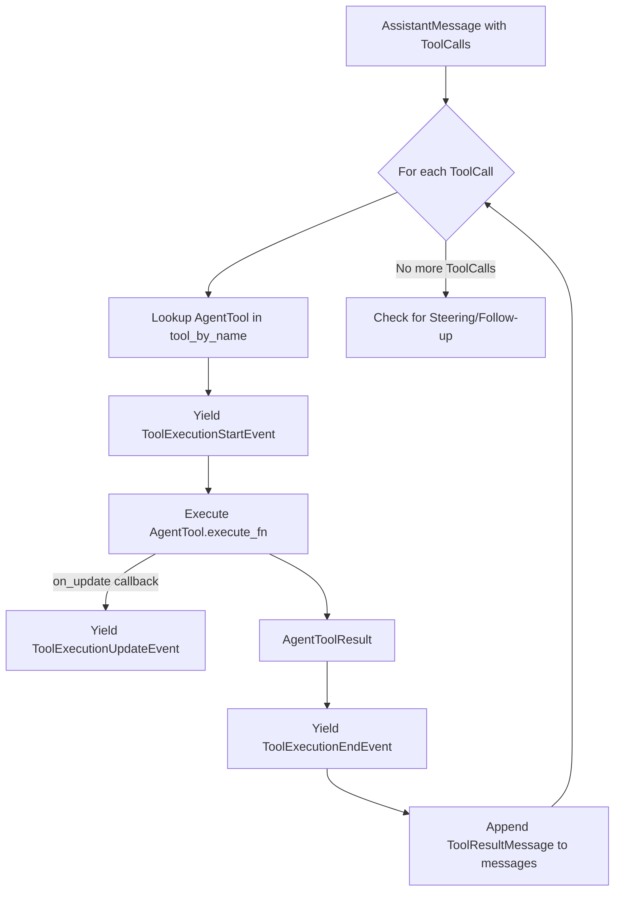
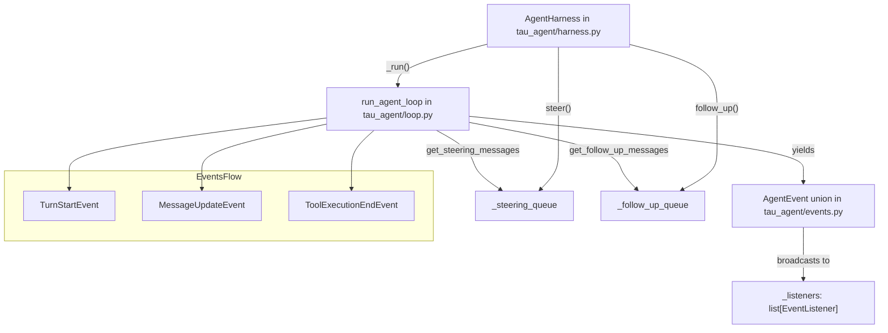

<!-- source: DeepWiki mcp.deepwiki.com · repo huggingface/tau · extra page Agent Loop and Events · fetched 2026-10-26 -->

# Agent Loop and Events

<details>
<summary>Relevant source files</summary>

The following files were used as context for generating this wiki page:

- [src/tau_agent/__init__.py](src/tau_agent/__init__.py)
- [src/tau_agent/events.py](src/tau_agent/events.py)
- [src/tau_agent/loop.py](src/tau_agent/loop.py)
- [src/tau_agent/messages.py](src/tau_agent/messages.py)
- [tests/test_agent_loop.py](tests/test_agent_loop.py)
- [tests/test_agent_types.py](tests/test_agent_types.py)
- [website/content/internals/agent-loop.md](website/content/internals/agent-loop.md)

</details>


This page provides a detailed examination of the agent loop within the `tau_agent` package, focusing on the `run_agent_loop` function defined in `src/tau_agent/loop.py`. It covers the lifecycle of an agent turn, how tool execution is managed, the role of steering and follow-up message queues, cancellation mechanisms, session settling, and the comprehensive `AgentEvent` union type. The `run_agent_loop` function is designed as a pure, provider-neutral engine that processes messages, tools, and provider streams into a sequence of observable events [src/tau_agent/loop.py:1-68]().

Sources:
- [src/tau_agent/loop.py:1-68]()
- [website/content/internals/agent-loop.md:1-76]()

---

## The `run_agent_loop` Function

The `run_agent_loop` function [src/tau_agent/loop.py:52-68]() serves as the core decision-making and interaction engine of Tau. It accepts conversation state (system prompt, messages), available tools, and a model provider, streaming `AgentEvent`s as the agent reasons and executes actions. The messages list passed to `run_agent_loop` is mutated by the loop to accumulate assistant responses and tool results [src/tau_agent/loop.py:146-169]().

### Agent Turn Lifecycle

The agent loop operates in a series of execution turns [src/tau_agent/loop.py:94](). Each turn begins with a `TurnStartEvent` [src/tau_agent/loop.py:102]() and terminates with a `TurnEndEvent` [src/tau_agent/loop.py:172](). Within a turn, the agent interacts with the `ModelProvider` to stream assistant output.

The lifecycle sequence unfolds as follows:
1. **Agent Start**: An `AgentStartEvent` is yielded at the beginning of the execution stream [src/tau_agent/loop.py:74]().
2. **Turn Start**: A `TurnStartEvent` is yielded for each turn [src/tau_agent/loop.py:75](), [src/tau_agent/loop.py:102]().
3. **Provider Interaction**: The loop invokes `_assistant_events` to request and stream provider output [src/tau_agent/loop.py:126-134]().
    * Provider stream chunks are translated into agent-level events:
        * `AssistantStartEvent` -> `MessageStartEvent` [src/tau_agent/events.py:34-37]()
        * `TextDeltaEvent` / `ThinkingDeltaEvent` -> `MessageUpdateEvent` [src/tau_agent/events.py:39-45]()
        * `AssistantDoneEvent` -> `MessageEndEvent` [src/tau_agent/events.py:47-50]()
4. **Assistant Message Collection**: The final `AssistantMessage` is recovered from the `MessageEndEvent` stream [src/tau_agent/loop.py:136-139]() and appended to the message history [src/tau_agent/loop.py:146]().
5. **Tool Execution (if any)**: If the `AssistantMessage` contains tool calls [src/tau_agent/loop.py:154-155](), the loop executes them via `_execute_tool_call` [src/tau_agent/loop.py:157-164]().
6. **Turn End**: A `TurnEndEvent` is yielded containing the assistant message and any accumulated tool results [src/tau_agent/loop.py:172]().
7. **Agent End**: An `AgentEndEvent` is yielded when the loop exhausts its queues and terminates [src/tau_agent/loop.py:182]().

Sources:
- [src/tau_agent/loop.py:52-184]()
- [src/tau_agent/events.py:1-87]()

---

## Tool Execution

When the `ModelProvider` returns an `AssistantMessage` containing `ToolCall` blocks, the loop enters its tool execution phase [src/tau_agent/loop.py:153-171]().

1. **Tool Lookup**: The agent resolves tools using `tool_by_name`, built from the `tools` sequence passed into `run_agent_loop` [src/tau_agent/loop.py:93]().
2. **Execution Start**: A `ToolExecutionStartEvent` is emitted for each tool call [src/tau_agent/events.py:52-57]().
3. **Tool Invocation**: The `execute_fn` of the target `AgentTool` is invoked with its arguments, a cancellation signal, and update callbacks.
4. **Execution Update**: Intermediate progress is broadcast via `ToolExecutionUpdateEvent`s [src/tau_agent/events.py:59-66]().
5. **Execution End**: Upon completion, an `AgentToolResult` is returned, a `ToolExecutionEndEvent` is yielded [src/tau_agent/events.py:67-73](), and a corresponding `ToolResultMessage` is appended to the message history [src/tau_agent/loop.py:168-169]().
6. **Continuation**: Once all tool calls are processed, the loop advances to the next turn, feeding the new tool results back to the model [src/tau_agent/loop.py:98-100]().

### Tool Execution Flow Diagram



Sources:
- [src/tau_agent/loop.py:93]()
- [src/tau_agent/loop.py:153-171]()
- [src/tau_agent/events.py:52-73]()
- [tests/test_agent_loop.py:190-214]()

---

## Steering and Follow-up Queues

The `run_agent_loop` function supports dynamic message injection via `get_steering_messages` and `get_follow_up_messages` callbacks [src/tau_agent/loop.py:64-65]().

* **Steering Messages**: Inspected at the start of every turn [src/tau_agent/loop.py:96](), [src/tau_agent/loop.py:174](). If present, steering messages are immediately appended to the conversation history and processed, allowing users or frontends to steer the agent mid-stream [src/tau_agent/loop.py:105-110]().
* **Follow-up Messages**: Evaluated only after the tool execution cycle finishes and no steering messages remain pending [src/tau_agent/loop.py:176-179](). If follow-up messages are retrieved, the loop continues execution.
* **Agent Settled**: When the agent finishes processing turns, tool calls, and queues without further input or tool execution, the agent reaches an settled state (`agent_settled`), concluding the run with `AgentEndEvent` [src/tau_agent/loop.py:180-182]().

Sources:
- [src/tau_agent/loop.py:64-67]()
- [src/tau_agent/loop.py:96-180]()

---

## Cancellation Tokens and History Repair

* **Cancellation (`signal`)**: The loop accepts an optional `CancellationToken` (`signal`) to abort ongoing model requests or tool executions [src/tau_agent/loop.py:62]().
* **History Repair**: Prior to dispatching message history to a provider, `run_agent_loop` invokes history repair utilities [src/tau_agent/loop.py:42](), [src/tau_agent/loop.py:130]() to ensure correct message alternation and unfulfilled tool-call recovery.

Sources:
- [src/tau_agent/loop.py:30]()
- [src/tau_agent/loop.py:42-62]()
- [src/tau_agent/loop.py:130]()

---

## The `AgentEvent` Union Type

All events emitted during `run_agent_loop` belong to the `AgentEvent` discriminated union [src/tau_agent/events.py:75-87]().

### Event Types Reference Table

| Event Class | Type String | Purpose |
| :--- | :--- | :--- |
| `AgentStartEvent` | `agent_start` | Indicates the beginning of an agent run [src/tau_agent/events.py:15-16](). |
| `AgentEndEvent` | `agent_end` | Indicates the conclusion of an agent run [src/tau_agent/events.py:19-20](). |
| `TurnStartEvent` | `turn_start` | Marks the start of a new model interaction turn [src/tau_agent/events.py:24-25](). |
| `TurnEndEvent` | `turn_end` | Marks the end of a turn following tool execution [src/tau_agent/events.py:28-29](). |
| `MessageStartEvent` | `message_start` | Signals the creation of a new transcript message [src/tau_agent/events.py:34-35](). |
| `MessageUpdateEvent` | `message_update` | Carries streaming text, thinking, or tool deltas [src/tau_agent/events.py:39-40](). |
| `MessageEndEvent` | `message_end` | Signals the finalization of a transcript message [src/tau_agent/events.py:47-48](). |
| `ToolExecutionStartEvent` | `tool_execution_start` | Indicates a tool call has started executing [src/tau_agent/events.py:52-53](). |
| `ToolExecutionUpdateEvent` | `tool_execution_update` | Reports progress updates from a running tool [src/tau_agent/events.py:59-60](). |
| `ToolExecutionEndEvent` | `tool_execution_end` | Reports completion and result of a tool call [src/tau_agent/events.py:67-68](). |

Sources:
- [src/tau_agent/events.py:1-87]()

---

## Bridging Natural Language and Code Entities

### Mapping Intent to Execution Diagram

```mermaid
graph TD
    subgraph "NaturalLanguageSpace"
        NL_UserPrompt[""User Prompt (e.g., Edit README.md)""]
        NL_AgentThought[""Agent Thought (internal reasoning)""]
        NL_ToolAction[""Tool Action (e.g., write README.md)""]
    end

    subgraph "CodeEntitySpace"
        CE_run_agent_loop[""run_agent_loop(...) in tau_agent/loop.py""]
        CE_ModelProvider[""ModelProvider.stream_response(...) in tau_agent/provider.py""]
        CE_AgentTool[""AgentTool.execute_fn(...) in tau_agent/tools.py""]

        subgraph "AgentEventStream"
            AES_MessageUpdateEvent[""MessageUpdateEvent in tau_agent/events.py""]
            AES_ToolExecutionStartEvent[""ToolExecutionStartEvent in tau_agent/events.py""]
        end
    end

    NL_UserPrompt --> CE_run_agent_loop
    CE_run_agent_loop --> CE_ModelProvider
    CE_ModelProvider -- "ThinkingDeltaEvent" --> AES_MessageUpdateEvent
    NL_AgentThought --> AES_MessageUpdateEvent
    CE_run_agent_loop --> CE_AgentTool
    CE_AgentTool --> AES_ToolExecutionStartEvent
    NL_ToolAction --> AES_ToolExecutionStartEvent
```

Sources:
- [src/tau_agent/loop.py:52-68]()
- [src/tau_agent/events.py:39-45]()

### Agent Harness and Loop Interaction Diagram



Sources:
- [src/tau_agent/loop.py:52-68]()
- [src/tau_agent/events.py:75-87]()

---

