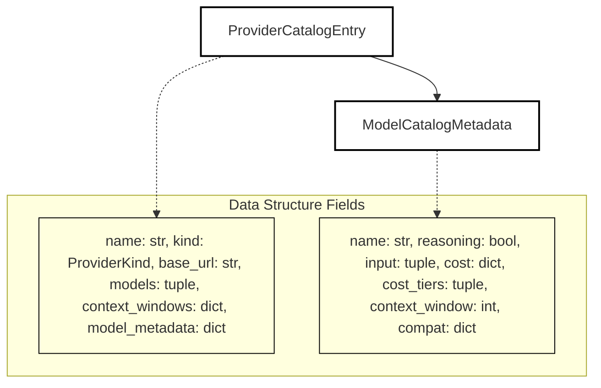
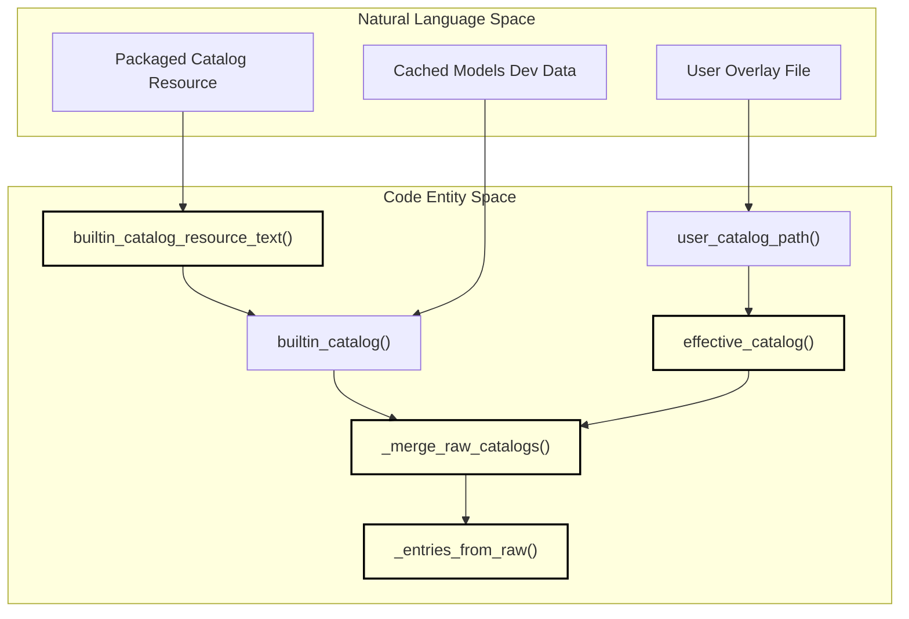
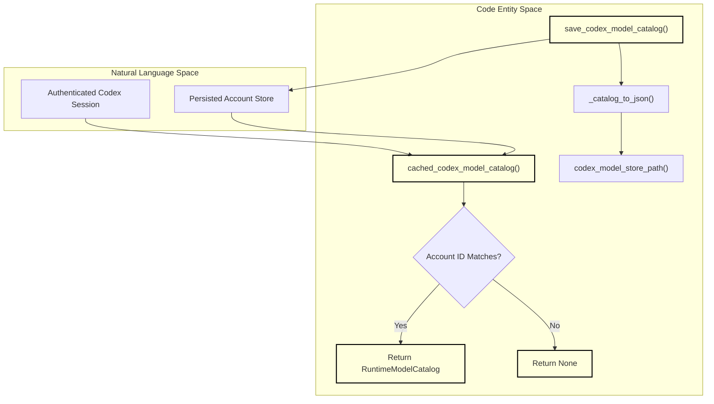

<!-- source: DeepWiki mcp.deepwiki.com · repo huggingface/tau · extra page Catalog Loader and models.dev Overlays · fetched 2026-10-26 -->

# Catalog Loader and models.dev Overlays

<details>
<summary>Relevant source files</summary>

The following files were used as context for generating this wiki page:

- [TODO.md](TODO.md)
- [dev-notes/architecture/provider-catalog-live-validation.md](dev-notes/architecture/provider-catalog-live-validation.md)
- [dev-notes/codex-live-model-catalog.md](dev-notes/codex-live-model-catalog.md)
- [dev-notes/kimi-k3-model-catalog.md](dev-notes/kimi-k3-model-catalog.md)
- [src/tau_coding/catalog_loader.py](src/tau_coding/catalog_loader.py)
- [src/tau_coding/codex_model_store.py](src/tau_coding/codex_model_store.py)
- [src/tau_coding/data/catalog.toml](src/tau_coding/data/catalog.toml)
- [src/tau_coding/data/docs/models.md](src/tau_coding/data/docs/models.md)
- [src/tau_coding/paths.py](src/tau_coding/paths.py)
- [src/tau_coding/provider_catalog.py](src/tau_coding/provider_catalog.py)
- [tests/test_codex_model_store.py](tests/test_codex_model_store.py)
- [tests/test_provider_catalog.py](tests/test_provider_catalog.py)
- [website/content/guides/providers-and-models.md](website/content/guides/providers-and-models.md)

</details>


## Purpose and Scope

This page provides a deep technical dive into Tau's configuration-driven provider catalog system, implemented primarily across `src/tau_coding/provider_catalog.py` [src/tau_coding/provider_catalog.py:1-111]() and `src/tau_coding/catalog_loader.py` [src/tau_coding/catalog_loader.py:1-183](). It covers core data structures (`ProviderCatalogEntry`, `ModelCatalogMetadata`, `ModelCostTier`), the `catalog.toml` schema, user-level overlays, model tombstones, live validation workflows, and the account-scoped Codex model store (`src/tau_coding/codex_model_store.py` [src/tau_coding/codex_model_store.py:1-88]()).

Sources: `src/tau_coding/provider_catalog.py` [src/tau_coding/provider_catalog.py:1-111](), `src/tau_coding/catalog_loader.py` [src/tau_coding/catalog_loader.py:1-183](), `src/tau_coding/codex_model_store.py` [src/tau_coding/codex_model_store.py:1-88]()

---

## Core Catalog Data Structures

Tau models provider definitions and per-model metadata using frozen dataclasses defined in `src/tau_coding/provider_catalog.py` [src/tau_coding/provider_catalog.py:31-95](). These structures are instantiated during catalog loading and consumed by frontends, model pickers, and runtime provider factories.


*Diagram 1: Core Catalog Data Structure Hierarchy (`ProviderCatalogEntry` and `ModelCatalogMetadata`)*

Sources: `src/tau_coding/provider_catalog.py` [src/tau_coding/provider_catalog.py:31-95]()

### `ModelCostTier` and Pricing Accounting
`ModelCostTier` allows defining usage rates that apply up to an optional input-token threshold [src/tau_coding/provider_catalog.py:31-38](). The helper function `model_cost_for_input_tokens()` [src/tau_coding/provider_catalog.py:57-67]() iterates through configured tiers and returns the appropriate cost dictionary or falls back to the flat base `cost` attribute.

| Class / Function | File Path | Role |
| :--- | :--- | :--- |
| `ModelCostTier` | `src/tau_coding/provider_catalog.py:31-38` | Represents token cost rates up to a max input token limit. |
| `ModelCatalogMetadata` | `src/tau_coding/provider_catalog.py:40-55` | Holds capabilities, limits, pricing, and compatibility flags for a single model. |
| `model_cost_for_input_tokens()` | `src/tau_coding/provider_catalog.py:57-67` | Resolves tiered pricing based on current input token volume. |
| `ProviderCatalogEntry` | `src/tau_coding/provider_catalog.py:70-94` | Durable descriptor for an AI provider, its endpoints, and available models. |

Sources: `src/tau_coding/provider_catalog.py` [src/tau_coding/provider_catalog.py:31-94]()

---

## Catalog Schema and Pydantic Validation (`catalog.toml`)

Tau validates built-in and user overlay catalog files against strict Pydantic models defined in `src/tau_coding/catalog_loader.py` [src/tau_coding/catalog_loader.py:58-121](). Any malformed fields, unknown keys, or missing required parameters raise a `CatalogError` [src/tau_coding/catalog_loader.py:54-55]().

```toml
schema_version = 1

[[providers]]
name = "nebius"
display_name = "Nebius AI Studio"
kind = "openai-compatible"
base_url = "https://api.studio.nebius.ai/v1"
api_key_env = "NEBIUS_API_KEY"
credential_name = "nebius"
models = ["deepseek-ai/DeepSeek-V4-Pro"]
default_model = "deepseek-ai/DeepSeek-V4-Pro"
docs_url = "https://studio.nebius.ai/docs"

[providers.context_windows]
"deepseek-ai/DeepSeek-V4-Pro" = 163840
```
*Snippet 1: Example `catalog.toml` Provider Block Structure*

Sources: `src/tau_coding/catalog_loader.py` [src/tau_coding/catalog_loader.py:58-121](), `tests/test_provider_catalog.py` [tests/test_provider_catalog.py:25-43]()

---

## Load-Merge-Resolve Lifecycle and User Overlays

The catalog loading subsystem merges packaged baseline definitions with user-provided overlays located at `~/.tau/catalog.toml` [src/tau_coding/catalog_loader.py:143-160]().


*Diagram 2: Catalog Loading and Overlay Resolution Lifecycle*

Sources: `src/tau_coding/catalog_loader.py` [src/tau_coding/catalog_loader.py:122-160]()

### Overlay Merge Rules
When `~/.tau/catalog.toml` defines a provider matching an existing built-in provider name:
1. **Scalar fields** replace built-in values [src/tau_coding/catalog_loader.py:90-113]().
2. **Models** are merged with user models taking precedence [src/tau_coding/catalog_loader.py:99]().
3. **Context windows** are merged per model key [src/tau_coding/catalog_loader.py:103]().
4. **Thinking configuration groups** (`thinking_levels`, `thinking_models`, `thinking_default`, `thinking_parameter`) replace atomically when `thinking_levels` is present [src/tau_coding/catalog_loader.py:41-43]().

Sources: `src/tau_coding/catalog_loader.py` [src/tau_coding/catalog_loader.py:41-43](), [src/tau_coding/catalog_loader.py:90-113]()

---

## The Codex Model Store

For authenticated OpenAI Codex subscriptions (`openai-codex`), model inventories and runtime limits are dynamic and account-specific [website/content/guides/providers-and-models.md:103-124](). Tau decouples this from static catalog definitions using an account-scoped model store implemented in `src/tau_coding/codex_model_store.py` [src/tau_coding/codex_model_store.py:1-88]().


*Diagram 3: Codex Model Store Resolution and Caching Flow*

Sources: `src/tau_coding/codex_model_store.py` [src/tau_coding/codex_model_store.py:25-88](), `website/content/guides/providers-and-models.md` [website/content/guides/providers-and-models.md:103-135]()

### Storage Specifications
* **Path:** `~/.tau/codex-models-store.json` [src/tau_coding/paths.py:67-69]().
* **Versioning:** Validates `schema_version == 1` and strict `account_id` matching before loading cached models [src/tau_coding/codex_model_store.py:42-45]().
* **Atomic Writes:** Uses `NamedTemporaryFile` combined with `.replace()` to prevent partial JSON write corruption [src/tau_coding/codex_model_store.py:70-82]().
* **Exclusions:** Stores *only* parsed model metadata and account identifiers; OAuth tokens and raw secrets are never written to the store [website/content/guides/providers-and-models.md:129-131]().

Sources: `src/tau_coding/paths.py` [src/tau_coding/paths.py:67-69](), `src/tau_coding/codex_model_store.py` [src/tau_coding/codex_model_store.py:25-88](), `website/content/guides/providers-and-models.md` [website/content/guides/providers-and-models.md:129-135]()

---

## Live Validation and Models.dev Generation

Tau synchronizes mainstream provider models using generated metadata from `models.dev` combined with build-time manifests [website/content/guides/providers-and-models.md:113-120]().

### Model Generation Workflow
To refresh the built-in generated inventory:
```bash
uv run python scripts/generate_models.py
```
*Snippet 2: Regenerating Model Inventories*

Sources: `website/content/guides/providers-and-models.md` [website/content/guides/providers-and-models.md:118-120]()

### Live Validation Runbook Summary
Live validation verifies that every model and thinking level configured in Tau successfully initiates a streaming connection (`response_start`) with the remote provider [dev-notes/architecture/provider-catalog-live-validation.md:23-38]().
* **Validation Script:** Executed via `uv run python ~/.tau/provider-validation/validate_provider_catalog.py run` [dev-notes/architecture/provider-catalog-live-validation.md:97-103]().
* **Results Ledger:** Appended as JSONL records to `~/.tau/provider-validation/pi-api-provider-catalog/results.jsonl` [dev-notes/architecture/provider-catalog-live-validation.md:73-77]().
* **Error Classification:** Distinguishes between payload schema failures (fixed in runtime adapters), deprecated model IDs (removed via catalog tombstones), and account-specific billing/credential errors [dev-notes/architecture/provider-catalog-live-validation.md:156-192]().

Sources: `dev-notes/architecture/provider-catalog-live-validation.md` [dev-notes/architecture/provider-catalog-live-validation.md:1-192]()

---

