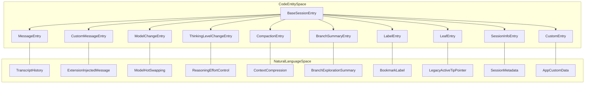
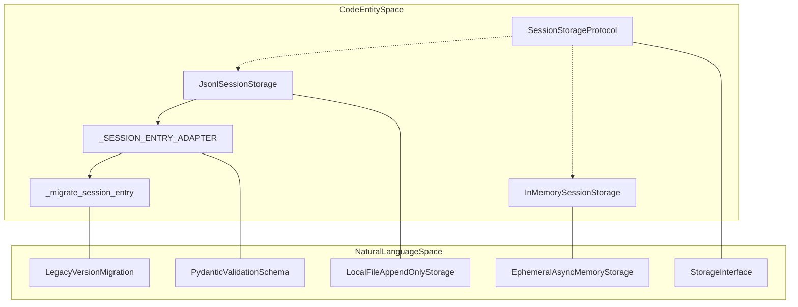
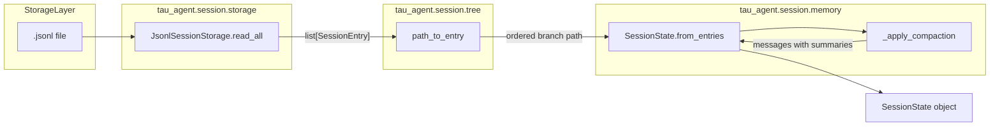

<!-- source: DeepWiki mcp.deepwiki.com · repo huggingface/tau · extra page Session Tree and JSONL Persistence · fetched 2026-10-26 -->

# Session Tree and JSONL Persistence

Relevant source files

The following files were used as context for generating this wiki page:

- [dev-notes/architecture/phase-20-2-thinking-controls.md](dev-notes/architecture/phase-20-2-thinking-controls.md)
- [dev-notes/architecture/phase-22-compaction-foundation.md](dev-notes/architecture/phase-22-compaction-foundation.md)
- [dev-notes/architecture/phase-24-session-tree-branching.md](dev-notes/architecture/phase-24-session-tree-branching.md)
- [dev-notes/architecture/phase-7-session-tree.md](dev-notes/architecture/phase-7-session-tree.md)
- [dev-notes/architecture/phase-8-coding-session.md](dev-notes/architecture/phase-8-coding-session.md)
- [dev-notes/custom-message-session-entries.md](dev-notes/custom-message-session-entries.md)
- [dev-notes/design/04-sessions.md](dev-notes/design/04-sessions.md)
- [dev-notes/design/602-session-preparation-lifecycle.md](dev-notes/design/602-session-preparation-lifecycle.md)
- [dev-notes/drop-leaf-session-entries.md](dev-notes/drop-leaf-session-entries.md)
- [dev-notes/first-kept-compaction.md](dev-notes/first-kept-compaction.md)
- [dev-notes/per-entry-session-labels.md](dev-notes/per-entry-session-labels.md)
- [dev-notes/push-based-persistence.md](dev-notes/push-based-persistence.md)
- [dev-notes/summary-request-usage.md](dev-notes/summary-request-usage.md)
- [src/tau_agent/session/__init__.py](src/tau_agent/session/__init__.py)
- [src/tau_agent/session/entries.py](src/tau_agent/session/entries.py)
- [src/tau_agent/session/jsonl.py](src/tau_agent/session/jsonl.py)
- [src/tau_agent/session/memory.py](src/tau_agent/session/memory.py)
- [src/tau_coding/branch_summary.py](src/tau_coding/branch_summary.py)
- [tests/test_session.py](tests/test_session.py)

This page details the append-only session entry model, JSONL persistence, in-memory state reconstruction, push-based persistence architecture, and tree traversal mechanisms used in Tau (`tau_agent.session`).

---

## Purpose and Scope

Tau preserves conversations and agent state across runs using an immutable append-only event log. Instead of mutating historical state in place, Tau appends new entries to a JSONL file and reconstructs active conversational state by replaying them [dev-notes/design/04-sessions.md:5-9](). Low-level session primitives, entries, serialization, and replay live in `tau_agent`, while coding-agent session orchestration (`CodingSession`) lives in `tau_coding` [dev-notes/design/04-sessions.md:85-89]().

Sources: [dev-notes/design/04-sessions.md:5-9](), [dev-notes/design/04-sessions.md:85-89]()

---

## Append-Only Session Entry Model

Tau's session persistence is built on `BaseSessionEntry`, which provides a unique `id` (generated via `new_entry_id()`), an optional `parent_id` for tree structuring, and a `timestamp` [src/tau_agent/session/entries.py:15-32]().

### Session Entry Types

| Entry Class | Type Discriminator | Purpose |
|:---|:---|:---|
| `MessageEntry` | `message` | Stores a standard transcript message (User, Assistant, or ToolResult) [src/tau_agent/session/entries.py:35-40](). |
| `CustomMessageEntry` | `custom_message` | Extension-injected message that participates in model context [src/tau_agent/session/entries.py:42-50](). |
| `ModelChangeEntry` | `model_change` | Records a change in the model and optional provider [src/tau_agent/session/entries.py:52-63](). |
| `ThinkingLevelChangeEntry` | `thinking_level_change` | Records changes to reasoning effort or thinking budget [src/tau_agent/session/entries.py:65-70](). |
| `CompactionEntry` | `compaction` | A context summary replacing older entries during replay [src/tau_agent/session/entries.py:72-86](). |
| `BranchSummaryEntry` | `branch_summary` | A summary of an abandoned or alternate branch [src/tau_agent/session/entries.py:88-98](). |
| `LabelEntry` | `label` | A bookmark change attached to a session entry [src/tau_agent/session/entries.py:100-106](). |
| `LeafEntry` | `leaf` | A legacy active-tip pointer retained strictly for deserialization compatibility [src/tau_agent/session/entries.py:108-113](). |
| `SessionInfoEntry` | `session_info` | Basic metadata such as creation time, working directory (`cwd`), and title [src/tau_agent/session/entries.py:115-122](). |
| `CustomEntry` | `custom` | Extension or application-owned session data identified by a namespace [src/tau_agent/session/entries.py:124-130](). |

### Code Entity Mapping: Session Entry Definitions

Sources: [src/tau_agent/session/entries.py:25-144]()

---

## JsonlSessionStorage and Serialization

Entries are serialized into canonical JSON Lines (JSONL) format via `entry_to_json_line()` and deserialized via `entry_from_json_line()` or `entries_from_json_lines()` [src/tau_agent/session/jsonl.py:19-60]().

- **Migration**: `_migrate_session_entry()` handles backward compatibility for legacy Tau-v1 message structures, such as string-based assistant content with old `tool_calls` fields, null usage costs, and legacy targetless labels [src/tau_agent/session/jsonl.py:63-116]().
- **Validation**: Pydantic's `TypeAdapter[SessionEntry]` validates payloads against the discriminated union schema [src/tau_agent/session/jsonl.py:12-32]().

### Code Entity Mapping: Serialization & Storage Architecture

Sources: [src/tau_agent/session/jsonl.py:12-101]()

---

## Tree Traversal, Replay, and SessionState

Because sessions are append-only and support branching via `parent_id` pointers, the active conversational state is dynamically reconstructed into a `SessionState` snapshot [src/tau_agent/session/memory.py:22-37]().

- **Path Reconstruction**: `path_to_entry()` traverses upwards from a target `leaf_id` to the root using parent identifiers, performs cycle detection, and orders entries chronologically [src/tau_agent/session/tree.py:22-40]().
- **Active Tip Selection**: The active tip defaults to the last non-`leaf` entry in file order. Historical `leaf` records remain readable for backward compatibility but never select the tip [src/tau_agent/session/memory.py:45-54]().
- **Replay Logic**: `SessionState.from_entries()` iterates through the resolved branch path, accumulating messages, active model/provider, thinking levels, labels, compactions, and branch summaries [src/tau_agent/session/memory.py:39-125]().

### Data Flow: From JSONL Storage to In-Memory SessionState

Sources: [src/tau_agent/session/memory.py:39-125](), [src/tau_agent/session/tree.py:22-40]()

---

## Branch Summaries and Compaction Replay

- **Compaction Replay**: When `SessionState.from_entries()` encounters a `CompactionEntry`, `_apply_compaction` evaluates `first_kept_entry_id` or legacy `replaces_entry_ids` to strip summarized historical entries while retaining newer context and injecting a provider-neutral summary message [src/tau_agent/session/memory.py:100-176]() [dev-notes/architecture/phase-22-compaction-foundation.md:21-33]().
- **Branch Summaries**: `BranchSummaryEntry` records represent explored alternate paths. When active in a branch path, `SessionState` converts them into a user-context summary message [dev-notes/architecture/phase-24-session-tree-branching.md:35-37](). `CodingSession` and `summarize_branch_messages_with_model` use model-assisted summarization to generate structured branch goals, progress, decisions, and next steps [src/tau_coding/branch_summary.py:68-111]() [dev-notes/architecture/phase-24-session-tree-branching.md:39-47]().

Sources: [src/tau_agent/session/memory.py:100-176](), [src/tau_coding/branch_summary.py:68-111](), [dev-notes/architecture/phase-22-compaction-foundation.md:21-33](), [dev-notes/architecture/phase-24-session-tree-branching.md:35-47]()

---

## Push-Based Persistence Architecture

Tau utilizes a push-based persistence model where `CodingSession` subscribes a persistence listener to the `AgentHarness` [dev-notes/design/04-sessions.md:41-43]().

- **Durable Boundary**: `MessageEndEvent` serves as the durable-message boundary [dev-notes/design/04-sessions.md:41-43](). Every `message_end` notification appends that message to storage before the event reaches the frontend [dev-notes/design/04-sessions.md:41-43]().
- **Cancellation & Interrupted Calls**: Because persistence runs via harness event subscribers rather than consumption loops, UI teardowns (such as pressing `Esc` in the TUI to cancel a worker) cannot lose writes, including synthetic "Tool call interrupted by user" error results generated during cancelled cleanup [dev-notes/push-based-persistence.md:16-24]().
- **Unstarted Runs**: A message whose `message_end` never fired (e.g., an abandoned first prompt) is deliberately not persisted, preventing aborted prompts from indexing new session files [dev-notes/design/04-sessions.md:50-51]().

Sources: [dev-notes/push-based-persistence.md:1-39](), [dev-notes/design/04-sessions.md:41-55]()

---

