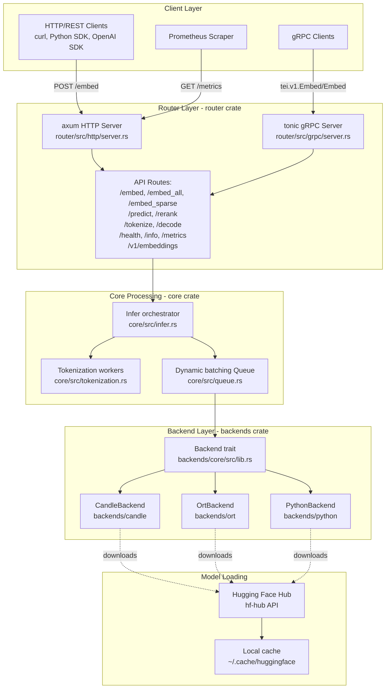
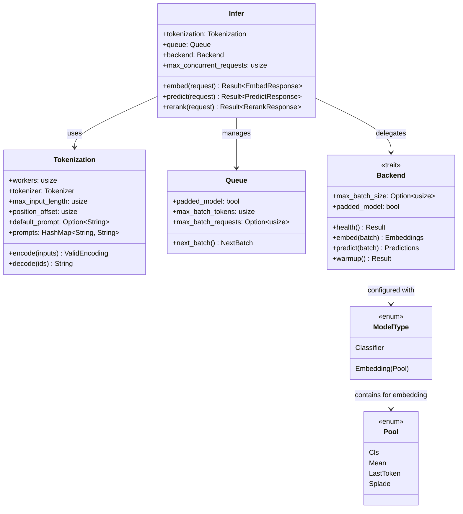
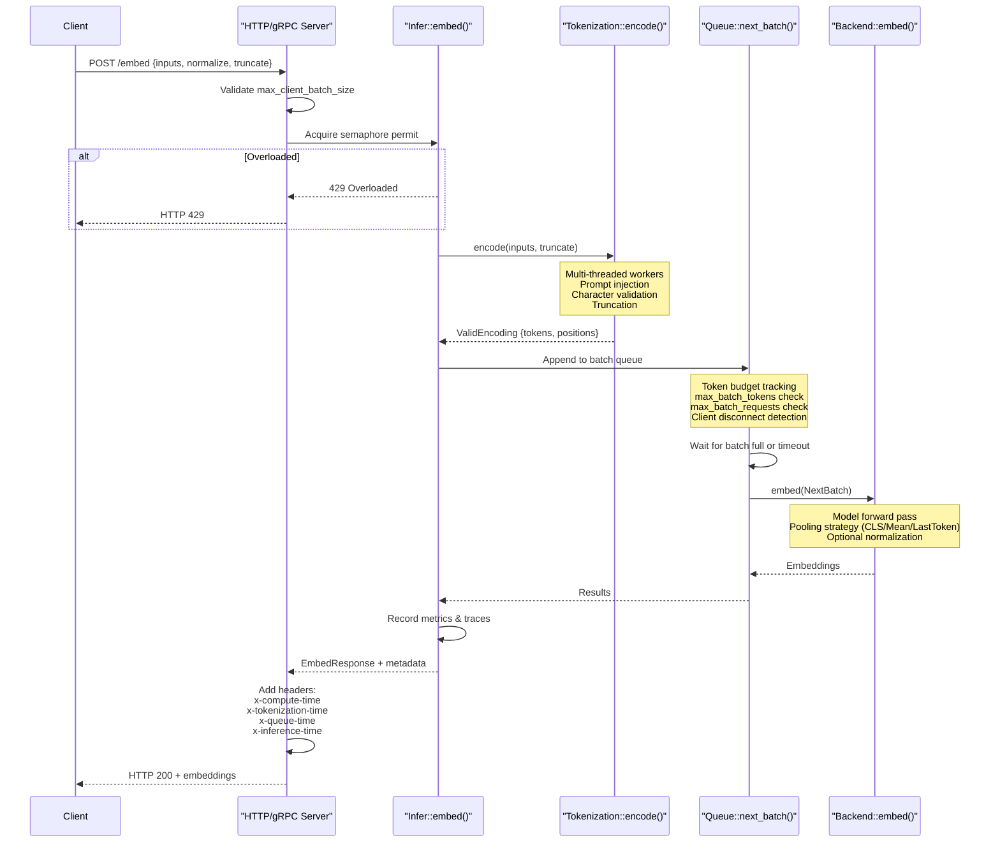
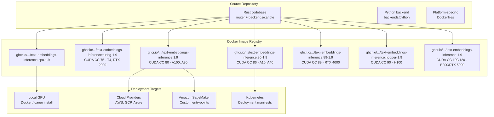
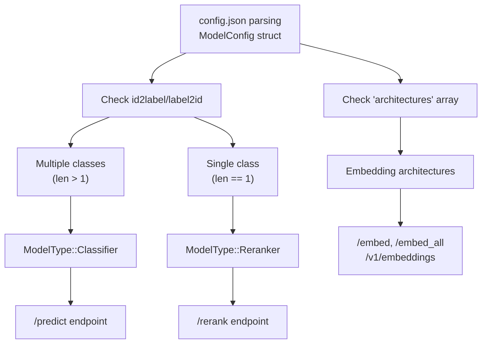

<!-- source: DeepWiki mcp.deepwiki.com · repo huggingface/text-embeddings-inference · page 1 Overview · fetched 2026-10-26 -->

# Overview

Relevant source files

The following files were used as context for generating this wiki page:

- [Cargo.lock](Cargo.lock)
- [Cargo.toml](Cargo.toml)
- [README.md](README.md)
- [docs/openapi.json](docs/openapi.json)
- [docs/source/en/cli_arguments.md](docs/source/en/cli_arguments.md)
- [docs/source/en/custom_container.md](docs/source/en/custom_container.md)
- [docs/source/en/private_models.md](docs/source/en/private_models.md)
- [docs/source/en/quick_tour.md](docs/source/en/quick_tour.md)
- [docs/source/en/supported_models.md](docs/source/en/supported_models.md)
- [router/src/lib.rs](router/src/lib.rs)
- [router/src/main.rs](router/src/main.rs)

Text Embeddings Inference (TEI) is a Rust-based toolkit for deploying and serving open-source text embedding, sequence classification, and re-ranking models. TEI provides production-ready inference with optimizations for NVIDIA GPUs (via CUDA), Apple Silicon (via Metal), and CPUs (via Intel MKL or ONNX Runtime).

The system supports popular embedding models including FlagEmbedding, Ember, GTE, E5, Qwen3, Mistral, and ModernBERT architectures. TEI is designed for high throughput and low latency, featuring token-based dynamic batching, Flash Attention optimizations, and comprehensive observability.

**Key Capabilities:**
- Multiple API interfaces: HTTP REST (via `axum`), gRPC (via `tonic`), OpenAI-compatible endpoints. [router/src/lib.rs:5-15]()
- Three backend implementations: Candle (Rust ML), ORT (ONNX Runtime), Python (PyTorch via gRPC). [Cargo.toml:3-11]()
- Hardware-optimized builds for CUDA compute capabilities 75-120, Intel CPUs, and Apple Metal. [docs/source/en/supported_models.md:70-80]()
- Production features: Prometheus metrics, OpenTelemetry tracing, distributed deployment support. [README.md:51-62]()

For deployment instructions, see [Getting Started](#2). For detailed API documentation, see [API Reference](#6).

Sources: [README.md:1-61](), [router/src/lib.rs:1-40](), [Cargo.toml:1-28]()

## System Architecture

TEI is organized into four main layers: client interfaces, router layer, core processing, and backend implementations. The architecture is designed for high performance with async I/O, multi-threaded tokenization, and hardware-accelerated inference.

**Overall System Architecture**

**Key Architecture Characteristics:**
- **Async Router**: Built on `tokio` async runtime for non-blocking I/O. [Cargo.toml:38-38]()
- **Multi-threaded Tokenization**: CPU-bound tokenization runs in OS thread pool. [router/src/lib.rs:47-47]()
- **Dynamic Batching**: Token budget tracking in `Queue` maximizes GPU utilization. [router/src/main.rs:73-74]()
- **Backend Abstraction**: `Backend` trait enables swapping between Candle/ORT/Python implementations. [Cargo.toml:3-11]()
- **Safetensors Loading**: All backends use `.safetensors` format for fast weight loading. [README.md:60-60]()

Sources: [router/src/lib.rs:44-378](), [Cargo.toml:1-23](), [README.md:47-61]()

## Core Components and Data Flow

The TEI core components implement the request processing pipeline, from tokenization through batching to inference.

**Core Component Structure**

**Component Responsibilities:**

| Component | Key Functions | Purpose |
|-----------|---------------|---------|
| `Infer` | `embed()`, `predict()`, `rerank()` | Request orchestration, admission control via semaphore. [router/src/lib.rs:31-31]() |
| `Tokenization` | `encode()`, `decode()` | Multi-threaded tokenization with prompt injection. [router/src/lib.rs:33-33]() |
| `Queue` | `next_batch()` | Dynamic batching with token budget tracking. [router/src/lib.rs:32-32]() |
| `Backend` | `embed()`, `predict()`, `warmup()` | Abstract inference interface. [router/src/lib.rs:29-29]() |

**Request Admission Control:**
- Semaphore-based limiting via `max_concurrent_requests` in `Infer`. [router/src/main.rs:59-60]()
- Returns HTTP 429 when limit exceeded to prevent queue buildup. [docs/openapi.json:173-186]()
- Per-request tracking with `tokio::sync::Semaphore`. [Cargo.toml:38-38]()

Sources: [router/src/lib.rs:244-306](), [README.md:47-61]()

## Request Processing Pipeline

Requests flow through multiple stages with detailed timing instrumentation at each step. The pipeline is designed to maximize throughput while maintaining low latency.

**Request Processing Sequence**

**Pipeline Stages and Timing:**

1. **Validation**: Request size, batch size checks in router handlers. [router/src/main.rs:81-82]()
2. **Tokenization**: Parallel tokenization in OS thread pool. [router/src/main.rs:35-36]()
3. **Queue Wait**: Dynamic batching until `max_batch_tokens` reached. [router/src/main.rs:73-74]()
4. **Backend Inference**: GPU/CPU forward pass with hardware acceleration. [README.md:57-59]()
5. **Response Assembly**: Metadata headers, Prometheus recording, OpenTelemetry spans. [router/src/lib.rs:66-67]()

Sources: [router/src/lib.rs:44-70](), [README.md:123-128]()

## Deployment Architecture

TEI provides multiple deployment options with pre-built Docker images optimized for different hardware platforms. The build matrix generates specialized images for maximum performance.

**Multi-Platform Deployment Options**

**Docker Image Selection Guide:**

| Hardware | CUDA Compute Capability | Docker Image Tag | Flash Attention |
|----------|------------------------|------------------|-----------------|
| Intel/AMD CPU | N/A | `cpu-1.9` | No |
| NVIDIA T4, RTX 2000 | 75 (Turing) | `turing-1.9` | v1 |
| NVIDIA A100, A30 | 80 (Ampere) | `1.9` (default) | v2 |
| NVIDIA RTX 4000 | 89 (Ada) | `89-1.9` | v2 |
| NVIDIA H100 | 90 (Hopper) | `hopper-1.9` | v2 |
| NVIDIA B200, RTX 5090 | 100/120 (Blackwell) | `1.9` | v2 |

Sources: [docs/source/en/supported_models.md:70-95](), [docs/source/en/custom_container.md:30-36](), [Cargo.toml:1-23]()

## Supported Model Types

TEI categorizes models into three types based on their architecture and determines available API endpoints accordingly.

**Model Type Detection and API Routing**

**Supported Embedding Models:**

| Model Family | Position Encoding | Examples |
|--------------|------------------|----------|
| Qwen3 | RoPE | `Qwen/Qwen3-Embedding-8B` |
| Qwen2 | RoPE | `Alibaba-NLP/gte-Qwen2-7B-instruct` |
| XLM-RoBERTa | Absolute | `multilingual-e5-large-instruct` |
| JinaBERT | ALiBi | `jina-embeddings-v2-base-en` |
| ModernBERT | Absolute | `ModernBERT-large` |

**Pooling Strategy Selection:**

For embedding models, TEI supports four pooling strategies (configured via `--pooling` or auto-detected): [docs/source/en/cli_arguments.md:65-69]()

- **CLS**: Select the CLS token.
- **Mean**: Average all token embeddings.
- **LastToken**: Select the last token.
- **Splade**: Sparse Lexical and Expansion.

Sources: [router/src/lib.rs:118-141](), [docs/source/en/supported_models.md:21-67]()

## Performance Optimizations

TEI implements multiple optimization techniques to maximize throughput and minimize latency.

**Token-Based Dynamic Batching:**
The `Queue` component groups requests based on token counts:
- **Token Budget Tracking**: Tracks total tokens via `max_batch_tokens` (default: 16384). [router/src/main.rs:73-74]()
- **Client Disconnect Detection**: Prevents wasted computation on abandoned requests. [router/src/main.rs:59-60]()

**Hardware-Specific Optimizations:**
- **Flash Attention**: Optimized kernels for CUDA devices. [README.md:57-58]()
- **cuBLASLt**: Fused matrix operations for NVIDIA GPUs. [README.md:59-59]()
- **Candle**: Rust-native ML framework for low-overhead execution. [README.md:58-58]()

Sources: [README.md:51-62](), [router/src/main.rs:62-82]()

## Observability and Monitoring

TEI provides comprehensive observability through Prometheus metrics and OpenTelemetry tracing. [README.md:62-62]()

**Monitoring Features:**
- **Prometheus Metrics**: Exported on a configurable port (default: 9000). [router/src/lib.rs:68-68]()
- **OpenTelemetry**: Distributed tracing via `--otlp-endpoint`. [router/src/lib.rs:66-66]()
- **Timing Headers**: All HTTP responses include `x-compute-time`, `x-tokenization-time`, etc. [docs/source/en/quick_tour.md:103-103]()

Sources: [router/src/lib.rs:64-68](), [docs/openapi.json:1-15]()

## Configuration and Deployment

TEI is configured via command-line arguments or environment variables. [router/src/main.rs:13-15]()

**Essential Parameters:**
- `--model-id`: HF Hub ID or local path. [router/src/main.rs:25-25]()
- `--dtype`: Force model precision (`float16`, `float32`). [router/src/main.rs:40-40]()
- `--max-batch-tokens`: Critical control for hardware usage. [router/src/main.rs:74-74]()
- `--hf-token`: For private or gated models. [router/src/main.rs:144-144]()

For details, see [System Architecture](#1.1), [Features and Capabilities](#1.2), and [Model Types and Endpoint Routing](#1.3).

Sources: [router/src/main.rs:13-158](), [docs/source/en/cli_arguments.md:1-150]()

---

