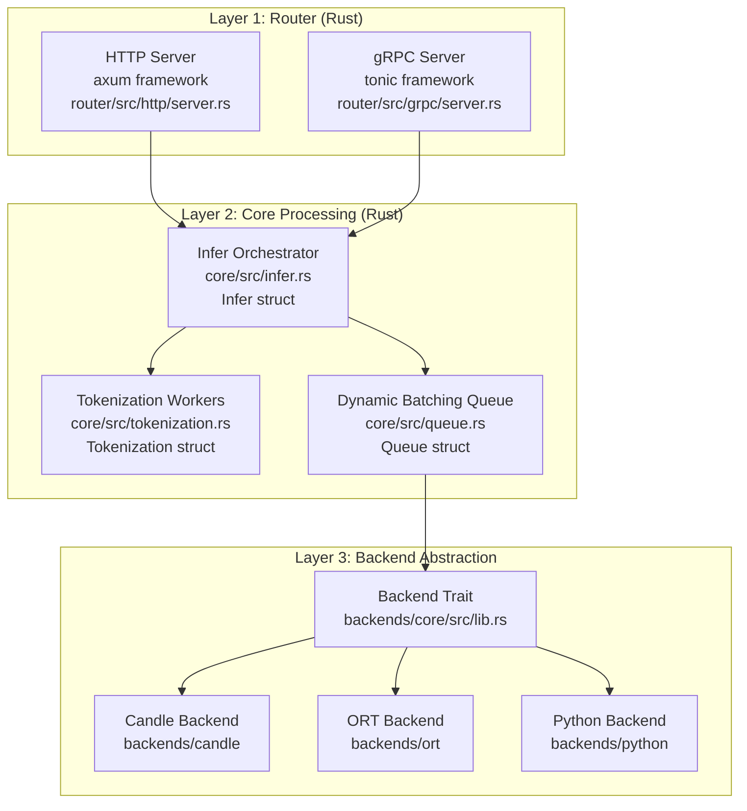
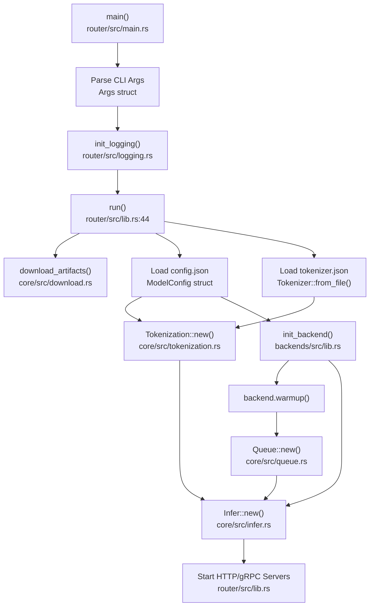
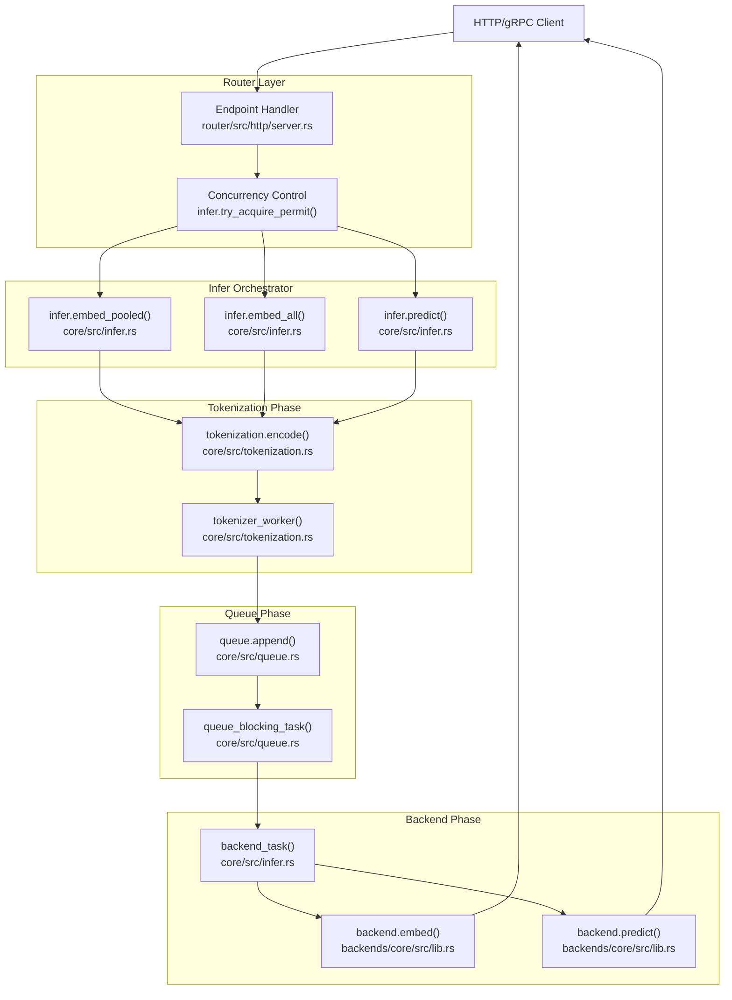

<!-- source: DeepWiki mcp.deepwiki.com · repo huggingface/text-embeddings-inference · page 1.1 System Architecture · fetched 2026-10-26 -->

# System Architecture

Relevant source files

The following files were used as context for generating this wiki page:

- [Cargo.lock](Cargo.lock)
- [Cargo.toml](Cargo.toml)
- [README.md](README.md)
- [backends/Cargo.toml](backends/Cargo.toml)
- [backends/candle/Cargo.toml](backends/candle/Cargo.toml)
- [backends/core/src/lib.rs](backends/core/src/lib.rs)
- [backends/python/src/lib.rs](backends/python/src/lib.rs)
- [backends/src/dtype.rs](backends/src/dtype.rs)
- [core/Cargo.toml](core/Cargo.toml)
- [docs/openapi.json](docs/openapi.json)
- [docs/source/en/cli_arguments.md](docs/source/en/cli_arguments.md)
- [router/Cargo.toml](router/Cargo.toml)
- [router/src/lib.rs](router/src/lib.rs)
- [router/src/main.rs](router/src/main.rs)

## Purpose and Scope

This document describes the high-level architecture of Text Embeddings Inference (TEI), focusing on how the major system components interact to serve embedding, classification, and reranking requests. It covers the three-layer design (Router, Core Processing, and Backend), the communication patterns between layers, and the key data structures that flow through the system.

For information about specific backend implementations (Candle, ORT, Python), see [Backend Architecture and Selection](#4.1). For hardware-specific optimizations, see [CUDA Compute Capability System](#5.1) and [Intel Platform Optimization](#5.2). For detailed API endpoint documentation, see [HTTP API Endpoints](#6.1).

## Architectural Overview

TEI is organized into three distinct layers that separate concerns and enable flexible deployment:

### Layered System Diagram

**Sources**: [router/src/lib.rs:1-37]() [], [core/src/infer.rs:1-56]() [], [Cargo.toml:1-21]() [], [backends/core/src/lib.rs:37-48]() []

### Layer Responsibilities

| Layer | Components | Responsibilities |
|-------|------------|------------------|
| **Router** | `axum` HTTP server, `tonic` gRPC server | Protocol handling, request validation, response formatting, OpenAPI/Swagger, CORS, authentication. |
| **Core Processing** | `Infer`, `Tokenization`, `Queue` | Request orchestration, multi-threaded tokenization, dynamic batching, concurrency control. |
| **Backend** | `Backend` trait implementations | Model inference, hardware-specific optimizations, model loading. |

**Sources**: [router/Cargo.toml:45-59]() [], [core/src/infer.rs:11-56]() [], [backends/core/src/lib.rs:37-48]() []

## Component Initialization and Startup Flow

The system initialization follows a specific sequence to ensure all dependencies are properly configured:

### Initialization Sequence

**Sources**: [router/src/main.rs:15-157]() [], [router/src/lib.rs:44-106]() [], [router/src/lib.rs:109-112]() [], [router/src/lib.rs:144-147]() []

### Key Initialization Steps

1. **Configuration Loading** ([router/src/lib.rs:109-112]()): Parses `config.json` to determine model type, architecture, and positional encoding scheme.
2. **Backend Selection** ([router/src/lib.rs:314-343]()): Initializes the specific backend implementation (Candle, ORT, or Python) based on feature flags and hardware availability.
3. **Tokenization Workers** ([router/src/lib.rs:353-359]()): Initializes the `Tokenization` struct which manages a pool of worker threads.
4. **Queue Initialization** ([router/src/lib.rs:360-363]()): Creates the `Queue` for dynamic batching.
5. **Backend Tasks** ([core/src/infer.rs:36-44]()): Spawns the `batching_task` and `backend_task` tokio tasks for asynchronous processing.

**Sources**: [router/src/lib.rs:109-363]() [], [core/src/infer.rs:24-56]() []

## Request Processing Pipeline

### End-to-End Request Flow

The following diagram shows how a request flows through the system, mapping to specific code functions:

**Sources**: [router/src/lib.rs:31-33]() [], [core/src/infer.rs:118-430]() [], [backends/core/src/lib.rs:37-48]() []

### Request Processing Steps

1. **Request Reception**: HTTP or gRPC handlers validate the request body and extract parameters.
2. **Admission Control**: A semaphore limits concurrent requests to `max_concurrent_requests` ([router/src/main.rs:56-60]()).
3. **Tokenization** ([core/src/tokenization.rs]()): 
   - Requests are sent to a pool of worker threads.
   - Workers apply prompt injection, character validation, and truncation.
4. **Queue Submission** ([core/src/queue.rs]()): Tokenized inputs are appended to the dynamic batching queue.
5. **Dynamic Batching** ([core/src/queue.rs]()): 
   - A blocking task assembles batches based on the token budget (`max_batch_tokens`).
   - It tracks `cumulative_seq_lengths` for optimized inference.
6. **Backend Inference** ([core/src/infer.rs:449-472]()): 
   - The `backend_task` receives batches and calls the backend-specific `embed` or `predict` methods.
7. **Response Assembly**: Results are sent back via oneshot channels and formatted for the client.

**Sources**: [router/src/main.rs:56-74]() [], [core/src/infer.rs:449-472]() []

## Core Component Details

### Infer Orchestrator

The `Infer` struct ([core/src/infer.rs:11-56]()) coordinates the entire inference pipeline, managing communication between tokenization, batching, and backend execution.

**Key Methods**:
- `embed_pooled()`: Returns a single pooled embedding per input.
- `embed_all()`: Returns all token embeddings for a sequence.
- `predict()`: Returns classification or reranking scores.

**Sources**: [core/src/infer.rs:11-56]() []

### Tokenization System

Multi-threaded tokenization runs in dedicated OS threads to avoid blocking the async runtime. It handles complex logic such as prompt templates and truncation ([core/src/tokenization.rs]()).

**Configuration**:
- Worker count: Defaults to the number of CPU cores ([router/src/main.rs:32-36]()).
- Truncation: Controlled by the `auto_truncate` flag ([router/src/main.rs:84-91]()).

**Sources**: [router/src/main.rs:32-91]() []

### Dynamic Batching Queue

The `Queue` manages batch assembly with token budget tracking. It ensures that the total number of tokens in a batch does not exceed `max_batch_tokens` ([router/src/main.rs:62-74]()).

**Batching Logic**:
- Pop entries from the queue.
- Filter out dropped requests (client disconnects).
- Stop assembly when the token or request budget is reached.
- Construct the `Batch` struct ([backends/core/src/lib.rs:9-17]()) for the backend.

**Sources**: [router/src/main.rs:62-78]() [], [backends/core/src/lib.rs:9-17]() []

## Data Structures and Communication

### Key Data Types

| Type | Location | Purpose |
|------|----------|---------|
| `Batch` | [backends/core/src/lib.rs:9-17]() | Assembled batch ready for backend inference. |
| `Embedding` | [backends/core/src/lib.rs:29-32]() | Enum representing either a pooled embedding or all token embeddings. |
| `ModelType` | [backends/core/src/lib.rs:51-54]() | Identifies if the model is a Classifier or Embedding model. |
| `Pool` | [backends/core/src/lib.rs:59-70]() | Supported pooling strategies (Cls, Mean, Splade, LastToken). |

**Sources**: [backends/core/src/lib.rs:9-70]() []

### Communication Patterns

- **Tokenization**: Uses `async-channel` ([core/Cargo.toml:9]()) to distribute work to OS threads.
- **Batching**: Uses `tokio::sync::mpsc` channels to pass requests from `Infer` to the `Queue`.
- **Backend**: Uses a dedicated `backend_task` ([core/src/infer.rs:449]()) to execute inference and return results via `oneshot` channels.

**Sources**: [core/Cargo.toml:9-17]() [], [core/src/infer.rs:449-472]() []

## Concurrency and Performance

### Semaphore-Based Admission Control

The system uses a semaphore to limit concurrent requests, preventing the server from being overwhelmed. This is configured via `max_concurrent_requests` ([router/src/main.rs:56-60]()).

### Thread Model

- **Tokio Runtime**: Handles HTTP/gRPC servers and orchestration tasks.
- **OS Threads**: Used for tokenization workers and the blocking queue task to prevent blocking the async executor.
- **Backend Prefetch**: The `backend_task` uses a channel with a buffer of 1 to allow the queue to prepare the next batch while the backend is busy ([core/src/infer.rs:34]()).

**Sources**: [router/src/main.rs:56-60]() [], [core/src/infer.rs:34-44]() []

## Error Handling and Observability

### Error Types

The system uses `BackendError` ([backends/core/src/lib.rs:84-95]()) to categorize failures:
- `Inference`: Errors occurring during model execution.
- `Unhealthy`: Backend health check failures.
- `WeightsNotFound`: Issues during model loading.

**Sources**: [backends/core/src/lib.rs:84-95]() []

### Metrics and Tracing

TEI integrates with Prometheus and OpenTelemetry for monitoring.
- **Prometheus**: Tracks request counts, durations, and batching statistics.
- **OpenTelemetry**: Provides distributed tracing for request lifecycles.

**Sources**: [router/Cargo.toml:27-31]() []

---

