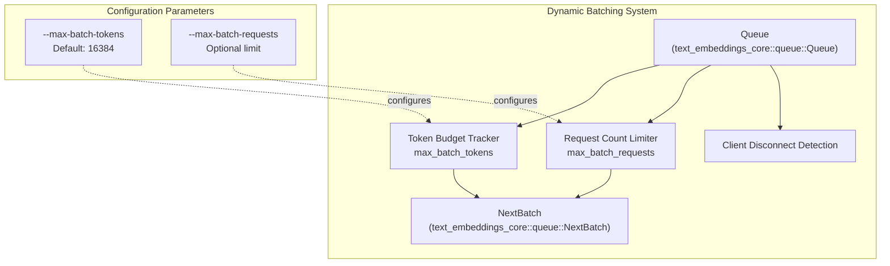
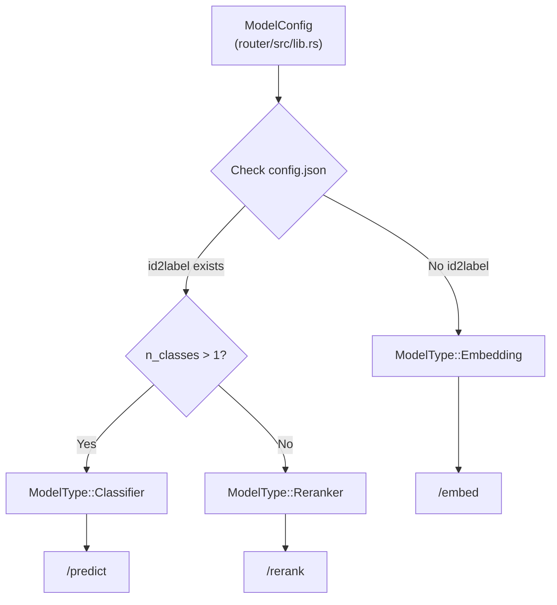

<!-- source: DeepWiki mcp.deepwiki.com · repo huggingface/text-embeddings-inference · page 1.2 Features and Capabilities · fetched 2026-10-26 -->

# Features and Capabilities

Relevant source files

The following files were used as context for generating this wiki page:

- [README.md](README.md)
- [docs/source/en/cli_arguments.md](docs/source/en/cli_arguments.md)
- [docs/source/en/custom_container.md](docs/source/en/custom_container.md)
- [docs/source/en/index.md](docs/source/en/index.md)
- [docs/source/en/local_cpu.md](docs/source/en/local_cpu.md)
- [docs/source/en/local_gpu.md](docs/source/en/local_gpu.md)
- [docs/source/en/local_metal.md](docs/source/en/local_metal.md)
- [docs/source/en/private_models.md](docs/source/en/private_models.md)
- [docs/source/en/quick_tour.md](docs/source/en/quick_tour.md)
- [docs/source/en/supported_models.md](docs/source/en/supported_models.md)
- [router/src/lib.rs](router/src/lib.rs)
- [router/src/main.rs](router/src/main.rs)

This document provides a comprehensive overview of the features and capabilities available in Text Embeddings Inference (TEI). It covers performance optimizations, model support, hardware platform compatibility, API features, and deployment options.

## Overview

TEI is a toolkit for deploying and serving open-source text embeddings and sequence classification models. It enables high-performance extraction for popular models like FlagEmbedding, GTE, and E5 by leveraging Rust-based backends and hardware-specific optimizations.

**Sources**: [README.md:49-51](), [docs/source/en/index.md:19-22]()

## Performance Optimization Features

### Dynamic Batching with Token Budget Management

TEI implements a sophisticated dynamic batching system that groups requests based on token count rather than request count. This ensures maximum hardware utilization by filling the available compute capacity regardless of varying sequence lengths.

**Key Configuration Parameters**:
- `max_batch_tokens`: Total token capacity per batch (default: 16384). This is the critical control for hardware usage [router/src/main.rs:73-74]().
- `max_batch_requests`: Optional limit on the number of individual requests per batch [router/src/main.rs:76-78]().
- `max_client_batch_size`: Maximum number of inputs a client can send in one HTTP/gRPC request (default: 32) [router/src/main.rs:81-82]().

**Sources**: [router/src/main.rs:59-82](), [README.md:56](), [router/src/lib.rs:31-33]()

### Flash Attention Optimization

TEI integrates Flash Attention for memory-efficient attention computation. It supports both Flash Attention v1 and v2, with selection depending on the GPU's compute capability.

| Architecture | Compute Capability | Support Status |
|--------------|--------------------|----------------|
| Turing | 7.5 | Supported via `candle-cuda-turing` [docs/source/en/local_gpu.md:44-48]() |
| Ampere/Hopper/Blackwell | 8.0+ | Native support via `candle-cuda` [docs/source/en/local_gpu.md:50-54]() |

Flash Attention is automatically utilized in the `candle` backend for supported models to reduce memory bandwidth requirements and increase speed.

**Sources**: [README.md:57-59](), [docs/source/en/local_gpu.md:44-54](), [docs/source/en/custom_container.md:30-36]()

### cuBLASLt and Fused Kernels

The system leverages `cuBLASLt` for optimized matrix operations on NVIDIA hardware. This reduces kernel launch overhead and improves performance for transformer layers.

**Sources**: [README.md:59](), [docs/source/en/index.md:29]()

### Multi-threaded Tokenization

To prevent tokenization from becoming a bottleneck, TEI uses a pool of worker threads. This allows the system to process incoming text into token IDs in parallel while the GPU/CPU performs inference on previous batches.

- **Configuration**: `--tokenization-workers` (defaults to the number of CPU cores) [router/src/main.rs:35-36]().

**Sources**: [router/src/lib.rs:47](), [router/src/main.rs:32-36]()

## Model Support and Flexibility

### Supported Model Architectures

TEI supports a wide variety of transformer architectures, classified by their position embedding methods:

| Position Type | Supported Architectures |
|---------------|-------------------------|
| **Absolute** | BERT, CamemBERT, XLM-RoBERTa, MPNet, ModernBERT |
| **Alibi** | JinaBERT |
| **RoPE** | Mistral, Alibaba GTE, Qwen2, Qwen3, Gemma3 |

**Sources**: [README.md:68-71](), [docs/source/en/supported_models.md:23-24]()

### Model Type and Endpoint Mapping

The system automatically infers the model type from `config.json` and `modules.json` to route requests to the appropriate endpoints.

**Sources**: [router/src/lib.rs:118-141](), [docs/source/en/quick_tour.md:107-154]()

### Matryoshka Representation Learning (MRL) Support

TEI supports models trained with MRL, allowing users to request truncated embedding dimensions at inference time. This is handled via the `dimensions` parameter in the API.

**Sources**: [router/src/main.rs:120-132]() (Dense module context)

### Pooling Strategies

Users can override the default pooling method or let TEI parse it from the model's `1_Pooling/config.json`. Supported methods include:
- `cls`: Uses the `[CLS]` token.
- `mean`: Averages all token embeddings.
- `last-token`: Uses the final token.
- `splade`: Sparse Lexical and Expansion (for `ForMaskedLM` models).

**Sources**: [router/src/main.rs:47-54](), [docs/source/en/cli_arguments.md:65-69]()

## Hardware Platform Support

TEI provides optimized Docker images and local installation paths for diverse hardware:

| Platform | Optimization | Image Suffix |
|----------|--------------|--------------|
| **NVIDIA GPU** | CUDA, Flash Attention, cuBLASLt | `cuda-1.9` |
| **Intel CPU** | MKL (Math Kernel Library) | `cpu-1.9` |
| **ARM64 CPU** | Optimized for Graviton/Apple Silicon | `cpu-arm64-1.9` |
| **Apple Metal** | Native Metal support for M-series chips | Local install via `-F metal` |

**Sources**: [docs/source/en/supported_models.md:82-85](), [docs/source/en/local_metal.md:52](), [docs/source/en/local_cpu.md:36]()

## Operational Capabilities

### Production-Ready Observability

- **Distributed Tracing**: Integration with OpenTelemetry (OTLP) for request tracking [router/src/main.rs:171-179]().
- **Prometheus Metrics**: Exports detailed metrics (latencies, batch sizes, token counts) on a configurable port [router/src/main.rs:181-183]().

### Security and Access

- **Private Models**: Support for gated or private models using `HF_TOKEN` [docs/source/en/private_models.md:27-31]().
- **Air-Gapped Deployment**: Ability to serve models from a local path without internet access [docs/source/en/quick_tour.md:175-196]().
- **API Key**: Optional Bearer token authentication via `--api-key` [router/src/main.rs:157-161]().

### Deployment Flexibility

- **No Graph Compilation**: Fast boot times as no model compilation is required [README.md:53]().
- **Safetensors**: Fast weight loading using the `safetensors` format [README.md:60]().
- **OpenAI Compatibility**: Provides a `/v1/embeddings` endpoint compatible with the OpenAI SDK [docs/source/en/quick_tour.md:80-91]().

**Sources**: [README.md:53-63](), [router/src/main.rs:139-144](), [docs/source/en/quick_tour.md:80-91]()

---

