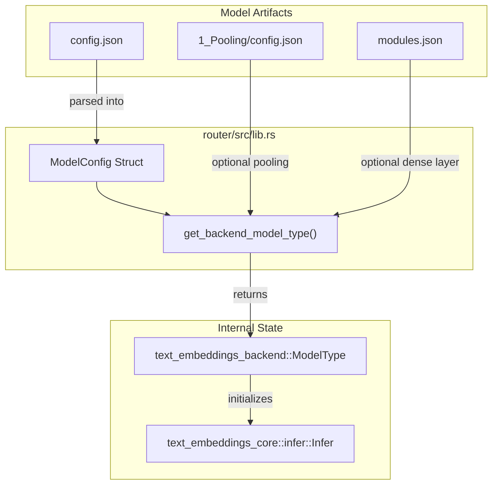
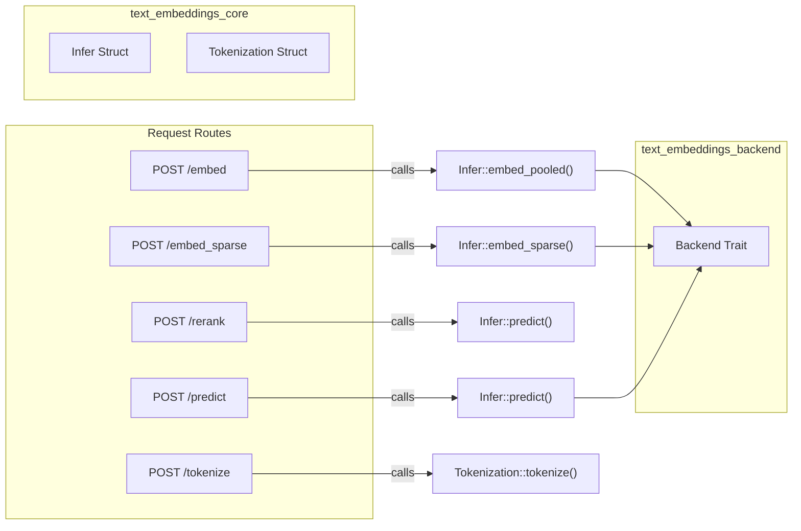

<!-- source: DeepWiki mcp.deepwiki.com · repo huggingface/text-embeddings-inference · page 1.3 Model Types and Endpoint Routing · fetched 2026-10-26 -->

# Model Types and Endpoint Routing

Relevant source files

The following files were used as context for generating this wiki page:

- [README.md](README.md)
- [backends/python/server/text_embeddings_server/models/__init__.py](backends/python/server/text_embeddings_server/models/__init__.py)
- [core/src/infer.rs](core/src/infer.rs)
- [core/src/queue.rs](core/src/queue.rs)
- [core/src/tokenization.rs](core/src/tokenization.rs)
- [docs/source/en/cli_arguments.md](docs/source/en/cli_arguments.md)
- [proto/tei.proto](proto/tei.proto)
- [router/src/grpc/server.rs](router/src/grpc/server.rs)
- [router/src/http/server.rs](router/src/http/server.rs)
- [router/src/http/types.rs](router/src/http/types.rs)
- [router/src/lib.rs](router/src/lib.rs)
- [router/src/main.rs](router/src/main.rs)
- [router/tests/test_http_embed.rs](router/tests/test_http_embed.rs)

This document explains how Text Embeddings Inference (TEI) determines model types, configures pooling strategies, and routes requests to appropriate endpoints based on model capabilities. For information about the complete API specification and request/response formats, see [HTTP API Endpoints](#6.1). For backend selection and initialization logic, see [Backend Architecture and Selection](#4.1).

## Overview

TEI supports three distinct model types, each with its own set of available endpoints:

- **Classifier Models**: Multi-class sequence classification models.
- **Reranker Models**: Single-class cross-encoder models for relevance scoring.
- **Embedding Models**: Vector representation models with various pooling strategies (Dense or Sparse).

Model type determination occurs at startup by analyzing the model's `config.json` and `modules.json` (if available) or `1_Pooling/config.json`. The system then validates all API requests to ensure they are compatible with the loaded model type, returning HTTP 424 (Failed Dependency) errors for incompatible operations.

---

## Model Type Detection Process

TEI determines the model type by parsing the model's configuration files during initialization. The primary detection logic resides in the `get_backend_model_type` function in [router/src/lib.rs:380-440]().

### Detection Logic Flow

The model type detection follows this priority order:

1.  **Architecture Inspection**: It iterates through the `architectures` array in `config.json` [router/src/lib.rs:385-414]().
2.  **Edge Case Handling**: Specifically skips architectures like `NewForTokenClassification` often found in GTE models that lack proper label mappings [router/src/lib.rs:388-393]().
3.  **SPLADE Detection**: If the `--pooling splade` argument is provided and the architecture ends with `MaskedLM`, it returns an Embedding type with Splade pooling [router/src/lib.rs:395-398]().
4.  **Classification Detection**: If an architecture ends with `Classification`, it is identified as a Classifier/Reranker. In this case, any `--pooling` CLI argument is ignored [router/src/lib.rs:400-405]().
5.  **Pooling Configuration**: For embedding models, it determines the strategy by checking the `--pooling` argument, then searching for `1_Pooling/config.json`, and finally defaulting to `CLS` for BERT models [router/src/lib.rs:416-437]().

### Data Flow Diagram: Config to ModelType

The following diagram bridges the configuration files to the internal `ModelType` enum used by the `Infer` struct.

Sources: [router/src/lib.rs:104-142](), [router/src/lib.rs:380-440](), [core/src/infer.rs:11-21]()

---

## Model Type Categories

### Classifier Models
Classification models perform multi-class sequence classification. They are identified by architectures ending with `Classification` and having `n_classes > 1` in their `id2label` mapping [router/src/lib.rs:119-135]().

- **Type Structure**: `ModelType::Classifier(ClassifierModel)` [router/src/lib.rs:119-131]().
- **Compatible Endpoints**: `/predict` [router/src/http/server.rs:104-109]().

### Reranker Models
Reranker models are specialized classifiers with a single class, used for cross-encoder relevance scoring between query-document pairs. They have `n_classes == 1` [router/src/lib.rs:133-134]().

- **Type Structure**: `ModelType::Reranker(ClassifierModel)` [router/src/lib.rs:133]().
- **Compatible Endpoints**: `/rerank` [router/src/http/server.rs:307-312]() and `/predict`.

### Embedding Models
Embedding models generate dense or sparse vector representations. The pooling strategy determines how token embeddings are aggregated [router/src/lib.rs:136-141]().

- **Type Structure**: `ModelType::Embedding(EmbeddingModel)` [router/src/lib.rs:136]().
- **Compatible Endpoints**: `/embed`, `/embed_all`, `/similarity`, `/v1/embeddings`, and `/embed_sparse` (Splade only).

Sources: [router/src/lib.rs:118-141](), [router/src/http/server.rs:139-143]()

---

## Pooling Strategies

Embedding models use pooling to aggregate token-level embeddings. TEI prioritizes pooling determination from the CLI argument, then the configuration file [router/src/lib.rs:416-437]().

| Pooling Type | Description | Use Case |
| :--- | :--- | :--- |
| **CLS** | Uses the `[CLS]` token (first token). | BERT-style models. |
| **Mean** | Averages all token embeddings. | Most sentence-transformers models. |
| **LastToken** | Uses the last actual token. | Decoder models (Mistral, Qwen). |
| **Splade** | Sparse Max-pooling over log activations. | Sparse retrieval (ForMaskedLM models). |

**Conversion Logic**: The `TryFrom<PoolConfig>` implementation in the backend crate prioritizes modes in the order: CLS > Mean > LastToken [router/src/lib.rs:454-477]().

---

## Endpoint Routing Matrix

The system routes requests based on model type compatibility. Each endpoint validates the model type before processing.

### Routing Logic Diagram: Endpoint to Infer Function

This diagram maps HTTP/gRPC routes to the specific functions within the `Infer` and `Tokenization` classes.

Sources: [router/src/http/server.rs:104-109](), [router/src/http/server.rs:307-312](), [router/src/http/server.rs:442-447](), [core/src/infer.rs:118-221](), [core/src/tokenization.rs:104-109]()

### Model Type Validation

When a request hits an endpoint, TEI performs a validation check. If the model type is incompatible, it returns an HTTP 424 status [router/src/http/server.rs:490-504]().

- **Embedding Validation**: `/embed` checks if `info.model_type` is `Embedding` [router/src/http/server.rs:490-504]().
- **Reranker Validation**: `/rerank` checks if `info.model_type` is `Reranker` [router/src/http/server.rs:332-346]().
- **SPLADE Validation**: `/embed_sparse` checks `infer.is_splade()` [core/src/infer.rs:179-187]().

Sources: [router/src/http/server.rs:332-346](), [router/src/http/server.rs:490-504](), [core/src/infer.rs:128-136](), [core/src/infer.rs:179-187]()

---

## Configuration Reference

### config.json
Primary model configuration. The `architectures` field is the primary driver for `ModelType` inference [router/src/lib.rs:109-115]().

### 1_Pooling/config.json
Sentence Transformers specific pooling config. It defines `pooling_mode_cls_token`, `pooling_mode_mean_tokens`, etc [router/src/lib.rs:420-426]().

### modules.json
Used to detect if a `Dense` layer (linear projection) should be applied to the embeddings after pooling [router/src/lib.rs:199-215]().

Sources: [router/src/lib.rs:109-115](), [router/src/lib.rs:199-215](), [router/src/lib.rs:420-426]()

---

