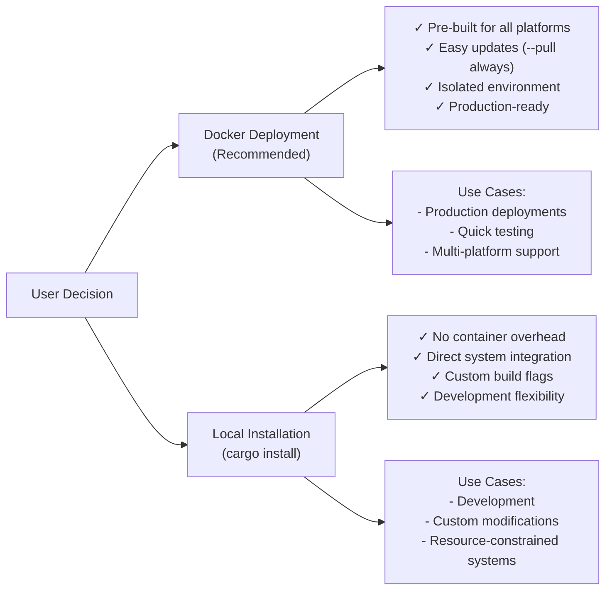
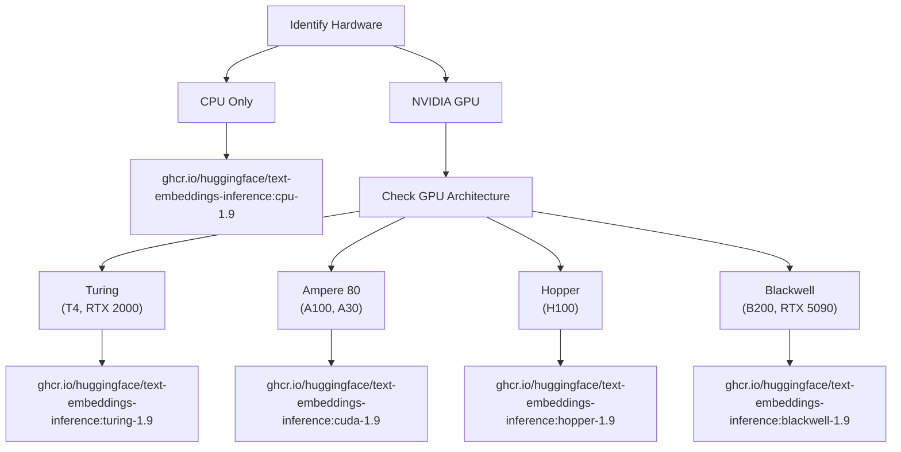
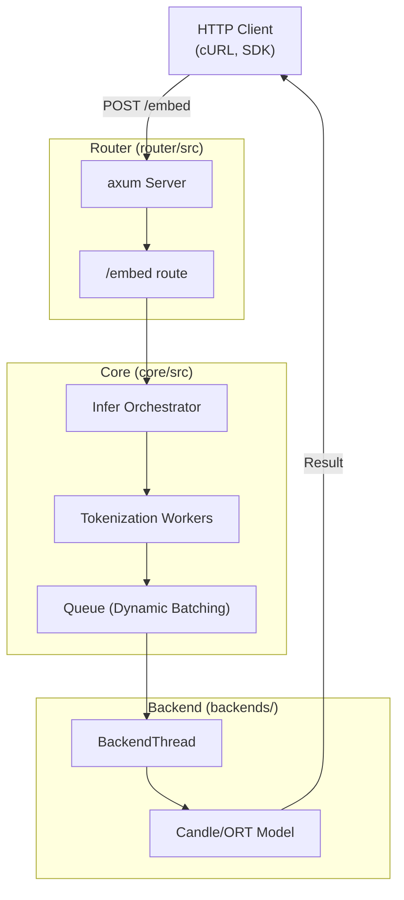

<!-- source: DeepWiki mcp.deepwiki.com · repo huggingface/text-embeddings-inference · page 2 Getting Started · fetched 2026-10-26 -->

# Getting Started

<details>
<summary>Relevant source files</summary>

The following files were used as context for generating this wiki page:

- [Dockerfile](Dockerfile)
- [Dockerfile-cuda](Dockerfile-cuda)
- [Dockerfile-cuda-all](Dockerfile-cuda-all)
- [cuda-all-entrypoint.sh](cuda-all-entrypoint.sh)
- [cuda-entrypoint.sh](cuda-entrypoint.sh)
- [docs/source/en/custom_container.md](docs/source/en/custom_container.md)
- [docs/source/en/private_models.md](docs/source/en/private_models.md)
- [docs/source/en/quick_tour.md](docs/source/en/quick_tour.md)
- [docs/source/en/supported_models.md](docs/source/en/supported_models.md)

</details>


This page provides a comprehensive guide for deploying and running Text Embeddings Inference (TEI). It covers prerequisites, deployment methods, and basic usage patterns to help you get a model serving embeddings as quickly as possible.

For advanced deployment strategies including cloud platforms and production tuning, see [Deployment and Operations](#7). For API reference documentation, see [API Reference](#6). For information about model types and endpoint routing, see [Model Types and Endpoint Routing](#1.3).

---

## Prerequisites

### Hardware Requirements

TEI supports multiple hardware platforms with varying levels of optimization:

| Hardware Type | Minimum Requirement | Notes |
|---------------|-------------------|-------|
| **CPU** | x86-64 or ARM64 | Intel MKL or Accelerate framework used |
| **NVIDIA GPU** | CUDA Compute Capability ≥ 7.5 | Excludes V100, Titan V, GTX 1000 series |
| **Apple Silicon** | M1/M2/M3 | Metal backend support (no GPU acceleration in Docker) |

**Supported NVIDIA Architectures:**
- Turing (T4, RTX 2000 series) - `runtime_compute_cap=75`
- Ampere (A100, A30, A10, A40) - `runtime_compute_cap=80` or `86`
- Ada Lovelace (RTX 4000 series) - `runtime_compute_cap=89`
- Hopper (H100) - `runtime_compute_cap=90`
- Blackwell (B200, RTX 5000 series) - `runtime_compute_cap=100` or `120`

**Sources:** [docs/source/en/supported_models.md:68-75](), [docs/source/en/custom_container.md:30-36]()

### Software Requirements

**For Docker Deployment:**
- Docker Engine (installation guide: https://docs.docker.com/get-docker/)
- For GPU usage: [NVIDIA Container Toolkit](https://docs.nvidia.com/datacenter/cloud-native/container-toolkit/install-guide.html)
- NVIDIA drivers compatible with CUDA 12.2 or higher.

**For Local Installation (cargo):**
- Rust toolchain (https://rustup.rs/)
- For CPU (x86): Intel MKL (2024.0.0 recommended) or ONNX Runtime.
- For GPU: CUDA Toolkit 12.2+ and compatible drivers.

**Sources:** [docs/source/en/quick_tour.md:24-27](), [Dockerfile:35-37]()

---

## Deployment Method Overview

TEI can be deployed using two primary methods:



**Deployment Method Selection:**

| Consideration | Docker (See [Docker Deployment](#2.1)) | Local (See [Local Installation](#2.2)) |
|---------------|---------|-------|
| **Ease of Setup** | ⭐⭐⭐⭐⭐ Single command | ⭐⭐ Requires Rust toolchain |
| **Platform Support** | All architectures pre-built | Must compile for your platform |
| **Update Process** | `--pull always` flag | Recompile required |
| **Customization** | Limited to runtime flags | Full source access |
| **Production Use** | ✅ Recommended | ⚠️ Requires expertise |

**Sources:** [docs/source/en/quick_tour.md:21-27](), [docs/source/en/custom_container.md:17-24]()

---

## Quick Start with Docker

This section demonstrates the fastest path to serving embeddings. For comprehensive Docker deployment documentation, see [Docker Deployment](#2.1).

### Step 1: Select Docker Image for Your Hardware



**Sources:** [docs/source/en/supported_models.md:82-95]()

### Step 2: Run Docker Container

**Basic GPU Deployment:**
```bash
model=Qwen/Qwen3-Embedding-0.6B
volume=$PWD/data

docker run --gpus all -p 8080:80 -v $volume:/data --pull always \
  ghcr.io/huggingface/text-embeddings-inference:cuda-1.9 --model-id $model
```

**CPU Deployment:**
```bash
model=BAAI/bge-base-en-v1.5
volume=$PWD/data

docker run -p 8080:80 -v $volume:/data --pull always \
  ghcr.io/huggingface/text-embeddings-inference:cpu-1.9 --model-id $model
```

**Key Docker Run Parameters:**
- `--gpus all`: Enables GPU access (omit for CPU).
- `-p 8080:80`: Maps container port 80 to host port 8080.
- `-v $volume:/data`: Persistent cache for model weights.
- `--pull always`: Ensures latest image version.
- `--model-id`: Hugging Face model ID or local path.

**Sources:** [docs/source/en/quick_tour.md:33-44]()

### Step 3: Verify Deployment

**Check Health Endpoint:**
```bash
curl http://127.0.0.1:8080/health
```

**Check Model Information:**
```bash
curl http://127.0.0.1:8080/info
```

**Sources:** [docs/source/en/quick_tour.md:55-59]()

---

## Making Your First API Request

For comprehensive API documentation, see [HTTP API Endpoints](#6.1). For client library examples, see [Client Libraries and Examples](#6.4).

### Using cURL

**Embedding a Single Text:**
```bash
curl 127.0.0.1:8080/embed \
    -X POST \
    -d '{"inputs":"What is Deep Learning?"}' \
    -H 'Content-Type: application/json'
```

**Embedding Multiple Texts (Batching):**
```bash
curl 127.0.0.1:8080/embed \
    -X POST \
    -d '{"inputs":["Today is a nice day", "I like you"]}' \
    -H 'Content-Type: application/json'
```

**Sources:** [docs/source/en/quick_tour.md:52-59](), [docs/source/en/quick_tour.md:157-164]()

### Using Python (huggingface_hub)

```python
from huggingface_hub import InferenceClient

client = InferenceClient()

embedding = client.feature_extraction(
    "What is deep learning?",
    model="http://localhost:8080/embed"
)
print(len(embedding[0]))
```

**Sources:** [docs/source/en/quick_tour.md:65-77]()

### Using Python (OpenAI SDK)

TEI exposes an OpenAI-compatible endpoint at `/v1/embeddings`:

```python
from openai import OpenAI

client = OpenAI(base_url="http://localhost:8080/v1", api_key="-")

response = client.embeddings.create(
    model="text-embeddings-inference",
    input="What is Deep Learning?",
)

print(response.data[0].embedding)
```

**Sources:** [docs/source/en/quick_tour.md:80-94]()

### Request Flow Diagram



**Sources:** [Dockerfile-cuda:104-106](), [docs/source/en/quick_tour.md:52-59]()

---

## Configuration Essentials

This section covers the most commonly used configuration options. For a complete reference of all command-line arguments and environment variables, see [Configuration Options](#2.4).

### Common Configuration Examples

**Serving Private/Gated Models:**
If a model is gated (e.g., `google/embeddinggemma-300m`), provide your `HF_TOKEN`:

```bash
docker run --gpus all -e HF_TOKEN=$token -p 8080:80 -v $volume:/data \
  ghcr.io/huggingface/text-embeddings-inference:cuda-1.9 --model-id $model
```

**Air-Gapped Deployment:**
Download weights via `git clone` and mount them locally:

```bash
# Mount local directory to /data and point model-id to the path
docker run --gpus all -p 8080:80 -v $volume:/data \
  ghcr.io/huggingface/text-embeddings-inference:cuda-1.9 --model-id /data/gte-base-en-v1.5
```

**Sources:** [docs/source/en/private_models.md:34-41](), [docs/source/en/quick_tour.md:175-196]()

---

## Special Model Types

### Re-ranking Models
Used to score similarity between a query and a list of texts. Use the `/rerank` endpoint.

```bash
curl 127.0.0.1:8080/rerank \
    -X POST \
    -d '{"query":"What is Deep Learning?", "texts": ["Deep Learning is...", "Other text"], "raw_scores": false}' \
    -H 'Content-Type: application/json'
```

### Sequence Classification
Used for tasks like sentiment analysis. Use the `/predict` endpoint.

```bash
curl 127.0.0.1:8080/predict \
    -X POST \
    -d '{"inputs":"I like you."}' \
    -H 'Content-Type: application/json'
```

**Sources:** [docs/source/en/quick_tour.md:107-153]()

---

## Next Steps

Now that you have TEI running, explore these topics:

- **[Docker Deployment](#2.1)** — Detailed selection of hardware-specific images and volume mounting.
- **[Local Installation](#2.2)** — Building from source for specific platforms like Apple Metal.
- **[Basic Usage](#2.3)** — Advanced API parameters and batching patterns.
- **[Configuration Options](#2.4)** — Full list of environment variables and CLI arguments.

**Sources:** [docs/source/en/supported_models.md:17-20]()

---

