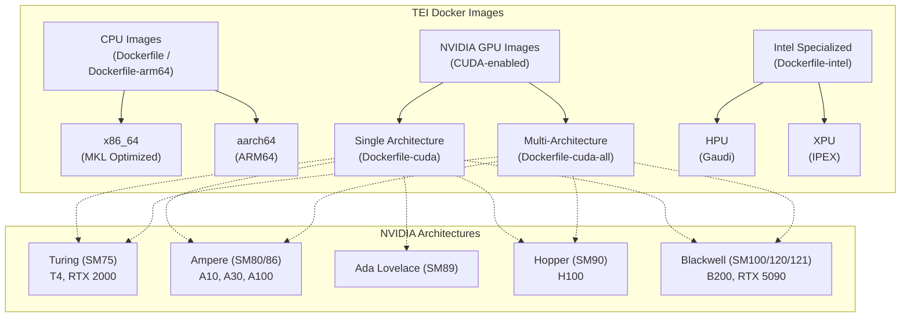
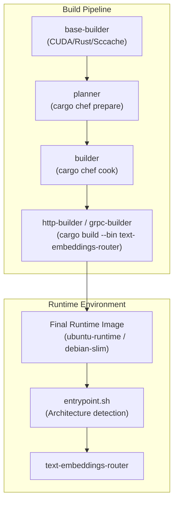

<!-- source: DeepWiki mcp.deepwiki.com · repo huggingface/text-embeddings-inference · page 2.1 Docker Deployment · fetched 2026-10-26 -->

# Docker Deployment

<details>
<summary>Relevant source files</summary>

The following files were used as context for generating this wiki page:

- [.github/workflows/build.yaml](.github/workflows/build.yaml)
- [.github/workflows/matrix.json](.github/workflows/matrix.json)
- [Dockerfile](Dockerfile)
- [Dockerfile-cuda](Dockerfile-cuda)
- [Dockerfile-cuda-all](Dockerfile-cuda-all)
- [backends/candle/src/compute_cap.rs](backends/candle/src/compute_cap.rs)
- [backends/candle/src/flash_attn.rs](backends/candle/src/flash_attn.rs)
- [cuda-all-entrypoint.sh](cuda-all-entrypoint.sh)
- [cuda-entrypoint.sh](cuda-entrypoint.sh)
- [docs/source/en/custom_container.md](docs/source/en/custom_container.md)
- [docs/source/en/private_models.md](docs/source/en/private_models.md)
- [docs/source/en/quick_tour.md](docs/source/en/quick_tour.md)
- [docs/source/en/supported_models.md](docs/source/en/supported_models.md)

</details>


This page documents the Docker-based deployment options for Text Embeddings Inference (TEI), detailing the available Docker images, their configuration, and usage patterns for different hardware platforms.

## Overview of Docker Images

Text Embeddings Inference provides several Docker images optimized for different hardware configurations, including CPU-only (x86 and ARM64), NVIDIA GPUs with different architectures, and specialized accelerators like Intel Gaudi (HPU).



Sources: [.github/workflows/matrix.json:1-128](), [docs/source/en/supported_models.md:82-105]()

## Building Process and Container Structure

The TEI Docker images follow a multi-stage build process using `cargo-chef` to optimize layer caching.



Sources: [Dockerfile-cuda:1-168](), [Dockerfile-cuda-all:1-138](), [Dockerfile:1-115]()

## CPU-based Deployment

The standard CPU image is optimized for x86_64 and includes Intel MKL (Math Kernel Library) and a "fakeintel" shim to ensure optimal performance on various CPU targets.

### Features and Optimizations
- **Intel MKL**: Integrated for optimized linear algebra [Dockerfile:29-37]().
- **Instruction Sets**: Defaults to `AVX512_E4` for compatible processors [Dockerfile:78]().
- **Parallelism**: Defaults to 8 Rayon threads [Dockerfile:79]().

### Usage
```bash
model=BAAI/bge-small-en-v1.5
docker run -p 8080:80 -v $PWD/data:/data ghcr.io/huggingface/text-embeddings-inference:cpu-1.9 --model-id $model
```

Sources: [Dockerfile:74-115](), [docs/source/en/supported_models.md:84-85]()

## GPU-based Deployment

TEI provides specialized images for NVIDIA GPUs. Note that CUDA compute capabilities < 7.5 (e.g., V100, Titan V) are **not supported** [docs/source/en/supported_models.md:74]().

### Single Architecture GPU Images
These images are built for a specific `CUDA_COMPUTE_CAP` to minimize binary size and ensure compatibility with specific kernels like Flash Attention.

| Architecture | Tag Prefix | Compute Cap |
| :--- | :--- | :--- |
| Turing | `turing-` | 75 |
| Ampere | (Default) | 80 |
| Ada Lovelace | `89-` | 89 |
| Hopper | `hopper-` | 90 |
| Blackwell | `100-` / `120-` | 100 / 120 |

Sources: [.github/workflows/matrix.json:2-65](), [docs/source/en/custom_container.md:30-36]()

### Multi-Architecture GPU Images (`cuda-all`)
The `cuda-all` image contains multiple binaries and an entrypoint script that detects the host GPU's compute capability at runtime to execute the most efficient version.

**Runtime Detection Logic:**
1. The script calls `nvidia-smi` to query `compute_cap` [cuda-all-entrypoint.sh:29]().
2. It maps the capability to a specific binary (e.g., `75` -> `text-embeddings-router-75`) [cuda-all-entrypoint.sh:31-41]().
3. It handles CUDA 12.9 compatibility layers if the host driver is older [cuda-all-entrypoint.sh:12-27]().

Sources: [Dockerfile-cuda-all:128-136](), [cuda-all-entrypoint.sh:1-45]()

## Volume Mounting and Data Persistence

It is highly recommended to mount a local volume to `/data` to avoid re-downloading model weights on every container start.

- **Default Cache**: `HUGGINGFACE_HUB_CACHE` is set to `/data` in all official images [Dockerfile-cuda:142](), [Dockerfile:76]().
- **Private Models**: To serve gated or private models, pass the `HF_TOKEN` environment variable [docs/source/en/private_models.md:33-41]().

### Air-Gapped Deployment
For environments without internet access:
1. Download the model locally using `git lfs clone` [docs/source/en/quick_tour.md:189]().
2. Mount the local directory to `/data`.
3. Set `--model-id /data/<model_folder>` [docs/source/en/quick_tour.md:195]().

## Prerequisites

- **NVIDIA Driver**: Version compatible with CUDA 12.2 or higher [docs/source/en/quick_tour.md:27]().
- **NVIDIA Container Toolkit**: Must be installed on the host to expose GPUs to Docker [docs/source/en/quick_tour.md:27]().
- **Docker**: Version with Buildx support is recommended for custom builds [Dockerfile-cuda:65]().

## Container Runtime to Code Mapping

This diagram maps the Docker entrypoint and runtime environment to the internal Rust components.

```mermaid
graph LD
    subgraph "Docker Runtime"
        EP["entrypoint.sh
        (cuda-entrypoint.sh)"]
        ENV["Environment Variables
        (PORT, HF_TOKEN, etc.)"]
    end

    subgraph "text-embeddings-router (Crate)"
        MAIN["main()
        (router/src/main.rs)"]
        ARGS["Args Struct
        (router/src/lib.rs)"]
        BACKEND["Backend Selection
        (backends/src/lib.rs)"]
    end

    EP -->|Executes| MAIN
    ENV -->|Parsed by clap| ARGS
    ARGS -->|Configures| BACKEND
    
    subgraph "Hardware Access"
        BACKEND -->|Compute Cap Check| CC["get_runtime_compute_cap()
        backends/candle/src/compute_cap.rs"]
        BACKEND -->|Flash Attention| FA["flash_attn_varlen()
        backends/candle/src/flash_attn.rs"]
    end
```

Sources: [Dockerfile-cuda:166-167](), [backends/candle/src/compute_cap.rs:14-24](), [backends/candle/src/flash_attn.rs:23-36](), [cuda-entrypoint.sh:1-12]()

---

