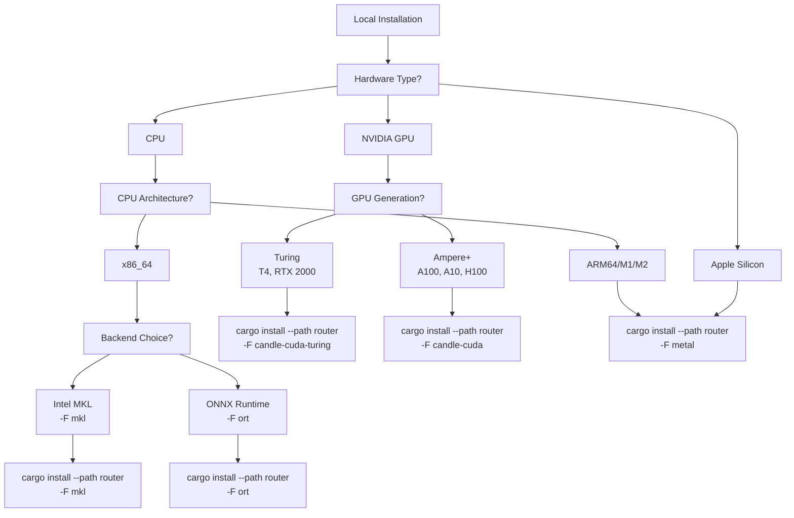
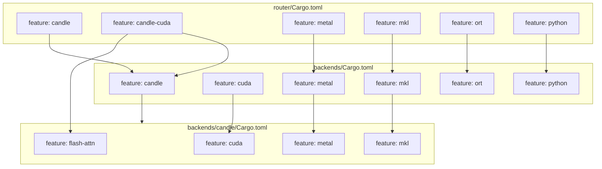

<!-- source: DeepWiki mcp.deepwiki.com · repo huggingface/text-embeddings-inference · page 2.2 Local Installation · fetched 2026-10-26 -->

# Local Installation

<details>
<summary>Relevant source files</summary>

The following files were used as context for generating this wiki page:

- [backends/Cargo.toml](backends/Cargo.toml)
- [backends/candle/Cargo.toml](backends/candle/Cargo.toml)
- [backends/src/dtype.rs](backends/src/dtype.rs)
- [core/Cargo.toml](core/Cargo.toml)
- [docs/source/en/index.md](docs/source/en/index.md)
- [docs/source/en/local_cpu.md](docs/source/en/local_cpu.md)
- [docs/source/en/local_gpu.md](docs/source/en/local_gpu.md)
- [docs/source/en/local_metal.md](docs/source/en/local_metal.md)
- [flake.lock](flake.lock)
- [flake.nix](flake.nix)
- [router/Cargo.toml](router/Cargo.toml)

</details>


This document provides instructions for building and installing Text Embeddings Inference (TEI) locally from source using `cargo install`. Local installation is recommended when you need custom build configurations, want to develop against TEI, or prefer not to use Docker containers. For Docker-based deployment, see page 2.1.

## Installation Overview

TEI is built using Rust and supports multiple hardware backends through Cargo feature flags. The installation process involves installing the Rust toolchain, system dependencies, selecting hardware-specific feature flags, and building the `text-embeddings-router` binary.

**Local Installation Decision Tree**



Sources: [docs/source/en/local_cpu.md:17-43](), [docs/source/en/local_gpu.md:17-54](), [docs/source/en/local_metal.md:17-53]()

## Prerequisites

### Required Tools

**Rust Toolchain**
Install Rust using rustup:
```bash
curl --proto '=https' --tlsv1.2 -sSf https://sh.rustup.rs | sh
```
Sources: [docs/source/en/local_cpu.md:23-27](), [docs/source/en/local_gpu.md:34-38](), [docs/source/en/local_metal.md:43-47]()

**System Dependencies**
On Linux machines, you may need OpenSSL libraries and `gcc`:
```bash
sudo apt-get install libssl-dev gcc -y
```
Sources: [docs/source/en/local_cpu.md:57-61]()

**GPU-Specific Prerequisites**
For NVIDIA GPU support, NVIDIA drivers must be compatible with CUDA version 12.2 or higher. Add the binaries to your path:
```bash
export PATH=$PATH:/usr/local/cuda/bin
```
Sources: [docs/source/en/local_gpu.md:24-30]()

**Nix Environment**
Alternatively, a `flake.nix` is provided which includes `rustup`, `protobuf`, and `apple-sdk_15` for Darwin systems.
Sources: [flake.nix:22-31]()

## Understanding Feature Flags

TEI uses Cargo feature flags to enable different backends and optimizations. These are defined primarily in the `router` crate but propagate down to the `backends` and `candle` crates.

**Feature Flag Mapping to Code Entities**



Sources: [router/Cargo.toml:81-95](), [backends/Cargo.toml:21-32](), [backends/candle/Cargo.toml:41-48]()

### Key Feature Flag Categories

| Category | Feature Flags | Purpose |
|----------|--------------|---------|
| **API Protocol** | `http` (default), `grpc` | Enable HTTP (Axum) or gRPC (Tonic) endpoints. |
| **Backend Selection** | `candle` (default), `python`, `ort` | Choose ML inference backend. |
| **CPU Optimization** | `mkl`, `accelerate` | Intel MKL or Apple Accelerate for CPU BLAS. |
| **GPU Support** | `candle-cuda`, `candle-cuda-turing`, `candle-cuda-volta` | CUDA support for different architectures. |
| **Apple Silicon** | `metal` | Metal Performance Shaders for M1-M4. |
| **Linking Strategy** | `static-linking`, `dynamic-linking` (default) | Link style for `cudarc` and `intel-mkl-src`. |

Sources: [router/Cargo.toml:81-96](), [backends/candle/Cargo.toml:41-48]()

## Installation Steps by Platform

### NVIDIA GPU

The installation command depends on your GPU architecture to ensure the correct CUDA kernels are compiled.

*   **Turing GPUs (T4, RTX 2000 series):**
    ```shell
    cargo install --path router -F candle-cuda-turing
    ```
*   **Ampere, Ada Lovelace, Hopper, and Blackwell:**
    ```shell
    cargo install --path router -F candle-cuda
    ```

The `candle-cuda` feature enables `flash-attn` (v2), while `candle-cuda-turing` enables `flash-attn-v1`.
Sources: [docs/source/en/local_gpu.md:44-54](), [router/Cargo.toml:91-92]()

### CPU (x86_64)

For x86 machines, Intel MKL is recommended for optimal performance:
```shell
cargo install --path router -F mkl
```
This activates `intel-mkl-src` and enables `candle/_mkl`.
Sources: [docs/source/en/local_cpu.md:35-37](), [router/Cargo.toml:86](), [backends/candle/Cargo.toml:44]()

### Apple Silicon (Metal)

On macOS, you can use Homebrew for a prebuilt binary or build from source with Metal support:

*   **Homebrew:**
    ```shell
    brew install text-embeddings-inference
    ```
*   **Source:**
    ```shell
    cargo install --path router -F metal
    ```
Sources: [docs/source/en/local_metal.md:23-27](), [docs/source/en/local_metal.md:51-53]()

## Data Type (`DType`) Support

The `DType` enum determines the precision used for inference. Default values vary by the enabled feature flags.

| Feature | Default DType | Supported DTypes |
|---------|---------------|------------------|
| `python` | `Bfloat16` | `Float16`, `Float32`, `Bfloat16` |
| `accelerate` | `Float32` | `Float32` (`Float16` disabled) |
| `mkl` | `Float32` | `Float32`, `Float16` (if candle) |
| `ort` | `Float32` | `Float32` |
| `candle` (Default) | `Float16` | `Float16`, `Float32` |

Sources: [backends/src/dtype.rs:8-58]()

## Launching the Router

Once installed, use the `text-embeddings-router` binary to serve a model.

```shell
model=Qwen/Qwen3-Embedding-0.6B

# Run with float16 on port 8080
text-embeddings-router --model-id $model --dtype float16 --port 8080
```

The router binary is defined in `router/Cargo.toml` as the primary executable.
Sources: [docs/source/en/local_gpu.md:61-64](), [router/Cargo.toml:13-15]()

---

