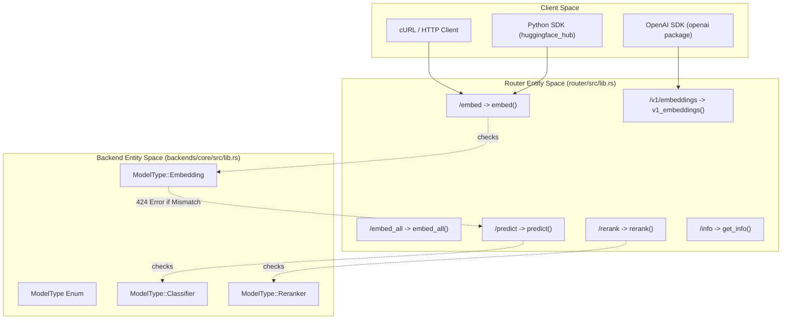
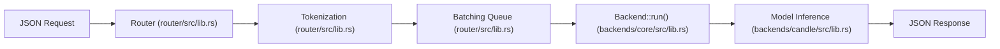

<!-- source: DeepWiki mcp.deepwiki.com · repo huggingface/text-embeddings-inference · page 2.3 Basic Usage · fetched 2026-10-26 -->

# Basic Usage

<details>
<summary>Relevant source files</summary>

The following files were used as context for generating this wiki page:

- [Cargo.lock](Cargo.lock)
- [Cargo.toml](Cargo.toml)
- [docs/openapi.json](docs/openapi.json)
- [docs/source/en/custom_container.md](docs/source/en/custom_container.md)
- [docs/source/en/examples.md](docs/source/en/examples.md)
- [docs/source/en/private_models.md](docs/source/en/private_models.md)
- [docs/source/en/quick_tour.md](docs/source/en/quick_tour.md)
- [docs/source/en/supported_models.md](docs/source/en/supported_models.md)

</details>


This page demonstrates how to interact with a running Text Embeddings Inference server to generate embeddings, perform reranking, and execute sequence classification tasks. It assumes you have already deployed TEI using Docker or local installation.

For information about advanced configuration of the server itself, see **Configuration Options**. For detailed API specifications and all available parameters, see **HTTP API Endpoints**.

---

## Quick Start: Your First Embedding Request

Once your TEI server is running (by default on `http://localhost:8080`), you can immediately start generating embeddings using cURL:

```bash
curl 127.0.0.1:8080/embed \
    -X POST \
    -d '{"inputs":"What is Deep Learning?"}' \
    -H 'Content-Type: application/json'
```

This sends a POST request to the `/embed` endpoint with a single text input. The server will return a JSON response containing the embedding vector.

**Sources:** [docs/source/en/quick_tour.md:52-59](), [docs/openapi.json:89-115]()

---

## HTTP API Endpoints Overview

TEI exposes multiple HTTP endpoints depending on the model type. The server automatically determines which endpoints are available based on the loaded model's architecture.

### Endpoint-to-Code Mapping
The following diagram maps the external API surface to the internal router logic.

**API Route Mapping**


**Endpoint Availability by Model Type:**

| Endpoint | Embedding Models | Classifier Models | Reranker Models |
|----------|------------------|-------------------|-----------------|
| `/embed` | ✓ | ✗ (424 error) | ✗ (424 error) |
| `/embed_all` | ✓ | ✗ (424 error) | ✗ (424 error) |
| `/v1/embeddings` | ✓ | ✗ (424 error) | ✗ (424 error) |
| `/rerank` | ✗ (424 error) | ✗ (424 error) | ✓ |
| `/predict` | ✗ (424 error) | ✓ | ✓ |
| `/info` | ✓ | ✓ | ✓ |

**Sources:** [docs/openapi.json:15-644](), [docs/source/en/quick_tour.md:107-154]()

---

## Understanding Response Formats

### Embedding Response

A successful `/embed` request returns a JSON object containing the embedding vectors. The response also includes performance metadata in HTTP headers for detailed timing breakdowns.

| Header | Description |
|--------|-------------|
| `x-compute-type` | Hardware type (e.g., `gpu`, `cpu`) |
| `x-compute-time` | Total elapsed time in seconds |
| `x-compute-tokens` | Input token count |
| `x-inference-time` | Backend inference time |

**Sources:** [docs/source/en/quick_tour.md:52-60](), [docs/openapi.json:107-115]()

---

## Request Parameters

### Common Parameters for `/embed`

The `/embed` endpoint accepts the following parameters in the JSON request body:

| Parameter | Type | Required | Description |
|-----------|------|----------|-------------|
| `inputs` | `string` or `string[]` | Yes | Text(s) to embed |
| `truncate` | `boolean` | No | Truncate inputs exceeding max length |
| `normalize` | `boolean` | No | Apply L2 normalization to embeddings |

Example with parameters:

```bash
curl 127.0.0.1:8080/embed \
    -X POST \
    -d '{
      "inputs": "What is Deep Learning?",
      "normalize": true,
      "truncate": true
    }' \
    -H 'Content-Type: application/json'
```

**Sources:** [docs/openapi.json:96-105](), [docs/source/en/quick_tour.md:155-164]()

---

## Using Python Client Libraries

### huggingface_hub InferenceClient

The recommended Python client is `InferenceClient` from the `huggingface_hub` library.

```python
from huggingface_hub import InferenceClient

client = InferenceClient()

# Generate embedding for a single text
embedding = client.feature_extraction(
    "What is deep learning?",
    model="http://localhost:8080/embed"
)
```

**Sources:** [docs/source/en/quick_tour.md:65-77]()

### OpenAI-Compatible API

TEI provides an OpenAI-compatible endpoint at `/v1/embeddings`.

```python
from openai import OpenAI

client = OpenAI(base_url="http://localhost:8080/v1", api_key="-")

response = client.embeddings.create(
    model="text-embeddings-inference",
    input="What is Deep Learning?",
)

print(response.data[0].embedding)
```

**Sources:** [docs/source/en/quick_tour.md:79-94]()

---

## Working with Different Model Types

### Reranker Models
Rerankers score query-document pairs. Use the `/rerank` endpoint.

```bash
curl 127.0.0.1:8080/rerank \
    -X POST \
    -d '{"query":"What is Deep Learning?", "texts": ["Deep Learning is...", "Deep learning is not..."]}' \
    -H 'Content-Type: application/json'
```

**Sources:** [docs/source/en/quick_tour.md:129-133]()

### Sequence Classification Models
For tasks like sentiment analysis, use the `/predict` endpoint.

```bash
curl 127.0.0.1:8080/predict \
    -X POST \
    -d '{"inputs":"I like you."}' \
    -H 'Content-Type: application/json'
```

**Sources:** [docs/source/en/quick_tour.md:149-153]()

---

## Request Flow Visualization

This diagram bridges the Natural Language request to the internal Code entities.

**Internal Data Flow**


**Sources:** [docs/source/en/quick_tour.md:48-50](), [Cargo.toml:1-11]()

---

## Error Handling

TEI uses specific HTTP status codes to indicate failure types.

| Status Code | Description | Example Cause |
|-------------|-------------|---------------|
| 400 | Batch is empty | `{"inputs": []}` |
| 413 | Batch size error | Exceeding `max_client_batch_size` |
| 422 | Tokenization error | Input text cannot be processed |
| 424 | Backend Error | Inference failed or model type mismatch |
| 429 | Model overloaded | Too many concurrent requests |

**Sources:** [docs/openapi.json:44-85](), [docs/openapi.json:117-187]()

---

