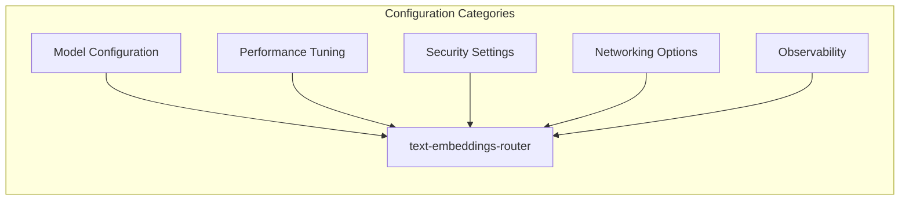
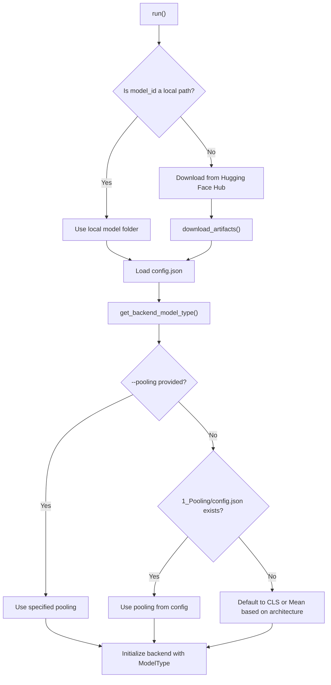
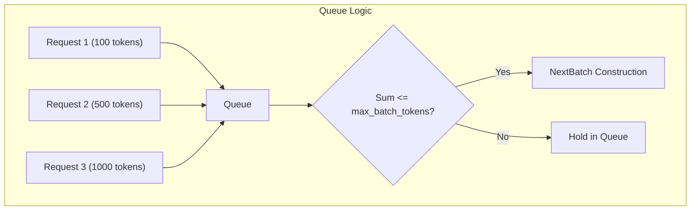

<!-- source: DeepWiki mcp.deepwiki.com · repo huggingface/text-embeddings-inference · page 2.4 Configuration Options · fetched 2026-10-26 -->

# Configuration Options

<details>
<summary>Relevant source files</summary>

The following files were used as context for generating this wiki page:

- [README.md](README.md)
- [docs/source/en/cli_arguments.md](docs/source/en/cli_arguments.md)
- [docs/source/en/custom_container.md](docs/source/en/custom_container.md)
- [docs/source/en/private_models.md](docs/source/en/private_models.md)
- [docs/source/en/quick_tour.md](docs/source/en/quick_tour.md)
- [docs/source/en/supported_models.md](docs/source/en/supported_models.md)
- [router/src/lib.rs](router/src/lib.rs)
- [router/src/main.rs](router/src/main.rs)

</details>


This page details the configuration options available when running the Text Embeddings Inference (TEI) server. TEI provides numerous configuration parameters that allow for fine-tuning performance, security, and behavior characteristics of the inference service via command-line arguments and environment variables.

## System Configuration Overview

TEI configuration is defined in the `Args` struct within the router component. This struct uses `clap` for command-line parsing and supports mapping environment variables to arguments.



Sources: [router/src/main.rs:13-15](), [router/src/lib.rs:44-70]()

## Model Configuration Options

These options control which model is loaded and how its architecture is interpreted.

| Option | Environment Variable | Description | Default |
|--------|----------------------|-------------|---------|
| `--model-id` | `MODEL_ID` | Hugging Face model ID or local path to model directory. | *Required* |
| `--revision` | `REVISION` | Specific commit ID or branch name for Hub models. | `None` (main) |
| `--dtype` | `DTYPE` | Force a specific data type (e.g., `float16`, `float32`). | Auto-detected |
| `--pooling` | `POOLING` | Override pooling strategy (e.g., `cls`, `mean`, `splade`, `last-token`). | From config |
| `--dense-path` | `DENSE_PATH` | Path to a specific `Dense` module (Linear layer + activation). | `None` |
| `--hf-token` | `HF_TOKEN` | Hugging Face Hub token for private/gated models. | Read from cache |

### Model Selection and Pooling Logic

The server attempts to resolve the pooling strategy by checking the command-line argument first, then the model's `1_Pooling/config.json`, and finally falling back to architecture-specific defaults.



Sources: [router/src/lib.rs:72-106](), [router/src/lib.rs:115-141](), [router/src/main.rs:47-54]()

## Performance Tuning Options

These settings are critical for optimizing hardware utilization and managing memory.

| Option | Environment Variable | Description | Default |
|--------|----------------------|-------------|---------|
| `--max-concurrent-requests` | `MAX_CONCURRENT_REQUESTS` | Limit of concurrent requests to prevent wait times. | `512` |
| `--max-batch-tokens` | `MAX_BATCH_TOKENS` | Maximum total tokens across all sequences in a batch. | `16384` |
| `--max-batch-requests` | `MAX_BATCH_REQUESTS` | Limit on the number of individual requests in a single batch. | `None` |
| `--max-client-batch-size` | `MAX_CLIENT_BATCH_SIZE` | Max inputs allowed in a single client POST request. | `32` |
| `--tokenization-workers` | `TOKENIZATION_WORKERS` | Number of parallel workers for tokenization tasks. | CPU Cores |
| `--auto-truncate` | `AUTO_TRUNCATE` | Truncate inputs exceeding model max length. | `true` |

### Dynamic Batching Constraints

The `max_batch_tokens` parameter is the primary lever for performance. It defines the "token budget" for the dynamic batching system managed by the `Queue`.



Sources: [router/src/main.rs:62-78](), [router/src/main.rs:80-91](), [router/src/lib.rs:265-276]()

## Networking and Security Options

These options define how the service is exposed and secured.

| Option | Environment Variable | Description | Default |
|--------|----------------------|-------------|---------|
| `--hostname` | `HOSTNAME` | IP address to listen on. | `0.0.0.0` |
| `--port` | `PORT` | Port to listen on. | `3000` |
| `--uds-path` | `UDS_PATH` | Unix socket path for internal gRPC communication. | `/tmp/...` |
| `--api-key` | `API_KEY` | Optional API key required in request headers. | `None` |
| `--payload-limit` | `PAYLOAD_LIMIT` | Maximum size of the HTTP request body in bytes. | `2,000,000` |
| `--cors-allow-origin` | `CORS_ALLOW_ORIGIN` | Allowed origins for CORS. | `None` |

Sources: [router/src/main.rs:146-168](), [router/src/main.rs:175-181]()

## Observability Options

TEI provides native support for Prometheus metrics and OpenTelemetry (OTLP) tracing.

| Option | Environment Variable | Description | Default |
|--------|----------------------|-------------|---------|
| `--prometheus-port` | `PROMETHEUS_PORT` | Port for the `/metrics` endpoint. | `9464` |
| `--otlp-endpoint` | `OTLP_ENDPOINT` | OTLP collector endpoint for distributed tracing. | `None` |
| `--otlp-service-name` | `OTLP_SERVICE_NAME` | Service name reported to the OTLP collector. | `text-embeddings-inference.router` |

Sources: [router/src/main.rs:183-194]()

## Configuration Mapping to Code Entities

The `run` function in `router/src/lib.rs` consumes the `Args` and initializes the core system components.

```mermaid
classDiagram
    class "Args (main.rs)" {
        model_id: String
        max_batch_tokens: usize
        max_concurrent_requests: usize
        auto_truncate: bool
    }
    
    class "Infer (core)" {
        tokenizer: Tokenization
        queue: Queue
        backend: Backend
    }

    class "Tokenization (core)" {
        workers: usize
        model_max_length: usize
    }

    class "Queue (core)" {
        max_batch_tokens: usize
        max_concurrent_requests: usize
    }

    "Args (main.rs)" ..> "run()": passed to
    "run()" --> "Tokenization (core)": initializes
    "run()" --> "Queue (core)": initializes
    "run()" --> "Infer (core)": composes
```

Sources: [router/src/lib.rs:44-70](), [router/src/lib.rs:219-277]()

## Prompt Configuration

TEI allows prepending static text to every input, which is useful for models like E5 or BGE that require "query: " or "passage: " prefixes.

- `--default-prompt`: A raw string prepended to all inputs.
- `--default-prompt-name`: A key used to look up a prompt in the model's `tokenizer_config.json` or `sentence_bert_config.json`.

These two options are mutually exclusive (`conflicts_with`).

Sources: [router/src/main.rs:93-118](), [router/src/lib.rs:206-218]()

## Environment Variable Specifics

In addition to arguments, TEI respects these environment-only variables:

- `HF_HUB_USER_AGENT_ORIGIN`: Appended to the user agent when downloading models from the Hub.
- `HF_HUB_CACHE`: Sets the directory where model weights are stored.
- `HF_TOKEN`: Primary variable for Hub authentication.

Sources: [router/src/lib.rs:78-90](), [router/src/main.rs:139-144]()

## Common Configuration Scenarios

### Local Air-Gapped Deployment
To run without internet access, point `model-id` to a local directory and ensure all artifacts (including `tokenizer.json` and `config.json`) are present.

```bash
text-embeddings-router --model-id /path/to/local/model --port 8080
```

### High-Throughput GPU Serving
For high-end GPUs (e.g., A100/H100), increase the token budget and concurrent request limit.

```bash
text-embeddings-router \
  --model-id BAAI/bge-large-en-v1.5 \
  --max-batch-tokens 32768 \
  --max-concurrent-requests 1024 \
  --dtype float16
```

Sources: [README.md:182-196](), [docs/source/en/cli_arguments.md:71-88]()

---

