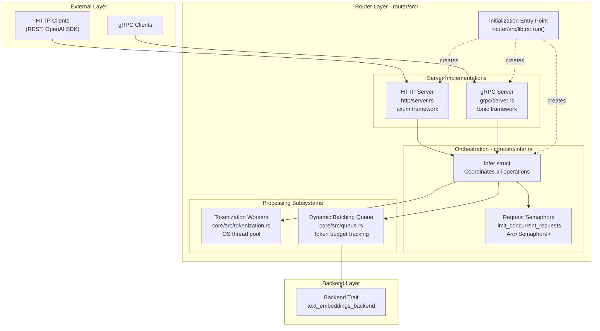
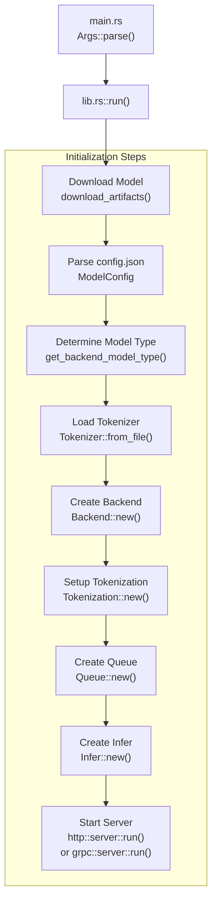
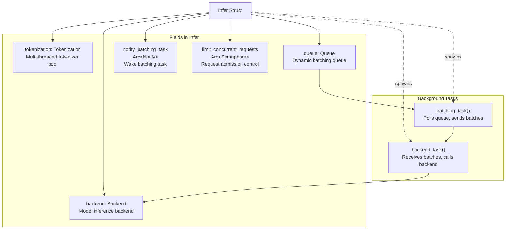
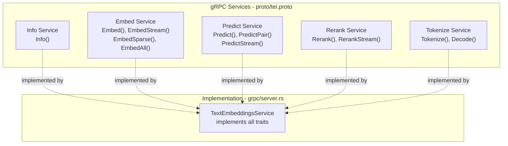
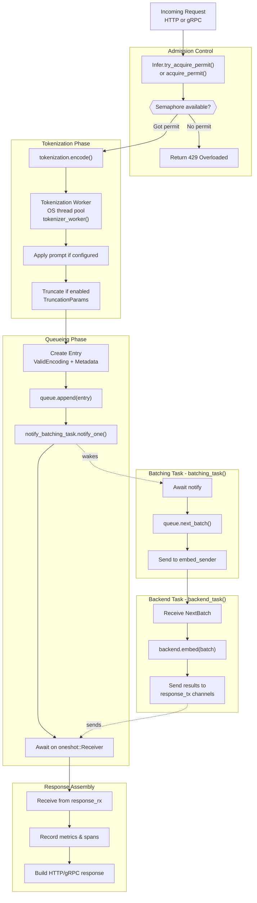
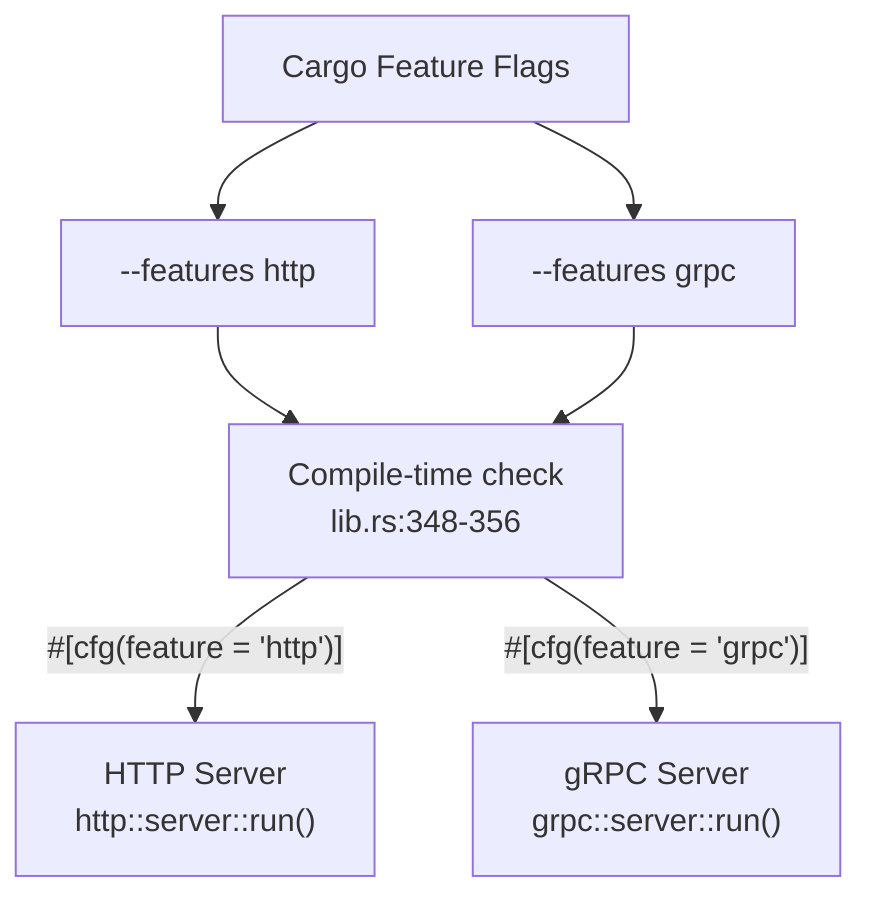

<!-- source: DeepWiki mcp.deepwiki.com · repo huggingface/text-embeddings-inference · page 3 Router Component · fetched 2026-10-26 -->

# Router Component

<details>
<summary>Relevant source files</summary>

The following files were used as context for generating this wiki page:

- [README.md](README.md)
- [core/src/infer.rs](core/src/infer.rs)
- [core/src/queue.rs](core/src/queue.rs)
- [core/src/tokenization.rs](core/src/tokenization.rs)
- [docs/source/en/cli_arguments.md](docs/source/en/cli_arguments.md)
- [proto/tei.proto](proto/tei.proto)
- [router/src/grpc/server.rs](router/src/grpc/server.rs)
- [router/src/http/server.rs](router/src/http/server.rs)
- [router/src/http/types.rs](router/src/http/types.rs)
- [router/src/lib.rs](router/src/lib.rs)
- [router/src/main.rs](router/src/main.rs)
- [router/tests/test_http_embed.rs](router/tests/test_http_embed.rs)

</details>


## Purpose and Scope

The Router Component is the entry point and orchestration layer for Text Embeddings Inference (TEI). It handles incoming HTTP and gRPC requests, coordinates tokenization, manages dynamic batching, and dispatches work to backend model implementations. The router is responsible for concurrency control, request validation, observability instrumentation, and response assembly.

This page covers the router's architecture, initialization, and orchestration responsibilities. For detailed information about specific subsystems, see:
- API endpoint specifications: [HTTP and gRPC Endpoints](#3.1)
- Request processing details: [Request Processing Pipeline](#3.2)
- Tokenization implementation: [Tokenization System](#3.3)
- Batching logic: [Dynamic Batching Queue](#3.4)
- Metrics and tracing: [Observability and Monitoring](#3.5)

For backend model inference, see [Backend System](#4).

## Architecture Overview

The router component sits between external clients and the backend inference system. It is implemented primarily in Rust and consists of two main server implementations (HTTP and gRPC), an orchestration layer (`Infer`), and supporting systems for tokenization and batching.



**Sources**: [router/src/lib.rs:1-412](), [router/src/http/server.rs:1-100](), [router/src/grpc/server.rs:1-50](), [core/src/infer.rs:1-100]()

## Core Components

### Entry Point and Initialization

The router's entry point is the `run` function in [router/src/lib.rs:44-412](). This function handles:

1. **Model discovery and download** - resolves model path (local or Hub), downloads artifacts if needed via `download_artifacts` [router/src/lib.rs:101-101]().
2. **Configuration parsing** - loads `config.json`, determines model type (embedding/classifier/reranker) [router/src/lib.rs:109-141]().
3. **Tokenizer initialization** - loads `tokenizer.json`, applies model-specific post-processing for architectures like Qwen2 [router/src/lib.rs:144-177]().
4. **Backend creation** - initializes the appropriate backend (Candle/ORT/Python) [router/src/lib.rs:260-264]().
5. **Subsystem setup** - creates `Tokenization` workers [router/src/lib.rs:271-278](), the `Queue` [router/src/lib.rs:280-285](), and the `Infer` orchestrator [router/src/lib.rs:292-297]().
6. **Server launch** - starts HTTP or gRPC server based on feature flags [router/src/lib.rs:348-412]().



**Key Configuration Parameters** (from [router/src/main.rs:15-188]()):

| Parameter | Environment Variable | Default | Description |
|-----------|---------------------|---------|-------------|
| `model_id` | `MODEL_ID` | N/A | Model identifier or local path |
| `max_concurrent_requests` | `MAX_CONCURRENT_REQUESTS` | `512` | Semaphore limit for request admission |
| `max_batch_tokens` | `MAX_BATCH_TOKENS` | `16384` | Token budget for dynamic batching |
| `max_batch_requests` | `MAX_BATCH_REQUESTS` | None | Optional limit on requests per batch |
| `tokenization_workers` | `TOKENIZATION_WORKERS` | CPU count | Number of OS threads for tokenization |
| `auto_truncate` | `AUTO_TRUNCATE` | `true` | Automatically truncate oversized inputs |
| `port` | `PORT` | `3000` | Server listening port |

**Sources**: [router/src/lib.rs:44-412](), [router/src/main.rs:15-188]()

### Infer Orchestrator

The `Infer` struct in [core/src/infer.rs:13-56]() is the central orchestration component. It coordinates tokenization, batching, and backend inference while managing concurrency.



**Core Methods** in `Infer`:

| Method | Purpose | Key Code Location |
|--------|---------|-------------------|
| `try_acquire_permit()` | Attempt to get request semaphore permit (non-blocking) | [core/src/infer.rs:94-105]() |
| `acquire_permit()` | Get request semaphore permit (blocking) | [core/src/infer.rs:107-115]() |
| `tokenize()` | Tokenize input without inference | [core/src/infer.rs:59-74]() |
| `decode()` | Decode token IDs to text | [core/src/infer.rs:76-91]() |
| `embed_pooled()` | Get pooled embeddings | [core/src/infer.rs:224-321]() |
| `embed_all()` | Get all token embeddings | [core/src/infer.rs:118-166]() |
| `embed_sparse()` | Get sparse embeddings (SPLADE) | [core/src/infer.rs:169-221]() |
| `predict()` | Classification/scoring | [core/src/infer.rs:391-498]() |

**Sources**: [core/src/infer.rs:11-523]()

### HTTP Server

The HTTP server is implemented using the `axum` framework in [router/src/http/server.rs](). It provides REST endpoints with JSON request/response formats and OpenAPI documentation.

**Endpoint Groups**:

| Endpoint Pattern | Handler Function | Model Type Support |
|------------------|------------------|-------------------|
| `POST /embed` | `embed()` | Embedding models only |
| `POST /embed_sparse` | `embed_sparse()` | SPLADE pooling only |
| `POST /embed_all` | `embed_all()` | Embedding models only |
| `POST /predict` | `predict()` | Classifier/Reranker |
| `POST /rerank` | `rerank()` | Reranker only |
| `POST /v1/embeddings` | `openai_embed()` | Embedding models (OpenAI compat) |
| `POST /tokenize` | `tokenize()` | All model types |
| `POST /decode` | `decode()` | All model types |
| `GET /health` | `health()` | All model types |
| `GET /info` | `get_model_info()` | All model types |

**Sources**: [router/src/http/server.rs:46-109]()

### gRPC Server

The gRPC server uses the `tonic` framework and is defined in [router/src/grpc/server.rs](). It offers the same functionality as HTTP with protobuf messages and streaming support.

**Service Structure** (from [proto/tei.proto:1-37]()):



**Streaming Support**:

The gRPC server provides optimized streaming endpoints that process multiple requests concurrently while maintaining response ordering. The `TextEmbeddingsService` ([router/src/grpc/server.rs:46-50]()) manages these requests, using a configurable `max_parallel_stream_requests` limit [router/src/grpc/server.rs:54-57]().

**Sources**: [proto/tei.proto:1-37](), [router/src/grpc/server.rs:45-63]()

## Request Flow Through Router

The following diagram shows how a request flows through the router components from initial receipt to final response:



**Timing Breakdown** in `ResponseMetadata`:

| Timing Field | Description | Recorded Where |
|--------------|-------------|----------------|
| `tokenization_time` | Duration in tokenization workers | [core/src/tokenization.rs:68-101]() |
| `queue_time` | Time waiting in queue + batching | [core/src/queue.rs:27](), [core/src/infer.rs:207-210]() |
| `inference_time` | Actual backend inference duration | Returned by backend |

**Sources**: [core/src/infer.rs:125-166](), [core/src/queue.rs:69-95](), [core/src/tokenization.rs:171-200]()

## Code Entity Mapping

### Key Structs and Their Roles

| Concept | Code Entity | Location | Primary Responsibility |
|---------|-------------|----------|----------------------|
| Router entry point | `run()` function | [router/src/lib.rs:44]() | Initialize all components and start server |
| Request orchestration | `Infer` struct | [core/src/infer.rs:13]() | Coordinates tokenization → batching → backend |
| Tokenization system | `Tokenization` struct | [core/src/tokenization.rs:14]() | Manages OS thread pool of tokenizers |
| Dynamic batching | `Queue` struct | [core/src/queue.rs:36]() | Token-budget-aware batch assembly |
| Concurrency control | `limit_concurrent_requests` | [core/src/infer.rs:19]() | `Arc<Semaphore>` for request admission |

### Configuration Flow

```mermaid
graph LR
    subgraph "CLI Arguments"
        ArgsStruct["Args struct<br/>main.rs:15-188"]
    end
    
    subgraph "Runtime Config"
        ModelConfig["ModelConfig<br/>lib.rs:111"]
    end
    
    subgraph "Component Config"
        TokenizationConfig["Tokenization::new()<br/>workers, max_input_length"]
        QueueConfig["Queue::new()<br/>max_batch_tokens, max_batch_requests"]
        InferConfig["Infer::new()<br/>max_concurrent_requests"]
    end
    
    ArgsStruct --> TokenizationConfig
    ArgsStruct --> QueueConfig
    ArgsStruct --> InferConfig
    
    ModelConfig -.parsed from config.json.-> ArgsStruct
```

**Sources**: [router/src/main.rs:15-188](), [router/src/lib.rs:109-113](), [core/src/tokenization.rs:30-65]()

### Feature Flags and Server Selection

The router is compiled with exactly one of two mutually exclusive feature flags:



The compile-time enforcement is at [router/src/lib.rs:348-356]().

**Sources**: [router/src/lib.rs:348-356]()

## Observability Integration

### Metrics (Prometheus)

Metrics are collected via the `metrics` crate:

| Metric Name | Type | Labels | Location |
|-------------|------|--------|----------|
| `te_request_count` | Counter | `method` | [router/src/http/server.rs:177]() |
| `te_request_failure` | Counter | `err` | [core/src/infer.rs:69, 100, 129]() |
| `te_queue_size` | Gauge | - | [core/src/queue.rs:115]() |
| `te_embed_duration` | Histogram | - | [core/src/infer.rs:157]() |

**Sources**: [core/src/infer.rs:156-163](), [core/src/queue.rs:115-116]()

---

