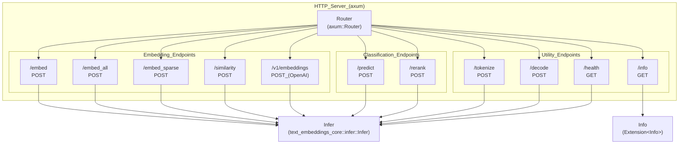
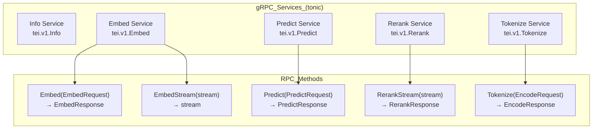
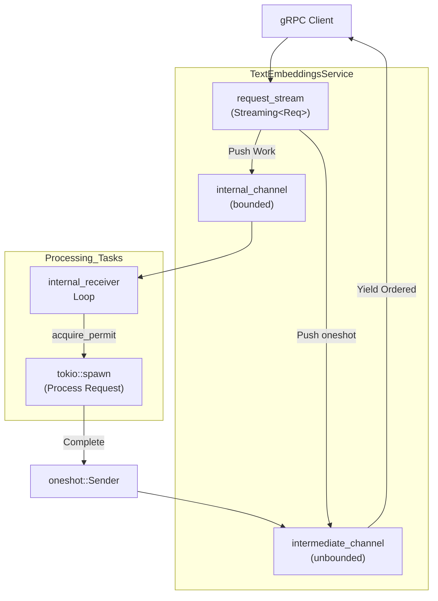

<!-- source: DeepWiki mcp.deepwiki.com · repo huggingface/text-embeddings-inference · page 3.1 HTTP and gRPC Endpoints · fetched 2026-10-26 -->

# HTTP and gRPC Endpoints

<details>
<summary>Relevant source files</summary>

The following files were used as context for generating this wiki page:

- [Cargo.lock](Cargo.lock)
- [Cargo.toml](Cargo.toml)
- [core/src/infer.rs](core/src/infer.rs)
- [core/src/queue.rs](core/src/queue.rs)
- [core/src/tokenization.rs](core/src/tokenization.rs)
- [docs/openapi.json](docs/openapi.json)
- [proto/tei.proto](proto/tei.proto)
- [router/src/grpc/server.rs](router/src/grpc/server.rs)
- [router/src/http/server.rs](router/src/http/server.rs)
- [router/src/http/types.rs](router/src/http/types.rs)
- [router/tests/test_http_embed.rs](router/tests/test_http_embed.rs)
- [router/tests/test_http_predict.rs](router/tests/test_http_predict.rs)
- [router/tests/test_http_rerank.rs](router/tests/test_http_rerank.rs)

</details>


This page provides a comprehensive reference for all HTTP and gRPC endpoints exposed by Text Embeddings Inference. It documents request/response schemas, parameter options, error codes, and endpoint-specific behaviors.

For information about the request processing pipeline and batching mechanisms, see [Request Processing Pipeline](#3.2). For details on tokenization and truncation handling, see [Tokenization System](#3.3). For observability features including metrics and tracing, see [Observability and Monitoring](#3.5).

## Overview

TEI exposes two primary API interfaces:

- **HTTP REST API**: JSON-based endpoints served via [axum](https://docs.rs/axum), documented with OpenAPI/Swagger at `/docs`.
- **gRPC API**: Protocol Buffer-based services via [tonic](https://docs.rs/tonic), with health checking and reflection support.

Both interfaces provide equivalent functionality for embeddings, classification, and reranking, with gRPC additionally supporting streaming requests.

**Sources**: [router/src/http/server.rs:1-100](), [router/src/grpc/server.rs:1-50](), [proto/tei.proto:1-38]()

## HTTP REST API

### Endpoint Architecture

The HTTP server is implemented in the `router` crate using the `axum` web framework. All endpoints are registered in the main server initialization and exposed through a unified router.

Title: HTTP Endpoint Routing Architecture


**Sources**: [router/src/http/server.rs:46-1184](), [Cargo.toml:10-11]()

### Embedding Endpoints

#### POST /embed

Returns pooled embeddings for input text(s). This is the primary endpoint for dense vector retrieval.

**Handler**: `predict` (for classifiers) or `embed` (for embeddings) function at [router/src/http/server.rs:586-709]().

**Request Schema** (`EmbedRequest`):

| Field | Type | Default | Description |
|-------|------|---------|-------------|
| `inputs` | `Input` | *required* | Single text, token IDs, or batch of texts/IDs |
| `truncate` | `Option<bool>` | `auto_truncate` | Whether to truncate inputs exceeding max length |
| `truncation_direction` | `TruncationDirection` | `Right` | Truncate from left or right |
| `prompt_name` | `Option<String>` | `None` | Prompt key from sentence-transformers config |
| `normalize` | `bool` | `true` | Apply L2 normalization to embeddings |
| `dimensions` | `Option<usize>` | `None` | Truncate embedding to specified dimensions (MRL) |

**Response Schema** (`EmbedResponse`):
```json
{
  "embeddings": [[0.1, 0.2, ..., 0.768]]
}
```

**Status Codes**:
- `200`: Success
- `400`: Empty batch
- `413`: Batch size exceeds limit
- `422`: Tokenization error
- `424`: Model type incompatible (not an embedding model)
- `429`: Server overloaded (concurrent request limit reached)

**Sources**: [router/src/http/server.rs:586-709](), [router/src/http/types.rs:411-451](), [docs/openapi.json:89-188]()

#### POST /embed_all

Returns token-level embeddings without pooling. Useful for tasks requiring per-token representations.

**Handler**: `embed_all` function at [router/src/http/server.rs:726-839]().

**Request Schema** (`EmbedAllRequest`):

| Field | Type | Default | Description |
|-------|------|---------|-------------|
| `inputs` | `Input` | *required* | Single text, token IDs, or batch |
| `truncate` | `Option<bool>` | `auto_truncate` | Truncation toggle |
| `truncation_direction` | `TruncationDirection` | `Right` | Truncation direction |
| `prompt_name` | `Option<String>` | `None` | Prompt injection key |

**Response Schema** (`EmbedAllResponse`):
Returns a 3D array: `[batch_size][sequence_length][hidden_size]`.

**Sources**: [router/src/http/server.rs:726-839](), [router/src/http/types.rs:467-480](), [docs/openapi.json:190-290]()

#### POST /embed_sparse

Returns sparse embeddings for SPLADE-based models. Only available when using a model with SPLADE pooling.

**Handler**: `embed_sparse` function at [router/src/http/server.rs:856-971]().

**Response Schema** (`EmbedSparseResponse`):
```json
{
  "embeddings": [
    [
      {"index": 42, "value": 0.8},
      {"index": 156, "value": 0.3}
    ]
  ]
}
```

**Sources**: [router/src/http/server.rs:856-971](), [router/src/http/types.rs:453-465](), [docs/openapi.json:292-391]()

#### POST /similarity

Computes cosine similarity between a source sentence and multiple target sentences using `simsimd` for acceleration.

**Handler**: `similarity` function at [router/src/http/server.rs:500-560]().

**Sources**: [router/src/http/server.rs:554-557](), [docs/openapi.json:666-765]()

#### POST /v1/embeddings (OpenAI Compatible)

OpenAI-compatible embedding endpoint for drop-in replacement.

**Handler**: `openai_embed` function at [router/src/http/server.rs:989-1122]().
Supports `base64` encoding for efficient transport of large vectors [router/src/http/server.rs:1091-1095]().

**Sources**: [router/src/http/server.rs:989-1122](), [router/src/http/types.rs:317-365]()

### Classification Endpoints

#### POST /predict

Returns classification predictions with scores and labels. Available for classifier and reranker models.

**Handler**: `predict` function at [router/src/http/server.rs:104-280]().

**Input Format**: Supports flexible `PredictInput` (Single, Pair, or Batch) [router/src/http/types.rs:35-138]().

**Label Mapping**: Labels are resolved using the `id2label` map from the model configuration [router/src/http/server.rs:139-143]().

**Sources**: [router/src/http/server.rs:104-280](), [router/src/http/types.rs:34-241]()

#### POST /rerank

Reranks documents against a query using a reranker model (cross-encoder).

**Handler**: `rerank` function at [router/src/http/server.rs:307-474]().
Processes query-document pairs concurrently using `join_all` [router/src/http/server.rs:410-413]().

**Sources**: [router/src/http/server.rs:307-474](), [router/src/http/types.rs:243-274]()

### Utility Endpoints

#### POST /tokenize

Tokenizes input text and returns token IDs with metadata.

**Handler**: `tokenize` function at [router/src/http/server.rs:1140-1184]().
Uses `text_embeddings_core::tokenization::SimpleToken` for character-offset mapping [router/src/http/server.rs:1172-1181]().

**Sources**: [router/src/http/server.rs:1140-1184](), [core/src/tokenization.rs:499-530]()

#### POST /decode

Converts token IDs back to text using the model's tokenizer.

**Handler**: `decode` function at [router/src/http/server.rs:1124-1138]().

**Sources**: [router/src/http/server.rs:1124-1138](), [core/src/tokenization.rs:138-167]()

---

## gRPC API

### Service Architecture

The gRPC API is defined in `proto/tei.proto` and implemented in the `router` crate using `tonic`.

Title: gRPC Service Hierarchy


**Sources**: [proto/tei.proto:1-204](), [router/src/grpc/server.rs:1-50]()

### Service Definitions

#### Info Service
Returns server and model metadata such as `max_batch_tokens` and `model_type` [proto/tei.proto:47-61]().

#### Embed Service
Handles all embedding-related operations including unary and streaming variants for pooled, sparse, and all-token embeddings [proto/tei.proto:11-18]().

#### Predict Service
Handles classification tasks. `PredictPair` is specifically for sequence pairs [proto/tei.proto:20-25]().

#### Rerank Service
Ranks documents. `RerankStream` accumulates requests and returns a single sorted response [router/src/grpc/server.rs:1069-1138]().

#### Tokenize Service
Utility service for `Tokenize` and `Decode` [proto/tei.proto:32-37]().

### Streaming Request Handling

gRPC streaming uses a three-channel system to maintain request order while allowing concurrent processing.

Title: gRPC Streaming Data Flow


**Implementation Details**:
- **Concurrency**: Limited by `GRPC_MAX_PARALLEL_STREAM_REQUESTS` [router/src/grpc/server.rs:49-62]().
- **Ordering**: Maintained by yielding results from the `intermediate_channel` in the sequence they were received [router/src/grpc/server.rs:427-453]().

**Sources**: [router/src/grpc/server.rs:49-470](), [proto/tei.proto:63-70]()

---

## Error Handling

### Error Response Schema

All errors return a standard structure. In HTTP, this is `ErrorResponse` [router/src/lib.rs:28-36]().

```json
{
  "error": "Model is overloaded",
  "error_type": "overloaded"
}
```

### Status Code Mapping

| Error Type | HTTP Code | gRPC Code | Cause |
|------------|-----------|-----------|-------|
| `empty` | 400 | `INVALID_ARGUMENT` | No inputs provided [core/src/tokenization.rs:76]() |
| `validation` | 413 | `INVALID_ARGUMENT` | Batch too large [router/src/http/server.rs:205]() |
| `tokenizer` | 422 | `INTERNAL` | Encoding failure [core/src/tokenization.rs:397]() |
| `backend` | 424 | `FAILED_PRECONDITION` | Model mismatch or inference error [core/src/infer.rs:334]() |
| `overloaded` | 429 | `RESOURCE_EXHAUSTED` | Max concurrency reached [core/src/infer.rs:94]() |
| `unhealthy` | 503 | `UNAVAILABLE` | Health check failed [router/src/http/server.rs:70]() |

**Sources**: [router/src/lib.rs:154-255](), [core/src/infer.rs:94-105](), [docs/openapi.json:44-186]()

---

## Request Parameters

### Common Parameters

- **`truncate`**: `Option<bool>`. If `true`, inputs exceeding `max_input_length` are truncated [core/src/tokenization.rs:378]().
- **`truncation_direction`**: `Right` (default) or `Left`. Controls which end of the text is kept [router/src/http/types.rs:205]().
- **`prompt_name`**: `Option<String>`. Injects a specific prompt from the model configuration [core/src/tokenization.rs:264]().
- **`normalize`**: `bool`. (Embed only) Applies L2 normalization to vectors [core/src/infer.rs:288]().
- **`dimensions`**: `Option<usize>`. (Embed only) Truncates embedding for MRL models [core/src/infer.rs:273]().

### Input Formats

- **`Input`**: Supports single string, token IDs, or batches [router/src/http/types.rs:302-306]().
- **`PredictInput`**: Specialized for classification, supporting text pairs [router/src/http/types.rs:40-138]().

**Sources**: [router/src/http/types.rs:196-446](), [core/src/tokenization.rs:264-410](), [core/src/infer.rs:224-480]()

---

