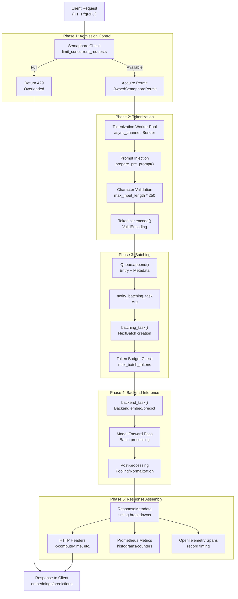
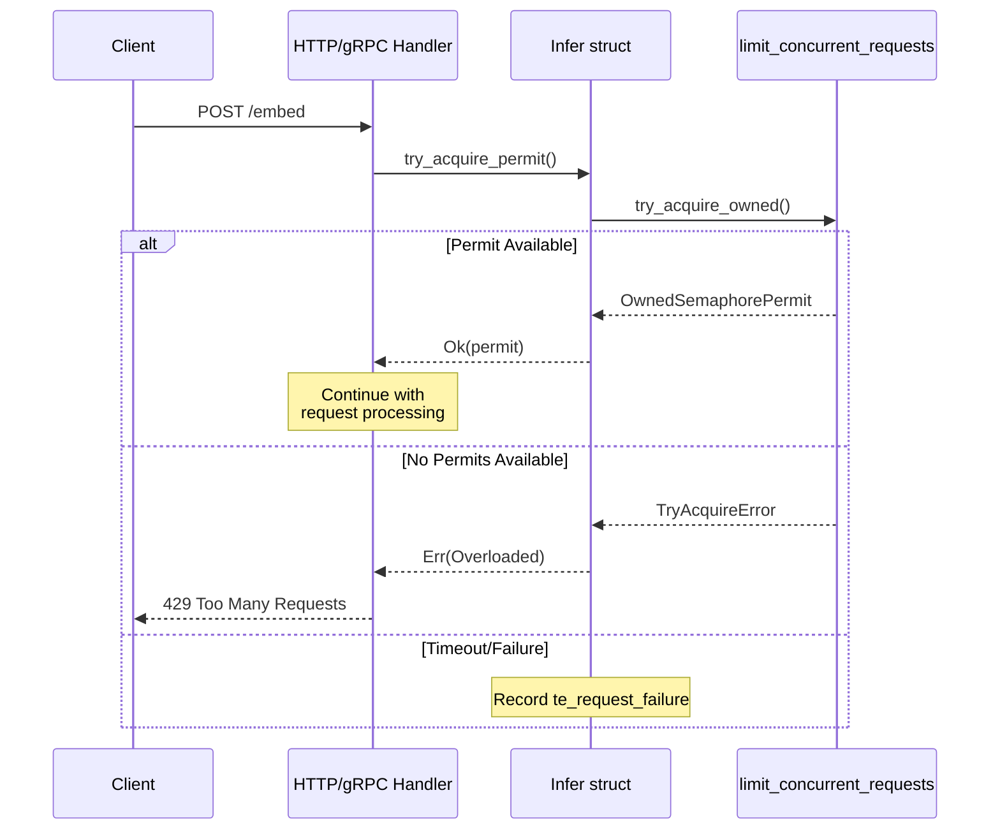
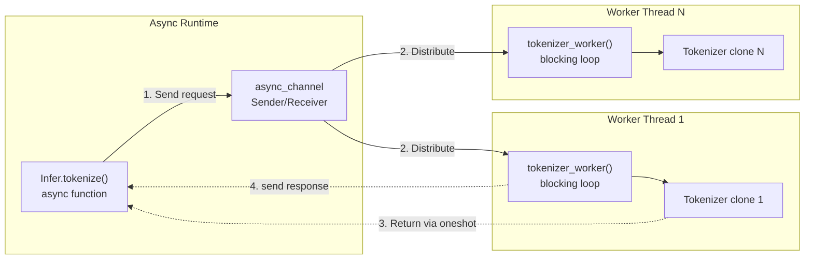
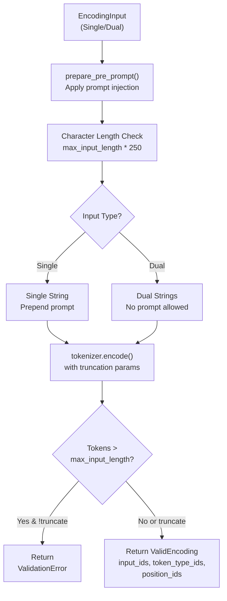
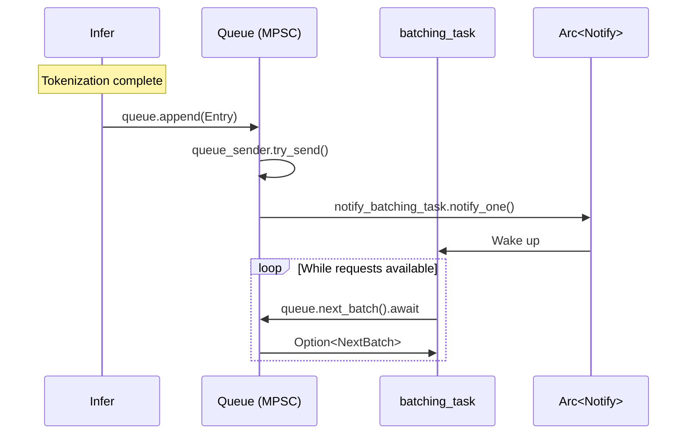
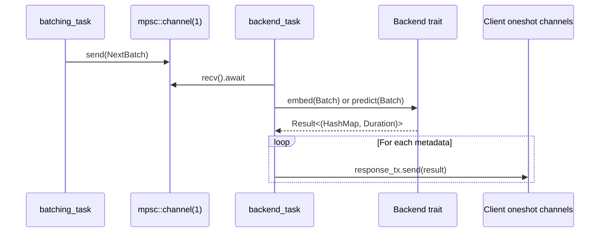
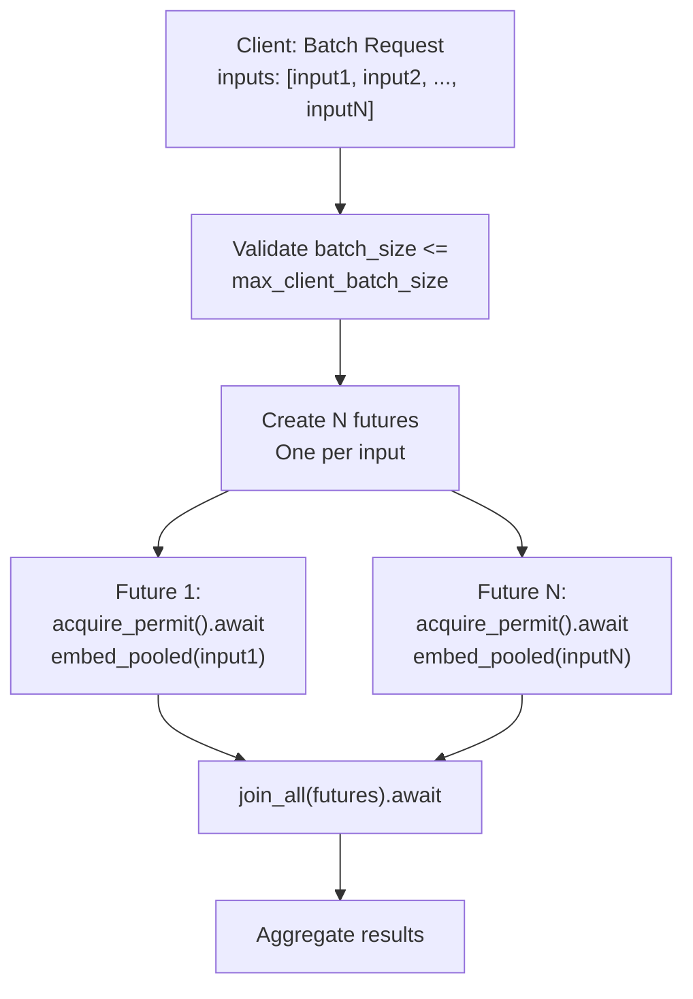

<!-- source: DeepWiki mcp.deepwiki.com · repo huggingface/text-embeddings-inference · page 3.2 Request Processing Pipeline · fetched 2026-10-26 -->

# Request Processing Pipeline

Relevant source files

The following files were used as context for generating this wiki page:

- [README.md](README.md)
- [core/src/infer.rs](core/src/infer.rs)
- [core/src/queue.rs](core/src/queue.rs)
- [core/src/tokenization.rs](core/src/tokenization.rs)
- [docs/source/en/cli_arguments.md](docs/source/en/cli_arguments.md)
- [proto/tei.proto](proto/tei.proto)
- [router/src/grpc/server.rs](router/src/grpc/server.rs)
- [router/src/http/server.rs](router/src/http/server.rs)
- [router/src/http/types.rs](router/src/http/types.rs)
- [router/src/lib.rs](router/src/lib.rs)
- [router/src/main.rs](router/src/main.rs)
- [router/tests/test_http_embed.rs](router/tests/test_http_embed.rs)

## Purpose and Scope

This document describes the complete lifecycle of a request through the Text Embeddings Inference (TEI) system, from initial admission to final response. It covers the five main phases: concurrency control, tokenization, batching, backend inference, and response assembly. Each request passes through these phases in sequence, with multiple requests being processed concurrently.

For detailed information about individual components:
- **API endpoints and request formats**: See [HTTP and gRPC Endpoints](#3.1)
- **Tokenization internals**: See [Tokenization System](#3.3)
- **Batching algorithm details**: See [Dynamic Batching Queue](#3.4)
- **Metrics and tracing**: See [Observability and Monitoring](#3.5)
- **Backend implementations**: See [Backend System](#4)

## Request Flow Architecture

**Sources**: [router/src/lib.rs:44-70](), [core/src/infer.rs:13-56](), [core/src/tokenization.rs:14-18](), [core/src/queue.rs:36-39]()

## Phase 1: Request Admission and Concurrency Control

### Semaphore-Based Admission

The system uses a semaphore to limit the number of concurrent requests, preventing resource exhaustion and maintaining predictable latency. The semaphore is initialized in `Infer::new` with `max_concurrent_requests` permits.

The semaphore check occurs in two modes within the `Infer` struct:

| Mode | Function | Behavior | Use Case |
|------|----------|----------|----------|
| **Try Acquire** | `try_acquire_permit()` | Returns immediately with error if no permits | Single requests, fast-fail [core/src/infer.rs:94-105]() |
| **Await Acquire** | `acquire_permit()` | Waits asynchronously for permit | Batch requests, parallel processing [core/src/infer.rs:108-115]() |

**Key Code Locations**:
- Semaphore initialization: [core/src/infer.rs:47]()
- HTTP Try acquire: [router/src/http/server.rs:181]()
- HTTP Await acquire (batch): [router/src/http/server.rs:242]()
- gRPC permit acquisition: [router/src/grpc/server.rs:79]()

### Request Rejection Metrics

When a request is rejected due to overload, `try_acquire_permit` increments the `te_request_failure` counter with `err="overloaded"` label and returns a `TextEmbeddingsError`.

**Sources**: [core/src/infer.rs:94-105](), [router/src/http/server.rs:181-183](), [router/src/lib.rs:51-54]()

## Phase 2: Tokenization

### Multi-Threaded Tokenization Worker Pool

Tokenization is CPU-bound and runs in dedicated OS threads to prevent blocking the async runtime. The `Tokenization` struct spawns `workers` threads that receive `TokenizerRequest` via an `async_channel`.

**Key Components**:
- Worker pool initialization: [core/src/tokenization.rs:30-65]()
- Worker loop: [core/src/tokenization.rs:171-180]()
- Request channel: [core/src/tokenization.rs:41]()
- Response channel: [core/src/tokenization.rs:83]()

### Tokenization Steps

Each tokenization request proceeds through the following steps inside `tokenizer_worker`:

**Character Multiplier**: The system applies a conservative character limit of `max_input_length * 250` characters (defined as `MAX_CHAR_MULTIPLIER`) before tokenization [core/src/tokenization.rs:10]().

**Prompt Injection**: If a `prompt_name` or `default_prompt` is specified, the text is prepended to the input before tokenization in `prepare_pre_prompt`.

**Sources**: [core/src/tokenization.rs:171-252](), [core/src/tokenization.rs:10](), [router/src/lib.rs:55-57]()

## Phase 3: Dynamic Batching Queue

### Queue Append and Notification

After tokenization completes, the request is added to the batching queue as an `Entry` containing the `ValidEncoding` and `Metadata`:

**Entry Structure**:
- `encoding`: `ValidEncoding` with `input_ids`, `token_type_ids`, `position_ids` [core/src/queue.rs:14]()
- `metadata`: `Metadata` containing:
  - `response_tx`: oneshot channel for result [core/src/queue.rs:23]()
  - `tokenization`: Duration of tokenization phase [core/src/queue.rs:25]()
  - `queue_time`: Instant when queued [core/src/queue.rs:27]()
  - `prompt_tokens`: Number of tokens for metrics [core/src/queue.rs:29]()
  - `pooling`: Whether pooled embedding requested [core/src/queue.rs:31]()

**Sources**: [core/src/infer.rs:524-544](), [core/src/queue.rs:11-32](), [core/src/infer.rs:31-41]()

### Batch Formation Algorithm

The `queue_blocking_task` runs in a dedicated thread and constructs batches according to these constraints:

| Constraint | Configuration | Enforcement |
|------------|---------------|-------------|
| **Token Budget** | `max_batch_tokens` | Total tokens across all requests [core/src/queue.rs:157]() |
| **Request Limit** | `max_batch_requests` | Maximum individual requests [core/src/queue.rs:179]() |
| **Client Disconnect** | N/A | Drop entries with closed response channels [core/src/queue.rs:142]() |

**Cumulative Sequence Lengths**: The `cu_seq_lengths` vector stores the cumulative token count at each request boundary [core/src/queue.rs:131-132](). This enables the backend to locate each request's tokens in the flattened batch.

**Padded vs. Unpadded Models**: For padded models, the token budget calculation uses `max_length * (metadata.len() + 1)` to account for padding [core/src/queue.rs:150-152]().

**Sources**: [core/src/queue.rs:99-211](), [core/src/queue.rs:42-63]()

## Phase 4: Backend Inference

### Backend Task and Model Execution

The `backend_task` receives batches via an MPSC channel (bounded to 1 for prefetching) and executes them on the `Backend`:

**Key Design Decision**: The `backend_task` handles the actual model execution, which is a blocking operation. It iterates through the batch results and sends them back to individual request owners via `response_tx` [core/src/infer.rs:546-625]().

**Sources**: [core/src/infer.rs:546-625](), [core/src/infer.rs:34-44]()

### Inference Result Processing

The `Infer` struct handles post-processing before returning to the handler:

1. **Classification (Predict)**:
   - If `raw_scores=false`, results are typically normalized (softmax/sigmoid) by the backend or logic in [router/src/http/server.rs:146-162]().

2. **Embeddings (Embed)**:
   - **MRL Truncation**: If `dimensions` is specified, embeddings are truncated [core/src/infer.rs:273-286]().
   - **Normalization**: If `normalize=true`, L2 normalization is applied [core/src/infer.rs:288-303]().

**Sources**: [core/src/infer.rs:224-321](), [router/src/http/server.rs:139-171]()

## Phase 5: Response Assembly and Metadata

### ResponseMetadata Construction

The `ResponseMetadata` struct captures detailed timing breakdowns for each phase:

| Metric | Source |
|------|--------|
| **tokenization_time** | From `InferMetadata` [core/src/infer.rs:354]() |
| **queue_time** | `queue_time.elapsed() - inference_duration` [core/src/infer.rs:559]() |
| **inference_time** | Returned by backend [core/src/infer.rs:560]() |
| **total_time** | `start_time.elapsed()` [router/src/grpc/server.rs:37]() |

**Sources**: [router/src/lib.rs:588-614](), [router/src/grpc/server.rs:32-43](), [core/src/infer.rs:556-563]()

### Multi-Channel Observability

Response metadata is exported through parallel channels:

1. **HTTP Headers**: Injected into the response `HeaderMap` including `x-compute-time`, `x-compute-tokens`, etc. [router/src/lib.rs:639-696]().
2. **Prometheus Metrics**: Histograms like `te_embed_duration` and `te_embed_queue_duration` [core/src/infer.rs:157-163]().
3. **OpenTelemetry Spans**: Recorded via `record_span` on the tracing span [router/src/lib.rs:616-624]().

**Sources**: [router/src/lib.rs:588-696](), [core/src/infer.rs:154-165](), [router/src/grpc/server.rs:109-110]()

## Batch Request Processing

For client-side batch requests (e.g., multiple strings in one HTTP call), the system processes inputs concurrently:

**Implementation Details**:
- **Concurrency**: Uses `futures::future::join_all` to wait for all individual input processing tasks [router/src/http/server.rs:247]().
- **Permits**: Each input in the batch acquires its own semaphore permit via `acquire_permit()` [router/src/http/server.rs:242]().
- **Validation**: Rejects batches exceeding `max_client_batch_size` [router/src/http/server.rs:229-231]().

**Sources**: [router/src/http/server.rs:221-276](), [router/src/main.rs:81-82](), [core/src/infer.rs:108-115]()

---

