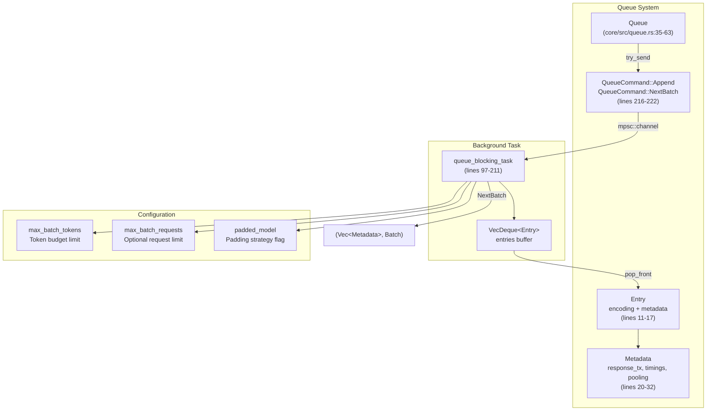
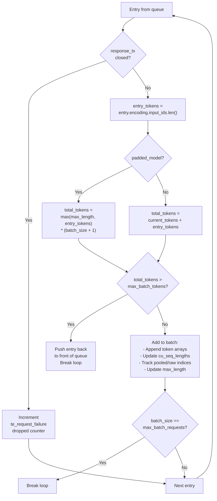
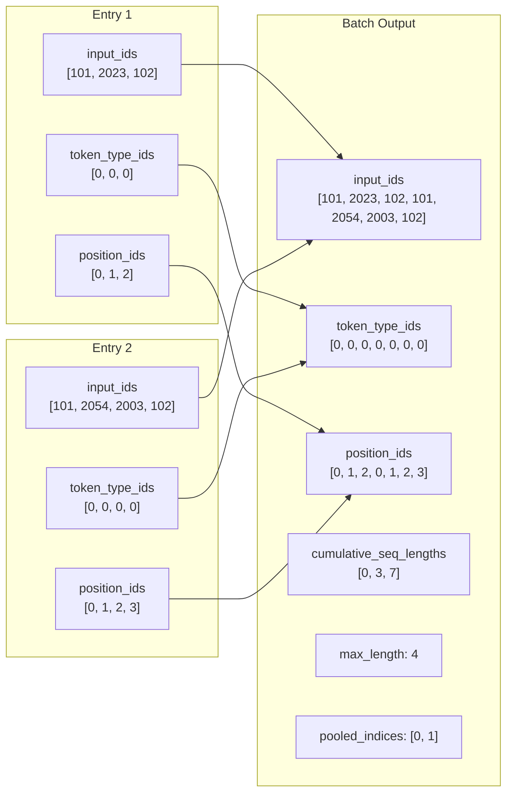
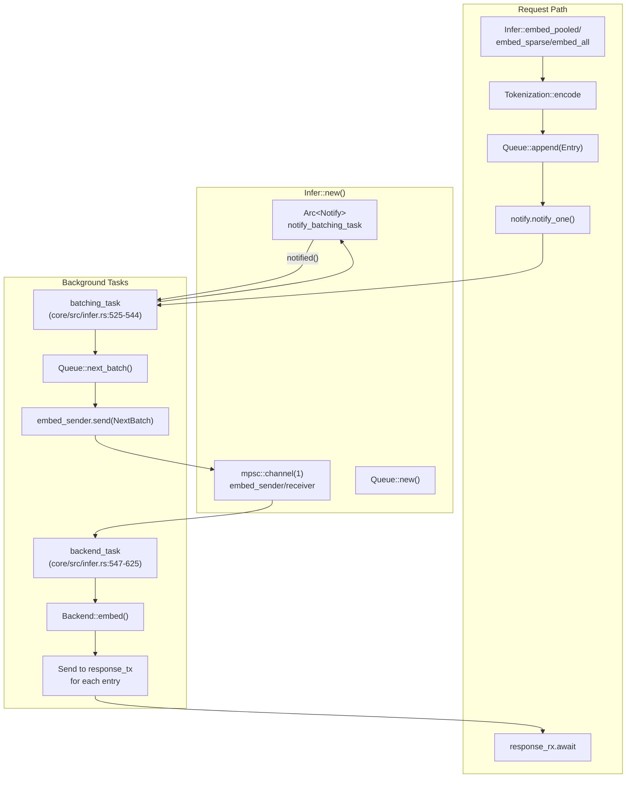

<!-- source: DeepWiki mcp.deepwiki.com · repo huggingface/text-embeddings-inference · page 3.4 Dynamic Batching Queue · fetched 2026-10-26 -->

# Dynamic Batching Queue

<details>
<summary>Relevant source files</summary>

The following files were used as context for generating this wiki page:

- [README.md](README.md)
- [core/src/infer.rs](core/src/infer.rs)
- [core/src/queue.rs](core/src/queue.rs)
- [core/src/tokenization.rs](core/src/tokenization.rs)
- [docs/source/en/cli_arguments.md](docs/source/en/cli_arguments.md)
- [proto/tei.proto](proto/tei.proto)
- [router/src/grpc/server.rs](router/src/grpc/server.rs)
- [router/src/http/server.rs](router/src/http/server.rs)
- [router/src/http/types.rs](router/src/http/types.rs)
- [router/src/lib.rs](router/src/lib.rs)
- [router/src/main.rs](router/src/main.rs)
- [router/tests/test_http_embed.rs](router/tests/test_http_embed.rs)

</details>


This document describes the dynamic batching queue system that aggregates individual inference requests into optimized batches for backend execution. The queue implements token budget management, client disconnect detection, and adaptive batch sizing to maximize throughput while respecting memory constraints.

For information about the tokenization that occurs before queueing, see [Tokenization System](#3.3). For details on the inference orchestration that uses the queue, see [Request Processing Pipeline](#3.2).

## Purpose and Architecture

The dynamic batching queue serves as a buffer between tokenized requests and backend inference execution. It accumulates individual requests and forms batches based on token budget constraints and request count limits, enabling efficient GPU/accelerator utilization through batch processing. [core/src/queue.rs:36-63]()

The queue operates as a background task that receives tokenized encodings via channels and constructs optimized batches according to configurable constraints. It implements eager batching—forming batches as soon as conditions are met—to minimize latency while maximizing throughput. [core/src/queue.rs:99-105]()

### Core Components



**Sources:** [core/src/queue.rs:1-223]()

### Data Structures

| Structure | Fields | Purpose |
|-----------|--------|---------|
| `Queue` | `queue_sender: mpsc::Sender<QueueCommand>` | Thread-safe handle for appending entries and requesting batches [core/src/queue.rs:38]() |
| `Entry` | `encoding: ValidEncoding`<br/>`metadata: Metadata` | Single request with tokenized input and metadata [core/src/queue.rs:11-17]() |
| `Metadata` | `response_tx: oneshot::Sender`<br/>`tokenization: Duration`<br/>`queue_time: Instant`<br/>`prompt_tokens: usize`<br/>`pooling: bool` | Request tracking and response coordination [core/src/queue.rs:20-32]() |
| `Batch` | `input_ids: Vec<u32>`<br/>`token_type_ids: Vec<u32>`<br/>`position_ids: Vec<u32>`<br/>`cumulative_seq_lengths: Vec<u32>`<br/>`max_length: u32`<br/>`pooled_indices: Vec<usize>`<br/>`raw_indices: Vec<usize>` | Concatenated batch for backend execution [core/src/queue.rs:188-202]() |

**Sources:** [core/src/queue.rs:11-32](), [core/src/queue.rs:188-202]()

## Token Budget Management

The queue implements a token budget system to ensure batches fit within GPU memory constraints. The budget calculation differs based on whether the model requires padded inputs. [core/src/queue.rs:150-155]()

### Budget Calculation Algorithm



**Sources:** [core/src/queue.rs:137-182]()

### Padded vs. Non-Padded Models

The token budget calculation strategy depends on the model's input requirements:

**Non-Padded Models** (e.g., Flash Attention variants):
```rust
// core/src/queue.rs:154
current_tokens + entry_tokens
```
- Accepts variable-length sequences concatenated together.
- More memory efficient for heterogeneous sequence lengths.
- Uses `cumulative_seq_lengths` to track sequence boundaries. [core/src/queue.rs:175]()

**Padded Models** (e.g., standard transformers):
```rust
// core/src/queue.rs:151
(max(max_length, entry_tokens as u32) * (metadata.len() + 1) as u32) as usize
```
- Requires all sequences padded to the same length.
- Token count grows quadratically with batch size.
- More conservative batch sizing to avoid OOM errors. [core/src/queue.rs:150-153]()

The `padded_model` flag is set during backend initialization based on model capabilities. [core/src/queue.rs:100]()

**Sources:** [core/src/queue.rs:148-155]()

## Batch Formation Process

The queue constructs batches by concatenating token arrays from individual entries and tracking sequence boundaries.

### Batch Construction Details



The batch formation algorithm (lines 122-182 of `core/src/queue.rs`):

1. **Initialize arrays** with capacity based on `max_batch_tokens` and `max_batch_requests`. [core/src/queue.rs:124-132]()
2. **Pop entries** from the `VecDeque` front. [core/src/queue.rs:139]()
3. **Filter dropped requests** by checking `response_tx.is_closed()`. [core/src/queue.rs:142]()
4. **Calculate token budget** using padded or non-padded formula. [core/src/queue.rs:150-155]()
5. **Break if budget exceeded**, pushing entry back to queue front. [core/src/queue.rs:157-160]()
6. **Concatenate token arrays**: `input_ids.extend()`, `token_type_ids.extend()`, `position_ids.extend()`. [core/src/queue.rs:169-171]()
7. **Track indices**: add to `pooled_indices` or `raw_indices` based on `metadata.pooling`. [core/src/queue.rs:162-165]()
8. **Update cumulative lengths**: append `current_tokens` to `cu_seq_lengths`. [core/src/queue.rs:175]()
9. **Update max_length**: `max_length = max(max_length, entry_tokens)`. [core/src/queue.rs:167]()
10. **Break if request limit reached**: `Some(metadata.len()) == max_batch_requests`. [core/src/queue.rs:179-181]()

**Sources:** [core/src/queue.rs:116-182]()

### Pooled vs. Raw Indices

The queue tracks two separate index lists to support different output types:

- **`pooled_indices`**: Entries requiring pooled embeddings (single vector per sequence). Set when `metadata.pooling == true`. [core/src/queue.rs:163]()
- **`raw_indices`**: Entries requiring all token embeddings (matrix per sequence). Set when `metadata.pooling == false`. [core/src/queue.rs:164]()

The backend uses these indices to generate the appropriate output format for each request in the batch.

**Sources:** [core/src/queue.rs:128-165](), [core/src/infer.rs:138-142]()

## Client Disconnect Detection

The queue implements early filtering of dropped requests to avoid wasted computation on clients that have disconnected.

### Disconnect Detection Implementation

```rust
// From core/src/queue.rs:142-146
if entry.metadata.response_tx.is_closed() {
    let counter = metrics::counter!("te_request_failure", "err" => "dropped");
    counter.increment(1);
    continue;
}
```

When a client disconnects (e.g., timeout, cancellation), the oneshot receiver is dropped. The queue checks `response_tx.is_closed()` before adding each entry to a batch. Closed channels indicate the client is no longer waiting for a response, so the entry is discarded. [core/src/queue.rs:142-146]()

This optimization:
- Prevents wasted GPU cycles on abandoned requests.
- Reduces batch sizes for faster processing of active requests.
- Tracks dropped requests via the `te_request_failure` metric with `err="dropped"` label.

**Sources:** [core/src/queue.rs:137-146]()

## Integration with Inference Pipeline

The queue integrates with the broader inference system through two background tasks that form a pipeline: batching → backend execution → response distribution.

### Pipeline Architecture



**Sources:** [core/src/infer.rs:25-56](), [core/src/infer.rs:525-625]()

### Batching Task

The `batching_task` function runs in a loop:

1. **Wait for notification**: `notify.notified().await` blocks until a request is queued. [core/src/infer.rs:528]()
2. **Reserve channel capacity**: `embed_sender.reserve().await` gets a permit. [core/src/infer.rs:531]()
3. **Request batches**: Loop calling `queue.next_batch()` while batches are available. [core/src/infer.rs:535]()
4. **Send to backend**: `permit.send(next_batch)` forwards batch to backend task. [core/src/infer.rs:538]()
5. **Prefetch**: Continue until queue is empty, then wait for next notification.

The bounded channel with capacity 1 enables prefetching one batch while the backend processes the current batch, improving pipeline utilization. [core/src/infer.rs:34]()

**Sources:** [core/src/infer.rs:525-544]()

### Backend Task

The `backend_task` function processes batches:

1. **Receive batch**: `embed_receiver.recv().await` gets next batch. [core/src/infer.rs:548]()
2. **Execute inference**: Call `backend.predict()` or `backend.embed()`. [core/src/infer.rs:555]()
3. **Spawn response thread**: `std::thread::spawn()` to avoid blocking the backend. [core/src/infer.rs:581]()
4. **Match results**: Extract embeddings or predictions from result map using entry indices. [core/src/infer.rs:590-620]()
5. **Send responses**: Call `response_tx.send()` for each entry's oneshot channel. [core/src/infer.rs:622]()
6. **Handle errors**: Broadcast error to all entries if inference fails. [core/src/infer.rs:563-579]()

The response distribution happens in a separate OS thread to prevent response sending from starving the backend task's async runtime. [core/src/infer.rs:581]()

**Sources:** [core/src/infer.rs:547-625]()

## Configuration Parameters

The queue behavior is controlled by parameters passed during initialization:

| Parameter | Type | Purpose | Default/Typical |
|-----------|------|---------|-----------------|
| `max_batch_tokens` | `usize` | Maximum total tokens per batch (token budget) | 16384 [router/src/main.rs:73-74]() |
| `max_batch_requests` | `Option<usize>` | Optional limit on requests per batch | None [router/src/main.rs:77-78]() |
| `max_concurrent_requests` | `usize` | Maximum queued requests before backpressure | 512 [router/src/main.rs:59-60]() |
| `padded_model` | `bool` | Whether model requires padded inputs | Backend dependent [core/src/queue.rs:43]() |

These parameters are set based on command-line arguments and model capabilities during initialization in `router/src/main.rs`. [router/src/main.rs:56-82]()

**Sources:** [core/src/queue.rs:42-63](), [router/src/main.rs:15-160]()

## Metrics and Observability

The queue emits several Prometheus metrics for monitoring:

```rust
// Queue size tracking
metrics::gauge!("te_queue_size").increment(1.0);  // core/src/queue.rs:116
metrics::gauge!("te_queue_size").decrement(batch_size as f64);  // core/src/queue.rs:205

// Batch statistics
metrics::histogram!("te_batch_next_size").record(batch_size as f64); // core/src/queue.rs:206
metrics::histogram!("te_batch_next_tokens").record(current_tokens as f64); // core/src/queue.rs:207

// Dropped requests
metrics::counter!("te_request_failure", "err" => "dropped").increment(1); // core/src/queue.rs:144
```

These metrics enable monitoring of:
- **Queue depth**: Current number of pending requests.
- **Batch efficiency**: Distribution of batch sizes and token counts.
- **Client disconnects**: Rate of dropped requests.

**Sources:** [core/src/queue.rs:113-207]()

## Performance Considerations

### Memory-Throughput Tradeoff

The token budget directly controls memory usage vs. throughput:
- **Higher `max_batch_tokens`**: Larger batches, better GPU utilization, more memory.
- **Lower `max_batch_tokens`**: Smaller batches, lower latency, less memory.

For production deployments, set `max_batch_tokens` to the largest possible value until the model is compute bound. [router/src/main.rs:70-71]()

### Request Count Limits

Setting `max_batch_requests` prevents unbounded batch sizes when processing many short sequences:
- Without limit: Batch could contain thousands of very short sequences.
- With limit (e.g., 128): Caps batch at 128 requests regardless of token count. [core/src/queue.rs:179-181]()

### Padded Model Overhead

For padded models, token budget is consumed quadratically:
- A single long sequence in a batch forces all other sequences to be padded to that length, consuming tokens significantly faster. [core/src/queue.rs:150-153]()

**Sources:** [core/src/queue.rs:148-158](), [router/src/main.rs:62-74]()

---

