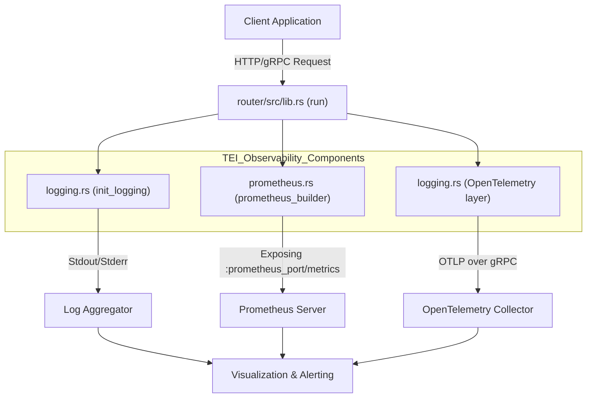
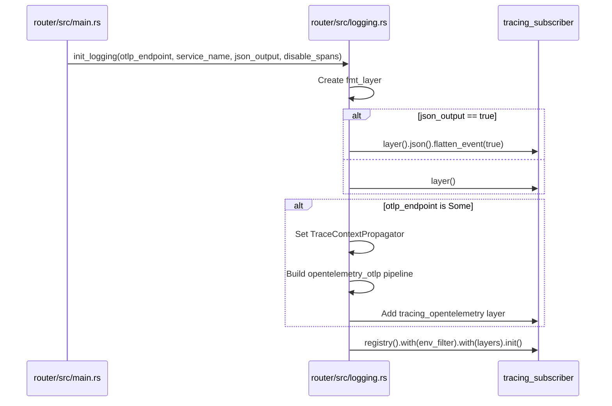
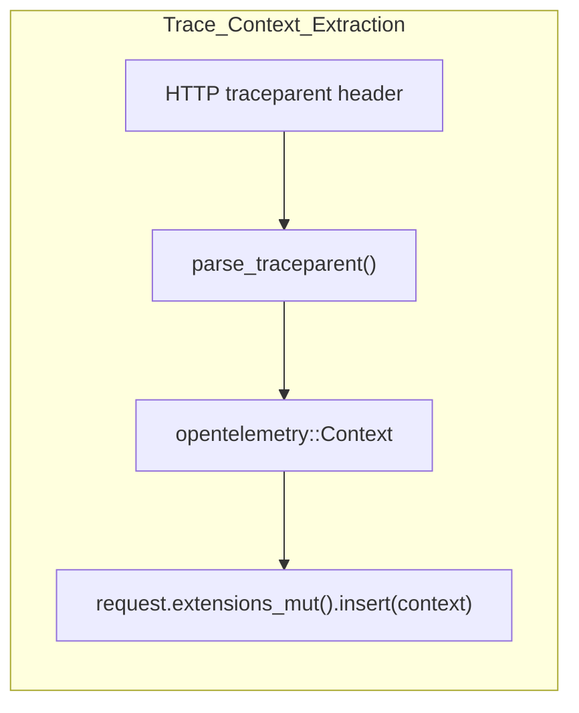

<!-- source: DeepWiki mcp.deepwiki.com · repo huggingface/text-embeddings-inference · page 3.5 Observability and Monitoring · fetched 2026-10-26 -->

# Observability and Monitoring

Relevant source files

The following files were used as context for generating this wiki page:

- [README.md](README.md)
- [docs/source/en/cli_arguments.md](docs/source/en/cli_arguments.md)
- [load_tests/load.js](load_tests/load.js)
- [load_tests/load_grpc.js](load_tests/load_grpc.js)
- [load_tests/load_grpc_stream.js](load_tests/load_grpc_stream.js)
- [router/src/lib.rs](router/src/lib.rs)
- [router/src/logging.rs](router/src/logging.rs)
- [router/src/main.rs](router/src/main.rs)
- [router/src/prometheus.rs](router/src/prometheus.rs)
- [router/tests/common.rs](router/tests/common.rs)

This document describes the observability and monitoring capabilities of Text Embeddings Inference (TEI). It covers the logging system, metrics collection, distributed tracing, and performance monitoring features built into the router component.

## Overview

TEI includes comprehensive observability features to help users monitor their deployment, troubleshoot issues, and optimize performance. The system provides three primary observability mechanisms:

1.  **Logging** - Structured logging with configurable format and levels via the `tracing` crate [[router/src/logging.rs:72-134]]().
2.  **Metrics** - Prometheus metrics for system and request performance [[router/src/prometheus.rs:5-47]]().
3.  **Distributed Tracing** - OpenTelemetry integration for end-to-end request tracking [[router/src/logging.rs:96-123]]().

These mechanisms integrate together to give you complete visibility into your embedding service.

### Observability Data Flow

Sources: [router/src/lib.rs:44-70](), [router/src/logging.rs:72-134](), [router/src/prometheus.rs:5-47]()

## Logging System

TEI uses the Rust `tracing` framework for its logging implementation, providing structured logs with context. The logging system is initialized in `router/src/logging.rs`.

### Configuration Options
The following command-line options and environment variables control logging behavior [[router/src/main.rs:166-173]]():

| Option | Source | Description |
|--------|--------|-------------|
| `--json-output` | `Args` | Enables JSON-formatted logs for log aggregation systems [[router/src/logging.rs:85-93]](). |
| `--disable-spans` | `Args` | Disables span context in logs to reduce log volume [[router/src/logging.rs:89-90]](). |
| `LOG_LEVEL` | Env Var | Sets log level (TRACE, DEBUG, INFO, WARN, ERROR). Defaults to INFO [[router/src/logging.rs:126-127]](). |

### Logging Initialization Logic
The `init_logging` function sets up the subscriber registry with layers for formatting and OpenTelemetry export.

Sources: [router/src/logging.rs:72-134](), [router/src/main.rs:182-187]()

## Metrics Collection

TEI exposes Prometheus metrics via `metrics_exporter_prometheus`. The `prometheus_builder` function in `router/src/prometheus.rs` configures custom buckets for duration, input length, and batch sizes [[router/src/prometheus.rs:5-47]]().

### Prometheus Buckets
To provide high-resolution latency and throughput data, TEI uses specialized histogram buckets:
*   **Duration**: 35 geometric buckets starting from 0.00001s with a 1.5x multiplier [[router/src/prometheus.rs:14-23]]().
*   **Input Length**: Power-of-two buckets (2^x) up to `max_input_length` [[router/src/prometheus.rs:26-30]]().
*   **Batch Size/Tokens**: Power-of-two buckets to track dynamic batching efficiency [[router/src/prometheus.rs:33-38]]().

### Performance Headers and Metadata
Every request is profiled using the `ResponseMetadata` struct [[router/src/lib.rs:558-570]](). This metadata is injected into HTTP response headers via the `From<ResponseMetadata> for HeaderMap` implementation [[router/src/lib.rs:608-665]]().

| Header | Code Entity | Description |
|--------|-------------|-------------|
| `x-compute-time` | `inference_time` | Time spent in model execution [[router/src/lib.rs:633]](). |
| `x-compute-tokens` | `compute_tokens` | Number of tokens in the request [[router/src/lib.rs:645]](). |
| `x-tokenization-time`| `tokenization_time` | Duration of the tokenization phase [[router/src/lib.rs:653]](). |
| `x-queue-time` | `queue_time` | Time spent waiting in the `Queue` [[router/src/lib.rs:657]](). |
| `x-total-time` | `start_time.elapsed()` | Total end-to-end request latency [[router/src/lib.rs:649]](). |

Sources: [router/src/lib.rs:558-665](), [router/src/prometheus.rs:5-47]()

## Distributed Tracing

TEI supports distributed tracing via the OpenTelemetry Protocol (OTLP). This is enabled by providing the `--otlp-endpoint` argument [[router/src/main.rs:160-163]]().

### Trace Parent Injection
TEI can extract trace context from incoming HTTP requests using the `traceparent` header. The `trace_context_middleware` in `router/src/logging.rs` parses W3C `traceparent` strings to link TEI spans to upstream caller traces [[router/src/logging.rs:47-66]]().

Sources: [router/src/logging.rs:16-66](), [router/src/lib.rs:66-67]()

## Performance Monitoring & Load Testing

The codebase includes `k6` load testing scripts to validate observability and performance under stress. These scripts verify that the performance headers (`x-total-time`, etc.) are correctly reported.

### Load Testing Tools
*   **HTTP Load Test**: `load_tests/load.js` simulates constant arrival rates and checks for 200 OK statuses while aggregating performance header trends [[load_tests/load.js:1-62]]().
*   **gRPC Load Test**: `load_tests/load_grpc.js` performs similar checks for the gRPC interface [[load_tests/load_grpc.js:1-68]]().
*   **Streaming gRPC**: `load_tests/load_grpc_stream.js` monitors metadata returned in gRPC streams, specifically `totalTimeNs`, `tokenizationTimeNs`, etc [[load_tests/load_grpc_stream.js:40-45]]().

### Health Monitoring
The server includes a health check mechanism. In integration tests, `check_health` polls the `/health` endpoint to ensure the `run` task has successfully initialized the model and backend [[router/tests/common.rs:26-44]]().

Sources: [load_tests/load.js:54-58](), [load_tests/load_grpc_stream.js:40-45](), [router/tests/common.rs:26-44]()

---

