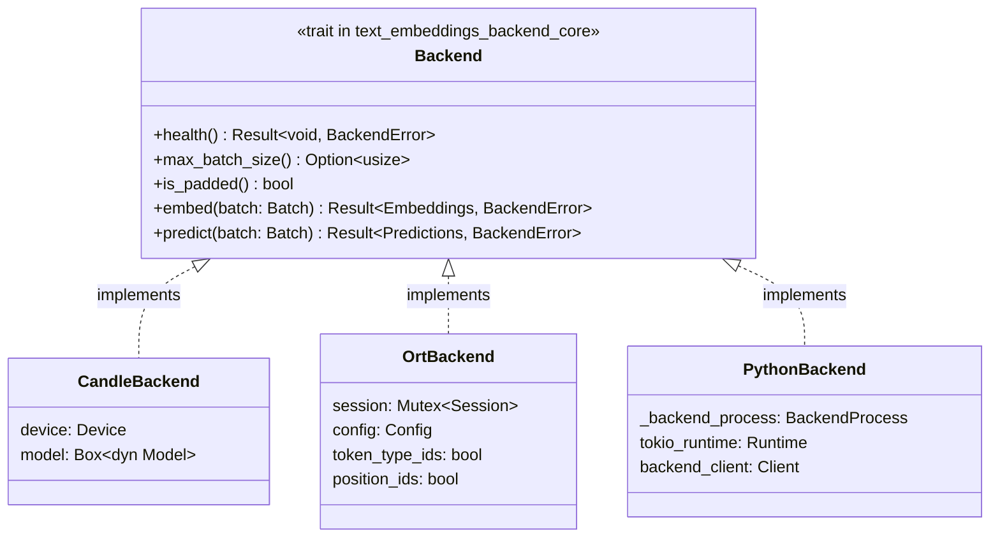
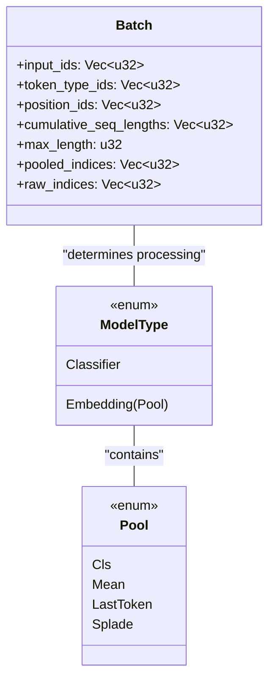
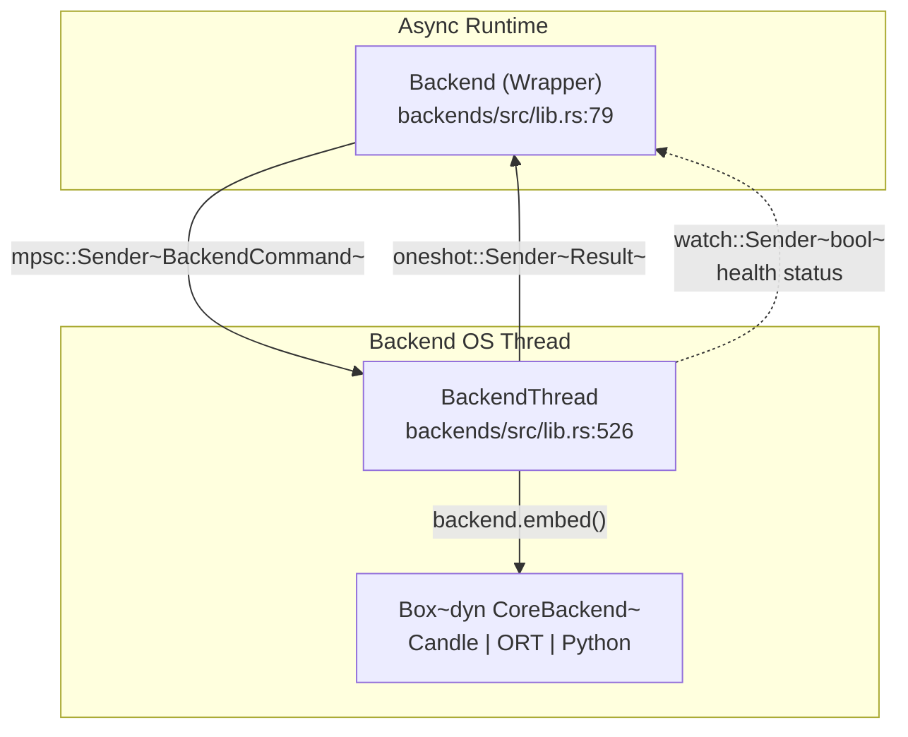

<!-- source: DeepWiki mcp.deepwiki.com · repo huggingface/text-embeddings-inference · page 4 Backend System · fetched 2026-10-26 -->

# Backend System

Relevant source files

The following files were used as context for generating this wiki page:

- [backends/core/src/lib.rs](backends/core/src/lib.rs)
- [backends/ort/Cargo.toml](backends/ort/Cargo.toml)
- [backends/ort/src/lib.rs](backends/ort/src/lib.rs)
- [backends/python/src/lib.rs](backends/python/src/lib.rs)
- [backends/src/lib.rs](backends/src/lib.rs)

The Backend System performs model inference for embedding generation and text classification. TEI supports three backend implementations (Candle, ONNX Runtime, and Python) that share a common trait interface, enabling flexible deployment based on hardware, model format, and performance requirements. The backend system handles model loading, weight management, device selection, and inference execution in dedicated threads.

This page provides an overview of the backend architecture. For detailed information on specific topics, see:
- [Backend Architecture and Selection](#4.1) — Backend trait, initialization logic, and cascading selection.
- [Candle Backend](#4.2) — Rust-native ML backend with CUDA/Metal/CPU support.
- [BERT and Flash-Optimized Models](#4.3) — BERT implementations and Flash Attention optimizations.
- [Pooling Strategies](#4.4) — CLS, Mean, LastToken, and Splade pooling implementations.
- [ORT Backend](#4.5) — ONNX Runtime backend for cross-platform execution.
- [Python Backend](#4.6) — PyTorch backend with gRPC communication.
- [Model Implementations](#4.7) — Specific model architectures (Qwen3, Mistral, GTE, etc.).

## Backend Trait Interface

All backend implementations in TEI implement the `Backend` trait from `text_embeddings_backend_core`, which defines a uniform interface for model inference:

**Backend Trait Core Methods**

**Sources:** [backends/core/src/lib.rs:37-48](), [backends/ort/src/lib.rs:61-73](), [backends/python/src/lib.rs:12-16]()

The trait defines methods that enable uniform interaction:

| Method | Purpose | Return Type |
|--------|---------|-------------|
| `health()` | Backend health check | `Result<(), BackendError>` |
| `max_batch_size()` | Maximum supported batch size | `Option<usize>` |
| `is_padded()` | Whether model requires padding | `bool` |
| `embed(batch)` | Generate embeddings | `Result<Embeddings, BackendError>` |
| `predict(batch)` | Classification inference | `Result<Predictions, BackendError>` |

**Batch Structure**

The `Batch` struct contains tokenized input data passed to backends:

**Sources:** [backends/core/src/lib.rs:9-27](), [backends/core/src/lib.rs:51-70]()

- `input_ids`, `token_type_ids`, `position_ids`: Flattened token arrays for all sequences in batch.
- `cumulative_seq_lengths`: Boundaries between sequences (length = batch_size + 1).
- `max_length`: Maximum sequence length in batch.
- `pooled_indices`, `raw_indices`: Indices used to map output tensors back to specific requests.

## Available Backend Implementations

### Candle Backend

Rust-native ML backend using the Candle library. It is the preferred backend for performance and native integration.

**Key Features:**
- **Device Support**: CUDA, Metal, or CPU.
- **Flash Attention**: Optimized attention implementations for modern GPUs.
- **No Python Dependency**: Entirely written in Rust for low-overhead execution.

For details, see [Candle Backend](#4.2).

### ONNX Runtime (ORT) Backend

Uses Microsoft's ONNX Runtime for model execution.

**Key Features:**
- **Compatibility**: Supports models exported to ONNX format.
- **Session Management**: Uses `ort::Session` with configurable threading via `num_cpus`. [backends/ort/src/lib.rs:128-135]()
- **Input Preparation**: Handles `token_type_ids`, `position_ids`, and `past_key_values` dynamically based on model session inputs. [backends/ort/src/lib.rs:137-158]()

For details, see [ORT Backend](#4.5).

### Python Backend

PyTorch-based backend running in a separate process, communicating via gRPC.

**Key Features:**
- **Fallback Support**: Used when models are not yet supported in Candle or ORT.
- **Process Management**: Spawns a `BackendProcess` and connects via Unix Domain Sockets (UDS). [backends/python/src/lib.rs:32-49]()
- **Limitations**: Does not support raw embeddings (only pooled). [backends/python/src/lib.rs:76-80]()

For details, see [Python Backend](#4.6).

## Backend Thread Architecture

The `Backend` struct manages a background OS thread (`BackendThread`) to ensure that blocking inference operations do not stall the async router.

**Thread and Channel Architecture**

**Sources:** [backends/src/lib.rs:79-130](), [backends/src/lib.rs:526-561]()

**Communication Protocol:**
- **BackendCommand**: Enum containing `Health`, `Embed`, and `Predict` variants. Each command carries a `Span` for tracing and a `oneshot` channel for the response. [backends/src/lib.rs:569-582]()
- **Timing**: The thread records the exact duration of the inference call using `Instant::now()`. [backends/src/lib.rs:541-557]()

## Model Types and Pooling

TEI supports different model types which dictate how output tensors are processed.

| Model Type | Primary Operation | Default Pooling |
|------------|-------------------|-----------------|
| `Classifier` | `predict()` | `Pool::Cls` |
| `Embedding` | `embed()` | Configurable (Mean, Cls, etc.) |

**Sources:** [backends/core/src/lib.rs:51-54](), [backends/ort/src/lib.rs:87-97]()

**Pooling Strategies**:
- `Cls`: Uses the first token's embedding.
- `Mean`: Averages all token embeddings.
- `LastToken`: Uses the final token (common in decoder-only models).
- `Splade`: Sparse Lexical and Expansion for sparse embeddings.

For details, see [Pooling Strategies](#4.4).

## Hardware Optimization and Warmup

Backends include specialized logic for hardware platforms, particularly for Intel HPUs and AMD ROCm.

**HPU Warmup Logic**:
The system performs a series of inference passes with various batch sizes and sequence lengths to "warm up" the HPU graphs. It uses `powers_of_two` for batch sizes and `generate_bucket_sizes` for sequence lengths. [backends/src/lib.rs:133-190]()

**Detection Helpers**:
- `is_hpu()`: Checks for `hl-smi`. [backends/src/lib.rs:61-69]()
- `is_rocm()`: Checks for `rocm-smi`. [backends/src/lib.rs:71-76]()

For details, see [Hardware Optimization](#5).

---

