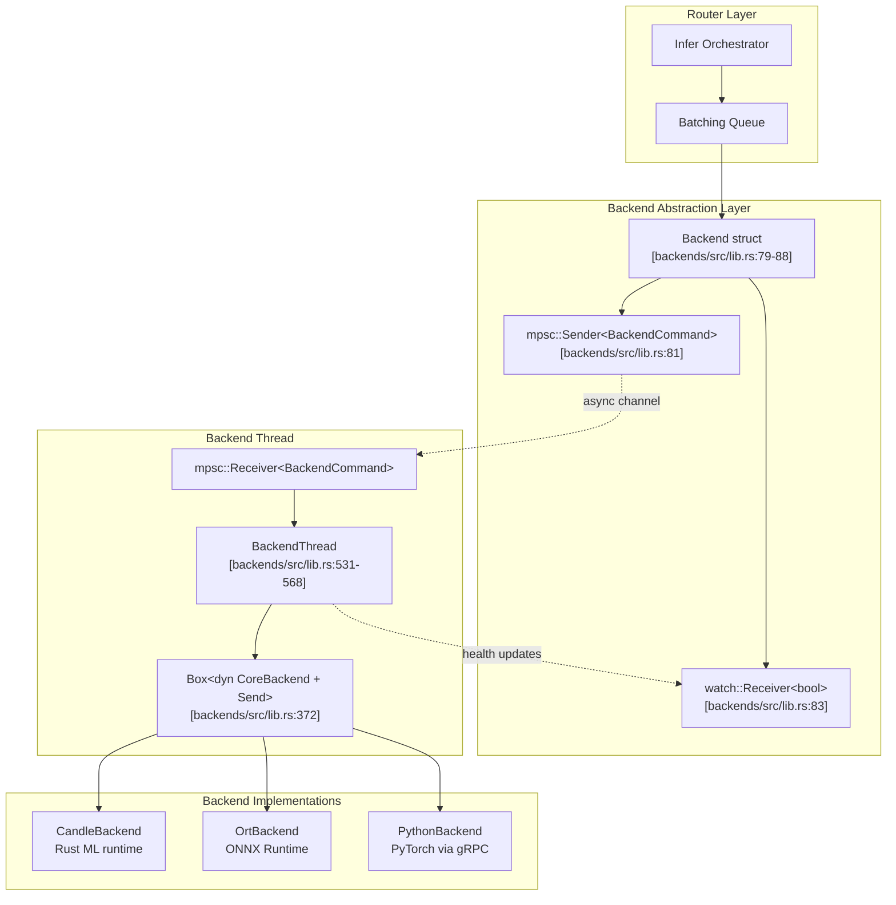
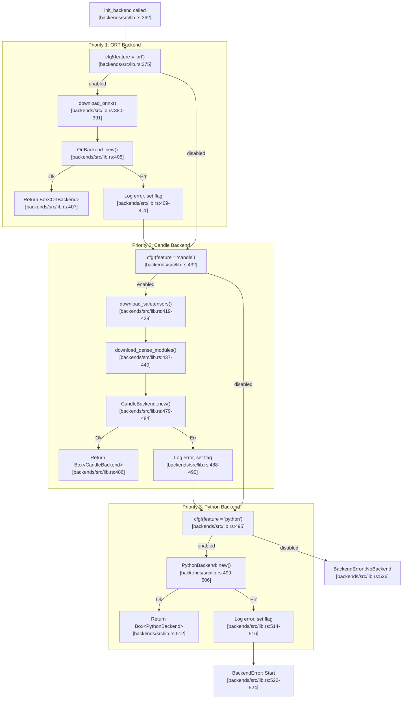
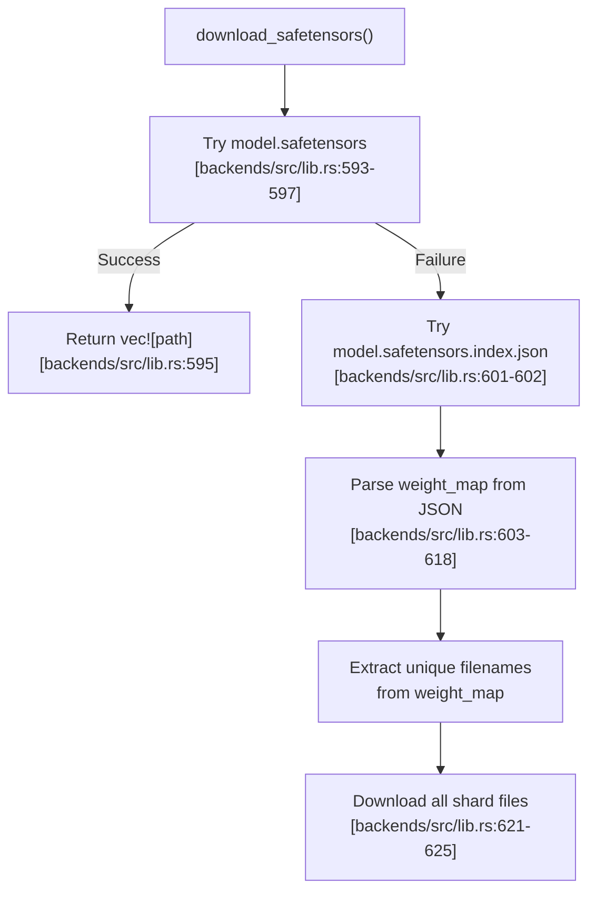
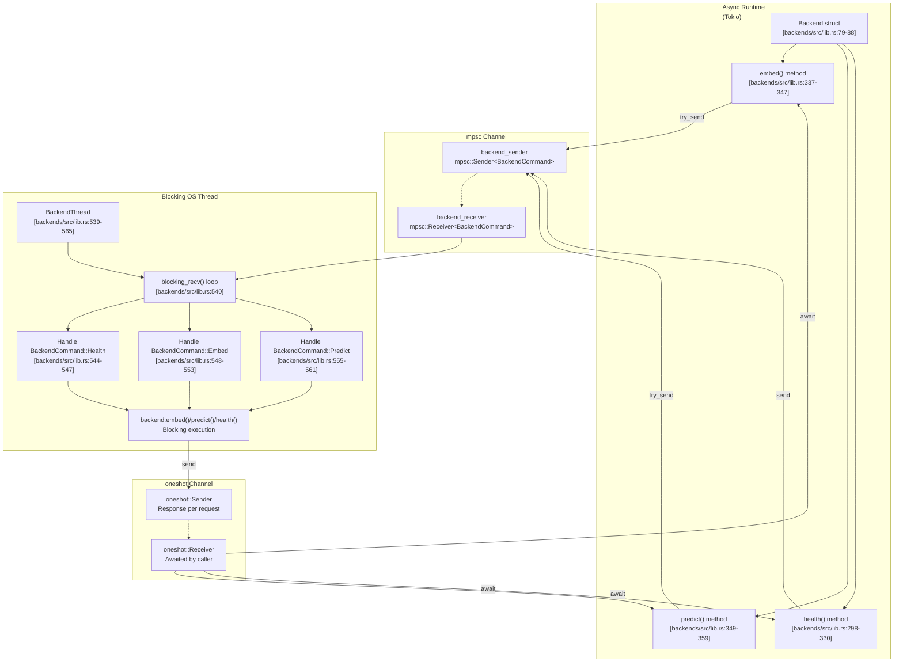
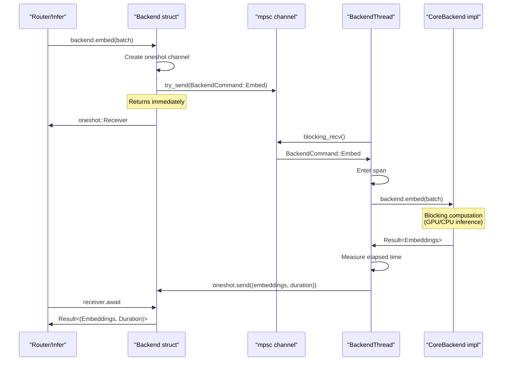

<!-- source: DeepWiki mcp.deepwiki.com · repo huggingface/text-embeddings-inference · page 4.1 Backend Architecture and Selection · fetched 2026-10-26 -->

# Backend Architecture and Selection

<details>
<summary>Relevant source files</summary>

The following files were used as context for generating this wiki page:

- [backends/core/Cargo.toml](backends/core/Cargo.toml)
- [backends/core/src/lib.rs](backends/core/src/lib.rs)
- [backends/ort/Cargo.toml](backends/ort/Cargo.toml)
- [backends/ort/src/lib.rs](backends/ort/src/lib.rs)
- [backends/python/src/lib.rs](backends/python/src/lib.rs)
- [backends/src/lib.rs](backends/src/lib.rs)

</details>


## Purpose and Scope

This document describes the backend architecture layer that abstracts model inference across different execution runtimes (ONNX Runtime, Candle, PyTorch). It covers the backend selection mechanism, thread architecture, and communication protocol between the router and backend implementations.

For details on specific backend implementations, see:
- Candle backend and device detection: [4.2]()
- ORT (ONNX Runtime) backend: [4.5]() 
- Python backend: [4.6]()
- Model-specific implementations: [4.7]()

For request processing and batching that occurs before backend invocation, see [3.4]().

## Architecture Overview

The backend system uses a trait-based abstraction to support multiple inference runtimes. The `Backend` struct in [backends/src/lib.rs:79-88]() provides a unified interface that wraps different backend implementations (`CandleBackend`, `OrtBackend`, `PythonBackend`) behind a common `CoreBackend` trait.



**Sources:** [backends/src/lib.rs:79-130](), [backends/src/lib.rs:531-568]()

## Backend Trait Interface

All backends implement the `CoreBackend` trait from `text_embeddings_backend_core`, which defines three core operations:

| Method | Purpose | Returns |
|--------|---------|---------|
| `health()` | Verify backend is operational | `Result<(), BackendError>` |
| `embed()` | Generate embeddings from batch | `Result<Embeddings, BackendError>` |
| `predict()` | Perform classification/reranking | `Result<Predictions, BackendError>` |

Additional trait methods control backend behavior:

| Method | Purpose | Example Values |
|--------|---------|----------------|
| `is_padded()` | Whether backend requires padded inputs | ORT: `true` [backends/ort/src/lib.rs:398-400](), Candle: varies |
| `max_batch_size()` | Optional batch size limit | ORT: `Some(8)` [backends/ort/src/lib.rs:390-392]() |

**Sources:** [backends/core/src/lib.rs:37-48](), [backends/ort/src/lib.rs:389-400]()

## Cascading Backend Selection

The `init_backend` function in [backends/src/lib.rs:362-528]() implements a three-tier fallback mechanism that attempts to initialize backends in priority order:



### Selection Logic Details

The backend selection follows these rules:

1. **ORT Backend** ([backends/src/lib.rs:375-414]()):
   - Requires `model.onnx` or `onnx/model.onnx` files [backends/ort/src/lib.rs:99-105]()
   - Downloads `model.onnx` and optionally `model.onnx_data` [backends/src/lib.rs:630-663]()
   - Also downloads `tokenizer_config.json` for padding side configuration [backends/ort/src/lib.rs:114-126]()
   - Only supports `float32` dtype [backends/ort/src/lib.rs:81-85]()
   - Splade pooling not supported [backends/ort/src/lib.rs:90-94]()

2. **Candle Backend** ([backends/src/lib.rs:432-493]()):
   - Requires `model.safetensors` or `pytorch_model.bin` weights
   - Falls back to `pytorch_model.bin` if safetensors not found [backends/src/lib.rs:419-429]()
   - Optionally downloads Dense modules from Sentence Transformers [backends/src/lib.rs:435-477]()
   - Supports multiple dtypes and devices (CUDA, Metal, CPU, HPU)

3. **Python Backend** ([backends/src/lib.rs:495-519]()):
   - Last resort fallback
   - Spawns in separate process via `management::BackendProcess` [backends/python/src/lib.rs:32-39]()
   - Uses PyTorch with gRPC communication [backends/python/src/lib.rs:15]()

4. **Error Handling**:
   - If all backends fail and at least one was attempted: `BackendError::Start` [backends/src/lib.rs:521-524]()
   - If no backends are compiled in: `BackendError::NoBackend` [backends/src/lib.rs:526]()

**Sources:** [backends/src/lib.rs:362-528](), [backends/ort/src/lib.rs:81-126](), [backends/python/src/lib.rs:12-56]()

## Model File Download and Resolution

### Safetensors Download Strategy

The `download_safetensors` function in [backends/src/lib.rs:591-628]() handles both single-file and sharded weight formats:



**Sources:** [backends/src/lib.rs:591-628]()

### ONNX Model Download

The `download_onnx` function in [backends/src/lib.rs:630-663]() attempts multiple paths for ONNX files:

| Priority | File Path | Data File |
|----------|-----------|-----------|
| 1 | `model.onnx` | `model.onnx_data` |
| 2 | `onnx/model.onnx` | `onnx/model.onnx_data` |

If ONNX files are not found, initialization fails with a logged error suggesting export scripts [backends/src/lib.rs:385]().

**Sources:** [backends/src/lib.rs:630-663]()

### Dense Module Handling

For Sentence Transformers models with Dense projection layers, the system downloads additional modules via `download_dense_modules` in [backends/src/lib.rs:712-786]():

1. Downloads `modules.json` configuration [backends/src/lib.rs:719-722]()
2. Parses Dense module definitions [backends/src/lib.rs:697-709]()
3. For each Dense module, downloads:
   - `{module_path}/config.json` [backends/src/lib.rs:743-745]()
   - `{module_path}/model.safetensors` (preferred) [backends/src/lib.rs:749-751]()
   - `{module_path}/pytorch_model.bin` (fallback) [backends/src/lib.rs:757-759]()

**Sources:** [backends/src/lib.rs:712-813](), [backends/src/lib.rs:665-709]()

## Backend Thread Architecture

The backend runs in a dedicated OS thread to prevent blocking the async runtime, using a command-based communication pattern.



### Thread Creation and Management

The `BackendThread` wrapper [backends/src/lib.rs:531-573]() manages the blocking thread lifecycle:

1. **Initialization** ([backends/src/lib.rs:534-568]()):
   - Spawns OS thread with `std::thread::spawn`
   - Thread runs blocking receive loop
   - Takes ownership of backend and receiver

2. **Command Processing** ([backends/src/lib.rs:540-565]()):
   - Blocks on `backend_receiver.blocking_recv()`
   - Measures execution time per command
   - Tracks health status and updates watch channel
   - Sends responses via oneshot channels

3. **Cleanup** ([backends/src/lib.rs:570-573]()):
   - `Drop` implementation joins thread
   - Ensures graceful shutdown when `Backend` is dropped

**Sources:** [backends/src/lib.rs:531-573]()

## Communication Protocol

### BackendCommand Enum

The `BackendCommand` enum in [backends/src/lib.rs:576-589]() defines all operations the backend thread can perform:

```rust
enum BackendCommand {
    Health(Span, oneshot::Sender<Result<(), BackendError>>),
    Embed(Batch, Span, oneshot::Sender<Result<(Embeddings, Duration), BackendError>>),
    Predict(Batch, Span, oneshot::Sender<Result<(Predictions, Duration), BackendError>>),
}
```

### Request-Response Flow



**Sources:** [backends/src/lib.rs:337-359](), [backends/src/lib.rs:548-561]()

### Health Monitoring System

The backend maintains health state via a `watch` channel [backends/src/lib.rs:83]() updated after each operation [backends/src/lib.rs:563]():

| Health State | Trigger | Health Check Behavior |
|--------------|---------|----------------------|
| `true` | Any successful operation | Basic check via `backend.health()` [backends/src/lib.rs:299-311]() |
| `false` | Startup or any failure | Full check with test batch inference [backends/src/lib.rs:312-329]() |

**Sources:** [backends/src/lib.rs:298-335](), [backends/src/lib.rs:118-120](), [backends/src/lib.rs:543-563]()

## Warmup System

The `Backend::warmup` method pre-compiles model graphs for expected input shapes.

### HPU Warmup Strategy

For Habana Gaudi HPUs, `warmup_hpu` in [backends/src/lib.rs:133-190]() generates shape combinations using `generate_bucket_sizes` [backends/src/lib.rs:46-59]():

- Batch sizes: Generated as powers of two up to `MAX_WARMUP_BATCH_SIZE` [backends/src/lib.rs:149-154]().
- Sequence lengths: Generated based on `PAD_SEQUENCE_TO_MULTIPLE_OF` and `SEQ_LEN_EXPONENT_BASE` [backends/src/lib.rs:167-173]().
- Inference is performed for every combination of batch size and sequence length [backends/src/lib.rs:181-188]().

**Sources:** [backends/src/lib.rs:133-190](), [backends/src/lib.rs:34-59]()

### Standard Warmup

For non-HPU/ROCm devices, `warmup` in [backends/src/lib.rs:237-296]() creates a single large batch based on `max_batch_tokens` and `max_input_length` to initialize memory and compute kernels.

**Sources:** [backends/src/lib.rs:237-296]()

## Backend Implementation Comparison

| Feature | ORT | Candle | Python |
|---------|-----|--------|--------|
| **Model Format** | ONNX | Safetensors/PyTorch | Safetensors/PyTorch |
| **Dtype Support** | float32 only [backends/ort/src/lib.rs:81-85]() | Multiple | Multiple |
| **Devices** | CPU (OneDNN) | CPU, CUDA, Metal, HPU | CPU, CUDA |
| **Padding Required** | Yes [backends/ort/src/lib.rs:398-400]() | Varies by model | No [backends/python/src/lib.rs:71-73]() |
| **Max Batch Size** | 8 [backends/ort/src/lib.rs:390-392]() | None | None |

**Sources:** [backends/ort/src/lib.rs:76-170](), [backends/python/src/lib.rs:59-132](), [backends/src/lib.rs:375-512]()

---

