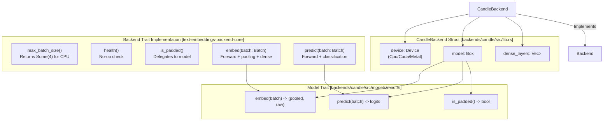
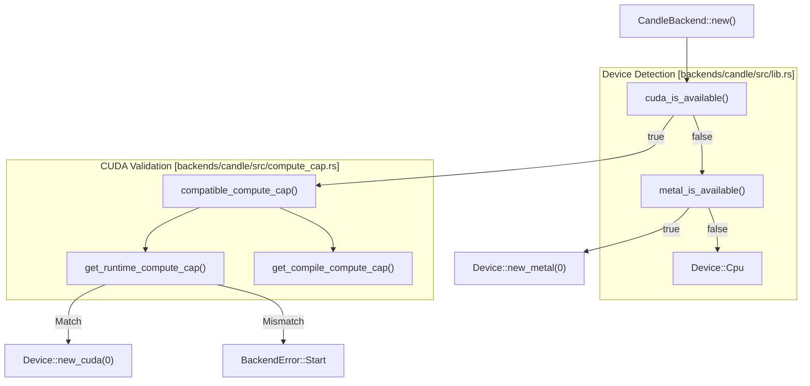
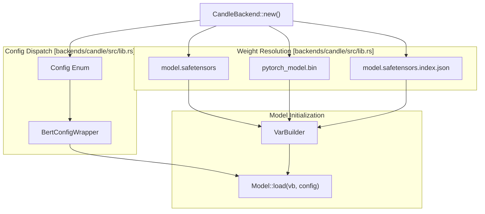

<!-- source: DeepWiki mcp.deepwiki.com · repo huggingface/text-embeddings-inference · page 4.2 Candle Backend · fetched 2026-10-26 -->

# Candle Backend

Relevant source files

The following files were used as context for generating this wiki page:

- [backends/candle/build.rs](backends/candle/build.rs)
- [backends/candle/src/lib.rs](backends/candle/src/lib.rs)
- [backends/candle/src/models/mod.rs](backends/candle/src/models/mod.rs)

The Candle Backend is a Rust-native machine learning inference engine that provides hardware-accelerated model execution for embedding and classification tasks. It serves as the primary high-performance backend option, supporting CUDA GPUs, Apple Metal, and CPU devices with architecture-specific optimizations.

## Purpose and Scope

The Candle Backend leverages the [Candle](https://github.com/huggingface/candle) ML framework to execute transformer models directly in Rust without Python overhead. It provides:

- **Zero-copy model loading** from safetensors files using memory mapping.
- **Device-specific optimizations** with automatic hardware detection.
- **Flash Attention integration** for variable-length sequence processing on CUDA.
- **Multi-model support** for BERT-family, decoder-only (Mistral, Qwen), and specialized architectures (ModernBERT).
- **Optional dense projection layers** for model composition and dimensionality reduction.

This backend is enabled via the `candle` Cargo feature, with additional sub-features for hardware acceleration (`cuda`, `metal`, `mkl`, `accelerate`).

**Sources:** [backends/candle/src/lib.rs:1-30](), [backends/candle/src/models/mod.rs:1-56]()

## Core Architecture

The `CandleBackend` struct serves as the central orchestrator, managing the lifecycle of the device, the model instance, and any post-processing layers.

**Diagram: CandleBackend Architecture and Trait Relationships**

The `CandleBackend` implements the `Backend` trait from `text-embeddings-backend-core`, providing standardized methods for embedding generation and classification. The `Model` trait abstracts the specific forward pass logic for different architectures (BERT, Mistral, etc.).

**Sources:** [backends/candle/src/lib.rs:156-160](), [backends/candle/src/lib.rs:574-661](), [backends/candle/src/models/mod.rs:104-114]()

## Device Selection and Compute Capability

Device selection follows a priority cascade: CUDA (if available and compatible) → Metal (on Apple Silicon) → CPU. For CUDA devices, the backend performs runtime compute capability verification.

**Diagram: Device Selection and CUDA Validation Flow**

When the `cuda` feature is enabled, the backend validates that the runtime GPU's compute capability matches the compile-time target. This check is critical because Flash Attention kernels are compiled for specific compute capabilities (e.g., CC 80 for Ampere). Mismatches result in a `BackendError::Start`.

**Sources:** [backends/candle/src/lib.rs:187-212](), [backends/candle/src/compute_cap.rs:1-35](), [backends/candle/build.rs:10-35]()

## Model Loading via VarBuilder

The loading process uses `VarBuilder` to load weights from disk into the selected device. It supports single safetensors, PyTorch binaries, and sharded weights.

**Diagram: Model Loading and Dispatch Pipeline**

1.  **File Discovery**: The backend checks for `model.safetensors`, `pytorch_model.bin`, or a sharded `model.safetensors.index.json` [backends/candle/src/lib.rs:170-183]().
2.  **Configuration**: `config.json` is deserialized into a `Config` enum which uses `model_type` as a tag [backends/candle/src/lib.rs:125-154]().
3.  **Dispatch**: The `BertConfigWrapper` handles Jina-specific BERT variants by checking `_name_or_path` or `auto_map` fields [backends/candle/src/lib.rs:73-122]().
4.  **Instantiation**: Based on the `Config` variant and `use_flash_attn()` check, the specific model (e.g., `FlashBertModel` or `BertModel`) is initialized [backends/candle/src/lib.rs:308-511]().

**Sources:** [backends/candle/src/lib.rs:162-230](), [backends/candle/src/lib.rs:308-511]()

## Supported Model Architectures

The Candle backend implements a wide range of architectures, often providing both a standard variant (CPU/Metal/CUDA) and a Flash-optimized variant (CUDA FP16).

| Architecture | Config Variant | Standard Implementation | Flash Implementation (CUDA) |
| :--- | :--- | :--- | :--- |
| **BERT** | `Bert` | `BertModel` | `FlashBertModel` |
| **DistilBERT** | `DistilBert` | `DistilBertModel` | `FlashDistilBertModel` |
| **Mistral** | `Mistral` | N/A (CUDA only) | `FlashMistralModel` |
| **ModernBERT** | `ModernBert` | `ModernBertModel` | `FlashModernBertModel` |
| **Qwen3** | `Qwen3` | `Qwen3Model` | `FlashQwen3Model` |
| **Gemma3** | `Gemma3` | `Gemma3Model` | N/A |
| **Jina BERT** | `Bert` (Jina) | `JinaBertModel` | `FlashJinaBertModel` |

**Sources:** [backends/candle/src/lib.rs:24-36](), [backends/candle/src/lib.rs:126-154](), [backends/candle/src/models/mod.rs:57-102]()

## Embedding Pipeline

The `embed` function handles the end-to-end flow from input `Batch` to final `Embeddings`.

1.  **Model Inference**: Calls `self.model.embed(batch)`, which returns pooled and/or raw token embeddings [backends/candle/src/lib.rs:598]().
2.  **Dense Post-processing**: If `dense_layers` are present, they are applied sequentially to the pooled embeddings [backends/candle/src/lib.rs:606-615]().
3.  **DType Conversion**: Embeddings are converted to `F32` and moved to CPU [backends/candle/src/lib.rs:617-619]().
4.  **Result Mapping**: The results are mapped back to the original request indices using `pooled_indices` and `raw_indices` from the batch [backends/candle/src/lib.rs:621-643]().

### Dense Layers
Dense layers (projections) can be loaded from subdirectories specified in `dense_paths`. Each layer requires its own `config.json` and weights [backends/candle/src/lib.rs:514-564]().

**Sources:** [backends/candle/src/lib.rs:591-644](), [backends/candle/src/models/dense.rs:59-102]()

## Flash Attention Logic
The `use_flash_attn` helper determines if Flash Attention should be enabled based on:
- The `cuda` feature flag [backends/candle/src/lib.rs:51]().
- The `USE_FLASH_ATTENTION` environment variable [backends/candle/src/lib.rs:53]().
- Runtime compute capability (requires CC >= 80 for V2) [backends/candle/src/lib.rs:63]().
- Supported versions (V1 or V2) by the specific model architecture [backends/candle/src/lib.rs:60-65]().

**Sources:** [backends/candle/src/lib.rs:39-68]()

---

