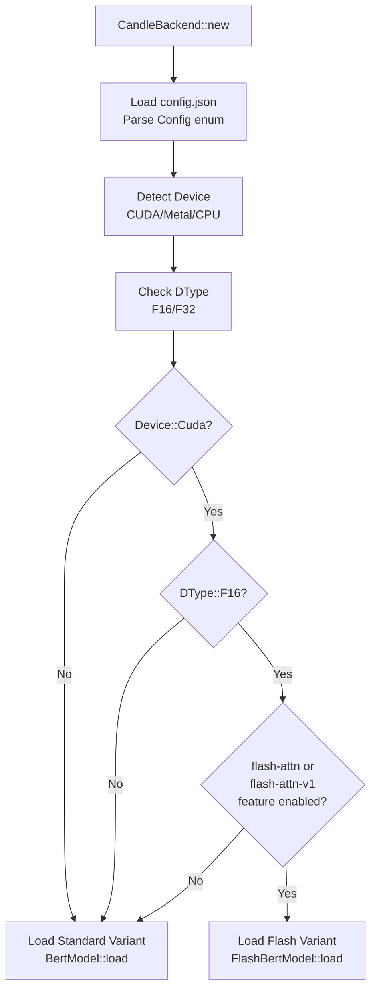
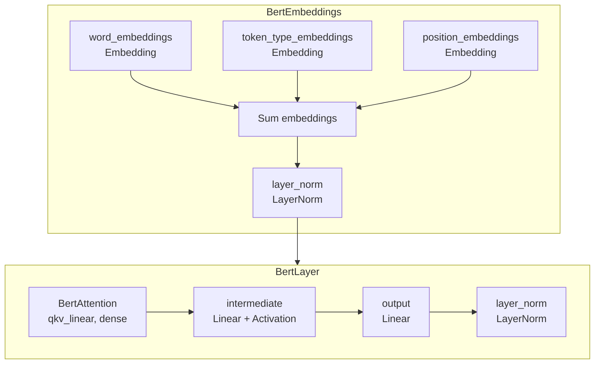
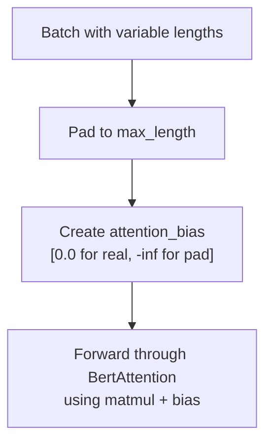
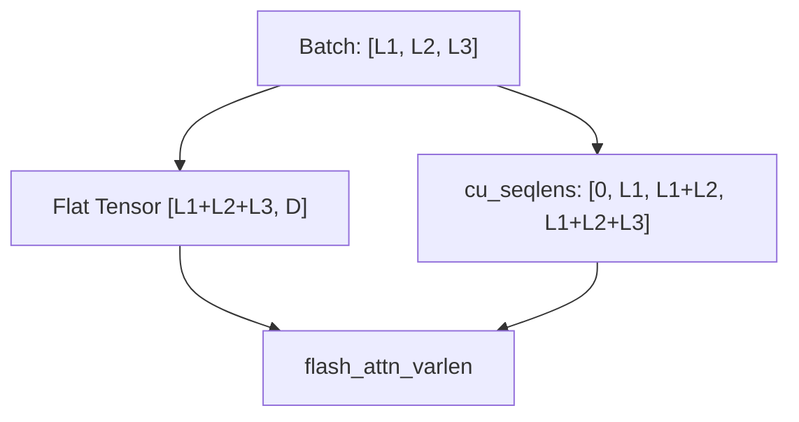

<!-- source: DeepWiki mcp.deepwiki.com · repo huggingface/text-embeddings-inference · page 4.3 BERT and Flash-Optimized Models · fetched 2026-10-26 -->

# BERT and Flash-Optimized Models

<details>
<summary>Relevant source files</summary>

The following files were used as context for generating this wiki page:

- [backends/candle/src/models/bert.rs](backends/candle/src/models/bert.rs)
- [backends/candle/src/models/distilbert.rs](backends/candle/src/models/distilbert.rs)
- [backends/candle/src/models/flash_bert.rs](backends/candle/src/models/flash_bert.rs)
- [backends/candle/src/models/flash_distilbert.rs](backends/candle/src/models/flash_distilbert.rs)
- [backends/candle/src/models/flash_jina.rs](backends/candle/src/models/flash_jina.rs)
- [backends/candle/src/models/flash_jina_code.rs](backends/candle/src/models/flash_jina_code.rs)
- [backends/candle/src/models/flash_nomic.rs](backends/candle/src/models/flash_nomic.rs)
- [backends/candle/src/models/jina.rs](backends/candle/src/models/jina.rs)
- [backends/candle/src/models/jina_code.rs](backends/candle/src/models/jina_code.rs)
- [backends/candle/src/models/nomic.rs](backends/candle/src/models/nomic.rs)

</details>


## Purpose and Scope

This document covers the BERT model implementations within the Candle backend, including both standard and Flash-Attention optimized variants. These implementations handle encoder-based transformer models including BERT, RoBERTa, CamemBERT, XLM-RoBERTa, DistilBERT, Nomic BERT, and specialized variants like Jina BERT.

For information about backend selection and device-specific optimizations, see [Backend Architecture and Selection](#4.1). For pooling strategy details, see [Pooling Strategies](#4.4). For other model architectures like Mistral and Qwen, see [Model Implementations](#4.7).

**Sources:** [backends/candle/src/models/bert.rs:1-956](), [backends/candle/src/models/flash_bert.rs:1-550](), [backends/candle/src/models/flash_nomic.rs:1-350]()

---

## Model Variants and Selection

### Supported BERT Variants

The Candle backend supports multiple BERT-based architectures through a unified configuration system:

| Model Type | Config Struct | Standard Implementation | Flash Implementation |
|------------|-------------|------------------------|---------------------|
| BERT / RoBERTa | `BertConfig` | `BertModel` | `FlashBertModel` |
| DistilBERT | `DistilBertConfig` | `DistilBertModel` | `FlashDistilBertModel` |
| Jina BERT | `BertConfig` | `JinaBertModel` | `FlashJinaBertModel` |
| Jina Code BERT | `BertConfig` | `JinaCodeBertModel` | `FlashJinaCodeBertModel` |
| Nomic BERT | `NomicConfig` | `NomicBertModel` | `FlashNomicBertModel` |

**Sources:** [backends/candle/src/models/bert.rs:11-30](), [backends/candle/src/models/distilbert.rs:10-22](), [backends/candle/src/models/nomic.rs:12-40](), [backends/candle/src/models/flash_jina.rs:217-234]()

### Model Selection Logic

The system selects between standard and Flash-optimized implementations based on runtime conditions. Flash variants are prioritized on CUDA hardware with FP16 precision.



**Diagram: BERT Model Selection Decision Tree**

**Sources:** [backends/candle/src/models/flash_bert.rs:231-238](), [backends/candle/src/models/flash_distilbert.rs:189-196](), [backends/candle/src/models/flash_nomic.rs:212-219]()

---

## Architecture Components

### Common Components

BERT models in TEI follow a standard modular structure.



**Diagram: Shared BERT Architecture Components**

**Sources:** [backends/candle/src/models/bert.rs:42-102](), [backends/candle/src/models/bert.rs:266-333]()

### QKV Linear Fusion

Both standard and Flash implementations fuse the Query, Key, and Value linear projections into a single `qkv_linear` operation to reduce kernel launches.

```rust
// From backends/candle/src/models/bert.rs:138-141
let qkv_weight = Tensor::cat(&[&query_weight, &key_weight, &value_weight], 0)?;
let qkv_bias = Tensor::cat(&[&query_bias, &key_bias, &value_bias], 0)?;
let qkv_linear = Linear::new(qkv_weight, Some(qkv_bias), None);
```

**Sources:** [backends/candle/src/models/bert.rs:123-141](), [backends/candle/src/models/flash_bert.rs:30-46]()

---

## Standard BERT Implementation

### Padded Batch Processing

The standard `BertModel` uses padded batching where sequences are padded to the maximum length in the batch. It creates an `attention_bias` to mask padding tokens.



**Diagram: Padded Batch Processing Flow**

**Sources:** [backends/candle/src/models/bert.rs:706-812](), [backends/candle/src/models/bert.rs:170-263]()

### cuBLASLt-Accelerated Path

On CUDA, the standard implementation uses `cublaslt.batch_matmul` to fuse the scaling and attention bias addition.

```rust
// From backends/candle/src/models/bert.rs:184-192
let attention_scores = cublaslt.batch_matmul(
    &key_layer,
    &query_layer,
    attention_bias.as_ref(),
    Some(self.softmax_scale as f32),
    beta,
    None,
    None,
)?;
```

**Sources:** [backends/candle/src/models/bert.rs:190-244]()

---

## Flash BERT Implementation

### Variable-Length Batching

`FlashBertModel` uses unpadded batching, concatenating sequences into a single flat tensor. It tracks sequence boundaries using `cu_seqlens` (cumulative sequence lengths).



**Diagram: Variable-Length Batch Processing**

**Sources:** [backends/candle/src/models/flash_bert.rs:369-392](), [backends/candle/src/flash_attn.rs:1-120]()

### Flash Attention Call

The core of the Flash variants is the `flash_attn_varlen` function, which avoids materializing the $O(N^2)$ attention matrix.

```rust
// From backends/candle/src/models/flash_bert.rs:95-108
let attention = flash_attn_varlen(
    &qkv[0], &qkv[1], &qkv[2],
    None, cu_seqlens, cu_seqlens,
    max_s, max_s,
    self.softmax_scale, false,
    None, None,
)?;
```

**Sources:** [backends/candle/src/models/flash_bert.rs:95-108](), [backends/candle/src/models/flash_jina.rs:97-110]()

---

## Specialized Models

### Nomic BERT and Rotary Embeddings

Nomic BERT (`FlashNomicBertModel`) utilizes Rotary Positional Embeddings (RoPE) instead of absolute position embeddings. It maintains a `rotary_cache` for performance.

```rust
// From backends/candle/src/models/flash_nomic.rs:81
apply_rotary_inplace(&qkv[0], &qkv[1], &cos, &sin, true)?;
```

**Sources:** [backends/candle/src/models/flash_nomic.rs:72-100](), [backends/candle/src/models/nomic.rs:57-95]()

### Jina BERT Variants

Jina BERT models include architectural modifications such as gated MLPs and ALiBI (Attention with Linear Biases).

- **JinaBertModel**: Uses ALiBI slopes passed to `flash_attn_varlen`.
- **JinaCodeBertModel**: Implements `layer_norm_q` and `layer_norm_k` (Query/Key normalization) within the attention block.

**Sources:** [backends/candle/src/models/flash_jina.rs:120-189](), [backends/candle/src/models/flash_jina_code.rs:11-156]()

### DistilBERT

DistilBERT is a smaller, faster variant. The `FlashDistilBertModel` supports variable-length batching and `Pool::Splade` for sparse embeddings.

**Sources:** [backends/candle/src/models/distilbert.rs:25-62](), [backends/candle/src/models/flash_distilbert.rs:176-185]()

---

## Model Trait Implementation

All BERT variants implement the `Model` trait, allowing the backend to interact with them uniformly.

| Function | `BertModel` (Standard) | `FlashBertModel` |
|----------|------------------------|------------------|
| `is_padded()` | `true` | `false` |
| `embed()` | Uses padded pooling | Uses `cu_seqlens` pooling |
| `predict()` | Padded classification | Unpadded classification |

**Sources:** [backends/candle/src/models/bert.rs:935-955](), [backends/candle/src/models/flash_bert.rs:529-549]()

---

