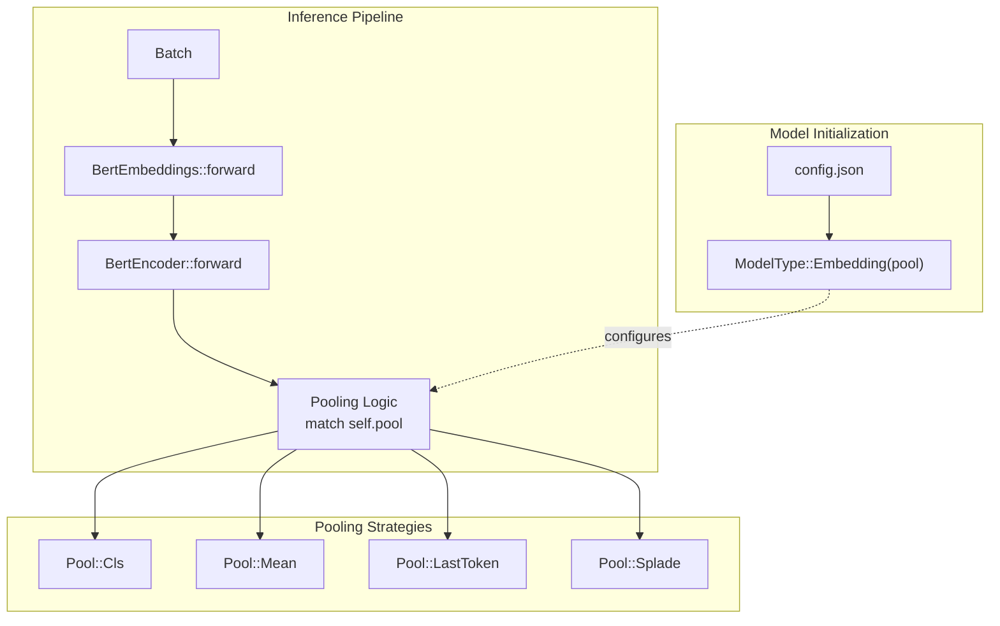
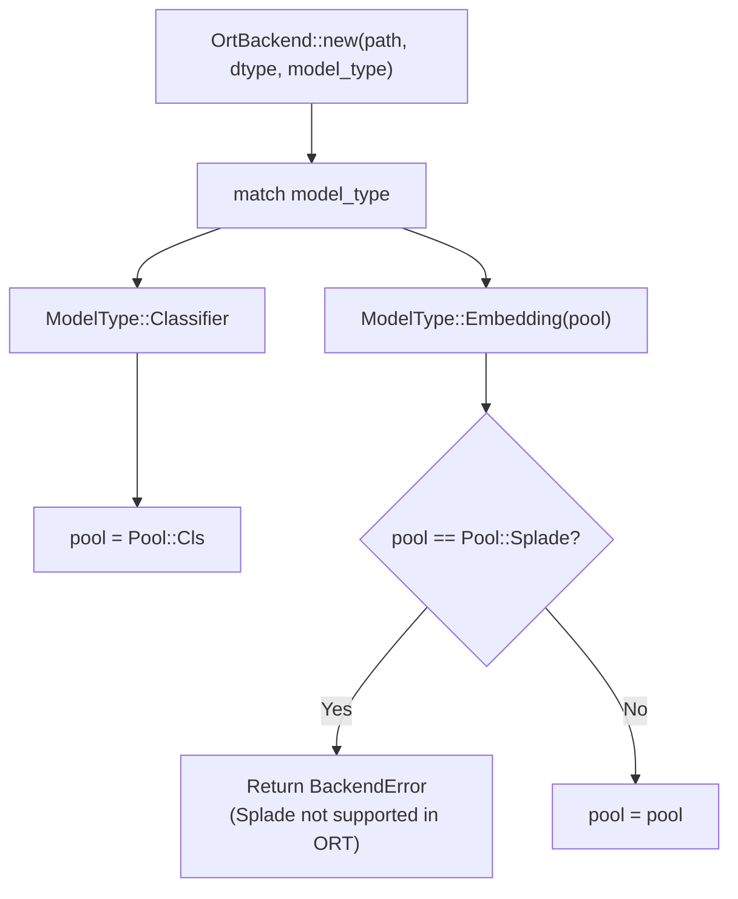
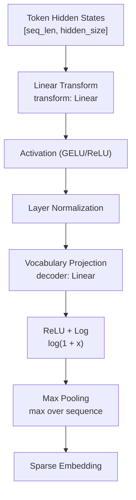
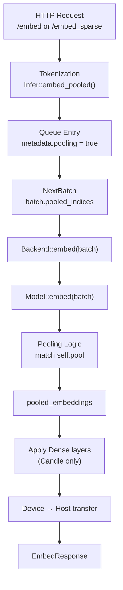

<!-- source: DeepWiki mcp.deepwiki.com · repo huggingface/text-embeddings-inference · page 4.4 Pooling Strategies · fetched 2026-10-26 -->

# Pooling Strategies

Relevant source files

The following files were used as context for generating this wiki page:

- [backends/candle/src/lib.rs](backends/candle/src/lib.rs)
- [backends/candle/src/models/dense.rs](backends/candle/src/models/dense.rs)
- [backends/candle/src/models/mod.rs](backends/candle/src/models/mod.rs)
- [backends/ort/Cargo.toml](backends/ort/Cargo.toml)
- [backends/ort/src/lib.rs](backends/ort/src/lib.rs)
- [backends/src/lib.rs](backends/src/lib.rs)

## Purpose and Scope

This page documents the pooling strategies implemented in the Text Embeddings Inference (TEI) backends for converting variable-length token-level embeddings into fixed-size vector representations. Pooling is the final step in the embedding pipeline that aggregates token embeddings from transformer models into a single embedding vector suitable for downstream tasks like semantic search and similarity comparison.

This document covers the pooling strategies supported by TEI (CLS, Mean, LastToken, and Splade), their implementations in both the Candle and ORT backends, and how they are selected based on model configuration.

---

## Pooling Overview

### What is Pooling?

Transformer-based embedding models output a sequence of token-level embeddings with shape `[batch_size, sequence_length, hidden_size]`. Pooling strategies reduce this sequence dimension to produce a single fixed-size embedding of shape `[batch_size, hidden_size]` that represents the entire input text.

**Sources**: [backends/candle/src/models/bert.rs:636-752](), [backends/ort/src/lib.rs:260-310]()

### When Pooling Occurs

Pooling is applied during the `embed` method of model implementations, after the transformer encoder produces token-level hidden states. The choice of pooling strategy is determined at model initialization time based on the `ModelType` enum.

**Sources**: [backends/candle/src/models/bert.rs:576-597](), [backends/ort/src/lib.rs:87-97](), [backends/candle/src/lib.rs:591-644]()

---

## Pool Enum and Selection

### Pool Type Definition

The `Pool` enum in `text_embeddings_backend_core` defines the available pooling strategies:

| Pool Type | Description | Use Case |
|-----------|-------------|----------|
| `Pool::Cls` | Uses [CLS] token embedding | BERT-style models, classification |
| `Pool::Mean` | Averages all token embeddings | Sentence-BERT models, semantic similarity |
| `Pool::LastToken` | Uses last actual token | Decoder-style models (Mistral, Qwen) |
| `Pool::Splade` | Sparse lexical expansion | Sparse retrieval, keyword extraction |

**Sources**: [backends/src/lib.rs:15-17](), [backends/ort/src/lib.rs:12-14]()

### Pool Selection During Model Loading

The pooling strategy is determined when the model is loaded, based on the `ModelType` parameter passed to the backend constructor. In the ORT backend, SPLADE is explicitly rejected as it requires custom logic only present in Candle.

**Sources**: [backends/ort/src/lib.rs:87-97](), [backends/candle/src/models/bert.rs:576-597]()

---

## CLS Token Pooling

### Overview

CLS pooling extracts the embedding of the first token in the sequence, which is conventionally a special `[CLS]` (classification) token. This token is trained to aggregate sequence-level information during pre-training.

### Implementation Details

For standard BERT models in Candle, CLS pooling selects the first position's hidden state. In ORT, it uses `ndarray` slicing.

**Candle Implementation** (single sequence):
- **Location**: [backends/candle/src/models/bert.rs:669-675]()
- Directly indexes the first token: `outputs.i(0)?.unsqueeze(0)?`

**Candle Flash Implementation** (variable-length batching):
- **Location**: [backends/candle/src/models/flash_bert.rs:398-427]()
- Uses `cu_seqlens` tensor to get CLS positions: `cu_seqlens.narrow(0, 0, batch_size)?`
- Applies index selection: `outputs.index_select(&indices, 0)?`

**ORT Implementation**:
- **Location**: [backends/ort/src/lib.rs:261-267]()
- Slices the first token from the session output: `outputs.slice(s![.., 0, ..])`

**Sources**: [backends/candle/src/models/bert.rs:658-681](), [backends/ort/src/lib.rs:260-267]()

---

## Mean Pooling

### Overview

Mean pooling averages the embeddings of all tokens in the sequence, excluding padding tokens. This strategy is commonly used in sentence-transformer models.

### Implementation Details

In the ORT backend, mean pooling is performed on `ndarray` types after inference, using the `input_lengths` provided in the batch to avoid padding influence.

**ORT Implementation**:
- **Location**: [backends/ort/src/lib.rs:269-286]()
- Iterates through the batch: `for (i, mut output) in outputs.axis_iter_mut(Axis(0)).enumerate()`
- Calculates the mean for the non-padded length: `output.slice(s![..len, ..]).mean_axis(Axis(0))`

**Candle Implementation**:
- **Location**: [backends/candle/src/models/bert.rs:683-717]()
- For single sequences: `outputs.sum_keepdim(1)? / (seq_len as f64)?`
- For batched sequences: Iterates through each sequence using cumulative lengths (`cu_seqlens`), computes mean individually, and concatenates results.

**Sources**: [backends/ort/src/lib.rs:269-286](), [backends/candle/src/models/bert.rs:683-717]()

---

## LastToken Pooling

### Overview

LastToken pooling extracts the embedding of the last actual token in the sequence (before padding). This strategy is standard for decoder-only models like Mistral and Qwen3.

### Implementation Details

**Candle Implementation**:
- **Location**: [backends/candle/src/models/bert.rs:719-738]()
- Computes last position: `cu_seq_lengths[i + 1] - 1`
- For single sequence: Direct indexing `outputs.i(index)?`
- For batched: Index selection with computed indices.

**ORT Implementation**:
- **Location**: [backends/ort/src/lib.rs:288-305]()
- Uses the `input_lengths` to find the correct index for each batch item: `output.index_axis(Axis(0), len - 1)`

**Sources**: [backends/candle/src/models/bert.rs:719-738](), [backends/ort/src/lib.rs:288-305]()

---

## Splade Pooling

### Overview

SPLADE (SParse Lexical AnD Expansion) produces sparse embeddings by applying learned importance weights to vocabulary tokens. It is only supported in the Candle backend.

### Architecture

### Implementation

The `BertSpladeHead` struct implements the SPLADE pooling head by projecting hidden states to the vocabulary size and applying a max-pooling operation over the sequence dimension.

**Location**: [backends/candle/src/models/bert.rs:468-559]()

**Sources**: [backends/candle/src/models/bert.rs:551-558](), [backends/candle/src/models/bert.rs:740-752]()

---

## Pooling in the Request Flow

### Integration with Infer Pipeline

**Sources**: [backends/candle/src/lib.rs:591-644](), [backends/candle/src/models/bert.rs:636-752](), [backends/ort/src/lib.rs:260-310]()

### Dense Layers

The Candle backend supports post-pooling dense layers defined in the `2_Dense` directory of Sentence Transformers models. These layers are applied after the pooling strategy but before returning the final vector.

**Implementation**:
- **Location**: [backends/candle/src/lib.rs:625-628]()
- Iterates through `dense_layers`: `pooled_embeddings = layer.forward(&pooled_embeddings)?`
- Activation functions supported: `Tanh` and `Identity`.

**Sources**: [backends/candle/src/lib.rs:156-160](), [backends/candle/src/models/dense.rs:68-75]()

---

## Implementation Files

### Core Pooling Implementation

| File | Key Components |
|------|----------------|
| [backends/candle/src/models/bert.rs]() | `BertModel` pooling logic (lines 636-752), `BertSpladeHead` (lines 468-559) |
| [backends/ort/src/lib.rs]() | `OrtBackend` pooling logic using `ndarray` (lines 260-310) |
| [backends/candle/src/models/flash_bert.rs]() | `FlashBertModel` variable-length pooling (lines 369-505) |
| [backends/candle/src/models/dense.rs]() | `DenseLayer` implementation for post-pooling transformations |

### Backend Integration

| Component | Purpose |
|-----------|---------|
| [backends/candle/src/lib.rs:591-644]() | `CandleBackend::embed()` - handles pooling dispatch and dense layers |
| [backends/ort/src/lib.rs:218-245]() | `OrtBackend::embed()` - performs inference and calls pooling |
| [backends/src/lib.rs:15-17]() | Re-exports `Pool` enum for backend consistency |

**Sources**: [backends/candle/src/models/bert.rs](), [backends/ort/src/lib.rs](), [backends/candle/src/lib.rs](), [backends/candle/src/models/dense.rs]()

---

