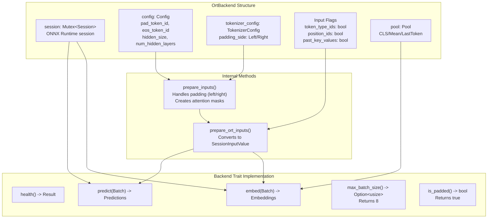
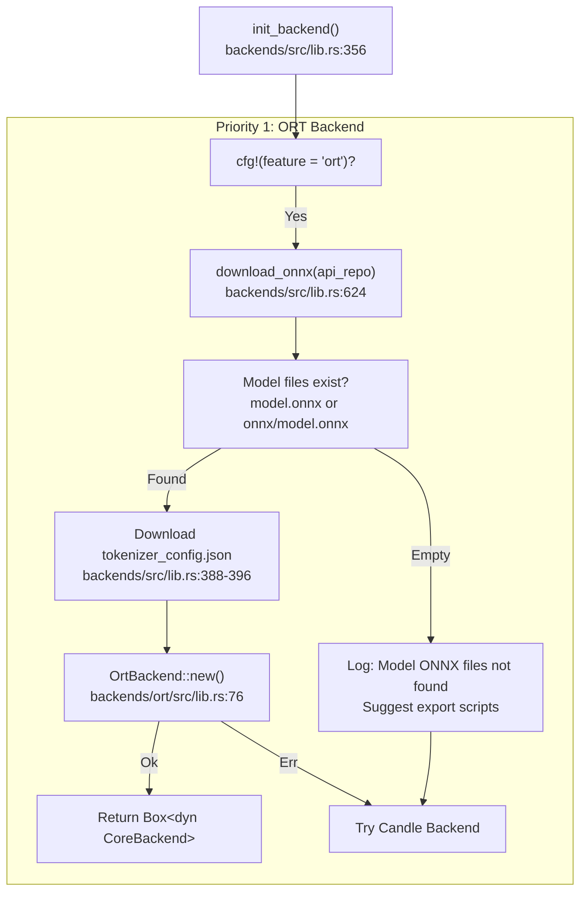
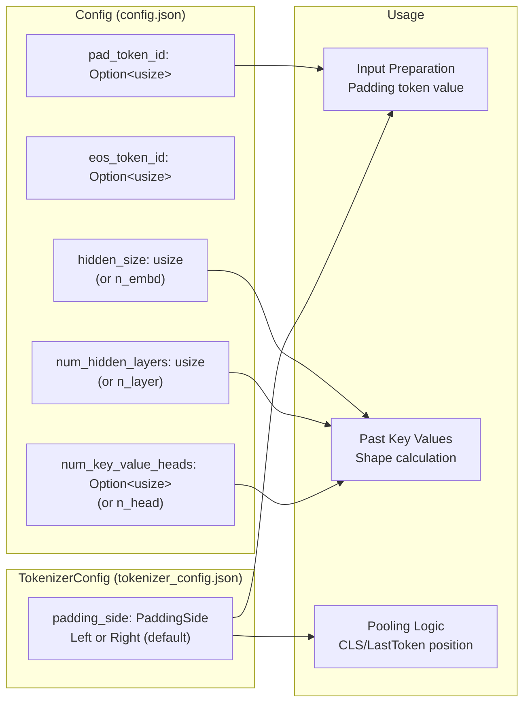
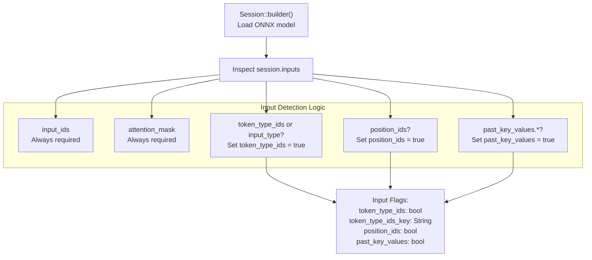
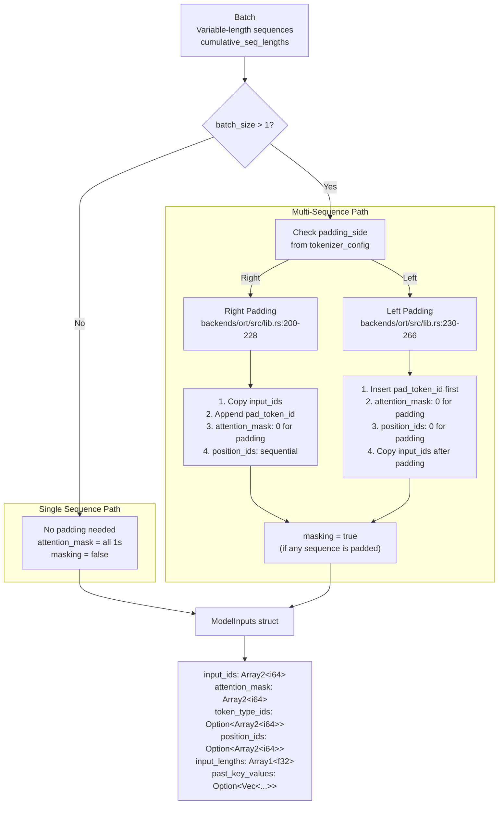
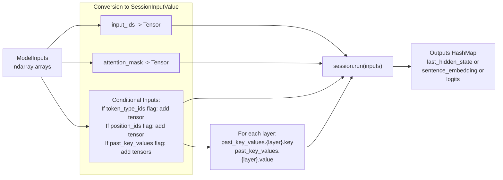
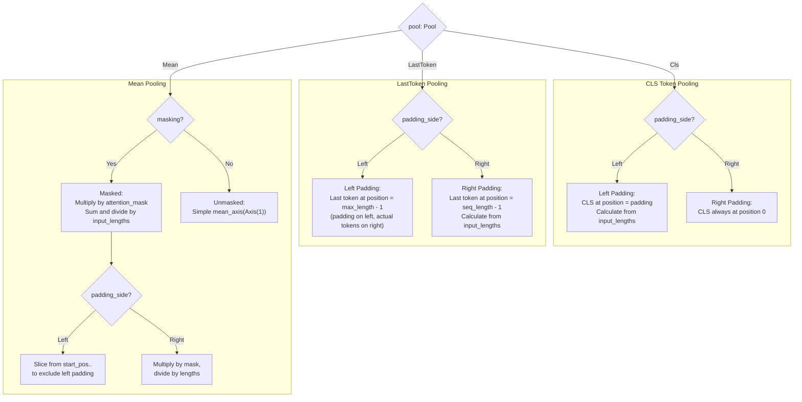
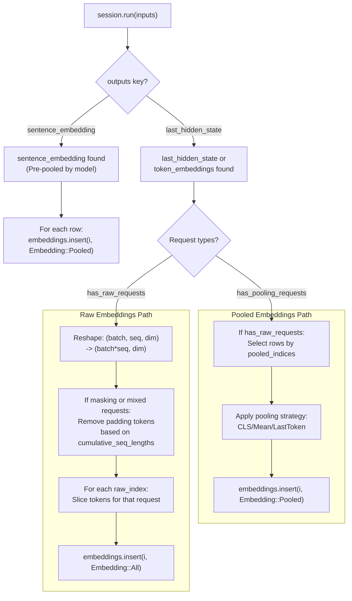
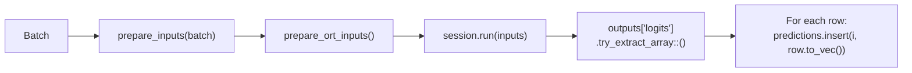

<!-- source: DeepWiki mcp.deepwiki.com · repo huggingface/text-embeddings-inference · page 4.5 ORT Backend · fetched 2026-10-26 -->

# ORT Backend

<details>
<summary>Relevant source files</summary>

The following files were used as context for generating this wiki page:

- [backends/Cargo.toml](backends/Cargo.toml)
- [backends/candle/Cargo.toml](backends/candle/Cargo.toml)
- [backends/ort/Cargo.toml](backends/ort/Cargo.toml)
- [backends/ort/src/lib.rs](backends/ort/src/lib.rs)
- [backends/src/dtype.rs](backends/src/dtype.rs)
- [backends/src/lib.rs](backends/src/lib.rs)
- [core/Cargo.toml](core/Cargo.toml)
- [router/Cargo.toml](router/Cargo.toml)

</details>


## Purpose and Scope

The ORT Backend provides ONNX Runtime-based model inference for Text Embeddings Inference. It enables cross-platform model execution using pre-exported ONNX models, offering broad hardware compatibility without requiring CUDA or other specialized accelerators. This backend is the first option attempted in the cascading backend selection logic.

For information about the backend selection process, see [Backend Architecture and Selection](#4.1). For alternative backends using native Rust ML (Candle) or Python/PyTorch, see [Candle Backend](#4.2) and [Python Backend](#4.6).

**Sources:** [backends/ort/src/lib.rs:1-717](), [backends/src/lib.rs:355-407]()

---

## Architecture Overview

The ORT Backend is implemented as a stateless wrapper around an ONNX Runtime session, managing model execution and output processing.



**Diagram: ORT Backend Component Structure**

The `OrtBackend` struct maintains thread-safe access to the ONNX Runtime session via `Mutex` and caches configuration data parsed from `config.json` and `tokenizer_config.json`. Input requirement flags (`token_type_ids`, `position_ids`, `past_key_values`) are determined by introspecting the ONNX model's input schema at initialization.

**Sources:** [backends/ort/src/lib.rs:61-73](), [backends/ort/src/lib.rs:76-170](), [backends/ort/src/lib.rs:382-393]()

---

## Backend Selection and Initialization

The ORT Backend is the first backend attempted in the cascading fallback chain defined in `init_backend()`.



**Diagram: ORT Backend Selection in Cascading Fallback**

The initialization process attempts to:
1. Download ONNX model files from Hugging Face Hub (if `api_repo` is provided) [backends/src/lib.rs:624-656]().
2. Search for `model.onnx` in root or `onnx/` subdirectory [backends/ort/src/lib.rs:99-105]().
3. Download `tokenizer_config.json` for padding side configuration [backends/src/lib.rs:388-396]().
4. Instantiate `OrtBackend` with parsed configurations [backends/ort/src/lib.rs:76-170]().

If ONNX files are not found or backend creation fails, the system falls back to Candle Backend.

**Sources:** [backends/src/lib.rs:368-407](), [backends/src/lib.rs:624-656](), [backends/ort/src/lib.rs:76-170]()

---

## ONNX Model File Requirements

The ORT Backend requires specific ONNX format files exported from the original model.

| File | Location Options | Purpose | Required |
|------|-----------------|---------|----------|
| `model.onnx` | Root or `onnx/model.onnx` | ONNX model graph definition | Yes |
| `model.onnx_data` | Root or `onnx/model.onnx_data` | External weights (for large models) | Optional |
| `config.json` | Root | Model configuration (dimensions, token IDs) | Yes |
| `tokenizer_config.json` | Root | Tokenizer padding side configuration | No (defaults to right) |

The download logic attempts both root-level and `onnx/` subdirectory paths to support different export formats:

```rust
// backends/src/lib.rs:627-639: Download model.onnx
// - Try root: api.get("model.onnx")
// - Fallback: api.get("onnx/model.onnx")

// backends/src/lib.rs:641-653: Download model.onnx_data  
// - Try root: api.get("model.onnx_data")
// - Fallback: api.get("onnx/model.onnx_data")
```

If no ONNX files are found, the system logs a helpful error message directing users to export scripts and a Hugging Face Space for ONNX conversion [backends/src/lib.rs:376-384]().

**Sources:** [backends/src/lib.rs:624-656](), [backends/ort/src/lib.rs:99-105]()

---

## Configuration Structures

The ORT Backend parses two configuration files to determine model parameters and preprocessing behavior.



**Diagram: Configuration File Usage**

The `Config` struct supports alternative field names (`n_embd`, `n_layer`, `n_head`) for models like `nomic-ai/nomic-embed-text-v1` that use different naming conventions in their ONNX exports [backends/ort/src/lib.rs:30-35]().

**Sources:** [backends/ort/src/lib.rs:16-36](), [backends/ort/src/lib.rs:38-50](), [backends/ort/src/lib.rs:107-126]()

---

## Model Input Introspection

The ORT Backend dynamically determines required model inputs by introspecting the ONNX session's input schema.



**Diagram: Dynamic Input Schema Detection**

This introspection approach allows the backend to adapt to different ONNX export configurations without hardcoding model-specific requirements. The `token_type_ids_key` is stored separately because some models use `input_type` instead of the standard `token_type_ids` field name [backends/ort/src/lib.rs:143-147]().

**Sources:** [backends/ort/src/lib.rs:137-158]()

---

## Input Preparation and Padding Strategies

The `prepare_inputs()` method transforms a `Batch` into properly padded `ndarray` tensors, handling both left and right padding strategies.



**Diagram: Input Preparation and Padding Logic**

The `masking` flag returned by `prepare_inputs()` indicates whether the attention mask must be used during pooling operations. This is set to `true` when sequences in the batch have different lengths (requiring padding) or when both pooling and raw embedding requests are mixed in the same batch [backends/ort/src/lib.rs:197]().

**Key Implementation Details:**

- **Right Padding** [backends/ort/src/lib.rs:200-228](): Padding tokens appended after actual tokens. Position IDs continue sequentially: `[0, 1, 2, 3, 4, 5]` for a length-3 sequence padded to 6.

- **Left Padding** [backends/ort/src/lib.rs:230-266](): Padding tokens prepended before actual tokens. Position IDs are 0 for padding, then sequential: `[0, 0, 0, 0, 1, 2]` for a length-3 sequence padded to 6.

- **Past Key Values** [backends/ort/src/lib.rs:301-321](): For models with optimized MHA/MQA nodes, empty key-value cache tensors are initialized with shape `(batch_size, num_key_value_heads, 0, head_size)`.

**Sources:** [backends/ort/src/lib.rs:174-334](), [backends/ort/src/lib.rs:38-50]()

---

## ONNX Runtime Execution

The `prepare_ort_inputs()` method converts `ndarray` arrays into ONNX Runtime `SessionInputValue` types.



**Diagram: ONNX Runtime Session Execution**

The session runs with thread-level parallelism configured based on available CPU cores [backends/ort/src/lib.rs:130-131]() and uses `GraphOptimizationLevel::Level3` for maximum optimization [backends/ort/src/lib.rs:132-133]().

**Sources:** [backends/ort/src/lib.rs:336-379](), [backends/ort/src/lib.rs:128-135](), [backends/ort/src/lib.rs:410-412](), [backends/ort/src/lib.rs:678-680]()

---

## Pooling Strategy Implementations

The ORT Backend implements three pooling strategies, each handling left/right padding differently.



**Diagram: Pooling Strategy Decision Tree**

### CLS Token Pooling

**Right Padding** [backends/ort/src/lib.rs:484](): CLS token is always at position 0, regardless of sequence length.

**Left Padding** [backends/ort/src/lib.rs:462-483](): CLS token position varies by padding amount. For a sequence with 3 tokens padded to length 6: `[PAD, PAD, PAD, CLS, tok1, tok2]`, CLS is at position 3.

### LastToken Pooling

**Left Padding** [backends/ort/src/lib.rs:490-496](): Last actual token is always at `max_length - 1` since padding is on the left.

**Right Padding** [backends/ort/src/lib.rs:497-524](): Last actual token position is `seq_length - 1`, requiring calculation from `input_lengths` when masking is enabled.

### Mean Pooling

When `masking=false` (single sequence or uniform length batch), simple averaging is used [backends/ort/src/lib.rs:569]().

When `masking=true`, the implementation differs by padding side:

- **Left Padding** [backends/ort/src/lib.rs:539-558](): Slice the outputs array from `start_pos` to exclude left padding, then compute mean.

- **Right Padding** [backends/ort/src/lib.rs:559-566](): Multiply outputs by attention mask (expanded to 3D), sum, and divide by actual sequence lengths.

**Sources:** [backends/ort/src/lib.rs:461-573](), [backends/ort/src/lib.rs:486-525]()

---

## Embedding Output Processing

The `embed()` method handles both pooled embeddings and raw token-level embeddings, processing ONNX Runtime outputs into the `Embeddings` HashMap.



**Diagram: Embedding Output Processing Pipeline**

The output processing distinguishes three cases:

1. **Pre-pooled outputs** [backends/ort/src/lib.rs:417-430](): Some ONNX models export with built-in pooling, outputting `sentence_embedding` directly.

2. **Pooling requests** [backends/ort/src/lib.rs:446-582](): Applies the configured pooling strategy (CLS/Mean/LastToken) to `last_hidden_state`. If the batch contains mixed request types (both pooling and raw), it selects only the rows corresponding to `pooled_indices`.

3. **Raw token embeddings** [backends/ort/src/lib.rs:584-659](): Reshapes the 3D output to 2D, removes padding tokens (if necessary), and slices embeddings for each request by `raw_indices`.

The padding removal logic [backends/ort/src/lib.rs:593-636]() handles both left and right padding by calculating exact token positions using `cumulative_seq_lengths`.

**Sources:** [backends/ort/src/lib.rs:395-663](), [backends/ort/src/lib.rs:417-430](), [backends/ort/src/lib.rs:446-582](), [backends/ort/src/lib.rs:584-659]()

---

## Classification Predictions

The `predict()` method handles sequence classification tasks by extracting logits from the ONNX Runtime output.



**Diagram: Classification Prediction Flow**

The `predict()` implementation is simpler than `embed()` because classification outputs are always pooled (one logit vector per sequence) and don't require complex padding-aware processing [backends/ort/src/lib.rs:665-692]().

**Sources:** [backends/ort/src/lib.rs:665-692]()

---

## Dependency Configuration

The ORT Backend uses the `ort` crate with specific features enabled for optimal performance.

```toml
[dependencies]
ort = { 
    version = "2.0.0-rc.10", 
    default-features = false, 
    features = ["std", "download-binaries", "half", "onednn", "ndarray"] 
}
```

**Key Features:**

- `std`: Standard library support.
- `download-binaries`: Automatic ONNX Runtime binary download at build time.
- `half`: FP16 support (though only FP32 is used at runtime).
- `onednn`: Intel oneDNN acceleration for CPU inference.
- `ndarray`: Native integration with ndarray tensors.

The `ort-sys` dependency is pinned to the exact version due to ABI compatibility requirements.

**Sources:** [backends/ort/Cargo.toml:13-14]()

---

## Limitations and Constraints

The ORT Backend has several known limitations compared to other backends:

| Limitation | Reason | Alternative |
|-----------|--------|-------------|
| **Float32 only** | ONNX Runtime integration only supports FP32 inference in TEI [backends/ort/src/lib.rs:81-85]() | Use Candle for FP16/BF16 |
| **No Splade pooling** | Sparse tensor operations not implemented [backends/ort/src/lib.rs:90-94]() | Use Candle backend |
| **Max batch size: 8** | Hardcoded in `max_batch_size()` [backends/ort/src/lib.rs:383-385]() | Use Candle for larger batches |
| **Requires ONNX export** | Models must be pre-exported to ONNX format | Export using Optimum or provided scripts |

**DType Validation** [backends/ort/src/lib.rs:81-85](): The backend explicitly checks that `dtype == "float32"` and returns an error for other types.

**Splade Rejection** [backends/ort/src/lib.rs:90-94](): If the model type specifies `Pool::Splade`, initialization fails with an error directing users to the Candle backend.

**ONNX Export Resources:** When ONNX files are not found, the system logs a helpful message [backends/src/lib.rs:378]() pointing to:
- Export scripts: https://gist.github.com/tomaarsen/4b00b0e3be8884efa64cfab9230b161f
- Hugging Face Space: https://huggingface.co/spaces/sentence-transformers/backend-export

**Sources:** [backends/ort/src/lib.rs:81-97](), [backends/ort/src/lib.rs:383-385](), [backends/src/lib.rs:376-384]()

---

## Error Handling

The ORT Backend uses a custom error mapping trait to convert ONNX Runtime and ndarray errors into `BackendError` types.

```rust
// backends/ort/src/lib.rs:695-716
pub trait WrapErr<O> {
    fn s(self) -> Result<O, BackendError>;  // Startup errors
    fn e(self) -> Result<O, BackendError>;  // Inference errors
}

impl<O> WrapErr<O> for Result<O, ort::Error> {
    fn s(self) -> Result<O, BackendError> {
        self.map_err(|e| BackendError::Start(e.to_string()))
    }
    fn e(self) -> Result<O, BackendError> {
        self.map_err(|e| BackendError::Inference(e.to_string()))
    }
}
```

The `.s()` method is used during initialization for startup errors, while `.e()` is used during inference for runtime errors. This pattern allows fine-grained error categorization throughout the backend.

**Sources:** [backends/ort/src/lib.rs:695-716]()

---

