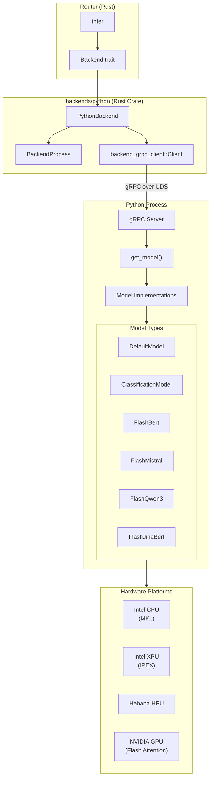
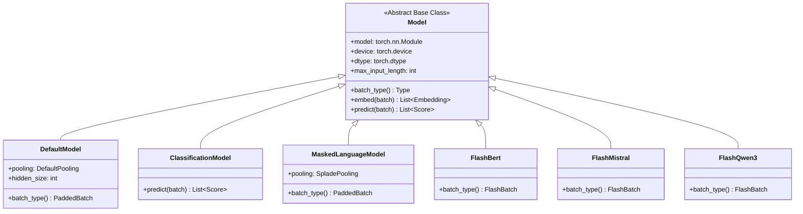

<!-- source: DeepWiki mcp.deepwiki.com · repo huggingface/text-embeddings-inference · page 4.6 Python Backend · fetched 2026-10-26 -->

# Python Backend

<details>
<summary>Relevant source files</summary>

The following files were used as context for generating this wiki page:

- [backends/core/src/lib.rs](backends/core/src/lib.rs)
- [backends/python/server/pyproject.toml](backends/python/server/pyproject.toml)
- [backends/python/server/text_embeddings_server/cli.py](backends/python/server/text_embeddings_server/cli.py)
- [backends/python/server/text_embeddings_server/models/classification_model.py](backends/python/server/text_embeddings_server/models/classification_model.py)
- [backends/python/server/text_embeddings_server/models/default_model.py](backends/python/server/text_embeddings_server/models/default_model.py)
- [backends/python/server/text_embeddings_server/models/flash_bert.py](backends/python/server/text_embeddings_server/models/flash_bert.py)
- [backends/python/server/text_embeddings_server/models/flash_mistral.py](backends/python/server/text_embeddings_server/models/flash_mistral.py)
- [backends/python/server/text_embeddings_server/models/flash_qwen3.py](backends/python/server/text_embeddings_server/models/flash_qwen3.py)
- [backends/python/server/text_embeddings_server/models/jinaBert_model.py](backends/python/server/text_embeddings_server/models/jinaBert_model.py)
- [backends/python/server/text_embeddings_server/models/masked_model.py](backends/python/server/text_embeddings_server/models/masked_model.py)
- [backends/python/server/text_embeddings_server/models/pooling.py](backends/python/server/text_embeddings_server/models/pooling.py)
- [backends/python/server/text_embeddings_server/models/types.py](backends/python/server/text_embeddings_server/models/types.py)
- [backends/python/server/text_embeddings_server/server.py](backends/python/server/text_embeddings_server/server.py)
- [backends/python/server/text_embeddings_server/utils/device.py](backends/python/server/text_embeddings_server/utils/device.py)
- [backends/python/server/text_embeddings_server/utils/flash_attn.py](backends/python/server/text_embeddings_server/utils/flash_attn.py)
- [backends/python/src/lib.rs](backends/python/src/lib.rs)
- [backends/python/src/management.rs](backends/python/src/management.rs)
- [docs/source/en/_toctree.yml](docs/source/en/_toctree.yml)

</details>


The Python Backend is one of the three backend implementations available in Text Embeddings Inference (TEI), designed to leverage PyTorch for performing embedding and classification operations. This document explains how the Python Backend is implemented, its architecture, and how it integrates with the rest of the TEI system. For information about other backends like Candle or ONNX Runtime, see [Backend System](#4).

## Overview

The Python Backend provides an implementation of the `Backend` trait using PyTorch and Python-based model implementations. It serves as a fallback when models are not supported by the Candle or ORT backends, and also provides specialized implementations for certain hardware platforms (Intel XPU, Habana HPU). The backend consists of a Rust management layer that spawns and communicates with a separate Python process via gRPC over Unix Domain Sockets (UDS).

### System Architecture



**Key Characteristics:**
- **Inter-process Communication**: Uses gRPC protocol over Unix Domain Sockets for low-latency communication.
- **Process Isolation**: Python process runs separately, managed by Rust.
- **Platform Support**: Specialized builds for Intel CPU (MKL), Intel XPU (IPEX), and Habana HPU platforms.
- **Model Flexibility**: Supports models not available in Candle backend, including custom Flash Attention implementations.

Sources: [backends/python/src/lib.rs:1-133](), [backends/python/server/text_embeddings_server/server.py:1-100]()

## Architecture

The Python Backend consists of two main components operating in separate processes:

### Component Overview

| Component | Language | Purpose | Location |
|-----------|----------|---------|----------|
| `PythonBackend` | Rust | Backend trait implementation, process management, gRPC client | [backends/python/src/lib.rs:12-57]() |
| Python Server | Python | Model loading, inference execution, gRPC server | [backends/python/server/]() |

### Communication Flow

```mermaid
sequenceDiagram
    participant Router
    participant PythonBackend["PythonBackend (Rust)"]
    participant BackendProcess["management::BackendProcess"]
    participant UDS["Unix Domain Socket"]
    participant GRPCServer["Python gRPC Server"]
    participant ModelInstance["Model Instance"]
    
    Note over PythonBackend: new() called
    PythonBackend->>BackendProcess: BackendProcess::new()
    BackendProcess->>BackendProcess: Create UDS path
    BackendProcess->>GRPCServer: Spawn "python-text-embeddings-server"
    
    Note over GRPCServer: Load model on startup
    
    Router->>PythonBackend: embed(batch)
    PythonBackend->>PythonBackend: tokio_runtime.block_on()
    PythonBackend->>UDS: gRPC Embed request
    UDS->>GRPCServer: Forward request
    GRPCServer->>ModelInstance: model.embed(batch)
    ModelInstance-->>GRPCServer: List[Embedding]
    GRPCServer-->>UDS: gRPC response
    UDS-->>PythonBackend: Embeddings
    PythonBackend-->>Router: Return HashMap<usize, Embedding>
```

Sources: [backends/python/src/lib.rs:18-57](), [backends/python/src/lib.rs:59-132](), [backends/python/src/management.rs:19-140]()

### Process Management

The `PythonBackend` struct manages the Python process lifecycle:

**Initialization** ([backends/python/src/lib.rs:18-56]()):
1. Creates a `BackendProcess` which spawns the Python server process using `Command::new("python-text-embeddings-server")` [backends/python/src/management.rs:69-75]().
2. Cleans up previous UDS files if they exist [backends/python/src/management.rs:31-33]().
3. Creates a Tokio runtime for async gRPC communication [backends/python/src/lib.rs:40-43]().
4. Establishes a gRPC connection to the Python server via UDS [backends/python/src/lib.rs:45-49]().

**Backend Trait Implementation** ([backends/python/src/lib.rs:59-132]()):
- `health()`: Checks if the Python process is responsive via gRPC health check [backends/python/src/lib.rs:60-69]().
- `is_padded()`: Returns `false` as the Rust layer doesn't perform padding for the Python backend [backends/python/src/lib.rs:71-73]().
- `embed()`: Maps a Rust `Batch` to gRPC fields and executes the call [backends/python/src/lib.rs:75-102]().
- `predict()`: Maps a Rust `Batch` to gRPC fields for classification [backends/python/src/lib.rs:104-131]().

Sources: [backends/python/src/lib.rs:12-133](), [backends/python/src/management.rs:14-148]()

## Model System

The Python Backend implements a pluggable model architecture with specialized implementations for different model types and hardware platforms.

### Model Class Hierarchy



Sources: [backends/python/server/text_embeddings_server/models/default_model.py:16-57](), [backends/python/server/text_embeddings_server/models/masked_model.py:16-58](), [backends/python/server/text_embeddings_server/models/flash_bert.py:280-320](), [backends/python/server/text_embeddings_server/models/flash_mistral.py:365-422](), [backends/python/server/text_embeddings_server/models/flash_qwen3.py:382-456]()

### Specialized Model Implementations

#### FlashBert
The `FlashBert` implementation provides a high-performance BERT path using custom attention kernels. It requires `FlashBatch` input, which avoids padding by using cumulative sequence lengths (`cu_seqlens`) [backends/python/server/text_embeddings_server/models/types.py:92-123]().

- **Attention**: Uses `text_embeddings_server.utils.flash_attn.attention` which dispatches to `flash_attn_2_cuda` or `flash_attn_cuda` [backends/python/server/text_embeddings_server/utils/flash_attn.py:119-207]().
- **Layer Norm**: Uses `FastLayerNorm` which can dispatch to `dropout_layer_norm` for fused CUDA operations [backends/python/server/text_embeddings_server/models/flash_bert.py:36-104]().

#### FlashMistral and FlashQwen3
These models are optimized for causal architectures used in embedding tasks.
- **Mistral**: Supports `MistralRMSNorm` and `MistralRotaryEmbedding` [backends/python/server/text_embeddings_server/models/flash_mistral.py:72-136]().
- **Qwen3**: Includes `Qwen3RMSNorm` and Q/K normalization within `Qwen3Attention` [backends/python/server/text_embeddings_server/models/flash_qwen3.py:74-197]().

Sources: [backends/python/server/text_embeddings_server/models/flash_bert.py:1-320](), [backends/python/server/text_embeddings_server/models/flash_mistral.py:1-422](), [backends/python/server/text_embeddings_server/models/flash_qwen3.py:1-456]()

## Hardware Acceleration

The Python Backend provides platform-specific optimizations for CUDA, Intel XPU, and Habana HPU.

### Device Selection Logic
The `get_device()` function in `text_embeddings_server.utils.device` determines the execution target:
1. **CUDA**: Preferred if `torch.cuda.is_available()` is true [backends/python/server/text_embeddings_server/utils/device.py:65-68]().
2. **HPU**: Detected via `hl-smi` check [backends/python/server/text_embeddings_server/utils/device.py:44-50]().
3. **XPU**: Detected if `intel_extension_for_pytorch` is available and `USE_IPEX` is enabled [backends/python/server/text_embeddings_server/utils/device.py:58-60]().

### Flash Attention Dispatch
The `attention` function in `text_embeddings_server.utils.flash_attn` handles various hardware backends:
- **Intel XPU**: Calls `ipex.llm.functional.varlen_attention` [backends/python/server/text_embeddings_server/utils/flash_attn.py:126-142]().
- **ROCm**: Uses `rocm_attn` which wraps `F.scaled_dot_product_attention` [backends/python/server/text_embeddings_server/utils/flash_attn.py:63-87]().
- **Habana HPU**: Uses `hpu_attn` wrapping `FusedSDPA.apply` [backends/python/server/text_embeddings_server/utils/flash_attn.py:90-116]().
- **CUDA**: Uses `flash_attn_2_cuda.varlen_fwd` [backends/python/server/text_embeddings_server/utils/flash_attn.py:171-188]().

Sources: [backends/python/server/text_embeddings_server/utils/device.py:1-83](), [backends/python/server/text_embeddings_server/utils/flash_attn.py:1-209]()

## Batch Types and Processing

The Python server defines specific batch classes to handle data movement to the device.

| Class | Purpose | Key Method |
|-------|---------|------------|
| `PaddedBatch` | Standard padded tensor batch for non-flash models. | `from_pb`: Allocates 4D tensor for `input_ids`, `token_type_ids`, `position_ids`, and `attention_mask` [backends/python/server/text_embeddings_server/models/types.py:42-85](). |
| `FlashBatch` | Unpadded batch for Flash Attention models. | `from_pb`: Creates flat tensors and `cu_seqlens` [backends/python/server/text_embeddings_server/models/types.py:103-123](). |

**HPU Optimization**: `PaddedBatch.from_pb` includes specific logic for HPU to "round up" sequence lengths to multiples (default 128) and batch sizes to powers of 2 to better utilize Habana's bucketing [backends/python/server/text_embeddings_server/models/types.py:49-60]().

Sources: [backends/python/server/text_embeddings_server/models/types.py:1-127]()

---

