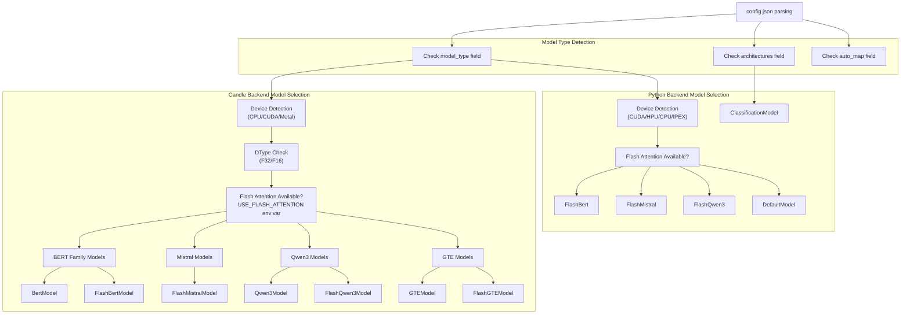

<!-- source: DeepWiki mcp.deepwiki.com · repo huggingface/text-embeddings-inference · page 4.7 Model Implementations · fetched 2026-10-26 -->

# Model Implementations

Relevant source files

The following files were used as context for generating this wiki page:

- [backends/candle/src/layers/index_select.rs](backends/candle/src/layers/index_select.rs)
- [backends/candle/src/layers/mod.rs](backends/candle/src/layers/mod.rs)
- [backends/candle/src/layers/rotary.rs](backends/candle/src/layers/rotary.rs)
- [backends/candle/src/models/distilbert.rs](backends/candle/src/models/distilbert.rs)
- [backends/candle/src/models/flash_distilbert.rs](backends/candle/src/models/flash_distilbert.rs)
- [backends/candle/src/models/flash_gte.rs](backends/candle/src/models/flash_gte.rs)
- [backends/candle/src/models/flash_mistral.rs](backends/candle/src/models/flash_mistral.rs)
- [backends/candle/src/models/flash_modernbert.rs](backends/candle/src/models/flash_modernbert.rs)
- [backends/candle/src/models/flash_nomic.rs](backends/candle/src/models/flash_nomic.rs)
- [backends/candle/src/models/flash_qwen2.rs](backends/candle/src/models/flash_qwen2.rs)
- [backends/candle/src/models/flash_qwen3.rs](backends/candle/src/models/flash_qwen3.rs)
- [backends/candle/src/models/gemma3.rs](backends/candle/src/models/gemma3.rs)
- [backends/candle/src/models/gte.rs](backends/candle/src/models/gte.rs)
- [backends/candle/src/models/llama.rs](backends/candle/src/models/llama.rs)
- [backends/candle/src/models/mistral.rs](backends/candle/src/models/mistral.rs)
- [backends/candle/src/models/modernbert.rs](backends/candle/src/models/modernbert.rs)
- [backends/candle/src/models/nomic.rs](backends/candle/src/models/nomic.rs)
- [backends/candle/src/models/pplx1.rs](backends/candle/src/models/pplx1.rs)
- [backends/candle/src/models/qwen2.rs](backends/candle/src/models/qwen2.rs)
- [backends/candle/src/models/qwen3.rs](backends/candle/src/models/qwen3.rs)
- [backends/candle/tests/snapshots/test_modernbert__modernbert_classification_mean_pooling.snap](backends/candle/tests/snapshots/test_modernbert__modernbert_classification_mean_pooling.snap)
- [backends/candle/tests/snapshots/test_modernbert__modernbert_classification_single.snap](backends/candle/tests/snapshots/test_modernbert__modernbert_classification_single.snap)
- [backends/candle/tests/snapshots/test_pplx1__pplx1_cpu_batch.snap](backends/candle/tests/snapshots/test_pplx1__pplx1_cpu_batch.snap)
- [backends/candle/tests/snapshots/test_pplx1__pplx1_cpu_single.snap](backends/candle/tests/snapshots/test_pplx1__pplx1_cpu_single.snap)
- [backends/candle/tests/test_flash_pplx1.rs](backends/candle/tests/test_flash_pplx1.rs)
- [backends/candle/tests/test_pplx1.rs](backends/candle/tests/test_pplx1.rs)

This page documents the specific model architectures supported by TEI, including implementation details for each model family. For information about backend selection and initialization logic, see [Backend Architecture and Selection](#4.1). For BERT and Flash-optimized attention mechanisms, see [BERT and Flash-Optimized Models](#4.3).

## Overview

TEI supports multiple model architectures through both the Candle (Rust) and Python backends. Each model architecture has specific requirements regarding hardware, precision, and optimization features. Models are organized into families based on their underlying architecture (encoder-only, decoder-only, or specialized variants).

The system automatically selects the appropriate model implementation based on:
- Model type from `config.json`
- Available hardware (CPU, CUDA, Metal, HPU)
- Requested precision (float32, float16, bfloat16)
- Flash Attention availability
- Model-specific requirements

Sources: [backends/candle/src/lib.rs:91-116](), [backends/python/server/text_embeddings_server/models/__init__.py:63-137]()

## Supported Model Catalog

### Candle Backend Model Matrix

| Model Family | Standard Variant | Flash Variant | Hardware Requirements | Precision | Notes |
|--------------|------------------|---------------|----------------------|-----------|-------|
| BERT | `BertModel` | `FlashBertModel` | CPU/CUDA/Metal | FP32/FP16 | Includes RoBERTa, CamemBERT, XLM-RoBERTa |
| JinaBERT | `JinaBertModel` | `FlashJinaBertModel` | CPU/CUDA/Metal | FP32/FP16 | Custom attention with QK post-norm |
| JinaCodeBERT | `JinaCodeBertModel` | `FlashJinaCodeBertModel` | CPU/CUDA/Metal | FP32/FP16 | Specialized for code |
| DistilBERT | `DistilBertModel` | `FlashDistilBertModel` | CPU/CUDA/Metal | FP32/FP16 | Distilled variant [backends/candle/src/models/distilbert.rs:10-22]() |
| ModernBERT | `ModernBertModel` | `FlashModernBertModel` | CPU/CUDA/Metal | FP32/FP16 | Flash v1 lacks windowing support |
| NomicBERT | `NomicBertModel` | `FlashNomicBertModel` | CPU/CUDA/Metal | FP32/FP16 | Nomic AI architecture |
| GTE | `GTEModel` | `FlashGTEModel` | CPU/CUDA/Metal | FP32/FP16 | General Text Embeddings [backends/candle/src/models/gte.rs:15-35]() |
| MPNet | `MPNetModel` | - | CPU/CUDA/Metal | FP32/FP16 | No Flash variant |
| Mistral | - | `FlashMistralModel` | CUDA only | FP16 only | Requires Flash Attention v2, CC ≥ 80 [backends/candle/src/models/mistral.rs:6-24]() |
| Qwen2 | - | `FlashQwen2Model` | CUDA only | FP16 only | Requires Flash Attention [backends/candle/src/models/qwen2.rs:10-26]() |
| Qwen3 | `Qwen3Model` | `FlashQwen3Model` | CPU/CUDA/Metal | FP32/FP16 | Supports standard and Flash [backends/candle/src/models/qwen3.rs:14-37]() |
| Gemma3 | `Gemma3Model` | - | CPU/CUDA/Metal | FP32 only | FP32 required [backends/candle/src/models/gemma3.rs:13-34]() |

### Python Backend Model Support

| Model Type | Implementation Class | Device Support | Notes |
|------------|---------------------|----------------|-------|
| BERT (Flash) | `FlashBert` | CUDA, HPU, IPEX | Requires Flash Attention installation |
| JinaBERT | `FlashJinaBert` | CUDA, HPU | Custom implementation for jina-embeddings-v2-base-code |
| Mistral | `FlashMistral` | HPU | HPU graph optimization [backends/python/server/text_embeddings_server/models/flash_mistral.py:12-30]() |
| Qwen3 | `FlashQwen3` | HPU | HPU graph optimization [backends/python/server/text_embeddings_server/models/flash_qwen3.py:12-30]() |
| Generic | `DefaultModel` | All | Uses `AutoModel` from transformers [backends/python/server/text_embeddings_server/models/default_model.py:16-30]() |
| Classification | `ClassificationModel` | All | Uses `AutoModelForSequenceClassification` [backends/python/server/text_embeddings_server/models/classification_model.py:15-30]() |
| Masked LM | `MaskedLanguageModel` | All | For Splade pooling [backends/python/server/text_embeddings_server/models/masked_model.py:16-30]() |

Sources: [backends/candle/src/lib.rs:232-512](), [backends/python/server/text_embeddings_server/models/__init__.py:76-137]()

## Model Selection and Initialization Flow

**Model Selection Decision Logic**

The selection process follows a cascading pattern:

1. **Configuration Parsing**: Extract `model_type`, `architectures`, and `auto_map` fields
2. **Backend-Specific Logic**: Different backends use different criteria
3. **Hardware Constraints**: Some models require specific hardware (e.g., Mistral requires CUDA with CC ≥ 80 [backends/candle/src/lib.rs:423-437]())
4. **Optimization Selection**: Flash Attention variants selected when conditions met

Sources: [backends/candle/src/lib.rs:232-512](), [backends/python/server/text_embeddings_server/models/__init__.py:76-137]()

## Candle Backend Implementations

### Qwen3 Architecture

Qwen3 is a decoder-only model with several unique features optimized for embedding generation.

```mermaid
graph TB
    subgraph "Qwen3Model Structure"
        Embeddings["Embedding Layer<br/>vocab_size × hidden_size"]
        
        subgraph "Qwen3Layer (×num_layers)"
            InputNorm["RMSNorm<br/>input_layernorm"]
            Attention["Qwen3Attention"]
            PostNorm["RMSNorm<br/>post_attention_layernorm"]
            MLP["Qwen3MLP"]
            
            InputNorm --> Attention
            Attention --> PostNorm
            PostNorm --> MLP
        end
        
        OutputNorm["RMSNorm<br/>Final layer norm"]
        Pooling["Pooling Strategy<br/>Cls/Mean/LastToken"]
        
        Embeddings --> InputNorm
        MLP --> OutputNorm
        OutputNorm --> Pooling
    end
    
    subgraph "Qwen3Attention Components"
        QProjWeight["q_proj (weight only)"]
        KProjWeight["k_proj (weight only)"]
        VProjWeight["v_proj (weight only)"]
        OProjWeight["o_proj (weight only)"]
        QNorm["RMSNorm q_norm"]
        KNorm["RMSNorm k_norm"]
        RotaryEmb["Rotary Embeddings"]
        
        QProjWeight --> QNorm
        KProjWeight --> KNorm
        QNorm --> RotaryEmb
        KNorm --> RotaryEmb
    end
    
    subgraph "Qwen3MLP Components"
        GateProj["gate_proj"]
        UpProj["up_proj"]
        DownProj["down_proj"]
        Activation["HiddenAct<br/>(SiLU/GELU)"]
        
        GateProj --> Activation
        UpProj --> Activation
        Activation --> DownProj
    end
```

**Qwen3-Specific Features**

1. **Query/Key Normalization**: Qwen3 applies `RMSNorm` to queries and keys after projection [backends/candle/src/models/qwen3.rs:117-118]().
2. **No Bias Terms**: Linear layers often lack bias parameters unless `attention_bias` is true [backends/candle/src/models/qwen3.rs:73-81]().
3. **Grouped Query Attention (GQA)**: Supported via `num_key_value_heads` < `num_attention_heads` [backends/candle/src/models/qwen3.rs:189-205]().
4. **Flash Variant**: The `FlashQwen3Model` uses `flash_attn_varlen` for high-throughput inference [backends/candle/src/models/flash_qwen3.rs:155-169]().

Sources: [backends/candle/src/models/qwen3.rs:39-262](), [backends/candle/src/models/flash_qwen3.rs:11-174]()

### Mistral Architecture

Mistral models in Candle backend are Flash-only and require specific hardware.

**Requirements:**
- CUDA device only
- FP16 precision
- Flash Attention v2 (feature `flash-attn`)
- Compute Capability ≥ 80 (Ampere or newer)

**Implementation Details:**
- **Attention**: Uses `flash_attn_varlen` with sliding window support (`window_size_left`) [backends/candle/src/models/flash_mistral.py:13-14]().
- **MLP**: Implements a gated MLP with `gate_up_proj` and SiLU activation [backends/candle/src/models/flash_mistral.rs:117-167]().
- **RoPE**: Uses `apply_rotary_inplace` for position embeddings [backends/candle/src/models/flash_mistral.rs:95-96]().

Sources: [backends/candle/src/models/flash_mistral.rs:9-115](), [backends/candle/src/models/mistral.rs:5-24]()

### GTE Models

GTE (General Text Embeddings) models support both standard and Flash variants.

**Key Components:**
- **Rotary Embeddings**: Uses RoPE for position encoding [backends/candle/src/models/gte.rs:102-103]().
- **Layer Normalization**: Uses `LayerNorm` instead of RMSNorm [backends/candle/src/models/gte.rs:209-211]().
- **Attention**: The standard variant supports cuBLASLt fused matmuls on CUDA [backends/candle/src/models/gte.rs:106-160]().

Sources: [backends/candle/src/models/gte.rs:37-179](), [backends/candle/src/models/flash_gte.rs:11-98]()

### ModernBERT Architecture

ModernBERT is an optimized encoder-only architecture.

**Key Features:**
- **Flash Variant**: `FlashModernBertModel` uses `flash_attn_varlen` for the encoder layers.
- **Pooling**: Supports Mean, Cls, and other strategies common to encoder models.
- **Hardware**: Highly optimized for CUDA using FP16/BF16.

Sources: [backends/candle/src/models/modernbert.rs](), [backends/candle/src/models/flash_modernbert.rs]()

### Gemma3 Architecture

Gemma3 has unique precision and normalization requirements:

**Implementation Details:**
- **Precision**: FP32 precision only [backends/candle/src/lib.rs:396-405]().
- **RMSNorm**: Uses a custom `Gemma3RMSNorm` that multiplies by `(1.0 + weight)` for scaling [backends/candle/src/models/gemma3.rs:88-90]().
- **Attention**: Supports both Full and Sliding window attention types [backends/candle/src/models/gemma3.rs:134-137]().

Sources: [backends/candle/src/models/gemma3.rs:37-132](), [backends/candle/src/models/gemma3.rs:139-203]()

## Python Backend Implementations

The Python backend provides additional flexibility through PyTorch and transformers library integration, especially for HPU (Habana) support.

### FlashMistral (Python)

Python's FlashMistral implementation provides HPU support for Mistral models.

**Architecture Components:**

| Component | Implementation | Notes |
|-----------|---------------|-------|
| `MistralRMSNorm` | RMS normalization | HPU-optimized with `FusedRMSNorm` [backends/python/server/text_embeddings_server/models/flash_mistral.py:32-45]() |
| `MistralRotaryEmbedding` | RoPE embeddings | Uses `nn.Module` for buffer registration [backends/python/server/text_embeddings_server/models/flash_mistral.py:48-80]() |
| `MistralAttention` | Multi-head attention | Uses custom `attention()` function [backends/python/server/text_embeddings_server/models/flash_mistral.py:83-160]() |

Sources: [backends/python/server/text_embeddings_server/models/flash_mistral.py:1-350]()

### FlashQwen3 (Python)

FlashQwen3 implements Qwen3 architecture with HPU optimizations.

**Key Differences from Mistral:**

1. **Query/Key Normalization**: Applies `RMSNorm` to queries and keys after projection [backends/python/server/text_embeddings_server/models/flash_qwen3.py:141-142]().
2. **HPU Optimization**: Uses HPU graph wrapping when `device.type == "hpu"` [backends/python/server/text_embeddings_server/models/__init__.py:112-117]().

Sources: [backends/python/server/text_embeddings_server/models/flash_qwen3.py:1-380]()

## Performance Considerations

### Model-Specific Optimizations

| Model | Optimization | Benefit | Requirements |
|-------|--------------|---------|--------------|
| FlashBERT | Variable-length attention | Eliminates padding overhead | CUDA + FP16 [backends/candle/src/models/flash_bert.rs:217-367]() |
| FlashMistral | Flash Attention v2 | 2-4x faster attention | CUDA CC≥80 + FP16 [backends/candle/src/lib.rs:423-437]() |
| Qwen3 (standard) | cuBLASLt matmul | Fused attention operations | CUDA [backends/candle/src/models/qwen3.rs:208-262]() |
| Python Models | HPU graphs | Operator fusion on Habana | HPU device [backends/python/server/text_embeddings_server/models/__init__.py:112-117]() |

### Memory Usage Patterns

**Flash Attention Models:**
- Lower memory usage due to no attention matrix materialization.
- Memory scales with O(N) instead of O(N²).
- Enables longer sequences [backends/candle/src/models/flash_bert.rs:11-15]().

**Standard Models:**
- Padded batching increases memory usage.
- Attention bias masks add overhead.
- Compatible with diverse hardware including CPU and Metal [backends/candle/src/models/bert.rs:561-704]().

Sources: [backends/candle/src/lib.rs:188-212](), [backends/candle/src/layers/mod.rs:1-17]()

---

