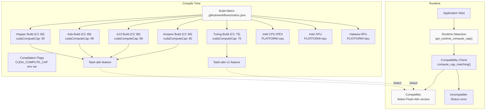
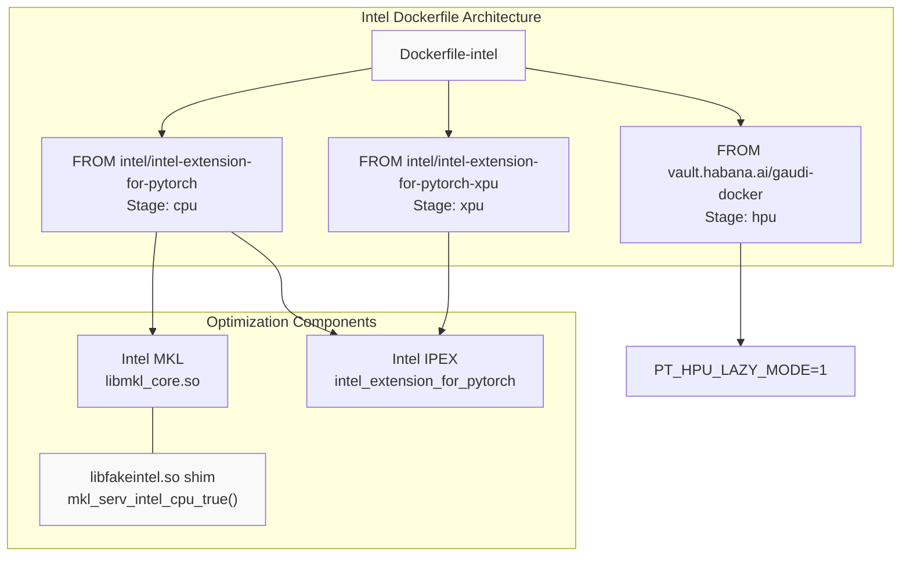
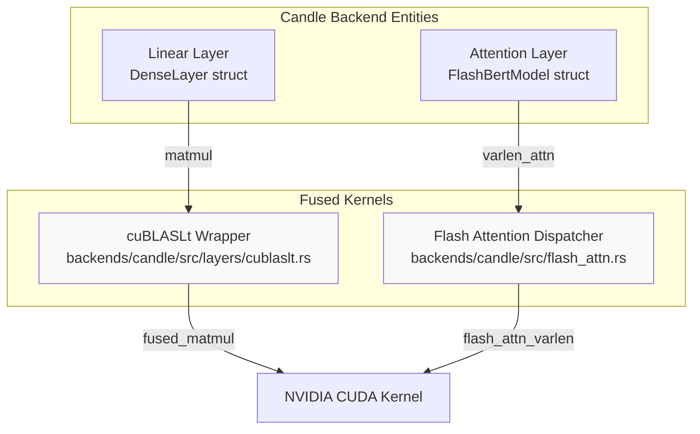

<!-- source: DeepWiki mcp.deepwiki.com · repo huggingface/text-embeddings-inference · page 5 Hardware Optimization · fetched 2026-10-26 -->

# Hardware Optimization

Relevant source files

The following files were used as context for generating this wiki page:

- [.github/workflows/build.yaml](.github/workflows/build.yaml)
- [.github/workflows/matrix.json](.github/workflows/matrix.json)
- [Dockerfile](Dockerfile)
- [Dockerfile-cuda](Dockerfile-cuda)
- [Dockerfile-cuda-all](Dockerfile-cuda-all)
- [backends/candle/src/compute_cap.rs](backends/candle/src/compute_cap.rs)
- [backends/candle/src/flash_attn.rs](backends/candle/src/flash_attn.rs)
- [cuda-all-entrypoint.sh](cuda-all-entrypoint.sh)
- [cuda-entrypoint.sh](cuda-entrypoint.sh)

This page documents TEI's hardware-specific optimizations and the mechanisms used to select appropriate kernels, libraries, and implementations based on the target platform. The system supports NVIDIA GPUs (with compute capability-specific builds), Intel CPUs and accelerators, Apple Silicon, and Habana HPUs, each with tailored optimization strategies.

For information about backend selection and initialization logic, see [Backend Architecture and Selection](#4.1). For deployment strategies and choosing the right Docker image, see [Multi-Platform Docker Images](#7.1).

---

## Optimization Strategy Overview

TEI employs a multi-tier optimization approach that combines compile-time specialization with runtime detection:

**Figure 1: Compile-Time and Runtime Optimization Flow**

The system builds separate binaries for each major GPU architecture family, each linked against architecture-specific optimized kernels. At runtime, the system verifies that the compiled compute capability matches the available hardware and selects the appropriate Flash Attention implementation.

**Sources:** [.github/workflows/matrix.json:1-128](), [backends/candle/src/compute_cap.rs:8-47](), [backends/candle/src/flash_attn.rs:23-120]()

---

## Hardware Platform Matrix

TEI supports the following hardware platforms through specialized builds:

| Platform | Build Name | Dockerfile | Compute Cap | Key Features |
|----------|-----------|------------|-------------|--------------|
| NVIDIA Turing | `turing` | Dockerfile-cuda | 75 | Flash Attention v1 |
| NVIDIA Ampere | `ampere` | Dockerfile-cuda | 80 | Flash Attention v2 |
| NVIDIA A10 | `a10` | Dockerfile-cuda | 86 | Flash Attention v2 |
| NVIDIA Ada | `ada-lovelace` | Dockerfile-cuda | 89 | Flash Attention v2 |
| NVIDIA Hopper | `hopper` | Dockerfile-cuda | 90 | Flash Attention v2 |
| NVIDIA Blackwell | `blackwell` | Dockerfile-cuda | 100/120 | Flash Attention v2 |
| CUDA All | `all` | Dockerfile-cuda-all | Multi | Runtime detection |
| Intel CPU | `cpu-ipex` | Dockerfile-intel | N/A | Intel MKL, IPEX |
| Intel XPU | `xpu-ipex` | Dockerfile-intel | N/A | Intel GPU, oneCCL |
| Habana HPU | `hpu` | Dockerfile-intel | N/A | HPU graphs, lazy mode |
| Generic CPU | `cpu` | Dockerfile | N/A | Portable, no acceleration |

**Table 1: Platform Build Matrix**

Each build produces both standard HTTP and gRPC variants (except `all`). The build matrix is defined in [.github/workflows/matrix.json:1-128]() and processed by the CI/CD pipeline in [.github/workflows/build.yaml:24-143]().

**Sources:** [.github/workflows/matrix.json:1-128](), [.github/workflows/build.yaml:1-184]()

---

## CUDA Compute Capability System

### Runtime Detection and Matching

The Candle backend implements a compute capability detection system to ensure binary compatibility between compiled code and runtime hardware. The `get_runtime_compute_cap` function queries the driver for major and minor attributes [backends/candle/src/compute_cap.rs:14-24]().

For details on GPU matching rules and Flash Attention dispatching, see [CUDA Compute Capability System](#5.1).

**Sources:** [backends/candle/src/compute_cap.rs:1-110]()

---

## Intel Platform Optimization

TEI provides specialized Intel-optimized builds for CPU, XPU (GPUs), and Habana HPU (Gaudi). These builds leverage Intel Extension for PyTorch (IPEX) and Intel MKL for optimized inference.

**Figure 2: Intel Platform Components**

For details on IPEX configuration and HPU lazy mode, see [Intel Platform Optimization](#5.2).

**Sources:** [Dockerfile-intel:1-154](), [Dockerfile:29-41](), [.github/workflows/matrix.json:102-127]()

---

## cuBLASLt and Performance Kernels

TEI utilizes high-performance kernels for fused operations, such as matrix multiplications with integrated bias and activation. The system can dynamically detect and utilize `cuBLASLt` when the `candle-cuda` feature is active.

**Figure 3: Performance Kernel Mapping**

For details on fused matrix operations and ALiBi attention bias, see [cuBLASLt and Performance Kernels](#5.3).

**Sources:** [backends/candle/src/layers/cublaslt.rs:1-130](), [backends/candle/src/flash_attn.rs:23-120]()

---

