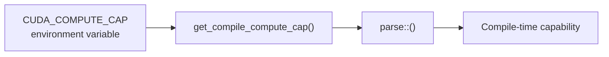
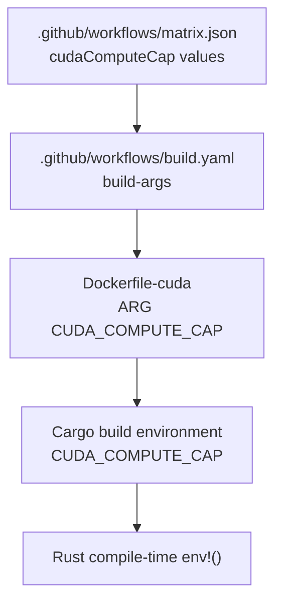
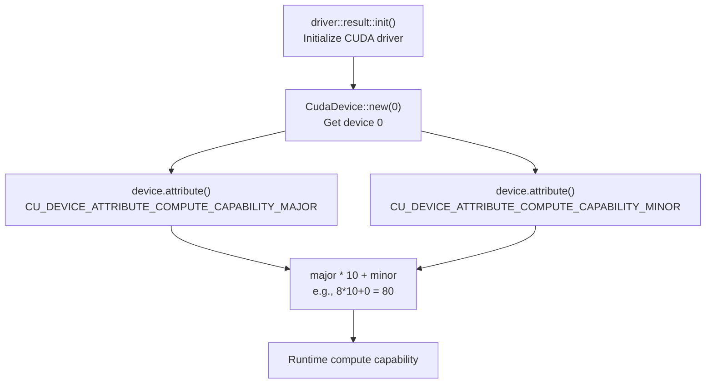
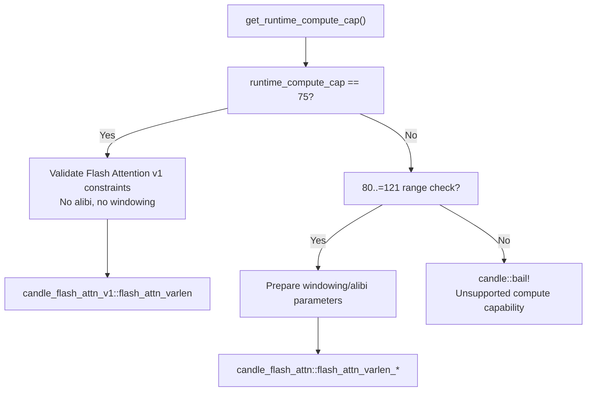

<!-- source: DeepWiki mcp.deepwiki.com · repo huggingface/text-embeddings-inference · page 5.1 CUDA Compute Capability System · fetched 2026-10-26 -->

# CUDA Compute Capability System

<details>
<summary>Relevant source files</summary>

The following files were used as context for generating this wiki page:

- [.github/workflows/build.yaml](.github/workflows/build.yaml)
- [.github/workflows/matrix.json](.github/workflows/matrix.json)
- [backends/candle/src/compute_cap.rs](backends/candle/src/compute_cap.rs)
- [backends/candle/src/flash_attn.rs](backends/candle/src/flash_attn.rs)
- [backends/candle/src/lib.rs](backends/candle/src/lib.rs)
- [backends/candle/src/models/mod.rs](backends/candle/src/models/mod.rs)

</details>


## Purpose and Scope

This document describes the CUDA compute capability detection, validation, and optimization system in Text Embeddings Inference (TEI). The system ensures binary compatibility between compiled CUDA kernels and runtime GPU hardware, while enabling automatic selection of optimal Flash Attention implementations.

**Scope:**
- Compile-time and runtime compute capability detection.
- Compatibility matching logic between build-time and runtime GPUs.
- Flash Attention version selection (v1 vs v2) and feature validation.
- Build matrix configuration for different GPU generations.
- Multi-architecture image support.

For general hardware optimization strategies beyond CUDA, see [Intel Platform Optimization](). For cuBLASLt kernel details, see [cuBLASLt and Performance Kernels]().

**Sources:** [backends/candle/src/compute_cap.rs:1-47](), [backends/candle/src/flash_attn.rs:1-120]()

---

## Compute Capability Overview

NVIDIA GPUs have a **compute capability** version that determines which CUDA features and instruction sets are available. TEI uses this to:

1. Compile optimized binaries for specific GPU generations.
2. Select appropriate Flash Attention implementations at runtime via `flash_attn_varlen`.
3. Ensure binary compatibility during deployment using `compatible_compute_cap`.

### Supported Compute Capabilities

| Compute Cap | GPU Architecture | Example GPUs | Flash Attention | Feature Flag |
|-------------|------------------|--------------|-----------------|--------------|
| 75 | Turing | T4, RTX 2080 Ti | v1 | `flash-attn-v1` |
| 80 | Ampere | A100, A10G, RTX 3090 | v2 | `flash-attn` |
| 86 | Ampere | A10 | v2 | `flash-attn` |
| 89 | Ada Lovelace | RTX 4090, L40S | v2 | `flash-attn` |
| 90 | Hopper | H100 | v2 | `flash-attn` |
| 100-121 | Blackwell | B100, B200, GB200 | v2 | `flash-attn` |

**Sources:** [.github/workflows/matrix.json:1-75](), [backends/candle/src/compute_cap.rs:26-38](), [backends/candle/src/flash_attn.rs:39-69]()

---

## Compile-Time Compute Capability

The compile-time compute capability is set via the `CUDA_COMPUTE_CAP` environment variable during the Rust build process. This value determines which CUDA kernels and features are compiled into the binary.

### Environment Variable Reading



The function `get_compile_compute_cap` retrieves this value:

[backends/candle/src/compute_cap.rs:8-12]()

```rust
pub fn get_compile_compute_cap() -> Result<usize, anyhow::Error> {
    env!("CUDA_COMPUTE_CAP")
        .parse::<usize>()
        .context("Could not retrieve compile time CUDA_COMPUTE_CAP")
}
```

### Build System Configuration

The build system passes `CUDA_COMPUTE_CAP` through multiple layers:



**Sources:** [.github/workflows/build.yaml:132](), [backends/candle/src/compute_cap.rs:8-12](), [.github/workflows/matrix.json:1-75]()

---

## Runtime Compute Capability Detection

At application startup, the system queries the actual GPU hardware to determine its compute capability. This enables validation and dynamic feature selection.

### GPU Query Process



Implementation in [backends/candle/src/compute_cap.rs:14-24]():

```rust
pub fn get_runtime_compute_cap() -> Result<usize, anyhow::Error> {
    driver::result::init().context("CUDA is not available")?;
    let device = CudaDevice::new(0).context("CUDA is not available")?;
    let major = device
        .attribute(CU_DEVICE_ATTRIBUTE_COMPUTE_CAPABILITY_MAJOR)
        .context("Could not retrieve device compute capability major")?;
    let minor = device
        .attribute(CU_DEVICE_ATTRIBUTE_COMPUTE_CAPABILITY_MINOR)
        .context("Could not retrieve device compute capability minor")?;
    Ok((major * 10 + minor) as usize)
}
```

The runtime capability is cached using a static `Once` initialization in the `flash_attn` module to avoid repeated GPU queries:

[backends/candle/src/flash_attn.rs:4-20]()

**Sources:** [backends/candle/src/compute_cap.rs:14-24](), [backends/candle/src/flash_attn.rs:4-20]()

---

## Compatibility Matching Logic

The system validates that binaries compiled for a specific compute capability can run on the detected GPU hardware. Compatibility is not always an exact match due to forward compatibility within GPU families.

### Matching Rules

The `compute_cap_matching` function defines the compatibility matrix:

[backends/candle/src/compute_cap.rs:26-38]()

```rust
fn compute_cap_matching(runtime_compute_cap: usize, compile_compute_cap: usize) -> bool {
    match (runtime_compute_cap, compile_compute_cap) {
        (75, 75) => true,
        (80..=89, 80) => true,
        (86..=89, 80..=86) => true,
        (89, 89) => true,
        (90, 90) => true,
        (100, 100) => true,
        (120..=121, 120) => true,
        (121, 121) => true,
        (_, _) => false,
    }
}
```

### Compatibility Matrix

| Runtime CC | Compatible Compile CC | Reason |
|------------|----------------------|--------|
| 75 | 75 | Turing requires exact match |
| 80-89 | 80 | Base Ampere build supports Ada |
| 86-89 | 80-86 | A10 builds support Ada |
| 90 | 90 | Hopper requires exact match |
| 100 | 100 | Blackwell B100 requires exact match |
| 120-121 | 120 | Blackwell B200 builds support GB200 |

**Sources:** [backends/candle/src/compute_cap.rs:26-38]()

---

## Flash Attention Version Selection

The `flash_attn_varlen` function acts as a dispatcher that selects the appropriate Flash Attention implementation based on the detected `runtime_compute_cap`.

### Selection Logic Flow



### Implementation Details

From [backends/candle/src/flash_attn.rs:36-120]():

**Turing (CC 75) - Flash Attention v1:**
- Requires `flash-attn-v1` feature flag.
- Does not support Alibi or attention windowing [backends/candle/src/flash_attn.rs:40-45]().

**Ampere to Blackwell (CC 80-121) - Flash Attention v2:**
- Requires `flash-attn` feature flag.
- Supports Alibi via `flash_attn_varlen_alibi_windowed` [backends/candle/src/flash_attn.rs:83-95]().
- Supports sliding window attention via `flash_attn_varlen_windowed` [backends/candle/src/flash_attn.rs:97-108]().

The `use_flash_attn` helper in the backend library also checks the `USE_FLASH_ATTENTION` environment variable and ensures runtime CC >= 80 for v2:

[backends/candle/src/lib.rs:45-68]()

**Sources:** [backends/candle/src/flash_attn.rs:23-120](), [backends/candle/src/lib.rs:45-68]()

---

## Build Matrix and Image Selection

The GitHub Actions workflow uses `matrix.json` to build images for all supported compute capabilities in parallel.

### Matrix Examples

From [.github/workflows/matrix.json:1-75]():

- **Turing (75)**: `"cudaComputeCap": 75`, uses `Dockerfile-cuda`.
- **Ampere (80)**: `"cudaComputeCap": 80`, primary image.
- **Hopper (90)**: `"cudaComputeCap": 90`, uses `hopper-` prefix.
- **Blackwell (120/121)**: `"cudaComputeCap": 120` and `121`, targeting newer architectures.

### Multi-Architecture Support (cuda-all)

The `Dockerfile-cuda-all` build (referenced in `matrix.json`) provides a single image containing multiple binaries. At runtime, an entrypoint script selects the binary matching the host's compute capability.

**Sources:** [.github/workflows/matrix.json:1-83](), [.github/workflows/build.yaml:120-143]()

---

## Testing and Validation

The system includes unit tests to verify the compatibility matching logic, ensuring that forward compatibility rules (like Ada running Ampere builds) are strictly maintained.

[backends/candle/src/compute_cap.rs:50-110]()

```rust
#[cfg(test)]
mod tests {
    use crate::compute_cap::compute_cap_matching;

    #[test]
    fn test_compute_cap() {
        assert!(compute_cap_matching(75, 75));
        assert!(compute_cap_matching(80, 80));
        assert!(compute_cap_matching(121, 120)); // Blackwell compatibility
        assert!(compute_cap_matching(89, 80));  // Ada on Ampere build
        
        assert!(!compute_cap_matching(75, 80)); // Turing cannot run Ampere
        assert!(!compute_cap_matching(90, 80)); // Hopper cannot run Ampere
    }
}
```

**Sources:** [backends/candle/src/compute_cap.rs:49-110]()

---

