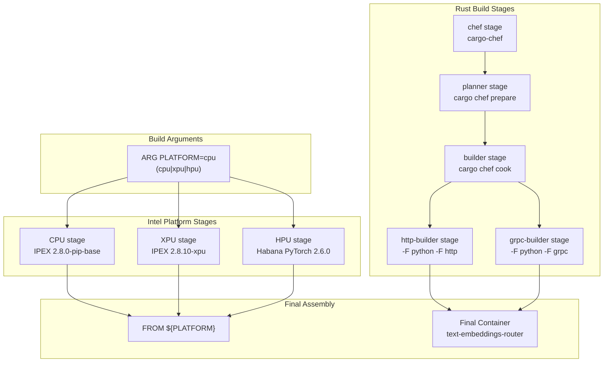
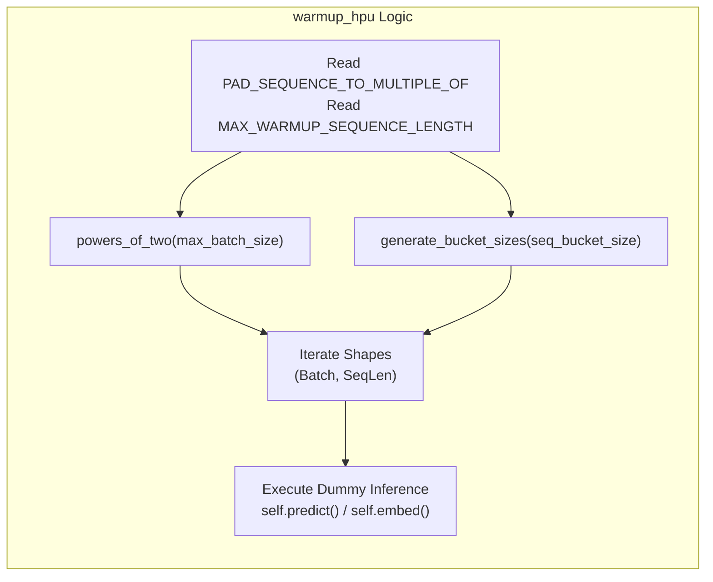

<!-- source: DeepWiki mcp.deepwiki.com · repo huggingface/text-embeddings-inference · page 5.2 Intel Platform Optimization · fetched 2026-10-26 -->

# Intel Platform Optimization

<details>
<summary>Relevant source files</summary>

The following files were used as context for generating this wiki page:

- [.gitignore](.gitignore)
- [Dockerfile-intel](Dockerfile-intel)
- [backends/ort/Cargo.toml](backends/ort/Cargo.toml)
- [backends/ort/src/lib.rs](backends/ort/src/lib.rs)
- [backends/python/server/Makefile](backends/python/server/Makefile)
- [backends/python/server/poetry.lock](backends/python/server/poetry.lock)
- [backends/python/server/requirements-hpu.txt](backends/python/server/requirements-hpu.txt)
- [backends/python/server/requirements-intel.txt](backends/python/server/requirements-intel.txt)
- [backends/python/server/requirements.txt](backends/python/server/requirements.txt)
- [backends/src/lib.rs](backends/src/lib.rs)
- [docs/source/en/intel_container.md](docs/source/en/intel_container.md)
- [integration_tests/README.md](integration_tests/README.md)
- [integration_tests/gaudi/conftest.py](integration_tests/gaudi/conftest.py)
- [integration_tests/gaudi/test_embed.py](integration_tests/gaudi/test_embed.py)
- [integration_tests/pyproject.toml](integration_tests/pyproject.toml)
- [integration_tests/uv.lock](integration_tests/uv.lock)

</details>


## Purpose and Scope

This page documents Intel platform-specific optimizations in Text Embeddings Inference (TEI), covering CPU (with Intel MKL/IPEX), XPU (Intel Data Center GPU), and HPU (Habana Gaudi). These optimizations are implemented through specialized Docker builds, environment configurations, and the Python backend integration.

For general backend selection logic, see [Backend Architecture and Selection](#4.1). For the Python backend implementation details, see [Python Backend](#4.6).

---

## Supported Intel Platforms

TEI supports three distinct Intel hardware targets, each with specific base images and runtime requirements:

| Platform | Hardware | Base Image | PyTorch/IPEX Version | Primary Use Case |
|----------|----------|------------|-----------------|------------------|
| **CPU** | Intel Xeon | `intel/intel-extension-for-pytorch:2.8.0-pip-base` | 2.8.0 (CPU) | General-purpose CPU inference |
| **XPU** | Intel Data Center GPU | `intel/intel-extension-for-pytorch:2.8.10-xpu` | 2.8.10 (XPU) | GPU-accelerated Intel inference |
| **HPU** | Habana Gaudi 2/3 | `vault.habana.ai/.../pytorch-installer-2.6.0` | 2.6.0 (HPU) | High-throughput Habana accelerators |

**Sources**: [Dockerfile-intel:62-65](), [Dockerfile-intel:85-88](), [Dockerfile-intel:107-110](), [docs/source/en/intel_container.md:69-70]()

---

## Docker Build Architecture

The Intel optimization suite uses a unified `Dockerfile-intel` with a multi-stage, parameterized build flow.

### Build Pipeline



**Sources**: [Dockerfile-intel:1-154]()

---

## HPU (Habana Gaudi) Optimizations

HPUs require specialized handling due to their "Lazy Mode" execution and the need for static graph shapes to avoid frequent recompilations.

### Warmup and Bucketing

The `Backend` struct provides a `warmup_hpu` function that pre-compiles computation graphs for various batch sizes and sequence lengths. This prevents latency spikes during initial requests.



**Key Parameters**:
- `PAD_SEQUENCE_TO_MULTIPLE_OF`: Defaults to 128. Controls sequence length padding granularity [backends/src/lib.rs:144]().
- `MAX_WARMUP_SEQUENCE_LENGTH`: Limits the maximum sequence length during warmup [backends/src/lib.rs:145]().
- `PT_HPU_LAZY_MODE`: Must be set to `1` for Habana accelerators [Dockerfile-intel:88]().

**Sources**: [backends/src/lib.rs:133-190](), [backends/src/lib.rs:34-59]()

---

## XPU Platform Configuration

The XPU (Intel GPU) variant requires complex environment setup for the oneAPI stack and Level Zero drivers.

### oneAPI Environment Variables
The XPU stage configures the following critical paths for Intel's runtime:
- `CCL_ROOT`: `/opt/intel/oneapi/ccl/latest` [Dockerfile-intel:124]()
- `LD_LIBRARY_PATH`: Includes paths for MKL, MPI, and Intel compilers [Dockerfile-intel:128]()
- `FI_PROVIDER_PATH`: Configures libfabric providers for inter-GPU communication [Dockerfile-intel:126]()

### XPU Driver and Toolkit Installation
The build process adds Intel GPU repositories and installs the `intel-basekit` along with specialized PyTorch wheels:
- `torch==2.8.0` with XPU index URL [Dockerfile-intel:121]()
- `intel-extension-for-pytorch==2.8.10+xpu` [Dockerfile-intel:122]()
- `oneccl_bind_pt==2.8.0+xpu` [Dockerfile-intel:122]()

**Sources**: [Dockerfile-intel:107-140]()

---

## Dependency Management

TEI maintains separate requirement files to ensure that Intel images do not include unnecessary CUDA or ROCm bloat.

### Platform Requirements

| File | Key Components | Exclusions |
|------|----------------|------------|
| `requirements-intel.txt` | `transformers`, `einops`, `opentelemetry` | `nvidia-*`, `triton` |
| `requirements-hpu.txt` | `accelerate`, `habana-torch` (via base), `pandas` | `nvidia-*` |

**Sources**: [backends/python/server/requirements-intel.txt:1-46](), [backends/python/server/requirements-hpu.txt:1-61]()

---

## ONNX Runtime (ORT) on Intel

While many Intel optimizations use the Python backend, the `OrtBackend` supports Intel CPUs via the `onednn` feature in the `ort` crate.

- **Execution Provider**: Uses `onednn` for optimized CPU kernels [backends/ort/Cargo.toml:13]().
- **Intra-op Threads**: Automatically scales to `num_cpus::get()` [backends/ort/src/lib.rs:130]().
- **Optimization Level**: Sets `GraphOptimizationLevel::Level3` for maximum performance [backends/ort/src/lib.rs:132]().

**Sources**: [backends/ort/src/lib.rs:128-135](), [backends/ort/Cargo.toml:13]()

---

## Deployment and Usage

### Build Commands
Users can build specific Intel images using the `PLATFORM` build argument:
```bash
# CPU Build
docker build -f Dockerfile-intel --build-arg PLATFORM=cpu -t tei-cpu .

# HPU Build
docker build -f Dockerfile-intel --build-arg PLATFORM=hpu -t tei-hpu .
```

### Runtime Configuration
For HPU deployment, the `--runtime=habana` flag is mandatory, and the `MAX_WARMUP_SEQUENCE_LENGTH` should be tuned to the model's expected workload to optimize graph compilation.

```bash
docker run -p 8080:80 -v $PWD/data:/data --runtime=habana \
  -e HABANA_VISIBLE_DEVICES=all \
  -e MAX_WARMUP_SEQUENCE_LENGTH=512 \
  tei-hpu --model-id Qwen/Qwen3-Embedding-0.6B --dtype bfloat16
```

**Sources**: [docs/source/en/intel_container.md:72-91](), [Dockerfile-intel:1-154]()

---

