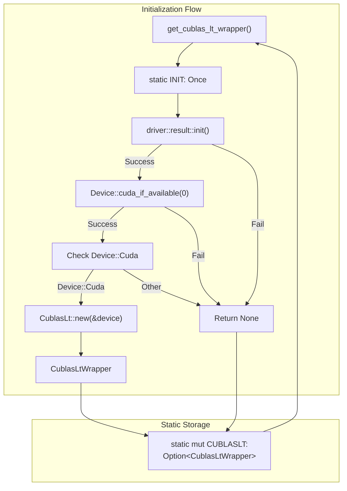
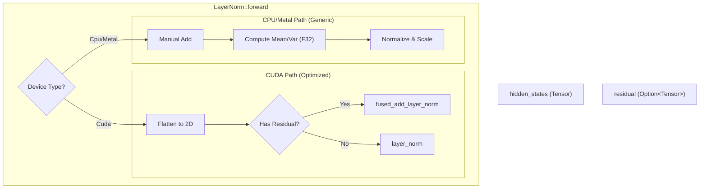

<!-- source: DeepWiki mcp.deepwiki.com · repo huggingface/text-embeddings-inference · page 5.3 cuBLASLt and Performance Kernels · fetched 2026-10-26 -->

# cuBLASLt and Performance Kernels

<details>
<summary>Relevant source files</summary>

The following files were used as context for generating this wiki page:

- [backends/candle/src/alibi.rs](backends/candle/src/alibi.rs)
- [backends/candle/src/layers/cublaslt.rs](backends/candle/src/layers/cublaslt.rs)
- [backends/candle/src/layers/index_select.rs](backends/candle/src/layers/index_select.rs)
- [backends/candle/src/layers/layer_norm.rs](backends/candle/src/layers/layer_norm.rs)
- [backends/candle/src/layers/mod.rs](backends/candle/src/layers/mod.rs)
- [backends/candle/src/models/flash_gte.rs](backends/candle/src/models/flash_gte.rs)
- [backends/candle/src/models/flash_qwen2.rs](backends/candle/src/models/flash_qwen2.rs)
- [backends/candle/src/models/gte.rs](backends/candle/src/models/gte.rs)
- [backends/candle/src/models/qwen2.rs](backends/candle/src/models/qwen2.rs)

</details>


## Purpose and Scope

This document covers the hardware-accelerated kernels and fused operations used within the Candle backend. It specifically details the `cuBLASLt` wrapper implementation, optimized layer normalization, ALiBI attention bias generation, and CUDA-accelerated index selection. These components collectively reduce memory bandwidth bottlenecks and minimize kernel launch overhead on NVIDIA GPUs.

---

## cuBLASLt Wrapper Architecture

The `cuBLASLt` functionality is encapsulated in the `CublasLtWrapper` struct, providing a safe Rust interface to NVIDIA's cuBLASLt library. This library allows for "fused" matrix operations, combining multiplication, scaling, bias addition, and activation into a single GPU kernel.

### Initialization and Availability

The wrapper is initialized lazily and stored in a static variable.



**Sources:** [backends/candle/src/layers/cublaslt.rs:8-39]()

### Fused Matrix Multiplication API

The wrapper exposes `matmul` and `batch_matmul` which interface with `fused_matmul` and `fused_batch_matmul` from the `candle-cublaslt` crate.

| Method | Role | Fused Capabilities |
| :--- | :--- | :--- |
| `matmul` | Standard GEMM | Alpha scaling, Beta scaling, Bias addition, GELU/RELU activation. |
| `batch_matmul` | Batched GEMM | Same as above, optimized for 3D tensors (batch*heads, seq, dim). |

**Sources:** [backends/candle/src/layers/cublaslt.rs:49-128]()

### Activation Mapping

When using the wrapper, `HiddenAct` enums are mapped to native cuBLASLt activations where possible.

*   **Native Fusion:** `HiddenAct::Gelu` and `HiddenAct::Relu` are fused directly into the GEMM kernel [backends/candle/src/layers/cublaslt.rs:61-76]().
*   **Partial Fusion:** `HiddenAct::Swiglu` is not natively supported for fusion in cuBLASLt; the GEMM is executed, followed by a separate `candle_nn::ops::swiglu` call [backends/candle/src/layers/cublaslt.rs:78-80]().

---

## Optimized Layer Normalization

The `LayerNorm` and `LayerNormNoBias` implementations provide a unified interface that dispatches to highly optimized CUDA kernels when available.

### Data Flow for LayerNorm



**Sources:** [backends/candle/src/layers/layer_norm.rs:104-161]()

### Key Performance Features
1.  **Fused Add-Norm:** On CUDA, if a residual tensor is provided, the system uses `fused_add_layer_norm` from the `candle-layer-norm` crate. This combines the residual addition and normalization into one kernel launch [backends/candle/src/layers/layer_norm.rs:141-152]().
2.  **Precision Handling:** On non-CUDA devices, calculations are upcast to `F32` for stability before being cast back to the original `DType` [backends/candle/src/layers/layer_norm.rs:113-117]().

---

## ALiBI (Attention with Linear Biases)

For models like GTE that may use ALiBI instead of positional embeddings, TEI provides a specialized tensor builder to generate head-specific slopes.

### Slope Generation Logic
The function `alibi_head_slopes` calculates geometric sequences of slopes. If the number of heads is not a power of 2, it calculates the slopes for the closest power of 2 and then fills the remainder by interpolating from a sequence twice as large [backends/candle/src/alibi.rs:24-47]().

### Tensor Construction
`build_alibi_tensor` creates a 4D tensor of shape `(1, num_heads, seq_len, seq_len)` where each head has a different bias matrix based on its calculated slope and the relative distance between tokens [backends/candle/src/alibi.rs:49-80]().

---

## Index Select Optimization

The `index_select` utility in TEI is a performance wrapper around the standard Candle operation.

```rust
pub fn index_select(tensor: &Tensor, ids: &Tensor, dim: usize) -> Result<Tensor> {
    #[cfg(not(feature = "cuda"))]
    {
        tensor.index_select(ids, dim)
    }
    #[cfg(feature = "cuda")]
    {
        candle_index_select_cu::index_select(tensor, ids, dim)
    }
}
```

On CUDA-enabled builds, it uses the `candle-index-select-cu` crate, which provides a specialized kernel for gathering indices, significantly faster than the generic implementation for large embedding lookups or token gathering.

**Sources:** [backends/candle/src/layers/index_select.rs:10-19]()

---

## Integration in Model Architectures

### GTE (Standard vs. Flash)
The GTE implementation demonstrates the choice between cuBLASLt and Flash Attention:

*   **Standard GTE:** Uses `get_cublas_lt_wrapper()` to perform batched matrix multiplication for attention scores. It fuses the `softmax_scale` (alpha) and `attention_bias` addition (beta) into the `batch_matmul` call [backends/candle/src/models/gte.rs:106-135]().
*   **Flash GTE:** Bypasses cuBLASLt for the attention mechanism entirely, instead calling `flash_attn_varlen` for superior performance on supported hardware [backends/candle/src/models/flash_gte.rs:80-93]().

### Qwen2 and RMSNorm
Qwen2 models utilize `RMSNorm` [backends/candle/src/models/flash_qwen2.rs:194-203](), which is another optimized kernel similar to `LayerNorm` but without the mean-centering step, reducing computation.

**Sources:** [backends/candle/src/models/gte.rs:106-171](), [backends/candle/src/models/flash_gte.rs:80-93](), [backends/candle/src/models/flash_qwen2.rs:2-10]()

---

