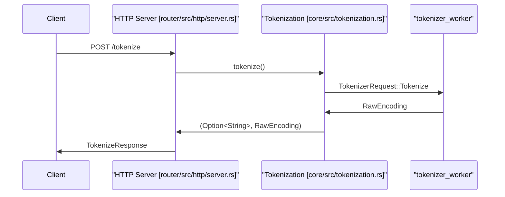
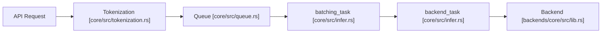

<!-- source: DeepWiki mcp.deepwiki.com · repo huggingface/text-embeddings-inference · page 6 API Reference · fetched 2026-10-26 -->

# API Reference

<details>
<summary>Relevant source files</summary>

The following files were used as context for generating this wiki page:

- [Cargo.lock](Cargo.lock)
- [Cargo.toml](Cargo.toml)
- [core/src/infer.rs](core/src/infer.rs)
- [core/src/queue.rs](core/src/queue.rs)
- [core/src/tokenization.rs](core/src/tokenization.rs)
- [docs/openapi.json](docs/openapi.json)
- [proto/tei.proto](proto/tei.proto)
- [router/src/grpc/server.rs](router/src/grpc/server.rs)
- [router/src/http/server.rs](router/src/http/server.rs)
- [router/src/http/types.rs](router/src/http/types.rs)
- [router/tests/test_http_embed.rs](router/tests/test_http_embed.rs)

</details>


This document provides a comprehensive reference for the Text Embeddings Inference (TEI) HTTP and gRPC APIs. It details all available endpoints, request/response formats, and error handling for integrating with the TEI service.

## API Overview

Text Embeddings Inference exposes a RESTful HTTP API and a gRPC interface that allow you to generate embeddings, perform classification, and execute tokenization.

```mermaid
flowchart TD
    Client["Client Application"]
    
    subgraph "TEI API [router/src/http/server.rs]"
        subgraph "Model Information"
            info["/info - get_model_info"]
            health["/health - health"]
        end
        
        subgraph "Tokenization Operations"
            tokenize["/tokenize - tokenize"]
            decode["/decode - decode"]
        end
        
        subgraph "Embedding Operations"
            embed["/embed - embed"]
            embed_all["/embed_all - embed_all"]
            embed_sparse["/embed_sparse - embed_sparse"]
            similarity["/similarity - similarity"]
        end
        
        subgraph "Classification Operations"
            predict["/predict - predict"]
            rerank["/rerank - rerank"]
        end
        
        subgraph "Compatibility"
            openai["/v1/embeddings - openai_embeddings"]
        end
    end
    
    Client --> Model Information
    Client --> Tokenization Operations
    Client --> Embedding Operations
    Client --> Classification Operations
    Client --> Compatibility
```

Sources: [router/src/http/server.rs:46-1144](), [docs/openapi.json:15-786]()

## Common API Patterns

### Response Status Codes

TEI uses standard HTTP status codes to indicate the success or failure of requests [router/src/http/server.rs:20-22]():

| Status Code | Description |
|-------------|-------------|
| 200 | Success - The request was successfully processed |
| 400 | Bad Request - Batch is empty [router/src/http/server.rs:94-95]() |
| 413 | Payload Too Large - Batch size exceeds limits [router/src/http/server.rs:96-97]() |
| 422 | Unprocessable Entity - Tokenization error [router/src/http/server.rs:92-93]() |
| 424 | Failed Dependency - Backend inference failed [router/src/http/server.rs:88-89]() |
| 429 | Too Many Requests - Model is overloaded [router/src/http/server.rs:90-91]() |
| 503 | Service Unavailable - System is unhealthy [router/src/http/server.rs:64-65]() |

### Error Responses

All error responses follow a consistent format defined by the `ErrorResponse` struct [router/src/http/server.rs:13]():

```json
{
  "error": "Description of the error",
  "error_type": "ErrorType"
}
```

Where `error_type` is one of the variants in the `ErrorType` enum: `Unhealthy`, `Backend`, `Overloaded`, `Validation`, or `Tokenizer` [router/src/http/server.rs:13]().

Sources: [router/src/http/server.rs:70-109](), [docs/openapi.json:1025-1049]()

## Model Information Endpoints

### GET /info
Returns the `Info` struct containing model metadata and server configuration [router/src/http/server.rs:54-56]().

### GET /health
Checks system health by calling `infer.health()` [router/src/http/server.rs:70-78]().

Sources: [router/src/http/server.rs:46-78](), [docs/openapi.json:323-391]()

## Tokenization Endpoints

The tokenization system uses a background worker pool to handle processing [core/src/tokenization.rs:51-62]().



### POST /tokenize
Converts text into a list of `SimpleToken` objects [router/src/http/types.rs:8](). For details, see [HTTP API Endpoints](#6.1).

### POST /decode
Converts a vector of token IDs back into a string [core/src/tokenization.rs:138-167]().

Sources: [core/src/tokenization.rs:104-167](), [router/src/http/server.rs:643-731]()

## Embedding Endpoints

TEI supports multiple embedding representations depending on the model configuration.

### POST /embed
The primary endpoint for generating pooled, dense embeddings. Supports Matryoshka Representation Learning (MRL) via the `dimensions` parameter [router/src/http/types.rs:161-163]().

### POST /embed_all
Returns the hidden states for every token in the input without applying pooling [router/src/http/server.rs:328-393]().

### POST /embed_sparse
Generates sparse embeddings for models using SPLADE pooling [router/src/http/server.rs:257-326]().

### POST /similarity
Calculates the spatial similarity between a `source_sentence` and a list of `sentences` [router/src/http/server.rs:564-641]().

Sources: [router/src/http/server.rs:188-641](), [core/src/infer.rs:118-210]()

## Classification and Reranking Endpoints

### POST /predict
Used for sequence classification. It maps model output logits to labels using the `id2label` mapping from the model configuration [router/src/http/server.rs:139-143]().

### POST /rerank
A specialized endpoint for cross-encoders that ranks a list of documents against a query [router/src/http/server.rs:468-562]().

Sources: [router/src/http/server.rs:104-186](), [router/src/http/server.rs:468-562]()

## gRPC API

TEI provides a high-performance gRPC interface defined in `tei.proto`. It supports unary and streaming variants for all major operations.

| Service | Methods |
|---------|---------|
| `Embed` | `Embed`, `EmbedStream`, `EmbedSparse`, `EmbedAll` |
| `Predict` | `Predict`, `PredictPair` |
| `Rerank` | `Rerank`, `RerankStream` |
| `Tokenize` | `Tokenize`, `Decode` |

For details, see [gRPC API](#6.2).

Sources: [proto/tei.proto:5-37](), [router/src/grpc/server.rs:46-300]()

## Request Lifecycle and Batching

Requests are validated, tokenized, and then placed into a `Queue` [core/src/queue.rs:36-39](). A `batching_task` pulls entries from the queue to form a `NextBatch` based on `max_batch_tokens` and `max_batch_requests` [core/src/queue.rs:139-182]().



Sources: [core/src/infer.rs:37-44](), [core/src/queue.rs:139-182]()

## Further Information

- For detailed HTTP parameter schemas, see [HTTP API Endpoints](#6.1).
- For protobuf definitions and gRPC streaming, see [gRPC API](#6.2).
- To access the interactive Swagger documentation, navigate to `/docs` on a running TEI instance [router/src/http/server.rs:44]().
- For client SDK usage, see [Client Libraries and Examples](#6.4).

---

