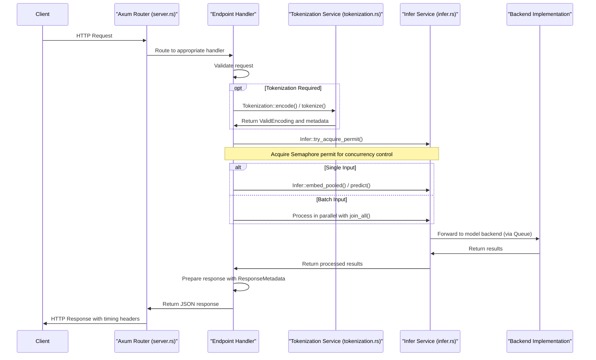
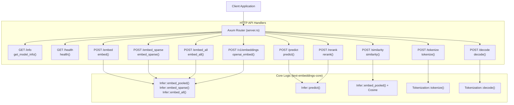

<!-- source: DeepWiki mcp.deepwiki.com · repo huggingface/text-embeddings-inference · page 6.1 HTTP API Endpoints · fetched 2026-10-26 -->

# HTTP API Endpoints

<details>
<summary>Relevant source files</summary>

The following files were used as context for generating this wiki page:

- [Cargo.lock](Cargo.lock)
- [Cargo.toml](Cargo.toml)
- [core/src/infer.rs](core/src/infer.rs)
- [core/src/queue.rs](core/src/queue.rs)
- [core/src/tokenization.rs](core/src/tokenization.rs)
- [docs/openapi.json](docs/openapi.json)
- [proto/tei.proto](proto/tei.proto)
- [router/src/grpc/server.rs](router/src/grpc/server.rs)
- [router/src/http/server.rs](router/src/http/server.rs)
- [router/src/http/types.rs](router/src/http/types.rs)
- [router/tests/test_http_embed.rs](router/tests/test_http_embed.rs)
- [router/tests/test_http_predict.rs](router/tests/test_http_predict.rs)
- [router/tests/test_http_rerank.rs](router/tests/test_http_rerank.rs)

</details>


This page documents the HTTP API provided by Text Embeddings Inference (TEI), which serves as the primary interface for clients to interact with embedding, classification, and reranking models. For information about the gRPC API, see [gRPC API](6.2).

## Request Processing Flow

The diagram below illustrates how HTTP requests are processed through the TEI system, showing the interaction between the Axum router, the tokenization pool, and the inference engine.



Sources: [router/src/http/server.rs:104-279](), [router/src/http/server.rs:562-733](), [core/src/infer.rs:94-115](), [core/src/tokenization.rs:68-101]()

## API Endpoints Overview

TEI exposes several POST endpoints tailored to specific model types (Embedding, Classifier, Reranker).

| Endpoint | Method | Description | Model Type |
|----------|--------|-------------|------------|
| `/info` | GET | Get model information | Any |
| `/health` | GET | Health check | Any |
| `/metrics` | GET | Prometheus metrics | Any |
| `/embed` | POST | Generate pooled vector embeddings | Embedding |
| `/embed_sparse` | POST | Generate sparse embeddings | Embedding (with SPLADE) |
| `/embed_all` | POST | Generate per-token embeddings | Embedding |
| `/predict` | POST | Get classification predictions | Classifier |
| `/rerank` | POST | Rerank texts by relevance to query | Reranker |
| `/similarity` | POST | Calculate text similarity | Embedding |
| `/tokenize` | POST | Tokenize input text | Any |
| `/decode` | POST | Decode token IDs to text | Any |
| `/v1/embeddings` | POST | OpenAI-compatible embeddings | Embedding |



Sources: [router/src/http/server.rs:46-280](), [router/src/http/server.rs:562-915](), [docs/openapi.json:15-786]()

## Common Request Parameters

Many endpoints share common parameters for controlling request behavior:

| Parameter | Type | Description |
|-----------|------|-------------|
| `inputs` | String, Array, or Object | Text input(s) to process. Can be single string or pairs for Rerank/Predict. |
| `truncate` | Boolean | Whether to truncate inputs exceeding model's maximum context length. Defaults to `info.auto_truncate`. |
| `truncation_direction` | String | Direction for truncation: "Left" or "Right" (default: "Right"). |
| `prompt_name` | String | Optional prompt template name defined in `tokenizer_config.json`. |

Sources: [router/src/http/types.rs:11-32](), [router/src/http/types.rs:406-429](), [core/src/tokenization.rs:182-186]()

## Common Response Headers

All API endpoints return metadata headers containing high-resolution timing information extracted from `ResponseMetadata`.

| Header | Description |
|--------|-------------|
| `x-compute-chars` | Number of characters processed. |
| `x-compute-tokens` | Number of tokens processed. |
| `x-total-time` | Total processing time (ms). |
| `x-tokenization-time` | Time spent on tokenization workers (ms). |
| `x-queue-time` | Time spent waiting in the batching queue (ms). |
| `x-inference-time` | Time spent on the model backend (ms). |

Sources: [router/src/http/server.rs:165-198](), [router/src/http/server.rs:712-729]()

## Detailed Endpoint Documentation

### Model Information and Health

#### GET /info
Returns metadata about the loaded model, including its type (Embedding, Classifier, or Reranker) and constraints.
Sources: [router/src/http/server.rs:46-56](), [docs/openapi.json:351-370]()

#### GET /health
Verifies backend health. Returns `200` if the backend is responsive, otherwise `503`.
Sources: [router/src/http/server.rs:58-78](), [docs/openapi.json:323-349]()

### Embedding Endpoints

#### POST /embed
Generates pooled vector embeddings. Supports Matryoshka Representation Learning (MRL) via the `dimensions` parameter.
- **Normalize**: If `true`, the resulting vector is L2 normalized.
- **Dimensions**: Optional integer to truncate the embedding vector (MRL).
Sources: [router/src/http/server.rs:562-733](), [router/tests/test_http_embed.rs:11-55]()

#### POST /embed_sparse
Generates sparse embeddings for models using SPLADE (Sparse Lexical and Expansion) pooling. Returns a list of `index`/`value` pairs for non-zero activations.
Sources: [router/src/http/server.rs:736-915](), [core/src/infer.rs:169-203]()

#### POST /embed_all
Returns the raw hidden states for every token in the input sequence. Not available for SPLADE models.
Sources: [router/src/http/server.rs:919-988](), [core/src/infer.rs:118-166]()

#### POST /v1/embeddings
An OpenAI-compatible endpoint. Supports `input` as string or array and `encoding_format` (float or base64).
Sources: [router/src/http/types.rs:315-360](), [router/src/http/server.rs:1053-1145]()

### Classification and Reranking

#### POST /predict
Used for Sequence Classification. Maps model output logits to labels using the model's `id2label` configuration.
- **raw_scores**: If `true`, returns raw logits instead of softmax probabilities.
Sources: [router/src/http/server.rs:81-280](), [router/src/http/types.rs:35-138]()

#### POST /rerank
Calculates the relevance of a list of `texts` relative to a `query`. Internally uses a Cross-Encoder architecture.
Sources: [router/src/http/server.rs:303-474](), [router/src/http/types.rs:240-272]()

#### POST /similarity
Calculates the cosine similarity between a `source_sentence` and a list of `sentences` by generating embeddings and performing spatial similarity calculations using `simsimd`.
Sources: [router/src/http/server.rs:477-559](), [router/src/http/server.rs:545-548]()

### Tokenization Utilities

#### POST /tokenize
Returns the tokenization details for the input text, including token IDs, the text representation of each token, and character offsets (`start`/`stop`).
Sources: [core/src/tokenization.rs:104-135](), [router/src/http/types.rs:504-550]()

#### POST /decode
Converts a list of token IDs back into a single string.
Sources: [core/src/tokenization.rs:138-167](), [router/src/http/types.rs:559-573]()

## Input and Output Data Types

The system uses specialized Enums to handle flexible input types (single strings, pairs, or batches).

```mermaid
classDiagram
    class Sequence {
        <<enum>>
        Single(String)
        Pair(String, String)
    }
    
    class PredictInput {
        <<enum>>
        Single(Sequence)
        Batch(Vec~Sequence~)
    }
    
    class EncodingInput {
        <<enum>>
        Single(String)
        Dual(String, String)
    }
    
    class ValidEncoding {
        input_ids: Vec~u32~
        token_type_ids: Vec~u32~
        position_ids: Vec~u32~
    }
    
    PredictInput --> Sequence
    Sequence ..> EncodingInput : conversion
    EncodingInput --> ValidEncoding : via Tokenization::encode()
```

Sources: [router/src/http/types.rs:11-32](), [router/src/http/types.rs:35-38](), [core/src/tokenization.rs:207-213]()

## Error Handling

TEI uses the `ErrorResponse` struct to provide structured error messages.

| Status Code | Error Type | Description |
|-------------|------------|-------------|
| 400 | `empty` | Input text or batch is empty. |
| 413 | `validation` | Input exceeds `max_input_length` or batch exceeds `max_batch_tokens`. |
| 422 | `tokenizer` | Failure during the tokenization process. |
| 424 | `backend` | The model backend failed to process the request (e.g., NaN scores). |
| 429 | `overloaded` | No semaphore permits available (too many concurrent requests). |
| 503 | `unhealthy` | Health check failed. |

Sources: [router/src/http/server.rs:70-78](), [router/src/http/server.rs:148-153](), [core/src/infer.rs:94-105]()

## Examples

### Embedding with MRL (Matryoshka)
```bash
curl -X POST http://localhost:8080/embed \
  -H "Content-Type: application/json" \
  -d '{"inputs": "test", "dimensions": 128}'
```
Sources: [router/tests/test_http_embed.rs:19-22]()

### Reranking
```bash
curl -X POST http://localhost:8080/rerank \
  -H "Content-Type: application/json" \
  -d '{
    "query": "What is deep learning?",
    "texts": ["It is a subset of ML", "The weather is nice"],
    "return_text": true
  }'
```
Sources: [router/src/http/server.rs:303-315]()

---

