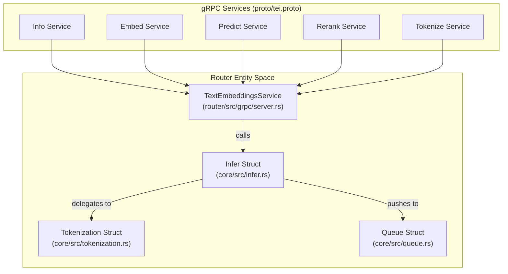
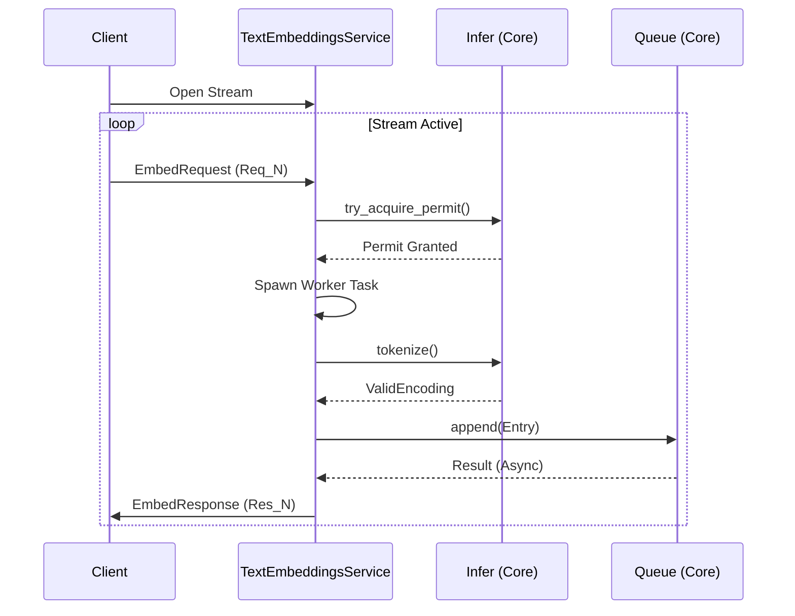

<!-- source: DeepWiki mcp.deepwiki.com · repo huggingface/text-embeddings-inference · page 6.2 gRPC API · fetched 2026-10-26 -->

# gRPC API

Relevant source files

The following files were used as context for generating this wiki page:

- [.github/PULL_REQUEST_TEMPLATE.md](.github/PULL_REQUEST_TEMPLATE.md)
- [CODE_OF_CONDUCT.md](CODE_OF_CONDUCT.md)
- [CONTRIBUTING.md](CONTRIBUTING.md)
- [backends/grpc-client/build.rs](backends/grpc-client/build.rs)
- [backends/grpc-client/src/client.rs](backends/grpc-client/src/client.rs)
- [backends/proto/embed.proto](backends/proto/embed.proto)
- [core/src/infer.rs](core/src/infer.rs)
- [core/src/queue.rs](core/src/queue.rs)
- [core/src/tokenization.rs](core/src/tokenization.rs)
- [proto/tei.proto](proto/tei.proto)
- [router/src/grpc/server.rs](router/src/grpc/server.rs)
- [router/src/http/server.rs](router/src/http/server.rs)
- [router/src/http/types.rs](router/src/http/types.rs)
- [router/tests/test_http_embed.rs](router/tests/test_http_embed.rs)

This page documents the gRPC API interface provided by Text Embeddings Inference. The gRPC API offers all the same functionality as the HTTP API with additional support for bidirectional streaming RPCs for improved throughput in high-volume scenarios. For the HTTP REST API, see [HTTP API Endpoints](#6.1).

## Overview

The gRPC API is defined using Protocol Buffers (protobuf) and implemented using the `tonic` framework. The server provides five distinct services, each focused on a specific type of operation. All services support both unary (single request/response) and streaming variants.

**Key Characteristics:**
- Protocol Buffers v3 syntax defined in `tei.proto`.
- Bidirectional streaming support for high-throughput pipelining.
- Structured metadata responses for observability (timings, token counts).
- Type-safe request/response schemas.
- Server reflection and health checking enabled.

**Sources:** [proto/tei.proto:1-205](), [router/src/grpc/server.rs:1-43]()

## Service Architecture

The gRPC layer acts as a thin wrapper around the core `Infer` struct, translating Protobuf messages into internal types.

**Sources:** [router/src/grpc/server.rs:45-63](), [core/src/infer.rs:13-21](), [proto/tei.proto:5-37]()

## Service Definitions

### Info Service
Provides metadata about the deployed model and server configuration.

| RPC Method | Request Type | Response Type | Description |
|------------|--------------|---------------|-------------|
| `Info` | `InfoRequest` | `InfoResponse` | Returns model ID, type, and server limits |

**Sources:** [proto/tei.proto:5-9](), [router/src/grpc/server.rs:581-600]()

### Embed Service
Generates embeddings for text inputs.

| RPC Method | Request Type | Response Type | Streaming | Description |
|------------|--------------|---------------|-----------|-------------|
| `Embed` | `EmbedRequest` | `EmbedResponse` | Unary | Pooled dense embedding |
| `EmbedStream` | `EmbedRequest` | `EmbedResponse` | Bidirectional | Streaming pooled embeddings |
| `EmbedSparse` | `EmbedSparseRequest` | `EmbedSparseResponse` | Unary | SPLADE sparse embeddings |
| `EmbedAll` | `EmbedAllRequest` | `EmbedAllResponse` | Unary | Per-token embeddings |

**EmbedRequest Key Fields:**
- `inputs`: Text string to embed.
- `truncate`: Boolean to enable auto-truncation.
- `normalize`: Boolean (default true) to L2 normalize output [router/src/grpc/server.rs:94]().
- `dimensions`: Optional dimensionality for Matryoshka (MRL) models [router/src/grpc/server.rs:95]().

**Sources:** [proto/tei.proto:11-18](), [router/src/grpc/server.rs:76-121]()

### Predict Service
Classification and scoring for text or text pairs.

| RPC Method | Request Type | Response Type | Description |
|------------|--------------|---------------|-------------|
| `Predict` | `PredictRequest` | `PredictResponse` | Single text classification |
| `PredictPair` | `PredictPairRequest` | `PredictResponse` | Text pair scoring (Cross-Encoders) |

**Sources:** [proto/tei.proto:20-25](), [router/src/grpc/server.rs:260-330]()

### Rerank Service
Re-ranks a list of documents relative to a query.

| RPC Method | Request Type | Response Type | Description |
|------------|--------------|---------------|-----------|
| `Rerank` | `RerankRequest` | `RerankResponse` | Batch reranking |
| `RerankStream` | `RerankStreamRequest` | `RerankResponse` | Client-side streaming |

**Sources:** [proto/tei.proto:27-30](), [router/src/grpc/server.rs:805-971]()

### Tokenize Service
Exposes the internal tokenizer for debugging and length checks.

| RPC Method | Request Type | Response Type | Description |
|------------|--------------|---------------|-------------|
| `Tokenize` | `EncodeRequest` | `EncodeResponse` | Returns token IDs and text |
| `Decode` | `DecodeRequest` | `DecodeResponse` | Converts IDs back to string |

**Sources:** [proto/tei.proto:32-37](), [router/src/grpc/server.rs:332-377]()

## Streaming Implementation

Streaming RPCs (e.g., `EmbedStream`) utilize a background task architecture to process multiple requests concurrently while maintaining order.

**Implementation Details:**
- **Concurrency Control**: The server limits concurrent stream requests via `GRPC_MAX_PARALLEL_STREAM_REQUESTS` (default 1024) [router/src/grpc/server.rs:54-57]().
- **Ordering**: The implementation ensures that responses are returned in the same order as requests within a single stream.
- **Resource Management**: Each request in the stream must acquire a permit from the `limit_concurrent_requests` semaphore in the `Infer` struct [router/src/grpc/server.rs:406-407]().

**Sources:** [router/src/grpc/server.rs:379-470](), [core/src/infer.rs:94-105]()

## Observability and Metadata

Every inference response includes a `Metadata` message containing high-resolution timing data.

| Field | Unit | Description |
|-------|------|-------------|
| `compute_chars` | Count | Number of input characters [proto/tei.proto:64]() |
| `compute_tokens` | Count | Number of tokens processed [proto/tei.proto:65]() |
| `total_time_ns` | ns | Total request duration [proto/tei.proto:66]() |
| `tokenization_time_ns`| ns | Time spent in `Tokenization` workers [proto/tei.proto:67]() |
| `queue_time_ns` | ns | Time spent in the dynamic batching `Queue` [proto/tei.proto:68]() |
| `inference_time_ns` | ns | Time spent in the hardware `Backend` [proto/tei.proto:69]() |

The conversion from internal `ResponseMetadata` to gRPC `Metadata` is handled by an `impl From` block in the gRPC server module [router/src/grpc/server.rs:32-43]().

**Sources:** [proto/tei.proto:63-70](), [router/src/grpc/server.rs:32-43]()

## Error Handling

gRPC status codes are mapped from the internal `TextEmbeddingsError` and `ErrorResponse` types.

- **`INVALID_ARGUMENT`**: Input validation failures (e.g., empty input) [router/src/lib.rs:160]().
- **`RESOURCE_EXHAUSTED`**: Server is overloaded (semaphore full) [router/src/lib.rs:163]().
- **`FAILED_PRECONDITION`**: Model type mismatch (e.g., calling `Predict` on an embedding model) [router/src/lib.rs:165]().
- **`INTERNAL`**: Backend inference or tokenization panic [router/src/lib.rs:166]().

**Sources:** [router/src/lib.rs:156-185](), [router/src/grpc/server.rs:99]()

## Internal Backend gRPC (Python Shard)

TEI also uses a private gRPC protocol for communication between the Rust core and the optional Python backend (`EmbeddingService`). This is distinct from the public `tei.v1` API and is optimized for batch transfers of token IDs and position IDs.

**Key Private RPCs:**
- `Embed`: Accepts `input_ids`, `token_type_ids`, `position_ids`, and `cu_seq_lengths` [backends/proto/embed.proto:17-24]().
- `Predict`: Used for classification tasks in the Python shard [backends/proto/embed.proto:11]().

**Sources:** [backends/proto/embed.proto:1-41](), [backends/grpc-client/src/client.rs:48-66]()

---

