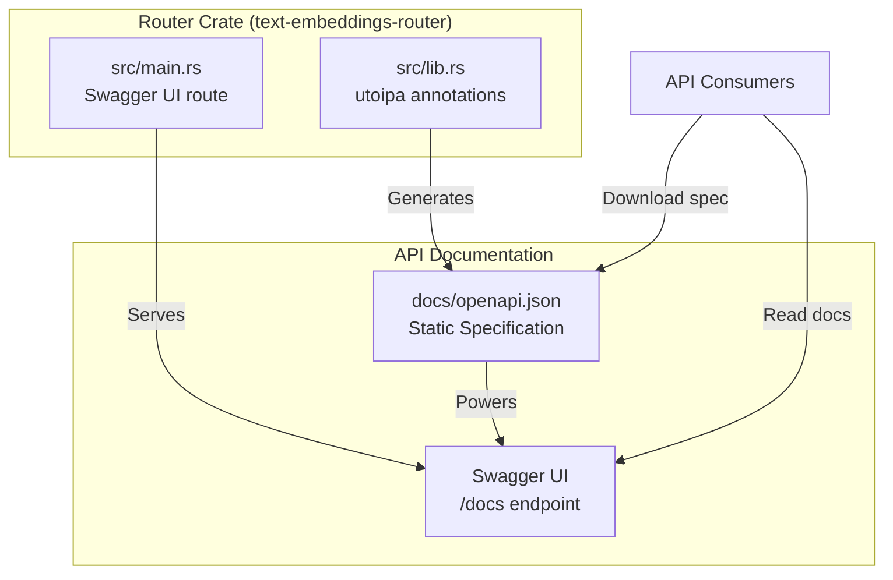
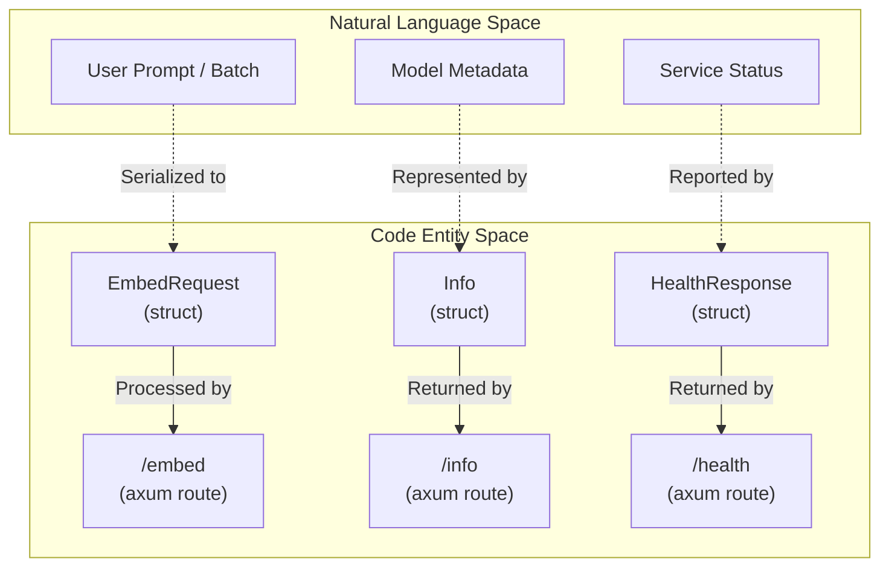
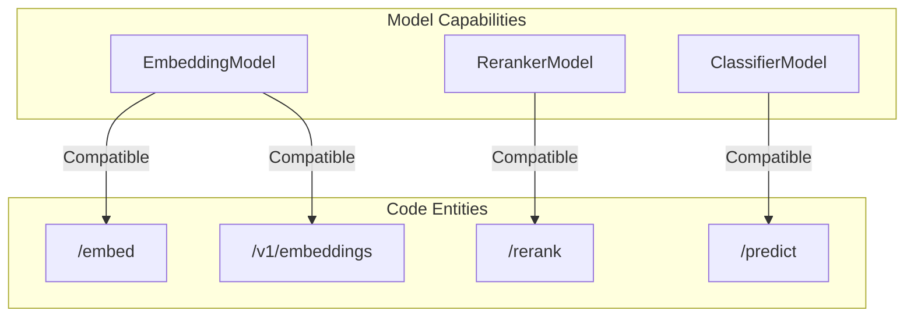

<!-- source: DeepWiki mcp.deepwiki.com · repo huggingface/text-embeddings-inference · page 6.3 OpenAPI Specification · fetched 2026-10-26 -->

# OpenAPI Specification

<details>
<summary>Relevant source files</summary>

The following files were used as context for generating this wiki page:

- [Cargo.lock](Cargo.lock)
- [Cargo.toml](Cargo.toml)
- [backends/Cargo.toml](backends/Cargo.toml)
- [backends/candle/Cargo.toml](backends/candle/Cargo.toml)
- [backends/src/dtype.rs](backends/src/dtype.rs)
- [core/Cargo.toml](core/Cargo.toml)
- [docs/openapi.json](docs/openapi.json)
- [router/Cargo.toml](router/Cargo.toml)

</details>


This page documents the OpenAPI specification provided by Text Embeddings Inference (TEI), which serves as the machine-readable API contract for all HTTP endpoints. For detailed information about individual API endpoints and their usage, see [HTTP API Endpoints](#6.1). For information about client libraries that consume this specification, see [Client Libraries and Examples](#6.4).

## Purpose and Scope

The OpenAPI specification is a formal, language-agnostic description of the Text Embeddings Inference HTTP API. It defines:

- All available HTTP endpoints and their operations.
- Request and response schemas with validation rules.
- Data types, formats, and constraints (e.g., `max_batch_tokens`).
- Error response structures and standard status codes.
- Model-specific information and metadata returned by the `/info` endpoint.

The specification enables automatic client generation, interactive API documentation via Swagger UI, and API contract validation. It follows the OpenAPI 3.0.3 standard.

## Implementation and Access

The TEI router utilizes the `utoipa` crate for generating OpenAPI schemas from Rust types and `utoipa-swagger-ui` for serving the interactive documentation.



**Accessing the Specification:**

The OpenAPI specification is available as a static file and via the running server:

| Access Method | Location | Use Case |
|--------------|----------|----------|
| Static JSON File | `docs/openapi.json` | Tooling and client generation |
| Swagger UI | `/docs` | Interactive API exploration |
| Raw JSON Endpoint | `/openapi.json` | Runtime access by dynamic clients |

Sources: [router/Cargo.toml:49-50](), [docs/openapi.json:1-15]()

## Document Structure

The OpenAPI document follows the standard OpenAPI 3.0.3 structure. The TEI implementation organizes the API into several functional groups.



Sources: [docs/openapi.json:15-940](), [docs/openapi.json:942-1899]()

### API Information

The specification header defines metadata about the API:

```json
{
  "openapi": "3.0.3",
  "info": {
    "title": "Text Embeddings Inference",
    "description": "Text Embedding Webserver",
    "version": "1.9.3"
  }
}
```

The version number `1.9.3` is synchronized across the workspace [Cargo.toml:25]() and the static specification [docs/openapi.json:13]().

## Schema Definitions

The specification defines 38 reusable schema components under `components.schemas`. These represent the data models used across all API endpoints.

### Input Schema Flexibility

The `Input` schema uses `oneOf` to handle various input formats, allowing the API to accept both raw text and pre-tokenized IDs.

```json
{
  "Input": {
    "oneOf": [
      { "$ref": "#/components/schemas/InputType" },
      { "type": "array", "items": { "$ref": "#/components/schemas/InputType" } }
    ]
  },
  "InputType": {
    "oneOf": [
      { "type": "string" },
      { "type": "array", "items": { "type": "integer", "format": "int32" } }
    ]
  }
}
```

This supports:
- Single string: `"Hello world"`
- Array of strings: `["Hello", "world"]`
- Single array of IDs: `[101, 202, 102]`
- Array of ID arrays: `[[101, 202], [101, 303]]`

Sources: [docs/openapi.json:1298-1347]()

### Error Response Structure

All endpoints use a consistent error response structure defined by the `ErrorResponse` and `ErrorType` schemas.

| Error Type | HTTP Status | Description |
|------------|-------------|-------------|
| `Unhealthy` | 503 | Backend service is not ready |
| `Backend` | 424 | Inference operation failed (e.g., CUDA error) |
| `Overloaded` | 429 | Queue is full or timeout reached |
| `Validation` | 413 | Request exceeds `max_batch_tokens` or `max_client_batch_size` |
| `Tokenizer` | 422 | Tokenization or decoding failed |
| `Empty` | 400 | Request contains no inputs |

Sources: [docs/openapi.json:1187-1211]()

## API Endpoints and Model Compatibility

The specification documents 12 paths. Compatibility is determined by the model type loaded at runtime (Embedding, Classifier, or Reranker).



### Endpoint Summary

| Endpoint | Primary Schema | Success Status |
|----------|----------------|----------------|
| `/embed` | `EmbedRequest` / `EmbedResponse` | 200 |
| `/rerank` | `RerankRequest` / `RerankResponse` | 200 |
| `/predict` | `PredictRequest` / `PredictResponse` | 200 |
| `/v1/embeddings` | `OpenAICompatRequest` / `OpenAICompatResponse` | 200 |
| `/info` | `Info` (Response) | 200 |

Sources: [docs/openapi.json:15-940](), [docs/openapi.json:1349-1384]()

## OpenAI Compatibility

TEI provides an OpenAI-compatible endpoint at `/v1/embeddings`. This allows users to swap TEI into existing OpenAI-based workflows by simply changing the `base_url`.

Key features of the OpenAI schema:
- **Request**: Uses `input` (string or array) and `model` (string).
- **Response**: Returns a `list` object containing `data` (embeddings) and `usage` (token counts).
- **Encoding**: Supports `encoding_format: "base64"` for efficient transfer of high-dimensional vectors.

Sources: [docs/openapi.json:1429-1510](), [docs/openapi.json:840-939]()

## Server Configuration and Info

The `/info` endpoint returns the runtime state of the server, which is crucial for clients to manage batching and truncation on their side.

```json
{
  "Info": {
    "properties": {
      "model_id": { "type": "string" },
      "model_dtype": { "type": "string" },
      "max_input_length": { "type": "integer" },
      "max_batch_tokens": { "type": "integer" },
      "auto_truncate": { "type": "boolean" }
    }
  }
}
```

The `model_dtype` field reflects the `DType` enum defined in the backend core, which varies based on hardware features like `mkl` or `cuda`.

Sources: [docs/openapi.json:1213-1296](), [backends/src/dtype.rs:8-19]()

## Specification Maintenance

The OpenAPI specification is synchronized with the codebase:
1. **Rust Types**: Data structures in the `router` and `core` crates are annotated with `utoipa` macros.
2. **Static Export**: The `docs/openapi.json` file is updated to reflect the current state of the API for each release (currently `1.9.3`).
3. **Feature Flags**: The `http` feature in `router/Cargo.toml` enables the OpenAPI and Swagger UI dependencies.

Sources: [router/Cargo.toml:83](), [Cargo.toml:25](), [docs/openapi.json:13]()

---

