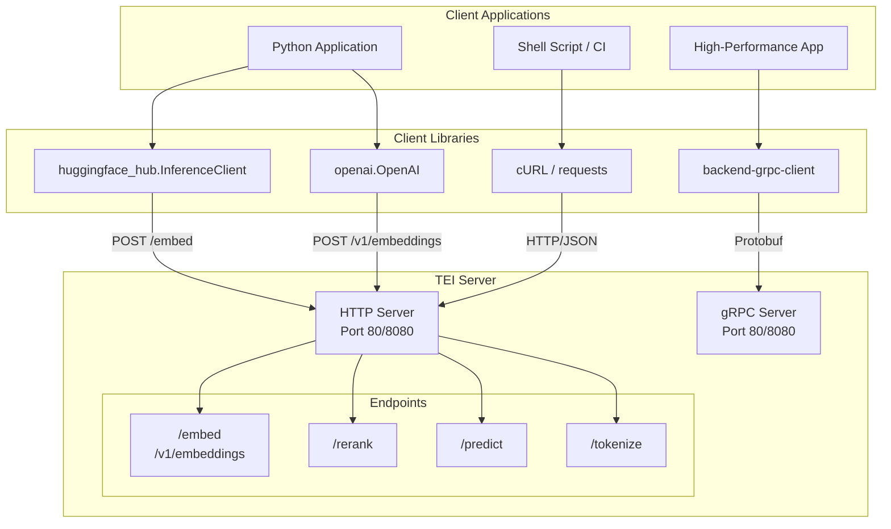
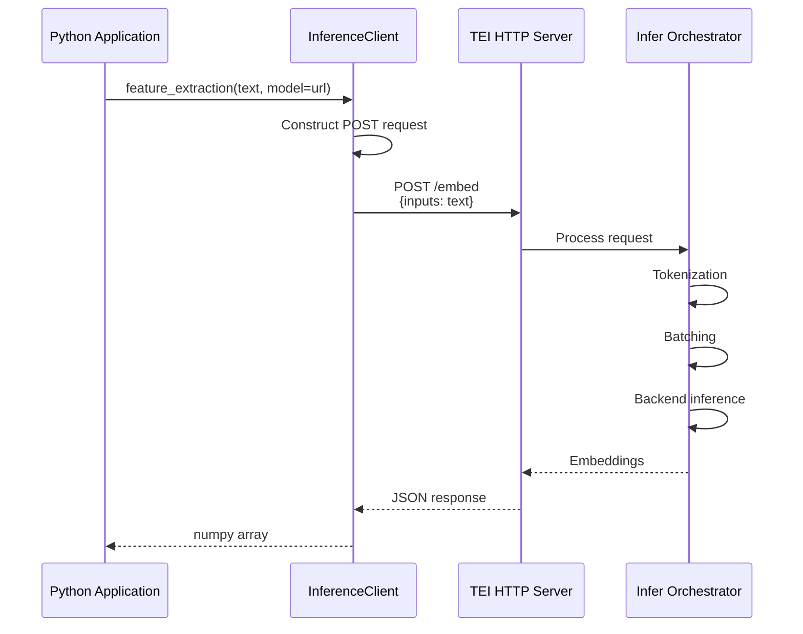
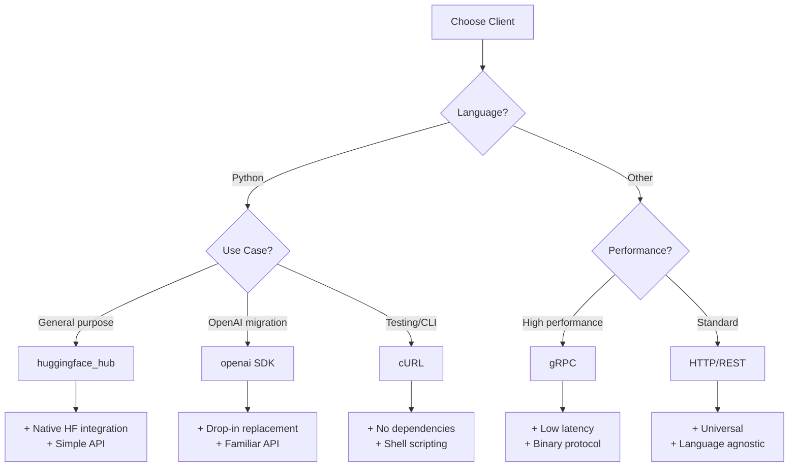

<!-- source: DeepWiki mcp.deepwiki.com · repo huggingface/text-embeddings-inference · page 6.4 Client Libraries and Examples · fetched 2026-10-26 -->

# Client Libraries and Examples

<details>
<summary>Relevant source files</summary>

The following files were used as context for generating this wiki page:

- [docs/source/en/custom_container.md](docs/source/en/custom_container.md)
- [docs/source/en/examples.md](docs/source/en/examples.md)
- [docs/source/en/private_models.md](docs/source/en/private_models.md)
- [docs/source/en/quick_tour.md](docs/source/en/quick_tour.md)
- [docs/source/en/supported_models.md](docs/source/en/supported_models.md)

</details>


This page demonstrates how to interact with Text Embeddings Inference (TEI) using various client libraries and tools. It provides practical code examples for common use cases including embeddings, reranking, and classification tasks.

For detailed information about the HTTP API endpoints and their parameters, see [HTTP API Endpoints](#6.1). For OpenAPI schema details, see [OpenAPI Specification](#6.3). For gRPC service definitions, see [gRPC API](#6.2).

## Overview

Text Embeddings Inference can be accessed through multiple client interfaces:

| Client Type | Use Case | Recommended For |
|-------------|----------|-----------------|
| **huggingface_hub SDK** | Python applications | Most Python users; native HF integration |
| **OpenAI SDK** | OpenAI-compatible clients | Drop-in replacement for OpenAI embeddings |
| **cURL / HTTP** | Testing, shell scripts | Quick testing, non-Python environments |
| **gRPC** | High-performance applications | Low-latency, streaming requirements |

## Client Architecture



**Sources**: [docs/source/en/quick_tour.md:48-106]()

## Python Client: huggingface_hub

The `huggingface_hub` library provides a native Python interface for Text Embeddings Inference through the `InferenceClient` class. This is the recommended approach for Python developers.

### Installation

```bash
pip install --upgrade huggingface_hub
```

### Basic Embedding Example

```python
from huggingface_hub import InferenceClient

client = InferenceClient()

# Single text embedding
embedding = client.feature_extraction(
    "What is deep learning?",
    model="http://localhost:8080/embed"
)
print(f"Embedding dimensions: {len(embedding[0])}")
```

### Batch Embeddings

```python
from huggingface_hub import InferenceClient

client = InferenceClient()

# Multiple texts in a batch
texts = ["Today is a nice day", "I like you"]

embeddings = client.feature_extraction(
    texts,
    model="http://localhost:8080/embed"
)
```

### Request Flow



**Sources**: [docs/source/en/quick_tour.md:65-77](), [docs/source/en/quick_tour.md:157-164]()

## Python Client: OpenAI SDK

Text Embeddings Inference provides an OpenAI-compatible endpoint at `/v1/embeddings`, allowing drop-in replacement for OpenAI's embedding API.

### Installation

```bash
pip install --upgrade openai
```

### Basic Usage

```python
import os
from openai import OpenAI

# Point to local TEI instance
client = OpenAI(
    base_url="http://localhost:8080/v1", 
    api_key="-" # Not used but required by SDK
)

response = client.embeddings.create(
    model="text-embeddings-inference",
    input="What is Deep Learning?",
)

print(response.data[0].embedding)
```

### OpenAI Compatibility Mapping

| OpenAI Parameter | TEI Support | Notes |
|------------------|-------------|-------|
| `input` | ✅ Yes | Supports string or list of strings |
| `model` | ✅ Yes | Value `text-embeddings-inference` is standard |
| `encoding_format`| ✅ Yes | Supports "float" |

**Sources**: [docs/source/en/quick_tour.md:79-94]()

## cURL and Direct HTTP

For testing, shell scripts, or non-Python environments, direct HTTP requests can be made using cURL.

### Embeddings Endpoint

```bash
curl 127.0.0.1:8080/embed \
    -X POST \
    -d '{"inputs":"What is Deep Learning?"}' \
    -H 'Content-Type: application/json'
```

### OpenAI-Compatible Endpoint

```bash
curl http://localhost:8080/v1/embeddings \
  -H "Content-Type: application/json" \
  -d '{
    "input": "What is Deep Learning?",
    "model": "text-embeddings-inference",
    "encoding_format": "float"
  }'
```

### Batch Requests

```bash
curl 127.0.0.1:8080/embed \
    -X POST \
    -d '{"inputs":["Today is a nice day", "I like you"]}' \
    -H 'Content-Type: application/json'
```

**Sources**: [docs/source/en/quick_tour.md:50-59](), [docs/source/en/quick_tour.md:96-105](), [docs/source/en/quick_tour.md:157-164]()

## Reranking Examples

Reranker models (cross-encoders) score the similarity between a query and a list of texts. They use the `/rerank` endpoint.

### cURL Example

```bash
curl 127.0.0.1:8080/rerank \
    -X POST \
    -d '{"query":"What is Deep Learning?", "texts": ["Deep Learning is not...", "Deep learning is..."], "raw_scores": false}' \
    -H 'Content-Type: application/json'
```

**Sources**: [docs/source/en/quick_tour.md:111-133]()

## Classification Examples

Sequence classification models predict labels or scores for input texts using the `/predict` endpoint.

### cURL Example

```bash
curl 127.0.0.1:8080/predict \
    -X POST \
    -d '{"inputs":"I like you."}' \
    -H 'Content-Type: application/json'
```

### Batch Classification

```bash
curl 127.0.0.1:8080/predict \
    -X POST \
    -d '{"inputs":[["I like you."], ["I hate pineapples"]]}' \
    -H 'Content-Type: application/json'
```

**Sources**: [docs/source/en/quick_tour.md:135-153](), [docs/source/en/quick_tour.md:166-173]()

## Private and Gated Models

When serving models that are private or gated on the Hugging Face Hub, you must provide an `HF_TOKEN`.

### Usage with Docker

```shell
model=<your private model>
token=<your read token>

docker run --gpus all -e HF_TOKEN=$token -p 8080:80 -v $volume:/data --pull always ghcr.io/huggingface/text-embeddings-inference:cuda-1.9 --model-id $model
```

**Sources**: [docs/source/en/private_models.md:17-41]()

## Client Selection Guide



**Sources**: [docs/source/en/quick_tour.md:46-106]()

---

