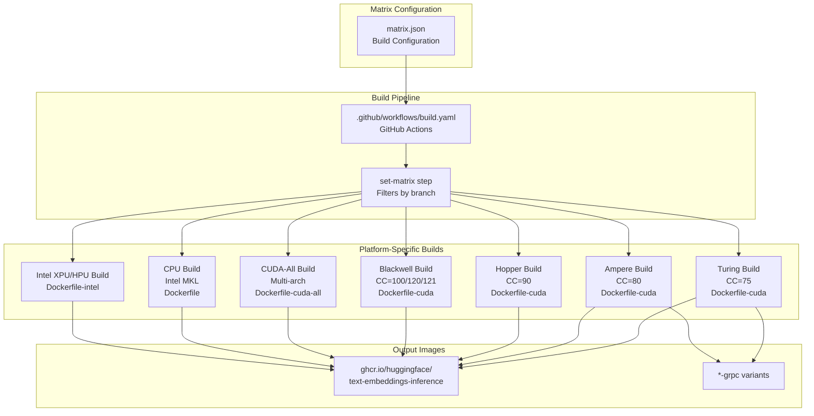
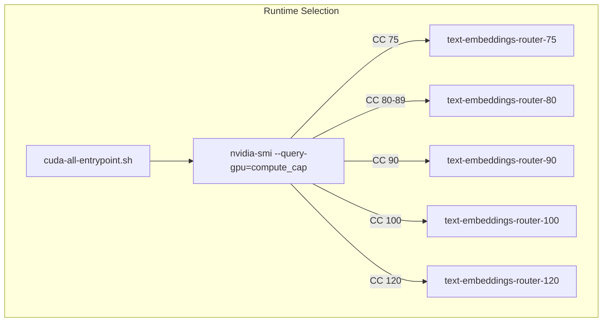

<!-- source: DeepWiki mcp.deepwiki.com · repo huggingface/text-embeddings-inference · page 7 Deployment and Operations · fetched 2026-10-26 -->

# Deployment and Operations

Relevant source files

The following files were used as context for generating this wiki page:

- [.github/workflows/build.yaml](.github/workflows/build.yaml)
- [.github/workflows/matrix.json](.github/workflows/matrix.json)
- [Dockerfile](Dockerfile)
- [Dockerfile-cuda](Dockerfile-cuda)
- [Dockerfile-cuda-all](Dockerfile-cuda-all)
- [backends/candle/src/compute_cap.rs](backends/candle/src/compute_cap.rs)
- [backends/candle/src/flash_attn.rs](backends/candle/src/flash_attn.rs)
- [cuda-all-entrypoint.sh](cuda-all-entrypoint.sh)
- [cuda-entrypoint.sh](cuda-entrypoint.sh)

This page covers production deployment strategies, multi-platform Docker image selection, cloud provider integration, performance tuning, and authentication for private models. For information about basic Docker deployment and initial setup, see [Getting Started](#2). For API endpoint usage, see [API Reference](#6). For performance optimization of the request processing pipeline itself, see [Request Processing Pipeline](#3.2).

## Overview

Text Embeddings Inference (TEI) is deployed primarily through pre-built Docker images optimized for specific hardware platforms. The system supports:

- **10+ hardware platforms**: NVIDIA GPUs (Turing through Blackwell), Intel CPUs (MKL/IPEX), Intel XPU, Habana HPU.
- **Air-gapped deployments**: Models cached in local volumes.
- **Cloud platforms**: AWS SageMaker, GCP, Azure with custom entrypoints.
- **Multiple serving modes**: HTTP-only or gRPC-only.

The deployment strategy uses a matrix-driven CI/CD pipeline that produces platform-specific binaries with optimized kernels for maximum performance.

**Sources**: [.github/workflows/matrix.json:1-128](), [.github/workflows/build.yaml:1-23]()

## Multi-Platform Docker Images

### Build Matrix Architecture

The build system uses a matrix-driven CI/CD pipeline defined in [.github/workflows/matrix.json:1-128]() that generates images for different hardware platforms. Each matrix entry specifies:

- `name`: Build identifier.
- `imageNamePrefix`: Docker tag prefix.
- `cudaComputeCap`: CUDA compute capability (75, 80, 86, 89, 90, 100, 120, 121).
- `dockerfile`: Platform-specific Dockerfile (e.g., `Dockerfile-cuda`, `Dockerfile-intel`, `Dockerfile-arm64`).
- `grpc`: Whether to build the gRPC variant.
- `extraBuildArgs`: Platform-specific build arguments like `DEFAULT_USE_FLASH_ATTENTION`.

**Diagram**: Docker Image Build Matrix - Shows how matrix.json configuration drives platform-specific builds.

The build workflow [.github/workflows/build.yaml:33-41]() filters the matrix based on branch name, allowing selective builds during development.

**Sources**: [.github/workflows/matrix.json:1-128](), [.github/workflows/build.yaml:33-41]()

### Choosing the Right Image

Selection depends on hardware architecture and required features. The `imageNamePrefix` in the matrix determines the tag:

| Hardware | Compute Capability | Docker Image Tag Prefix | Flash Attention |
|----------|-------------------|------------------|-----------------|
| CPU (Intel MKL) | N/A | `cpu-` | No |
| CPU (ARM64) | N/A | `cpu-arm64-` | No |
| Intel XPU | N/A | `xpu-ipex-` | No |
| Habana HPU | N/A | `hpu-` | No |
| NVIDIA T4 | 75 (Turing) | `turing-` | v1 (Disabled by default) |
| NVIDIA A100 | 80 (Ampere) | (None/Latest) | v2 |
| NVIDIA H100 | 90 (Hopper) | `hopper-` | v2 |
| NVIDIA Blackwell | 100/120 | `100-` / `120-` | v2 |
| NVIDIA Multi-arch | 75-120 | `cuda-` | Runtime detection |

**Sources**: [.github/workflows/matrix.json:1-128](), [Dockerfile-cuda:140-144]()

### CUDA Multi-Architecture Image

The `cuda-all` variant [Dockerfile-cuda-all:1-138]() contains separate binaries compiled for different compute capabilities. The entrypoint script `cuda-all-entrypoint.sh` detects runtime GPU compute capability via `nvidia-smi` and selects the appropriate binary [cuda-all-entrypoint.sh:29-44]().

**Diagram**: CUDA-All Multi-Architecture Binary Selection.

The compute capability matching logic [backends/candle/src/compute_cap.rs:26-38]() ensures binary compatibility:
- CC 75 requires an exact match (Turing-specific Flash Attention v1).
- CC 80-89 can use the CC 80 binary (Ampere Flash Attention v2).
- CC 120-121 can use the CC 120 binary.

**Sources**: [cuda-all-entrypoint.sh:29-44](), [backends/candle/src/compute_cap.rs:26-38](), [Dockerfile-cuda-all:128-132]()

### Docker Build Process

All Dockerfiles follow a multi-stage pattern using `cargo-chef` for dependency caching [Dockerfile:1-19]().

Key optimizations:
1. **sccache**: Uses GitHub Actions cache for distributed compilation [.github/workflows/build.yaml:70-76]().
2. **nvprune**: Reduces binary size by pruning static CUDA libraries for specific compute capabilities [Dockerfile-cuda:59-79]().
3. **Intel MKL Patch**: CPU images include `libfakeintel.so` and `LD_PRELOAD` to bypass Intel-only checks in MKL [Dockerfile:39-40, 80]().

**Sources**: [Dockerfile:1-115](), [Dockerfile-cuda:59-79](), [.github/workflows/build.yaml:70-76]()

## Cloud and SageMaker Deployment

### Amazon SageMaker

TEI provides SageMaker-compatible entrypoints. These scripts handle the `cuda-compat` layer for older host drivers [cuda-entrypoint.sh:12-27]().

**Key Configuration**:
- **HF_MODEL_ID**: The model to load.
- **LD_LIBRARY_PATH**: Includes `/usr/local/cuda/compat` if the host driver version is lower than the container's CUDA version [cuda-entrypoint.sh:25]().

**Sources**: [cuda-entrypoint.sh:8-27](), [Dockerfile-cuda:154]()

## Performance Tuning

### Flash Attention Configuration

Flash Attention selection [backends/candle/src/flash_attn.rs:37-115]() is automated based on runtime compute capability:
- **CC 75**: Dispatched to `candle_flash_attn_v1` [backends/candle/src/flash_attn.rs:47-61]().
- **CC 80+**: Dispatched to `candle_flash_attn` with support for alibi and windowed attention [backends/candle/src/flash_attn.rs:70-109]().

**Sources**: [backends/candle/src/flash_attn.rs:37-115]()

### Environment Variables

| Variable | Default | Purpose |
|----------|---------|---------|
| `HUGGINGFACE_HUB_CACHE` | `/data` | Model cache directory [Dockerfile:76](). |
| `PORT` | `80` | HTTP/gRPC server port [Dockerfile:77](). |
| `RAYON_NUM_THREADS` | `8` | CPU parallelism for tokenization/pooling [Dockerfile:79](). |
| `USE_FLASH_ATTENTION` | `True` | Global toggle for hardware acceleration [Dockerfile-cuda:144](). |
| `MKL_ENABLE_INSTRUCTIONS` | `AVX512_E4` | CPU instruction set optimization [Dockerfile:78](). |

**Sources**: [Dockerfile:76-81](), [Dockerfile-cuda:142-145]()

## Private Models and Authentication

### Hugging Face Hub Authentication

To serve private or gated models, the `HF_TOKEN` environment variable must be provided. The container uses this token to authenticate with the Hugging Face Hub during the model download phase.

**Volume Mounting**:
It is recommended to mount a host directory to `/data` to persist models across container restarts [Dockerfile:76]().

**Sources**: [Dockerfile:76](), [Dockerfile-cuda:142]()

---

