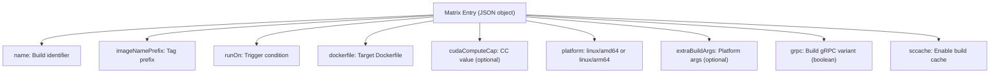
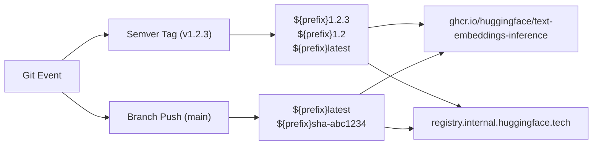
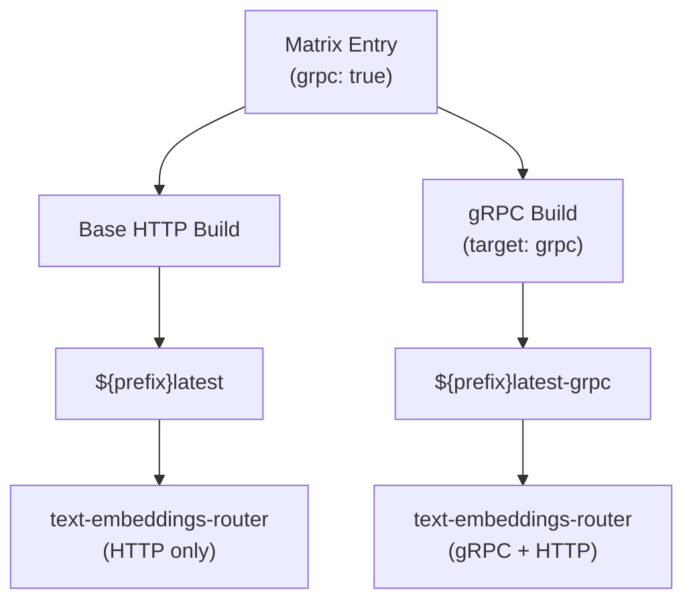
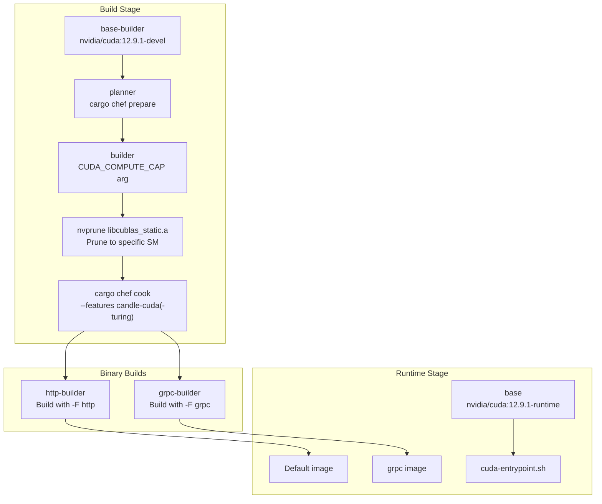
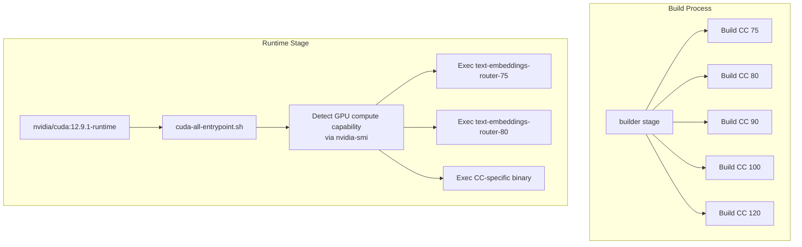
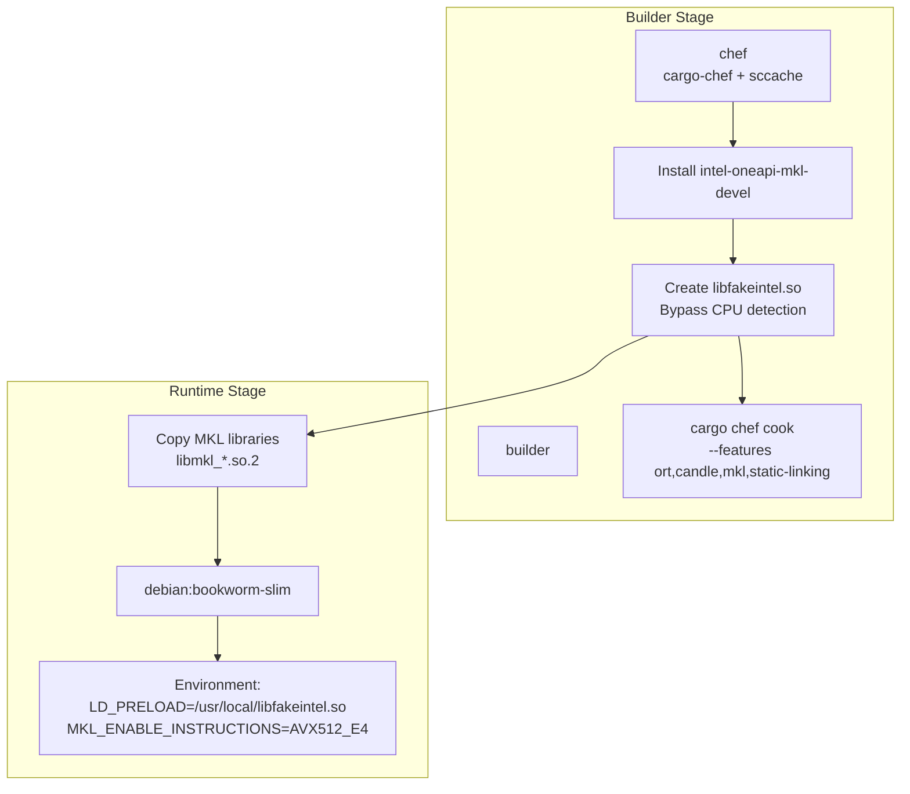
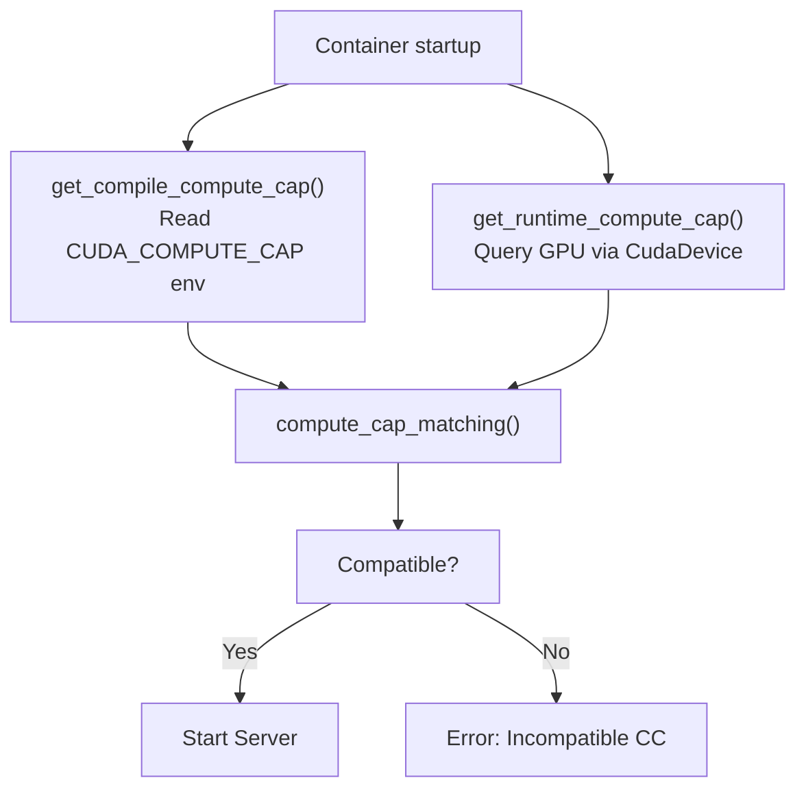

<!-- source: DeepWiki mcp.deepwiki.com · repo huggingface/text-embeddings-inference · page 7.1 Multi-Platform Docker Images · fetched 2026-10-26 -->

# Multi-Platform Docker Images

Relevant source files

The following files were used as context for generating this wiki page:

- [.github/workflows/build.yaml](.github/workflows/build.yaml)
- [.github/workflows/matrix.json](.github/workflows/matrix.json)
- [Dockerfile](Dockerfile)
- [Dockerfile-arm64](Dockerfile-arm64)
- [Dockerfile-cuda](Dockerfile-cuda)
- [Dockerfile-cuda-all](Dockerfile-cuda-all)
- [backends/candle/src/compute_cap.rs](backends/candle/src/compute_cap.rs)
- [backends/candle/src/flash_attn.rs](backends/candle/src/flash_attn.rs)
- [cuda-all-entrypoint.sh](cuda-all-entrypoint.sh)
- [cuda-entrypoint.sh](cuda-entrypoint.sh)

This document explains the comprehensive multi-platform Docker image build system in TEI, including the build matrix configuration, image naming conventions, and how to select the appropriate image for your hardware platform. The system supports 10+ different hardware configurations through platform-specific optimizations.

For deployment instructions and usage examples, see [Docker Deployment](#2.1). For details on runtime GPU detection and compute capability matching, see [CUDA Compute Capability System](#5.1). For cloud-specific deployment patterns, see [Cloud and SageMaker Deployment](#7.2).

## Build Matrix Overview

TEI uses a JSON-based build matrix to generate platform-specific Docker images through GitHub Actions. The matrix is defined in [.github/workflows/matrix.json:1-128]() and consumed by the CI/CD workflow in [.github/workflows/build.yaml:1-184]().

### Matrix Configuration Structure

Each entry in the build matrix specifies the target architecture, compute capabilities, and build-time features:

**Sources:** [.github/workflows/matrix.json:1-128](), [.github/workflows/build.yaml:24-40]()

### Supported Platform Matrix

| Platform | Image Prefix | Dockerfile | Compute Cap | Arch | Key Features |
|----------|-------------|------------|-------------|------|--------------|
| **NVIDIA Turing** | `turing-` | `Dockerfile-cuda` | 75 | x86_64 | Flash Attention v1, T4/RTX 2000 |
| **NVIDIA Ampere** | (default) | `Dockerfile-cuda` | 80 | x86_64 | Flash Attention v2, A100/RTX 3000 |
| **NVIDIA A10** | `86-` | `Dockerfile-cuda` | 86 | x86_64 | Flash Attention v2, A10 optimized |
| **NVIDIA Ada** | `89-` | `Dockerfile-cuda` | 89 | x86_64 | Flash Attention v2, RTX 4000 |
| **NVIDIA Hopper** | `hopper-` | `Dockerfile-cuda` | 90 | x86_64 | Flash Attention v2, H100 |
| **NVIDIA Blackwell** | `100-` / `120-` | `Dockerfile-cuda` | 100/120 | x86_64 | B100/B200 support |
| **NVIDIA Blackwell ARM** | `121-` | `Dockerfile-cuda` | 121 | arm64 | Grace Blackwell support |
| **CUDA-All** | `cuda-` | `Dockerfile-cuda-all` | 75-120 | x86_64 | Multi-arch with runtime selection |
| **CPU** | `cpu-` | `Dockerfile` | N/A | x86_64 | Intel MKL, Candle+ORT backends |
| **CPU ARM64** | `cpu-arm64-` | `Dockerfile-arm64` | N/A | arm64 | AWS Graviton / Apple Silicon |
| **Intel CPU IPEX** | `cpu-ipex-` | `Dockerfile-intel` | N/A | x86_64 | Intel Extension for PyTorch |
| **Intel XPU** | `xpu-ipex-` | `Dockerfile-intel` | N/A | x86_64 | Intel integrated/discrete GPUs |
| **Habana HPU** | `hpu-` | `Dockerfile-intel` | N/A | x86_64 | Gaudi accelerators |

**Sources:** [.github/workflows/matrix.json:1-128]()

## Image Naming and Tagging Strategy

### Tag Generation

The [docker/metadata-action](https://github.com/docker/metadata-action) generates image tags based on git events and matrix prefixes [.github/workflows/build.yaml:105-119]():

**Example tags for Turing build (`imageNamePrefix: "turing-"`):**
- `ghcr.io/huggingface/text-embeddings-inference:turing-1.5.0`
- `ghcr.io/huggingface/text-embeddings-inference:turing-latest`

**Sources:** [.github/workflows/build.yaml:105-119](), [.github/workflows/matrix.json:4]()

### gRPC Variant Images

When `grpc: true` is set in the matrix, a second image is built with the `-grpc` suffix using the `grpc` target in the Dockerfile [.github/workflows/build.yaml:144-184]():

The gRPC variant includes both HTTP and gRPC servers, while the base variant is HTTP-only.

**Sources:** [.github/workflows/build.yaml:144-184](), [Dockerfile-cuda:156-168]()

## Platform-Specific Dockerfiles

### NVIDIA CUDA Images (Single Compute Capability)

The [Dockerfile-cuda:1-168]() builds optimized binaries for a specific compute capability using `nvprune` to minimize binary size:

**Key optimizations:**
- `nvprune` reduces `libcublas_static.a` size by removing unused compute capabilities [Dockerfile-cuda:57-79]().
- Feature flags select Flash Attention version: `candle-cuda-turing` for CC 75, `candle-cuda` for CC 80+ [Dockerfile-cuda:85-90]().
- Static linking (`-F static-linking`) is used to minimize runtime dependencies [Dockerfile-cuda:104-106]().

**Sources:** [Dockerfile-cuda:1-168](), [cuda-entrypoint.sh:1-30]()

### CUDA-All Multi-Architecture Image

The [Dockerfile-cuda-all:1-138]() builds five separate binaries for different compute capabilities and uses a runtime entrypoint to select the appropriate one:

The entrypoint script (`cuda-all-entrypoint.sh`) performs runtime GPU detection and executes the matching binary [cuda-all-entrypoint.sh:29-44]().

**Trade-offs:**
- **Pros:** Single image for all NVIDIA GPUs, simplified deployment.
- **Cons:** Significantly larger image size, no gRPC variant in the all-in-one image [.github/workflows/matrix.json:81]().

**Sources:** [Dockerfile-cuda-all:1-138](), [cuda-all-entrypoint.sh:1-45]()

### CPU Image with Intel MKL

The [Dockerfile:1-115]() provides CPU-only inference with Intel MKL optimizations and a bypass for AMD CPUs:

**MKL CPU detection bypass:**
The `libfakeintel.so` library [Dockerfile:39-40]() contains a stub function `mkl_serv_intel_cpu_true()` that tricks MKL into enabling optimizations on non-Intel CPUs. This is loaded via `LD_PRELOAD` [Dockerfile:80]().

**Sources:** [Dockerfile:1-115](), [Dockerfile:39-40]()

### ARM64 CPU Image

The [Dockerfile-arm64:1-88]() provides native ARM64 support for architectures like AWS Graviton:

- Uses `aarch64-unknown-linux-musl` variant of `sccache` [Dockerfile-arm64:8]().
- Compiles with `ort` and `candle` features [Dockerfile-arm64:33]().
- Downloads ARM64 specific `protoc` for gRPC support [Dockerfile-arm64:49-53]().

**Sources:** [Dockerfile-arm64:1-88](), [.github/workflows/matrix.json:93-100]()

## Choosing the Right Image

### Performance and Compatibility Matrix

| Image Prefix | Best For | Architecture | Flash Attention |
|--------------|----------|--------------|-----------------|
| `turing-` | T4, RTX 2000 | x86_64 | v1 |
| (none) | A100, RTX 3000 | x86_64 | v2 |
| `89-` | L4, RTX 4000 | x86_64 | v2 |
| `hopper-` | H100 | x86_64 | v2 |
| `120-` | Blackwell B200 | x86_64 | v2 |
| `121-` | Grace Blackwell | arm64 | v2 |
| `cpu-` | General CPU | x86_64 | N/A |
| `cpu-arm64-` | Graviton, M1/M2 | arm64 | N/A |

**Sources:** [.github/workflows/matrix.json:1-128](), [backends/candle/src/flash_attn.rs:37-120]()

## Runtime Compute Capability Matching

When using CUDA-based images, TEI validates GPU compatibility at startup using `compatible_compute_cap()` [backends/candle/src/compute_cap.rs:40-47]():

**Matching logic** [backends/candle/src/compute_cap.rs:26-38]():
- CC 75 requires CC 75.
- CC 80 supports runtime CC 80 through 89.
- CC 120 supports runtime CC 120 and 121.

This ensures that kernels optimized for a specific architecture (like Flash Attention) are only executed on compatible hardware.

**Sources:** [backends/candle/src/compute_cap.rs:1-47](), [backends/candle/src/flash_attn.rs:37-120]()

## Build Process and Caching

### sccache and cargo-chef

To keep build times manageable across the matrix, TEI uses a two-pronged caching strategy:

1. **cargo-chef:** Caches the compilation of dependencies (`cargo chef cook`) so that source code changes only trigger a rebuild of the application layer [Dockerfile:19-46]().
2. **sccache:** Caches individual object files in an S3 bucket [.github/workflows/build.yaml:141-142](). This is particularly effective for heavy CUDA kernel compilation.

**Sources:** [.github/workflows/build.yaml:70-76](), [Dockerfile:4-10](), [Dockerfile-cuda:3-23]()

---

