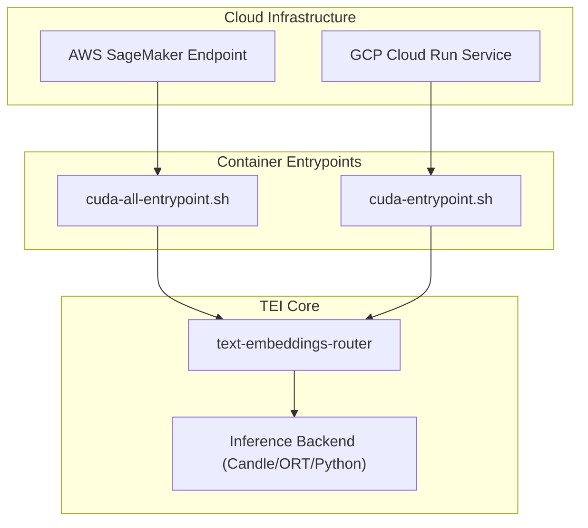
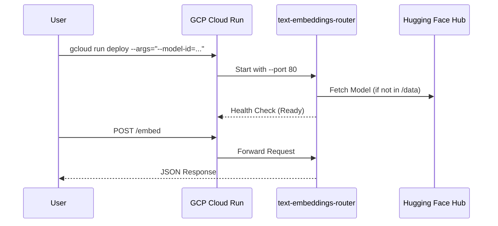

<!-- source: DeepWiki mcp.deepwiki.com · repo huggingface/text-embeddings-inference · page 7.2 Cloud and SageMaker Deployment · fetched 2026-10-26 -->

# Cloud and SageMaker Deployment

<details>
<summary>Relevant source files</summary>

The following files were used as context for generating this wiki page:

- [Dockerfile](Dockerfile)
- [Dockerfile-cuda](Dockerfile-cuda)
- [Dockerfile-cuda-all](Dockerfile-cuda-all)
- [cuda-all-entrypoint.sh](cuda-all-entrypoint.sh)
- [cuda-entrypoint.sh](cuda-entrypoint.sh)
- [docs/source/en/custom_container.md](docs/source/en/custom_container.md)
- [docs/source/en/private_models.md](docs/source/en/private_models.md)
- [docs/source/en/quick_tour.md](docs/source/en/quick_tour.md)
- [docs/source/en/supported_models.md](docs/source/en/supported_models.md)
- [docs/source/en/tei_cloud_run.md](docs/source/en/tei_cloud_run.md)

</details>


This page provides technical details on deploying Text Embeddings Inference (TEI) to managed cloud platforms, specifically focusing on AWS SageMaker and Google Cloud Run. It covers the specialized entrypoint scripts, CUDA compatibility layers, and configuration required for production-grade cloud environments.

## Overview

Cloud deployment of TEI leverages containerized builds that are optimized for specific hardware targets. The system uses specialized entrypoint scripts to bridge the gap between cloud-specific environment variables and the `text-embeddings-router` CLI arguments.


Sources: [cuda-entrypoint.sh:29-29](), [cuda-all-entrypoint.sh:31-44](), [Dockerfile-cuda:154-167]()

## CUDA Compatibility and Entrypoints

In cloud environments where host drivers may be older than the container's CUDA version, TEI employs a compatibility layer. The entrypoint scripts check the host's CUDA version via `nvidia-smi` and conditionally inject `cuda-compat` into the library path.

### CUDA Version Check Logic
The script calculates an integer representation of the driver version to compare against the target version (12.9.1).
- **Logic**: `DRIVER_INT = (MAJ * 10000) + (MIN * 100) + PATCH` [cuda-entrypoint.sh:21-22]()
- **Action**: If `DRIVER_INT < 120901`, it exports `LD_LIBRARY_PATH="/usr/local/cuda/compat:${LD_LIBRARY_PATH}"` [cuda-entrypoint.sh:24-26]().

### Hardware-Specific Binary Dispatch
For the "all-in-one" CUDA images (e.g., used in SageMaker), the `cuda-all-entrypoint.sh` script detects the GPU's Compute Capability at runtime and executes the matching optimized binary:

| Compute Capability | Target Architecture | Binary Executed |
|--------------------|---------------------|-----------------|
| 75 | Turing (T4) | `text-embeddings-router-75` |
| 80-89 | Ampere (A100, A10) | `text-embeddings-router-80` |
| 90 | Hopper (H100) | `text-embeddings-router-90` |
| 100 | Blackwell (B200) | `text-embeddings-router-100` |
| 120 | Blackwell (RTX 5090) | `text-embeddings-router-120` |

Sources: [cuda-all-entrypoint.sh:29-44](), [Dockerfile-cuda-all:128-132](), [docs/source/en/custom_container.md:30-36]()

## Google Cloud Run Deployment

GCP Cloud Run provides a serverless environment for TEI. While traditionally CPU-only, it now supports NVIDIA L4 GPUs in specific regions [docs/source/en/tei_cloud_run.md:30-31]().

### Data Flow: Cloud Run to TEI

Sources: [docs/source/en/tei_cloud_run.md:98-112](), [Dockerfile:77-81]()

### Key Configuration Parameters
When deploying via `gcloud run deploy`, the following flags are critical for TEI performance:
- `--no-cpu-throttling`: Required for consistent inference latency [docs/source/en/tei_cloud_run.md:80]().
- `--gpu 1 --gpu-type nvidia-l4`: Enables hardware acceleration [docs/source/en/tei_cloud_run.md:81]().
- `--memory 16Gi`: Minimum recommended for GPU workloads [docs/source/en/tei_cloud_run.md:79]().

## AWS SageMaker Integration

SageMaker deployment typically utilizes the `Dockerfile-cuda-all` build which contains multiple binaries compiled for different `CUDA_COMPUTE_CAP` targets [Dockerfile-cuda-all:84-110]().

### SageMaker Container Structure
The SageMaker-compatible images include:
1. **Multiple Binaries**: Pre-compiled versions of `text-embeddings-router` for SM75, SM80, SM90, etc. [Dockerfile-cuda-all:128-132]().
2. **Entrypoint Script**: `entrypoint.sh` (mapped from `cuda-all-entrypoint.sh`) which handles the routing to the correct binary [Dockerfile-cuda-all:134-136]().

### Private Model Support
For models behind gated access, the `HF_TOKEN` environment variable must be passed to the container [docs/source/en/private_models.md:40-41](). This is handled by the cloud provider's secret management or environment variable configuration.

## Custom Container Builds

For specific hardware or air-gapped environments, users can build custom images using the provided Dockerfiles.

### Build Arguments
- `CUDA_COMPUTE_CAP`: Defines the target GPU architecture during compilation (e.g., `80` for A100) [Dockerfile-cuda:43-43]().
- `FEATURES`: Rust feature flags such as `candle-cuda`, `mkl`, or `ort` [Dockerfile:46-46]().

```bash
# Example build for A100 (Compute Cap 80)
docker build . -f Dockerfile-cuda --build-arg CUDA_COMPUTE_CAP=80
```
Sources: [docs/source/en/custom_container.md:45-47](), [Dockerfile-cuda:85-90]()

## Summary of Cloud-Specific Variables

| Variable | Description | Default |
|----------|-------------|---------|
| `PORT` | The port the router listens on | `80` [Dockerfile-cuda:143]() |
| `HUGGINGFACE_HUB_CACHE` | Location for downloaded model weights | `/data` [Dockerfile-cuda:142]() |
| `USE_FLASH_ATTENTION` | Toggle for Flash Attention kernels | `True` [Dockerfile-cuda:144]() |
| `LD_LIBRARY_PATH` | Path for CUDA and MKL shared objects | Includes `/usr/local/cuda/lib64` [Dockerfile-cuda:145]() |
| `MKL_ENABLE_INSTRUCTIONS` | CPU optimization level for Intel | `AVX512_E4` [Dockerfile:78]() |

Sources: [Dockerfile-cuda:142-145](), [Dockerfile:76-81]()

---

